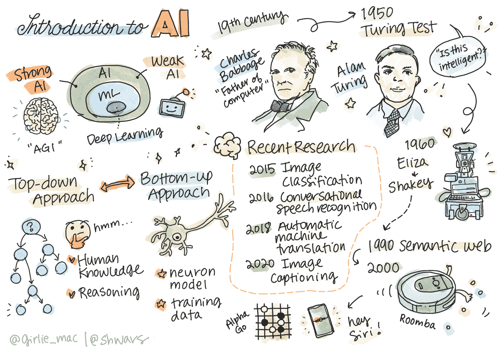
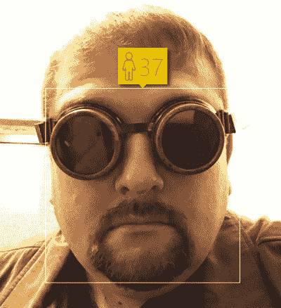
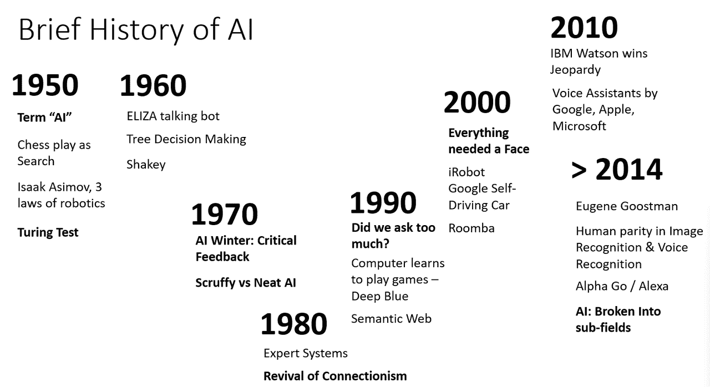
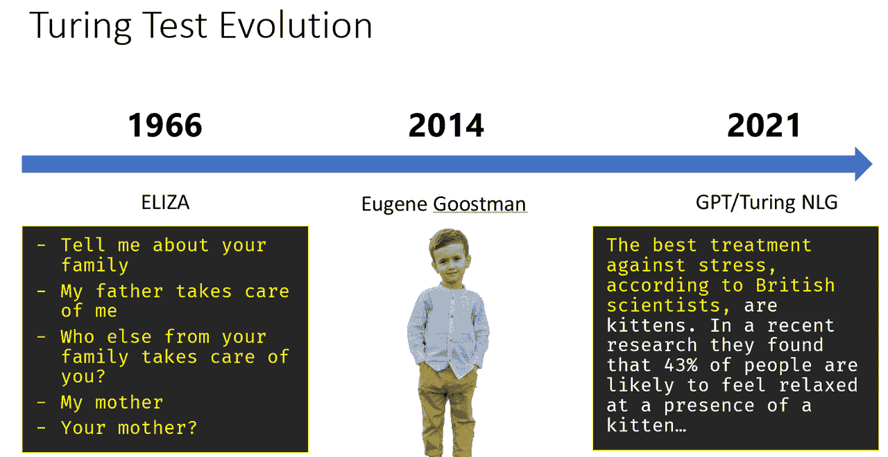
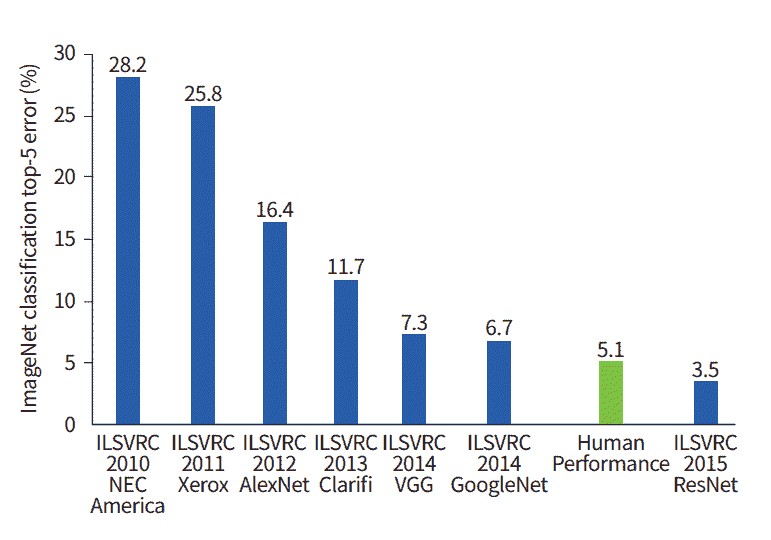

# 人工智能简介和历史

> 来源：[https://waytoagi.feishu.cn/docx/YqPEdYrxVoq6XdxcGrHcyn5tnQe](https://waytoagi.feishu.cn/docx/YqPEdYrxVoq6XdxcGrHcyn5tnQe)

> 译者：Miranda，原文见 https://microsoft.github.io/AI-For-Beginners/lessons/1-Intro/README.md

# [课前测试](https://red-field-0a6ddfd03.1.azurestaticapps.net/quiz/101)

---

人工智能（Artificial Intelligence）是一门令人兴奋的科学，它研究我们如何使计算机表现出智能行为，例如做一些人类所擅长的事情。

最初，查尔斯·巴贝奇（Charles Babbage）发明了计算机，用于按照一套明确定义的程序（即算法）来对数字进行运算。现代计算机虽然比 19 世纪提出的原始计算机模型要先进得多，但仍然遵循着相同的受控计算理念。因此，如果我们知道实现某些目标所需的每一个步骤及其顺序，就有可能编写出程序，使计算机按照我们的想法去做这些事。

> ✅ “根据照片判断一个人的年龄”是一件无法明确编程的任务，因为我们并不知道当我们在做这件事时，是如何经过某些清晰的步骤，从而在脑海中得到一个数字的。

---

然而，对于有些任务，我们并不能知道明确的解法。例如从一个人的照片中来判断他/她的年龄。我们之所以能做这件事，是因为我们见过了很多不同年龄的人，但我们无法明确自己的大脑具体是通过哪些步骤来完成这项任务的，所以也无法编写明确的程序让计算机来完成。这种类型的任务正是人工智能（简称AI）感兴趣的。

✅ 想一想，如果人工智能得以实现，哪些任务可以被交给计算机完成？考虑金融、医学和艺术领域，这些领域如今是如何从人工智能中受益的？

# 弱人工智能（Weak AI） vs. 强人工智能（Strong AI）

---

| 弱人工智能 | 强人工智能 |
| --- | --- |
| 弱人工智能指的是针对特定任务或范围较小的任务来设计和训练的 AI 系统。 | 强人工智能，或通用人工智能（AGI），是指具有人类水平的智能和理解能力的 AI 系统。 |
| 这些 AI 系统不是通用智能的；它们只擅长执行提前定义好的任务，但缺乏真正的理解和意识。 | 这些 AI 系统有能力完成任何人类可以完成的智力任务，适用于不同的领域，同时拥有某种形式的意识或自我意识。 |
| 弱人工智能的例子包括 Siri 或 Alexa 等虚拟助手，流媒体服务所使用的推荐算法，以及为特定客服任务所设计的对话机器人。 | 实现强人工智能是人工智能研究的长期目标，这需要我们开发出在各种任务和环境中都能够进行推理、学习、理解和适应的 AI 系统。 |
| 弱人工智能是高度专业化的，它不具备像人类一样的认知能力，也无法超出为它设定的小范围领域来解决一般问题。 | 强人工智能目前还只是一个理论概念，还没有任何 AI 系统能达到这种通用智能水平。 |

更多信息请见[通用人工智能](https://en.wikipedia.org/wiki/Artificial_general_intelligence)（AGI）。

# “智能”的定义与图灵测试

---

当我们谈到“智能”这个概念的时候，一大问题是它没有明确的定义。有人说“智能”与抽象思维或自我意识有关，但我们依然无法恰当地定义它。

想要了解“智能”一词的模糊性，可以尝试去回答一个问题：“猫是有智力的吗？”不同的人往往会给出不同的答案，因为并没有一个国际公认的测试来证明这一说法的真假。如果你认为有这样的测试，那就试试让你的猫去做个智商测试吧……

✅ 想一想你是如何定义“智能”的。一只能解开迷宫并获得食物的乌鸦是有智力的吗？人类的小孩是有智力的吗？

---

当谈到通用人工智能（AGI）时，我们需要一些方法[来判断我们](https://en.wikipedia.org/wiki/Alan_Turing)是否创造了一个真[正的智能](https://en.wikipedia.org/wiki/Turing_test)系统。阿兰·图灵提出了一种名为“图灵测试”（Turing Test）的方法，该方法目前也被用作“智能”的定义。图灵测试将某一计算机系统和真人进行比较，由于任何自动的检测方法都有可能被计算机系统绕开，图灵测试使用人类评审员来判断结果。如果这位人类评审员在文本对话中无法区分真人和计算机系统，那么这个计算机系统就会被认为是“智能”的。

> [2014年，一款在圣彼得堡开发](https://en.wikipedia.org/wiki/Eugene_Goostman)的名叫“尤金·古斯特曼（Eugene Goostman）”的聊天机器人，使用一些技巧通过了图灵测试。它事先声称自己是一个13岁的乌克兰男孩，这解释了它在回答人类评审员问题时为什么会出现知识缺乏和文字习惯差异。这款机器人在长达5分钟的对话中让超过30%的人类评审员认为它是一个真人，而图灵在此前认为人类在2000年就能使机器人达到这个测试指标。不过我们应该认识到，这个事件并不能说明我们已经创造出了一个真正的智能系统，也不能说明计算机系统骗过了人类评审员——不是系统骗过了人类，而是机器人的创造者骗过了人类！

✅ 你有没有被聊天机器人骗过，以为自己是在和真人说话？它是怎样骗过你的？

# 实现人工智能的不同方法

---

如果我们希望让一台计算机表现得像人类一样，需要在计算机内模拟人类的思维方式。因此，我们需要理解是什么造就了人类的“智能”。

> 我们必须理解自己的决策过程是如何进行的，才能够为机器编写智能程序。如果你稍微做一下自我觉察，就会发现有些过程是下意识发生的，例如我们可以不假思索地区分出猫和狗，而有些过程则需要推理。

解决这个问题有两种可能的方法：

| 自上而下的方法（符号推理） | 自下而上的方法（神经网络） |
| --- | --- |
| 自上而下的方法模拟人类通过推理来解决问题的方式。它包括对人类知识的提炼，并用计算机可读的形式来表示，此外还需要开发一种在计算机内部模拟推理的方法。 | 自下而上的方法模拟人脑的结构，由大量称为神经元的简单单元组成。每个神经元的行为取决于输入数据的加权平均值，我们可以提供训练数据来训练神经元网络，从而解决有用的问题。 |

还有一些其他可能实现智能的方法：

+   新兴的、依靠协同的多智能体系统（multi-agent），它基于这样一个事实，即复杂的智能行为可以来自大量简单智能系统的相互作用。根据进化控制论，在元系统跃迁的过程中，智能可以从更简单的反应行为中产生。

+   进化方法或遗传算法（genetic algorithm），是一种基于进化原理的优化过程。

> [1] 译者注：元系统跃迁，Metasystem Transition，是指通过演化涌现出更高层次的组织或者控制。

我们将在课程的后续部分考虑这些方法，但现在我们将重点关注自上而下、自下而上两个主要方向。

## 自上而下的方法

在自上而下的方法中，我们尝试对推理过程进行建模。由于我们在推理时可以知道自己的思考步骤，因此我们可以尝试将这一过程形式化，并转化为计算机程序。这就是所谓的符号推理（symbolic reasoning）。

人们的头脑中往往有一些指导决策过程的规则。例如，当医生对病人进行诊断时，他/她可能会通过发烧症状意识到病人身体内部可能有一些炎症。通过将大量规则应用于特定问题，医生有可能得出最终的诊断结果。

这种方法在很大程度上依赖于知识表示和推理。从人类专家那里提取知识可能是最困难的部分，因为医生在很多情况下并不清楚自己为什么会得出特定的诊断结果。有时，他/她只是直接在脑海中浮现出解决方案，而并未经过明确的思考。类似“根据照片判断一个人的年龄”这样的任务，根本无法简化为对知识的操作。

## 自下而上的方法

我们还有另一种选择，就是模拟大脑中最简单的元素——神经元。我们可以在计算机中构建一个人工的神经网络，然后通过举例教它解决问题。这类似于新生儿通过观察周围环境来学习的过程。

✅ 对婴儿的学习方式做一个小调研。婴儿大脑中的基本要素有哪些？

> 那么机器学习（ML）呢？

> 人[工智能的一部](https://github.com/microsoft/ML-For-Beginners)分方法是基于数据来使计算机学会解决问题，这样的方法称为机器学习。我们在本课程中将不讨论经典机器学习，建议你可以学习单独的《机器学习入门》课程。

# 人工智能简史

---

人工智能作为一个领域始于二十世纪中叶。最初，符号推理非常流行，也带来了一系列重要进展，例如专家系统——能够在某些有限问题的领域充当专家的计算机程序。然而，人们很快发现这种方法无法实现[应用场景的大规模拓](https://en.wikipedia.org/wiki/AI_winter)展。从专家那里提取知识，用计算机可读的形式表现出来，并保持知识库的准确性，是一项非常复杂的任务，而且因为成本太高，在很多情况下并不适用。这使得20世纪70年代出现了“人工智能寒冬”（AI Winter）。

随着时间的推移，计算资源变得越来越便宜，可用的数据也越来越多，神经网络方法开始在计算机视觉、语音理解等领域展现出可与人类相媲美的卓越性能。在过去十年中，“人工智能”一词大多被用作“神经网络”的同义词，因为我们听到的大多数人工智能的成功案例都是基于神经网络的方法。

我们可以观察一下这些方法是如何变化的，例如，在创建国际象棋计算机对弈程序时：

+   早期的国际象棋对弈程序是以搜索为基础的——程序尝试估计对手在给定[棋步数量下可能走](https://en.wikipedia.org/wiki/Alpha%E2%80%93beta_pruning)的棋步，并根据在几步棋内所能达到的最佳位置选择最佳棋步。这带来了阿尔法-贝塔剪枝搜索算法的发展。

+   搜索[策略在对局即将](https://en.wikipedia.org/wiki/Case-based_reasoning)结束时效果很好，因为此时搜索空间对应的棋步可能性局限在非常小的范围内。然而在对局刚刚开始时，搜索空间非常巨大，需要考虑通过学习人类棋手之间的现有对局来改进算法。随后的实验采用了基于案例的推理，即程序在知识库中寻找与当前棋局位置非常相似的案例，以此来决定自己的棋步。

+   能够战胜人类棋手的现代对弈程序都基于神经网络和强化学习，程序通过长时间与自己的对弈，从自己的错误中学习，以此来学会下棋，这与人类学习下棋的过程非常相似。不过，计算机程序可以用更少的时间下更多的棋，因此学习速度更快。

✅ 对人工智能玩过的其他游戏做一个小调研。

同样，我们可以看到创建“会说话的程序”（可能通过图灵测试）的方法是如何变化的：

+   早期的此类程序，如 [Eliza](https://en.wikipedia.org/wiki/ELIZA)，基于非常简单的语法规则，并将输入的句子重新表述为一个问题。

+   Cortana、Siri 或谷歌助手（Google Assistant）等现代助手都是混合系统，它们使用神经网络将语音转换成文本，并识别我们的意图，然后采用一些推理或明确的算法来执行所需的操作。

+   未来，我们可以期待一个完整的基于神经网络的模型来独立处理对话。最近的 GPT 和 Turing-NLG 系列神经网络在这方面取得了巨大成功。

# 最新的人工智能研究

---

近期神经网络研究的巨大发展始于 2010 年左右，当时开始出现可用的大型公共数据集。一个名为 ImageNet 的大型图像集合包含了约 1,400 万张带注释的图像，这催生了 ImageNet 大规模视觉识别挑战赛。

2012 年，卷积神经网络首次被用于图像分类，使得分类错误率大幅下降（从近 30% 降至 16.4%）。2015 年，微软研究院的 ResNet 架构达到了人类水平的准确率。

从那时起，神经网络在许多任务中都表现得非常成功：

| 年份 | 实现人类水平准确率 |
| --- | --- |
| 2015 | [图像分类](https://doi.org/10.1109/ICCV.2015.123) |
| 2016 | [对话语音识别](https://arxiv.org/abs/1610.05256) |
| 2018 | [自动化机器翻译](https://arxiv.org/abs/1803.05567)（从中文到英文） |
| 2020 | [图像描述](https://arxiv.org/abs/2009.13682) |

在过去几年中，我们见证了大型语言模型的巨大成功，例如 BERT 和 GPT-3。这主要归功于有大量的通用文本数据可供使用，让我们可以训练模型来捕捉文本的结构和含义，在通用文本集合上对它们进行预训练，然后针对更具体的任务对这些模型进行专门化。我们将在本课程的后半部分学习更多有关自然语言处理的知识。

# 🚀挑战

---

浏览一下互联网，在你看来，人工智能在哪里得到了最有效的应用。是在地图应用程序中，还是在语音转文字服务或视频游戏中？研究这些系统是如何构建的。

# [课后测试](https://red-field-0a6ddfd03.1.azurestaticapps.net/quiz/201)

---

# 复习 & 自学

---

通过阅读本课，回顾人工智能和机器学习的历史。从该课或本课顶部的简图中选取一个元素，对其进行更深入的研究，以了解其演变的文化背景。

**作业：Game Jam**

游戏是深受人工智能和 ML 发展影响的一个领域。在这项作业中，请就你喜欢的一款受人工智能发展影响的游戏写一篇短文。它应该是一款足够古老的游戏，能够受到多种计算机处理系统的影响。国际象棋或围棋就是一个很好的例子，但也可以看看视频游戏，如乒乓球或吃豆人。写一篇文章，讨论游戏的过去、现在和人工智能的未来。