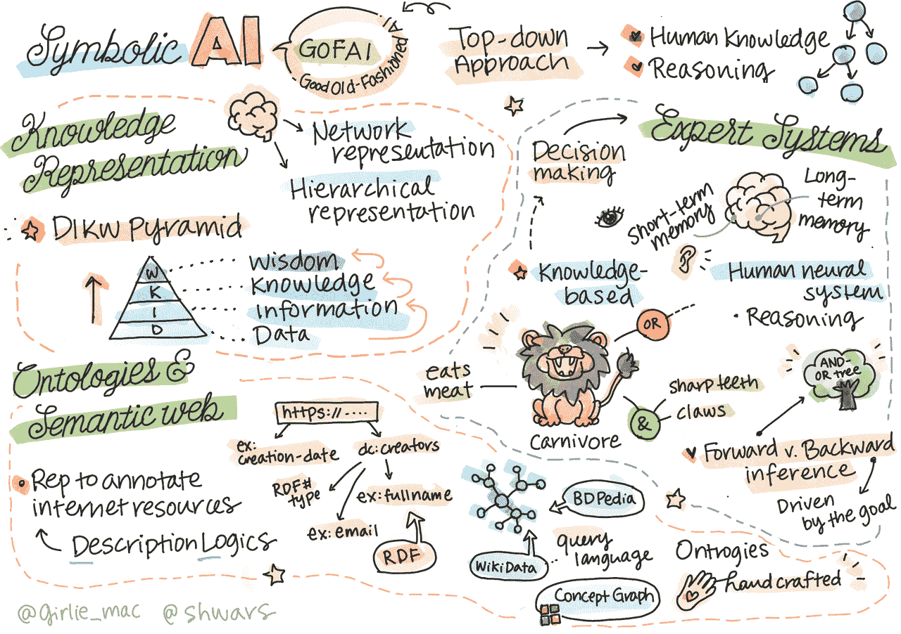
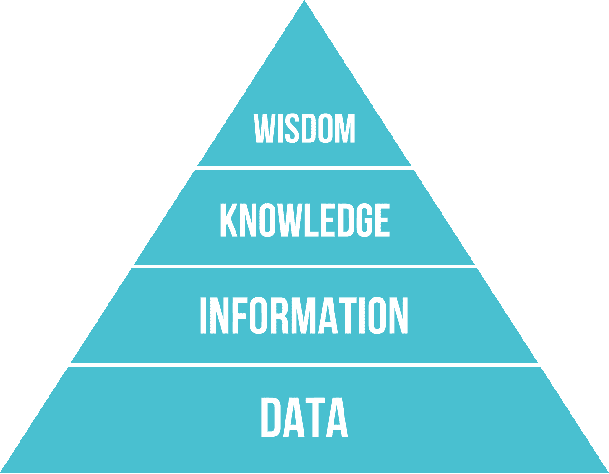
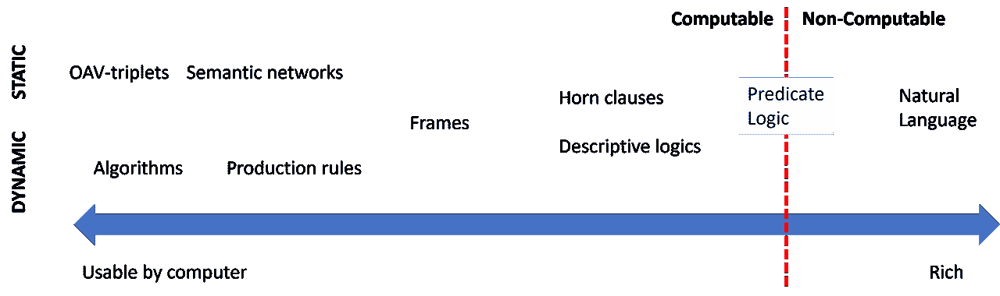
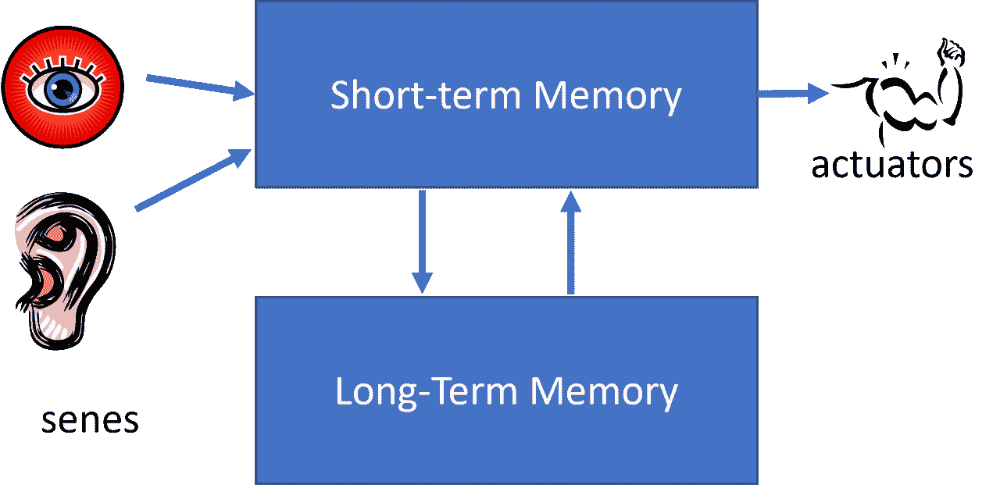
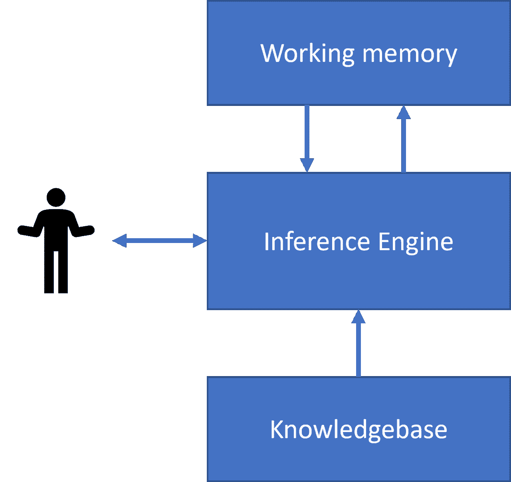
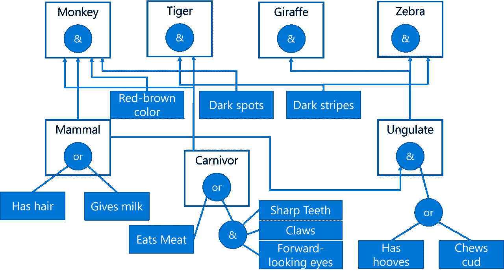
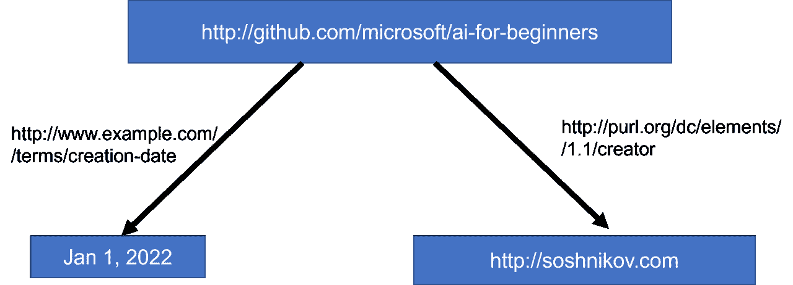
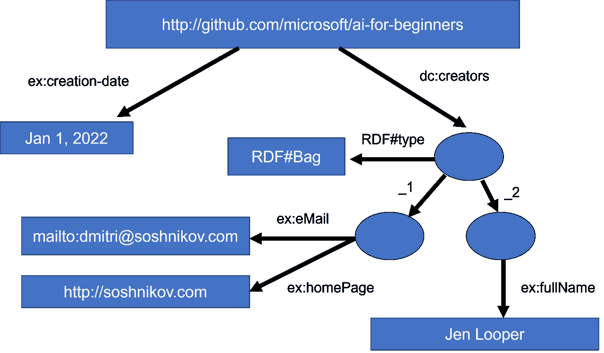
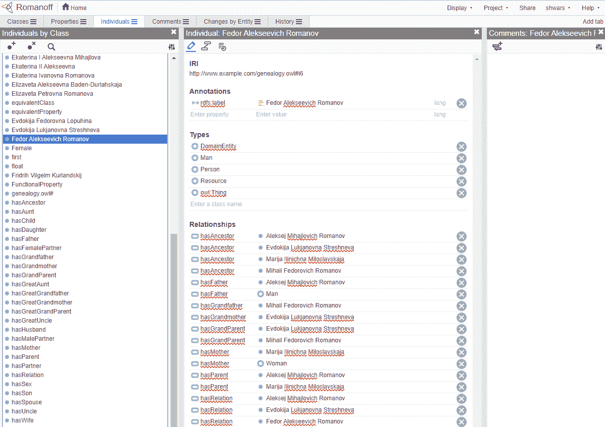

# 知识表示和专家系统

> 来源：[https://waytoagi.feishu.cn/docx/HvG6dIHRyo99cDxegezcMDhQnPf](https://waytoagi.feishu.cn/docx/HvG6dIHRyo99cDxegezcMDhQnPf)

> 译者：Miranda，原文见 https://microsoft.github.io/AI-For-Beginners/lessons/2-Symbolic/README.md



对人工智能的追求基于对知识的探求，以使机器能像人类一样理解世界。但如何才能做到这一点呢？

# [课前测试](https://red-field-0a6ddfd03.1.azurestaticapps.net/quiz/102)

---

在人工智能发展的早期，通过自上而下的方式创建智能系统（在上一课讨论过）非常流行。当时的想法是从人申诉提取知识并转化为机器可读的形式，然后利用这些知识自动解决问题。这种方法基于两大理念：

+   知识表示

+   推理

# 知识表示

---

符号人工智能的一个重要概念是知识（knowledge）。必须将知识与信息（information）或数据（data）区分开来。例如，我们可以说书籍包含了知识，因为我们可以通过阅读书籍成为专家。然而，书籍所包含的内容实际上被称为数据，通过阅读书籍将这些数据整合进我们的世界模型中，我们就将这些数据转换成了知识。

> ✅ 知识是存在于我们脑海中的东西，代表着我们对世界的理解。知识是通过活跃的学习过程获得的，它将我们接收到的信息碎片整合到我们对世界的活跃模型中。

[在大多数情况下，](https://en.wikipedia.org/wiki/DIKW_pyramid)我们并不严格定义知识，而是使用 DIKW 金字塔将知识与其他相关概念进行整合。该金字塔包含以下概念：

+   **数据（Data）**是以书面文字或口头语言等物理介质表示的东西。数据独立于人类而存在，可以在人与人之间传递。

+   **信息（Information）**我们在头脑中解释数据的方式。例如，当我们听到“计算机”这个词时，会对它有一定的了解。

+   **知识（Knowledge）**融入我们世界模型的信息。例如，一旦我们知道了计算机是什么，我们就会开始对它的工作原理、价格以及用途有一些概念。这个相互关联的概念网络构成了我们的知识。

+   **智慧（Wisdom）**是我们理解世界的更高一个层次，它象征着元知识（meta-knowledge），例如关于如何以及何时使用知识的一些概念。



因此，知识表示的问题是找到某种有效的方法，以数据的形式在计算机中表示知识，使其能够自动化使用。这可以看作是一个连续谱：



+   在左侧，有几种非常简单的知识表示可以被计算机有效利用。最简单的是算法，即用计算机程序来表示知识。然而，这并不是表示知识的最佳方式，因为它并不灵活。我们头脑中的知识往往是非算法性的。

+   右边是自然语言等知识表示方式。它的功能最强大，但不能用于自动化推理。

> ✅ 想一想，你是如何在头脑中呈现知识并将其转化为笔记的。是否有一种特定的格式对你来说非常有效，有助于记忆？

# 计算机知识表示的分类

---

我们可以将不同的计算机知识表示方法分为以下几类：

+   **网络表示**（Network representations）的基础是，我们的大脑中存在一个**由相互关**联的概念组成的网络。我们可以尝试在计算机中以图形的形式再现相同的网络，即语义网络（semantic network）。

1.  **“对象-属性-值”三元组****（Object**-Attribute-Value triplets）或“属性-值”对（attribute-value pairs）。既然图可以在计算机中表示为节点和边的列表，我们就可以用包含对象、属性和值的三元组列表来表示语义网络。例如，我们可以建立以下有关编程语言的三元组：

| **对象** | **属性** | **值** |
| --- | --- | --- |
| Python | 是 | 隐式类型语言（Untyped-Language） |
| Python | 的发明者是 | 吉多·范罗苏姆 |
| Python | 块-语法 | 缩进 |
| 隐式类型语言 | 没有 | 类型定义 |

> ✅ 思考如何用三元组来表示其他类型的知识。

1.  **层次表示**（Hierarchical representations）强调的是，我们经常在头脑中对物体进行层次划分。例如，我们知道金丝雀是一种鸟，所有的鸟都有翅膀。我们还知道金丝雀通常是什么颜色，它们的飞行速度是多少。

+   **框架表示法**（Frame representation）是将每个对象或每类对象表示为一个包含槽（slots）的框架。槽具有可能的默认值、值限制或存储过程，可以调用它们来获取槽的值。所有框架形成的层次结构类似于面向对象编程语言中的对象层次结构。

> 译者补充：框架由框架名和一些槽组成，每个槽有一些值，槽值可以是逻辑的、数字的，可以是程序、条件、默认值或是一个子框架。槽值含有如何使用框架信息、下一步可能发生的信息、预计未实现该如何做的信息等。

+   **场景**（Scenarios）是一种特殊的框架，它表示可以从时间维度展开的复杂情况。

**Python（框架名）**

| 槽 | 值 | 默认值 | 间隔 |
| --- | --- | --- | --- |
| 名字 | Python |  |  |
| 是一种 | 隐式类型语言 |  |  |
| 变量命名法 |  | 骆驼式命名法（CamelCase） |  |
| 程序长度 |  |  | 5-5000 行 |
| 块语法 | 缩进 |  |  |

1.  **程序表示**（Procedural representations）的基础是通过一系列在特定条件发生时可以执行的操作来表示知识。

+   产**生式**规则（Pr**o****du**ction rules）指的是我们用于得出结论的“如果-那么”语句。例如，医生可以制定这样一条规则：如果病人发高烧或血液检测中 C 反应蛋白水平较高，那么他就有炎症。一旦遇到如果语句的其中一种情况，我们就能得出病人有炎症的结论，然后在进一步的推理中加以利用。

+   算法可以被视为另一种形式的程序表示，尽管它们几乎从未直接用于基于知识的系统中。

1.  **逻辑学**最初是由亚里士多德提出的，用来表示人类的普遍知识。

+   谓词逻辑（Predicate Logic）作为一种数学理论，其内容过于丰富，无法计算，因此通常使用它的某些子集，例如逻辑编程语言 Prolog 中使用的霍恩子句（Horn clauses）。

+   描述逻辑（Descriptive Logic）是逻辑系统的一个家族，用于表示和推理分布式知识表示（如语义网 semantic web）的对象层次。

# 专家系统

---

符号人工智能的早期成就之一是专家系统——为充当某个有限问题领域的专家而设计的计算机系统。它们基于从一个或多个人类专家那里提取的知识库，并包含一个推理引擎，在此基础上进行推理。





专家系统就像人类的推理系统一样，包含短期记忆和长期记忆。同样，在以知识为基础的系统中，我们会区分以下几个部分：

+   **问题记忆**（**Prob**lem memory）：包含与当前要解决的问题有关的知识，如病人的体温或血压、是否有炎症等。这种知识也被称为静态知识（static knowledge），因为它包含了快照信息，记录着我们在当前状态下对问题的了解——即所谓的问题状态（problem state）。

+   **知识库**（K**nowl**edge base）：代表某个问题领域的长期知识。它是从人类专家那里人工提取的，不会因外部的咨询而改变。由于它允许我们从一个问题状态前往另一个问题状态，因此也被称为动态知识（dynamic knowledge）。

+   **推理引擎**（Inference engine）：协调在问题状态空间中搜索的整个过程，必要时向用户提问。它还负责找到适用于每个状态的正确规则。

举例来说，下面这个专家系统是根据动物的物理特征来判断动物的：



这种图称为 AND-OR 树，是一组产生式规则的图形表示。在从人类专家那里提取知识的早期阶段，绘制树形图非常有用。要在计算机中表示知识，使用规则更为方便：

```
IF the animal eats meat //如果这个动物吃肉
OR (animal has sharp teeth //或动物有锋利的牙齿
    AND animal has claws //和动物有爪子
    AND animal has forward-looking eyes //和动物有向前看的眼睛
) 
THEN the animal is a carnivore //那么这个动物是一个肉食动物
```

你可以注意到，规则左侧的每个条件和操作本质上都是对象-属性-值（OAV）三元组。工作记忆包含与当前要解决的问题相对应的 OAV 三元组。规则引擎会查找满足条件的规则，并应用这些规则，从而向工作记忆中添加另一个三元组。

> ✅ 为你喜欢的主题写一个 AND-OR 树！

## 正向推理与反向推理

上述过程被称为**正向推理**（forward inference）。它以工作记忆中和问题相关的一些初始数据为起点，然后执行以下推理循环：

1.  如果目标属性已经存在于工作记忆中 → 停止推理并给出结果

1.  **查找满**足当前条件的所有规则 → 获得规则冲突集（conflict set）。

1.  执行**冲突解决**（conflict resolution） → 选择一条将在这一步执行的规则。可能有不同的冲突解决策略：

+   选择知识库中第一条适用的规则

+   随机选择一条规则

+   选择更具体的规则，即满足“左侧”（left-hand-side，LHS）条件最多的规则

1.  应用选定的规则，在问题状态中插入新的知识片段

1.  重复步骤 1。

不过，在某些情况下，我们可能希望从对问题一无所知开始，并提出有助于得出结论的问题。例如，在进行医学诊断时，我们通常不会在开始诊断病人之前事先进行所有的医学分析。我们更希望在需要做出决定时进行分析。

这个过程就会用到**反向推理**（backward inference）来建模。它是由目标驱动的，目标即我们想要找到的属性值：

1.  选择所有能给出目标值的规则（即目标位于“右侧”（right-hand-side，RHS））→ 获得一个冲突集。

1.  如果没有关于该属性的规则，或者有一条规则规定我们应该向用户询问该值 → 询问用户，否则：

1.  使用冲突解决策略选择一条规则作为假设 → 我们将尝试证明它

1.  对规则的LHS中的所有属性重复这个过程，尝试证明它们是目标

1.  如果该过程在任何时候失败，则在第 3 步使用另一条规则。

> ✅ 在哪些情况下正向推理是更合适的？在哪些情况下反向推理更合适？

## 专家系统的实施

专家系统可以使用不同的工具来实现：

+   直接用某种高级编程语言进行编程。这不是最好的办法，因为基于知识的系统的主要优点是知识与推理分离，问题领域的专家应该在不了解推理过程细节的情况下编写规则。

+   使用专家系统外壳（expert systems shell），即专门为使用某种知识表示语言填充知识而设计的系统。

# [✍️](https://microsoft.github.io/AI-For-Beginners/lessons/2-Symbolic/README?id=%e2%9c%8d%ef%b8%8f-exercise-animal-inference) 练习：动物推理

---

请参见 [Animals.ipynb](https://github.com/microsoft/AI-For-Beginners/blob/main/lessons/2-Symbolic/Animals.ipynb)，了解实施正向推理和反向推理的专家系统的示例。

> 注：这个例子非常简单，只能让人了解专家系统的样子。一旦你开始创建这样一个系统，只有当规则达到一定数量（大约 200 多条）时，你才会注意到它的一些智能行为。在某些时候，规则会变得过于复杂，以至于你无法将所有规则都牢记在心，这时你可能会开始怀疑系统为什么会做出某些决定。不过，基于知识的系统的重要特点是，你总能准确解释任何决定是如何做出的。

# 本体和语义网

---

20 世纪末，有人倡议使用知识表示法来注释互联网资源，以便能够找到与非常具体的查询相对应的资源。这一举措被称为语义网，它依赖于几个概念：

+   一种基于描述逻辑学（description logics，DL）的特殊知识表示法。它类似于框架知识表示法，因为它建立了一个具有属性的对象层次结构，但它具有正式的逻辑语义和推理。有一整套 DL 在表达能力和推理算法的复杂性之间取得平衡。

+   分布式知识表示法，所有概念都用一个全局 URI 标识符表示，这样就有可能创建跨越互联网的知识层次结构。

> 译者注：统一资源标志符（英语：Uniform Resource Identifier，缩写：URI）在电脑术语中是用于标志某一互联网资源名称的字符串。 该种标志允许用户对网络中（一般指万维网）的资源通过特定的协议进行交互操作。 URI的最常见的形式是统一资源定位符（URL），经常指定为非正式的网址。

+   基于 XML 的知识描述语言系列： RDF（资源描述框架，Resource Description Framework）、RDFS（RDF 模式，RDF Schema）、OWL（本体网络语言，Ontology Web Language）。

语义网的一个核心概念是**本体**（Ontology）。它是对特定领域之中某套概念及其相互之间关系的形式化表达。最简单的本体可能只是问题领域中对象的层次结构，但更复杂的本体将包括可用于推理的规则。

在语义网中，所有表示都基于三元组。每个对象和每个关系都由 URI 唯一标识。例如，如果我们想说明本人工智能课程是由德米特里·索什尼科夫于 2022 年 1 月 1 日开发的，我们可以使用以下三元组：



```
http://github.com/microsoft/ai-for-beginners http://www.example.com/terms/creation-date “Jan 13, 2007”
http://github.com/microsoft/ai-for-beginners http://purl.org/dc/elements/1.1/creator http://soshnikov.com
```

> ✅ 这里 http://www.example.com/terms/creation-date 和 http://purl.org/dc/elements/1.1/creator 是表达创建者和创建日期概念的一些众所周知和普遍接受的 URI。

在更复杂的情况下，如果我们想定义创建者的列表，我们可以使用 RDF 中定义的一些数据结构。



搜索引擎和自然语言处理技术可以从文本中提取结构化数据，它们的成功在某种程度上减缓了语义网的建设进度。不过，在某些领域，人们仍在为维护本体和知识库做出巨大努力。有几个项目值得一提：

+   [WikiData](https://www.wikidata.org/wiki/Wikidata:Main_Page) 是与维基百科相关的机器可读知识库的集合。大部分数据都是从维基百科信息框（InfoBoxes，维基百科页面内的结构化内容）中挖掘出来的。你可以用SPARQL（一种用于语义网的特殊查询语言）来查询维基数据。下面是一个示例查询，用于显示人类最流行的眼睛颜色：

```
#defaultView:BubbleChart
SELECT ?eyeColorLabel (COUNT(?human) AS ?count)
WHERE
{
  ?human wdt:P31 wd:Q5.       # human instance-of homo sapiens
  ?human wdt:P1340 ?eyeColor. # human eye-color ?eyeColor
  SERVICE wikibase:label { bd:serviceParam wikibase:language &quot;en&quot;. }
}
GROUP BY ?eyeColorLabel
```

+   [DBpedia](https://www.dbpedia.org/) 是与 WikiData 类似的另一项工作。

> ✅ 如果你想尝试构建自己的本体或打开现有[的本体，有一个](https://protege.stanford.edu/)很棒的可视化本体编辑器叫 Protégé。可以下载或在线使用。



# [✍️](https://microsoft.github.io/AI-For-Beginners/lessons/2-Symbolic/README?id=%e2%9c%8d%ef%b8%8f-exercise-animal-inference) 练习：家族本体

---

有关使用语义网技术推理家庭关系的示例，请参见 FamilyOntology.ipynb 笔记。我们将采用以普通 GEDCOM 格式表示的家谱和家庭关系本体，并为给定的个人集合构建一个包含所有家庭关系的图。

# 微软概念图

---

在大多数情况下，本体都是手工创建的。不过，也可以从非结构化数据（例如自然语言文本）中挖掘本体。

微软研究院（Microsoft Research）就做过这样的尝试，并最终形成了微软概念图（Microsoft Concept Graph）。

这是一个使用is-a继承关系组合在一起的实体大集合。它可以回答诸如“微软是什么？” 之类的问题，答案可能是 “一个概率为 0.87 的公司和一个概率为 0.75 的品牌”。

该图表以 REST API 或可下载的大型文本文件的形式提供，其中列出了所有实体对。

# [✍️](https://microsoft.github.io/AI-For-Beginners/lessons/2-Symbolic/README?id=%e2%9c%8d%ef%b8%8f-exercise-animal-inference) 练习：一张概念图

---

试试看 MSConceptGraph.ipynb ，看看我们如何使用微软概念图将新闻文章分成几类。

# 结论

---

如今，人工智能通常被认为是机器学习或神经网络的代名词。然而，人类也会进行显式推理（explicit reasoning），这是神经网络目前无法处理的。在现实世界的项目中，显式推理仍被用于执行需要解释的任务，或以受控方式修改系统行为。

> 译者注：显示推理，可以理解为基于特定规则的明确的推理过程，推理结果是清晰准确的。

# 🚀挑战

---

在与本课相关的“家族本体”笔记中，进行其他家庭关系的实验，尝试发现家族树中人物之间的新联系。

# [课后测试](https://red-field-0a6ddfd03.1.azurestaticapps.net/quiz/202)

---

# 复习 & 自学

---

在网上做一些调研，找到一些人类试图量化和编写知识的领域。看看布卢姆的分类法（Bloom's Taxonomy），回顾历史，了解人类是如何试图理解他们的世界的。探索林奈创建生物分类法的工作，观察德米特里·门捷列夫创建描述和分组化学元素的方法。你还能找到哪些有趣的例子？

**作业：建立一个本体**

建立知识库就是对表示了特定主题事实的模型进行分类。选择一个主题——比如一个人、一个地方或一件事——然后建立该主题的模型。使用本课中介绍的一些技术和建模策略。例如，创建一个客厅的本体，包括家具、灯光等。客厅与厨房有什么不同？浴室有什么不同？你怎么知道这是客厅而不是餐厅？使用 Protégé 构建本体。