# AGI万字长文（上）| 2023回顾与反思

> 来源：[https://waytoagi.feishu.cn/docx/NFPgdCOpHo8qDCxhsk8cuAX9nPc](https://waytoagi.feishu.cn/docx/NFPgdCOpHo8qDCxhsk8cuAX9nPc)

> 原创 Lian et Zian 普通人的AI自由 2024-02-18 16:38

> 链接：https://mp.weixin.qq.com/s/LVgcoT_aZwANscLpRqTg5w

## **太长不看版**

+   **2023年大众对AI的看法：这是**啥->好像也没那么厉害->和我没太大关系

+   目前还没有看到阻止AGI出现的硬性限制，且我们距离AGI只有几年距离

+   大模型的“想象力”、“取悦能力”比“逻辑能力”更早成熟

+   应用层没有独角兽；创业者最大的敌人是GPT官方

+   技术加速迭代是常态，不能等到“技术稳定”再出手

+   多模态大爆发：再次证明了AGI相对“窄AI”的代际优越性

+   **Agent/代理暂时还没出现，记**忆仍是瓶颈；核心问题是还没有“人的模型”

+   深度压缩是大模型的核心能力，端上智能越来越近

+   中美AI生态各自发展，2023年技术差距没有缩小

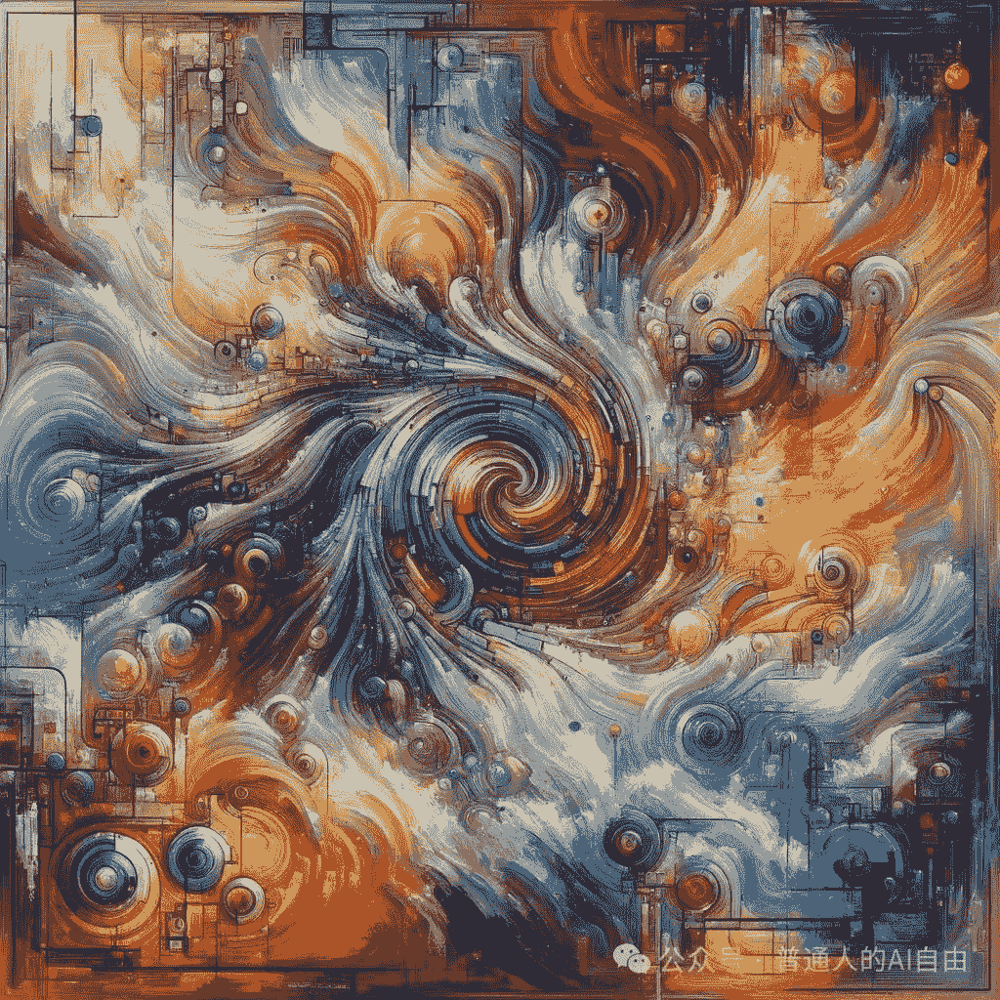

Image: "Explosion of AGI", with Dall-E

**[作者] Lian, MK**

## **  引子：高估的短期与低估的**长期

2023年是大模型澎湃发展的一年：从22年11月ChatGPT的惊艳面世，到23年3月GPT4作为“与AGI（通用人工智能）的第一次接触”，到23年末多模态大模型的全面爆发，再到刚刚面世的Sora再次震惊世界。大模型给了世界太多的惊喜、惊讶、迷茫、甚至恐惧。

有人问我：“AGI的出现可以和人类哪次发现/发明相比？”

**“大概是人类开始使用‘火’的时刻。万**有引力、iPhone什么的都不值一提。”

就像我在去年4月份文章中写的——在AGI和任何新事物的出现的时候：我们总是倾向于高估它的短期，但却低估它的长期。（前文《AGI|高估的短期与低估的长期》）目前正是这个大趋势的真实写照：

+   短期：AGI并没有马上催生出大量“明星APP”和“变现机器”。只有ChatGPT，Charactor.ai 等少数App实现了用户突破。大量上层应用APP就像韭菜一样：不仅昙花一现，迅速被OpenAI官方所取代, 而且还无法做到成本打平。于是，投资人极端谨慎，公众也渐渐对于AI麻木。

+   长期：技术的稳定的、加速度的迭代。23年3月预测的众多技术到现在都有了长足进步：视频生成、音频生成、代理Agent、记忆能力、模型小型化……它们距离商用可能还有各种各样的问题，但捅破这层窗户纸只是时间问题。

**人间一日，AI十年。**

这篇万字长文算为婴儿期的AGI做一个快照；算是在激流的2023找个锚点，更是为了2024更好地出发。

+   上篇：回顾AI在2023年发生的大事，为大家梳理出2023年AI圈的主线

+   下篇：不自量力地做些2024年的推断，为大家提供一些启发和点子

这里，我不会过多讨论技术细节，更多是从商业视角、个体视角来审视着这场技术海啸。文中有很多自不量力的估计，也有很多不准确、不完整的地方；欢迎大家找我聊天，告诉我你们的想法。

另外，这是我的新公众号，有关AI的文章都会集中放在这里。恳请大家收藏、加星、点赞、转发。

Image: "Explosion of AGI - with some order", with Dall-E

# **上篇：2023，风暴的前奏**

##  <1> 迈向AGI之路：世界模型、涌现与自我进化

**

世界模型：狼真的来了**。本次由ChatGPT掀起的革命与之前的"AI热"有着本质区别。如果说之前的AI都是“工具”，那么这次的AGI就是“大脑”。这个区别不仅来自于模型的目的，也来自于底层数据量。OpenAI一直主张的都是数据量和计算量的“暴力美学”，GPT从一开始就是要成为“世界模型”的，也就是说把世界上所有的知识压缩到模型里，达到“全知全能”。连“之所以使用视频和图像数据的原因”都是“仅仅因为有更多数据” --Ilya Sutskever（OpenAI前首席科学家, GPT之父）

从数据量级的角度来看，大模型正在接近全人类所有数据的量级。坊间传闻的GPT5应该在2024年就会出现，它应该就是"接近AGI"的存在了。但GPT5，不管是它的真正能力还是问世的时间，应该都会隔着“政治正确”的一层，因为不管是大众还是政府都还没有准备好欢迎AGI的降临。

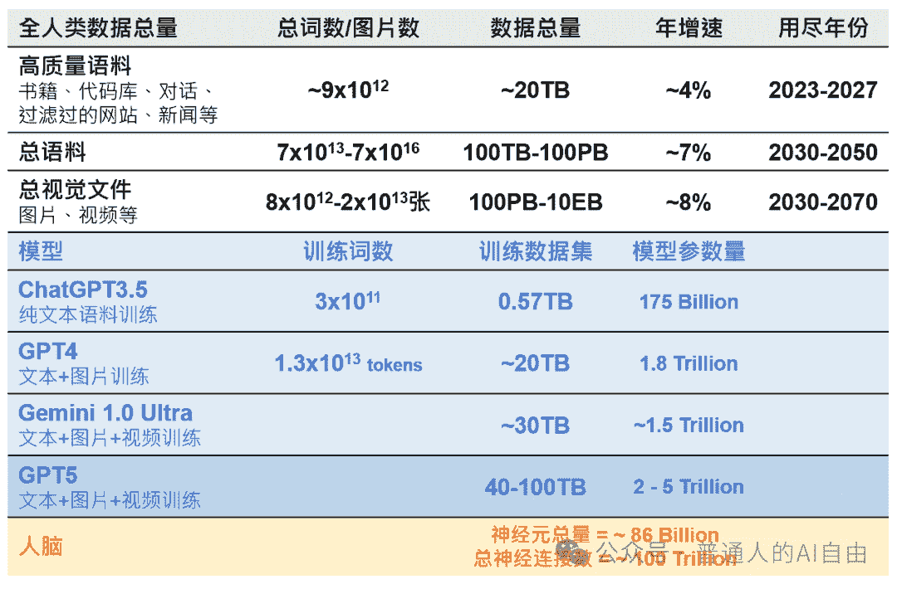

数据来源:

https://arxiv.org/pdf/2211.04325.pdf

https://lifearchitect.ai/gpt-5/

**

当然，GPT5与GPT4相比**应该不**仅仅是数据量级的提升，还**会**有数据质量、压缩效**率、表达能力的提升。如果参考近期模型小型化的进展：Mistral7B(7B参数)可以媲美GPT3.5(175B参数)的能力，那么GPT5相对于GPT4的提升也绝不仅仅是参数量级的倍数。

涌现：大脑可能比想象得更简单。大模型的一个重要特点是“涌现”, 意思是大模型可以自发获得之前没有训练过的能力。比如：单模态版GPT3.5用纯文字训练，但可以具备一定的空间图像能力。“涌现”这个词更早来自于研究复杂系统/混沌/脑科学领域，即系统在达到一定复杂程度之后会自发出现规则结构-自组织。于是，一个灵魂拷问就是：是否“智慧”也是仅仅是人脑结构“涌现”的现象？

顺着这条思路，如果做一个很牵强的假设：模型的参数约等于神经元的链接；那么模型还有2个量级的差距(1.8Trillion vs. 100Trillion)达到人脑水平。按照现在的发展速度，抹平这个差距也只有2-4年时间。如果“涌现”=“智能”的假设成立，那么到那个时候，人工智能超越大脑智能的物理基础就已经具备了。

当然，我们还很难直接把模型直接比作大脑。一个明显的事实是：大脑只要利用少量数据进行训练就可以有远超大模型的能力。我认为，这说明了模型结构迭代的空间是巨大的；这也是为什么小型化的模型可以取得媲美大模型的效果的原因。

自我进化：合成数据训练。当模型需要全人类数据进行训练的时候，无论从数据获取还是从成本的角度来讲，大模型都会很快遇到天花板。但经过几个月的实践，基本可以确认数据瓶颈是不存在的：因为模型训练可以使用合成数据，并不断提升效果。具体的例子一是市面上几乎所有的模型都会用ChatGPT生产的合成数据做训练，还有近期研究发现通过 “自我对弈(SPIN)” 的方法生成合成数据可以不断提升模型能力。真-左右互搏！

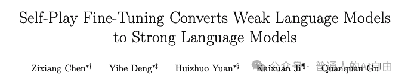

论文地址：https://arxiv.org/abs/2401.01335v1

和大脑相比，现在的模型本身使用了比人脑接受得多得多数据，但效果和人脑还有差距。那么，最自然的观点就是模型并没有充分使用这些数据。我们可以认为，“自我对弈”就是一种让模型不断精炼数据，向大脑能力靠拢的方式。再做一个更大胆的猜想：“自我对弈”和人脑的“想象力”是有相似之处的——大脑也是通过“想象”自己创造出合成数据，用于自我学习。

综合来讲，**目前还没有看到阻止AGI出现的硬性**限制，而且我们距离AGI只有几年的距离。之后，跑步进入硅基文明的碳基生物会活得怎么样呢？

Image: "Crumble of Liberty" with Dall-E

## <2>高估的短期：应用层没有独角兽

让我们暂时跳出对于长期的猜测，聊点更实在的：2024年初的大模型，究竟能力怎么样？

如果一句话概括的话：**GPT4正在上大学。**Ta可以聊天，可以谈恋爱，可以画画，甚至可以在公司实习完成一些简单的、明确的任务；不过Ta经常犯错，会偷懒，还很犟，会不遵守你的指令然后自己胡编一通……

看似繁荣的AI生态，其实真正跑出来的应用是和人们的期望是有差距的。也就是我们在“高估AI的短期能力”的地方。

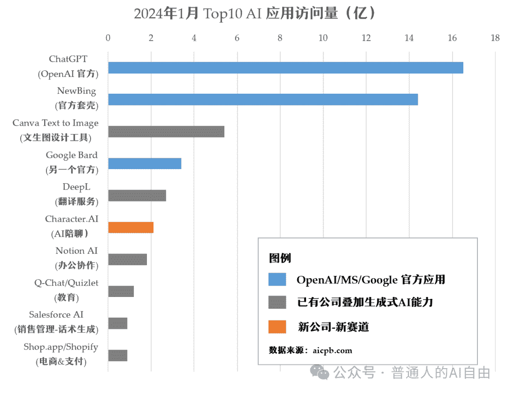

+   **正经聊天：**除了ChatGPT之外，其他基本都不太行。而且大家在抱怨OpenAI太贵的同时，OpenAI的收入也只是能推理服务的成本打平；新模型训练还是完全要靠融资。

+   **文生图：**让打工人感受最深的，是Midjourney, Dall-E， Stable Diffusion等文生图产品正在全面颠覆创意设计行业。在ChatGPT和Bing之后第一位的应用就是作图应用Canva。文生图在2023年经过几轮迭代，首先聚焦是画人手（已解决），之后主线在细节控制能力、降低推理成本、生图速度提升（目前可以做到300ms）上面。目前实际的体验是虽然创意惊艳，但废图多、细节修改还得靠人，所以额外付费买单有限；于此同时，机器成本即使经过了几轮优化，但人们对于图片质量的追求也水涨船高。所以说，真正赚到钱的可能只有做二次元小姐姐涩图的……

+   **AI陪聊（AI男女朋友）**：Character.ai、星野、豆包这类陪伴型聊天产品是2023年唯一实现突破的2C产品。大概是用户在上头的时候，即使有些胡言乱语也可以接受，以及这些产品不管是直球还是擦边球都能提供…… 我认为，这类陪伴型AI产品有着巨大潜力：这是在人与人的连接之外，开启“人与AI连接”的新时代的第一步，在未来也可以创造基于“连接”的商业护城河。

+   **AI法律文书**：这是目前AI在2B行业唯一基本成熟的应用。法律文书格式固定且核心技术是法条/判例的引用。这个应用其实是“搜索”能力和大模型能力的搭配。

+   其他2B应用：基本是雷声大、雨点小。虽然现在是个公司都想和AI沾边，按实际上真正用起来的并不多；“浏览器里加个ChatGPT快捷方式”是大多数在问卷中回答到“工作中使用AI”的公司的主要做法。这其实也很正常，因为AI的2B能力还很掉链子：连最擅长的代码（如Github Copilot）也只是“实习生水平”；以及，问题还在于AI写代码的速度比人跟在后面Debug要快得多。另外一个看似伸手可及的应用是“AI客服”，但实习体验上也并没有达到可以大量取代人工客服的预期。

我也尝**试用OpenAI的API搭了个**“写作助手”，但完全无法达到帮助写出现在这文章的能力。直接的感受差不多是在“指挥一群脱缰的野马”：控制困难、不能精细调整、没有记性、不讲逻辑是最痛的。当然，我自己花的时间也有限，也没有好好研究写Prompt/提示词的技巧。这个过程也我开始反思：现在的大模型究竟擅长的是什么？

**Hallucination = Im**agination | 幻觉 = 想象力

如果从2023年跑出的产品和实际使用体验上来**评价：**大**模型最成熟的**能力并不是逻辑，而是想象力和取悦人的能力。这大概是合乎逻辑的。首先，我们看到的“幻觉问题”本身就是想象力的表现；而且在训练过程中，模型的学习方式一直都是“穷举归纳式的”，我们暂时还不知道如何“教会”模型“逻辑的方法”，而只能期待模型自己涌现出“逻辑”的能力。第二，因为模型训练时的优化目标包含了“让人继续聊下去”，所以取悦人，而非事实和逻辑，才是大模型更擅长的。这个特点是现在选择产品赛道时所需要仔细考虑的事情：娱乐向、创意向、2C的产品会早于逻辑向、2B产品成熟。

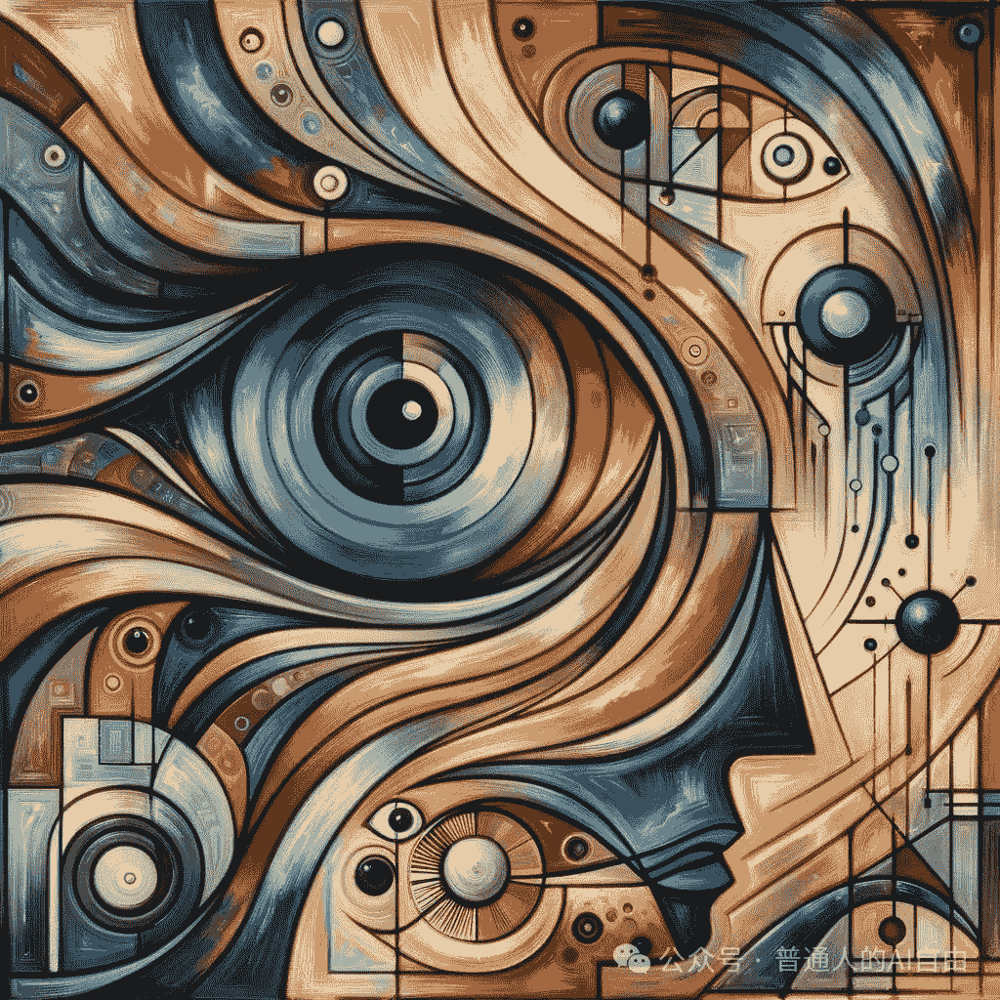

Image: "AI Imagination", with Dall-E

## <3>官方卷死创业公司：真的存在GPTs生态吗？

和之前的移动互联网创业大潮相比，AI创业者们要难得多，一个灵魂拷问是：如何不被官方卷死。

套壳GPT的“一个月独角兽”Jasper.ai（依靠GPT能力做广告文案）在GPT4问世之后价值几乎归零；刚刚面世的Sora让**1个月前还风光无限的Runwa****y**、Pika都黯然失色……这也是为什么现在投资圈对于AI应用公司的投入非常谨慎的主要原因：AI应用公司们并没有技术护城河。

红衫做了一张囊括主要AI创业公司的地图，里面的Logo换得和走马灯一样快。说得好听的是“生态繁荣”，不好听的就是“熊瞎子掰苞米”。

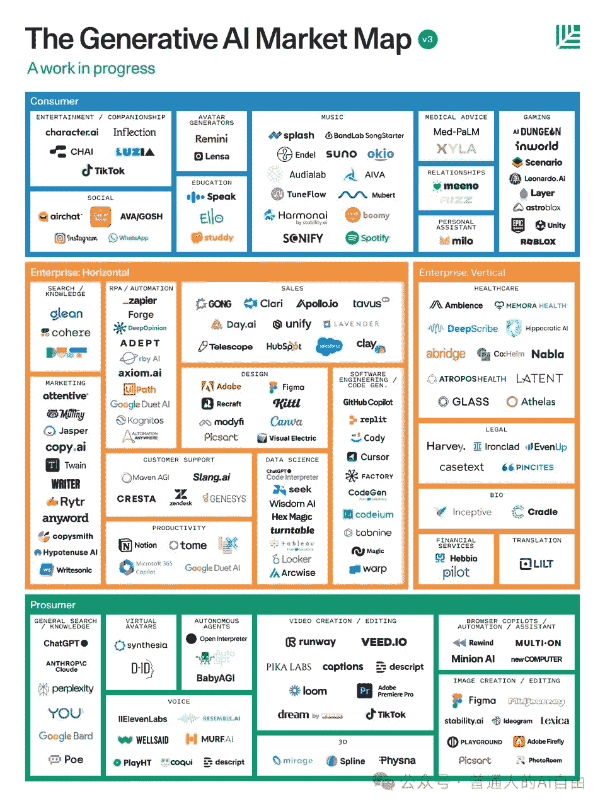

到了落地层面，创业者们其实面临着非常艰难的选择:

### **<路线一>：API+Prompt+**产品套壳：适合已经有产品/客户基础的公司

市面上最多的产品是调用API来实现的，但问题是，仅靠API+Prompt并无法形成护城河，Jasper的陨落就是最好的例子。备受瞩目的GPTs也是Prompt的低门槛模式，这可能也是GPT商店当前也并没有实质繁荣的原因：大DAU的应用要么是官方应用，要么是已有公司的产品延申，而极少新的商业模式。对于一般用户来讲，通过GPTs还是很难做到精细控制和稳定输出。我的理解是，个人“手搓应用”的时代，还是先要有Agent的能力才能实现。

对于已经有产品和用户的公司来讲，叠加AI应用是很好的选择。榜单中的Canva的核心竞争力来自于其存量用户、友好的产品设计、针对各种社交媒体的海量模板和一键发布功能，API和模型的使用就实现了锦上添花。另一个目前比较成功的例子是多邻国Duolingo（披着学外语学习APP外衣的休闲手游）：它最核心的护城河是休闲游戏的玩法设计，使用OpenAI的API则让题库成本大大降低，题库深度没有上线。

### <路线二>：开源模型+精调：适合有独有数据的公司

对于数据比较丰富的公司，是可以走开源模型+精调的道路的。因为独特的数据可以让精调出的模型在一定场景下有更好的表现。但实际操作起来难度其实不小，核心问题变成了：1)底层开源模型是否足够强大？2)底层模型升级之后，之前精调部分的经验是否可以复用？然而，这两点都很难保证。因为最强大的模型都不会开源，以及在底层黑箱的情况下做到精调经验的积累也很难。于是，这类商业模式就像大楼建立在流沙之上……生存的时间窗口取决于精调速度。

### **<**路线三>：自己做底层模型：只适合大厂和少量大佬

训练底层世界大模型需要十亿美元级别的投入，以及万张GPU卡，除了BBAT几家大厂之外，其他公司都是很难的。连大佬带领的智谱、Minimax、月之暗面、百川这些头部创业公司也都会在下一轮融资时遇到不少挑战。这也是为什么大多数国内公司都急着先推出产品，而无法完全集中精力专攻大模型的原因。第二梯队里那些挂着世界模型“羊头”的公司们，仔细看下来，基本卖的都是<路线二>的“狗肉”。

另外，即使是大厂，在一年时间内可以挑战OpenAI的也只有Google 的Gemini。Meta的LLama还只是个半吊子；Amazon、Apple、Tesla 也都没有特别好的进展；国内的BBAT似乎差得更远，目前还没有人敢说全面达到ChatGPT3.5的水平。

那退一步，在现在的时**刻，哪些**是一般创业者可以做的呢？暂时想到的也只有 “唯快不破”：尽量低成本、高速度地在一些比较小的赛道中不断尝试，不求做出全民产品，而是去低成本地把握那些小的细分赛道。

最后，要记住的是：**在这轮AI大潮中，新技术加速迭代是常态；我们不能期望在**“技术稳定”时再出手，因为永远都等不到。

Image: "AI Entrepreneur", with Dall-E

## <4>AI Agent/替身：目前记性还不太好；呼唤“人的模型”

**

AI Agent/A**I替身是除了AGI本身最重要的概念，因为它揭示了硅基文明的无限可能性。

AI Agent理念的核心是：设立目标->拆解任务->使用工具->做出决策；Agent 可以以人的方式相互交流->自主搭建社会协作关系；最终实现模仿人->替代人。

“斯坦福小镇”论文之后，一直有层出不穷的尝试，包括BabyGPT、AutoGPT等；OpenAI的Assitant API, Function Calling功能也是迈向AI Agent的第一步，让大语言模型可以开始实用工具。

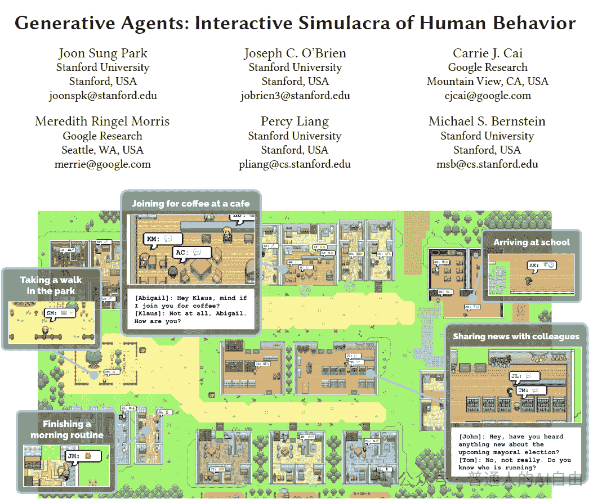

论文地址：https://arxiv.org/abs/2304.03442

不过，（值得庆幸的是）AI Agent**距离成熟还有**一定距离。目前最突出的问题是记忆力的问题。这一方面是技术层面上的：记忆准确性、逻辑完整性、合理遗忘、长期记忆机制与Token长度、调用效率之间制衡的问题。记忆能力和长Token能力是当前很多团队的攻坚重点：刚发布的Gemeni1.5在研究中达到10M的Token长度，比GPT4整整多出两个数量级；ChatGPT也在近期官宣了“记忆能力”；国内最突出的是专攻超长Token的公司“月之暗面”。

**还有一类是专攻AI Agen**t的“使用工具能力”的中间层产品，字节最近推出的Coze就是其中代表。在当前底层模型卷不动，上层应用没价值的时刻，做中间层大概是最好的选择。不过这里的机会可能会被资本雄厚的大厂先瓜分掉。（中间层需要支付大量API费用或算力）

再退一步，**人格本身是记忆的聚合**。记忆问题引申出的更本质问题是AI Agent的"人格"——记忆独**立性问题，而这会直接涉及到当前大模型训练方式和底层**数据。记忆独立性之所以重要又在于：只有Agent可以理解“某一个人”的时候，它才能和这个人很好合作，扮演乃至替代这个人做决策。

但仔细一想就不难发现，当今的大语言模型是“世界模型”，而不是“人的模型”。意思是，底层数据是来自于千千万万人的，每个人一丁点数据；而并不是大量的来自某一个人的数据。于是，一个大胆的猜想是：在一个人与AI充分合作的社会，不仅需要“世界模型”，也需要“人的模型”。而这时的Agent本身，也会分化出“世界Agent”和“个人Agent”。

当然，一个没有碳基人的纯硅基社会另当别论。

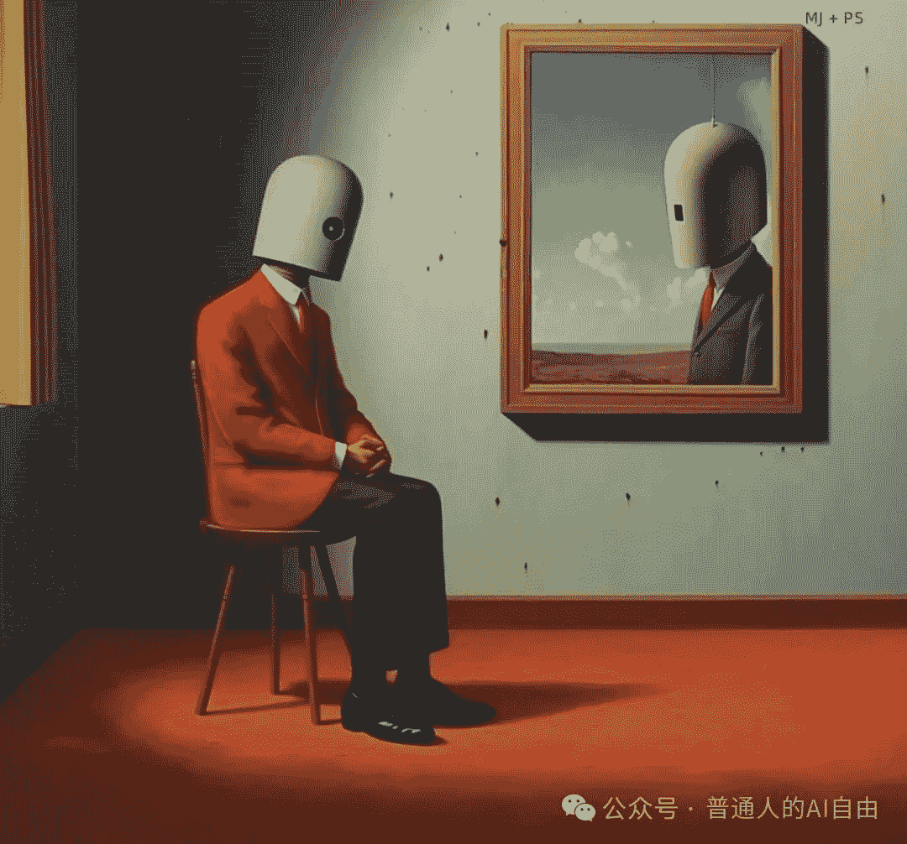

Image: "Dialogue", from LJH Color

## **<5>深度压缩与模型小型化**

AI Agent之外另一个重要方向，是大模型的小**型化。小模型**的直接好处就是训练成本和推理**的成本量级下降。比如能力相近的 LLaMA-7**B的训练成本相当于1张A100芯片训练9.3年，而GPT3(175B)则有100年，差了11倍。GPT4的训练成本更是高达6500年！

但成本还并不是意义最重大的。“压缩”是LLM模型的最核心能力，所谓“世界模型”就是要将人类的所有知识都压缩到模型中。顺着这条路思考，小型化的意义在于：小型化的模型首次让一个公司、甚至个人可以使用“全人类的知识”。而且，小型化的模型既是上文讲到的“人的模型”的技术基础，又是开启“端上智能”的先决条件。在未来，无论是手机、电脑还是机器人，都可能会配备一个小模型。

在这里，可能会出现一个历史的分叉：岔路的一边是“中心化的大一统世界模型”，另一边是“端上智能+人的模型的混合社会”。让我们拭目以待。

回到今天，小型化主要有两个阶梯。第一个阶梯的模型参数在6B-7B，这是游戏显卡可以覆盖的范围。最具代表性的是Meta的LLaMA，Mistral7B和国内的智谱；NVIDIA的Chat with RTX，默认搭载的就是Mistral7B。

第二个阶梯模型的想象空间更大，它们的参数在1-2B；这个大小就可以在手机和移动硬件上广泛使用了。华为、荣耀、小米、OPPO、VIVO等都已宣布会在手机端侧搭载大模型，目前还只能用最新的骁龙8Gen3旗舰处理器，而且耗能散热都是问题；三星S24上也搭载了Google Gemini Nano。

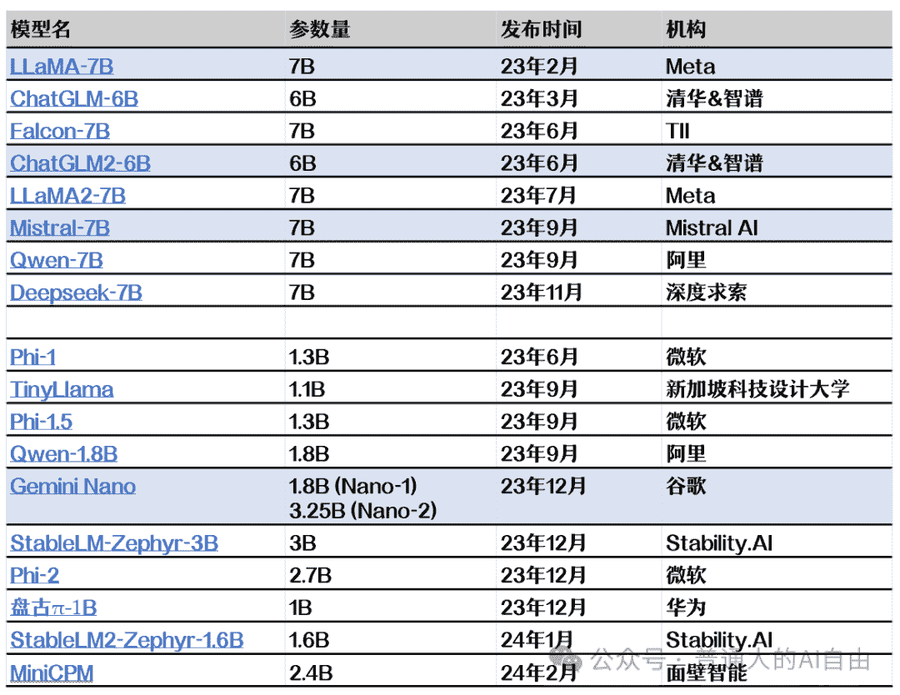

但不要高兴得太早，一个灵魂拷问是：小型化的模型真的能有大模型的能力吗？小型化的模型是真的“世界模型”还是仅仅是“窄AI问答机器”？目前来看，当模型规模被压缩时，稳定性和记忆能力都会有损失。

技术上来看，小型化的优化方法（Quantization, Batchsize Optimization, Learning Rate Scheduler, Neural architecture等）大多也都能应用在大模型上，所以说小模型能力比大模型落后一个代际应该是常态。但另一方面，Mistral7B的成功至少说明了，基于大模型输出的数据进行训练/蒸馏可以快速复刻大模型的大多数能力。

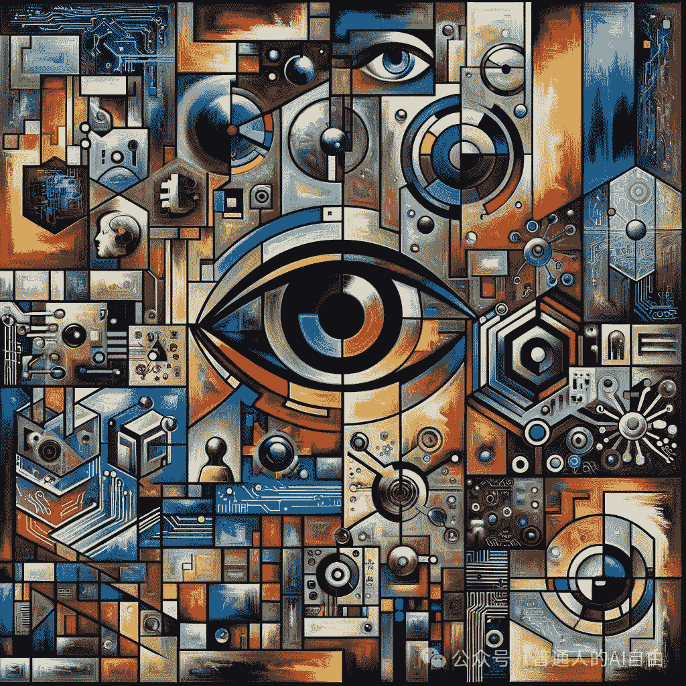

Image: "Dictatorship", with Dall-E

## <6>多模态大爆发：视频、音频与虚拟人

**

20**23年年末到今天最令人瞩目的就是视频、音频多模态能力的大爆发。

视频。Runway、Pika让我们看到了文生视频的可能性，2023年Q4有大量的高质量的文生视频-视频编辑工具的面世。

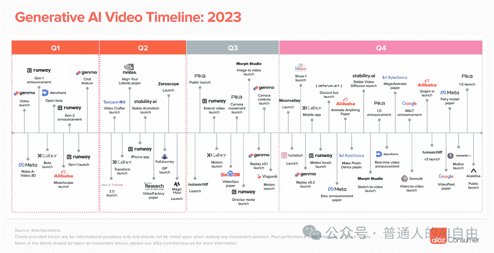

然而，比想象来的更快的，是来自于Sora的降维打击。Sora的出现，再次证明AGI相对“窄AI”的代际优越性。

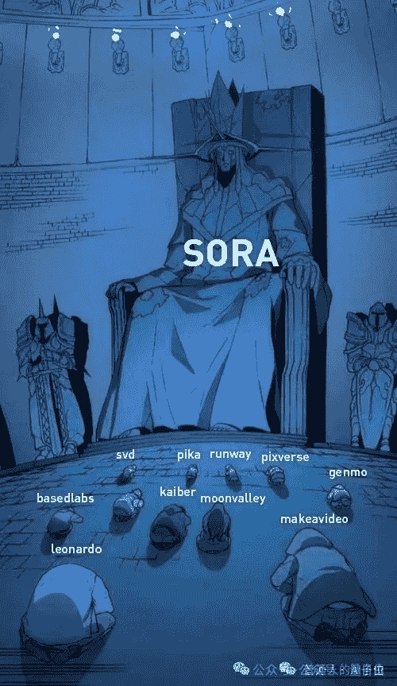

除了视频之外，Sora也直接把**3D能力**做到了7成以上。我们将马上看到视频、影视、游戏制作行业的大洗牌。当然，Sora也不是全能的，它还需要更好的对于物理世界理解能力，这可能是受到数字世界缺乏“触觉”、“重力”、“惯性”传感器的数据的原因。但虚拟现实已经近在眼前。

多模态的另一个进展在**音频**上。在加**入生成式**AI后，技术已经可以达到低成本克隆音色（如字节、MiniMax等都有十秒钟音频快速克隆的能力）、非常自然的文本转语音技术（如ElevenLabs）。具体到实操上，目前已经可以做到在日常/商业场景和音乐场景（如AI孙燕姿，Suno等）这类没有复杂/随机情感变化的场合中的以假乱真。目前的差距在于：情感丰富的聊天场景。但要弥补这个差距是要首先理解感情。这点很像Sora出现之前的视频生成行业；在不远的将来，在音频行业也可以再次期待来自GPT的降维打击。

退一步，**各种多模态技术的进展让我感受到了一种Convesion：一个**可以全真模仿人的时代即将来临。There is no truth anymore online. 在未来，可能只有线下见面才是真的。

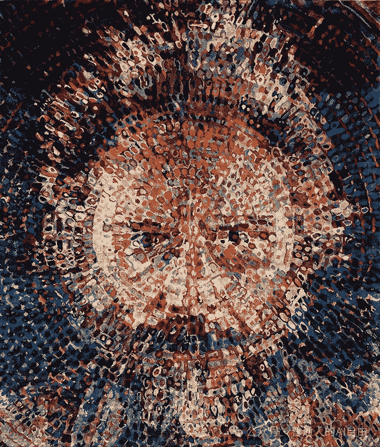

Image: "Faces"

## **<7>国内进展与卡脖子**

从业内人的角度，ChatGPT和GPT**4的出现时最令人**惊**讶的，**不**是它的能力**，而是保密工作做的太好。2023之前国内AI行业还处在沾沾自喜，自认为和美国只有个把月差距，而且还有人口数据优势；这种论调一下子被GPT4打回了原形。OpenAI在国内完全没有预警的情况下，直接拉开2年技术差距。具体原因，可能是国内的骄傲自大，可能是被之前Google主推的T5技术路线带偏，也可能是因为AGI实在是影响过于巨大，FBI、美国国防部这些国家机关不可能没和OpenAI打过招呼。

OpenAI的成功是大力出奇迹，所以23年上半年国内也笃信只要有卡有钱就可以“大炼钢铁”。那时不论是纷纷囤卡招人，研究类GPT架构的大厂们，还是讲着中国OpenAI的故事，拿着巨额融资的创业公司们，都想要第一个创造国产AGI。而到了下半年，在试验了一番发现不容易之后，又纷纷转向要做“垂直应用”、“商业化”；反而不提AGI了。这个转向是短视的，甚至是致命的。

2023年，中美在AGI技术的差距并没有缩小。现在，国内最领先的模型水平大概在准ChatGPT3.5的水平，和GPT4还有不小差距；甚至还不如临时拼凑的Mistral团队的水平。

大厂。大厂们无论是人才、GPU、数据，还是资金储备都是可以冲击AGI的，不过从实际效果上来看还并没有明确亮点。但与此同时，受内部短期考核压力的裹挟，大多数力量应该都放在卷新产品圈地盘和向上汇报工作上了。从另一个角度，这些模型虽然能力一般，但和业务的结合都是比较充分的。最后，大厂们同时背负了太多其他业务和政治考量：对于是否做大模型的出头鸟，很多公司都是要三思的。

具体来讲，百度和阿里是大厂里比较高调：百度的“文心4.0”是当前国内能力最好的模型之一，即将发布的阿里的“通义千问” QwenVL-MAX和Qwen2.0也都有比较好的指标。另外，阿里千问和钉钉的结合，百度文心和搜索的结合也都可圈可点。字节的“云雀”和腾讯的“混元”比较低调，一方面是公司文化的特点，另一方面也大概是还没有明确的亮点。

不过，字节在卷产品和资源调动上是下了决心的：Flow部门有豆包、扣子；还将推出AI角色互动APP“话炉”、图片产品Picpic。朱文佳带Flow，洪定坤做模型，张楠去剪映，再加上裁掉游戏和VR……字节上下All in AI的决心和行动力可能是最强的。

另外，字节和腾讯都有团队在和外部大模型合作，很多外服务和产品也不是用的自己的模型。

创业公司。目前明确看到有好模型、好产品的第一梯队公司大概如下：

+   智谱：一年间推出了4代GLM，一直是国内能力最好的模型之一

+   MiniMax：推出了MoE架构的新模型，和”星野“这个目前国内最成功的AI陪聊APP

+   月之暗面：专注长Token能力，在记忆力和长Token能力上可圈可点

其**他的我暂**时不列**了，在2023年官宣AI大**模型的公司非常多，其中免不了很多是蹭流量的。以及，大模型确实有门槛，融了资的公司还有些钱花，我们可以多给一些时间看2024年的结果。（判断的方式并不客观，欢迎讨论）

从产品层面上，2C端唯一真正出圈的是“妙鸭相机”，不过也只是昙花一现。大多数消费者对于AI产品的态度是“猎奇”，而非刚需。在2B行业中，大模型目前还是“纯技术投入”，对于收入撬动非常有限；而卖AI的大厂们实际上的目的是为了卖云……

最后，硬件层上的卡脖子并没有缓解。目前国内仍然没有芯片可以胜任大模型训练。不过在推理上已经开始有Nvidia的替代产品逐渐出现。备受瞩目的华为昇腾在单卡指标上距离不远，但因为稳定性不足和缺乏Cuda（硬件编译库）生态，仍然需要时间打磨。美国对于国内的芯片禁运在未来还会进一步加深；因此，除了卷模型之外，基于昇腾生态的软-硬件创业是一个机会，而且是更确定的机会。

## **后记：2023 AGI大事记**

+   **22年11月，Chat**GPT上线：“wow!", 大语言模型进入公众视野

+   **23年2月，Control**Net提出：AI生图控制基础，文生图成为真正的生产力工具

+   23年2月，LLaMA开源：**开源生态**的反击，大多数公司的“自研”有了基础

+   23年3月，GPT-4上线：“**与AGI的第一次接触**”，人类开始看到“**世界模型**”的影子

+   **23年3**月，英伟达 H100 发布，大模型算力基础大幅增强

+   23年4月，斯坦福小镇论文- AI Agent：硅基文明的无限可能性：使用工具、协作和决策能力的首次实验

+   23年9月，12月，Mistra**l-7B，**Mixtral-8x7B开源：模型小型化的里程碑，打平超越GPT-3.5(175B)；欧洲有了大模型团队

+   23年11月，GPTs + Assistants API：初级Agent形态与GPT生态构建

+   23年11月，**OpenAI 宫斗**：激进派-CEO-资本代言人Sam Altman获胜，拯救派-首席科学家-理想主义者Ilya Sutskever出局

+   23年12月，Google Gemi**ni系列发布：O**penAI对手开始出牌，竞争正式加速升级

+   **24年2月，英**伟达Chat with RTX发布: 端上智能的曙光

+   24年2月，OpenAI Sora发布：视频生成代际跃迁，再**次证明AGI相对**“窄AI”的代际优越性；虚拟现实成为可能

