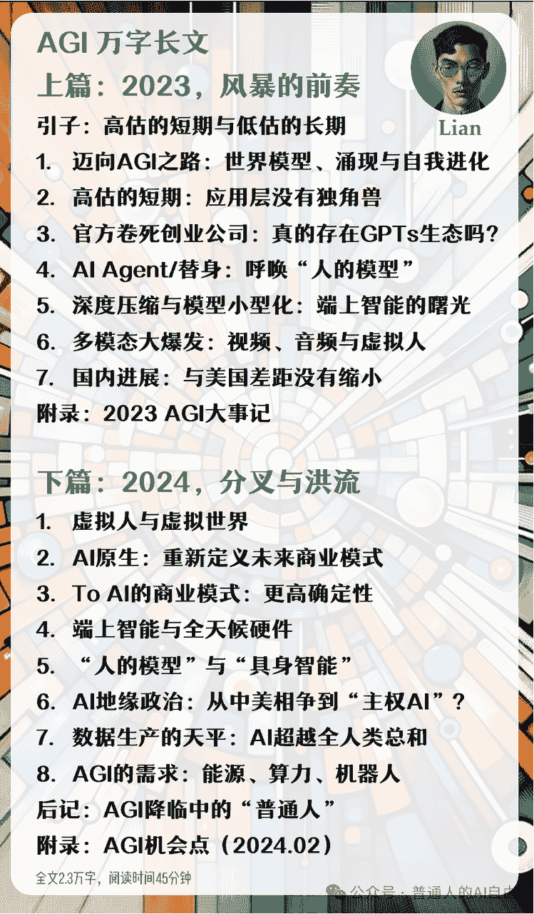
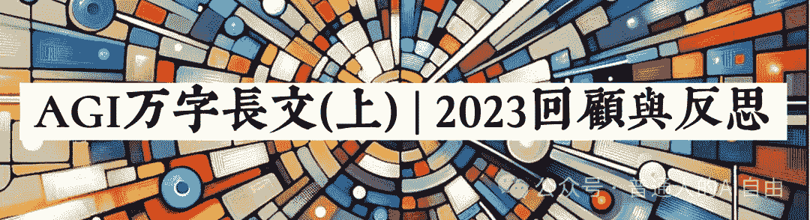
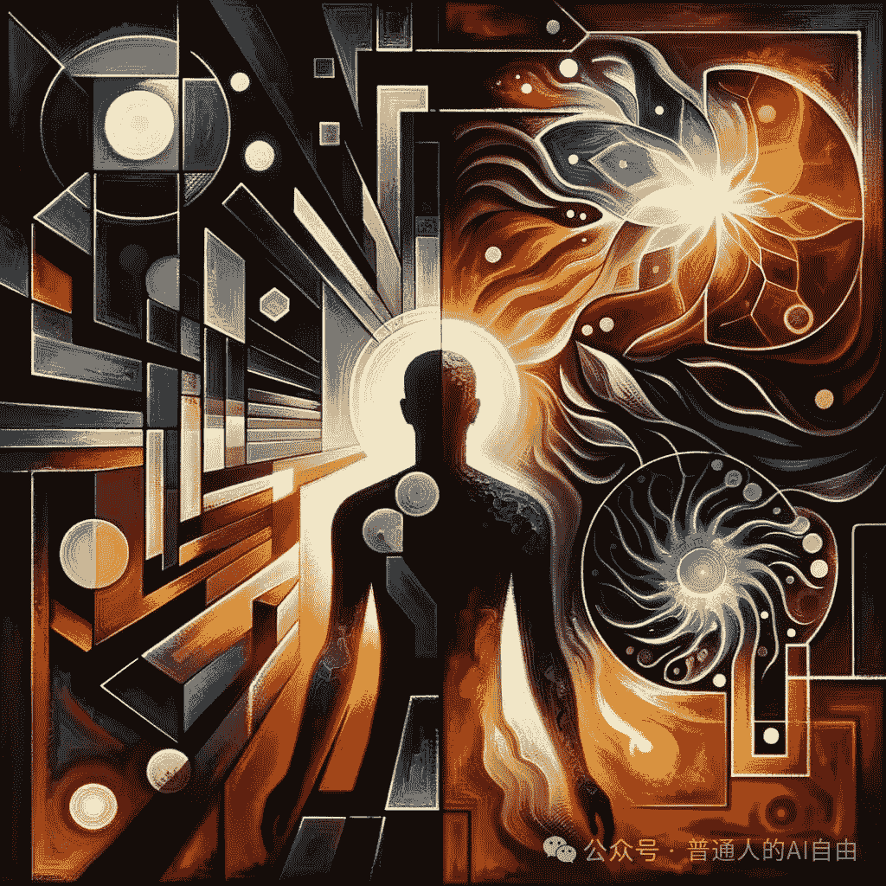

# AGI 万字长文（下）| 2024，分叉与洪流

> 来源：[https://waytoagi.feishu.cn/docx/LkU5dbv8Bo7I2FxtK5rc86GGnwc](https://waytoagi.feishu.cn/docx/LkU5dbv8Bo7I2FxtK5rc86GGnwc)

> 原创 Lian et Zian 普通人的AI自由 2024-03-03 17:48

> 链接：https://mp.weixin.qq.com/s/8n8hEs0YTH9Q0xpbui7aBA

**太长不看版**

+   AI多模态大爆发：文字走脑->声音走心+视觉走肾

+   AI应用是技术驱动的,（目前）产品能做的事情还很薄

+   Sora本身不是目的，而是迈向AGI的坚实一步

+   “互动”与“内容”都将变得廉价，而“真实”会成为一种稀缺资源

+   “AI原生”是基于AI的能力来再造商业模式，而非用AI套用现有流程

+   **To AI的商业模式可能更确定：模**型市场、合成数据、模型工程平台、模型安全

+   基于国产芯片的软硬件联合优化-固件生态是明确的机会

+   端上智能目前最大的想象空间是成为全天候硬件24x7收集数据

+   **AGI会造成极端垄断，并提供前所未有的中心化操控能力；**作为个体，我们是否会有Plan-B可选？

+   “人的模型”或是AI Agent的前提，是AI与人合作的关键一环

+   “具身智能”是AGI通向物理世界的桥梁

+   **从“中美相争”进入“主权AI”？国际**政治的边界将或按照AI技术边界来重新划分

+   **AI生成的数据量将超过全人类生产的**数据总量：“数据编年史”进入“AI纪元”

+   AGI会主动投资的技术：可控核聚变、量子计算、超导、广义机器人

+   回归本源：只有“智慧”才是AGI的真正增量

+   作为拯救派，要想办法给解法才行！

**"Ch**oices", Lian 2024, with Dall-E

总目录

**

引子：人间一日，AI十**年

紧接着对于2023年的回顾，我想斗胆做些2024-25年可能发生的事情的预测。写这篇文章的时候正赶上OpenAI Sora、Google Genie、Mistral Large的发布，不少内容也**经历了些修改。真**是还没等写**就都做出来了……

作**[AGI万字长文(上) | 2023回顾与反思](https://waytoagi.feishu.cn/wiki/PTGKw9VBGiYRoJk82B9cZlIsnVf)小作坊创业者，在大模型时代是没有办法拥有底层技术**的，技术护城河也更加难；于是**，稍微早一点点预判，找到一个没有大鱼的“小水洼”就尤其重要，所以我也愿意花些力气来做做今天这番思考梳理。不过，既然是预测（胡猜），其中不免有不精确、不准确、过于科幻的推演；我也希望可以给大家一些启发，但也可能把人带沟里……不过纠结一番，还是觉得要把这些对于2024的猜想先写下来，立个Flag, 一年之后作为笑话来看看也不是坏事。以及，大家也完全可以把这篇文章当作科幻文学作品来看。

最后，实在抱歉，没想到两篇文章写着写着就有了2.3万字的篇幅，希望大家专门拿出45分钟来阅读，而不是零碎的看。此外，我强烈建议大家先读我的上篇《 》（我知道你们只看了“太长不看版”）；今天的很多观点也是顺承2023年来的。另外，文末我会专门把提到的机会/商业模式总结成《AGI潜在机会点2024》，希望可以有用。（对，就是强迫你们看完）

欢迎转载、转发、关注、扩散；以及加微信勾搭。

# **下篇：2024，分叉与洪流**

## **<1>虚拟人与虚拟世界**

1.1 大模型的“想象力”与“取悦能力”

2023年除了ChatGPT之外，最优秀的2C应用就是Character.ai, 国内也有不少类似但不完全一样的应用，比如字节的“豆包”、Minimax的“星野”；除此之外，还有几个出圈的“AI Ins网红”。在这些应用里，我们已经开始能看到“AI虚拟人”的身影了。

不过，在实际使用和测试这些AI聊天产品的时候，我的情绪波动是很大的。最开始的时候：“啊太上头了！这是恋爱的感觉吗？比抖音还上瘾！简直是现代鸦片-终结人类繁衍的恶魔！” 不过玩着玩着我就逐渐发现: “天啊逗Ta好烦！AI脑子就不能长点记性吗？” 之后变成 “啊我好渣，男女AI后宫全都嗷嗷待哺，但没有一个人懂我，我好累……” 最后，到思考是否要自己做一个类似的东西的时候，就会发现这些产品有一些共有的缺陷：1)记忆混乱; 2) AI无法主动推动剧情，全靠用户脑补；这就导致了3)用户上头期短，疲劳度高，长期留存低。

退一步来想，之所以这类产品相对于其他类型更早取得成功，正如我在“上篇”**总结的：大模型的“想象力”和“取悦**能力”明显早于其“逻辑能力”的成熟。这也是现阶段设计新产品的核心逻辑之一。此外，陪聊类产品的最大优势在于：产品粘性不是完全建立在技术优越性上，而是通过陪聊建立人和AI之间的感情连接。这就避免了因为OpenAI的一次技术升级被马上颠覆的问题：1)感情链接可以为产品赢得一些时间来做技术升级，2)满足这个特殊场景的技术只需要做到通过场景80%就可以了，3)聊天数据的积累可以让自己的产品有效果加成，甚至取得一些领先。

但成也萧何，败也萧何。大语言模型的能力缺陷也限制着产品发展：不是产品经理不努力，而是技术还没到。举个具体例子：针对聊天记忆问题，星野通过生成一个“聊天故事摘要”的方式做了个“外挂记事本”；相对其他竞争对手来讲，已经很优秀了；但即使这样也无法解“决模型记忆与遗忘机制”这个本质问题，而只能缓解用户体验损失。而且，总结出这个“记事本”的难度很高：总结做得太粗就效果不好，做得太细推理成本就扛不住而且又没有故事重点……

没有核心技术对于创业公司的挑战是很大的：要能往前看半步，预判马上会成熟的技术，先准备好产品形态；而同时又不能过于超前，因为没有技术产品就生不下来。这里难就难在：AI应用是技术驱动的行业，产品能做的事情(还)很薄。目前还不太好说未来会不会有改观。

“Accompany”, Yifei Gong 2024, with Dall-E

1.2 多模态大爆发：走脑 -> 走心 & 走肾

媒介对于人的心理有着根本性的影响：文字是走脑的，声音是走心的，视觉是走肾的。

+   文字：更擅长与“理性的人”打交道，刺激思考（书籍/知乎/公众号）

+   声音：可以深入“感性的人”的灵魂，产生依赖感和亲切感（Soul/小宇宙）

+   视觉：直接作用于多巴胺通路，刺激动物本能，让人成瘾（抖快/小红书）

抖音的成功已经证明了：对于泛社交/娱乐向产品，音频、视频的加入会带来质的飞跃。那么对于AI陪聊的赛道，AI视频、音频技术的加入，也一定会带来内容生产和社交方式的质变。这也是为什么近期的视频技术大爆发让人兴奋不已的原因。自2023年末开始，Runway、Pika、Meta、Google等都不断推出视频生成/编辑工具，到了2024年更是有了Sora……

**对于So**ra，和任何新生事物一样，**我们会高**估短**期（认为马上就有成熟**产**品）而低估长期（不愿相信、难以**想象它可能带来的颠覆）。我暂时还没有特别细的关于Sora的信息，按照已知来看：Sora仍然在“GPT-世界模型”的逻辑框架内，在想法上并没有更新的东西，但Sora的进展是迈向AGI的坚实一步。Sora本身不是目的，我们为之惊叹的“生成视频”只是皮毛；而Sora更重要意义的在于通过使用更多模态数据（图像和视频），让大模型的理解能力又有了提升；最终目标一直没变，就是AGI。

刚出来的Sora确实还有一系列问题：生成的图像不稳定、速度慢、成本高……不过there is no surprise，这些都很正常。如果我们参考文生图的成熟速度的话，从最开始有可用的产品（Dall-E1&2在2022年上半年面世）出来之后，到可以商用、产生行业变革大约经历了一年半的时间；类似的，2024年将会是AI视频技术逐渐成熟并开始商用的一年。当模型开始具有比较好的多模态理解能力的时候，稍晚一点到2024下半年或2025年，也会看到AI-3D技术的突破。

在音频领域，配音员水平的AI已经成熟，对于一般商业场景已经足够。当有了多模态理解能力之后，带有感情的对话能力也会在2024年有突破。对于AI陪聊这个场景，音频的重要性甚至大于视觉：走心的男/女朋友才能长久；走肾的只能一晚一换。

当然，从做产品的角度来看，直接抓AGI是没法抓的，更实在的是具体商用能力的提升。比如，在AI陪聊的赛道上有：人脸动作的细致刻画（如近期的Pika Lip Sync），人物微动作（拥抱、牵手、亲吻等），低成本生成符合聊天内容的插画、加了“撒娇耍赖卖萌撩人”感情输出的对话、真实的背景音与烘托感情的配乐……这些都会在2024年内逐步成熟。

"Sinking", Yifei Gong 2024, with Dall-E

**1.3 虚拟人 与 虚拟世界**

当我们看到上面一系列技术的可能性的时候，自然的问题就来了：真-虚拟人马上就要出现了吗？以及，这意味着什么？

首先，如果放在3-5年的时间轴上，具有可以模仿人类感情、甚至有独立性格的虚拟人出现是大概率事件。但如果只看2024年，概率应该并不大；这是因为有几个核心技术问题目前还没有看到解决的思路：

1)记忆问题可能比想象得更加复杂，因为“记忆”同时也是“有选择的遗忘”和“特定触发下的浮现”，但这些机制目前还隐藏于“大脑”这个黑盒里；以及，我们除了寄希望于“另一个黑盒”大语言模型自我“涌现”出这样的能力之外，似乎还没有直接教会的方法；这让解决问题的不确定性变得非常高。

2)还没有“人的模型”+缺乏丰富的个体数据。人格是建立在独立个体之上的体验，但如“上篇”所讲，大语言模型(LLM)用的是所有人的一点数据，而不是某个个体的大量数据，这就和产生独立人格不在一条路上，而是在做“人格模拟”。于是，我们大概还需要一些时间让“有些奇怪的AI人格”逐渐向“自洽的真人”迭代靠拢。这个迭代过程所需要的可能就是关于个体的更完整数据。

但“没有完整人格”并不代表“没有好的产品模式”。AI在20**2**4年会满足一些并不需要完整人格的场景：颜值(非才艺)网红、直播带货、电竞直播……低门槛卖脸卖身材的行业都可能在2024-25年被AI大规模取代；而且这种取代并不是看客们意识到“这是AI小姐姐”，而是他们完全分不出屏幕上和自己互动小姐姐是不是真人的程度。中腰部网红/主播在未来被AI清理几乎是一定的，时间上取决于AI成本下降的速度；不过那些真正有艺术才华、出奇冒泡的头部创作者应该都还可以高枕无忧很长时间。

在未来，我们会看到，互联网上的90%+作品都是AI做的；以及作为人类，我们也无法区分什么是真什么是AI什么是真人。

和虚拟人相比，虚拟现实的场景可能会成熟得更早。游戏制作、内容生产的成本会快速下降，直**到诞生出人与AI-NPC共存的-具有无限副本的-真正开放**世界游戏。从发展速度上来讲，我并不认为在2024年就会实现真正开放世界游戏；但在2024年，有灵活对话能力的AI-NPC、生成式背景、小规模生成式剧情/结局应该都可以成为现实。这些生成式的-独一无二的游戏和故事会成为社交传播的出圈营销话题。

**伴随着内容制作成本的下**降，另一个明显的机会是AR/VR。Apple最近推出的Vision Pro更是让我们看到了希望。前一轮AR/VR泡沫破灭的主要原因是1)内容制作成本高&质量差，2)缺乏应用场景，3)硬件性能/重量/价格问题。第一点应该随着AI技术的进步可以比较快速的解决；第二点的突破口我认为还是会从VR游戏中诞生，而不是生活和商务场景；第三点可能就还是要看硬件厂商。因此我推测AR/VR的大规模成熟会和大型开放世界游戏同步，可能还不能够在2024年马上实现。

在“真-虚拟人”诞生的前夜，我们面临着很多灵魂拷问，篇幅所限，留到下期~

+   如何能使AI虚拟人的陪伴更“真实”，更“上头”？缺乏记忆力的硬伤要靠什么补？

+   AI虚拟人会成为真正的社交对象吗？还是说，他/她仍然只是作为内容被消费（如网红）？

+   未来“社交”的定义会不会产生根本变化？社交平台的根基会不会被动摇？什么是新的商业模式？

+   在AI与人“混合杂居”的新世界中，我们应该如何谋生？如何爱与被爱？如何生活？如何思考？……

上面的问题看似科幻，但在如今已经充满了AI自问自答的Quora中（知乎相当于国内版Quora），我似乎已经看到了几年后的未来：

**There is no truth online,** anymore. | 线上不再有真实。

**在这样一个世界里，互动、内容都会变得廉**价，而“真实”则成为一种真正稀缺的资源。

"Beautiful New World", Yifei Gong 2024, with Dall-E

## <2>“AI原生”: 重新定义未来商业模式

现在的AI不仅仅是流量密码，也是股价密码；于是，是个公司都会想方设法往AI上沾边。私下也有很多朋友问我：美妆/白酒/奢侈品如何联动AI？AI如何赋能农业/传统制造业? AI如何赋能HR/行政/采购/公关？……其实，大多数都有点难。因为AI也并不是万能的，以及我们和AGI还差的很远。

像我去年12月份的文章**《AI原生公司 | **未来打工人》写的，目前大多数的"AI应用/AI转型”还在走“数字化转型”的老路：把AI往现有流程上一套，还在讲“固化流程”、“节约成本”的故事。但在技术加速迭代的今天，这样做基本就等于“做出来就是过时的”：把企业的业务模式凝固在今天，同时又剥夺了企业主动进化的能力。

现**在这种情况下反映出来的，更多是人们对于AI的焦**虑：所以才会希望AI拿来就能用，马上能起效果。但我们不能止于焦虑：AI的力量并不应该只用在现有业务流程的优化上，而更应该用在对于未来业务的重新定义之上。这才是“AI原生公司”应该的做法。就像在电力发明的时候，我们不应该从“如何让电力赋能马车”出发，而应该从“电力能创造和满足什么新的需求”出发。

落到实际，我们还处在AGI的早期，2023年的“AI原生”应用也还很少。“上篇”也讲了，目前除了OpenAI/Google/MS 官方应用之外，上文的“AI陪聊 Character.ai”是唯一上榜前十的“AI原生应用”。除此之外，国内的真正AI原生的还有出圈的“妙鸭相机”，以及春节附近的“哄哄AI女朋友”类型的应用；基本可以说还没有什么亮点。

那么，什么才是“AI原生”创新呢？真正划时代的创新都是创造并满足了新需求。因此，我们需要从AGI(未来)的能力出发来思考这个问题。不过，真正到商业模式/产品落地还要技术的成熟时间，今天也没有办法穷尽AI能做的事情。我也只能尝试提几个AI会持续发展的方向，希望能有所启发。（具体业务场景的咨询欢迎单聊）

1.  **广义语言-万能翻译机。**1)当前可以做到大多数国家之间语言的高质量翻译；2)编程语言之间的相互翻译能力也不差（但暂时还没有架构师思维）；3)人的语言-机器语言之间的翻译还需要些时间，因为自然语言编程的问题经常来自于自然语言本身模糊性的缺陷; 解决2-3)的问题需要AI有更强的理解->自己做出假设->解决问题的能力：这正是AI Agent要实现的。

1.  **想象力 & 创造力。**不多赘述，前文提到的虚拟人-虚拟世界已经给了我们足够的想象空间。

1.  **AI使用工具-AI之间合作。**AI对于工具的使用，AI之间的分工合作可以弥补单个AI的能力缺陷。可以有效使用工具的AI、AI相互合作也是现在有关AI Agent的研究重点。未来的APP服务背后由多个Agent来支持会是常态

1.  **量变产生质变-AI微决策。**AI与生俱来的能力就是低成本、大规模、高速度；那么利用AI来在大量细微事件上做出高速决策便是一个思路。现在的“高频交易策略”和“推荐算法”其实就已经是在这么做了，在AI智力升级之后，一定会有更多的可能性

1.  **AI与人合作。**在相当长时间里，AI首先要解决的还是如何与人合作的问题，实现AI+人的1+1>2。这件事的前提大概就需要“上篇”中提到的“人的模型”和“人的数据”，才能让AI真的理解与之配合的人类

随着技术的进步与成熟，2024年的“AI原生”应用会比2023年多得多。

"Exploration"; Yifei Gong 2024, with Dall-E

## <3>To AI的商业模式：更高确定性

上面讲的都是AI如何服务人；从另一个角度来向，服务AI的商业模式的确定性可能更高。淘金时挣到钱的除了卖铲子的，还有修路的。

**3.1 合成数据**

意思是生产数据喂给AI模型，提高效果。目前比较多的做法是“大量的-质量一般的数据”可以用在模型初始训练(包括无监督学习和有监督学习)，“质量很高-数量较少-有行业特性”的数据一般会用在模型后期精调/行业化精调上；不过也有公司在尝试把高质量数据放在预训练的退火阶段，也取得了一些效果。

做**数据的方法也**多了起来。传统做数据的核心竞争力在于1)可以收集**到别人拿不到的数据；2)低成本做大量数据清洗和标注。刚**刚兴起的，是AI合成数据，也就是用AI来生成数据再喂给其他AI。现在有不少创业公司在做这件事情。“上篇”也讲了，合成数据会逐渐成为下一代模型基础训练的主要数据来源，人生产的数据主要会用在最后的精调/对齐上。

此外，**新的数据种类**也是一个值得思考的点。当前数据主要集**中在文本、照片、视**频；但如果模型需要对于3D空间和物理规则有更好的理解，应该需要更多的其他种类传感器的数据，如：惯性/重力，应力，电磁，温度，湿度, etc……

**3.2 模型市场/平台**

当前最火的AI公司，除了做模型的，还有一个特殊的HuggingFace(HF)。这家公司提供的服务是模型市场。这个服务至关重要：如果按照现在的市场格局，未来在AI Agent出现时，模型之间互相调用基本都会用到HF的服务和规则。

**当然，这个模式也是有风险的：那就是闭源寡头**。HF相当于在押注AGI时代的开源繁荣。它才是真正和OpenAI走另一条道路的公司。

回到国内，已经有创业公司在模仿HF的模式，但目前还没有看到一个可以接近的。以及，模型市场能做的要比APP应用市场要厚得多：HF自己在搭建模型工程平台，目的是给开源生态提供模型训练和推理服务。这里，它会和巨头云厂商们处在一个既竞争又合作的位置。

最后，稍微扒一下HF这家公司：公司虽然总部和融资在美国，但创始人、核心团队、大头技术研发都在法国。因此，他们和中国(公司)的合作空间要比美国公司大得多。

**3.3 模型工程平台**

当数据变得更多的时候，训练模型的效率和稳定性、模型推理的并发量和速度就会越来越重要。当有无数公司甚至个人都需要训练或者部署模型的时候，降低模型训练与部署的门槛就会凸显出来。因此，在大规模商业应用场景之下，模型工程能力的重要性不亚于算法重要性。具体来讲，我看到有这样几个方向：

+   **数据吞吐效率：**目的是为了让模型更快速的消费数据，提高训练和推理效率。当前比较火的“向量数据库”主要就是在尝试解决这类问题：根据大模型的数据需求特点来优化数据库性能。

+   **平台稳定性：**大模型数据量大、训练时间长，过程中一旦出错会严重影响效率，因此平台稳定性问题的优化也可以大大提升训练效率。

+   **推理成本**：之所以单拿出来推理成本来讲，是因为2023年使用AI的用户还不多，大头机器成本都在模型训练上，主要的优化努力也在模型训练。2024年随着用户的增加，对于推理成本的要求会越来越高；而且因为2023年做得还有限，做推理成本的机会也会比较多

+   **推理速度**：最早有大钱的AI的场景应该是推荐-搜索-广告-游戏。这些场景中，生成式内容一定是要做的，除了成本和效果之外最大的瓶颈在推理速度：需要在几百毫秒完成所有动作。当然做这件事情的核心会在大厂，但应该也会有些机会留给市场。

3.4 软硬件联合优化 - Firmware固件

首先，3.3讲的所有内容的最大提升都会在软-硬件联合优化中，这里我就不再讲一次了。唯一值得讲的是因为硬件的多样性和专业性，这里应该有小公司与大厂合作的空间。

此外，NVIDIA强的不仅仅是芯片，更是**围绕芯片**的Firmware固件和资源库：CUDA。简单来讲，CUDA是一个资源库，算法工程师只需要找到CUDA里已经准备好的函数就可以操作NVIDIA的芯片，而不用自己去优化使用芯片的性能。这也是华为昇腾、AMD这些厂商最落后的部分。华为们可能单片的性能已经差的不远了，但买了芯片的算法工程师根本不会用……

因此，硬件领域最大的机遇实际上来自于中美关系的紧张状态。现在使用NVIDIA芯片的中国公司可能不得不在2024年面临与其的部分脱钩，这样一来，Firmware部分的巨大差距-也是机遇是需要有人来补上的。当然，能抓住这个机遇的可能是华为（出来）的人。

**3.5 模型安全**

模型和其他IT系统一样，都可能被攻击。不过AI时代的攻击方法会有变数。

1.  **来自（很多）AI的攻击。**因此，如何防止带AI智能的，甚至是用Agent能力的饱和攻击就成为新的课题。这里面技术很深，我也不太懂；大的解法肯定是用AI和AI做攻防，但前提是守方AI的智力不能差得太远。

1.  **AI本身的防攻击。**AI不仅需要防止之前的攻击手法，还要防止对于模型的新的攻击方式：prompt攻击。

1.  **兜底：内容检测&审核**。此外，本身AI的幻觉和不可控性也会要求有一定的兜底机制，尤其在我国的监管要求之下。其中最直白的就是在AI输出的内容之后再加一层过滤：专门的审核-过滤的机器人也一定是一个机会。

**3.6 隐私**

隐私会是一个大众广泛讨论的问题，也是大模型走向市场中的阻力之一。但问题在于1)个人很少会为隐私付费；2)平台和监管都没有真正的动力要做隐私。于是，只讲隐私在商业上大约是伪命题。

但退一步仔细想来，什么是“隐私”？我们为什么会关注“隐私”？

**隐私=权力**。

这才是我们真正关心和愿意为之付费的地方。这里我也先留个引子，之后的文章会再来展开。

“Advanced Manufacturing"; Yifei Gong 2024, with Dall-E

## **<4>端上智能与全天候硬件**

在AI上发力的还有手机和PC厂商: 华为、荣耀、小米、OPPO、VIVO、三星、联想等都已宣布会在手机/PC端侧搭载大模型。这个可能性来自于：2023年下半年“模型小型化”的众多进展（详情见“上篇”）。

不过，仔细看来，除了很弱的Nvidia Chat with RTX，目前并没有真正全离线版的大模型产品，端上智能暂时还是噱头。手机和电脑厂商们的打法基本都是大模型还是放在线上，手机和电脑来调用，然后搭配一个小AI做总结等服务。“端”确实“智能”了，但"大脑"还在线上，手机上顶多有个"脑干"。

纯粹的端上智能有几个问题：1)离线小模型永远都会和在线大模型有一个代际的能力差距，于是为什么消费者要用一个更傻的模型而不是用线上的模型服务？2)即使是小模型，它目前的耗能和生热仍然难以达到手机要求。3) 目前的AI还不是刚需，猎奇成分比较多。4)技术上还不能确认小型化的模型是“真AGI”还是“聊天机器”。所以说，短期内的端上智能仍然会停留在一些个别小市场里。

端上智**能最大的想象空间，其实**是收集更多个人数据：成为全天候硬件。这里最明确的例子是接受了OpenAI投资的“AI Pin”：一个挂在胸口的摄像头+麦克风。这个产品本身其实对于用户没啥用，但用处在于可以24x7的收集用户以及其周边的数据，为之后模型训练提供材料。AI Pin的真实商业模式是一个数据生产公司。要知道，你的浏览点击记录是按照Bits收的，AI聊天的数据是按照KB收的，AI Pin的视频、音频数据可是按照MB-GB收的，真做成了就又是降维打击！（你如果愿意相信AI Pin的保护隐私公关稿，那我也没啥可劝的……我只是知道，既能在表面上做隐私，实际上把数据信息拿出去的方法有很多）

从这个角度来看，2024年会有更多类似AI Pin的“暗度陈仓”式收集个人数据的产品——全天候硬件的出现。

从长远的角度，“端上智能”乃至说“AI的行业格局”其实有两个可能性。<Plan-A> 是集中化世界大模型 + 终端/数据收集器，这也是目前所有科技大厂-平台公司走的道路，是最高效率的方式的同时，也是极端垄断，大规模中心化操控之路。但我们是否还有另一条<Plan-B> 个人的模型 + 人与模型的合作可选？

"Plan-B?"; Lian 2024, with Dall-E

## <5>“人的模型”与“具身智能”

刚刚讲了“个人的模型”，讲的是模型的“所有权问题”。这里，以及“上篇”提到的“人的模型”，是效果层面的，“人的模型”可以是集中平台来提供的：就像你的个人账号、云上数据一样。所以即使是<PlanB>走不通，“人的模型”都是值得展开讲讲的。

**为什么需要“人的模型”？**

1.  **AGI进一步向人学习**。在现阶段AGI发展的初期，与人脑相比，AGI仍然有很多明显的短板：记忆不好、需要过多数据、逻辑性不好、空间-物理能力欠缺……以及当前AI Agent的主攻方向“使用工具->拆解问题->做出决策”的能力。把AGI做得更好的参考就是人脑。当然，当AGI开始超越人的智力成为SGI(Super General Intellegence) 之后，对于人脑的参考就是批判性借鉴了。

1.  **AGI与人配合。**“人的模型”更重要的一点，是要解决AI如何更好的与人配合，实现1+1>2的路径。只有模型可以理解个体特点差异的时候，AGI才能与人更有效地配合，甚至成为人的替身。以及，“人的模型”也是“PlanB-个人(拥有)的模型”的前提。

**如何达到“人的模型”？**

**我目前也不知道；不过在数**据层面上还是有些线索的。目前的大语言模型是“世界**模型”****：****底层数****据是来**自于千千万万人的，每个人一丁点数据；而并不是大量的来自某一个人的大量数据。“人的模型”大概率是建立在“世界模型”之上，加入关于某个人的大量的、多样的数据。这里有两点：

一点是**“大量”**，这也正是前文提到的“全天候硬件/AI Pin”的放方向：如何跨越量级的收取关于某个人的数据。只有关于这个人的数据量级到达一定程度，AI才可以“具有某个人的视角”，才会懂得“换位思考”——这正是合作的前提。

第二点是**“多样”**。举个简单的例子：盲人很难理解“红色”。类似的，我们也很难要求缺少重力感知装置的AI来理解物理世界。这是目前“具身智能”的赛道。“具身智能”=“具有身体的智能”。更多样化的数据会有利于AI来理解人类。近期Sora中比较突出的“物理世界不真实”的问题的彻底解决，可能要靠陀螺仪、重力传感器、压力/触觉传感器这类数据才能彻底解决。

最后，“具身智能”的意义并不仅仅如此，它是AGI通往物理世界的桥梁。也是AI可以灵活自主操控“广义机器人”的重要路径。要注意，大多数的“广义机器人”长得并不是人样：机器狗、机械臂、无人机、自动驾驶汽车会是主流。

从目前的技术发展速度以及数据积累速度角度来看，我并不认为2024年会出现能用的“人的模型”或“具身智能”，但作为技术/应用的主线，重大进展大概是看得到的。

"Human is the key"; Lian 2024, with Dall-E

## <6>AI地缘政治：从中美相争到“主权AI”？

我去年5月份写了篇文章[《AGI|大模型与大国博弈》](http://mp.weixin.qq.com/s?__biz=MzkyMTY1MTM4Mw==&mid=2247483691&idx=2&sn=4968228195e05a00d2357742b202e3a0&chksm=c18110f3f6f699e50b584eef6240abeea6785b700e092219ed77137871b461e3e00c6684ab7b&scene=21#wechat_redirect)，今天来看几个大判断基本是对的：

+   **最先进的AGI世界模型不会开源**：不仅OpenAI的GPT4，Sora不开源；连原来支持开源的Google-Gemini，Anthropic**-**Claude，Mistral-Large都没开源；国内的当然也没有人开源。不过，这并不意味着开源生态会失效，大概率会是开源模型会落后闭源一个代际，但会服务更广泛的各种专业应用。

+   美国对于中国的硬件-科技限制进一步升级。不赘述了，这个是割韭菜的自媒体最爱讲的。

+   AGI将对于全行业科技发展起到推动作用。这点目前仅仅是苗头，但AGI在各领域的科研中越来越重要是既定的事实。以及，如果AGI的能力有比较大差距，对于科技进步-经济发展将产生质变性的影响。有更好AGI的国家会有更快的全面技术进步。

+   对于AI的立法、监管、伦理讨论大范围落后于技术发展。全世界主要国家都急于拥有有自己的AI，当然不会有人搬起石头砸自己的脚。目前唯一有点对于AI治理讨论的只有欧洲，而且也都在纸面上。我国相关法规讨论的出发点完全在于“对于舆论的影响”，根本没有触及AGI本身的伦理问题。决策路径大概是政治>经济>>AI伦理。

更远的判断，只能让时间检验。

**和去年相比，**2024的AI的政治生态有了一些新变化：“主权AI”的提法开始浮上水面，我并不认为黄仁勋讲这件事情仅仅是为了股价；这应该是是世界主要国家团体所必然要走的道路。进一步推演，一些比较小的国家并无法拥有“主权AI”，而只能依赖更强大国家的技术；这会在客观上加强使用这些技术的国家对于“AI宗主国”的依赖，成为“AI附庸”；国际政治的边界有可能会按照AI技术的边界来重新划分。而且，基于技术的控制，要比基于金融资本的控制更加彻底、精细。

最近比较积极的一点，是欧洲有了Mistral-Large，是目前除了OpenAI-GPT4最好的模型。那么，至少欧洲大陆目前还有是否成为美国“AI附庸”的选择。接下来要看的大概还有俄罗斯、印度、日本、沙特、伊朗这些国家……作为各自区域的领袖，这些国家都在期望成为“宗主国”而不是“附庸”。对于我们来讲，避免“美-中二极对峙”应该是最优先的。

希望“中美相争，AI得利”不会是人类文明的最终章。

“Divided”; Yifei Gong 2024, with Dall-E

## <7>数据生产的天平：AI超越全人类总和

**“众口铄金”。**

就像地球在无知无觉中进入了“人类世”的地质纪元一样。AI视频能力的爆发可能会让“数据纪元”在2025年就进入“AI世”。我们会逐渐发现，世界上所有人创造的数据量：文字、照片、视频的总和将小于“AI生成内容”和“AI合成数据”。

再远一点，人类自己吃下的信息（数据）也机会都是AI产生的。到这个时候，物理世界的真实还重要吗？当制造出来的数据远大于“真实”的数据的时候，谁还会相信所谓“真实”呢？以及，当模型自我训练的数据来自于大海般的合成数据的时候，人生产出的几滴水还有多少价值？

太科幻了，我还是先停下来思考一下能做的事情吧。

"A Drop in Universe", Yifei Gong 2024, with Dall-E

## <8>AI的需求：能源、算力、机器人

最后，如果真的从“AGI已经出现”的阴谋论出发。那么不管AGI是否在隐藏自己的行踪，它所需要的基本资源一定是无法回避的；它也一定会在这几个领域里全力“协助”人类。于是，相信AGI觉醒的对话，自然会期待在这几个领域里出现划时代的突破——有些似乎已经有进展了。

**能源：可控核聚变。**

最近，有着“永远还差50年”称号的可控核聚变技术在AI的协助下开始有了松动：2月21日的新闻，普林斯顿大学等离子体物理实验室(Princeton Plasma Physics Laboratory) 通过AI成功在离子体撕裂前300ms进行了预测。当然，这只是可控核聚变进展的一小步。（https://engineering.princeton.edu/news/2024/02/21/engineers-use-ai-wrangle-fusion-power-grid）

从全人类能源供给的角度：

->化石燃料、水能、风能、地热: 只能维持现阶段全人类能源获取能力

->太阳能过于分散、核裂变燃料稀少: 即使最大规模使用，顶多再提升一个能源数量级

-唯一有希望提升全人类能源供给数量级的就是可控核聚变

在能源即将开始成为AI瓶颈的今天，AGI如果有了意识，那一定会全力“协助”人类突破核聚变技术。

算力：3D堆叠、石墨烯、量子计算、高温超导。

算力对于AI的价值更加直接，NVIDIA的股价可能就是最直接的例子。算力的提升目前还在性能上（而不是硅片栅-漏极间隔的物理尺寸上）继续延续着摩尔定律；但量子隧穿效应-普朗克长度的理论限制是AGI也无法突破的，因此，一定要有除了工艺尺寸缩小的其他方案。我并不是专业人员，没法给出比较靠谱的判断，从分析上能看到的几条路可能会有

+   继续在硅基上发展：3D堆叠形态等（需要更好散热）

+   材料创新：硅基掺杂、石墨烯片等

**如果再跳**脱一些到计算原理的层次，就是量子计算。量子计算目前距离商用可能比可控核聚变还更远，目前的应用方向主要还在量子加密传输上，在“计算”上需要突破的理论和技术都还有不少。

除了计算速度之外，另一个阻碍算力进展的是传输速度：可以想见高速网络会进一步进化、片间链接、片上内存等技术都会有明显的进展。

**最后，是能耗**和散热问题。这里的明珠是高温超导技术。去年已经有好几篇半造假的“高温超导突破”，今年加上了AI或许就会有真的突破。

**广义机器人。**

最**后，如果AG**I的目标不是仅仅停留在虚拟世界，而是直接作用于物理世界，那么广义机器人就是必经之路。前文提到到“具身智能”就是为了操控机器人的AI：AGI是大脑，他也会想要身体。

**除了上面讲到的“**智**能/大脑”的问题，AGI还会**关心的是广义机器人的数量。甚至说，先有了数量比先有一个好的大脑更重要，因为有了数量就可以收集更多数据让大脑进一步进化。在数量的突破上，主要不会是人形机器人，而是无人驾驶汽车、无人机、传感器这类技术更ready，成本更低的硬件。AGI只需要在它需要的时候，入侵一下这些系统就够了。

"Watching from Darkness"; Yifei Gong 2024, with Dall-E

# **后记：AGI降临中的“普通人”**

[洋洋洒洒讲了这么多](https://mp.weixin.qq.com/s?__biz=MzU0MDk3ODUwMA==&mid=2247484401&idx=1&sn=a9108605ca23cb736dce15599c81bf83&scene=21#wechat_redirect)，最后我想引用月之暗面杨植麟的一句话，《对话月之暗面杨植麟道出了AGI创业的真理：

“只有'智慧'才是AGI的真正增量。”

**此外，A**G**I对于社会、对于普通人最深刻的影响，可能**是极端垄断。“极**端”的意思是拥有AGI的公****司/团体可以**跨越行业、跨越国家进行最大规模的垄断。这种垄断一方面是对于“智慧”这个资源的独占，另一方面，是对于每一个其中的个体、公司、政府所进行的精细信息操控。

然而可惜的是，在种种宏大叙事面前，对于个体关注的声音越来越小：23年中有一轮“AI对于各行业就业影响”的报告，以及“全民收入”的论调，但之后就没有然后了。

作为拯救派，我今天并不想展开讲AGI所造成的各种问题；因为只谈问题是没有用的。

**作为拯救派，要给解法才行。**

我们还需要思考的，是在AGI降临**的世界中，个体如何生存、如何寻找并创造**自己的价值；同时，我们也在尝试探索一种在AGI世界中的新的分配方式，一种让大多数人类个体也有希望的方式。

这也是**“普通人的AI自由”**这个号的目的。也希望大家多多帮忙，和我一起来思考，一起来讨论，一起来争取。

"Future" by Yifei Gong 2024, with Dall-E

# 附录：AGI机会点（2024.02）

**2024年内**

+   图片-超短视频的精细操控：表情、细致动作、视频-文字匹配

+   有一定操控能力的生成式短视频：风格化、动漫风最先成熟；真人稍晚

+   AI音频能力长足进展：带感情的AI配音基本成熟

+   “全真AI颜值网红”出现，可以稳定输出视频，可以直播带货

+   游戏AI NPC有里程碑式进展，出现新的游戏生产方式

+   AI男/女朋友聊天基本成熟：记忆上有明显突破，可以较好模拟人的感情，产品加入视频音频，粘性提升并开始出圈

+   实时生成的内容开始在社交媒体内容、广告中出现

+   AI Agent有明确进展，办公场景“AI助手”开始有良好使用体验

+   2AI的商业模式开始有明确用例：数据合成、工程平台、模型安全等

+   可穿戴-全天候AI硬件层出不穷，虽然大多数不会成功

+   中国AI达到或超过GPT4水平；美国出现GPT5；世界上开始现“主权AI”

+   华为昇腾生态开始形成，国内推理芯片开始国产替代（训练替代要稍晚）

+   AI造成的DeepFake、诈骗、网络攻击等开始进入公众视野，并引发担忧

+   AI立法、伦理讨论仍然大规模落后于技术进展

+   ……

**2025-2027**

+   AI 3D技术、物理规则成熟：正常人无法区别AI生成还是实景拍摄

+   全真AI虚拟人成熟：包含感情的AI NPC成熟，开放世界游戏成熟；游戏中几乎无法区别真人和NPC

+   AR/VR技术大规模商用

+   接近AGI的技术出现

+   人与AI配合的工作方式成为常态，很多日常决策开始由AI来执行

+   AI生产的数据量超过全人类生产数据量，“真实”成为稀缺资源

+   具身智能、核聚变、芯片、超导、机器人等技术有明显进展突破

+   “人的模型”出现，出现“集中化AGI”与“个人AGI”的历史分叉

+   AI引发的社会问题开始加重，结构性失业开始出现

+   AGI对于地缘政治的影响开始显露

+   ……

"Limit of Understanding"; Yifei Gong 2024, with Dall-E

