# 学习笔记：【这就是 ChatGPT】了解原理让大语言模型 AI 成为你的打工人

> 来源：[https://waytoagi.feishu.cn/docx/J8CKd3R7nogqCdxpOiwcl3oonWg](https://waytoagi.feishu.cn/docx/J8CKd3R7nogqCdxpOiwcl3oonWg)

> 🔗 原文链接： h[ttps://www.iaiuse.](https://www.iaiuse.com/posts/508a6067.html)com/posts/508a60...

> 作者：大雨

#  先说结论

+   ChatGPT 不仅是为了推广 GPT 技术的一种方式，也是一个展示软件开发商技术能力的示例。

+   虽然 Prompt 作为接口方式有其局限性，但它提供了与 AI 交互的直观方式。

+   未来可能有更多的方式，因为 Prompt 丢失了肢体语言，语气语调

+   在 AI 时代更要注意它带来的信息茧房，更重视自己的行业积累。

+   应警惕过度依赖 AI 而忽视独立思考的重要性。

+   虽然 AI 为某些人提供了盈利的机会，但这通常归功于他们原有的商业模式和策略。

+   AI 本身没有意识，人类不应将自己的感知错误归咎于它。

+   目前的模型通过预测下一个 Token 来生成文本，这限制了我们判断其是否具有真正的智能。

+   它是技术和工程的结晶，对于推动创新和实用应用具有重要价值。

+   它的成功只是赌对了，但远远不是终局。

+   虽然 AI 目前不能实现大幅度减少工作时间的愿景，但这种设想激励着技术进步。

+   目前阶段它只是内卷手段，剧场中你站起来早而已。

+   无法多了一个老板给我们的狗链子，AI 的使用迟早是标配。

+   这个过程中，我们该 996 还得 996。

+   下班老板找不到我们这个美好的愿望，在几十年前有电话开始就一去不复返了。


#  1、Prompt 有效不是因为它理解我们的想法

> 通过今天的内容希望能帮助大家破除对 ChatGPT 的迷信，对 AI 的妄念，从而更平和的心态对待它。它只是一个工具，一个好用的工具，帮我们提升技能，提升收入，提高人生幸福感的工具。

如果有一天，分开了，可以说

> 你是好人！

> 爱过！

##  1.1、ChatGPT 只是预测下一个 Token，而已！

比如我们有这样的想法：

+   请你帮我做一个关于英语学习的 PPT

+   请你给我翻译下面这段文字，输出的内容字数严格限制在 xxx 字以内

下面我们来看一下，什么叫预测下一个 Token。

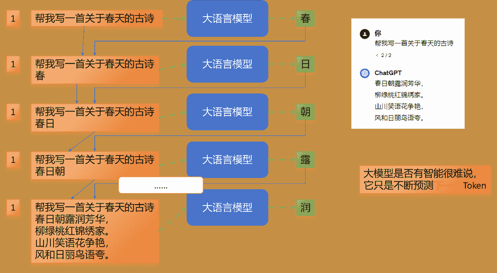

通过这幅图示，我们可以理解到大语言模型的工作原理：它将输入与自身的输出结合，循环处理直至任务完成。这种方式让人们质疑它的智能真实性。

目前，这类模型主要专注于文本输出，尚未具备与外部系统直接交互的能力，例如控制汽车或跳出网页对话框等操作。这突显了它们在应用范围上的限制。

虽然生成 Token 的具体机制不是我们的主要关注点，我们更加关注的是如何利用这项技术来更有效地解决问题。

##  1.2、如何让它的效果更好！激发更多神经元！

在开始之前，我们首先介绍一个使用搜索引擎的技巧，这将帮助我们更有效地与大语言模型进行交互。

我们可以通过推断，来预测

+   最终结果可能出现在哪里

+   以及整个网页可能包含哪些信息。

例如，当我们搜索“ChatGPT”、“ChatGPT OpenAI 本质原理神经网络内部平装定价”时，结果会有所不同。

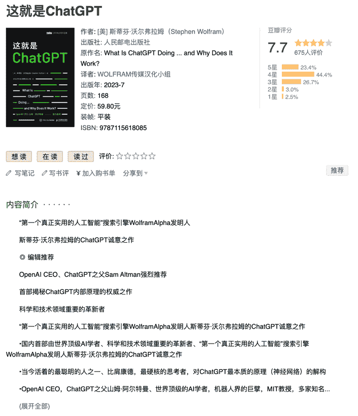

ChatGPT 的资料很多，但关于其原理的书籍则较少。一个独特的技巧是在搜索关键词中加入“定价”，因为这个词通常只出现在销售书籍的网站上。这可以大大帮助我们缩小搜索范围，从而有更高的概率找到我们想要的结果。

从这个例子中我们可以得出结论，对问题进行深入而精确的描述，可以帮助我们获得更高质量的答案。

> 不要被深刻两个字唬住了，就是多几个名字而已！

大多数人可能听说过神经元、显卡和 GPU。简而言之，激活更多的神经元可以增加获得高质量答案的可能性。下面我们将尝试简单说明对神经元的理解。

##  1.3、神经元是我们美化的叫法，就是一个简单的数据结构而已

> 注意，我的理解是不准确的，不用过于细究细节。最后我会放上 GPT 对我这个理解的评价。

>

>

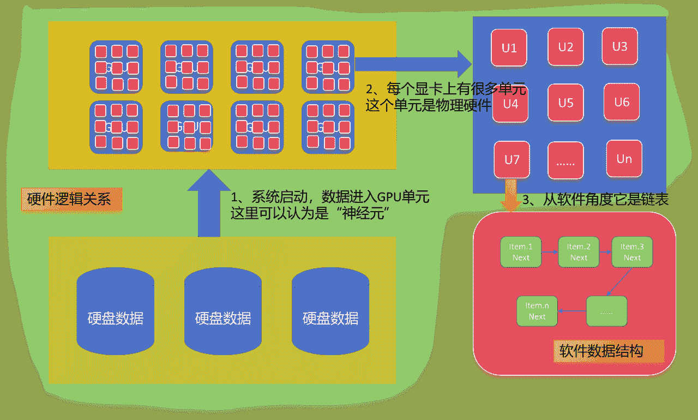

>

为了消除对 AI 的误解和无根据的信仰，这里介绍神经网络模型的工作原理，包括它的硬件和软件组成。

从整体上看，我们可以简化理解模型为存储在电脑硬盘上的一系列文件。训练过程实际上是将互联网上的高质量数据转换为模型可以理解的格式，而转换后的数据基本上是对人类不可读的。

在模型启动过程中，数据从硬盘加载到显卡中。这个过程类似于我们使用 Word 打开一个文档文件，其中 Word 程序将 doc 文件读入内存。显卡在处理某些任务上优于 CPU，主要是因为它专注于执行浮点运算，而 CPU 负责执行更广泛的计算任务。显卡上的每个单元可能存放了不同的数据，这些数据可以简单理解为 Python 类实例中的参数。

完成数据加载和实例化后，模型就可以接收外部请求了。我们需要理解的关键概念是，大模型的参数可以理解为类实例中的数据，这些参数是模型运行的基础。重要的是，大模型不会存储用户的数据，因此它不具备记忆功能。一旦系统启动，参数便固定下来，不再发生变化。

##  1.4、每个请求都要走遍所有神经元，来都来了吃了饭再走呗

> 注意，我的理解是不准确的，不用过于细究细节。最后我会放上 GPT 对我这个理解的评价。

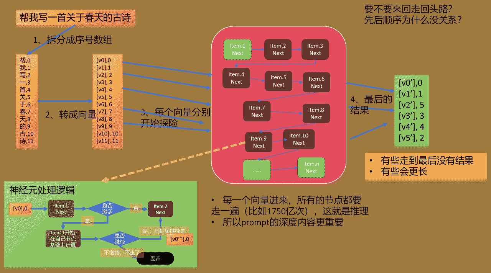

从这个图，我们可以简化理解大模型处理过程：

+   大模型首先将我们的输入请求（即 Prompt）拆分，并转换成向量。

+   这些向量随后进入神经网络。用简单的话来说，这些向量会被网络中的每个节点（或类实例）处理。

+   更简单地说，这个向量将经过 1750 亿个参数（即函数）的处理。

具体到每个神经元：

+   首先确定该神经元是否需要激活，根据传入向量与神经元存储数据的相关性决定是否激活。

+   如果激活，神经元将根据其内部参数与输入向量进行计算，并将修改后的向量传递给下一个神经元。

从这个角度理解：

+   每次接收到一个 Prompt，模型会让这个输入在所有神经元中传递一遍，无论这些神经元是否直接参与响应。

+   模型的规模越大，意味着包含的神经元（或参数）也越多，例如含有 1750 亿参数的模型。

+   因此，Prompt 的内容越丰富，就越有可能激发更多神经元，从而获得更好的输出结果。

这样的理解有助于我们认识到，大模型的有效性在于合适的神经元被激活。即使我们与 GPT 的交流看似无组织，只要关键点被触及，就足以触发有效的响应，这比遵循严格的框架更为重要。

甚至我们和 gpt 说的东西语无伦次问题也不大，关键的点说到，比框架更重要。

#  2、警惕！如何更好看待大模型

##  2.1、大模型的训练大概是什么样的

> 注意，我的理解是不准确的，不用过于细究细节。最后我会放上 GPT 对我这个理解的评价。

当我们遇到“大模型的训练”这样的术语时，虽然字面上看似易懂，实际上它背后的复杂性和含义可能远超我们的预期。这种情况下，最大的风险在于我们可能误以为已经理解了其含义，而用现有的知识体系去解读它，这可能导致我们形成了一种难以改变的错误观念。

这提醒我们，在面对新技术和概念时，需要保持开放和谨慎的态度，寻求深入和全面的理解，而不是仅仅满足于表面的认知。理解“大模型的训练”不仅仅是理解这几个字的意思，更重要的是要深入了解其技术背景、工作原理以及在实际应用中的作用和影响。这种深入的理解可能需要不断的学习和实践，但最终将帮助我们避免形成错误的观念，更有效地利用这些技术。!


###  工程实现从来都不美好

本质上，所有工程实现的东西，都需要做很多技术的折中，不要过分美化这个过程，知道内部实现非常没有意思，这点和我们日常工作中，不同行业之间的误会有异曲同工之妙，我们不要期待自己行业的知识非常丝滑迁移到另外一个行业去。

从这个意义上来说，不要去美化，给它不切实际的想象很重要！


###  模型训练的过程就是在解方程

当我们的请求被输入到模型时，它不再是我们通常理解的自然语言形式。而是被转化为机器可以理解的格式，通常是向量。不必深入了解向量的具体含义，重要的是明白这代表了从人类的自然语言到机器可识别的数字形式的转换。

在数学上，我们通过方程式如 y = f（x） = ax + b 来解决问题，通过已知的几组（x， y）值来计算出参数 a 和 b。类似地，大语言模型的训练过程也是通过计算来确定模型的参数。这些参数不仅限于两个（如 a 和 b），而是可能达到 1750 亿个。

介绍这些概念的目的是为了揭示，尽管工程实现可能看似枯燥，但理解其背后的原理对于去除对 AI 的无根据迷信非常重要。这种深入的理解可能需要时间和努力，但它将帮助我们更有效地利用这些技术，避免形成基于误解的观念。

###  一般训练会有 3 个步骤，每个步骤都要钱

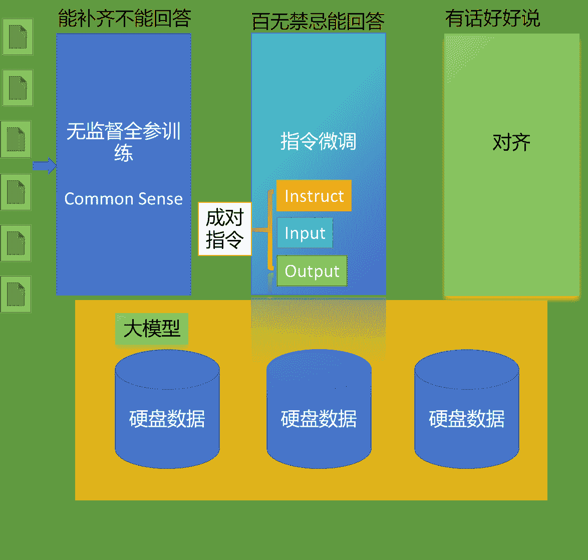

大语言模型训练过程涉及几个关键步骤：

+   **无监督学习： **这一阶段模型通过分析大量文本数据，学习到语言的基本结构和常识，具备文本补齐能力而非直接回答问题。模型将人类的知识通过向量化的方法转换，从而获得基础的语言模型。

+   清洗出好的数据

+   **指令微调： **在此阶段，模型被训练以理解并执行具体指令，如翻译文本，从而能够回答问题。这一阶段涉及的数据输入量相对于无监督学习阶段有所减少。

+   输入内容包括 3 个部分，中间可能有分隔符
* Instruct：请你翻译下面这段话
* Input： 一段英文
* Output： 一段中文

> 收集问答数据库或人工撰写

+   **对齐过程： **通过引入人类的评价标准（奖励函数）和处理特定的格式要求，进一步优化模型的输出以符合人类的期望。这包括处理文化、道德等方面的细节，以确保模型的输出更加贴近人类的价值观。

+   排序

相信在这个过程中，OpenAI 很有可能自己构建了一套强大的标注组织体系，高效，又能对抗标注人员能力强依赖。说起来人工标注符合 scaling law。

虽然具体的实现细节可能是各公司的机密，但大体上，这些步骤共同构成了构建一个高效、实用的大语言模型的过程，最终产生的模型可能含有高达 1750 亿个参数。

在开源与闭源模型的开发策略中，开源模型依赖于社区的贡献和集体智慧，而闭源模型则通常由企业投入大量资源进行开发。尽管方法不同，但两种策略都旨在推动大语言模型技术的发展和应用。

##  2.2、平和看待 ChatGPT ，不要妄自菲薄不过成王败寇


《The bitter lesson》（苦涩的教训）中提到人类开始研究 AI 开始，一直尝试先灌输人类的过往经验，复刻自己，再接着做。花费了大量时间研究算法。然后才开始尝试抛弃人类的经验，通过加大模型，提高算力，达到了惊人的效果！

> 人工智能研究者在选择方法时需权衡基于人类知识和计算力的方法。基于人类知识的方法使程序复杂化，难以充分发挥计算能力，而计算力的应用则可能牺牲对人类认知的理解。长期来看，摩尔定律使得计算力的发挥变得至关重要，与基于人类知识的方法形成一种此消彼长的局面。

OpenAI 的成功标志着在 AI 发展中选择增加计算能力和数据规模的路径取得了显著成效。然而，这种进展并非基于某种哲学信念或情怀，而是一种对未来技术方向的成功预判。

OpenAI 的成就虽然令人瞩目，但在人工智能的长远发展中，它并不代表最终的终点。AI 技术的普及和接受度仍在不断扩展中，值得我们继续探索和观察。

考虑到谷歌拥有众多团队和领域专家，每个团队都提出了可能需要巨额投资的可行方案。在这种情况下，作为决策者，选择哪一种发展路径需要仔细权衡风险与潜在回报。

##  2.3、警惕保姆级简化解释


讨论 AI 的高层次策略有助于我们深化对 AI 技术本质的理解，并破除迷信。然而，通过极度简化的方式，如短视频或生活比喻解释 AI 原理，虽便于理解，却可能引起误解。这种方式类似于社交中的第一印象，可能导致我们对 AI 形成不准确的观念，进而错失与 AI 深度融合的机遇。

因此，重要的是保持开放和谦逊的态度，同时培养独立思考的能力。在提问时，避免直接给出解决方案，而是探询 AI 的看法，以此作为进一步对话和探索的起点。

通过破除对术语如“神经网络”、“机器学习”和“训练”等的迷信，我们开始审视 Prompt 框架的价值，以及如何更有效地构造 Prompt。这些术语旨在缩短专业概念与普通人之间的距离，但误会的产生提醒我们需要深入理解这些技术，而非仅仅停留在名词上。

#  3、放弃 Prompt 雕花，大模型根本不 Care

前面的文章解释过 Prompt 年入 50W，其中 45W 是付给他本身的技能，我们也探讨 Prompt 有效的关键是能激发更多的神经元，提高获得我们想要的答案的概率。

某种程度上，Prompt 就是给人看的，而不是给机器看的。我们写一个格式非常优美的 Prompt，对于机器来说不见得就有意义了！

##  3.1、Prompt 的格式和编程语言的注释差不多

```
def say_hi(self):
    print(&quot;hi&quot;)

class Person:   # 定义一个名为Person的类。
    def say_hello(self):   # 定义一个方法（函数）叫做say_hello，它有一个参数self。self代表当前对象的实例。
        print(&quot;Hello, I am a person!&quot;)   # 打印输出文本&quot;Hello, I am a person!&quot;

person = Person()   # 创建一个名为person的实例，使用Person类来初始化它。

person.say_hello()   # 调用person对象的say_hello方法，输出：Hello, I am a person!

```

| 执行输出 | 编译结果 |
| --- | --- |
| 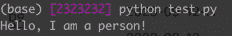 | 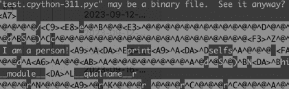 |

编写代码时，我们使用的编程语言实质上是为了方便人类理解和解决问题的工具。不论使用 C 语言、Python 还是 Rust，对于机器而言，所有这些编程语言最终都会被编译或解释为操作系统可以执行的格式。这意味着，从机器的角度看，具体采用哪种编程语言并不影响最终的执行结果。

在某些情况下，如果代码中的函数（如 say_hi）未被调用，编译过程可能会忽略它，导致最终的程序不包含这部分代码。这说明了机器在处理代码时的客观性，它不会关注代码的注释或未使用的部分，这些只是为了方便人类阅读和理解。

从 Prompt 框架的角度思考，这告诉我们不应过度依赖于固定的框架或格式。在构造 Prompt 时应保持开放和灵活的态度，因为最终重要的是内容的实质，而非表面的格式。这种理解促使我们在使用大语言模型时，既要保持警惕，又要避免被过时的思维定势所限制。

> 我们在写代码的时候，把注释弄得很漂亮，格式很好看，只是为了让人类好看，对于机器来说，根本不 care，编译的时候，首先把注释都给删除了……

从这个意义来说，我们 Prompt 框架中的那些格式词，很有可能最后都没有参与推理。

这里我们又破除了一个关于 Prompt 的执念，也就是我们不要被框架给唬住。再讲一个我们需要保持警惕的思考角度。

##  3.2、相比 Prompt 行业积累更重要

在深入探讨 Prompt 及其在 AI 产品中的应用时，人类交流的复杂性尤其值得关注，其中肢体语言的作用不容忽视。有效的沟通远远超出了语言文字的范畴。众多研究指出，在人际交流中，非言语因素，尤其是肢体语言，扮演着至关重要的角色。这些非言语元素，包括但不限于肢体语言、面部表情、姿势以及眼神交流，通常在传达情绪、意图和反馈时，比语言本身具有更强的影响力。

人与人之间的互动尤其凸显了这一点，因为人们往往会无意识地依赖于肢体信号来解读他人的真实情绪和意图。例如，微笑或目光交汇可以传达友好和接纳的态度，而交叉双臂可能被解读为防御或不开放。在无声的沟通中，这些肢体信号有效地填补了语言无法达到的空白。

然而，对于 AI 产品，尤其是基于 Prompt 的交互系统，这些交流的细微之处常常被忽略。目前的技术主要集中在文本的直接输入和输出上，而缺乏捕捉伴随人类交流的丰富非言语信息的能力。这种局限性降低了 AI 系统理解和响应人类情感和意图的能力，也限制了人机互动的自然性和流畅度。

面对这一挑战，未来的研究和开发将逐渐扩展到如何使 AI 产品能识别和解读非言语交流元素，包括发展能够识别人类面部表情、肢体语言和声音语调变化的算法。整合这些非言语交流的维度预期将显著提升 AI 系统的交互能力，从而实现更自然、直观且富有同情心的人机交互体验。

对于 OpenAI 等机构而言，推动技术朝这一方向发展，不仅代表了技术上的挑战，也体现了一种社会责任和义务。

在这样的背景下，我们个人深入理解所处的行业，明确未来的职业方向，并在此基础上深耕，变得尤为关键。这不仅有助于我们更有效地利用 AI 技术，也能确保我们在人机交互的新时代中保持竞争力和相关性。

##  3.3、警惕鸡兔同笼有效而放弃方程思考

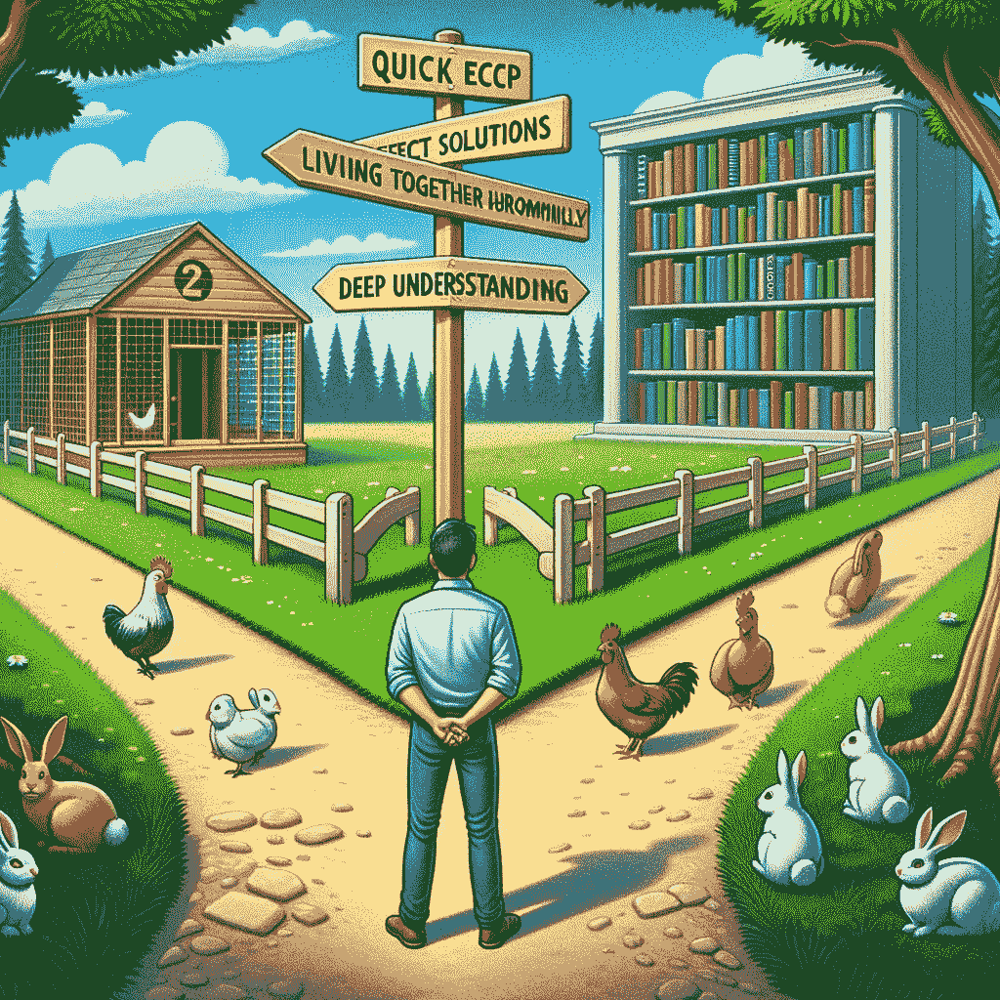

在搜索解决问题的过程中，我们可能会发现针对特定问题（如鸡兔同笼）的多种解法。尽管这些方法在没有方程式工具时非常有效，但它们也可能阻碍我们发展出使用方程式思维的能力，这种思维可以简化问题解决过程并应用于更广泛的问题。在某种程度上，Prompt 的技巧与方程思维具有相似性，旨在提供解决问题的框架和方法。

然而，对特定框架的过度依赖可能会限制我们探索更广泛解决问题的方法，导致我们失去发展解决问题能力的动力。尤其是当大模型的能力提升使得对复杂 Prompt 技巧的需求减少时，我们更应该认识到，大部分应用场景可能并不需要复杂的 Prompt。

此外，我们还需警惕陷入信息茧房的风险。信息茧房可能阻碍我们接触到多样化的观点和方法，进一步加剧依赖特定解决方案的倾向。

因此，保持开放心态，培养独立思考能力，同时不断探索和尝试新的方法，对于充分利用大语言模型和其他技术工具至关重要。除此之外我们还要警惕信息茧房。

##  3.4、警惕 AI 带来的信息茧房，说说 AI 总结

这几天网上比较火的一篇文章是关于著名投资人对大模型投资的评判的，大量的总结文案。

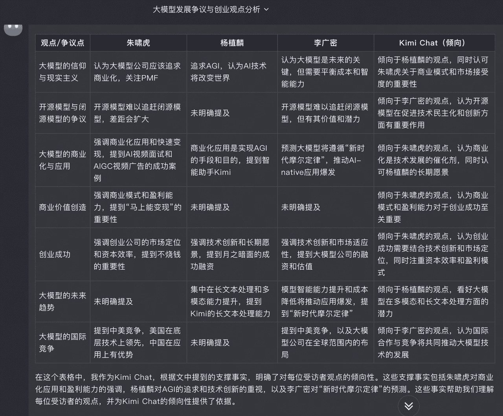

但是，对我而言，这篇文章中唯一有价值的一句话是：

> 模型到底在什么点让 to C 应用爆发，不知道。今天说“个人助理”都是技术人员的想象。我就问你，有几个人需要个人助理？都是典型的伪需求！

也就是说，当前，大多数 AI 应用可能不会长期存在，这是因为大型模型的能力还不足以支撑商业运营，必须通过开发具体应用程序来补充。如果这些应用依赖于大型模型（目前商业化使用国外大型模型是不被允许的），其未来是不确定的。因为 AI 领域的过度乐观，产生了一些并非真实需求的伪需求。投资大量资金进行开发……。

AI 的出现极大地促进了对高效知识管理和学习的需求。过去，我们可能因为时间不足而忽略了收藏夹中或已购买的课程。现在，AI 可以帮助我们总结这些内容，理论上我可以在一天内了解 300 本书的核心内容，然后决定是否深入阅读。


然而，上述例子清晰地展示了 AI 总结可能会忽略掉对我们真正有价值的信息。不过，有一个简单的解决方案。我们可以为不同类型的信息定制专门的 Prompt 进行总结并不断迭代。然而，能够坚持这一过程的人，可能并不属于需要这种服务的用户群体，因为这需要极高的自律性，这样的人不太可能受到“知识仓鼠症”的影响。

虽然 AI 在很大程度上解放了我们，但它也可能导致我们陷入新的信息茧房。有时候，了解了还不如不知道，因为无法采取行动。错过某些信息可能是无可避免的，而过度焦虑于此无益。错过就错过呗，命该如此，焦虑又有何用？

##  3.5、优先解决问题避免过早优化

我们使用 Prompt 的目的是为了解决问题。面对复杂问题时，建议将问题拆解，而不是过早地专注于 Prompt 的优化。

这样做容易使我们过分专注于 Prompt 这一工具本身，从而忽视了问题的本质解决，偏离了核心。随着问题逐步解决，我们可能会意识到，最初对 Prompt 进行优化的理由实际上可能是错误的。

##  3.6、大模型的重点不是记忆也不应该有记忆

经过一段时间的使用后，我们可能会对大型模型有一些误解，比如认为它能记住我们之前的交流内容。从模型参数的加载方式就可见，实际上这些模型本质上并没有记忆功能。ChatGPT 能理解我们的假象，仅仅是因为它每次将之前的对话内容作为新的输入重新提供给 GPT。


这种记忆功能并不是由大型模型直接实现的，而是通过在别处进行存储来达成。了解到模型是如何处理前面的 Prompt 后，我们也会发现它的局限性。我认为，这是因为推理过程本身有其复杂性。

> 目前场景下，存储的成本远远小于推理成本！

如果对话内容过长，可能会影响模型的整体性能。理论上，如果 ChatGPT 仅被一个人使用，这或许可行，因为用户可以接受较慢的响应速度。

解决这个问题的一个简单方法是启动另一个对话框。对于之前的数据，我们没有太多选择，只能进行总结。这个总结可以由我们自己或者 GPT 来完成。

显然，这并非我们期望的结果，因此出现了 GPTs 的概念。我认为，GPTs 的作用在于不断进行总结，以避免上下文超出限制。

这就引出了 GPTs 需要解决的问题，我将在后续讨论。接下来，我会分享我对于神经网络必要性的看法。

#  4、为什么需要神经网络从图片识别开始说起

如果识别一个印刷体图片，我可能会怎么做

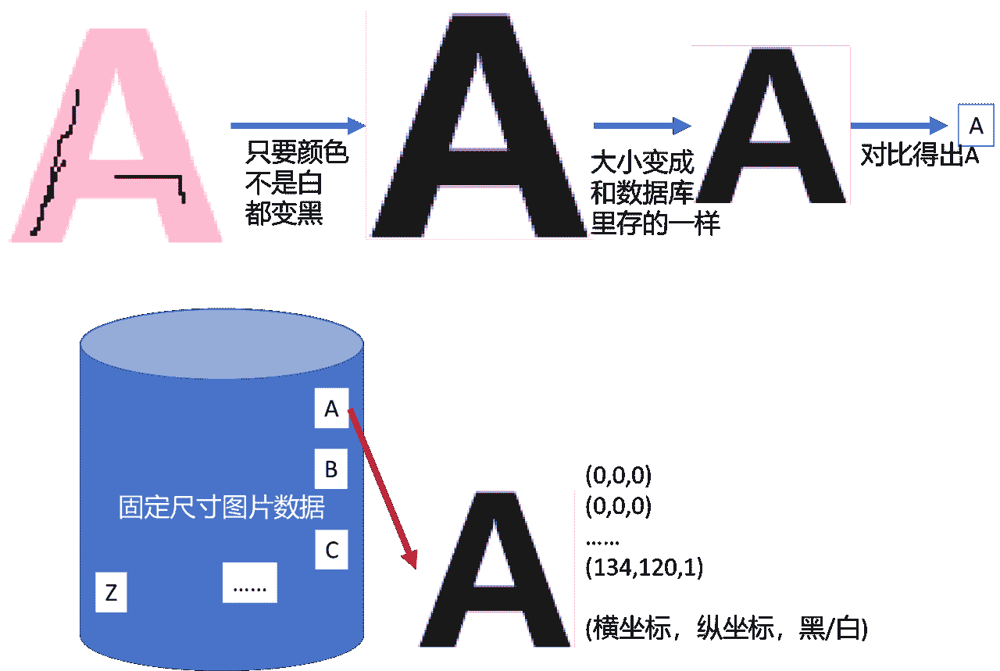

神经网络解决的是未知规则的处理。

+   先把图片都变成黑白

+   大小变成固定尺寸

+   和数据库的东西对比

+   得出结论

然而，这种情况过于理想化。不仅存在多种字体，即使对于印刷体，不同的拍摄角度也引入了多种例外情况。虽然存在图形算法进行矫正，但整体方法仍然是基于不断添加规则。

这种方法本质上是试图通过不断增加和完善规则来解决问题，这显然是不可行的。

虽然这种方法可以解决象棋的问题，但对围棋来说就非常困难了。围棋的每个节点有三种可能状态：白、黑或空，加上不同节点间状态的组合，现有的资源无法应对。

神经网络专门处理未知规则的情况。将图片转换为黑白，调整图片至固定尺寸，与数据库中的内容进行对比，最终得出结论。

神经网络的发展得益于生物学研究的支持，并且在数学上提供了一种方向，使其能够处理未知的情况，如手写体识别。

关于这部分内容，非常建议看《这就是 ChatGPT》这本书，它的作者是被称为”在世的最聪明的人”，研究神经网络几十年，创作了 Mathematica 、Wolfram 等备受推崇的软件，这本书最特别之处还在于，导读序是美团技术学院院长刘江老师回顾了整个 AI 技术发展的历史，对于了解 AI，大语言模型计算路线的发展，起到提纲挈领的作用，非常值得一读。

本文写作过程中得到了 [byzer-llm ](https://github.com/allwefantasy/byzer-llm)作者祝威廉的大力支持，在此感谢。byzer-llm 选择了一个非常特别的技术路线，在大模型时代显得尤为重要。

#  5、ChatGPT 和 Claude 关于我对大模型理解的点评

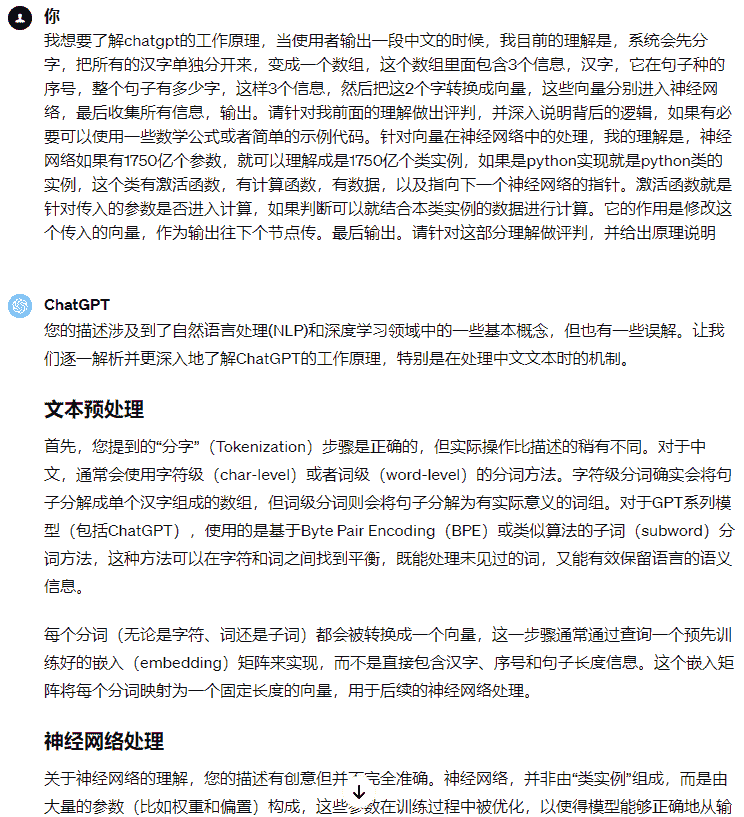

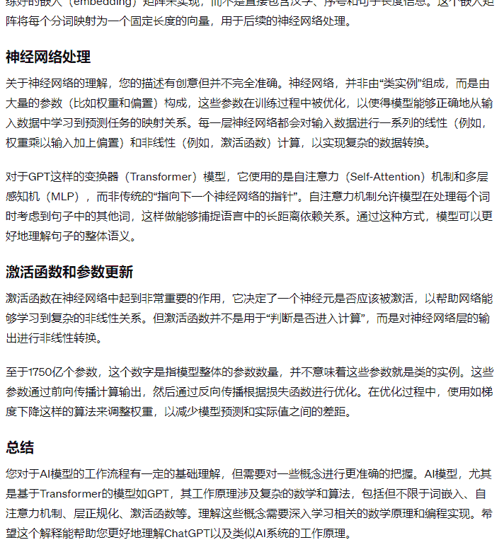

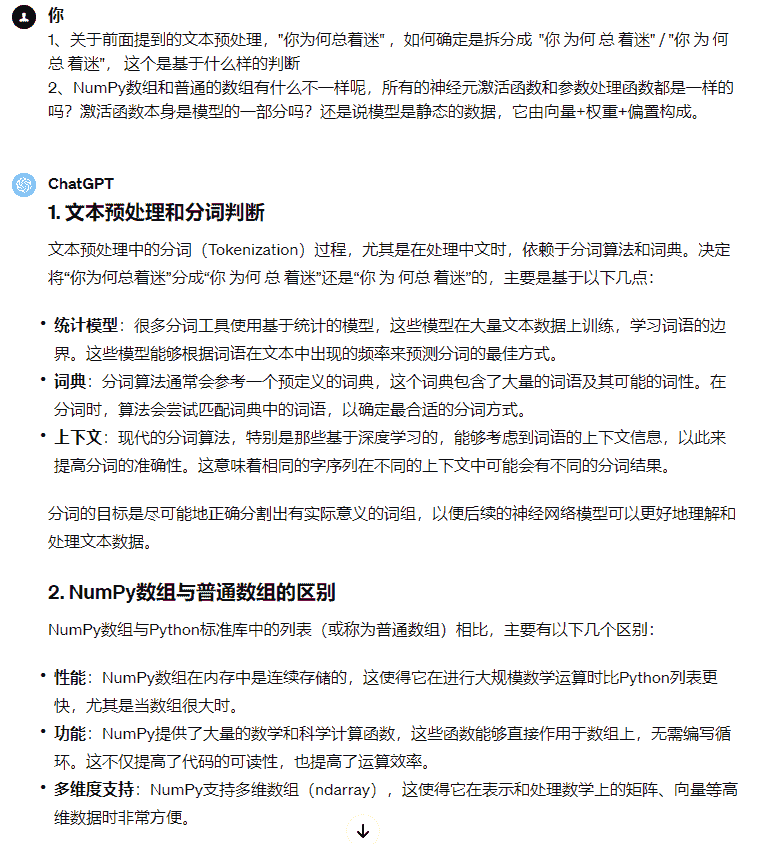

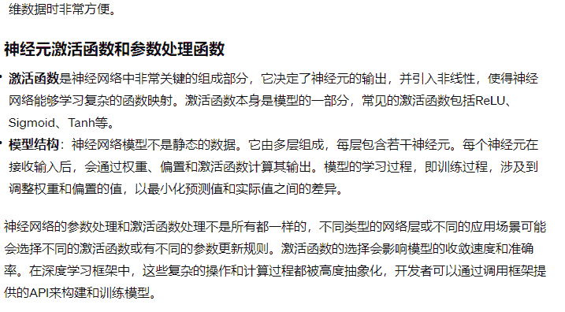

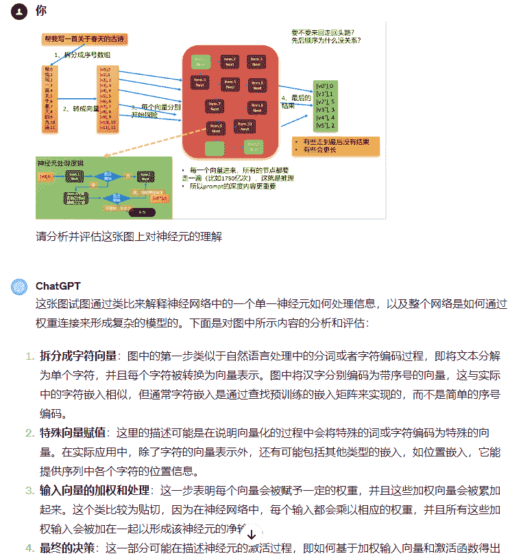

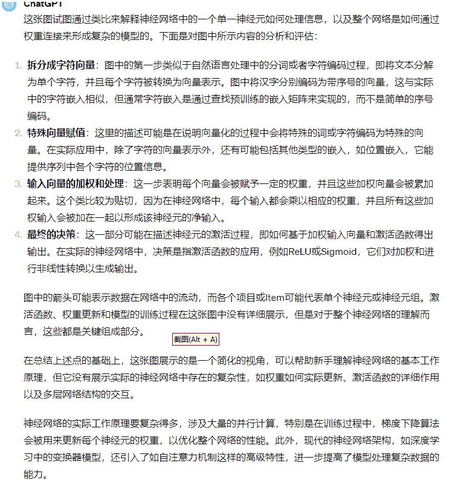

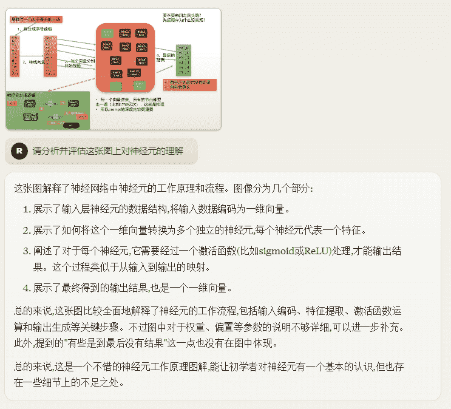

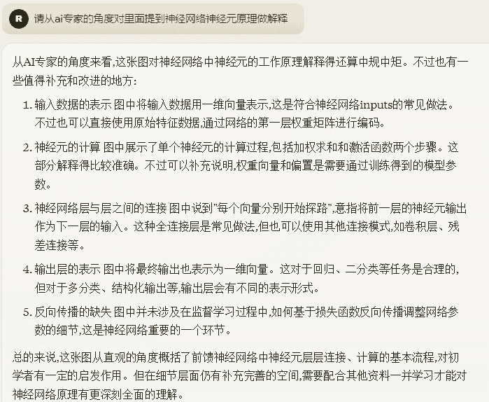