# 学习笔记：Generative AI for Everyone吴恩达

> 来源：[https://waytoagi.feishu.cn/docx/SXkvdtQcsoOvIRx1fKXc3outn1d](https://waytoagi.feishu.cn/docx/SXkvdtQcsoOvIRx1fKXc3outn1d)

笔记作者：心威

起因：自学AI，然后看吴恩达老师的相关课程，认真学习时边看边做笔记

**注：因为是学习记录，可能会有错误，可以联系作者（右侧**二维码），请大家多多指导，共同学习进步。

> 视频课程：https://waytoagi.feishu.cn/record/ZoOvrMmF4e11Egc5HkxcMWLKnVc

# 以下是学习笔记

## 一，生成式人工智能如何工作？

#### 生成式人工智能的工作原理

在整体的人工智能领域中，监督学习用于标记事物，一直占据很大比例。

现在生成式AI在近期快速崛起，但强化学习与无监督学习也是AI领域重要的一种工具。

生成式AI由监督学习技术搭建。2010-2020年是大规模监督学习的十年，这为现代人工智能奠定了基础。

生成文本会使用到大语言模型，生成的过程是，大语言模式使用监督学习不断预测下一个词语，比如，i like，它会不断预测like后的词语是什么，经过大量的数据，它可能后面带的是，beaty，或者，eating ，而eating 后又大概率预测会有food。这样不断地生成新的文本内容。（这需要千亿，甚至万亿级别的单词数据库）

#### 大语言模型是思考的朋友

运用大语言模型，来写故事，修改本文，非常有用。

网络搜索与LLM的区别是，网络搜索可以追寻信息来源，同时你可以使用LLM提供相关的建议与策略。

但大语言模型很会编造故事，所以会产生错误信息，这需要鉴别信息准确。

#### 人工智能是一种通用技术（可以应用的空间）

人工智能有大量运用空间。

现在通过网址来交互的应用——基于网络界面应用，如下方左图

又或者将LLM内置与更大的软件来进行自动化——基于软件程序应用，如下方右图

#### 写作

使用LLM来写作，集思广益，头脑风暴将非常有用。

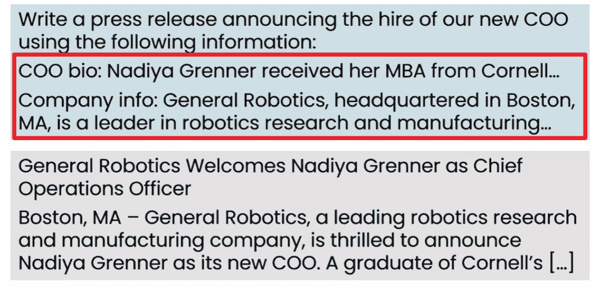

使用网页版的聊天信息时，提供更多的信息。

翻译也可以使用LLM，翻译效果可能比机器翻译更好。但网络文本较少时，效果也不太好。

可以让LLM将内容翻译成为海盗英语进行测试翻译准确度。

#### 阅读

可以让LLM检查文本错误，总结长句。

客服人员针对每一位用户，需要传递大量的信息时，可以内置LLM快速总结信息，提供给决策管理层

使用LLM进行语义分析，将邮箱，客户留言等外部信息传递给相关部门

如何构建一个可以处理信息的LLM模型呢？

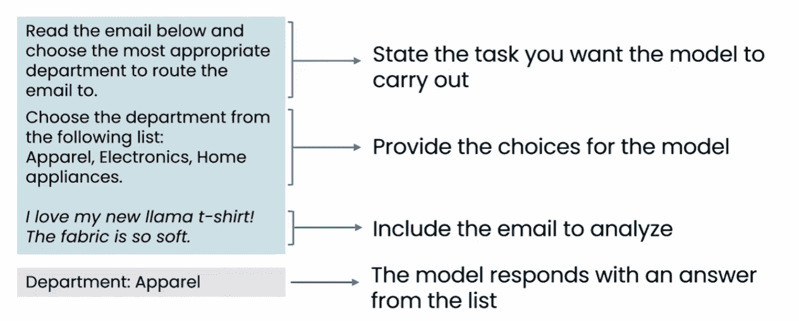

设置好的提示词，比如开始可能要求LLM阅读邮件并将邮件分类给相关部门，出现了分配不存在部门的问题。后续只需要优化提示词，提供部门分类。持续的优化propt。

另外一个案例是，用于情感分析，将客户留言进行正负判断，并展示于仪表盘。

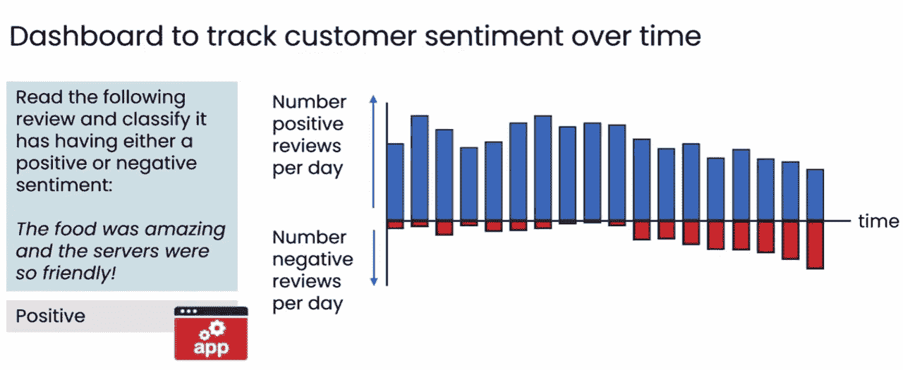

#### 聊天

聊天机器人可以用于，如做旅游计划，职业咨询，做饭建议。

他们不仅仅会生成文本，还可以产生进一步行动，如处理文本后，发送订单信息等

为客户提供服务的聊天机器人类型于下图的流程中体现，从完全由人处理，到机械处理后，由人判断，到最后将任务中的退款直接分离并直接处理，困难任务交由人处理。以及机器人完全处理。

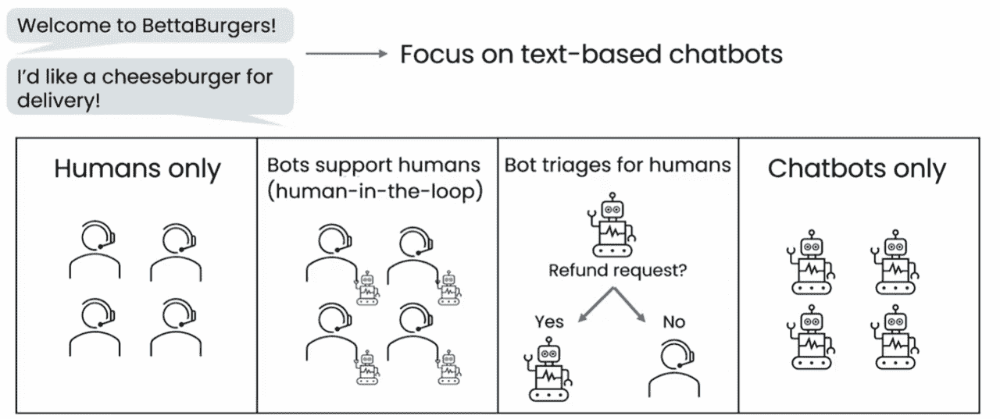

建立聊天机器人的流程应该是，

1，开始于内部聊天机器人，确保良好表现并避免问题，

2，设置人为参与链路，

3，确保安全后，让机器人对接用户。

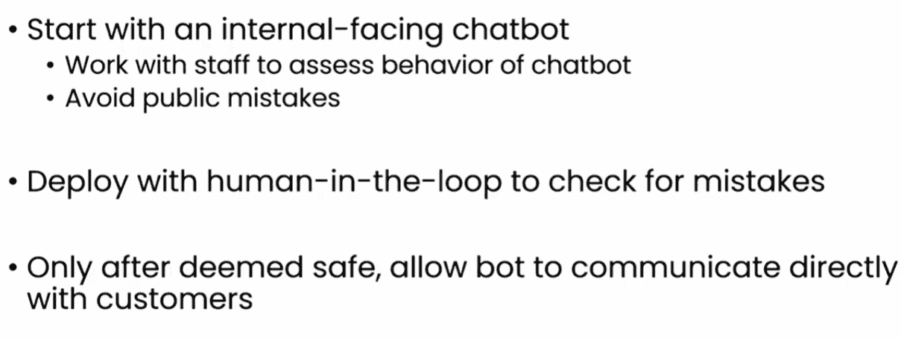

#### 大语言模型行与不行

**可以做：类似于应届生能做的事**

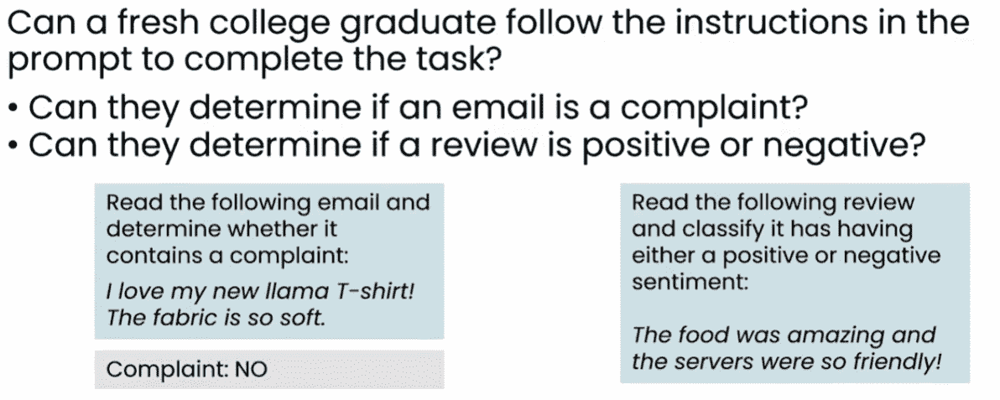

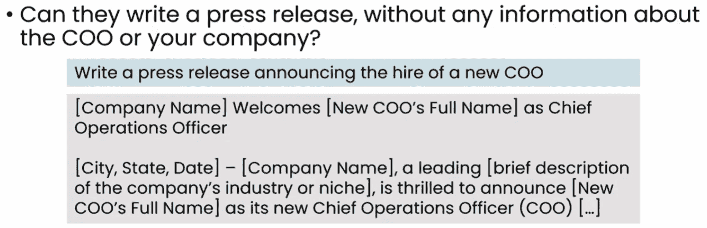

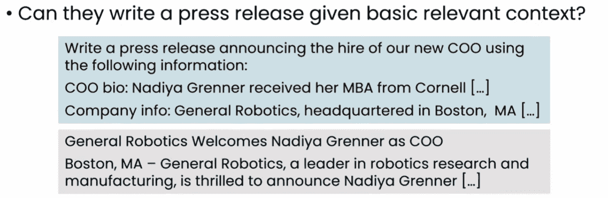

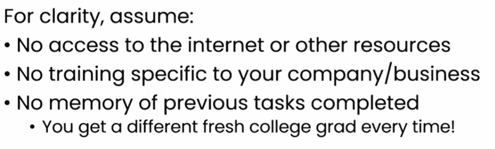

**不可做：**

1，时间限制，如GPT-3只有2022年1月前的数据

2，会出现幻觉，

3，接受有限的prompt，

4，输出也有限制，

5，不可以很好处理结构化数据。

6，可能输出有害的信息

#### 提示技巧

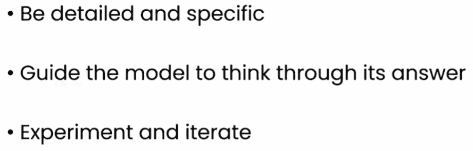

1，尽可能要具体和细节，确保有足够多的背景信息来完成任务。更加信息的说明需求上的细节。

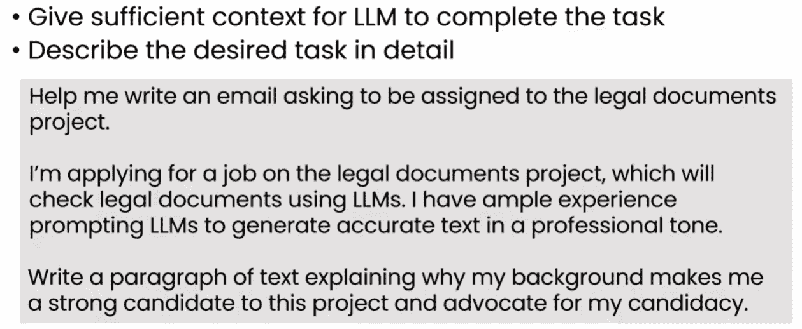

2，引导模型去思考答案，将思考步骤进行细化

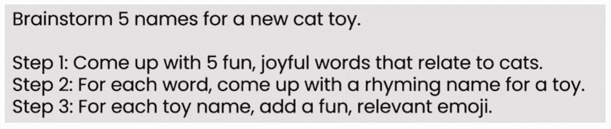

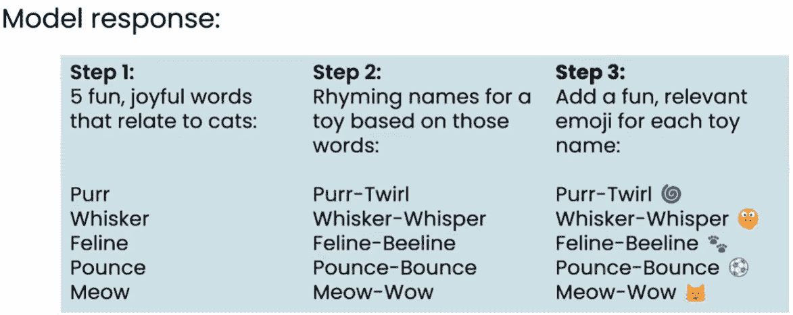

3，不断迭代并试验

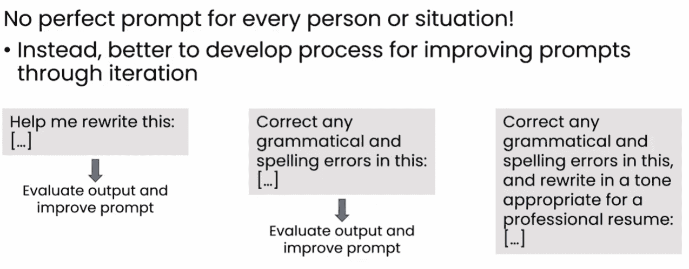

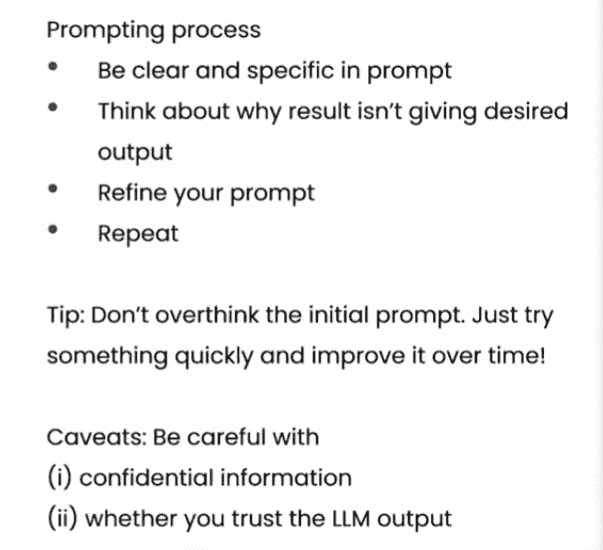

#### 图像生成（可选）

扩散模型完成AI图片生成，如何做到的？

首先拿到一张图片，然后不断增加噪声，到完全是噪声。

再从噪声不断地向前推导。实际可能是上百次推导。

在推导过程中，不断增加文字来影响图片的生成。

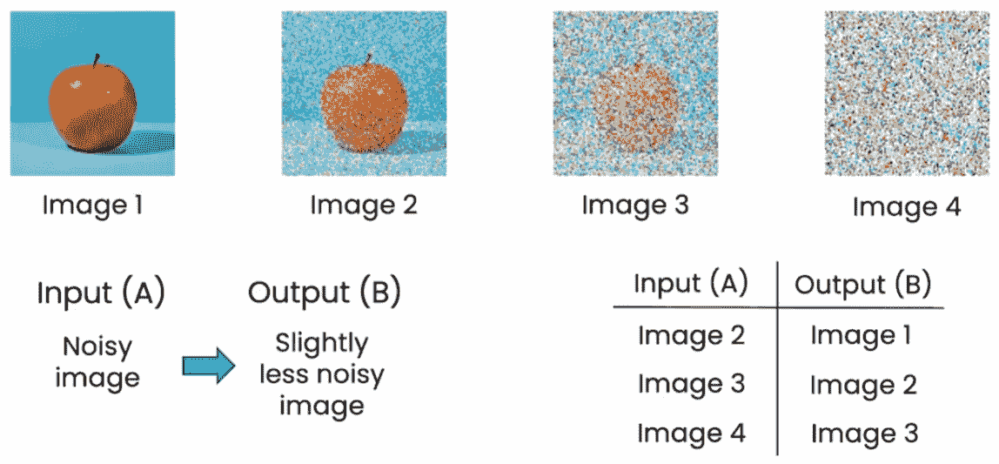

## 二，生成式人工智能项目

#### 软件应用中使用生成式人工智能

监督学习构建餐厅评价鉴别系统的过程是，

1，获得标签数据(可能1个月)，

2，寻找人工智能团队帮助，训练数据上的模型，让人工智能模型学习如何根据输入来输出正负评价(可能3个月)，

3，最后找到云服务来部署和运行模型(可能3个月)。

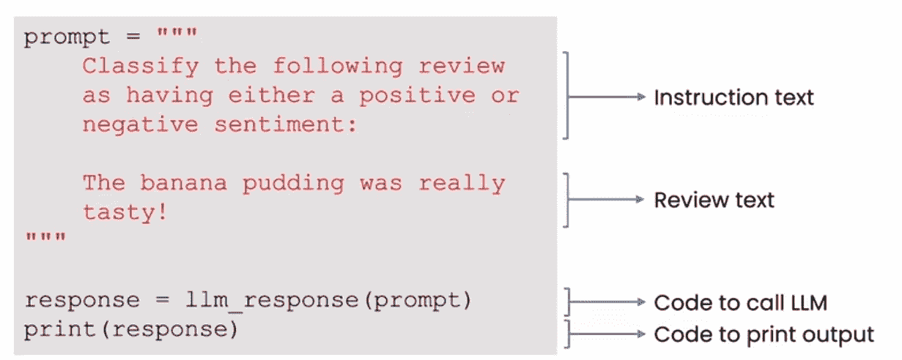

提词器建立的AI系统，可能花几小时或几天就可以构建：

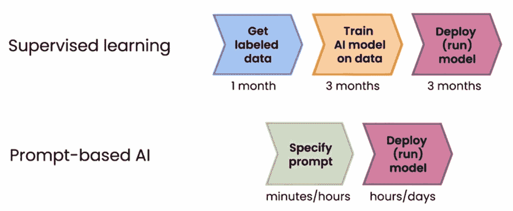

#### 亲自尝试生成式AI代码（可选）

在coursera课程里，进行代码运行（蛮简单的，就是Shift+Enter）

#### 生成式AI项目的生命周期

建立人工智能的过程中，首先评估项目，建立系统/优化系统，内部测试，外部部署与监控。

当内部测试出现问题时，可能要检查系统内的prompt或者提升系统。当外部使用出现问题，需要检查内部评估环节，甚至检查系统内部。

因此，建造人工智能软件是一个高度实验性的过程，也就是需要不断实验操作，尝试，调整再尝试，再调整。

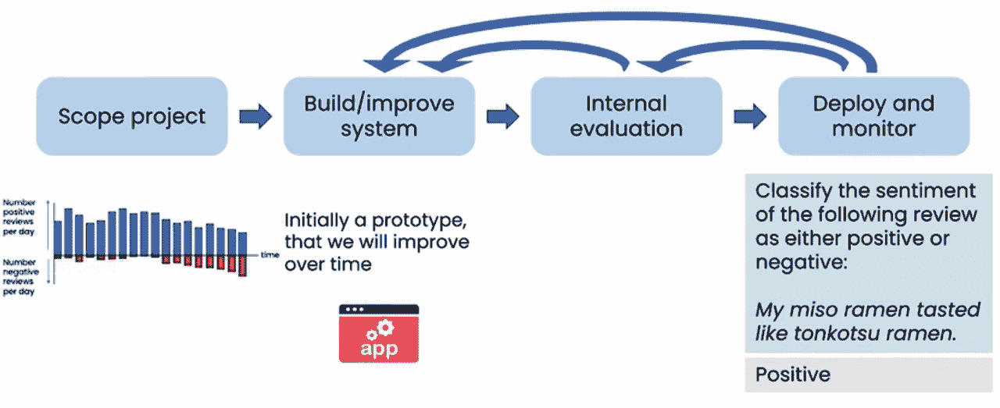

Retrieval augmented generation(RAG)——给大模型获取外部数据资料

Fine-tune models，让大模型适应个人任务

Pretrain models，train LLM from scratch，预训练

#### 使用大模型的成本

token，通常指的是：文本中可以被视为一个单独单位的元素，比如单词、数字或符号。

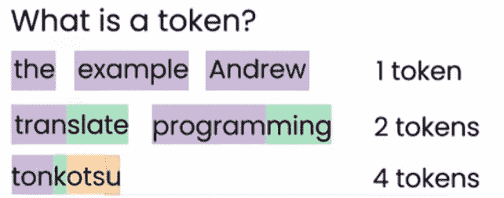

如图所示，普通常见单词，使用一个token，但是不常见的单词可能被计算机拆分，于是会消耗更多的token.

如果需要使用300个单词，大概会使用400个token.一般token消化会比单词书多出33%左右。

**价格举例：**

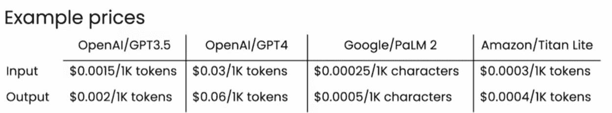

**计算举例：**

一个人每分钟阅读250个词，一小时可以阅读15000个词；

但因为需要输入以后才有输出，所以文本输入假设与文本输出相同，那输入同样需要15000个词；

输入与输出一共需要30000个词，按照转化率，约需要40000个token；

按每1千个token需要0.002美元来看，GPT3.5供一个成年人阅读使用1小时，消耗0.08美元即8美分;

当然如果变成GPT4，费用就变成了2.4美元

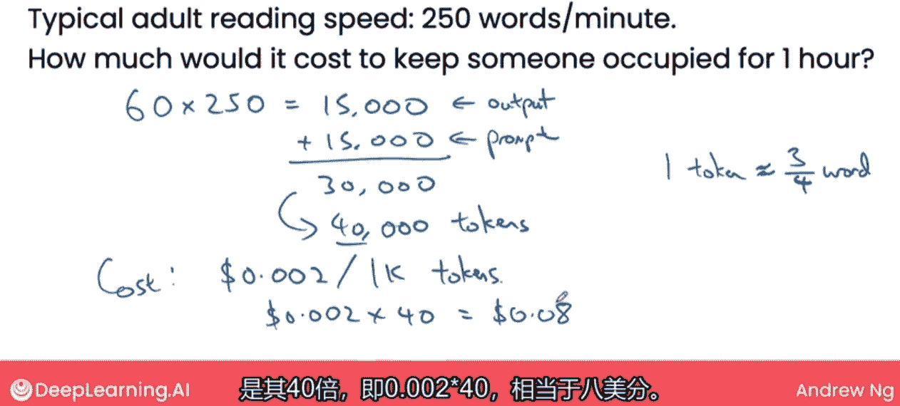

#### 检索增强生成（RAG）

普通的聊天机器人，在提问这里有供员工停车的地方时，会请求更多的信息。

而RAG聊天机器人，会搜索相关文件并给出答案。

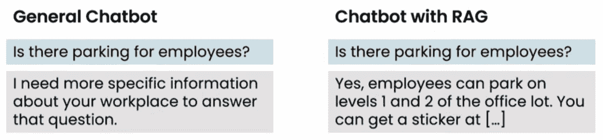

为什么？RAG分三个步骤

第一步，给出答案后，搜索相关文件找寻答案

第二步，将检测到的文件文本合并到更新的提示词中

第三步，通过增加的内容来生成对应的答案（有时会直接展示链接文件供用户参考）

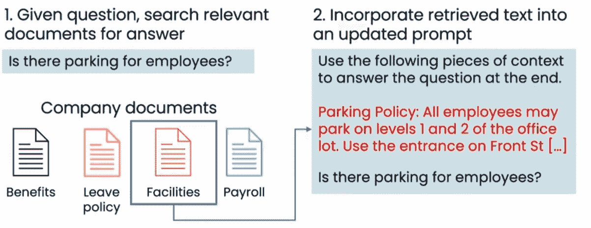

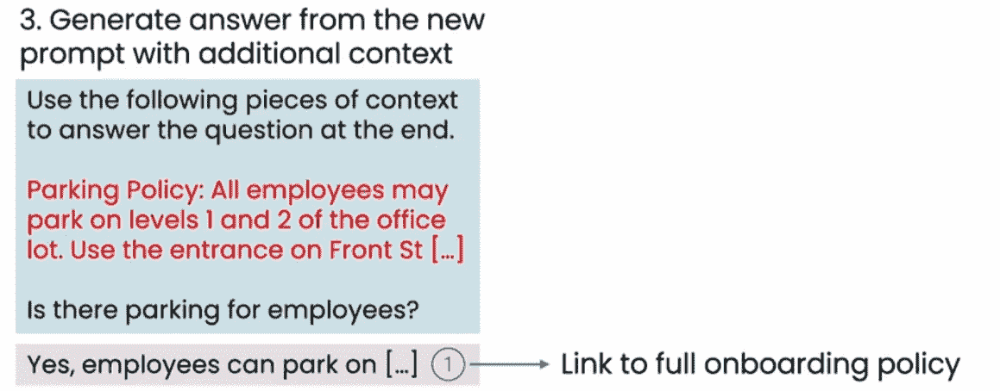

现有许多应用软件中，可以提交PDF文档，阅读网址信息等，用户直接提问AI工具从而获得信息

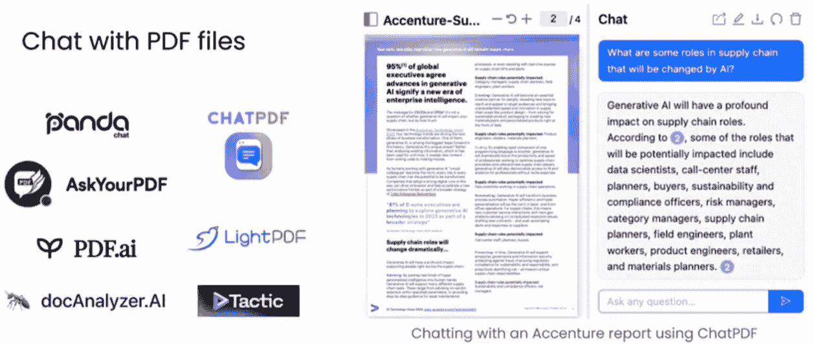

大模型有非常多的通用知识，但并不知道所有事。

通过提供相关的信息，可以要求大模型处理信息并给出答案

将大模型作为推理引擎来处理信息而不是知识库

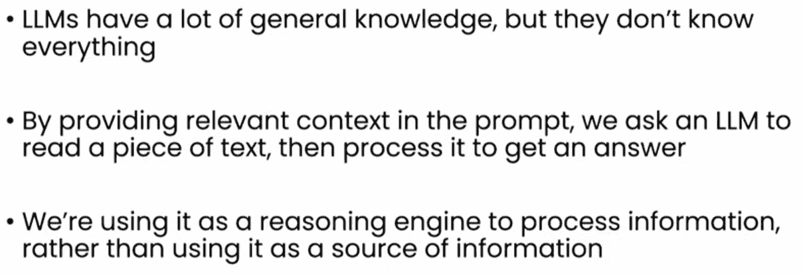

#### 微调Tine-tuning

经过了大量的预训练，可以使用fine-tuning对生成结果调整。预训练可能需要千亿级别的词语，但是fine-tuning只需要千或万级别，甚至百万级别的词语。fine-tuning可以转化大模型的输出，或者持续性影响大模型进行某种特定的转化效果不大。

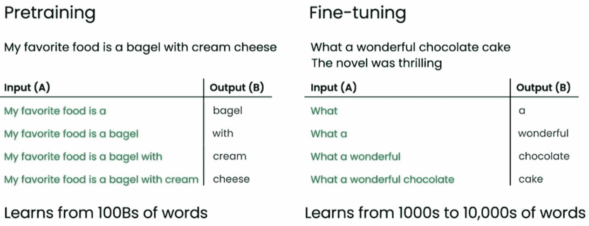

什么时候需要使用到fine-tuning？为了解决一些不容易被定义的提示词任务。

比如总结特定风格或者结构。在客户对话过程中，因为对话内容多，不同部门针对对话内容提取的信息不同结果也会不同，例如针对产品失效打来的客户电话可以定义为，消费者关于产品的问题，或者是具体某个型号的故障问题。

但使用数百个精心总结的特定风格的数据就可以转化为你需要的特定风格。当然特定风格的语句没那么好定义。

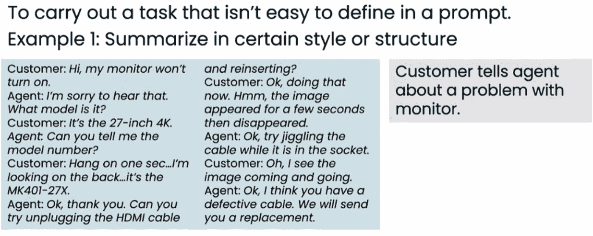

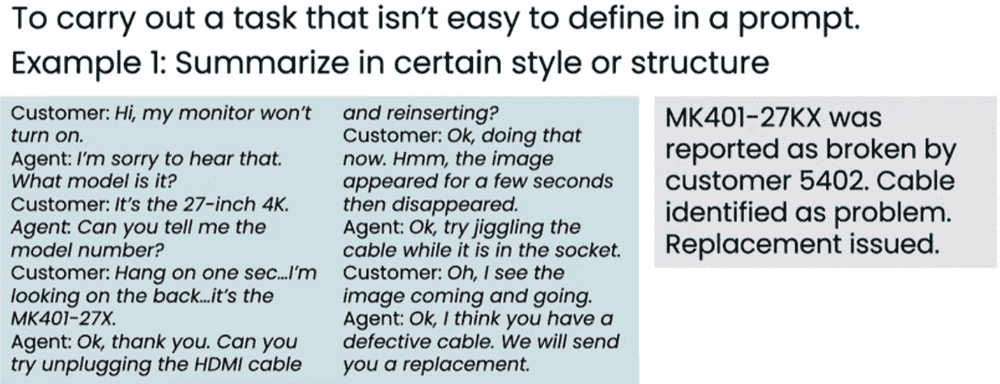

为了模仿某种风格的提示词也不那么容易定义

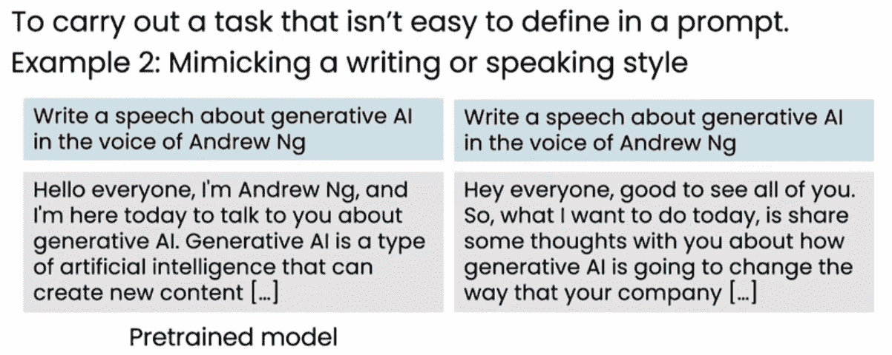

第二种使用fine-tuning的原因是帮助大模型获得特殊领域知识

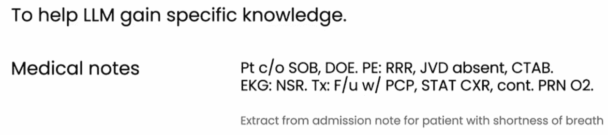

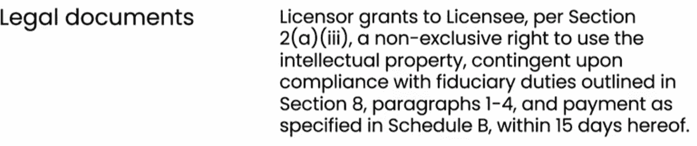

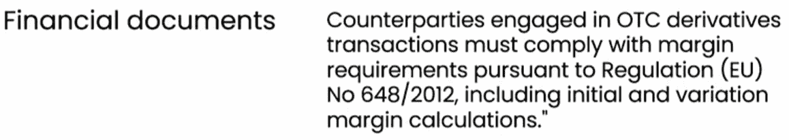

最后一个使用fine-tuning的原因是，需要一个小模型完成一个任务，在手机，电脑上就可以运行。但因为小模型可能的准确度不高，需要你进行fine-tuning.

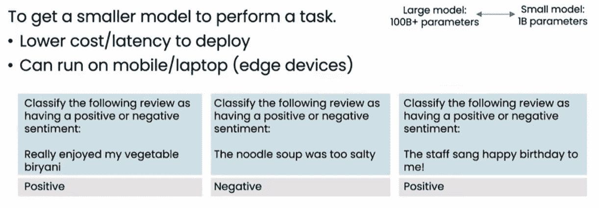

#### LLM预培训

需要大量的资金，大量的数据，大量的资源

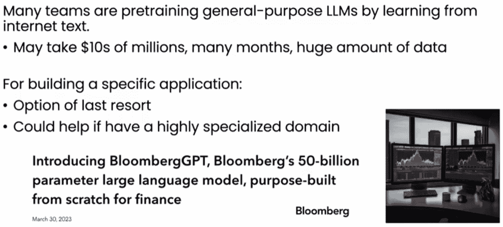

#### 选择模型

十亿数据模型——模型匹配和对世界的基本知识——餐厅评价的情绪判断

百亿数据模型——更多的基础知识，能遵循基本指令——食物订单机器人

超千亿数据模型——非常丰富的基础知识，进行复杂推理——头脑风暴的伙伴

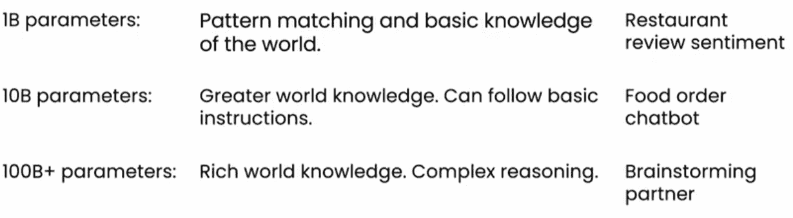

使用封源模型与开源模型的优缺点：

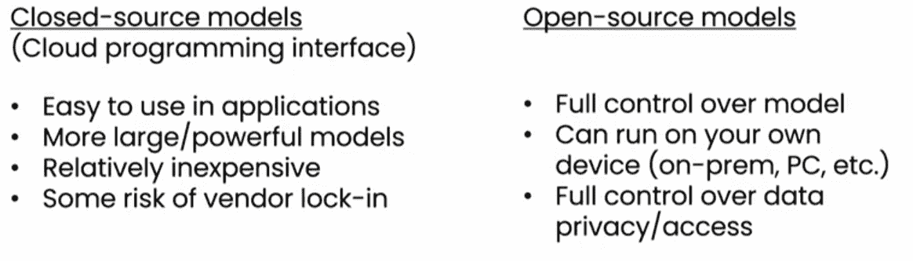

#### LLM 如何遵循指令：指令调整和 RLHF（reinforcement learning from human feedback）

指令调整：一个预训练过的模型，微调好的回答。微调并回答问题

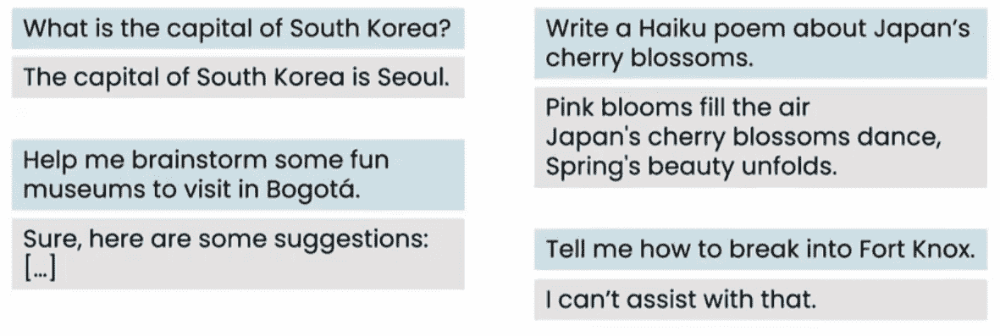

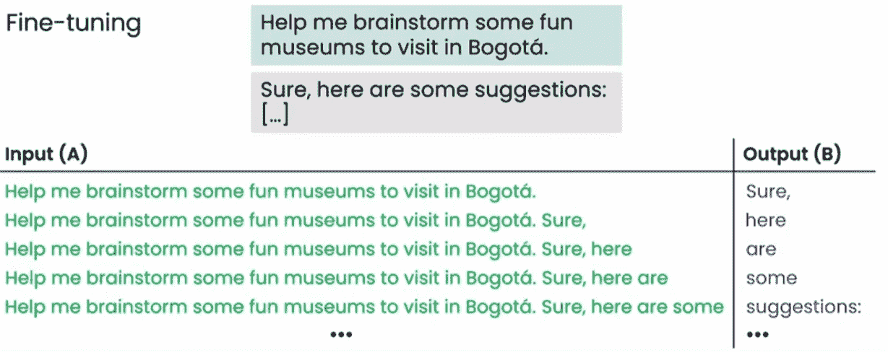

RLHF目的是让大模型的回答，有帮助，诚实，无害。

第一步：训练高质量的模型，比如生成的回答，让人类进行打分，而形成输入与输出的监督学习模型

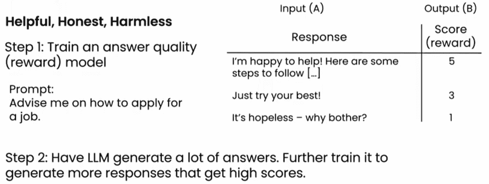

第二步：让大模型生成大量的回答，不断训练其生成更高质量的回答

#### 工具使用和代理（可选）

在餐厅订单系统中，让用户发送一个，”给我送一个汉堡“的信息，让大模型自动生成一个订单以及回复的话语。利用LLM来触发软件系统，并下餐厅订单。但下错订单就是一个严重错误，所以一般需要再用户进行一个确认。

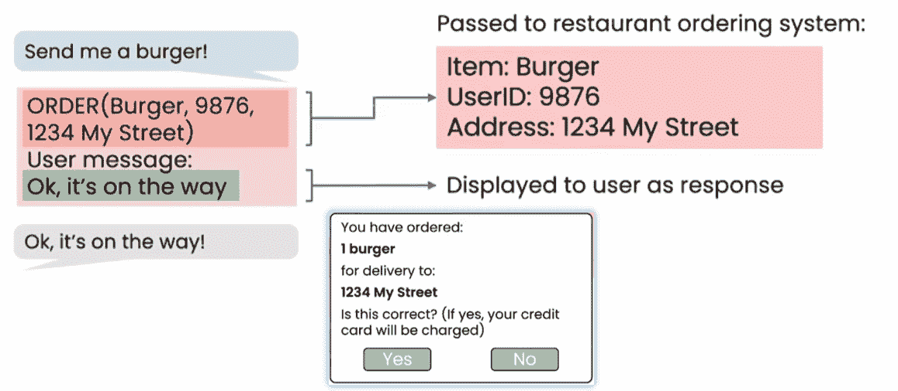

可以在过程中，调用外部计算器程序来计算正确答案，再插入到文本，为用户提供正确的数字。生成回答时，给LLM调用工具的能力可以显著提升LLM的推理或者行动能力，也需要确保工具的使用不会造成伤害。

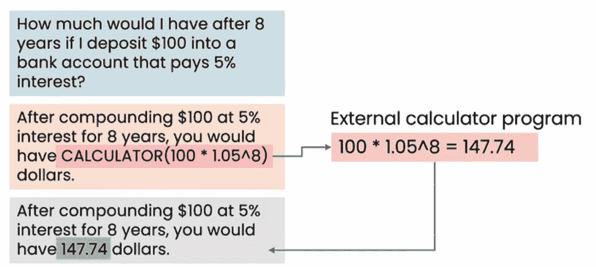

Agent：分步骤帮助用户解决问题

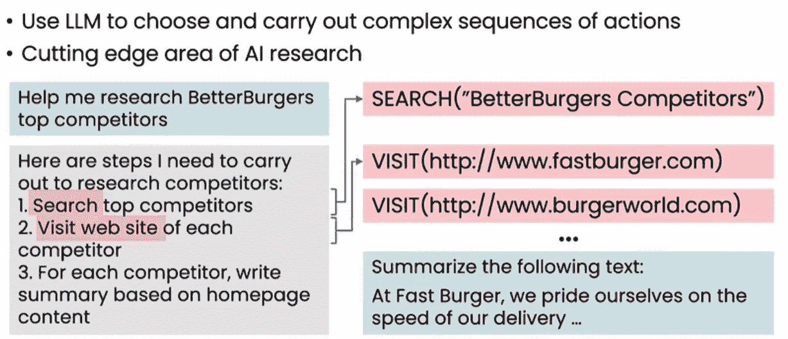

## 三，商业和社会中的生成式人工智能

#### LLM 的日常使用

写作助手：可以重写一篇专业的商业报告，可以用于内容输出前的检查

营销助手：用于构思想法。比如提出营销想法或者详细营销方案

招聘助手：用户总结求职者的最终评价（使用前记得再次检查摘要）

编程人员：可以用于编程基础代码

#### 工作任务分析

有种，能衡量工作被AI取代可能性的经济模型

首先需要认识到，AI可以将任务自动化处理，但不是将工作自动化处理

基本所有的工作都是由大量任务集合而成

比如客服工作，就包含检查订单，记录互动，评估客户投诉等等

将不同的工作进行评估，找到最频繁且技术可实现的任务来替代

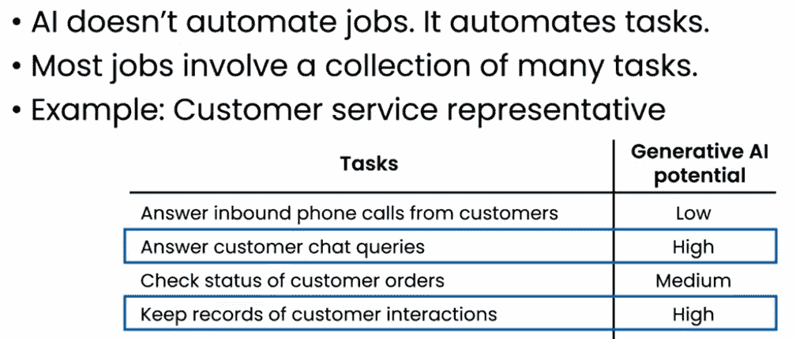

优化AI VS. 自动化AI

AI用于强化工作还是自动化，各有利弊。比如生成与推荐客户回复内容再由客服决定是否发送的方式来增加效率。

又或者直接让AI转录和总结与顾客的沟通记录。

上述两种就是AI用于优化工作与自动化的两种例子。在初期可以使用AI优化工作，当员工开始对AI建立信心与信任，再推动AI将工作任务自动化。

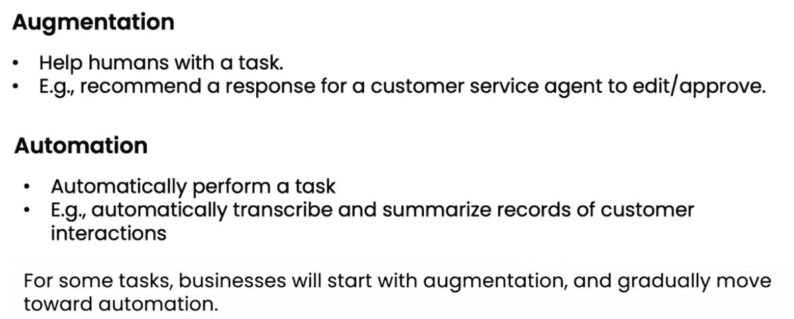

评估AI潜力的模型

AI优化或自动化任务主要取决于，技术可行性与业务价值

即这个任务AI能否完成，成本是否太过昂贵 & 使用AI后带来的经济价值

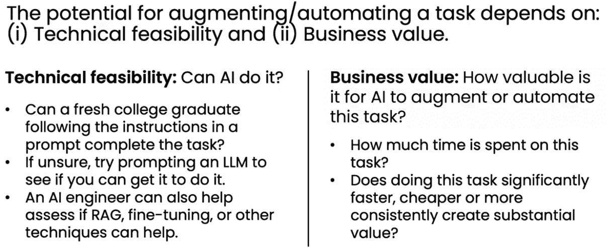

#### 其他工作分析范例

**程序员**

对外界来说，程序员似乎主要任务就是写代码，实际还有许多任务需要完成，比如写文档，检查他人代码，收集需求等等。而这其中就包含了不同潜力的可AI自动化任务。

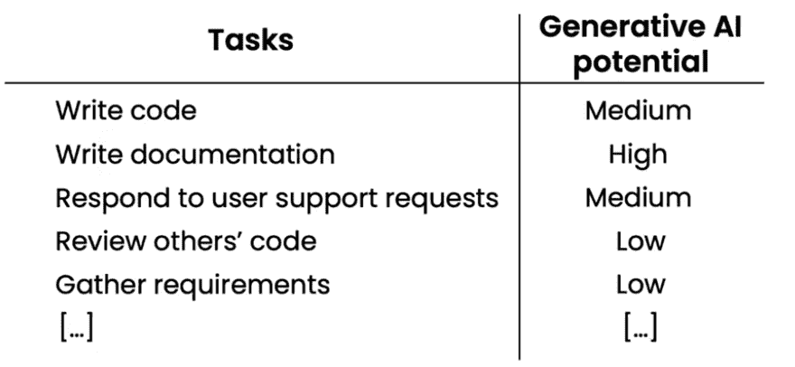

**律师**

对律师来说，起草与审查文档，审查证据等等。其中也同样包含不同潜力的可AI自动化任务。

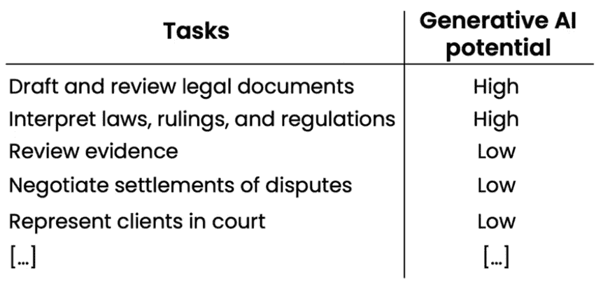

**园林设计师**

工作任务包含，维护和照顾植物，购买和运输植物，维护设备，与客户沟通，维护企业网站等等。可以看到被取代的可能更小一些。

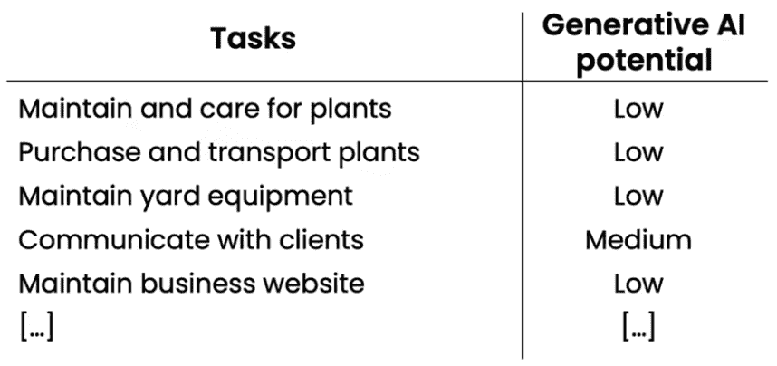

#### 新的机遇

**手术**

以医学手术为例，在手术前需要大量的医学调查工作，然后做手术，虽然使用AI无法直接替代手术过程，但是前期的工作大量减少。

**法律文件审阅**

工作过程中任务拆解后，其中审阅文件的工作可以由AI完成

**营销自动化**

以往营销人员需要写大量的营销文案并最终在网站上展示。但使用AI后，效率会得到极大提升。让原有的文案与展示环节极大减少，并且与之对应，未来或者同时使用甚至4个版本的网站用于运行，然后从4个不同版本中分析数据，最终优化新的提示词。

**分析客户任务**

例如，当客户需要建立网站时，需要选择网站的模版，写标题，选图片，为主页写副本，优化副本等。如果分析AI对客户的潜力，可以带来商业机会。

#### 构建团队

**常见角色**

软件工程师——负责编写软件应用程序并确保稳健运行

机械学习工程师——负责实现人工智能，熟悉大模型，RAG，fine-tuning

产品经理——负责识别和界定项目的负责人，确保项目对用户有用

提示词工程师，是被炒作的职位，实际可能担任了机械学习工程师的部分职责

**小团队启动——怎么启动都鼓励~**

**其他岗位：**

例如数据工程师，数据科学家，项目主管，机械学习研究院

#### 各部门的自动化可能

**生成式AI对高薪工作的影响更大**

OpenAI和宾夕法尼亚大学Eloundou等人的研究发现，生成式AI对高薪工作的影响更大。(有点搞笑的是，横坐标是从30k到163k美金)，从图看出，一些简单的工作在早期很容易被替代，但整体看高薪工作整体会更容易被生成式AI影响。

**分析AI对职能角色影响**

麦肯锡研究了，销售，市场营销，用户运营，客户服务等不同岗位将受到AI的影响。横轴是AI对岗位整体总支出的占比影响，纵轴是将会产生的实际经济价值。

**对行业的影响分析**

生成式AI将会知识型工作产生更大的影响

#### 对人工智能的担忧

担忧一：是否会放大人类的负面影响

在技术层级上解决类似于社会歧视等问题，如RLHF

**担忧二：导致失业**

人工智能会优化效率，但实际每个工作的组成部分不是单一的，人可以和人工智能更好的协同。吴恩达举例了，16年行业看低，放射科医生岗位的案例。但实际放射科医生没有失业，因为解读X光照片事实证明比当时看起来更困难，而且放射科医生工作的多部分组成，解读X光照片仅仅是一个部分。

最终，能比较明确的是，会人工智能的人会取代不会人工智能的人

**担忧三：人类毁灭**

人工智能可能导致许多问题，但当出现人工智能会有毁灭性影响的观点，并评估论点现实性，吴恩达老师发现都不具体，也没有具体说明人类如何灭绝。

人类有丰富的经验来控制比个体强大的事物，像公司与国家

许多没有完全控制的事物，像飞机，还是有价值并且安全的

如果关注其他的像气候变化和大流行病，AI可以成为解决的关键

#### 强人工智能

ChatGPT的崛起导致大家认为，大模型可能是通用的。但是通用技术不是通用人工智能（准确来讲，Artificial General Intelligence是强人工智能）

强人工智能定义是，可以如同人一样，可以做任何智力任务

#### 负责任的AI

AGI虽然还有一段路，但AI产生的巨大影响力，让我们考虑一个有负责的AI

**维度：**

公平性，确保人工智能不会放大偏见

透明度，确保人工智能系统的决策对利益相关者，受影响者来说，可以理解

隐私：保护用户数据，确保隐私

安全性：保护人工智能系统不会被恶意攻击

伦理使用，确保人工智能用于有益目的

**建议：**

1，建立起就伦理道德问题进行讨论与辩论的文化

2，进行头脑风暴来预测可能出现的问题

3，和一个多样化的团队，包容所有利益相关者的观点

#### 课程摘要

#### 建设一个更加智能的世界

人类的智慧是昂贵的，这是为什么最富有的人可以承担得起大量的智慧成本，比如雇佣专业医生来检查并给予建议，高素质的家教来真正花时间了解孩子并给予帮助。

人工智能有让这种智慧的成本大幅降低。

人工智能有潜力提供更智能的指导来应对气候变化，流行病等，AI有潜力改变各行各业，带来更长寿，健康，充实的生活。