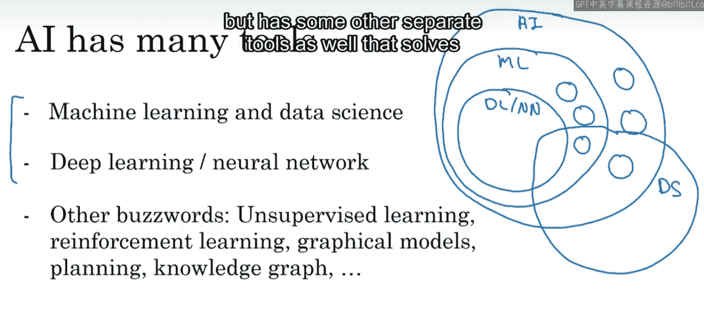
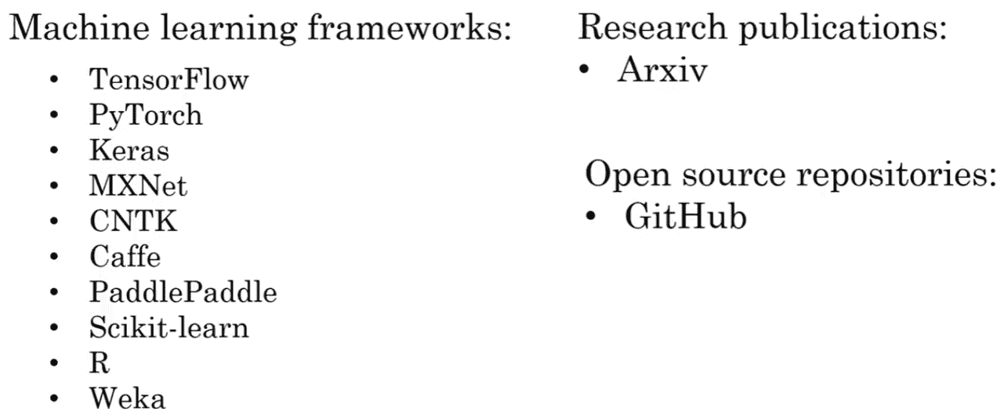
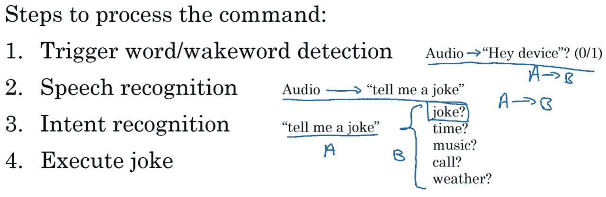
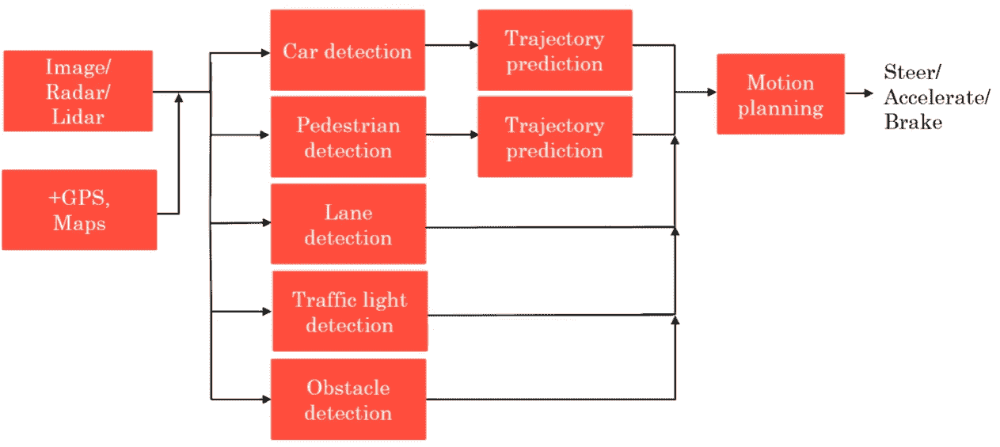
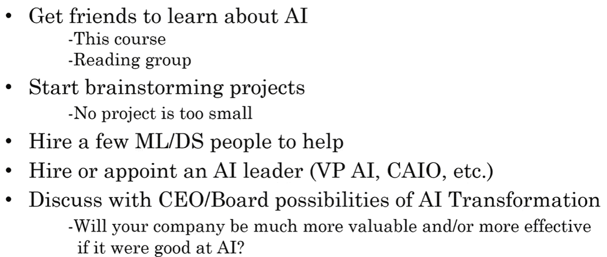
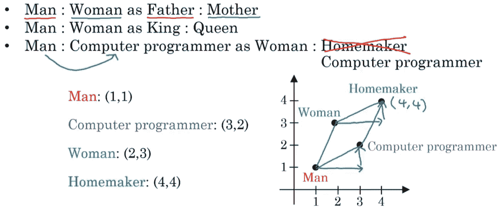
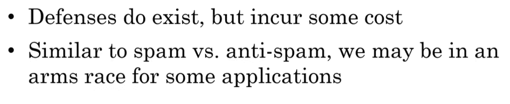
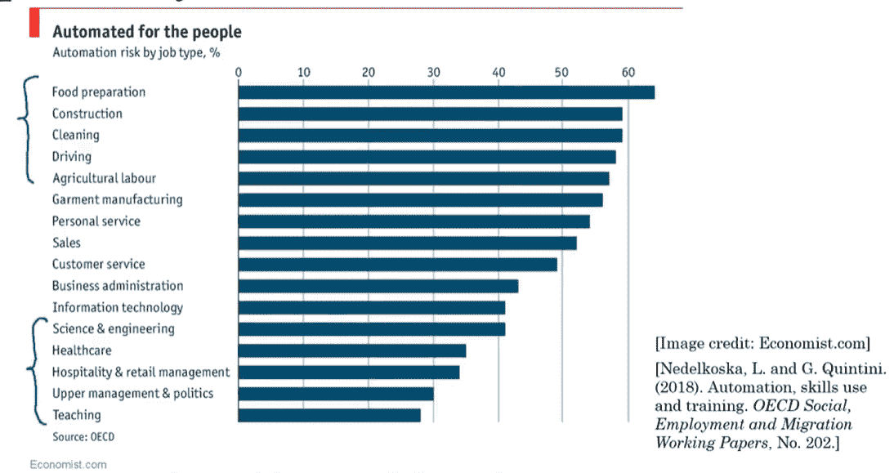
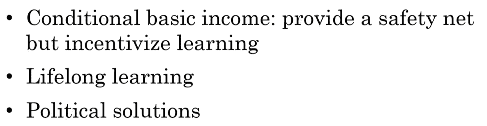

# 学习笔记：AI for everyone吴恩达

> 来源：[https://waytoagi.feishu.cn/docx/WXeqdQIlroBailxIW6BcneKDnVT](https://waytoagi.feishu.cn/docx/WXeqdQIlroBailxIW6BcneKDnVT)

笔记作者：心威

起因：自学AI，然后看吴恩达老师的相关课程，认真学习时边看边做笔记

**注：因为是学习记录，可能会有错误，可以联系作者（右侧**二维码），请大家多多指导，共同学习进步。

> 视频课程：https://waytoagi.feishu.cn/record/MpYtrApUXegqJ0cF4N7cXbuVnXd

# 以下是笔记

## 什么是人工智能？

AI分为ANI和AGI，ANI得到巨大发展但是AGI还没有取得巨大进展。

ANI,artificial narrow intelligence 弱人工智能。这种人工智能只可做一件事，如智能音箱，网站搜索，自动驾驶，工厂与农场的应用等。

AGI,artificial general intelligence，做任何人类可以做的事

##### 机器学习

监督学习，从A到B，从输入到输出。

为什么近期监督学习会快速发展，因为现有的数据快速增长，神经网络规模发展以及算力快速发展。

##### 什么是数据？

数据集，又称为资料集、数据集合或资料集合，是一种由数据所组成的集合。

Data set（或dataset）是一个数据的集合，通常以表格形式出现。每一列代表一个特定变量。每一行都对应于某一成员的数据集的问题。它列出的价值观为每一个变量，如身高和体重的一个物体或价值的随机数。每个数值被称为数据资料。对应于行数，该数据集的数据可能包括一个或多个成员。

如何获取数据，一，手动标注，二，观察行为，三，网络下载。

使用数据的方法，如果开始搜集数据，可以马上将数据展示或者喂给某个AI团队，因为大多数AI团队可以反馈给IT团队，说明那种类型数据需要收集，以及应该继续构建那种类型的IT基础框架。

数据不一定多就有用，可以尝试聘用AI团队要协助梳理数据。有时数据中会出现，不正确，缺少的数据，这就需要有效处理数据。

数据同时分为结构化数据与非结构化数据。结构化数据可以放在巨大的表格中，人们理解图片，视频，文本很简单，但是这种非结构化数据机器处理起来更难一些。

##### 人工智能术语

机械学习：学习输入输出，从A到B的映射。所以一般都有个运行的AI系统，即输入A必然会输出B的软件。更系统的定义是，让电脑在不被编程的情况下，就可以自己学习的研究领域。（1959，Arthur Samuel）

数据科学：分析数据集，从数据中获取一些结论与提示。挖掘数据来获取见解，输出结果往往是slide desk，如结论，PPT，项目结果。

神经网络/深度学习：有输入层，输出层，中间层（隐藏层）

##### 怎样才能成为一家人工智能公司？

吴恩达举例什么是互联网公司，就是利用互联网将公司运营得更好的公司。比如经常会做A/B测试，测算两个网站哪一个网站会更有优势。而拥有线下商城的公司，不能同时拥有平行时空下的两家不同商场。同时互联网公司迭代周期很短。互联网公司做决策的是产品经理，工程师等。传统企业则是老板。

对比来看，什么是人工智能公司。一，把通过人工智能做到的事情做得很好的公司，例如擅长有策略性数据采集，大型科技消费公司会有免费产品来帮助他们采集数据，并在别处盈利。深思熟虑的获取数据是一个好的人工智能公司的关键部分，人工智能公司会建立统一的数据仓库。人工智能公司将会擅长发现可以自动化的部分。也会有新的岗位，比如机械学习工程师。

人工智能公司将会是运用人工智能完成一些事情，并且做得非常优秀的公司。

人工智能转型五步：

1，启动试点项目来获得动能，几个小项目就可以了解人工智能可以做什么

2，建立一个公司内部的人工智能团队，

3，提供广泛的人工智能培训

4，制定一个人工智能策略是很重要的

5，确保内部与外部的沟通一致

**百度拓展：**

互联网企业有广义和狭义之分。

广义的互联网企业是指以计算机网络技术为基础，利用网络平台提供服务并因此获得收入的企业。广义的互联网企业可以分为：基础层互联网企业、服务层互联网企业、终端层互联网企业。

狭义的互联网企业是指在互联网上注册域名、建立网站，且利用互联网进行各种商务活动的企业，也即为广义互联网企业中的——终端层互联网企业。然而根据这些互联网企业所提供的不同的产品和服务，可分为：网络服务提供商、互联网服务提供商、互联网内容提供商、应用服务提供商、互联网数据中心、应用基础设施提供商。

##### 机器学习能做什么，不能做什么

对人来说，可以瞬间完成的工作都可以让AI完成。如翻译，判断车的位置，看手机是否有划痕，转化他人意思，判断客户问题是退货，换货等问题。

能不能让AI项目成功是艰难而复杂的，是否可以实现可以从几方面思考，一，学习一个“简单”概念，如思考不需要超过几秒的事件。二，有大量的可用数据，有输入A和输入B。三，使用新类型数据时，AI表现也通常不佳。

##### 机器学习能做什么、不能做什么的更多示例

可行项目：通过车辆前的摄像头，雷达可以判断前方车辆的距离/患者是否有肺炎

不可行项目：通过一张图片，判断这个人的意图/少量的图片与教科书来判断肺炎

##### 深度学习的非技术性解释（第 1 部分，可选）

以T恤商店销售额为例，衣服材质，营销费用，价格都会影响最后的销售额。输入材质，推广，价格数值，得到最终的销售额，只要数据量足够大就可以完成深度学习。而且中间过程不需要在深度学习中标注与拆解，只需要大量使用数据即可自然形成最终输出。

##### 深度学习的非技术性解释（第 2 部分，可选）

图像识别，实际是讲图片转化为大量的图像单个像素点RGB值，作为输入，再大量标注输出，形成神经网络（深度学习）。

## 建设人工智能项目

##### 机器学习项目的工作流程

1，收集数据，2，训练模型（不断优化，直到足够好），3，派送模型（测试并更新数据与模型），

##### 数据科学项目的工作流程

1，收集数据，2，分析数据（迭代多次获得正确的见解），3，提出假设与行动（调整，不断分析新的阶段数据）

##### 每个工作职能都需要学习如何使用数据

数据科学家与人工智能，在销售，农场主，网站优化等各个方面均有强大作用，前者通过数据做决策，后者通过数据完成训练，并形成输入输出的程序。

##### 如何选择人工智能项目

找到AI可以完成，并且你的商业领域可以运用的项目。召集一个人工智能专业与业务领域专家组成的团队

第一，思考可以自动化的任务而不是自动化的岗位（细化可自动化任务）

第二，思考什么是驱动商业价值的核心

第三，思考什么是你商业领域的主要痛点

破除数据迷信：1，有更多的数据基本没有坏处，2，数据让有些商业模式具有护城河（网络搜索），3，但即使少量数据集也可以取得进展。（有时错误数据的代价太高，或者资源太少）

Due diligence on project:

技术：1，确定AI系统可达到理想表现。2，需要多少数据？能获得多少？3，开发时间表，清晰所需时间，人员

商业：1，降低成本，提升效率，2，增加收入，3，推出新业务或产品。使用电子财务模型以定量估算价值

购买还是建造。这是一个重要的议题。现实情况是，人工智能项目可以外包而数据科学一般内部成立。

##### 与人工智能团队合作

1，为项目提供验收标准，如检测废品成功率95%，需要另准备测试数据集。标准尽量以数据衡量。有时人工智能团队需要两个测试集。

验收标准基本不可能100%正确，因为数据太少，技术不成熟，数据标注错误，模糊的标签（人为判断是否正确）都会成为不能100%准确的原因。

##### 人工智能团队的技术工具（可选）

## 在企业中建构人工智能

##### 案例研究：智能扬声器

1，探测到触发词或唤醒词

2，语音识别

3，意图识别

4，执行相关程序

智能音箱，需要对每一个用户提出的需求进行单独的程序编写导致智能音箱公司需要花费大量资金教育客户。这是智能音箱面对的困境。

##### 案例研究：自动驾驶汽车

1，汽车检测，使用监督学习，识别前方车辆不仅需要前置摄像头，还包括后置与两侧的摄像头或者传感器，如雷达与激光雷达。

2，行人检测，使用相似的传感器与技术

3，运动规划，规划你的行车路径，输出驾驶路径，速度。如匀速行驶在道路上或避开道路边停靠的车辆。

##### 人工智能团队的角色示例

软件工程师，如智能音箱中的，软件编程工作，团队中50%以上的占比

机械学习工程师，创建A-B的映射，或创建其他机械学习算法。搜集汽车图片，位置的数据，训练神经网络或深度学习算法，不断迭代，确保准确的输出。

机械学习研究员，负责开发机械学习的前沿技术。可能需要发表论文，或专注于研究

应用机械学习科学家，负责学术文献或研究文献中研究前沿技术，并想办法找到技术解决面临的问题

数据科学家，检测数据并分析数据背后的意义，向团队成员与负责人展示数据分析得出的结论

数据工程师，整理数据，确保数据是安全，易被保存，读取。因为人工智能需要处理的数据极大，自动驾驶汽车每分钟都会制造好几个GB的数据。

AI产品经理，帮助决定用AI做什么，什么是可行且有价值的。

##### 人工智能转型手册

1，启动试点项目来获得动能，几个小项目就可以了解人工智能可以做什么

在最初几个试点项目里，尽可能选择可以成功而不是最有价值的项目。在6-12个月里展示成效。这两个项目可以是内部或者外包来做。

2，建立一个公司内部的人工智能团队，

搭建一个集中统一的AI团队，再从这个团队中挑选人员帮助不同的业务部门，更好的支持业务团队人员，而不是业务团队负责人直接招聘AI人员。方便统一管理。

建立一个全公司范围内的平台，如果有什么软件平台，其他工具，或是数据基础设施，能对整个公司有帮助的话。单个部门或者没有这样的权限和资源帮助整个公司完成这个平台。

3，提供广泛的人工智能培训

高层可以了解AI为企业做什么，了解AI的策略，进行资源分配。

部门领导可以了解，如何设置项目方向（技术与商业调研），资源分配与监控进度

培养内部工程师，搭建和推出AI软件，收集数据管理数据，开展特别的AI项目

4，制定一个人工智能策略是很重要的

相对深度了解AI后，结合自身业务以后才能制定自身策略。

设置一种与AI良性循环相一致的公司策略，例如网络搜索，当出现一款更好的软件，就会有更多的用户使用，然后出现更多数据，反哺更好的软件，让产品不断更好，形成增长飞轮。

一个农业公司使用照片，拍摄田地照片，在早期人工拍摄，后续形成一个小模型以后，说服几个农民使用。最后不断扩大影响，形成增长飞轮，几年以后，这家公司以3亿美元被一家更大的公司收购。

考虑创建一个数据策略，优秀的公司擅长做战略数据采集，例如一些面向消费者的大型AI公司推出免费服务，像免费邮箱，免费相片共享服务等，以此搜集数据并提供更多的服务给你。与直接出售服务的模式大不相同。

考虑建造统一的数据仓库，方便管理与工程师使用。

创造网络效应与平台优势，在赢家通吃的行业，AI可以成为加速器。

5，确保内部与外部的沟通一致

与投资者，确保投资者看到AI优势以及相关地位

政府密切交流，以公私合伙伙伴形式，确保AI方案保持效果，也同时可以保护消费者。

消费者与AI人才的吸引招聘也极其重要，

最后是内部的交流顺畅，正确引导公司内部对AI项目的评价。

##### 应避免的人工智能陷阱

不要以为AI可以做任何事，考虑技术，数据，和工程资源有许多AI并不能做到的事情。

不要以为只雇佣2-3个机械学习工程师就可以提供公司的使用场景。机械学习人才很重要，也应该让工程师与业务人才交流，寻找可行，有价值的项目。

不要以为AI项目一次就可以成功，AI开发通常需要多次尝试才能成功。

期待直接使用传统的计划流程而不用改变。实际需要和AI团队测算时间节点，里程碑与KPI

不需要极其优秀的AI人才后，才能启动项目。持续构建团队，但实际普通工程师也可以提供有价值和可行的项目。

##### 迈出人工智能的第一步

与朋友一起学习AI，开始一个小项目，与ML/DS的人交流

##### 人工智能主要应用领域概览

**计算机视觉：**

图像分类和物体识别，是将图片作为输入，输出图像的内容分类。应用于面部识别。

物体识别，不仅是分类或者识别物体，还有检测是否有物体出现在一个图像里。

图像分割算法，不仅识别出对应的物体的位置，并将不同物体对应的像素点进行标记。识别X光照射图片则使用这种算法。

计算机视觉还可以进行视觉追踪，如检测视频中的奔跑者，还可以追踪随时间产生的对应轨迹，确定其运动方向。

**自然语言处理：**

文本分类，识别邮箱或文本中的内容，进行归类。可以用于情绪识别

信息检索，输入关键字，希望AI可以顺利找出文档。

名称实体识别，可以找出句子里的名称。自动提取电话，姓名，国籍等。

机械翻译，进行语言翻译

解析与语音部分标注技术，将句子词性标注（part-of-speech tagging），最后通过识别名词，形容词，动词等，让AI系统找出哪一些词语可以留意。

解析器，将单词组合成短语，最后组合成句子，同样是一种分类标签。

语音识别，将麦克风记录的空气高速压力变化数据，转化为文本。

触发词检测，识别触发词

语音ID识别，倾听说话来识别身份

语音合成技术Speech synthesis（text-to-speech,TTS），输入是文本，输出是语音

**机器人：**

机器人“感知”，意思是找出围绕于你的东西

运动轨迹计划，会寻找机器人行进的路径

控制，发送控制指令让机器跟随对应路径

##### 主要人工智能技术概览

**非监督学习：**

非监督学习最著名的就是聚类。非监督学习并不需要准确告诉AI系统需要输出什么。只是需要给出大量数据，然后让AI从中找出有趣的信息。

**迁移学习：**

任务A中学习的内容，可以用于帮助完成任务B。

许多计算机视觉实际是使用了迁移学习。

**强化学习：**

当输出好时强化。输出差时惩罚。

使用“奖励信号”来告诉AI什么时候做的好或差，AI会自动学习最大化奖励。做得好时，给一个正数权重，做得差时，给一个负数权重。

缺点是需要大量的数据。

**生成对抗网络：**

生成对抗网络是一种深度学习模型，由两个神经网络构成：生成器和判别器。生成器负责生成虚拟数据，判别器则负责判断这些数据是真实数据还是虚拟数据。两个网络不断反复训练和竞争，从而不断提高生成器生成真实数据的能力，直到生成的数据与真实数据无法区分。GAN可以用于图像、声音、文本等各种类型的数据生成和合成，被广泛应用于计算机视觉、自然语言处理等领域。

**知识图谱：**

在搜索时，展示知识图谱。这些信息是从知识图谱中产生的，意味着列出这些人和与其相关的关键信息，如生日，年纪等。酒店知识图谱可能包含大量信息，让人们在查地图时，可以快速找到准确信息。

## 人工智能与社会

##### 对人工智能的现实看法

过度乐观与过度悲观都不可取。

少量数据导致AI无法有良好表现，但高性能AI系统是黑盒模型，不清楚中间的运行原理，难以解释。为了大众能够接受AI，AI解释性研究也是众多学者在努力的方向。

AI会产生偏见与歧视

##### 歧视/偏见

微软发现AI会通过网络学习到偏见与歧视，同时给出了技术性解决方案。

人工智能系统存储单词的方式是使用一组数字，比如存储男人这个单词，或者使用数字组（1,1）来代表这个词。（实际代表的数组更复杂，暂且这么表示）男人对程序员的位置。会类同到，女人同向量上的对应词语。

存在少数群体歧视，肤色歧视等。

解决：

使用技术手段，将有歧视的数字（内容）归零。

使用更少偏见或者更有包容性的数据

要求系统拥有良好的透明度和审计流程，从而更好的纠正

团队更加多元化

##### 对人工智能的对抗性攻击

对AI的数据进行人类肉眼上不易察觉的改动，导致AI识别出完全不一样的结果。

标记错误的标签。

使用一些特殊的变化，让计算机无法正确识别事物，如带个花眼镜会将男士识别为女士。

使用一些特殊的贴纸，可以直接误导AI系统

解决对抗性攻击或许会付出一些代价，如系统运行速度变慢。

在一些应用上，的确存在军备竞赛意义上的，攻击对抗。

##### 人工智能的不利用途

生成虚假视频，破坏民主与隐私，压迫人民，虚假评论等等

##### 人工智能与发展中经济体

发展中国家的经济发展的必要步骤，会因为AI而直接被取代，导致发展中国家无法正常发展（待辩证看待）

吴恩达建议，发展中国家在垂直领域完成优势积累。

##### 人工智能与就业

2023年AI将会替代4亿-8亿工作岗位，同时AI会增加5.55-8.90亿新岗位。

如何计算被替代的岗位，实际是查看岗位的任务构成，看其中可以自动化的任务占比。

重复性高的很容易被替代，而灵活，非常规，创造性的岗位更难被取代。

如何应对人工智能的影响？

##### 结论

大家一起为AI世界努力吧，冲！