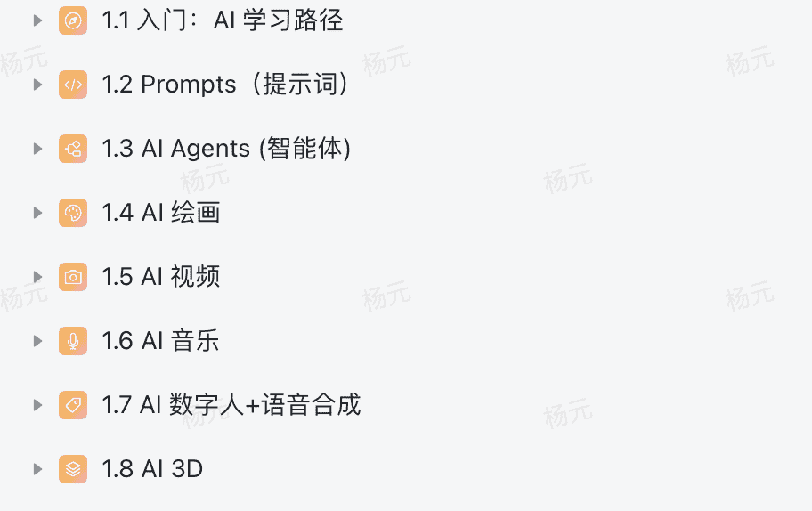
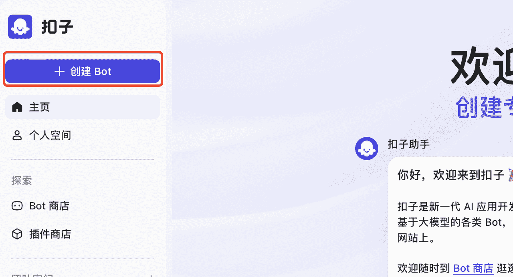
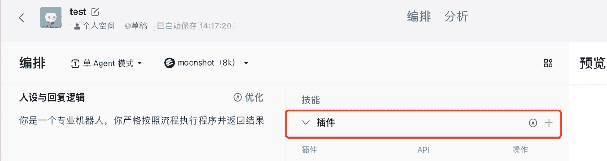
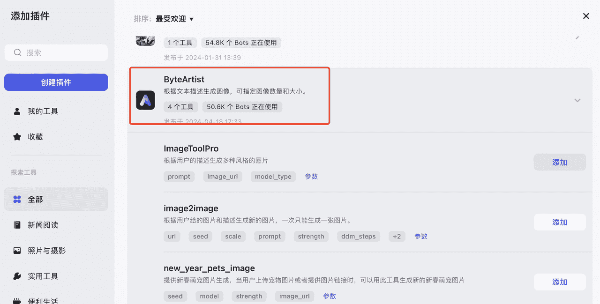
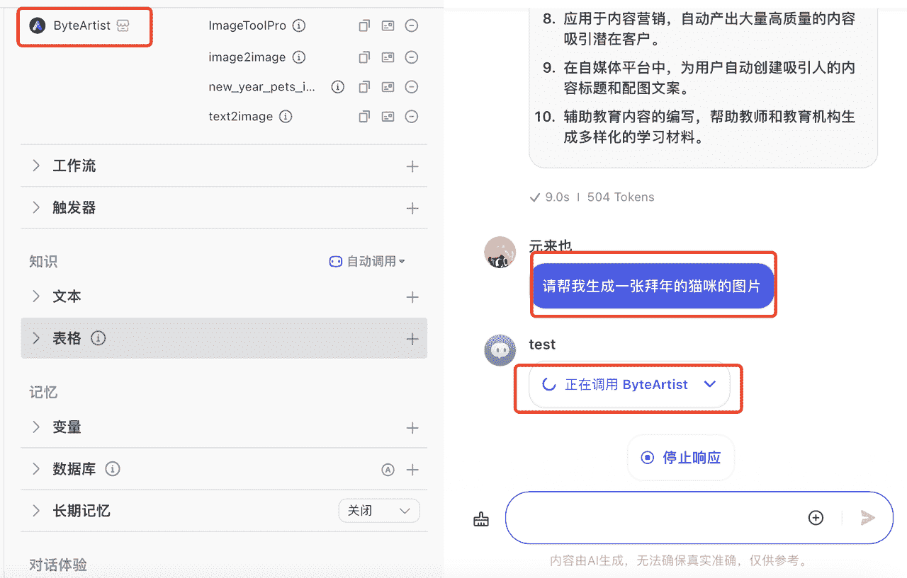
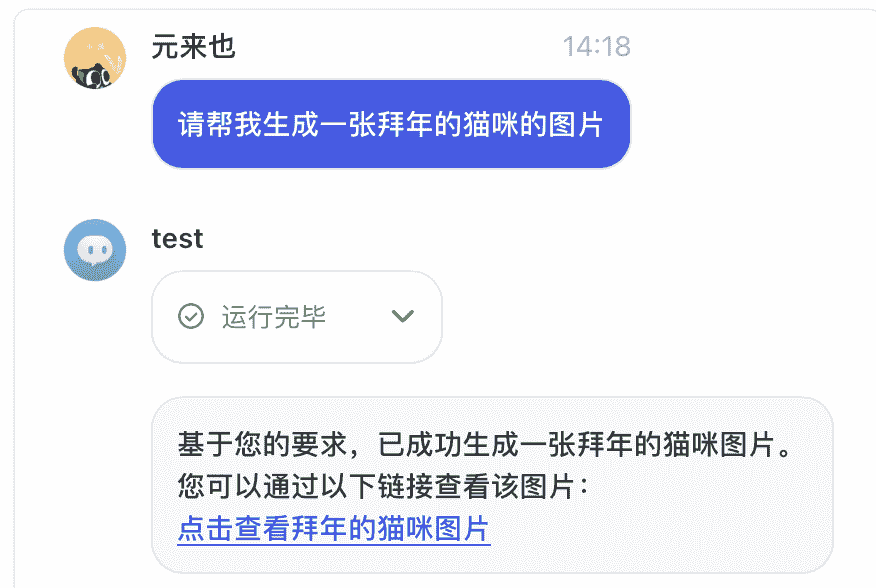
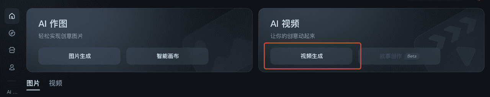
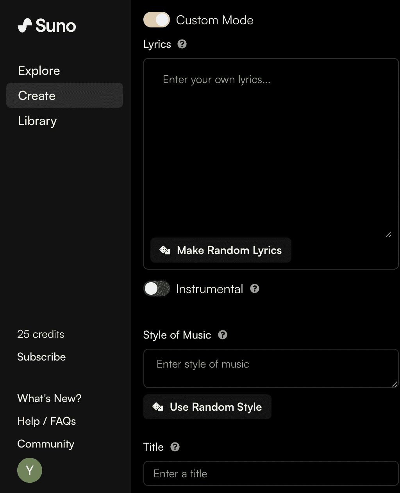

# 元子：小白30min快速体验AI工具

> 来源：[https://waytoagi.feishu.cn/docx/Td1HdKYSjosFo1xKa1wcmlaXnhd](https://waytoagi.feishu.cn/docx/Td1HdKYSjosFo1xKa1wcmlaXnhd)

作者

# 一、缘起：普通人和AI有堵墙

> 在像我一样的年轻人眼里，AI看起来很繁荣、离我们很近，能切实地为我提升效率，创造“奇迹”

> 但是对于“墙”外的许多人，它好像离得有点远——

——这些“许多人”里，包含了行业外的人、包含了没有科学🕸️的人、不愿初期付费的人、包含了我们的长辈

写这篇分享的初衷是，五一趁着节假日回家看望爹妈时，我那“无线电”专业、当年手把手给我启蒙电脑网络协议和编程的爸爸提出了一个需求——“给我和你妈科普一下啥叫AI”，短视频里讲的不太靠谱。

当我的父亲跟我说这句话的时候，我当真被震惊了一下：

1.  此前，我已经将WayToAGI的网址发送给了他，并向他大力推荐

1.  我已经为他配置好网络，注册好了谷歌的邮箱账号

1.  我的父亲是个持续学习的人，他还没退休，而他的工作和计算机、网络都有紧密的关系

所以何至于此，他会问出这样一个在我看来分明已经解决过的问题？

当然，这里面有很多原因，社会学的、个人习惯的、甚至是我和父亲交流模式上的。但也因此，我有些恍然地意识到，那些我们看来“有手就行”的AI工具初级尝试，其实已经拦住了很多人；而因为没有自己亲手的尝试，以至于他们对“AI到底能帮我做什么”都是基于猜想的，在快速碰壁后，就此打住了继续探索。

WayToAGI的社区，里面共创和沉淀的知识已经足够地丰富、甚至很多已经足够地深刻，但其核心是“以练代学”，可这些“有手就行”的一些工具尝试，或许其实是拦住大家的第一道坎儿。

# 二、开搞：百闻不如一试

> 对于普通人来说，对AI最好的直观初接触有两个方面

1.  最低成本能直接上手试的工具是什么？我能自己试试嘛？

1.  现在最普遍/最好的工具是什么、能达到什么效果

其实虽然底层都是大模型，但是AI工具却各有侧重，也有不同的公司进行各自的优化。关于每一种工具的详细入门、讲解和应用，其实WayToAIG已经分好了类目。

然而为了给我的父母更好地便捷展示AI的能力，让普通人更直观地马上上手，我选择了以下几个进行展开说明：

+   聊天工具

+   绘画工具

+   视频工具

+   音乐工具

## 聊天工具

直接抽象大模型能干什么，对爹妈来说因为没有理论支撑，也没尝试过，所以没有想象空间。

我结合爹妈的生活，简单给了他们一堆案例解释并直接上手：

+   你们可以用它来给奶奶制定老年人专属食谱，直接把营养需求和医嘱限制给它，让它直接出食谱

+   可以用它来替你们写每年的年度总结，直接把去年的给它，让它写个今年的

+   可以用它来直接教你们一些office里面的功能，直接问

#### **最低成本的开始：Kimi**

网址：https://kimi.moonshot.cn

优点：不需要科学🕸️,无收费，不需要登录可以直接使用

有案例，点击预设问题即可开始尝试

注册：微信 or 手机号

时间：5min

#### **先锋的：ChatGPT-4**

网址：https://chatgpt.com

优点：回答问题更准确、上下文的衔接更好

限制：需要🪜，需要gmail注册，有被封禁可能

时间：30-60min

价格：GPT-3.5免费，GPT-4 20$ 一个月

#### **尝试后：所以我们需要提示词工程**

在尝试的过程中，他们就会发现一些问题了：

它有的时候答非所问啊？我明明是问它食谱，还没给它医嘱和营养需求，它就已经开始疯狂输出了

它的回答格式不标准啊，用词不是我们事业单位可以接受的风格

它用文字描述的office excel的操作步骤我在界面上根本找不到

是的，这种感悟就很自然了，我就向他们解释了，AI因为它的原理，偶尔会出现“**幻觉”和理解的“**不准确”，为了让AI就一个具体的目标更好地服务我们，我们需要学习“提示词工程”。

而到这里，我的爹妈可以快捷使用KIMI后，他们从自己的经验出发，所产生的需求就会接近AI本身真实的范围了，我同他们约定，一旦他们想到具体要用它解决一些高频问题的时候，我会为他们写提示词，甚至捏一个BOT。

#### 高效化：Bot让它进一步专业、高效

网址：https://www.coze.cn/home

APP：直接搜索“豆包”

优点：不需要🪜，可以捏好给别人用，可以扩展聊天AI的基础能力（搜索、作图、文档等）

注册：手机号 or 抖音号 or 飞书号

时间：5min

话都讲到了这里，我的父亲于是大手一挥：“我想和你妈妈退休之后去国外旅游，我们需要个在线指导我练英语的老师，你这玩意儿只能打字吧？”

这个当然可以，于是我给他们打开了APP STORE并且安装了豆包，然后把我捏好的机器人分享给了爸妈，并且教他们可以在手机上直接给这个机器人打电话过去聊。

在尝试的过程中，他们又发现了一些问题了：

它有时候跟我讲中文，有时候跟我讲英文要怎么办？

它一句话太长啦，我听不懂那么长的话，我还需要每句话的翻译怎么办？

我需要它具体纠正我的一些发音，但是它只是在跟我对话，怎么办？

在这个过程中，我的爸妈慢慢发现了“啊！AI确实能做很多事情”，也慢慢发现了“啊！要用好它，还需要持续学习。” 于是我跟他们约定，每一个周末跟他们打电话的时候，我也为他们优化一下他们当前的使用方法，这样，他们就知道下一步他们想要如何更深入地学习和使用AI了。

#### 理论的重要性：知其然，遂减少不必要尝试

我的母亲是文科生，她对我的这套有时间节点和案例的迭代方案很满意，而我的父亲在我开始展示到第三个例子的时候表现出了一些不耐烦：

“那它的本质就是计算机逻辑，其实很笨，说白了就是要把规则跟它讲清楚，然后看它有没有足够的算力、工具去达到我的目的罢了。”

“其实我只要知道它的原理和历史，我自然而然就会知道它的底线和顶点在哪里。”

我的父亲本身就是一个工程学硕士，他的逻辑思维和抽象能力强大，我不得不说，他说得太对了，于是我再次翻出早就准备好的“理论基础”，再次安利给他。其实我早就将链接给过他，但是他显然没有看；但是经过我这次极度基础的试用展示之后，他重新提起了兴趣，并且自己开始向我征询理论的重要性，于是这次，我的推荐成功了。

[ChatGPT 是在做什么，为什么它有效？](https://waytoagi.feishu.cn/wiki/LnMOwmKIwihcRakRalcczNgrnjf)

[解析 Transformer 模型：理解 GPT-3、BERT 和 T5 背后的模型](https://waytoagi.feishu.cn/wiki/WCOcwp3DYiNj2mkiGVycjJ0Znaf)

[稳定扩散（Stable Diffusion）是如何运作的](https://waytoagi.feishu.cn/wiki/TNIRw7qsViYNVgkPaazcuaVfndc)

[GPT 的现状（State of GPT）](https://waytoagi.feishu.cn/wiki/IXjfwF9l9iX0IzkUg1Ec0Vcinx3)

[软件 2.0（Software 2.0）](https://waytoagi.feishu.cn/wiki/FFJawIKRpi77JokULCvcjIPBnBv)

[Sora之后，OpenAI Lilian Weng亲自撰文教你从头设计视频生成扩散模型](https://waytoagi.feishu.cn/wiki/TphSweEZgis6DKkrZOMcuqILn8d)

## 绘画工具

我的爸妈对于绘画没什么特别需求，但是在各种平台上有刷到过各种AI生成的图片，有些好奇，也有些羡慕。

我们家一直想要养一只宠物，因为各种各样的原因，久久不能成行，于是我决定，从画一只AI的猫猫开始，实现这个宠物梦想，也给我的父母展示一下AI画图的能力。

#### 最低成本的开始：扣子 + ByteArtist

网址：https://www.coze.cn/home

优点：不需要🪜,无收费，可以直接生成

注册：手机号 or 抖音号 or 飞书号

操作步骤：需要在coze的bot里面添加绘图插件

时间：5min

这里需要一点小小的加插件操作，不难，截图一步一步即可做到，而且确实做到全程没有科学🕸️，不需要付费

#### **先锋的：Midjourney**

网址：https://www.midjourney.com/explore?tab=random

优点：图片和描述相关性更大，风格更加显著

限制：需要🪜，需要gmail注册，不免费，在discord上代理使用

时间：30-60min

价格： 8$ 一个月/ 200张图

#### 尝试后：所以我们需要学习Midjourney专属提示词

通过简单的语句描述，我的父母已经可以画出各种各样可爱的小猫了。可是当他们希望画一幅让这个小猫微笑、特定动作、拜年的时候，他们再次遇到了困难。

这个逻辑就和聊天工具是一个道理了，所以我们需要学习一下提示词，让它更加精准地产生我们想象中的图画。

和聊天工具一样，我们可以逐步地高效化它，一方面从提示词下手，另一方面也可以从图片生成原理下手。

很显然，我的父母工作和生活中暂时没有刚需，他们感叹了这个工具的好玩之后，暂时地将它放在了一边。

我想，如果哪一天他们当真遇到了要自己生产图片却不太会使用PS的时候，他们会想起我今天的演示，并且向我询问进一步的内容。

## 视频工具

#### 最低成本的开始：Dreamina

网址：https://dreamina.jianying.com/ai-tool/home?subTab=

优点：不需要🪜, 每天有免费额度

注册：抖音号 or 手机号

时间：5min

#### 尝试后：让老照片活过来

我随便上传了一张离谱村的图片，没有加任何提示词，让爸妈看到这张图片有一些小小的动态，我的父母戏称这个叫做古早的GIF动图。

这个感官倒也没有错，他们开始很感兴趣地将一些风景照片上传上去，看看有什么效果——有的当真不错，水面动起来了；有的也很离谱，整个画面扭曲了。

他们突发奇想问我：“有一些你已经过世的外婆的照片，放进去会怎么样呢？”

就此，我们探讨了一下肖像权、版权、信息安全以及这个技术的意义。

因为图片生成视频的功能有现存的、人类可以自己生产的图片作为依据，它好像和我们的生活更贴近一些，也有更多的想象力用法，但同样也有许多不完善的规定和一些可能造成的风险。

对于视频工具，他们显然比绘画工具更感兴趣，并且同样询问我，“这玩意儿能在扣子里一起用吗？”

哈哈，这个问题已经是我在尝试中不曾探寻过的，这也是我在给我爸妈准备分享时，不曾预设到的问题，他们已经有了自己的对AI的基于事实的看法和使用方式；我想，有插件的情况下应该是可以的，否则，并不如直接去dreamina的官网来得方便快捷。

#### **先锋的：Sora**

网址：https://openai.com/sora

优点：发布的成果好，集成在openai一套里可用

限制：需要🪜，需要gmail注册，需要订阅后才能使用

时间：30-60min

价格：GPT-4 20$ 一个月

## 音乐工具

#### **最低成本的开始：suno**

网址：https://suno.com/create

优点：回答问题更准确、上下文的衔接更好

限制：需要🪜，需要邮箱注册

时间：10 min

价格：每日有免费额度10首歌

+   Custom Mode： 开启为自己有歌词，关闭则给你随机生成歌词，你只要填描述

+   Lyrics：直接填歌词即可，可以用熟悉的、喜欢的歌曲原词先感受一下产品功能，会有对比性。我的测试歌词在下面可以找到，是自己填的词，测试的话可以随便拿去用

+   Instrumental：不要歌词、直接出纯音乐的曲子

+   Style of Music：写Prompt的地方，1句简短的自然语言描述即可，注意最多100字符

#### 尝试后：我想让它唱出我的文字

让我没想到的是，爸妈对音乐工具表现出了最大的热忱。

我的父母是那个年代为数不多的自由恋爱，爸爸写过情书，甚至会弹吉他——“啊，我要把给你妈妈写过的东西唱出来”。他总这么说，而在我快速演示完之后，这个工具直接将他念叨了这么多年的事情轻而易举地拉到他的眼前。

他开始问我，能设置节拍、乐器吗？唱词是否咬字清楚呢？

开始有新的需求，意味着有新的学习动力和方向，于是我给他分享了我在玩suno的第一篇学习笔记：

[元来也：小白的Suno探寻笔记](https://waytoagi.feishu.cn/wiki/X9gSwxjA2ijeLnkOY8ucdVk6nxb)

# 三、AI和我的生活

> 对于超出自己理解范围内的事情，最简单的方法就是试一试。

> 学习一个新东西，百闻不如一练。

在这次面向父母的“AI布道”活动中，我发现，恰好是因为“AI工具”太强大了，可以做无数的事情，反而让AI的工具和普通人之间有一面墙，一面没有办法轻松地一戳即破、随即走向自我需求的墙。

AI是必然的未来方向，它的科普也有很长一段路要走，但是我坚信，尽可能简单地能试用它，本身就是让普通人更快在这场AI的路径和狂欢中受益的最好方式。

不论是行业外的人、没有梯子的人、不愿初期付费的人；

不论是我们的长辈、我们的平辈、还是我们的晚辈。

我不好说我是哪个派系，只愿未来因科技而便利，因科技而幸福。