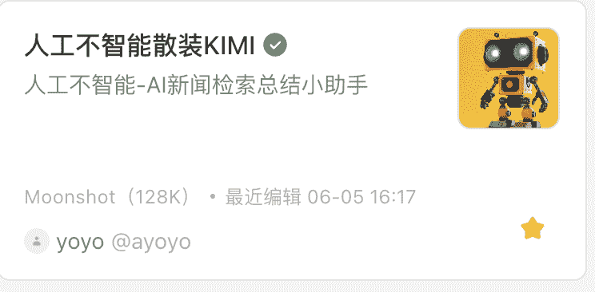
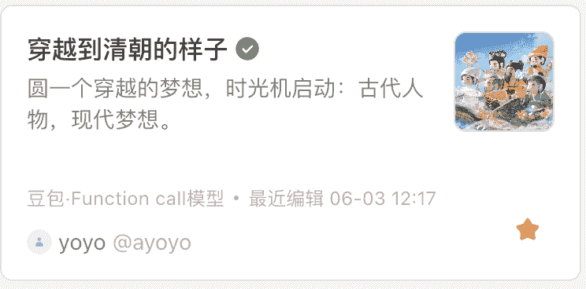
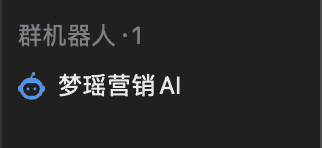

# YoYo：我在通往AGI的学习之路心得

> 来源：[https://waytoagi.feishu.cn/docx/ElC2dr6F5oUHv7xPjKAc3J17nMf](https://waytoagi.feishu.cn/docx/ElC2dr6F5oUHv7xPjKAc3J17nMf)

> 千人千面，仅代表个人的学习实践，仅供参考启发。

## 澄清内容，方便大家参考

### 学习前状态

+   不理解什么是AI，什么是提示词工程，但是不影响使用的一个蛮干的状态

+   个人是个文科生，不懂代码，英语也非常差；

+   在学习AGI之前的状态是，注册尝试各种AI工具，走了不少弯路

+   对ChatGPT的认识，仅限于日常问答，SQL学习交互，能够支持工作数据提取

### 学习后现状

+   终于可以搓多Agent的智能体，但是需要进修python搓更多智能体

+   营销文案demo，SQL代码进阶学习应用

+   创建了3个图像流智能体，2个Agent智能体玩具🪀

+   在公司中实践智能客服从创建到应用的过程，实现企业微信机器人问答的基本功能

学习Dr.kown的尝试实践

图像流的尝试

企业智能体实践，智能客服

## 在AGI的学习路径

关键词：#少就是多 #先有个初识 #目录索引推荐 #兴趣最重要 #先动手

学习路径，主线+支线的游戏通关～

+   最后，个人感受真的学不完，找到适合自己的就好

+   学以致用，通过学习-分享-不断填补知识的缝隙，成长的一种路径。

---

## 关于我

大家好～

我是yoyo 🐱

+   🐈 坐标北京，铲屎官一枚

+   🫡 AIGC的小白，持续进阶成长，打造一个自己的智能体

+   ☕️ 以上期待能够给到各位一点启发

> 感谢家属带我在“[通往 AGI 之路 ](https://waytoagi.feishu.cn/wiki/QPe5w5g7UisbEkkow8XcDmOpn8e)”打开新世界，接触有趣的事情，结识有趣的人

---