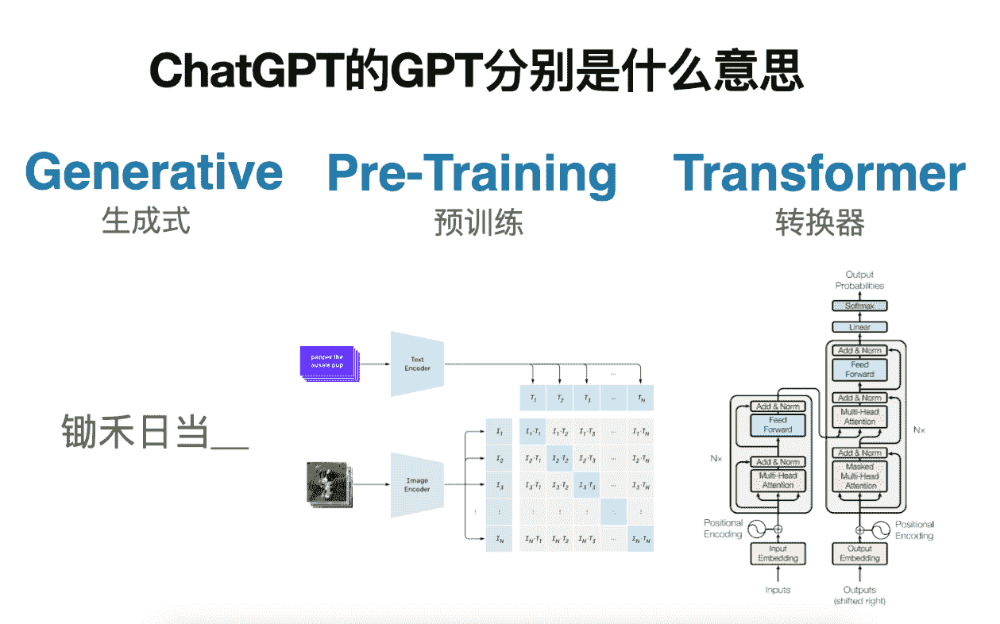
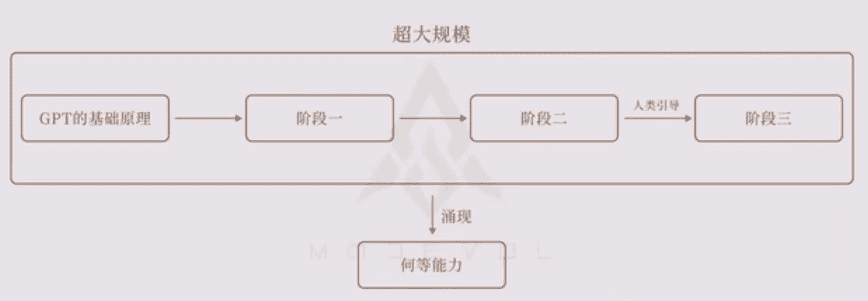
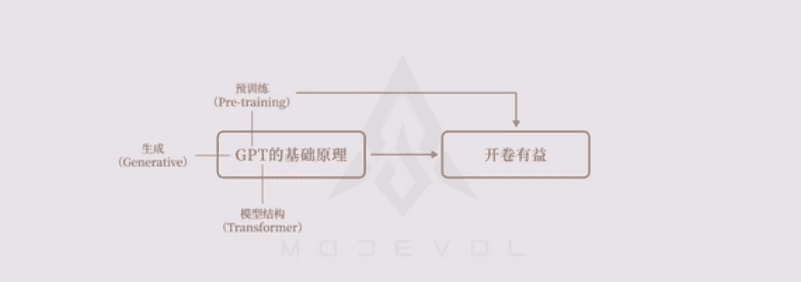
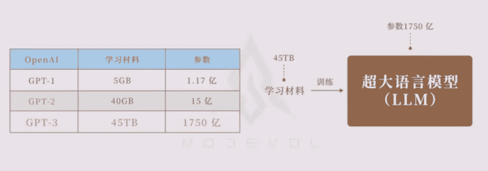
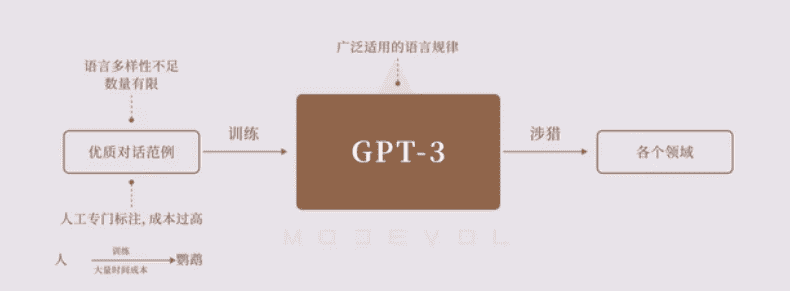
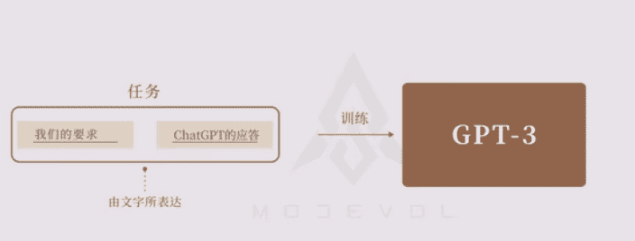
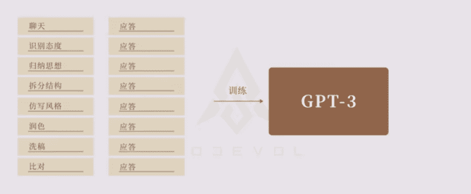
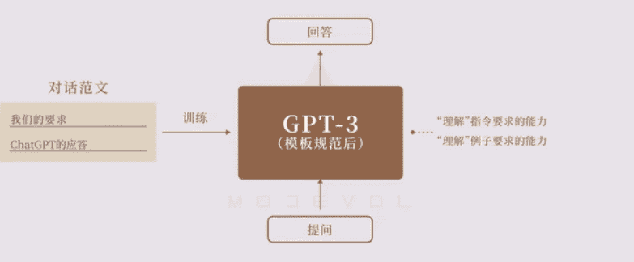
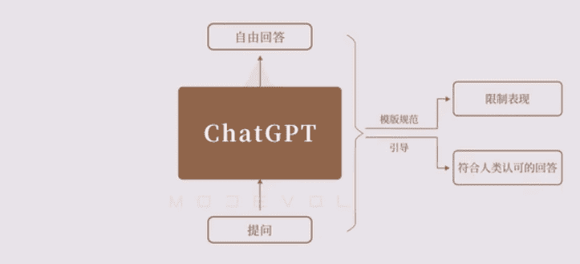

# YoYo：小白 AI 初识知识点扫盲

> 来源：[https://waytoagi.feishu.cn/docx/FXTPdIWm1oCxoIxj5macQ8BenTg](https://waytoagi.feishu.cn/docx/FXTPdIWm1oCxoIxj5macQ8BenTg)

> 作者：

> 文科生一枚，早期只会ChatGPT日常聊天，后来在coze平台一发入魂，逐渐沉迷，又菜又爱

> 现在初步进阶手搓智能体，可以使用API，coze平台搓过大聪明的agent，复刻过kimi搜索逻辑的智能体

> 

> 虽然捏过几个BOT，但越发觉得知识对实践的意义重大，所以结合自己踩过的坑，小结了下基本知识，对其有个大致的认识，是自己在AI的浪潮中，有那么一点笃定的求知路径。

> 以此献给那些，曾经与自己有相同困惑的小伙伴，让我们一起在AI的浪潮中乘风破浪，不断探索和成长

+   有兴趣伙伴，可以留言互动，有需要可以提供一份AI工具逐渐进入状态的tips文章。

+

# **我的 ChatGPT 大明白 **

## **  **** **** 一、认识 ChatGPT**

#### **1、ChatGPT 是什么**

它为什么叫做 ChatGPT 呢？先说 GPT：Generative Pre-Training Transformer；

Generative 生成式，Pre-Training 预训练。Transformer 转换器

示意图

ChatGPT 实质功能：本质是「单字接龙」，长文由单字接龙的回归所生成

GPT 作为大脑，也就是模型是需要训练的。

训练方式是通过材料学习，不断的形成模型。

eg.未学习前，胡乱生成，学习后，概率抽样生成，可以对比小朋友学习前后

训练的目的不是记忆，是学习，“提问和回答的通用规律”学习后的模型，可以实现举一反三

Chat Gpt 并不是搜索引擎的升级版，材料学习作业时调整模型，生成模型；可以给出没有记忆中的内容，这也是出现“幻觉”的原因，对现实不存在的东西，出现合乎规律的捏造，

通过提前训练才能生成想要的问答，这样的训练是为了让它学会「能举一反三的规律」

缺点是可能混淆记忆，无法直接查看和更新所学，且高度依赖学习材料，也是缺乏及时性，准确性的原因

#### **2、ChatGPT 的能力引爆**

##### **阶段一：开卷有益阶段**

理解人类语言，同一个意思可以有多总不同的表达形式，使用一个词，一段描述，同时表达在不同语境中又有不同含义，学习语义关系，语法规律，明白哪些表达实质上是同一个意思，大量范本材料习得规律，应对未见过的语言处理能力，即“开卷有益”（附图）

GPT-3，习得各种词汇和语法规则，编程语言和不同语言之间的关系，但是也有马后炮、事后诸葛亮的问题，高质量的问答，但是海量的知识，使回答不受约束；指挥就很重要了

参数反应着模型大小，Y=KX+B，就两个参数～～～

##### **阶段二：模版规范阶段**

对话模版矫正模型，可以形成优质的对话，同时还能实现延展能力，同时知道什么该说，和什么不该说。

同时，将任务对话范文来训练，最终实现两个能力：理解指令要求，和例子要求的能力

出现分治效应，一步一步的思维链条，比如在代码中，学到了所蕴含的「人类分治思想」

模版式对话，在科学领域发挥优秀，但是人文领域的问题缺乏创新性了

##### **阶段三：创意引导阶段**

通过提问自由回答，人类对其生成的内容进行好坏评分，也就是点赞和差评的逻辑实现 ChatGPT 模型的微调。

**另外，还有注意力，**微调，对齐暂不展开，不影响对 ChatGPT 本身的使用。

> 小结：涌现能力基础（“理解”指令，“理解”例子，思维链）

+   **ChatGPT 的三个训练阶段**

+   ****开卷有益****阶段：让 ChatGPT 对「海量互联网文本」做单字接龙，以扩充规模型的词汇量、语言支持、世界信息与知识。使 ChatGPT 从“哑巴鹦鹉”变成“脑容量超级大的懂王鹦鹉”。

+   ****模版规范****阶段：让 ChatGPT 对「优质对话范例」做单字接龙，以规范对话模式和对话内容。使 ChatGPT 变成“懂规矩的博学鹦鹉”。

+   ****创意引导****阶段：让 ChatGPT 根据「人类对生成答案对好坏评分」来调节模型，以引导它生成人类认可的创意回答。使 ChatGPT 变成“既懂规矩又会试探的博学鹦鹉”。

#### 3、ChatGPT 未来影响 mini（抛砖引玉）

+   **里程碑意义**

1.  大语言模型的可能性

1.  验证计划的可行性

+   **大语言模型能够做什么**

1.  精通语言的基础上存储人类知识，大语言模型中积累了世界知识，可以借助世界认知的基础上拥有改造能力；

1.  在人力创造知识，继承知识，应用知识过程中，大语言模型可以有处理繁重的任务，提升处理效率（速度快、记忆大、覆盖广、无疲劳等）；

1.  大语言模型有理解能力但是和人类理解有差异，其缺乏理解符号和指代对象之间的联系能力，不知道符号的指代；

eg.人力看到“苹果”和大语言模型看到“苹果”，具备同样的符号处理能力，也可以通过习得获得指代对象的处理能力，但是对其理解联想缺乏联系能力哦

1.  场景应用就有更大的探索空间，教育界、学术界、新闻界、内容生产行业的影响颇深；

1.  对社会对影响可以相当于，口语、文字、电脑、互联对社会对影响吧；

1.  方便人类对既有知识的继承，推进教育培养更高层次的人才；

1.  网络安全和社会安全也是个全新的挑战；

1.  ChatGPT 更影响各国未来在国际中的地位也不为过。

#### **4、思考碎碎念**

ChatGPT 在模型训练过程中“阳谋”也是挺有意思的；在体验 GPT Store 越发需要注意私有数据安全，在提升“智商”过程，不要忘了保护数据安全🔐

善用工具的人+ChatGPT 还会碰撞什么样的火花嘞～，要害怕的不应该是 ChatGPT，反而我们自己无法成为会使用工具的人。

## **二、认识 AIGC**

AIGC（Artificial Intelligence Generated Content，人工智能生成内容；认识 AIGC 之前，不妨从 ta 的愿头了解下，也就是内容生产方式从 PGC（Professional-Generated Content，专业生成内容）到 UGC（User-Generated Content，用户生成内容），再到 AIGC 的发展历程。

#### **1、PGC：专家创作时代**

Web1.0 时代，互联网内容生产以 PGC 为主，由专家和专业机构生产高质量内容，如雅虎、IMDb 等。PGC 优势在于专业性和易变现，但面临创作门槛高、产量不足等挑战。随着互联网发展，需求新的内容生产方式以满足用户多样化需求。

#### **2、UGC：用户创作时代**

随着互联网发展和用户需求多样化，Web 2.0 时代到来，用户参与内容创作，UGC（用户生成内容）成为主流。UGC 内容多样，个性化，通过推荐系统满足用户需求，降低了专业门槛，促进了互联网的民主化和个性化内容创作。

#### **3、AIGC：智能创作时代**

AIGC，即人工智能生成内容，是利用人工智能技术自动创作文本、音频、图像和视频等内容的新兴领域。它源自生成式人工智能（Generative AI），旨在通过机器学习模型，尤其是大模型（Foundation Model），来生成多样化的内容。这些大模型通过大量数据训练，具有较高的通用性和迁移能力，能够通过微调适应不同的内容生成任务，从而提高内容生产的效率和多样性。

尽管 AIGC 技术展现出巨大潜力，但它也面临技术、伦理和质量控制等挑战。技术成熟度需进一步提升，以确保生成内容的准确性和可靠性。同时，AIGC 的广泛应用需要考虑版权、隐私和伦理等方面的问题，确保内容的原创性和价值。未来，随着技术的完善和规范的建立，AIGC 有望成为互联网内容产业的重要驱动力，为用户提供更加丰富和个性化的体验。

**人工智能赋能内容创作的四大模态，AI 文本生成，AI **音频生成，AI 图像生成，AI 视频生成

AIGC 在元宇宙方向的应用，虚拟形象，虚拟物品，虚拟场景

#### **4、AIGC 技术发展**

##### **图灵测试，起源**

> 1950 年，艾伦·图灵发表了一篇划时代的论文《计算机器与智能》（Computing Machinery and Intelligence），探讨了让机器具备人类一样智能的可能性。论文在开篇就抛出了一个有趣的问题：“机器能思考吗？”

##### **符号主义**

符号主义认为智能源于逻辑推理，主张所有信息可抽象为符号，并通过逻辑规则处理这些符号来模拟人的认知过程。艾伦·纽厄尔的逻辑理论家项目是其早期代表，该程序能自动证明数学原理中的多个定理，显示了符号主义在模拟逻辑推理方面的潜力。符号主义在早期人工智能研究中占据主导地位，但随着技术发展，其局限性也逐渐显现，如对复杂情境的处理能力不足。

##### **行为主义**

行为主义起源于控制论，主要关注模拟人的智能行为和动作，而非内部认知过程。与符号主义相比，行为主义不强调对智能的深层理解，而是通过观察和模仿行为来实现智能控制。这一流派在智能机器人和自动化控制系统领域有广泛应用，21 世纪末随着相关技术的进步，行为主义开始受到更多关注，尽管它在智能模拟方面存在局限性，如缺乏对智能本质的深入理解。

##### **联结主义**

联结主义，又称神经网络，强调通过模拟人脑神经元网络来实现智能。它通过大量简单节点（神经元）和连接权重来处理信息，能够从数据中学习并提取特征。联结主义在处理复杂模式识别和预测任务方面表现出色，但存在“黑箱”问题，即难以解释模型的决策过程。随着深度学习技术的发展，联结主义在图像识别、语音处理等领域取得了显著成就，成为当前人工智能研究的热点之一。

##### **机器学习**

> 根据卡耐基梅隆大学计算机学院教授汤姆·米切尔（Tom Michell）的定义，机器学习是指“计算机程序能从经验 E 中学习，以解决某一任务 T，并通过性能度量 P，能够测定在解决 T 时机器在学习经验 E 后的表现提升”

+   数据获取：为机器提供用于学习的数据。

+   特征工程：提取出数据中的有效特征，并进行必要的转换。

+   模型训练：学习数据，并根据算法生成模型。

+   评估与应用：将训练好的模型应用在需要执行的任务上并评估其表现，如果取得了令人满意的效果就可以投入应用。

##### **强化学习**

强化学习就是让人工智能通过不断的学习试错，找到合适的策略去选择一系列行动，来达成目标。在构建策略时，还有一个需要考虑的关键因素叫作价值（Value），它反映的是将来能够获得所有奖励的期望值。本质上是一个从试错到反馈的过程，通过不断试错找到一个合适的策略。

##### **深度学习**

简单理解就是采用像深度神经网络这样有深度的层次结构进行机器学习的方法，是机器学习的一个子领域。主要特点是，更多的神经元，层次更多、连接方式更复杂，需要更庞大的计算能力加以支持，能够自动提取特征。

#### 5、大模型的重要基建 Transformer

##### **Seq2Seq 模型**

S**eq2Seq 模型最早**在 2014 年提出，主要是为了解决机器翻译的问题。Seq2Seq 模型的结构包括一个编码器和一个解码器，编码器会先对输入的序列进行处理，然后将处理后的结果发送给解码器，转化成我们想要的向量输出。

常用的场景实例，聊天问答，内容续写，摘要/标题生成，文本转语音

##### **注意力机制**

可以将“注意力”理解为一种“权重”，在理解图片或文本时，大脑会赋予对于认知有重要意义的内容高权重，赋予不重要的内容低权重，在不同的上下文中专注不同的信息，这样可以帮助人们更好地理解信息，同时还能降低信息处理的难度。这就是注意力机制。

另外还有多头注意力（Multi-Head Attention）机制。多头注意力机制主要通过多种变换进行加权计算，然后将计算结果综合起来，增强自注意力机制的效果。

##### Transformer 的基本结构

Transformer 与 Seq2Seq 模型类似，也采用了编码器-解码器结构，通常会包含多个编码器和多个解码器。

在编码器内有两个模块：一个多头注意力机制模块和一个前馈神经网络模块，这里的前馈神经网络是一种最简单的人工神经网络形式。

解码器内部的结构也和编码器类似，最开始包含一个多头注意力机制模块，最后包含一个前馈神经网络模块。需要注意的是，解码器中的多头注意力机制模块使用了掩码（Mask）机制，其核心思想是：因为解码器的生成物是一个个产生的，所以生成时只让参考已经生成的部分，而不允许参考未生成的部分。此外，在两个模块中间，还有一个多头注意力机制模块。

##### GPT 系列模型与 ChatGPT

GPT（Generative Pre-trained Transformer，生成型预训练变换器）是由 OpenAI 研发的大型文本生成类深度学习模型，可以用于对话 AI、机器翻译、摘要生成、代码生成等复杂的自然语言处理任务。GPT 系列模型使用了不断堆叠 Transformer 的思想，通过不断提升训练语料的规模与质量，以及不断增加网络参数来实现 GPT 的升级迭代

**ChatGPT 的训练步骤**：（详细理解，参考 ChatGPT 三个阶段）

1.  收集示范数据并训练一个监督学习的策略；

1.  收集对比数据并训练一个奖励模型；

1.  使用强化学习算法优化针对奖励模型的策略。

**目前的局限性**：

1.  理解偏差：模型可能产生看似合理但实际错误或荒谬的答案。

1.  敏感性问题：输入措辞的微小调整可能导致模型从不知道答案到正确回答的转变。

1.  冗长回答：模型的回答通常过于冗长，并可能过度使用某些短语。

1.  意图猜测：面对模棱两可的问题，模型倾向于猜测用户意图而非请求澄清。

1.  有害内容响应：模型有时可能响应有害问题或表现出有偏见的行为。

1.  逻辑推理错误：在需要数学和物理等逻辑推理的任务中，模型可能犯错误。

##### **BERT 模型**

BERT（Bidirectional Encoder Representations from Transformer**s）模型是谷****歌于 2**018 年提出的双向编码器表示，通过独立编码器抽取语言的深层语义。BERT 的训练包括两个创新任务：掩码语言模型，通过预测随机覆盖的单词来增强语境理解；下句预测，判断句子间联系以理解句际关系。尽管 BERT 在自然语言处理任务中表现出色，但执行特定任务时还需增加特定算法模块。此外，BERT 理念也被应用于机器视觉领域，通过将图片分割处理，ViT 模型得以实现图像识别。BERT 及其衍生模型在 AIGC 领域发挥重要作用，成为自然语言处理和机器视觉的重要里程碑。

---

## 关于我

大家好～我是yoyo 🐱

+   🐈 坐标北京，铲屎官一枚

+   🫡 AIGC的小白，持续进阶成长，致力于打造一个自己的智能体

+   ☕️ 以上期待能够给到各位一点启发

> 感谢家属带我在“[通往 AGI 之路 ](https://waytoagi.feishu.cn/wiki/QPe5w5g7UisbEkkow8XcDmOpn8e)”打开新世界，接触有趣的事情，结识有趣的人