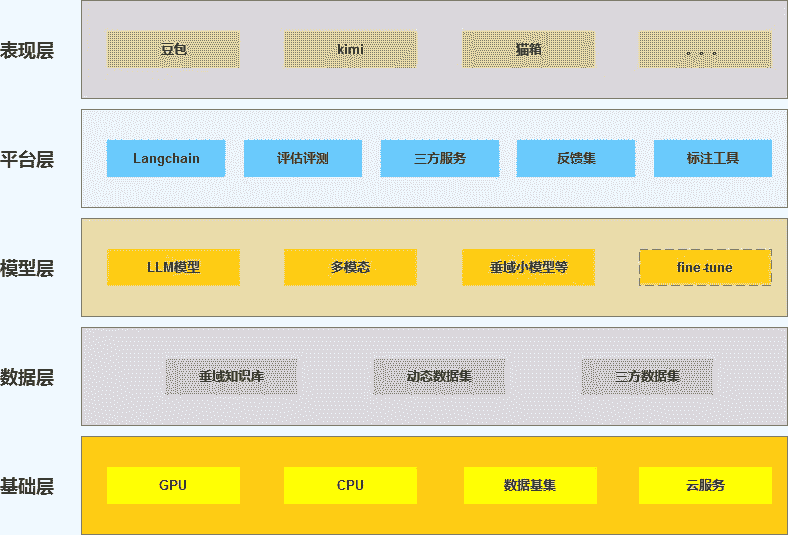
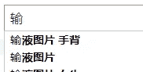
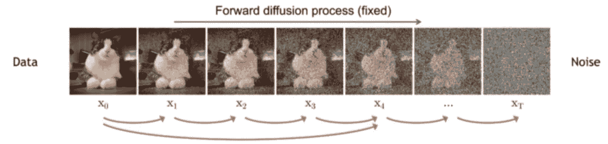
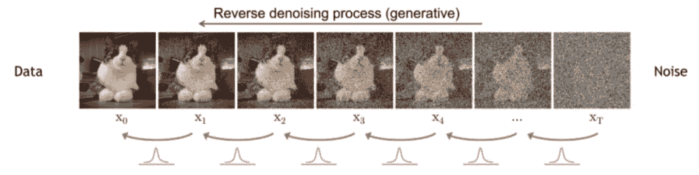
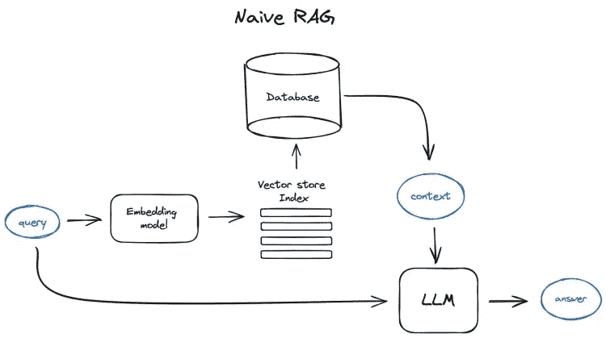
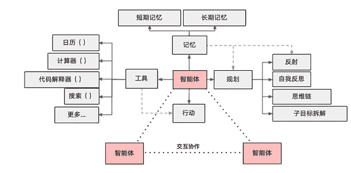

# Ranger：【AI 大模型】非技术背景，一文读懂大模型（长文）

> 来源：[https://waytoagi.feishu.cn/docx/QRo7dWyD0oX56KxJQsQcS97Hneg](https://waytoagi.feishu.cn/docx/QRo7dWyD0oX56KxJQsQcS97Hneg)

> 🔗 原文链接： h[ttps://www.woshipm](https://www.woshipm.com/share/6099217.html).com/share/60992...

> ⏰  发表时间：2024-08-15

> 作者：Ranger

> 本文旨在探讨大模型的工作原理、应用场景及其未来的发展趋势，以期为读者提供一个全面、客观的视角。我们将从大模型的整体架构、工作原理、以及市面上现有的 AI 产品等方面进行深入剖析，帮助大家更好地理解这项前沿技术。

## 一、写在前面

写这篇文章的初衷，源于近期涌起的唱衰 AI 大模型的风潮。不少人在对大模型的机制及当下的商业形态进行了初步了解后，便断言大模型是一场“骗局”，是资本操控的闹剧。同时，近来不管是投资领域还是各大厂，似乎都开始谨慎衡量做大模型这件事的投资回报率（ROI）。难道大模型当真不像去年众人所认定的那样，是一场所谓的“革命”吗？

唱衰大模型的人，大多持有这样的观点：他们觉得大模型仅能实现像 chatbox、文生图、图生图、生视频、生音频之类的功能，难以找到可商用的场景，更别说其中部分功能还可能存在幻觉问题。同时，大模型的算力也是有成本的，而且价格不低。

所以问题就出现了，即我们做出了一个个看似出色的 ai 产品，用户日活量或许也很高，但高日活带来的是高机器算力费用，而这笔费用又无法从活跃用户身上获取，所以这个商业模式就难以形成闭环了。

所以这种理解倒不能说是错误的，但这是建立在两个前提之上的。

第一，大模型确实后续也仅能用在聊天以及生成图片、文字、视频了；第二，算力的费用会持续居高不下。但在我看来，这两点都是不成立的。首先关于第二点的算力的问题，已经有许多解决方案了，不论是模型蒸馏，还是苹果的端云方案等等，我认为今年内算力成本问题将不再是难题。

那么第一点，其实也是今日的重点。而要知晓一个新事物究竟能够带来什么样的改变，我认为首先是先需要明晰其运作原理究竟是怎样的。实际上，我也看过市面上很多有关大模型的科普文章，坦白讲，对于非技术人员而言，理解起来颇具难度。

所以，我期望这篇文章能通过最为直白、最为简单的描述，帮助各位产品同学，理解何为大模型，大模型是如何运作的，大模型究竟带来了什么，以及我们究竟该去怎么看待这次大模型的浪潮。

## 二、大模型的整体架构

首先为方便大家对大模型有一个整体的认知，我们先从大模型的整体架构着手，来看看大模型的组成是怎么样的。

下面是我大致分的个层。从整体分层的角度来看，目前大模型整体架构可以分为以下几层：

### 1. 基础层：为大模型提供硬件支撑，数据支持等

例如 A100、数据服务器等等。

### 2. 数据层

这里的数据层指的不是用于基层模型训练的数据基集，而是企业根据自己的特性，维护的垂域数据。分为静态的知识库，和动态的三方数据集

### 3. 模型层：LLm 或多模态模型

LLm 这个大家应该都知道，large-language-model，也就是大语言模型，例如 GPT，一般使用 transformer 算法来实现。

多模态模型即市面上的文生图、图生图等的模型，训练所用的数据与 llm 不同，用的是图文或声音等多模态的数据集

### 4. 平台层：模型与应用间的平台部分

比如大模型的评测体系，或者 langchain 平台等，提供模型与应用间的组成部分

### 5. 表现层：也就是应用层，用户实际看到的地方

这个就很好理解了，就不用我多作解释了吧

## 三 、理解模型如何运作

在上面我们分解的大模型架构中，其他几层其实对于产品同学而言都是很好理解的。但其核心的模型层，也就是 LLm 和多模态，我相信很多人还是对其感到迷惑。为什么我输入一段文字后，模型就能给生成对应的回复？为什么模型可以根据我输入的文字去生成视频和图片？

这里我们不摆论文和学术性的讲解，我用尽可能通俗的方式来给大家讲解一下其原理。当然有兴趣的同学可以再深入的去学习。

### 1. LLm 工作原理

首先讲一下 LLm，即 large-language-model，大语言模型的工作原理。

我们可以观察 LLm 大模型比如豆包在回复的时候，是不是一个一个字，行业里称之为流式输出的方式给你呈现内容的。为什么会这样呢？这是因为，大模型确实是在一个字一个字地去推理生成内容的。

就好像我们看输入法的输入联想逻辑，输入联想，其实就是根据你输入的单个字，来推测你要输入的下个字是什么。比如我打了一个“输”字，那么我要打的下字就很有可能是“入”，当然这里就会有人问了，我要打的下个字也很有可能是“球”啊。

没错，最开始的研究人员确实也识别到了这个问题。那么解法是什么呢？其实很简单，我们把上下文加入到输入里，不就能帮助模型理解下个字该是什么了吗。

比如我们输入的是“我想在这个单元格中输”，那这下一个字大概率就是“入”。而我们如果输入的是“这场足球比赛中，输”，那下一个字大概率就是“球”。

那么看到这里，善于思考的同学可能会发现这里存在

第一，我们知道大模型的学习数据规模往往是海量的，每次的计算如果都带入全量的数据，算力上肯定是吃不消的。

第二，仅去算字的概率，似乎也有问题。因为我们用于训练的文章数据等，往往是出于各种场景各种背景写就的。仅去算下个字出现的概率，容易会被各种不相干的信息干扰。

是的，研究人员同样也遇到了这两个问题，而这时，两个概念的出现解决了这一难题。一个是词向量机制，一个是 transformer 模型中的 attention 自注意力机制。

**1）词向量机制**

词向量机制怎么理解呢？可以理解为把我们三维生活中的词，行业里称之为词元，或者 token，去进行一次拍平，降维到向量空间，也被称为潜空间，或者 latentspace 中去。比如一个词“杨柳”，在 latentspace 中，它不仅带有“植物”这一生物学的向量表示，也带有着“送别”的向量表示，也带有着“人名”的向量表示。这些向量表示，行业里称为 feature，中文翻译是“特征”，但说实话我觉得翻译为“意象”，更能表达其含义。

为什么说是意象呢，因为这个“杨柳”究竟在当前语境中表达什么含义，取决于其上下文而决定。这不正像是我们诗歌作品中的“意象”嘛

所以词向量就是，大模型通过海量的文档学习，把三维世界中的“词元”，转化为了 latentspace 中的“意象”的过程。比如“杨柳”，在 latentspace 中的表达可能就是[01，56，42]这样的表达。

这样转换之后，其实就解决了第一个问题，即我们把学习资料转化为了 latentspace 中的词向量，而在这个潜空间中运算的效率可以大大的增加，且词向量的表达方式可以表示出机器学习中，词汇之前的语义关系。

**2）attention 层**

而第二个问题，被 transformer 模型中的自注意力机制解决。自注意力机制可以理解为，在机器训练中，我们加入了若干的 attention 层，每一个层都会对输入的信息进行学习和理解记忆。

打个比方，“我今天吃了狮子头和蔬菜”这句话，在 transformer 中，会由 attention 层对这句话加入更多的信息来补充。比如补充“狮子头是一道菜”“今天是星期六”等等。这些补充信息，会作为输入给到下一个 attention 层进行补充。当然有些信息可能是不重要的，也会被忽视掉。最终层与层之间，哪些信息需要补充，哪些信息需要保留，哪些信息传递，均由模型自主学习完成。而最终学习的结果就是，模型可以把海量的数据以关系网的形式“消化”掉，并保留其重要的相关性。

这些表述可能还不够直观，再打个比方，这些层就好像人在去阅读文章的时候的一个连贯性注意力的过程。就好像我们在去阅读理解一篇文章的时候，脑子里会对输入的内容进行消化然后吸收记忆，而记忆下来的不是点状的知识，而是网状的经验。

**3）再形象些的比喻**

llm 的原理基本就是这样了，总结起来就是大模型以词向量和 transformer 的模型学习了海量的知识，把知识作为向量空间中的一种关系网进行存储，并在接受输入时，通过向量空间中的一系列匹配进行输出。

这个过程其实大家想一想，是不是就像是人脑在阅读学习的个过程？比如我们在记忆一些资料时，其实记忆的也不可能是逐字逐句去记忆的，也是按照相关性，重要程度，再结合历史经验信息进行记忆的。记忆下来的东西，也不是一个个的文字，而更像是一种感觉，一种“意象”。

再比如我们去看红色，会觉得这个代表温暖，代表强烈，这也是因为我们在去记忆这个信息时，同时受到来自生理、社会伦理等的关联记忆，所以一个简单的“红色”在我们的脑海中记忆时，也不仅是一个简单的词语，而是带有了很多的“feature”信息。

当然我这里仅是为了帮助大家理解，简化抽象了很多概念。LLm 这块如有感兴趣想进阶的同学，可以再看这篇文章进阶学习下。

https://www.understandingai.org/p/large-language-models-explained-with

### 2. 多模态的原理

ok 讲完了 LLm，我们来看多模态是怎么实现的

多模态模型目前基本就是文生图、图生图、图生视频、文生视频这些，其底层逻辑其实还是先从生图片这一源头。因为毕竟视频也是若干帧的图片组成。

所以在生图片的这个环节上，我们把比较火的这个 stablediffusion 用的这个 diffusion 扩散模型理解掉，也就差不多够了。

那么什么是扩散模型呢，这里我拿论文中的两张图帮助理解

一张是前向的，在图片上加噪点，最终生成一张无意义的噪点图，一个是后向的，从一个无意义的噪点图上消除噪点，最终得到一张有意义的实际图片。

其实扩散模型训练的就是这个加减噪点的过程：先把海量的带有标注文字描述的图片，例如“一只白色的小猫”，逐渐加满噪点。在这个过程中，模型会把每一步的图片向量值，和文字的向量值的数据分布的演变规律，进行系统学习并沉淀下来，这就完成了模型的训练。

在后续我们输入文字后，模型就可以根据输入的文字转化为的向量，去指导一个充满噪点的图片每一步减噪点的过程，生成最终的图片。

这里其实有两个点

一个是 diffusion 模型中加减噪点的方式，其实也与我们大脑中去构思一张图片的方式有些类似，我们去想像一张图片的时候，不也是从一片模糊中逐渐想清楚一张图片嘛

第二个是多模态模型会把文字的向量值和图片的 rgb 像素点的向量值进行关联，这个也像极了我们大脑中的一个思考过程。

当然这个过程比我描述的还要更复杂，比如过程里还要考虑到，噪点图的原始状态，加减噪点的过程需要多少步，每一步需要加入的噪点分布等等，这里仅为了大家理解方便，仅对主干逻辑作了讲解。

如有感兴趣的同学，可以看一下张涛老师对 diffusion 原理做的一次分享。个人认为这个分享质量非常棒

【[产品人如何学习 AI？以 Stable](https://www.bilibili.com/video/BV1wZ421h7w7/?share_source=copy_web&vd_source=e20dab09b86a96c6538305ab6db6b7b1) Diffusion 原理及发展历程为例】

## 四、再补充一些概念

ok，在我们对于两个重要的基础模型，llm 大语言模型和多模态模型的原理有了基础的认知后，我们可以再进一步，去理解下一些大模型领域常见的些术语名词，究竟是在干些什么，以及都能干什么。

### 1. prompt

prompt 这个词很多人都听到过，甚至一度还出现过 prompt 优化师这样的角色。那么 prompt 是做什么的呢？

prompt 其实是给到大模型输入的一段原始的输入，能够帮助模型更好地理解用户的需求并按照特定的模式或规则进行响应。

对于 prompt，比如可以设定“假设你是一位医生，给出针对这种症状的建议”，然后你与大模型后续的对话中，都会按照这个原始设定来展开。

这里有个比较有意思的玩法，就是我们可以在 prompt 的设定中，要求模型按照一定的思路逻辑去回答。比如最近比较火的 cot，也就是思维链，也是在 prompt 这个环节，对于模型的输出进行指导。

这里的玩法很多，比如我们还可以让模型按照特定格式的 json 输出等，这样模型真的就可以变成了一个输出器来使用。

### 2. RAG

rag，也就是 Retrieval-augmented-Generation，检索增强技术，应该也是大家经常看到的一个名词了。那么他到底是个什么东西呢？

首先我们先回顾 llm 的原理，其实就是把一堆互联网文献材料，降维到 latentspace 中，并通过 transformer 的方式用学习到了其中的“经验”。但文献资料是死的，如果仅通过固定的资料去回答问题，势必会出现一些无法回答的问题。

那么 rag 的出现就解决了这个问题，rag 允许模型可以到搜索引擎上去搜索问题相关的资料，并将获取到的信息，综合自己的知识体系内容，综合进行回复。

当然 rag 不全是这些，rag 的 r，也就是搜索，其实不是一件简单的事情。所以这个环节还会有些传统的搜索的逻辑在，比如对于输入问题的纠错，补充，拆分，以及对于搜索内容的权重逻辑等等的事情。

打个比方，比如问中国界世杯夺冠那年的啤酒销量如何，那就首先会做一次纠错，把“界世”纠错为“世界”，然后把问题拆分为两个问题，然后综合去搜索，把搜索到的资料在给到大模型，让其进行总结性输出

### 3. 大模型的涌现

这个可能有些同学不怎么听过这个词，但这个是大模型里，我认为最核心的个概念。

因为其实经上面的原理讲解，其实大家不难发现，这与目前大模型所表现出来的，仍然对不上啊。为什么只是在计算相关性和概率，就能让大模型表现出难以解释的表达？所以这就是涌现…也就是科学家们认为，当训练的数据到了一定程度后，模型的能力会涌现出很多难以用逻辑去解释的现象。

说实话在我看来，因为本身模型的学习就是在一个降维的 latentspace 中进行的，那我们尝试去用三维世界中的 if-else 去解释其行为，似乎本身也不靠谱不是么。不过现在倒也有一些论文使用跟踪标注等的的方式来尝试解释大模型内部的行为，这个看看就好了

### 4. AI Agent

agent 算是从年前到现在，比较火的一个概念了，也被很多人认为是大模型的未来的一个主要发展方向。

首先我们看这个很经典的一张图

看起来还是蛮复杂的，然后市面上的很多描述 agent 的文章写的也比较复杂，说智能体是啥智能的最小单元，相较于 copilot，是可以给他设定一个目标后主动完成任务的等等。

当然这些说法都没错，但是我觉得还是有些不好理解的。所以我们依然先从原理着手去理解下，agent 是个什么东西。

首先这张图里，中间的“智能体”，其实就是 llm，或者说大模型。四个箭头，分别是我们为 llm 增加的四个能力。工具、记忆、行动、规划。那么这个是怎么新增的呢？

目前行业里主要用到的是一个叫 langchain 的框架，这个框架可以简单理解为，他把 llm 和 llm 之间，以及 llm 和工具之间，通过代码或 prompt 的形式，进行了串接。

这个其实也像是在 rag 的基础上再进了一步。因为我们知道 rag 其实是给了大模型一个浏览器工具来使用嘛，那 agent，其实就是给了大模型更多的工具。比如像是长期记忆，其实就是给了大模型一个数据库工具让其往里记录重要信息。规划和行动，其实就是在大模型的 prompt 层做的些逻辑，比如让其将目标进行每一步的拆解，拆解完成后，每一步去输出不同的固定格式 action 指令，给到工具作为输入。

当然 langchain 或者说 agent 还不止这些，也会有很多其他的代码逻辑体现在其中，不过其主要的主干逻辑，其实还是在 prompt 层和工具层，完成的设计。

说实话我对于 Agent 产品我还是比较看好的，当然这不仅因为我曾经落地过实际的 Agent 产品，实在也是因为我认为这代表了我们可以在流程中给到大模型使用工具的能力，这其实就给了大模型应用更广阔的空间。比如我可以大模型帮我把差旅安排一下，大模型首先会判断一下为完成该目标，拆解需要有哪几个步骤要做（planning 能力），然后搜索近期我 oa 工具中的差旅记录（memory 能力），然后在飞猪上帮我预订酒店和机票（tools/action 能力），最终完成任务。

## 五、聊聊市面上目前的 ai 产品

ok，如果上面这些大家已经消化掉了的话，我们可以回过头来盘一盘目前市面上出现的这些 ai 产品了。

### 1. To C 领域

toc 领域，目前看到比较成体系的主要有这几类产品：

1）一类是主打 ai 角色扮演赛道的产品

例如“猫箱”“剧本戏”“名人朋友圈”这类

其实就是在 llm 基础上，在 prompt 上加了些特定角色定义

2）一类是主打 ai 陪伴类的产品

例如“星野”“Talkie”“BubblePal”等为代表

这类产品其实也是在 llm 基础上，在 prompt 上加了些特定角色定义。不过不一样的是，这类产品往往会在长短记忆上做出些处理，以突出其陪伴意义。随着陪伴的时间越久，知识库沉淀的个性化记录就越丰富，ai 也会越懂你。老实说这类产品我觉得还是很有意义的。

3）一类是做 ai 搜索工具的产品

例如“秘塔”“360 搜索”等

这类产品说白了就是上文提到的 rag，没啥别的。不过也有会在搜索内容基础上，把内容结构化，整出一个图谱或者脑图的，这个也还算有意思。

4）一类是单纯的做 aigc 的产品

例如“可灵”“ai 写作手”“即梦”“md”等

这类产品其实就是借助 ai 的生成能力做出的产品

5）还有一类是 agent 产品

这个目前只有头部的厂商在做，比如字节的扣子，支付宝的智能助理，百度的文心智能体，腾讯的元宝。

这类产品会提供一套 ai 开放平台框架，允许三方在上面通过组装 llm 和组件和自有的知识库信息等，定义自己专属垂域的 agent。

这个其实很像之前的小程序，主打的是一个生态和分发，做这个平台的前提是，你得有完备且有吸引力的分发渠道才可以。不然哪有开发者愿意上你的平台开发 agent 是不。

### 2. To B 领域

在 tob 领域，目前看到比较成体系的主要有这几类：

**1）一类是智能办公**

这类产品价值点主要体现在办公垂域场景中，比如办公场景下，需要快速总结群聊内容或会议信息，那就可以把群聊记录丢给大模型，让其总结出个一二三四出来。或者需要写个公文但没有思路时，ai 给出的结构模板参考等。

**2）一类是智能客服**

这类产品通常借助 agent 来实现，接入企业的 QA 知识库，对用户的信息予以回应。并且依据用户的回答，下达诸如取消订单、催快递之类的 action 指令。

**3）一类是 AI 导购**

这类产品主要在用户和商家之间发挥作用。以往的商品搜索体验，往往是商家猜测用户会搜索的标签，用户猜测商家设置的标签。然而运用 AI 导购，能够依据用户的问题，结合产品的介绍和评论信息等，为用户推荐更为准确、精准的产品。

比如，用户期望购买一个能容纳三个篮球的篮球背包。按照以往的流程，用户需要先查询能装下三个篮球的背包所需的容量，然后再在平台上搜索对应容量的背包。而使用 AI 导购，就能够将这一整个过程完全交由 AI 来处理。

**4）一类是智能营销**

此类别主要应用于营销环节，通过 AIGC 生成一些话术、物料、口播等内容，有些还会融入用户的个性化元素，以指导物料的生成。

**5）一类是智能人力资源**

目前，这类主要利用模型进行一些诸如简历初筛、JD 自动生成、数据分析等工作。

## 六、ai 究竟带来了什么

在深入了解了 AI 的运作原理，并盘了众多当前市面上 AI 的落地产品之后，我们不妨重新回到最开始的问题。此次 AI 大模型究竟引发了怎样的变革？

在思考这个问题之前，我想先分享下去年刚接触大模型时，困扰我的一个问题。即大模型与当下的智能语音技能的 NLU 存在什么差异？此前，我也曾涉足过一些语音产品的设计逻辑，知道语音技能链路其实就是把声音转为 ASR，再对文本进行 NLU 理解，然后映射到对应的语音技能表中，最后让程序依据相应的语音技能指令完成逻辑。乍看起来，大模型能实现的，通过语音技能似乎也能达成，那我们引入大模型的意义在哪里呢？

抱着这样的疑问，我尝试去理解了大模型的原理。当我在初步理解大模型的原理之后，我发现二者还是存在本质性的差别的。

差别在于，后者的语音技能 NLU 仅是通过一系列规则、分词策略等训练而成的产物。而且 NLU 的运作逻辑规律都是可观测的，具有 if-else 式的逻辑性。而大模型，则是凭借海量的数据，在向量空间中学习知识的关联性从而形成的，其运作逻辑难以观测，已然脱离了 if-else 的层面。

所以，我们再度审视这个问题，此次的 AI 变革到底带来了什么？

汪华老师在前不久的分享中，对于此次 AI 变革的量级提出了观点：他认为这次 AI 的变革量级，100%能够抵达第一个阶段，即与移动互联网处于同一级别；50%有可能发展至第二个阶段，即与蒸汽机的出现同量级；至于能否到达第三个阶段，即 AGI，尚不明确。

在这一点上，我的看法与他一致。因为我觉得，AI 此次带来的变革，已然脱离了传统互联网基于 if-else 的最底层逻辑，这几乎等同于重塑了互联网，这不就相当于蒸汽机级别般的变革吗？

## 七、我们该怎么去思考 ai 的发展和应用

变革归变革，那么作为产品人，我们该怎么去把 ai 这个能力用起来呢？

我认为转变自己的“传统”产品设计思路和视角，是最关键的一步。

其实我前段时间我在一个仅面向产品经理的公众号中，读到一篇对大模型发展未来表达看法的文章。文章的开篇，就表达了认为大模型应用是在内容、电商、o2o、工具之外的第五条赛道，且当前是否够资格成为“第五条赛道”都有待商榷。在该文章的评论区下，我建议作者先去了解下大模型的基础原理以及当前的技术发展状况。

当时之所以这样说，只是因为我觉得许多产品同学实际上并未真正意识到这次大模型所带来的变革，所以他们的思路和视角，依然停留在传统互联网商业模式上，仍然认为此次的变革只是在传统的基础之上做更新。

但上面我们也说了，这次的 ai 变革是从互联网最底层的 if-else 逻辑开始的，而那些传统互联网的商业模式，只是基于传统的互联网技术架构和用户需求综合出来的产物。

所以，我们在去思考 ai 的发展的时候，切记一定要去抛开当前的业务体系和框架，从最本质入手，从人最底层心智，和最底层的需求去着手，重新思考自己的产品逻辑，去重新设计商业逻辑体系和流程。否则你做出来的，只能是在现有业务体系下的雕花产物罢了。

最后，纸上得来终觉浅，绝知此事要躬行。建议感兴趣的产品同学，与其看千篇文章，不如实际地到 coze 或文心或混元平台上，亲手做几个 agent 出来感受一下。相信在这个过程中，大家可以收获到更多。祝愿大家都能在这次的 AI 浪潮中，找到属于自己的方向。