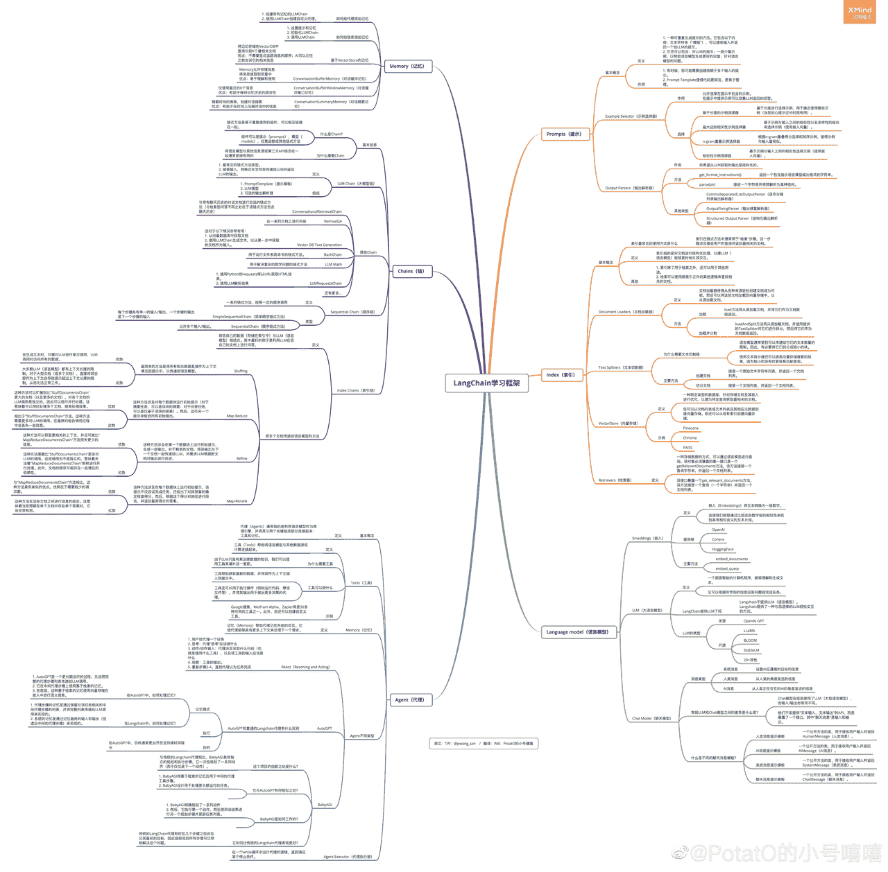

# 面向开发应用者

> 来源：[https://waytoagi.feishu.cn/docx/AEundtDb0oaqxOxyPFgczRJBn4c](https://waytoagi.feishu.cn/docx/AEundtDb0oaqxOxyPFgczRJBn4c)

# 通过AI开发应用的同学

多维表格（AfBGbP1IeaCoijs2mAGc4fW1nte_tbldeCxjW2nGiGT1）

## OpenAI官方指南

+   [调用库（Libraries）](https://ywh1bkansf.feishu.cn/wiki/Kp9FwOMTGiBHdEkON6Hcw2fWnQe)

+   [模型（Models）](https://ywh1bkansf.feishu.cn/wiki/R70MwasSpik2tgkCr7dc9eTmn0o)

+   文本补全（Text completion）

+   会话补全（Chat completions）

+   图像生成（Image generation）

+   [微调（Fine-tuning）](https://ywh1bkansf.feishu.cn/wiki/ATYCwS5RRibGXNkvoC4ckddLnLf)

+   [嵌入（Embeddings）](https://ywh1bkansf.feishu.cn/wiki/M5C9wX65mi9OWCkc8JHcFIkFnXf)

+   语音转文本（Speech to text）

+   [审核（Moderation）](https://ywh1bkansf.feishu.cn/wiki/OQcEwpTQbit1ilkoC9AcALjonoe)

## 1.2  langchain官方指南：

+   https://www.langchain.com/

+   https://blog.csdn.net/v_JULY_v/article/details/131552592 分析了LangChain的源码并且介绍了相关的应用构建方式

+   langchain 知识地图合集【中文翻译版】

[【R092】LangChain 知识地图合集【中文翻译版】.pdf](https://internal-api-drive-stream.feishu.cn/space/api/box/stream/download/all/JecHbmGDDoQUztx4Q1ec4Fnaneh)