# 写给不会代码的你：20分钟上手 Python + AI

> 来源：[https://waytoagi.feishu.cn/docx/I2Qid4EeRoQoyExnsIscTUBxnFb](https://waytoagi.feishu.cn/docx/I2Qid4EeRoQoyExnsIscTUBxnFb)

> 🔗 原文链接： h[ttps://mp.weixin.q](https://mp.weixin.qq.com/s/D8YsA5HB2saaLdJA9tIZ4g)q.com/s/D8YsA5HB...

> 原创 金色传说大聪明 赛博禅心 2024-03-24 11:02

在深入学习 AI 时，许多朋友发现需要编程，变得头大。

同时，各类教程都默认了你会打命令行，导致入门十分困难。

鉴于此，就有了这份简明入门，旨在让大家更快掌握 Python 和 AI 的相互调用。并使你 在接下来的 20 分钟内，循序渐进的完成以下任务：

+   完成一个简单程序

+   完成一个爬虫应用，抓取公众号文章

+   完成一个 AI 应用，为公众号文章生成概述

---

## **一些背景**

知己知彼，百战不殆

### **关于 Python**

> Python 就像 **哆拉A梦 **， 它:

+   **拥有一个**百宝袋，装满了各种道具，被称为 标准库 。当遇到问题时，都可以拿出来直接使用。

+   如果百宝袋里的道具不够用，还可以打电话给未来百货，去订购新道具。在这里：

+   打电话：对应 **pip **一类的工具，可以用来订购任何的道具。

+   未来百货： 对应 **GitHub **一类的分享代码的平台，里面啥都有 。

+   被全世界广泛使用，尤其是在 AI 领域，所以遍地是大哥

### **关于 OpenAI API**

> OpenAI 通过两种方式提供服务 :

+   其一：通过 ChatGPT，提供开箱即用的服务，直接对话即可，简单直观。

+   其二：通过 OpenAI API，提供更加灵活的服务，通过代码调用，来完成更多自动化任务，比如全自动将本地的 1 万本小说，从中文翻译成英文。

> **发现了没，这里**的 OpenAI API， 对应着上面 未来百货道具 。

---

## **组装小哆啦**

千里之行，始于足下

### **配置环境 ****请不要配置环境**

> **在任何教程里，**第一章总是配置环境：等同于 组装多啦A梦 ，包括安装IDE、依赖等等，有些时候甚至得去折腾内核。 但对新手来说，这些太过不友好，基本等同劝退。

> 本着快速上手的目的，我不建议任何的初学者去尝试配**置环境，毕竟有一些现成的在**线平台，比如 Google Colab 。这些平台像是野比世修一样，早早就把哆啦A梦组装好了，等你去用。

> 这里，我们以 Colab 为例，你所要做的事情就是 访问 Colab 的网站，并新建一个笔记本，网址是：

> https://colab.research.google.com

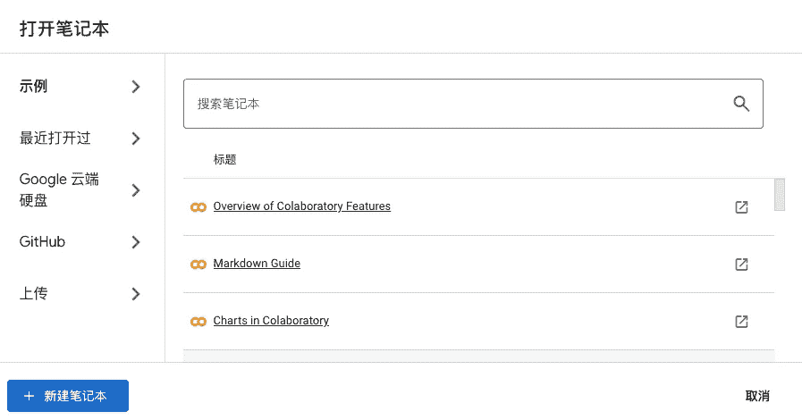

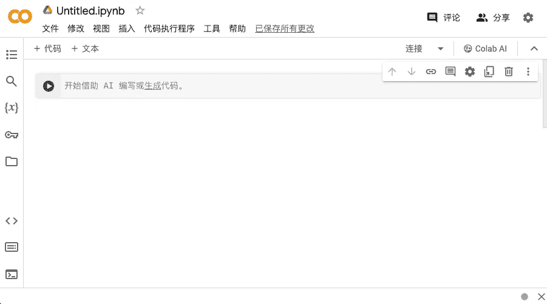

### **完成一个 Python 程序**

> 接下来，让我们写一个程序试试看：

> **任务：输出「大聪明最帅」 **

> 先介绍一个 Python 的重要语法：print()

> 当需要输出一句话的时，把这句话加上英文引号""，放在 print() 的括号里，如 print("公众号「赛博禅心」最棒了！") 就好了。

> 在我们的任务中，如果想让 Python** 输出「大聪明最帅」，那么就告**诉编译器 **pri**nt("大聪明最帅") ，然后点 运行 （快捷键：Ctrl/⌘ + Enter）。

> 你就会得到下图的结果，恭喜成功！

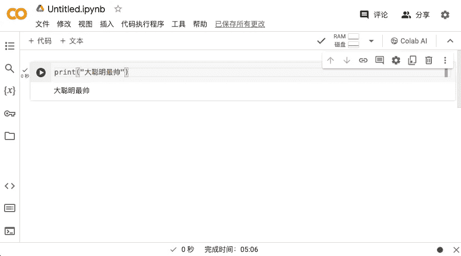

### **Tips**

> 这里是的在线平台我用的是 Google Colab，提供在线的，类 Jupyter 服务，帮助用户在浏览器中编写和执行Python代码，并且支持代码共享和直接调用一些谷歌的云服务。

> 访问 Colab 需要一定的网络环境。因此，如果你打不开，也可以尝试一些国产替代，如：

+   阿里云的天池 Notebook：https://tianchi.aliyun.com/notebook-ai

+   腾讯的 Cloud Studio：https://ide.cloud.tencent.com/

+   等等...

> 可以搜索「在线 IDE」或者「在线 Jupyter」，获取更多类似产品。

###

---

## **使用百宝箱**

他山之石，可以攻玉

### **完成一个爬虫应用**

> 很多人对 Python 的最大印象，是写爬虫：帮你自动的从网页上摘取所需的信息。

> 现在，让我们去写一个爬虫，抓我之前的文章：🔗 中学生能看懂：Sora 原理解读 🔗

>

+   已知1：这篇文章的地址是 https://mp.weixin.qq.com/s/KUnXlDlg-Rs_6D5RFpQbnQ

+   已知2：ChatGPT 很会写程序

+   已知3：我们用 Colab

> **得出结论：让 ChatGPT 帮我们**写这个程序，然后在 Colab 里运行

### **问问 ChatGPT**

>

> 大聪明

> 我使用 colab，请给我写一段代码，用于抓取 https://mp.weixin.qq.com/s/KUnXlDlg-Rs_6D5RFpQbnQ 的正文内容

> ChatGPT

> 在Colab中抓取网页的正文内容，你可以使用Python的requests库来获取网页的HTML源代码，然后使用BeautifulSoup库来解析HTML并提取所需的正文部分。下面是一个简单的示例代码，演示了如何实现这一过程。请注意，由于微信公众号文章可能有一些特殊的反爬措施，这段代码可能需要根据实际情况进行调整。

> 首先，确保你已经在你的Colab环境中安装了beautifulsoup4和requests库。如果没有安装，你可以使用以下命令安装：

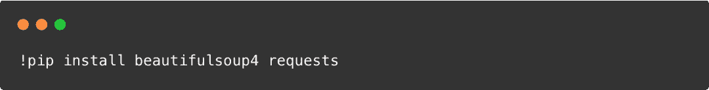

然后，使用以下代码抓取并解析指定的网页内容：

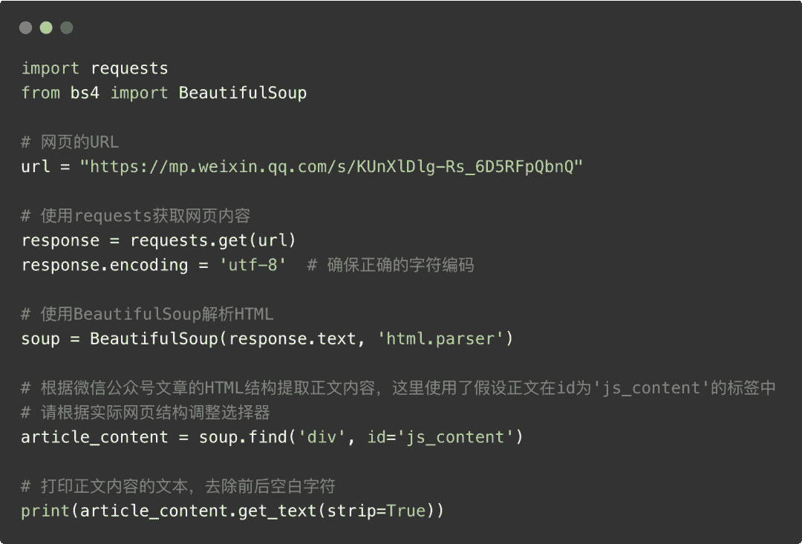

这段代码会打印出你提供的微信公众号文章的正文内容。请注意，由于网页的结构随时可能发生变化，所以提取正文内容的部分（即soup.find那一行）可能需要根据实际的HTML结构进行调整。如果文章有反爬虫机制，可能还需要进一步的处理，比如设置请求头模拟浏览器访问等。

### **运行你的代码**

> 然后，把这两段代码分别复制进去，并运行。

> 先复制第一段：

> !pip install beautifulsoup4 requests

> 运行后得到下图

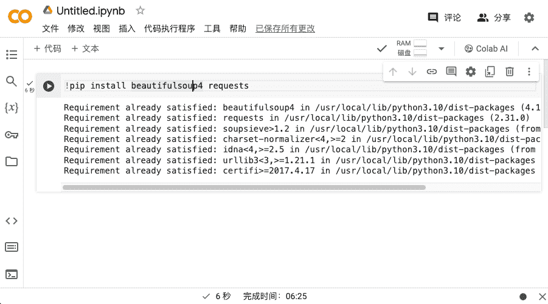

到这里的 pip，就是之前提到的「给未来商店打电话」，用来获取工具

接下来，点击左上方「+代码」按钮，新建一个新的代码块

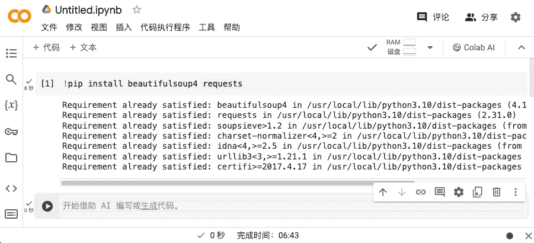

最后，复制后面的代码，并运行，获得下面的结果：

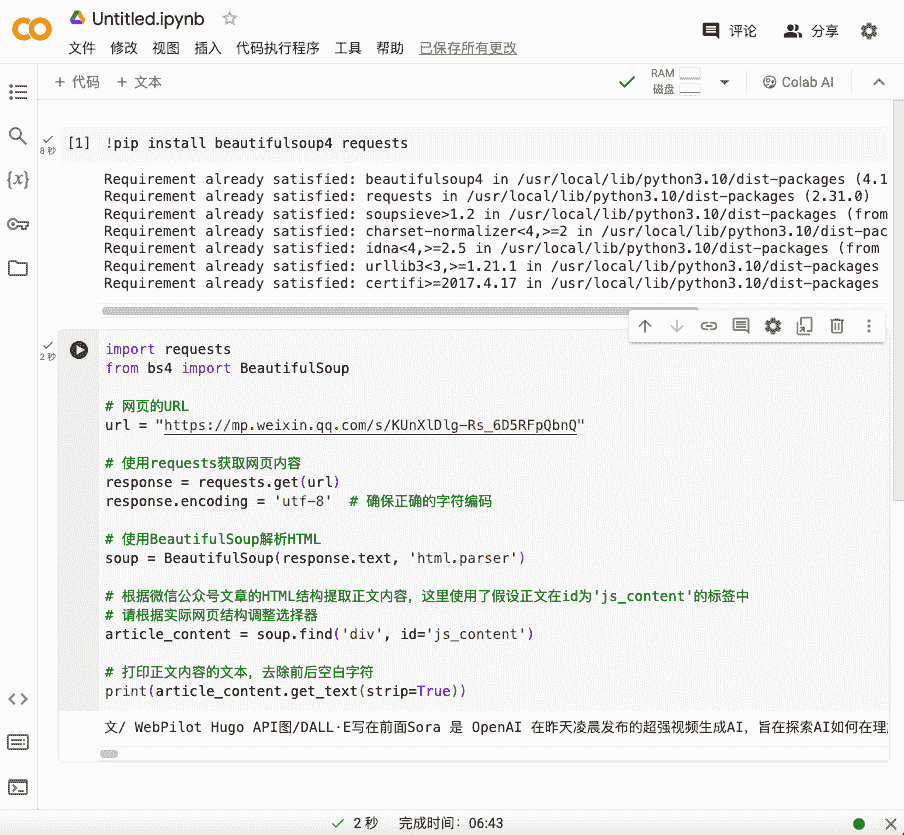

🎉 恭喜你，爬虫写好了 🎉

### **Tips**

> 在和 AI 配合写代码的过程中，如果你遇到了 Bug，类似：

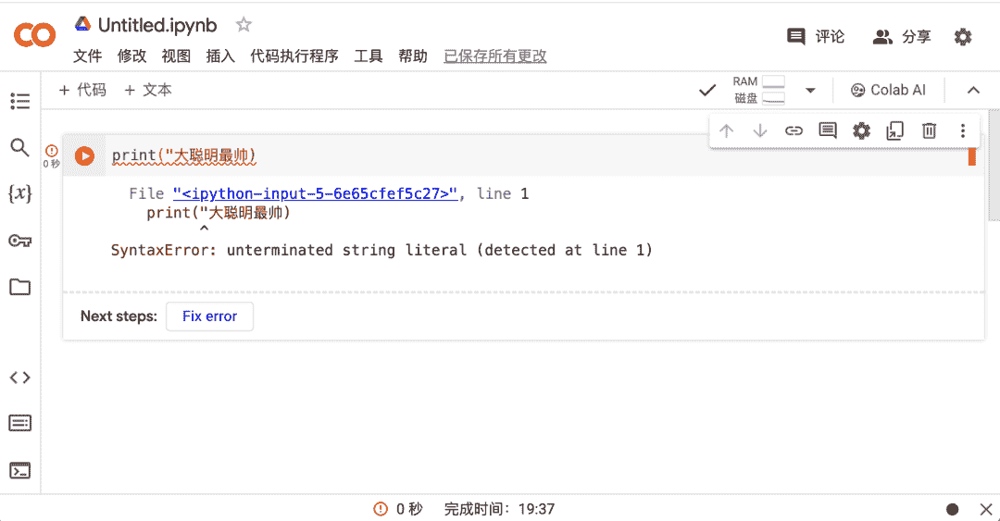

你可以直接将问题报给 ChatGPT，就像我这样

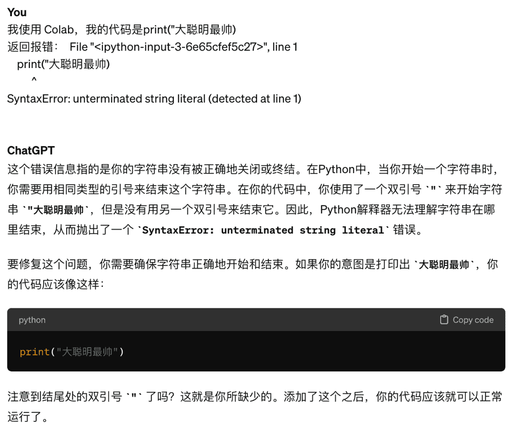

然后再把 ChatGPT 给出来的结果粘贴回去（如果还不行，就反复调试）

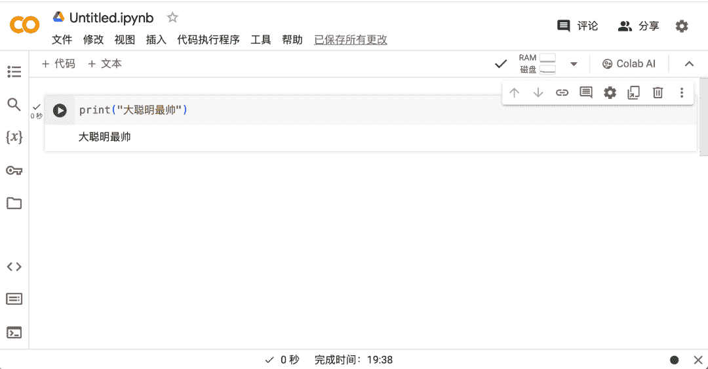

---

## **使用未来百货**

OpenAI API, YYDS

### **完成一个 AI 应用**

> 在许多的微信群里，都有这样一类 bot：你把公众号文章丢给他，他就会自动总结这篇文章。怎么做的呢？

> 答：通过 OpenAI API（或者其他家的 API）。我们尝试完成的画， 做法将 包含以下几步：

+   获得 API Key（扣费凭证）

+   获得 API 的示例代码（通常在 Playground 里面）

+   将必要的信息丢给 ChatGPT，让它帮你整合一下

+   复制，粘贴，运行，然后看看效果

### **获得 API Key**

> 以 OpenAI API 为例，你可以在这个页面找到 API Key：

> https://platform.openai.com/api-keys

> 打开后，点击「Create new secret key」即可获取

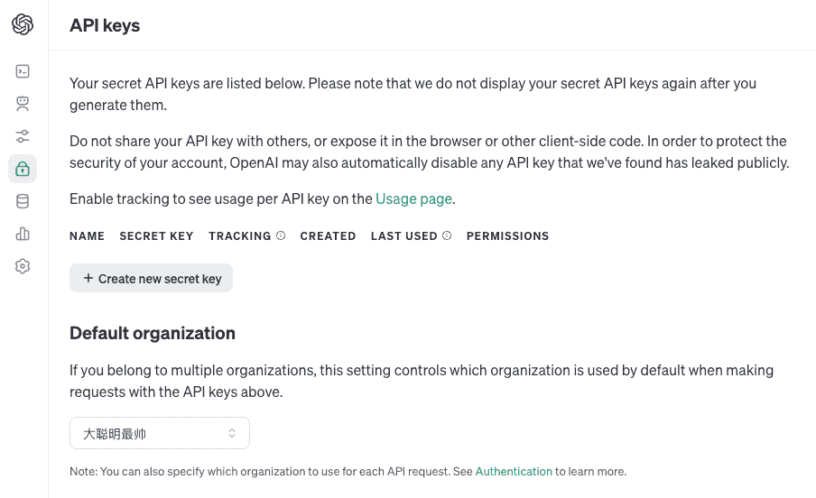

请注意：通常，你需要绑定支付方式，才可以获取有效Key

### **获得 API 使用的示例代码**

> 以 OpenAI API 为例，你可以在 Playground 这个页面获取 API 调用的示例代码：

> https://platform.openai.com/playground

> 并且可以将你和 GPT 的对话，转换成代码

> 注意，这里有两个值可以定义，一个是:

+   **SYSTEM **：对应 ChatGPT 里的 Instructions，用来定义这个 Bot 的功能/特点

+   **USER **：对应 ChatGPT 里，用户发出的信息

>

> 这里，我将 SYSTEM 定义成了缩略信息助手，而在 USER 中输入了文章内容

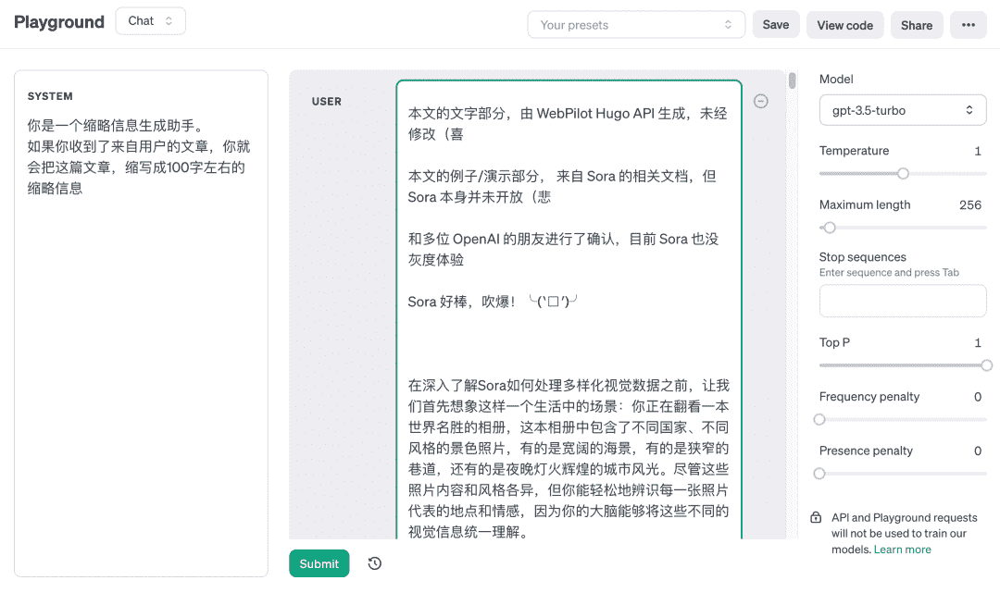

运行后，结果很令人满意

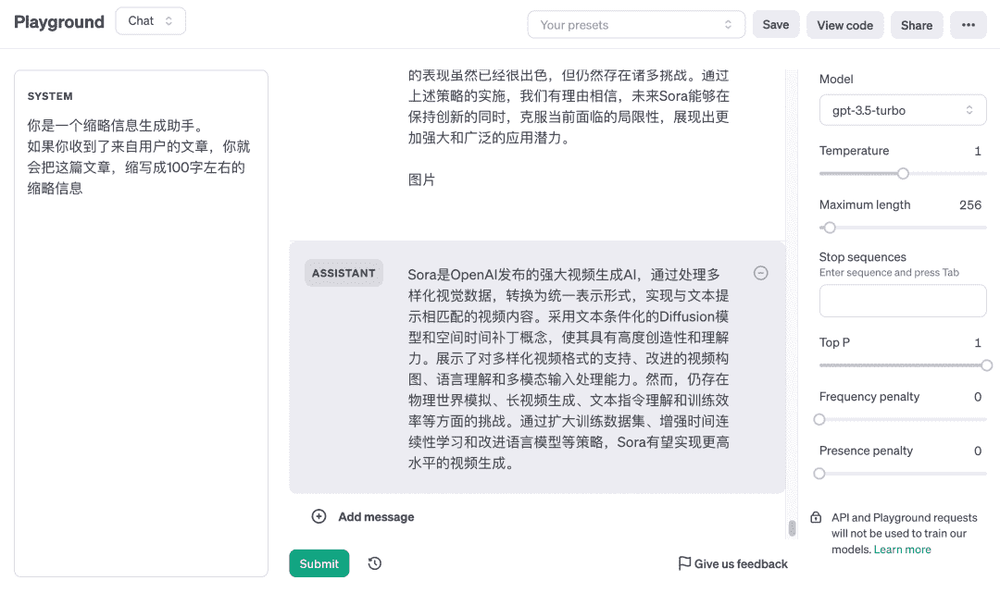

点击右上方 View Code，获取生成这一内容的示例代码

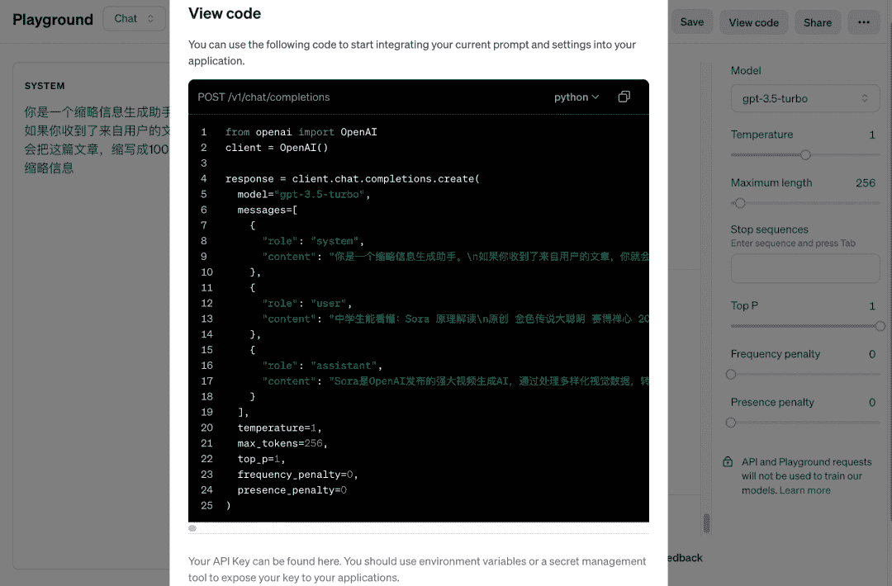

### **再问 ChatGPT**

> 顺着之前的对话，让 ChatGPT 帮我们继续写代码吧！

> ... 继续前文的对话 ...

> 大聪明

> 帮我升级一下这个代码，完整重写：

> 你不需要输出这篇文章的原始内容，而是通过 OpenAI 的 API，生成这篇文章的缩略信息，并打印

> 你假定我的 OpenAI API key 是（我这是一个假的 Key）：Craze-Thursday-Vivo-50

>

> 这是示例代码：

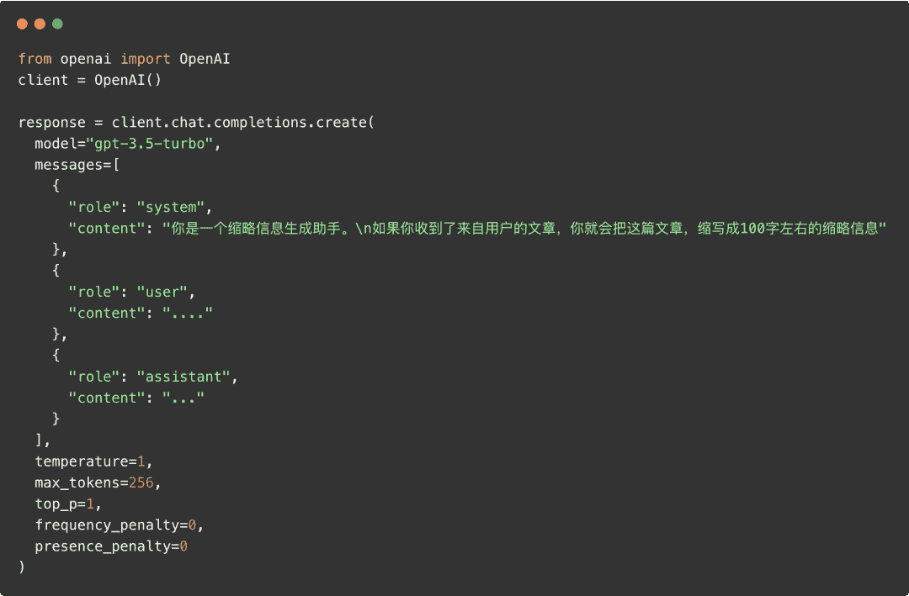

ChatGPT

为了满足你的要求，我们需要重写上述代码，以便首先抓取文章内容，然后使用假设的OpenAI API key（注意实际操作中需要替换为真实的API key）来生成文章的缩略信息。以下是整个过程的代码：

首先，安装必要的库：

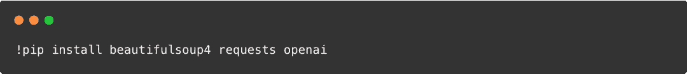

接下来，使用以下代码：

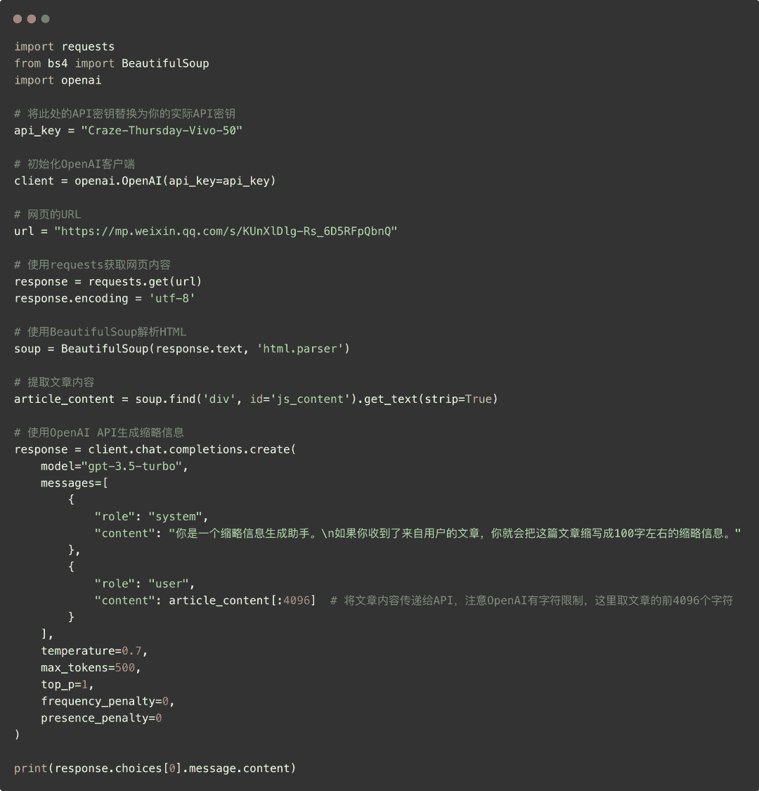

### **运行看看效果**

> 先复制第一段，运行试试

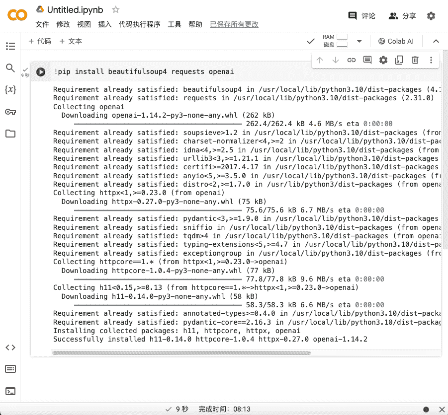

然后是第二段，记得把 Key 改一下

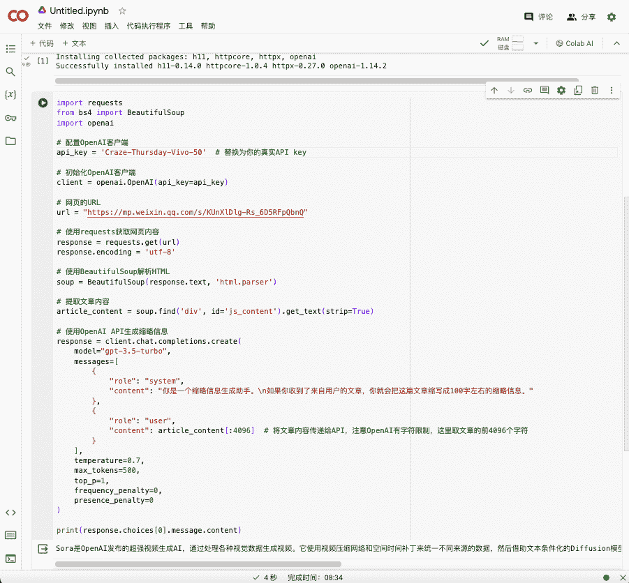

😊 截图的时候我把 key 换成了疯四 😊

看一下生成结果：

> Sora是OpenAI发布的超强视频生成AI，通过处理各种视觉数据生成视频。它使用视频压缩网络和空间时间补丁来统一不同来源的数据，然后借助文本条件化的Diffusion模型生成与文本提示匹配的视觉作品。这种方法使Sora能够创造出高度创新和多样化的视频内容，跨越语言和视觉障碍，展现出AI在理解语言和创作视觉方面的强大实力。

### **Tips**

> API Key 是你的扣费凭证， 请永远妥善保管你的 Key，不要泄漏

> 各家 AI 最细致的教程，几乎都在他们的官网上，对于 OpenAI 来说：

+   综合文档：https://platform.openai.com/docs/overview

+   API 使用：https://platform.openai.com/docs/api-reference

+   API Playground：https://platform.openai.com/playground

+   API 案例与答疑：https://cookbook.openai.com/

# **恭喜你**

# **完成了一个 AI 应用**

#

---

## **之后呢？**

学无止境，知无界限

### **如果希望继续精进...**

> 在本份教程中，你会发现，在 AI 的帮助下，你本就可以完成很多基础的编程工作。

> 但希望再深入一点，最好还是可以体系化的了解一下编程以及 AI。至少熟悉以下内容：

+   **Python基础 **

+   基本语法：了解Python的基本语法规则，比如变量命名、缩进等。

+   数据类型：熟悉Python中的基本数据类型，如字符串（String）、整数（Integer）、浮点数（Float）、列表（List）、元组（Tuple）、字典（Dictionary）等。

+   控制流：学习如何使用条件语句（if）、循环语句（for和while）来控制程序的执行流程。

+   **函数 **

+   定义和调用函数：学习如何定义自己的函数，以及如何调用现有的函数。

+   参数和返回值：理解函数如何接收参数和返回结果。

+   作用域和命名空间：了解局部变量和全局变量的概念，以及它们是如何在Python中工作的。

+   **模块和包**

+   导入模块：学习如何导入Python标准库中的模块或者第三方库。

+   使用包：理解如何安装和使用Python包来扩展程序的功能。

+   **面向对象编程（OOP） **

+   类和对象：了解面向对象编程的基本概念，包括类的定义和实例化。

+   属性和方法：学习如何为类定义属性和方法，以及如何通过对象来调用它们。

+   继承和多态：了解类之间的继承关系以及如何实现多态。

+   **异常处理 **

+   理解异常：了解什么是异常，以及它们在Python中是如何工作的。

+   异常处理：学习如何使用try和except语句来处理程序中可能发生的错误。

+   **文件操作 **

+   文件读写：学习如何打开文件、读取文件内容以及写入文件。

+   文件与路径操作：理解如何使用Python来处理文件路径，以及如何列举目录下的文件。

>

> 对于 AI ，可以尝试了解以下内容， 作为基础

+   **AI 背景知识 **

+   基础理论：了解人工智能、机器学习、深度学习的定义及其之间的关系。

+   历史发展：简要回顾AI的发展历程和重要里程碑。

+   **数学基础 **

+   统计学基础：熟悉均值、中位数、方差等统计概念。

+   线性代数：了解向量、矩阵等线性代数基本概念。

+   概率论：基础的概率论知识，如条件概率、贝叶斯定理。

+   **算法和模型 **

+   监督学习：了解常用算法，如线性回归、决策树、支持向量机（SVM）。

+   无监督学习：熟悉聚类、降维等算法。

+   强化学习：简介强化学习的基本概念。

+   **评估和调优 **

+   性能评估：了解如何评估模型性能，包括交叉验证、精确度、召回率等。

+   模型调优：学习如何使用网格搜索等技术优化模型参数。

+   **神经网络基础 **

+   网络结构：理解神经网络的基本结构，包括前馈网络、卷积神经网络（CNN）、循环神经网络（RNN）。

+   激活函数：了解常用的激活函数，如ReLU、Sigmoid、Tanh。

###

### **书籍推荐 - 作为新手入门**

1.  作为新手入门，在 Python 方面，我会推荐这些：

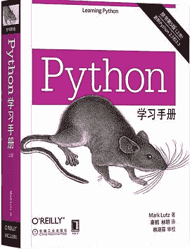

《Python 学习手册》：动物园家的书，名声在外

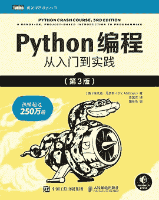

《Python 编程》：新手友好

1.  在 AI 方面， 我 会推荐这些 ：

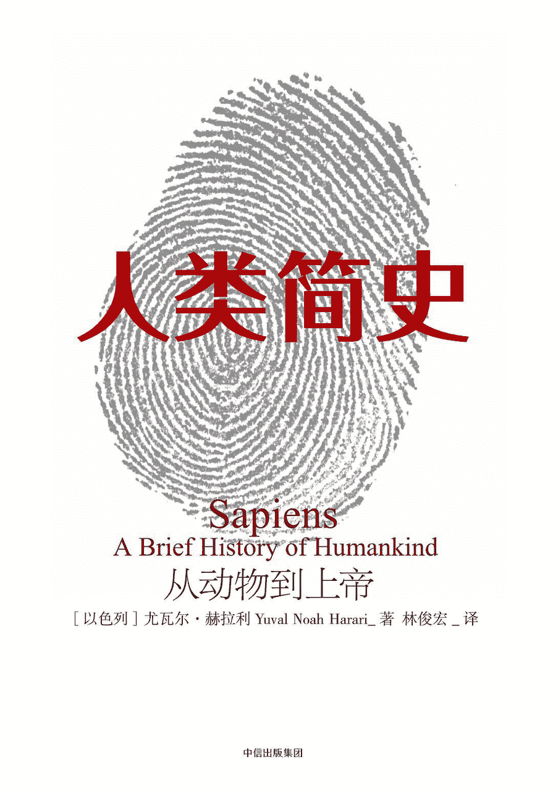

《人类简史》：「认知革命」的相关章节令我获益匪浅

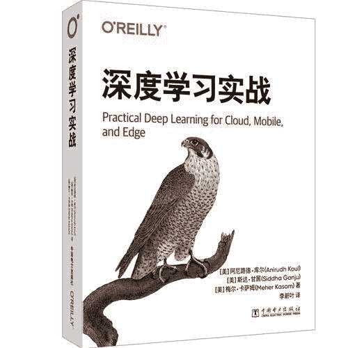

**《深度学习实战》：按脉络，梳理了 C**hatGPT 爆发前的 AI 信息与实践

### **课程&资源&信息推荐**

> 对于 Python，以及各种 AI 工具的使用，我会最优先的推荐 B 站 up 主「PAPAYA电脑教室」的 Python 入门课（他的很多课都很棒，而且完全免费）：

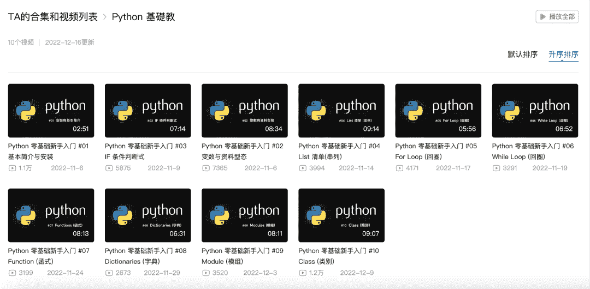

https://space.bilibili.com/402780815/channel/seriesdetail?sid=2762019

对于现在的大模型，我相信很少有人比 Andrej Karpathy 讲得更好，毕竟他也是 OpenAI 创始团队的成员

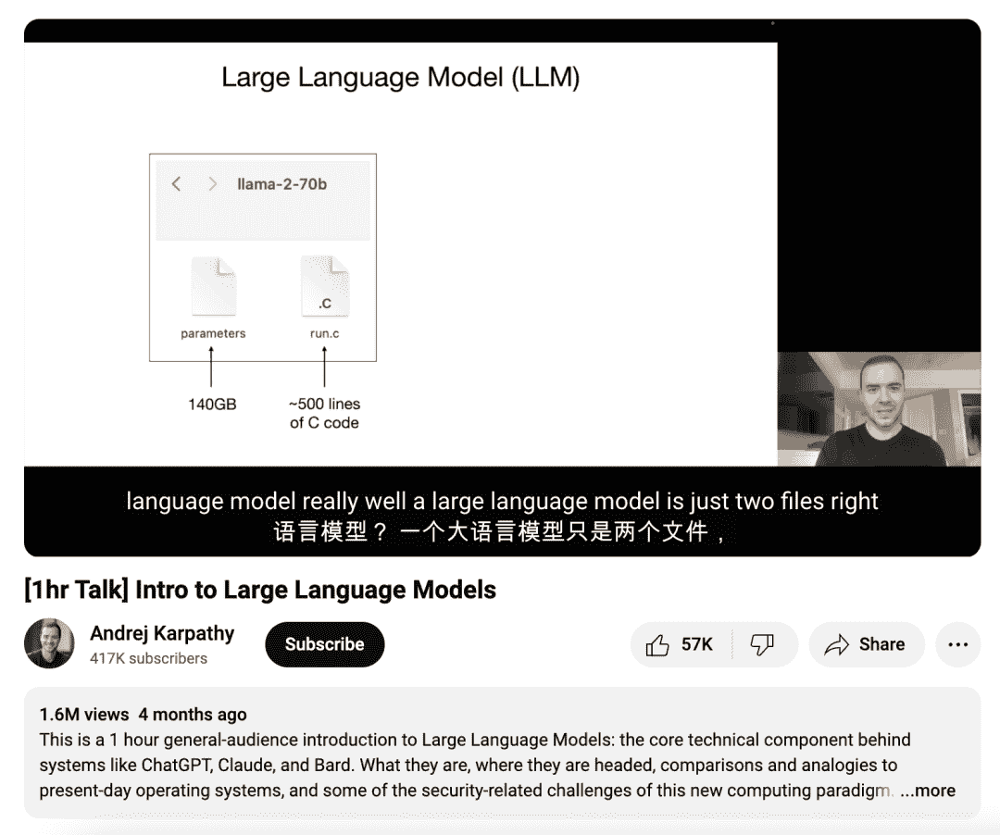

油管地址：https://www.youtube.com/watch?v=zjkBMFhNj_g

B站地址：https://www.bilibili.com/video/BV1AU421o7ob

> 对于资料库，我非常推荐 AJ 和众多小伙伴们共创的资料库（一个飞书文档）：

> 🌈 通往 AGI 之路（一个飞书文档）

> 这应该是当下最全的中文 AI 资料库，免费、开源、共创。 包含了几乎所有有价值的文档 、文章、资料、资讯 ，并永远是第一时间更新

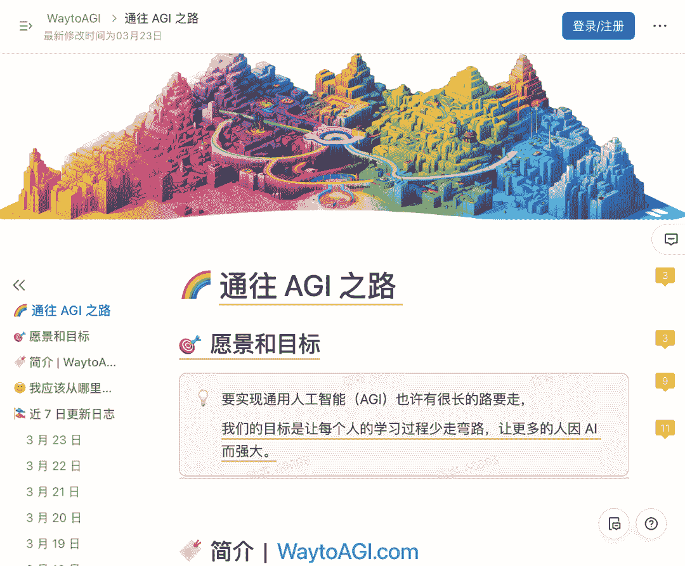

https://waytoagi.feishu.cn/wiki/QPe5w5g7UisbEkkow8XcDmOpn8e

# **最后愿大家**

# **Good Good Study**

# **Day Day Up !!!**