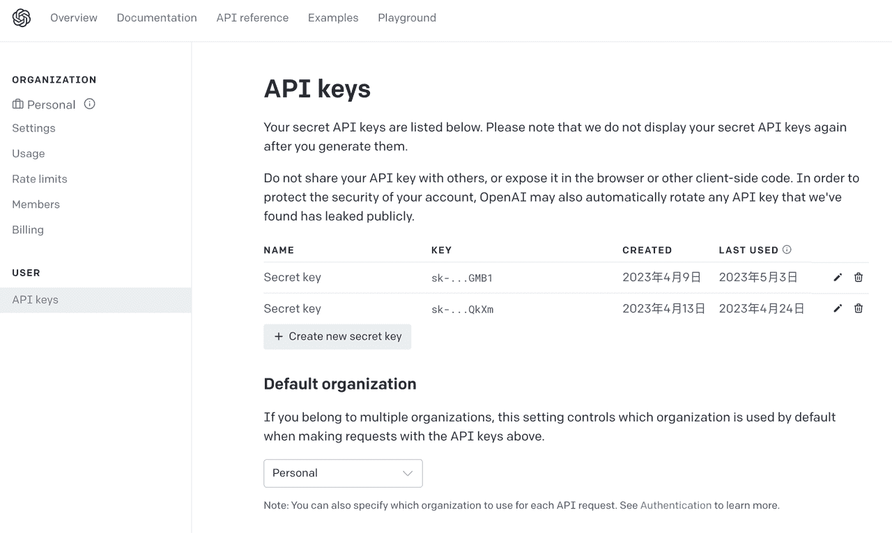
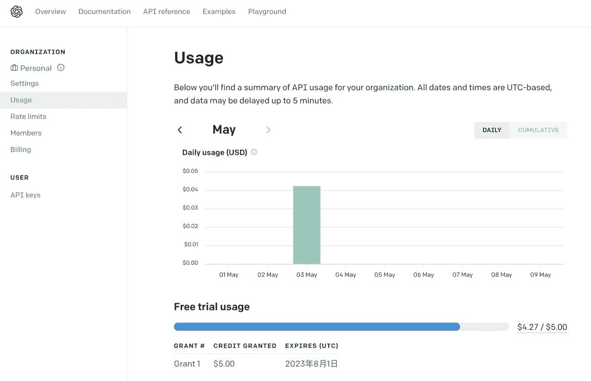
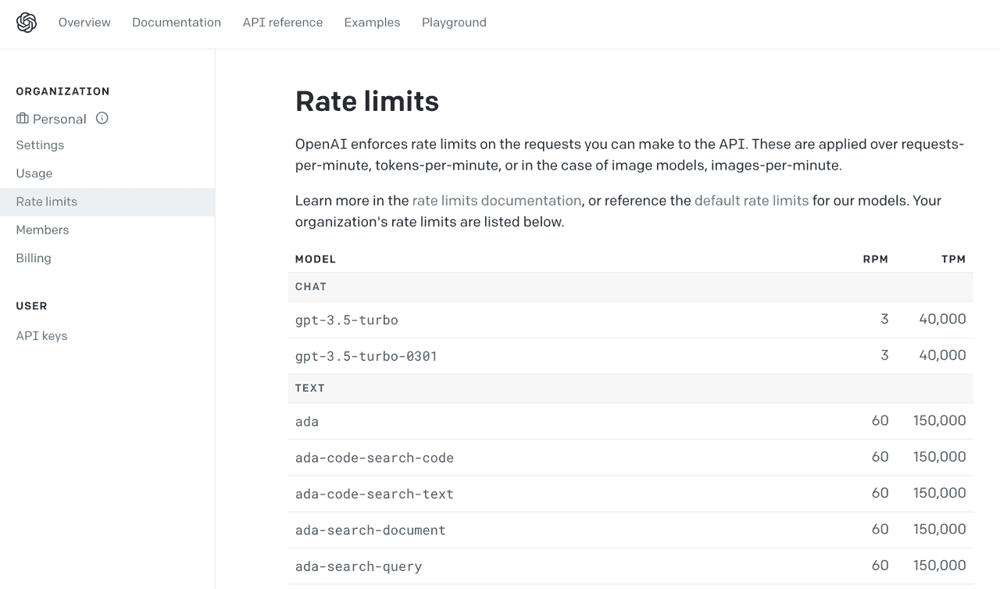

# API与速率限制

> 来源：[https://waytoagi.feishu.cn/docx/WkQ2dml0MonUvExgJwecTD57nxg](https://waytoagi.feishu.cn/docx/WkQ2dml0MonUvExgJwecTD57nxg)

## API

API（Application Programming Interface，应用程序编程接口）是一些预先定义的函数，目的是提供应用程序与开发人员基于某软件或硬件得以访问一组例程的能力。

### API 接入指南

ChatGPT API 接入需要如下条件。

1.  [已成功注册 OpenAI 的账号即可访问网站：h](https://platform.openai.com/account/api-keys)ttps://platform.openai.com/account/api-keys

1.  创建 API KEY，这个 API KEY 是用于 HTTP 请求身份验证的，可以创建多个。如下图点击“Create new secret key“，注意这个创建之后需要马上复制好保存，关闭弹框之后就看不到了。

1.  官方 API 文档链接[https://platform.openai.com](https://platform.openai.com/docs/api-reference/)/docs/api-reference/。

1.  注意 API 调用是收费的，但是 OpenAI 已经为我们免费提供了5美元的用量。

## 速率限制

速率限制是 API 对用户或客户端在指定时间内访问服务器的次数施加的限制。

### 为什么有速率限制？

速率限制是 API 的常见实践，它们出于几个不同的原因而被设置：

+   它们有助于防止滥用或误用 API。例如，恶意行为者可能会通过请求来淹没 API，试图使其超载或导致服务中断。通过设置速率限制，OpenAI 可以防止这种活动发生。

+   速率限制有助于确保每个人都能公平地访问 API。如果一个人或组织进行过多的请求，可能会拖累其他所有人使用 API。通过调节单个用户可以进行的请求数量，OpenAI 确保最多数量的人有机会使用 API 而不经历减缓。

+   速率限制可以帮助 OpenAI 管理其基础设施上的总负载。如果对 API 的请求急剧增加，则可能会给服务器带来压力并导致性能问题。通过设置速率限制，OpenAI 可以帮助所有用户维护平稳一致体验。

请完整阅读本文档以更好地了解 OpenAI 的 速度极值系统如何工作。我们提供代码示例和处理常见问题所需解决方案，请在填写“极值增长申请表”之前遵循此指南，并详细说明如何在最后一部分填写该表格。

### API的使用速率限制说明

OpenAI的API提供商在API使用方面有一些限制和规定，其中之一就是限制API的使用速率，以避免滥用和过度消耗资源。这种限制称为速率限制（Rate Limit），是许多API服务提供商都采用的一种机制。

OpenAI的速率限制规定了每个API端点可以接受的请求数量和时间间隔。根据OpenAI的API服务计划，不同的用户类型（如开发者、企业等）可以获得不同的速率限制，也可以根据实际需求进行定制。如果用户的请求超过了速率限制，OpenAI的API将返回一个错误响应，告知用户暂时无法处理请求。

####

### 使用API的注意事项

为了避免速率限制对用户造成不必要的影响，建议用户在使用OpenAI的API时遵循以下几点：

1.遵守OpenAI的API使用政策和服务条款。

2.根据自身需求选择合适的API服务计划，以获得更高的速率限制。

3.通过优化请求参数和减少重复请求等方式，尽可能减少API的使用次数。

4.在进行大规模或高频次的API请求时，采用分布式或异步处理方式，以提高效率和并发性。

5.监控API使用情况和响应状态，及时调整请求速率和处理策略，避免出现错误和超时等问题。