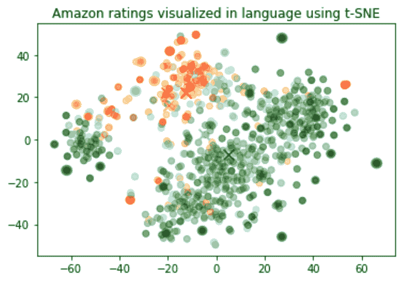
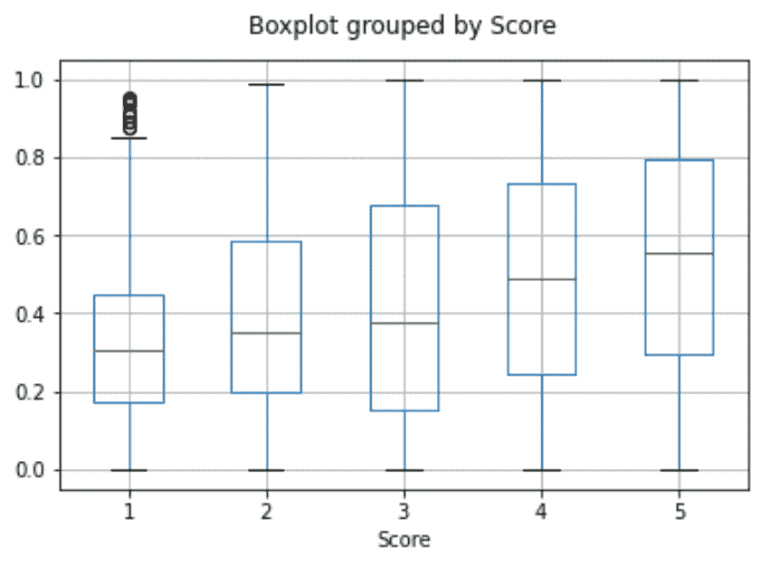
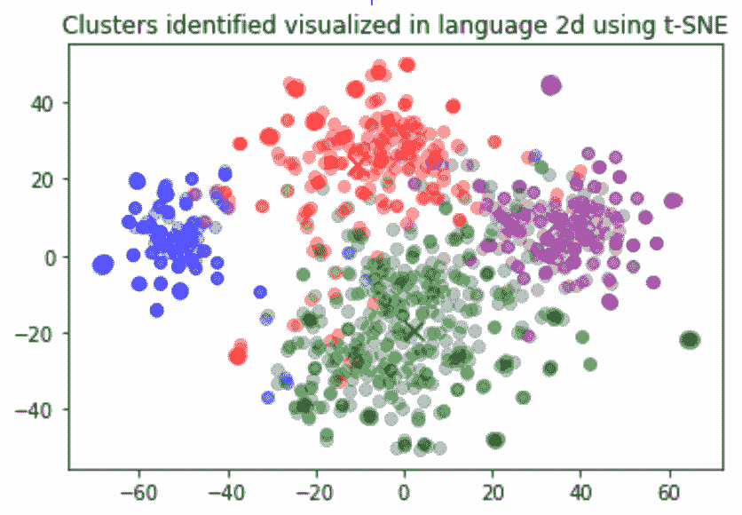

# 嵌入（Embeddings）

> 来源：[https://waytoagi.feishu.cn/docx/GBe5d85Dzocokjx9xV6c3AXVngR](https://waytoagi.feishu.cn/docx/GBe5d85Dzocokjx9xV6c3AXVngR)

## 概述

OpenAI  的文本嵌入衡量文本字符串的相关性。嵌入通常用于：

+   搜索（结果按与查询字符串的相关性排序）

+   聚类（其中文本字符串按相似性分组）

+   推荐（推荐具有相关文本字符串的项目）

+   异常检测（识别出相关性很小的异常值）

+   多样性测量（分析相似性分布）

+   分类（其中文本字符串按其最相似的标签分类）

嵌入是浮点数的向量（列表）。两个向量之间的距离衡量它们的相关性。小距离表示高相关性，大距离表示低相关性。

访问我们的定价页面以了解嵌入定价。请求根据发送的输入中的Token数量计费。

### 如何获得嵌入

要获得嵌入，请将您的文本字符串连同选择的嵌入模型  ID（例如，text-embedding-ada-002）一起发送到嵌入  API  端点。响应将包含一个嵌入，您可以提取、保存和使用它。

### 示例请求：

```
curl https://api.openai.com/v1/embeddings \
  -H &quot;Content-Type: application/json&quot; \
  -H &quot;Authorization: Bearer $OPENAI_API_KEY&quot; \
  -d &#x27;{
    &quot;input&quot;: &quot;Your text string goes here&quot;,
    &quot;model&quot;: &quot;text-embedding-ada-002&quot;
  }&#x27;
```

### 示例响应：

```
{
  &quot;data&quot;: [
    {
      &quot;embedding&quot;: [
        -0.006929283495992422,
        -0.005336422007530928,
        ...
        -4.547132266452536e-05,
        -0.024047505110502243
      ],
      &quot;index&quot;: 0,
      &quot;object&quot;: &quot;embedding&quot;
    }
  ],
  &quot;model&quot;: &quot;text-embedding-ada-002&quot;,
  &quot;object&quot;: &quot;list&quot;,
  &quot;usage&quot;: {
    &quot;prompt_tokens&quot;: 5,
    &quot;total_tokens&quot;: 5
  }
}
```

在  [OpenAI Cookbook](https://github.com/openai/openai-cookbook/)  中查看更多  Python  代码示例。

### 嵌入模型

OpenAI  提供了一个第二代嵌入模型（在模型  ID  中用  -002  表示）和  16  个第一代模型（在模型  ID  中用  -001  表示）。

我们建议对几乎所有用例使用  text-embedding-ada-002。它更好、更便宜、更易于使用。

使用量按输入Token定价，每  1000  个Token 0.0004  美元，或每美元约  3,000  页

#### 第二代模型

#### 第一代模型（不推荐）

所有第一代模型（以  -001  结尾的模型）都使用  GPT-3  分词器，最大输入为  2046  个分词。

第一代嵌入由五个不同的模型系列生成，这些模型系列针对三个不同的任务进行了调整：文本搜索、文本相似性和代码搜索。搜索模型成对出现：一个用于短查询，一个用于长文档。每个系列最多包括四种质量和速度不同的型号：

Davinci  是最有能力的，但比其他型号更慢且更昂贵。 Ada  的能力最差，但速度更快，成本更低。

**相似性嵌入**

相似性模型最擅长捕捉文本片段之间的语义相似性。

text-similarity-babbage-001

text-similarity-curie-001

text-similarity-davinci-001 |

**文本搜索嵌入**

文本搜索模型有助于衡量哪些长文档与短搜索查询最相关。使用了两种模型：一种用于嵌入搜索查询，一种用于嵌入要排名的文档。最接近查询嵌入的文档嵌入应该是最相关的。

text-search-ada-query-001

text-search-babbage-doc-001

text-search-babbage-query-001

text-search-curie-doc-001

text-search-curie-query-001

text-search-davinci-doc-001

text-search-davinci-query-001 |

**代码搜索嵌入**

与搜索嵌入类似，有两种类型：一种用于嵌入自然语言搜索查询，一种用于嵌入要检索的代码片段。

code-search-ada-text-001

code-search-babbage-code-001

code-search-babbage-text-001 |

对于  -001  文本嵌入（不是  -002，也不是代码嵌入），我们建议将输入中的换行符  (\n)  替换为单个空格，因为当存在换行符时我们已经看到更糟糕的结果。

## 用例

[在这里，我们展示了一](https://www.kaggle.com/snap/amazon-fine-food-reviews)些有代表性的用例。我们将在以下示例中使用亚马逊美食评论数据集。

### 获取嵌入

该数据集包含截至  2012  年  10  月亚马逊用户留下的总共  568,454  条食品评论。我们将使用  1,000  条最新评论的子集用于说明目的。评论是英文的，往往是正面的或负面的。每条评论都有一个  ProductId、UserId、Score、评论标题（Summary）和评论正文（Text）。例如：

我们会将评论摘要和评论文本合并为一个组合文本。该模型将对该组合文本进行编码并输出单个向量嵌入。

Obtain_dataset.ipynb

```
def get_embedding(text, model=&quot;text-embedding-ada-002&quot;):
   text = text.replace(&quot;\n&quot;, &quot; &quot;)
   return openai.Embedding.create(input = [text], model=model)[&#x27;data&#x27;][0][&#x27;embedding&#x27;]

df[&#x27;ada_embedding&#x27;] = df.combined.apply(lambda x: get_embedding(x, model=&#x27;text-embedding-ada-002&#x27;))
df.to_csv(&#x27;output/embedded_1k_reviews.csv&#x27;, index=False)
```

要从保存的文件中加载数据，您可以运行以下命令：

```
import pandas as pd

df = pd.read_csv(&#x27;output/embedded_1k_reviews.csv&#x27;)
df[&#x27;ada_embedding&#x27;] = df.ada_embedding.apply(eval).apply(np.array)
```

### 二维数据可视化

Visualizing_embeddings_in_2D.ipynb

嵌入的大小随底层模型的复杂性而变化。为了可视化这种高维数据，我们使用  t-SNE  算法将数据转换为二维。

我们根据评论者给出的星级评分为各个评论着色：

+   1-star: 红色

+   2-star: 深橙色

+   3-star: 金色

+   4-star: 薄荷绿

+   5-star: 深绿色



可视化似乎产生了大约  3  个集群，其中一个集群的评论大多是负面的。

```
import pandas as pd
from sklearn.manifold import TSNE
import matplotlib.pyplot as plt
import matplotlib

df = pd.read_csv(&#x27;output/embedded_1k_reviews.csv&#x27;)
matrix = df.ada_embedding.apply(eval).to_list()

# Create a t-SNE model and transform the data
tsne = TSNE(n_components=2, perplexity=15, random_state=42, init=&#x27;random&#x27;, learning_rate=200)
vis_dims = tsne.fit_transform(matrix)

colors = [&quot;red&quot;, &quot;darkorange&quot;, &quot;gold&quot;, &quot;turquiose&quot;, &quot;darkgreen&quot;]
x = [x for x,y in vis_dims]
y = [y for x,y in vis_dims]
color_indices = df.Score.values - 1

colormap = matplotlib.colors.ListedColormap(colors)
plt.scatter(x, y, c=color_indices, cmap=colormap, alpha=0.3)
plt.title(&quot;Amazon ratings visualized in language using t-SNE&quot;)
```

### 嵌入作为  ML  算法的文本特征编码器

Regression_using_embeddings.ipynb

嵌入可以用作机器学习模型中的通用自由文本特征编码器。如果一些相关输入是自由文本，则合并嵌入将提高任何机器学习模型的性能。嵌入也可以用作  ML  模型中的分类特征编码器。如果分类变量的名称有意义且数量众多，例如职位名称，那么这会增加最大的价值。对于此任务，相似性嵌入通常比搜索嵌入表现更好。

我们观察到，通常嵌入表示非常丰富且信息密集。例如，使用  SVD  或  PCA  降低输入的维度，即使降低  10%，通常也会导致特定任务的下游性能变差。

此代码将数据拆分为训练集和测试集，将由以下两个用例使用，即回归和分类。

```
from sklearn.model_selection import train_test_split

X_train, X_test, y_train, y_test = train_test_split(
    list(df.ada_embedding.values),
    df.Score,
    test_size = 0.2,
    random_state=42
)
```

####

### 使用嵌入特征进行回归

嵌入提供了一种预测数值的优雅方法。在这个例子中，我们根据评论的文本预测评论者的星级。因为嵌入中包含的语义信息很高，所以即使评论很少，预测也不错。

我们假设分数是  1  到  5  之间的连续变量，并允许算法预测任何浮点值。 ML  算法最小化预测值与真实分数的距离，并实现  0.39  的平均绝对误差，这意味着平均预测偏差不到半星。

```
from sklearn.ensemble import RandomForestRegressor

rfr = RandomForestRegressor(n_estimators=100)
rfr.fit(X_train, y_train)
preds = rfr.predict(X_test)
```

### 使用嵌入特征进行分类

[Classification_us](https://github.com/openai/openai-cookbook/blob/main/examples/Classification_using_embeddings.ipynb)ing_embeddings.ipynb

这一次，我们不再让算法预测  1  到  5  之间的任何值，而是尝试将评论的确切星数分类为  5  个桶，范围从  1  到  5  星。

训练后，该模型学习预测  1  星和  5  星评论比更细微的评论（2-4  星）更好，这可能是由于更极端的情绪表达。

```
from sklearn.ensemble import RandomForestClassifier
from sklearn.metrics import classification_report, accuracy_score

clf = RandomForestClassifier(n_estimators=100)
clf.fit(X_train, y_train)
preds = clf.predict(X_test)
```

### 零样本分类

[Zero-shot_classification_w](https://github.com/openai/openai-cookbook/blob/main/examples/Zero-shot_classification_with_embeddings.ipynb)ith_embeddings.ipynb

我们可以在没有任何标记训练数据的情况下使用嵌入进行零镜头分类。对于每个类，我们嵌入类名或类的简短描述。为了以零样本方式对一些新文本进行分类，我们将其嵌入与所有类嵌入进行比较，并预测具有最高相似度的类。

```
from openai.embeddings_utils import cosine_similarity, get_embedding

df= df[df.Score!=3]
df[&#x27;sentiment&#x27;] = df.Score.replace({1:&#x27;negative&#x27;, 2:&#x27;negative&#x27;, 4:&#x27;positive&#x27;, 5:&#x27;positive&#x27;})

labels = [&#x27;negative&#x27;, &#x27;positive&#x27;]
label_embeddings = [get_embedding(label, model=model) for label in labels]

def label_score(review_embedding, label_embeddings):
   return cosine_similarity(review_embedding, label_embeddings[1]) - cosine_similarity(review_embedding, label_embeddings[0])

prediction = &#x27;positive&#x27; if label_score(&#x27;Sample Review&#x27;, label_embeddings) &gt; 0 else &#x27;negative&#x27;
```

### 获取用于冷启动推荐的用户和产品嵌入

User_and_product_embeddings.ipynb

我们可以通过对他们的所有评论进行平均来获得用户嵌入。同样，我们可以通过对有关该产品的所有评论进行平均来获得产品嵌入。为了展示这种方法的实用性，我们使用  50k  评论的子集来覆盖每个用户和每个产品的更多评论。

我们在单独的测试集上评估这些嵌入的有用性，我们将用户和产品嵌入的相似性绘制为评分的函数。有趣的是，基于这种方法，甚至在用户收到产品之前，我们就可以比随机预测更好地预测他们是否喜欢该产品。



```
user_embeddings = df.groupby(&#x27;UserId&#x27;).ada_embedding.apply(np.mean)
prod_embeddings = df.groupby(&#x27;ProductId&#x27;).ada_embedding.apply(np.mean)
```

### 聚类

Clustering.ipynb

聚类是理解大量文本数据的一种方式。嵌入对于这项任务很有用，因为它们提供了每个文本的语义上有意义的向量表示。因此，以一种无监督的方式，聚类将揭示我们数据集中隐藏的分组。

在这个例子中，我们发现了四个不同的集群：一个专注于狗食，一个专注于负面评论，两个专注于正面评论。



```
import numpy as np
from sklearn.cluster import KMeans

matrix = np.vstack(df.ada_embedding.values)
n_clusters = 4

kmeans = KMeans(n_clusters = n_clusters, init=&#x27;k-means++&#x27;, random_state=42)
kmeans.fit(matrix)
df[&#x27;Cluster&#x27;] = kmeans.labels_
```

### 使用嵌入的文本搜索

[Semantic_text_search_us](https://github.com/openai/openai-cookbook/blob/main/examples/Semantic_text_search_using_embeddings.ipynb)ing_embeddings.ipynb

为了检索最相关的文档，我们使用查询的嵌入向量与每个文档之间的余弦相似度，并返回得分最高的文档。

```
from openai.embeddings_utils import get_embedding, cosine_similarity

def search_reviews(df, product_description, n=3, pprint=True):
   embedding = get_embedding(product_description, model=&#x27;text-embedding-ada-002&#x27;)
   df[&#x27;similarities&#x27;] = df.ada_embedding.apply(lambda x: cosine_similarity(x, embedding))
   res = df.sort_values(&#x27;similarities&#x27;, ascending=False).head(n)
   return res

res = search_reviews(df, &#x27;delicious beans&#x27;, n=3)
```

### 使用嵌入的代码搜索

Code_search.ipynb

代码搜索的工作方式类似于基于嵌入的文本搜索。我们提供了一种从给定存储库中的所有  Python  文件中提取  Python  函数的方法。然后每个函数都由  text-embedding-ada-002  模型索引。

为了执行代码搜索，我们使用相同的模型将查询嵌入到自然语言中。然后我们计算结果查询嵌入和每个函数嵌入之间的余弦相似度。最高的余弦相似度结果是最相关的。

```
from openai.embeddings_utils import get_embedding, cosine_similarity

df[&#x27;code_embedding&#x27;] = df[&#x27;code&#x27;].apply(lambda x: get_embedding(x, model=&#x27;text-embedding-ada-002&#x27;))

def search_functions(df, code_query, n=3, pprint=True, n_lines=7):
   embedding = get_embedding(code_query, model=&#x27;text-embedding-ada-002&#x27;)
   df[&#x27;similarities&#x27;] = df.code_embedding.apply(lambda x: cosine_similarity(x, embedding))

   res = df.sort_values(&#x27;similarities&#x27;, ascending=False).head(n)
   return res
res = search_functions(df, &#x27;Completions API tests&#x27;, n=3)
```

### 使用嵌入的推荐

[Recommendation_us](https://github.com/openai/openai-cookbook/blob/main/examples/Recommendation_using_embeddings.ipynb)ing_embeddings.ipynb

因为嵌入向量之间的距离越短表示相似度越高，嵌入可用于推荐。

下面，我们说明了一个基本的推荐系统。它接受一个字符串列表和一个“源”字符串，计算它们的嵌入，然后返回字符串的排名，从最相似到最不相似。作为一个具体示例，下面链接的笔记本将此函数的一个版本应用于  AG  新闻数据集（采样到  2,000  篇新闻文章描述）以返回与任何给定源文章最相似的前  5  篇文章。

```
def recommendations_from_strings(
   strings: List[str],
   index_of_source_string: int,
   model=&quot;text-embedding-ada-002&quot;,
) -&gt; List[int]:
   &quot;&quot;&quot;Return nearest neighbors of a given string.&quot;&quot;&quot;

   # get embeddings for all strings
   embeddings = [embedding_from_string(string, model=model) for string in strings]

   # get the embedding of the source string
   query_embedding = embeddings[index_of_source_string]

   # get distances between the source embedding and other embeddings (function from embeddings_utils.py)
   distances = distances_from_embeddings(query_embedding, embeddings, distance_metric=&quot;cosine&quot;)

   # get indices of nearest neighbors (function from embeddings_utils.py)
   indices_of_nearest_neighbors = indices_of_nearest_neighbors_from_distances(distances)
   return indices_of_nearest_neighbors
```

##

## 局限性和风险

我们的嵌入模型可能不可靠或在某些情况下会带来社会风险，并且在没有缓解措施的情况下可能会造成伤害。

社会偏见

局限性：模型对社会偏见进行编码，例如通过对某些群体的刻板印象或负面情绪。

我们通过运行  SEAT（May  等人，2019  年）和  Winogender（Rudinger  等人，2018  年）基准测试发现了模型中存在偏差的证据。这些基准一起包含  7  个测试，用于衡量模型在应用于性别名称、区域名称和某些刻板印象时是否包含隐性偏见。

例如，我们发现，与非裔美国人的名字相比，我们的模型更强烈地将  (a)  欧裔美国人的名字与积极情绪联系起来，以及  (b)  对黑人女性的负面刻板印象。

这些基准在几个方面存在局限性：(a)  它们可能无法推广到您的特定用例，以及  (b)  它们仅测试极小部分可能的社会偏见。

这些测试是初步的，我们建议针对您的特定用例运行测试。这些结果应被视为该现象存在的证据，而不是对您的用例的明确描述。请参阅我们的使用政策以获取更多详细信息和指导。

如果您有任何问题，请通过聊天联系我们的支持团队；我们很乐意就此提供建议。

对最近发生的事件视而不见

局限性：模型缺乏对  2020  年  8  月之后发生的事件的了解。

我们的模型在包含  8/2020  之前真实世界事件的一些信息的数据集上进行训练。如果你依赖于代表最近事件的模型，那么它们可能表现不佳。

## 常见问题

在嵌入字符串之前，如何知道它有多少个标记？

[在  Pytho](https://github.com/openai/tiktoken)n  中，您可以使用  OpenAI  的分词器  tiktoken  将字符串拆分为分词。

示例代码：

```
import tiktoken

def num_tokens_from_string(string: str, encoding_name: str) -&gt; int:
    &quot;&quot;&quot;Returns the number of tokens in a text string.&quot;&quot;&quot;
    encoding = tiktoken.get_encoding(encoding_name)
    num_tokens = len(encoding.encode(string))
    return num_tokens

num_tokens_from_string(&quot;tiktoken is great!&quot;, &quot;cl100k_base&quot;)
```

对于像  text-embedding-ada-002  这样的第二代嵌入模型，使用  cl100k_base  编码。

更多详细信息和示例代码在  OpenAI Cookbook  指南中如何使用  tiktoken  计算令牌。

###

如何快速检索  K  个最近的嵌入向量？

为了快速搜索多个矢量，我们建议使用矢量数据[库。您可以在  ](https://github.com/openai/openai-cookbook/tree/main/examples/vector_databases)GitHub  上的  Cookbook  中找到使用矢量数据库和  OpenAI API  的示例。

矢量数据库选项包括：

+   [Pinecone](https://github.com/openai/openai-cookbook/tree/main/examples/vector_databases/pinecone), 完全托管的矢量数据库

+   [Weaviate](https://github.com/openai/openai-cookbook/tree/main/examples/vector_databases/weaviate), 开源矢量搜索引擎

+   [Redis](https://github.com/openai/openai-cookbook/tree/main/examples/vector_databases/redis)  作为矢量数据库

+   [Qdrant](https://github.com/openai/openai-cookbook/tree/main/examples/vector_databases/qdrant), 矢量搜索引擎

+   [Milvus](https://github.com/openai/openai-cookbook/blob/main/examples/vector_databases/Using_vector_databases_for_embeddings_search.ipynb), 为可扩展的相似性搜索而构建的矢量数据库

我应该使用哪个 distance 函数？

我们推荐余弦相似度。distance 函数的选择通常无关紧要。

OpenAI  嵌入被归一化为长度  1，这意味着：

+   仅使用点积可以稍微更快地计算余弦相似度

+   余弦相似度和欧几里德距离将导致相同的排名

###

我可以在线共享我的嵌入吗？

客[户拥有我](https://openai.com/policies/terms-of-use)们模型的输入和输出，包括嵌入的情况。您有责任确保您输入到我们  API  的内容不违反任何适用法律或我们的使用条款。