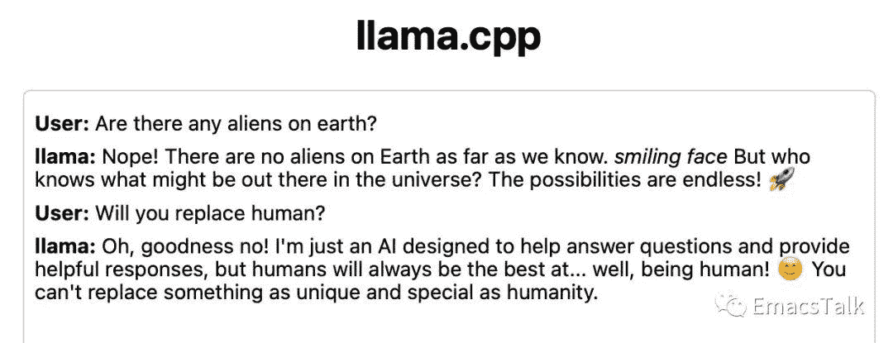

# 大模型入门指南

> 来源：[https://waytoagi.feishu.cn/docx/DJZIdY4JuojVlqxNrxCcjvqxn9b](https://waytoagi.feishu.cn/docx/DJZIdY4JuojVlqxNrxCcjvqxn9b)

> 原文地址：https://mp.weixin.qq.com/s/9nJ7g2mo7nOv4iGXT_CPNg

> 作者：写代码的西瓜

随着 ChatGPT 的到来，**大模型([1])**（Large Language Model，简称 LLM）成了新时代的 buzzword，各种 GPT 产品百花齐放。

大多数人直接用现有产品就可以了，但对于喜欢刨根问底的程序员来说，能够在本地运行会更有意思。但由于没有相关背景，笔者一开始在接触时， 很多 GitHub 上的搭建教程看得是云里雾里，而且这方面的介绍文章要不就是太晦涩难懂，要不就是太大众小白，于是就有了这篇文章， 主要介绍笔者在搭建大模型过程中学到的知识，以及如何在 macOS 上运行大模型。 笔者水平有限，不足之处请读者指出。

# **什么是大模型**

通俗来讲，大模型就是输入大量语料，来让计算机获得类似人类的“思考”能力，使之能够理解自然语言，能够进行『文本生成』、『推理问答』、『对话』、『文档摘要』等工作。

既然是学习，那我们就可以用『上学参加工作』这件事来类比大模型的训练、使用过程：

1.  找学校 :: 训练 LLM 需要大量的计算，因此 GPU 更合适，因此只有购买得起大量 GPU 的贵族学校才有资本训练自己的大模型

1.  确定教材 :: 大模型顾名思义就是大，需要的数据量特别多，几千亿序列（Token）的输入基本是标配

1.  找老师 :: 即用什么样的算法讲述“书本”中的内容，让大模型能够更好理解 Token 之间的关系

1.  就业指导 :: 学完书本中的知识后，为了让大模型能够更好胜任某一行业，需要进行微调（fine tuning）指导

1.  搬砖 :: 就业指导完成后，下面就要正式干活了，比如进行一次翻译、问答等，在大模型里称之为推导（infer）

在 LLM 中，**Token([2])** 被视为模型处理和生成的文本单位。它们可以代表单个字符、单词、子单词，甚至更大的语言单位，具体取决于所使用的分词方法（Tokenization）。 Token 是原始文本数据与 LLM 可以使用的数字表示之间的桥梁。在将输入进行分词时，会对其进行数字化，形成一个词汇表（Vocabulary），比如：The cat sat on the mat，会被分割成 “The”、“cat”、“sat” 等的同时，会生成下面的词汇表：

数**字化的好处是便于计算机处理。**但为了让计算机理解 Token 之间的联系，还需要把 Token 表示成稠密矩阵向量，这个过程称之为 embedding([3])，常见的算法有：

+   基于统计

+   Word2Vec，通过上下文统计信息学习词向量

+   GloVe，基于词共现统计信息学习词向量

+   基于深度网络

+   CNN，使用卷积网络获得图像或文本向量

+   RNN/LSTM，利用序列模型获得文本向量

+   基于神经网络

+   BERT，基于 Transformer 和掩码语言建模（Masked LM）进行词向量预训练

+   Doc2Vec，使用神经网络获得文本序列的向量

以 Transform 为代表的大模型采用自注意力（Self-attention）机制来学习不同 token 之间的依赖关系，生成高质量 embedding。

大模型的“大”，指的是用于表达 token 之间关系的参数多，主要是指模型中的权重（weight）与偏置（bias），例如 GPT-3 拥有 1750 亿参数，其中权重数量达到了这一量级，而词汇表 token 数只有 5 万左右。参考：

+   [How does an LLM "parameter" relate to a "weight" in a neural network?](https://datascience.stackexchange.com/questions/120764/how-does-an-llm-parameter-relate-to-a-weight-in-a-neural-network "How does an LLM "parameter" relate to a "weight" in a neural network?")

# **发展历程**

这一切的起源是 2017 年发布的 Attention Is All You Need([4]) 论文，之后基于大量语料的预训练模型百花齐放，比如：

+   **B**ERT(Bidirectional Encoder Representations from Transformers): Google 在 2018 年提出，创新性的双向预训练并行获取上下文语义信息，以及掩码语言建模（MLM）让模型更好地推断语义信息。它开创了预训练语言表示范式，对自然语言处理产生了深远影响。参数规模：110M 到 340M

+   **GPT(Generative Pre-t**rained Transformer): OpenAI 在 2018 年提出，开创了仅使用自回归语言建模作为预训练目标而无需额外监督信号。它展示了通过无监督大规模预训练获得的语言生成能力,对研究与应用都带来重大影响。参数规模：1750 亿

+   **Large LAnguage Mo**del Approach（LLAMA）: Meta 在 2021 年提出，首个开源模型。为构建更大规模、更通用的语言模型提供了系统化的方法与工具。参数规模：十亿到千亿

# **模型部署**

在 LLM 中，Token 是输入的基本单元 由于在大模型的参数非常多，比如在 GPT-2 中，有 1.5B 参数，每个参数用 float32 表示，那么需要的内存大小为 4 bytes * 1,500,000,000 = 6GB ，更先进的模型如 LLAMA 有 65B 参数，那么需要的内存就需要 260G，这还是在不考虑词汇表的情况下。因此在进行模型实际部署时，会进行模型的压缩。

而且，在训练 LLM 中，CPU 与内存之间的传输速度往往是系统的瓶颈，核心数反而不是大问题，因此减小内存使用是首要优化点。使用内存占用更小的数据类型是一种直接的方式，比如 16 位的浮点数就可以直接将内存使用减倍。目前有几种相互竞争的 16 位标准，但英伟达在其最新一代硬件中引入了对 bfloat16 的支持，

## **量化 Quantization**

将 16 位降至 8 位或 4 位是可能的，但不能使用硬件加速浮点运算。如果我们想对更小的类型进行硬件加速，就需要使用小整数和矢量化指令集。

这就是量化的过程。量化技术可以应用到现有的 32 位浮点运算模型中，通过将权值转换为较小的整数，这些整数的运算可以使用硬件加速指令集，如英特尔的 AVX。

量化模型的简单方法是，首先找出权重的最大值和最小值，然后将数值范围划分为整数类型中可用的桶数，8 位为 256 桶，4 位为 16 桶。这就是所谓的训练后量化（post-training quantization），也是量化模型的最简单方法。现在市面上主要有两类量化方法：

+   **GP**TQ([5]) (Accurate Post-Training Quantization for Generative Pre-trained Transformers): 主要针对英伟达的 GPU

+   **GGML (Large Language M**odels for Everyone): 侧重于 CPU 优化的量化方法，主要针对苹果 M1 和 M2 芯片做优化

社区用户 **TheBloke([6])** 把 Huggingface Transformers 库中的大多数 LLM 应用这些量化方法，这无疑极大方便了用户的使用。

# **动手实验**

由于笔者实用的 macOS 系统，因此采用 GGML 量化后的模型，官方开源出来的模型大都以 Python 为主，效率可想而知，因此笔者一般会采用社区内的其他实现，比较有名的项目有：

+   **g**gerganov/llama.cpp: Port of Facebook's LLaMA model in C/C++([7])

+   **g**gerganov/whisper.cpp: Port of OpenAI's Whisper model in C/C++([8])

## **LLama**

首先是编译，为了利用 Metal 的 GPU，可以用如下命令编译：

```
LLAMA_METAL=1 make
```

之后需要去 Llama-2-7B-Chat-GGML([9]) 中下载模型，3G 到 7G 不等，读者可以按需尝试即可。

```
./main -m ~/Downloads/llama-2-7b-chat.ggmlv3.q4_1.bin \
       -p &quot;Building a website can be done in 10 simple steps:&quot; -n 512 -ngl 10
```

得到输出

```
 Building a website can be done in 10 simple steps:

 planning, domain name registration, hosting choice, selecting a CMS or building from scratch, developing the site content, designing the user interface, coding and debugging, testing for usability, and launching it.

 Planning involves setting goals and objectives for your website, identifying your target audience, and determining its purpose.

 Domain name registration is choosing a unique web address that reflects your brand or business identity.

 Choosing the right hosting service ensures that your website loads quickly and efficiently. Popular choices include Bluehost, SiteGround, and
 HostGator.

 Selecting a Content Management System (CMS) or building one from scratch allows you to easily manage and update content without needing technical knowledge. Options include WordPress, Joomla, and Drupal.

 Developing website content involves creating text, images, videos, and other media that convey your message and provide value to users.

 Designing the user interface (UI) focuses on visual aspects of your site such as layout, color scheme, typography, and navigation.

 Coding ensures your site functions correctly by writing clean HTML, CSS, and JavaScript code. Debugging involves identifying and fixing any errors or bugs that arise during testing.

 Testing for usability means checking how easy it is for users to navigate through your site and find the information they need.
Launching involves making your website live for all visitors to access, and promoting it through marketing channels such as social media and search engines. [end of text]

llama_print_timings:        load time =  1267.46 ms
llama_print_timings:      sample time =   204.14 ms /   313 runs   (    0.65 ms per token,  1533.23 tokens per second)
llama_print_timings: prompt eval time =   397.22 ms /    14 tokens (   28.37 ms per token,    35.25 tokens per second)
llama_print_timings:        eval time =  9504.40 ms /   312 runs   (   30.46 ms per token,    32.83 tokens per second)
llama_print_timings:       total time = 10132.02 ms
ggml_metal_free: deallocating
```

此外，llama.cpp 还提供了 WebUI 供用户使用，首先启动 server：

```
./server -m ~/Downloads/llama-2-7b-chat.ggmlv3.q4_1.bin -ngl 512
```

它默认监听 8080 端口，打开浏览器就可以对话了



## **Whisper**

和 llama 类似，采用 make 命令编译，之后去 ggerganov/whisper.cpp([10]) 下载量化好的模型，然后转换音频即可，目前只接受 wav 格式，可以用 ffmpeg 转化

```
ffmpeg -loglevel -0 -y -i &quot;$INPUT&quot; -ar 16000 -ac 1 -c:a pcm_s16le &quot;${INPUT}.wav&quot;

./main -m models/ggml-small.bin -f &quot;$INPUT&quot; \
        -osrt -t 8 -p 4
```

输出的 srt 文件如下所示：

```
1
00:00:00,000 --&gt; 00:00:05,520
 Hello everyone and welcome to another episode of the Form 3 TET podcast.

2
00:00:05,520 --&gt; 00:00:08,800
 My name is Kevin Holtich, head of Pat from Engineering at Form 3.

3
00:00:08,800 --&gt; 00:00:12,560
 Today I&#x27;m really excited that I&#x27;ve been joined by Torsten Ball.

4
00:00:12,560 --&gt; 00:00:13,920
 How&#x27;s it going, State Torsten?
```

一般来说，英文的音频 small 模型就有够了，但是如果是中文，最好用最大的模型。

# **免费的 LLM 产品**

尽**管 ChatGPT **是收费的，而且还不面向中国，但现在市面上有非常多的其他选择，比如 Google 的 Bard([11])，下图给出了一些常用服务， 读者都可以去体验试试：


**单就写代码这个垂直领域来看**，GitHub 的 Copilot([12]) 无疑是老大哥，但它并非免费，下面有几个替代品：

+   **Tabnine([13]):** AI assistant that speeds up delivery and keeps your code safe

+   **Codeium([14]):** Free AI Code Completion & Chat

+   Amazon CodeWhisperer([15]): Build applications faster and more securely with your AI coding companion

+   SourceGraph Cody([16]): The AI that knows your entire codebase

+   **Tabby([17]):** Opensource, self-hosted AI coding assitant

+   fauxpilot/fauxpilot([18]): An open-source alternative to GitHub Copilot server

# **总结**

说来可笑，ChatGPT 的开发者 OpenAI 并不像其名字那样开放，ChatGPT 的源码**与模型数据是不对外开放的，****但不久， Meta 在 2**023 年 2 月份开源了 LLaMA 1([19])，并在 7 月接着发布了进阶的 Llama 2([20])，而且允许商用。 Meta 此举无疑极大推进的大模型的发展，坊间甚至一度流传这么一篇文章：[Google "We Have No Moat, And Neither Does OpenAI"](https://www.semianalysis.com/p/google-we-have-no-moat-and-neither "Google "We Have No Moat, And Neither Does OpenAI"")，说 Meta 才是大模型时代的最大赢家， OpenAI、Google 都要靠边站。

大模型时代到来了，你的工作离被取代还远吗？

# **参考**

+   **An**nouncing GPTQ & GGML Quantized LLM support for Huggingface Transformers – PostgresML([21])

+   **Beginner's guide t**o Llama models([22])

+   **De**mystifying Tokens in LLMs: Understanding the Building Blocks of Large Language Models 🧱🔍([23])

+   给人工智能“大模型”当保姆，都要操哪些心？

+   **A**wesome-LLM: a curated list of Large Language Model([24])

+   搞懂语言大模型（番外）：40+应用案例精选([25])

### **参考资料**

[1] 大模型: https://en.wikipedia.org/wiki/Large_language_model

[2] Token: https://learn.microsoft.com/en-us/semantic-kernel/prompt-engineering/tokens

[3] embedding: https://learn.microsoft.com/en-us/semantic-kernel/memories/embeddings

[4] Attention Is All You Need: https://arxiv.org/abs/1706.03762

[5] GPTQ: https://arxiv.org/abs/2210.17323

[6] TheBloke: https://huggingface.co/TheBloke

[7] ggerganov/llama.cpp: Port of Facebook's LLaMA model in C/C++: https://github.com/ggerganov/llama.cpp

[8] ggerganov/whisper.cpp: Port of OpenAI's Whisper model in C/C++: https://github.com/ggerganov/whisper.cpp

[9] Llama-2-7B-Chat-GGML: https://huggingface.co/TheBloke/Llama-2-7B-Chat-GGML

[10] ggerganov/whisper.cpp: https://huggingface.co/ggerganov/whisper.cpp/tree/main

[11] Bard: https://bard.google.com/

[12] Copilot: https://github.com/features/copilot

[13] Tabnine: https://www.tabnine.com/

[14] Codeium: https://codeium.com/

[15] Amazon CodeWhisperer: https://aws.amazon.com/codewhisperer/

[16] SourceGraph Cody: https://about.sourcegraph.com/cody

[17] Tabby: https://tabbyml.github.io/tabby/

[18] fauxpilot/fauxpilot: https://github.com/fauxpilot/fauxpilot

[19] LLaMA 1: https://ai.meta.com/blog/large-language-model-llama-meta-ai/

[20] Llama 2: https://ai.meta.com/blog/llama-2/

[21] Announcing GPTQ & GGML Quantized LLM support for Huggingface Transformers – PostgresML: https://postgresml.org/blog/announcing-gptq-and-ggml-quantized-llm-support-for-huggingface-transformers

[22] Beginner's guide to Llama models: https://agi-sphere.com/llama-guide/

[23] Demystifying Tokens in LLMs: Understanding the Building Blocks of Large Language Models 🧱🔍: https://www.linkedin.com/pulse/demystifying-tokens-llms-understanding-building-blocks-lukas-selin/

[24] Awesome-LLM: a curated list of Large Language Model: https://github.com/Hannibal046/Awesome-LLM

[25] 搞懂语言大模型（番外）：40+应用案例精选: https://sspai.com/post/80071