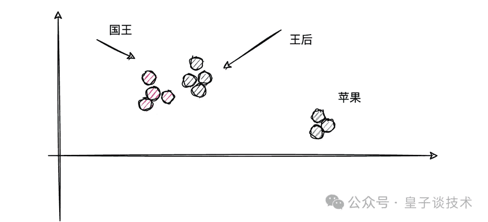
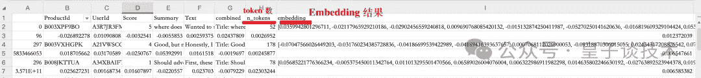

# 认识大模型 Embedding 技术加实战

> 来源：[https://waytoagi.feishu.cn/docx/VZEGdES8loEwcyxl1pgccT3snPh](https://waytoagi.feishu.cn/docx/VZEGdES8loEwcyxl1pgccT3snPh)

> 原文链接：https://mp.weixin.qq.com/s/8mDLFFmgKOQC8WK2kkwhaA

> 原创：皇子｜皇子谈技术 ｜2024-03-21 19:54

有朋友说想学习**大模型应用开发技术**，让我谈一谈。

首先大模型应用开发技术不需要我们掌握机器学习和深度学习的算法，但是要有编程思维、python 基础，然后跟着下面的步骤走，就能学得明白。

下面正式开始认识大模型 Embedding 的理论知识，加代码实战。看大家反馈，如果觉得难，我有打算接着 《讲清 Transformer 模型架构》，继续往后写 GPT 和 BERT 模型，又或者加入更多的实战，欢迎私信交流。

## **一、什么是 Embedding**

Embedding （嵌入）是一个浮点数的向量（列表）。两个向量之间的距离度量它们的相关性，小的距离表示高相关性，大的距离表示低相关性。

Embedding （嵌入）也是是一种在机器学习和深度学习中广泛应用的技术，特别是自然语言处理（NLP）和其他涉及高维离散数据的领域。它指的是将原本高维且通常是离散的输入数据（如单词、短语、用户 ID、商品 ID 等）映射到一个低维连续向量空间中的过程。这些低维向量称为嵌入（Embedding  vectors）。

例如，“国王”和“王后”在嵌入向量的空间里，位置就会挨得很近；而“苹果”这个词，虽然也是个词，但因为它的意思和前两者差别较大，所以它的嵌入向量就会落在离“国王”和“王后”比较远的地方。



Embedding  不仅限于单词，还可以扩展到句子、文档、实体或其他类型的对象。通过训练诸如 Word2Vec、GloVe 或 BERT   等模型，可以从大规模文本数据中学习出这样的嵌入向量。这些嵌入向量可以被看作是输入数据在潜在语义空间中的表示，使得机器学习模型能够更好地理解和处理这些数据，从而改善下游任务（如文本分类、情感分析、问答系统、机器翻译等）的表现。

除了文本数据，嵌入技术也被应用于社交网络分析、推荐系统、图像识别（如位置嵌入）、图神经网络（如节点嵌入）等多种场景中，实现将复杂对象的有效编码和降维表示。

## 二、Embeddings 分类及对应模型

Embeddings 有许多种类别和变体，每种类型的 Embeddings 都有其特定的设计目标和应用场景，共同点在于它们都致力于将复杂而抽象的对象结构化并压缩到便于计算和比较的数值形式，以下是几种常见的 Embeddings 类型：

### **词嵌入**

+   **Word2Vec**: 包括 CBOW （Continuous Bag-of-Words） 和 Skip-Gram 模型，由 Google 提出，用于学习单词之间的语义关系。

+   **GloVe** （Global Vectors for Word Representation）: 由斯坦福大学开发，旨在结合全局统计信息和局部上下文窗口的优势来生成单词嵌入。

+   **FastText**: 由 Facebook AI 团队推出，不仅考虑单个单词，还考虑内部字符 n-gram，对于罕见词汇有更好的表现。

+   **ELMo** （Embeddings from Language Models）: 利用双向 LSTM 对整个句子进行建模，产生上下文敏感的单词嵌入。

### **情景化话的词嵌入**

+   **BERT** （Bidirectional Encoder Representations from Transformers）: 由 Google 推出，利用 Transformer 架构的预训练模型，能够根据上下文提供动态的单词嵌入。

+   **GPT** （Generative Pre-training Transformer） 及其后续版本 GPT-2/3/4：由 OpenAI 开发，也是基于 Transformer 的自回归模型，同样能产出上下文相关的嵌入。

+   **XLNet**、**RoBERTa** 等都是 BERT 之后改进或扩展的预训练模型。

### **句子和文档嵌入**

+   **Doc2Vec**: 扩展了 Word2Vec，能够为整个文档生成统一的向量表示。

+   Average Word Embeddings: 将一段文本中所有单词的嵌入取平均作为整体的文本表示。

+   Transformers Sentence Embeddings: 如 BERT 的[CLS]标记对应的向量，或者专门针对句子级别的模型如 Sentence-BERT。

### **实体/概念嵌入**

+   Knowledge Graph Embeddings: 如 TransE、DistMult、ComplEx 等，用于将知识图谱中的实体和关系嵌入到低维向量空间中。

### **其他类型**

+   **图像 Embeddings**: 使用卷积神经网络（CNN）进行图像特征提取，得到的特征向量即为图像嵌入。

+   **音频 Embeddings**: 在语音识别和声纹识别中，将声音信号转化为有意义的向量表示。

+   用户/物品 Embeddings：在推荐系统中，将用户行为或物品属性映射到低维空间以进行协同过滤或基于内容的推荐。

还有一种**图 Embeddings**：是用于学习图结构的表示学习方法，将图中的节点和边映射到低维向量空间 中。通过学习图嵌入，可以将复杂的图结构转化为向量表示，以捕捉节点之间的结构和关联关系。这些方法可以通过 DeepWalk、Node2Vec、GraphSAGE 等算法来实现。图嵌入在图分析、社交网络分析、推荐系统等领域中广泛应用，用于发现社区结构、节点相似性、信息传播等图属性。

下面以 OpenAI 为例继续展开介绍

## 三、Embedding 在大模型中的价值

O**penAI 已经**产生了三代 Embedding 模型，另外第一代在官方文档中已经被删除了，模型选择上，推荐使用最新的第三代。

> ❝

> 补充：Token 的概念

> 模型通过将文本分解为令牌（Token）来理解和处理文本。Token    可以是单词，也可以是字符块。例如，单词“hamburger”被分解成标记“ham”、“bur”和“ger”，而很短且常见的单词像“pear”是一个  Token。许多 Token 以空格开头，例如“ hello”和“ bye”。

### OpenAI 的 GPT 大模型的不足

1、训练的数据是存在截止时间的，无法获取最新信息

2、无法访问企业/个人的内部知识库

3、输入的 Token 数限制

### Embedding 增强 GPT 的能力的过程

针对上面的问题， OpenAI 发布过这样一篇文档，说明如何使用两步搜索来增强 GPT 的能力：

**搜索：**搜索内部的知识库，检索相关文本。

**请求：**将检索到的文本内容部分发送给 GPT 大模型，并向其提出问题。

具体的操作步骤如下：

**1、准备搜索数据**（仅一次）

1）搜集数据：获取需要的数据，公开数据或者私有的数据

2）切块：将文档切分成短小的

3）嵌入：通过 OpenAI API 对切块的数据进行 Embedding 结果，

4）存储：存储 Embedding 结果，对于大型数据集的 Embedding 结果，可以使用向量数据库进行保存。

2、**搜索**（每次查询一次） 给定用户问题，从 OpenAI API 生成查询的 embeddings 使用 embeddings，按照与查询相关性对文本部分进行排序

> ❝

> 距离函数推荐使用：余弦相似性

3、**提问**（每次查询一次）

将问题和最相关的部分插入到发送给 GPT 的消息中返回 GPT 的答案

### Embedding 共有哪些作用

+   搜索（其中结果按与查询字符串的相关性进行排名）

+   聚类（其中文本字符串按相似性分组）

+   建议（建议包含相关文本字符串的项目）

+   异常检测（识别出相关性很小的离群值）

+   多样性测量（分析相似性分布）

+   分类（其中文本字符串按其最相似的标签分类）

## 四、实战-从数据集中获取 Embeddings

快速验证你的 OPENAI_API_KEY 是否有效！

```
curl https://api.openai.com/v1/embeddings \
  -H &quot;Content-Type: application/json&quot; \
  -H &quot;Authorization: Bearer $OPENAI_API_KEY&quot; \
  -d &#x27;{
    &quot;input&quot;: &quot;Your text string goes here&quot;,
    &quot;model&quot;: &quot;text-embedding-3-small&quot;
  }&#x27;
```

### 一）**加载数据集**

> ❝

> 准备：

> 1、OpenAI 的 API_KEY。

> 2、设置环境变量或者代码中初始化时传入。

> // 默认 OPENAI_BASE_URL=https://api.openai.com/v1，当使用代理时需要注意修改！

> export OPENAI_BASE_URL=https://api.openai.com/v1

> export OPENAI_API_KEY=sk-xxxxxx

### 二）**安装所有依赖**

```
# 安装所有依赖
!pip install openai tiktoken transformers plotly matplotlib scikit-learn torch torchvision scipy pandas

# openai 是 OpenAI 的 SDK
# Python做数据处理的时候，pandas，numpy库。pandas 提供了 DataFrame 数据结构，方便进行数据的读取、处理、分析等操作。
# tiktoken：使用tiktoken计数令牌。
```

### 三）**导入相关库**

```
# 导入相关库
import pandas as pd
import tiktoken
```

### 四）**实现基础方法**

```
# 实现基础方法
import os

from openai import OpenAI

# print(os.environ.get(&quot;OPENAI_BASE_URL&quot;))
# print(os.environ.get(&quot;OPENAI_API_BASE&quot;))
# print(os.environ.get(&quot;OPENAI_API_KEY&quot;))

client = OpenAI(max_retries=5, base_url=os.environ.get(&quot;OPENAI_API_BASE&quot;))

# 选择模型，默认text-embedding-3-small
def get_embedding(text, model=&quot;text-embedding-3-small&quot;):
   text = text.replace(&quot;\n&quot;, &quot; &quot;)
   return client.embeddings.create(input = [text], model=model).data[0].embedding
```

### 五）设置全局变量：选择模型、编码方式

```
# 设置全局变量：选择模型、编码器
embedding_model = &quot;text-embedding-3-small&quot;
embedding_encoding = &quot;cl100k_base&quot;
# text-embedding-3-small 模型支持的输入最大 Token 数是8191，嵌入维度 1536。第三代模型中允许开发人员权衡使用嵌入的性能和成本，而降低嵌入维度。
max_tokens = 8000
```

### 六）设置要筛选的评论数量为 1000

```
# 设置要筛选的评论数量为1000
top_n = 1000
# 对DataFrame进行排序，基于&quot;Time&quot;列，然后选取最后的2000条评论。
# 这个假设是，我们认为最近的评论可能更相关，因此我们将对它们进行初始筛选。
df = df.sort_values(&quot;Time&quot;).tail(top_n * 2) 
# 丢弃&quot;Time&quot;列，因为我们在这个分析中不再需要它。
df.drop(&quot;Time&quot;, axis=1, inplace=True)
# 从&#x27;embedding_encoding&#x27;获取编码
encoding = tiktoken.get_encoding(embedding_encoding)

# 计算每条评论的token数量。我们通过使用encoding.encode方法获取每条评论的token数，然后把结果存储在新的&#x27;n_tokens&#x27;列中。
df[&quot;n_tokens&quot;] = df.combined.apply(lambda x: len(encoding.encode(x)))

# 如果评论的token数量超过最大允许的token数量，我们将忽略（删除）该评论。
# 我们使用.tail方法获取token数量在允许范围内的最后top_n（1000）条评论。
df = df[df.n_tokens &lt;= max_tokens].tail(top_n)

# 打印出剩余评论的数量。
len(df)
```

### 七）获取 Embeddings 并保存

```
# 实际生成会耗时几分钟
# 提醒：大家可直接复用项目中的嵌入文件 fine_food_reviews_with_embeddings_1k_byli.csv
df[&quot;embedding&quot;] = df.combined.apply(lambda x: get_embedding(x, model=embedding_model))

output_datapath = &quot;data/fine_food_reviews_with_embeddings_1k_byli.csv&quot;

df.to_csv(output_datapath)
```

**生成的.csv 内容如下：**



## **小结**

我们认识了 **Embedding （嵌入）**是一个浮点数的向量（列表），两个向量之间的距离度量它们的相关性，小的距离表示高相关性，大的距离表示低相关性。知道了 Embedding 共有：词、句子、文档、图像等分类。还分析了 Embedding 在大模型中的价值。最后是 Embedding 的实战部分：从数据集中获取 Embedding 结果，并保存为 csv 文件。

最后，本示例中的实战代码，参考的是官方最新文档的内容，加上个人测试阶段的遇到的问题、代码注释等

> OpenAI 官网文档链接：https://platform.openai.com/docs/introduction

大模型技术，除了在 OpenAI 官网能看到的：Embedding、Function Call 和 Fune Tuning 等。

进阶到企业级应用开发的大模型技术还会涉及到：利用开源的 Embedding 模型、向量数据库去做检索增强生成（RAG），以及购买 GPU 服务器去基于开源大模型搭建企业级大模型项目。