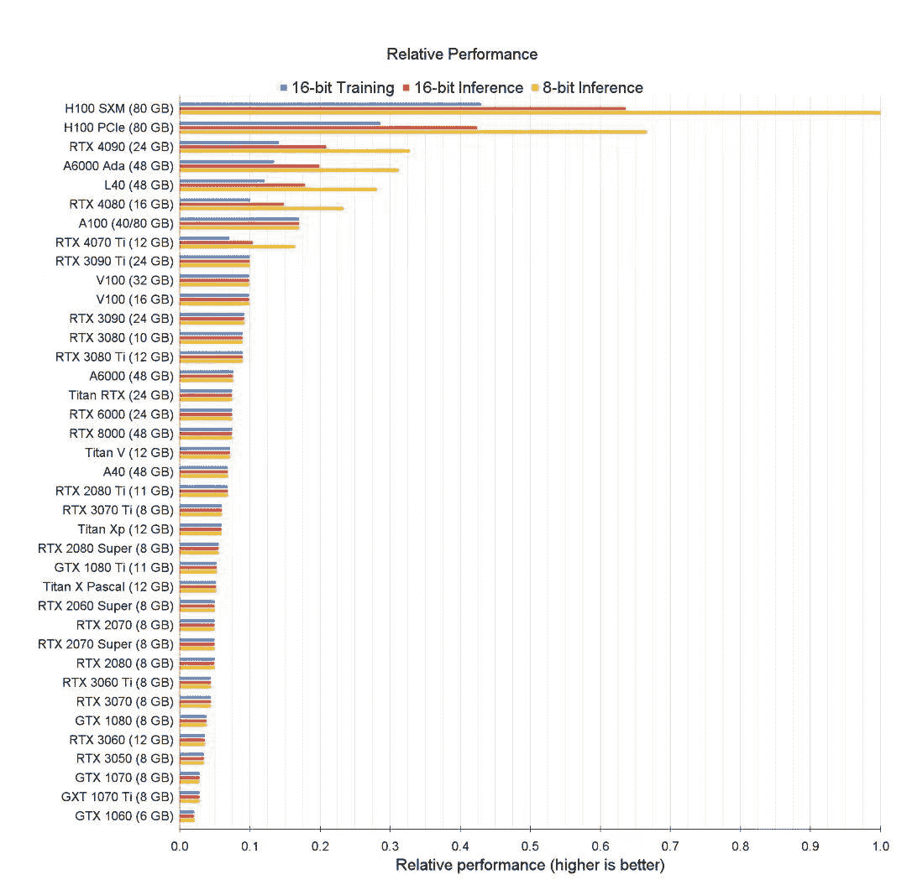

# 推理用GPU选购指北

> 来源：[https://waytoagi.feishu.cn/docx/WoWOdREopoEzFsxWx2tcdpBdnSg](https://waytoagi.feishu.cn/docx/WoWOdREopoEzFsxWx2tcdpBdnSg)

购买GPU实体卡，或者云GPU资源必读。

## 显卡的常规指标

大部分模型默认采用FP16的加载方式。

因此显卡的性能指标主要关注FP16的算力， 和显存大小。

+   算力通常影响推理速度，包含输入数据的处理，和持续吐出数据的速度。

+   在LLM的运算中，运算速度会很直观的体现在用户体验上：从提示词输入后到第一个输出的token的等待时间间隔，和流式输出下每秒吐字的字数。-- 通常流式吐字需要在每秒10 token以上能获得还能过得去的用户体验。

+   显存大小直接影响了你是否能装载模型。在开源模型的说明书上通常都会说明转载所需的显存大小。

+   所需显存大小也可以通过简单的“参数大小乘2”计**算**来简化判断，** **例如：chatglm3-6B，至少需要6*2=12G 的显存资源。实际显存需求当然还会受其他的影响，比如token计算过程中波动的显存量。因此如前例中，chatglm3-6b通常需要有16G甚至24G的显存，如果仅有12G显存，会很快出现OoM的问题。

## 英伟达显卡参数 （常见卡）

## 推理和训练性能天梯图

参考来自显卡天梯图2024.01更新:

