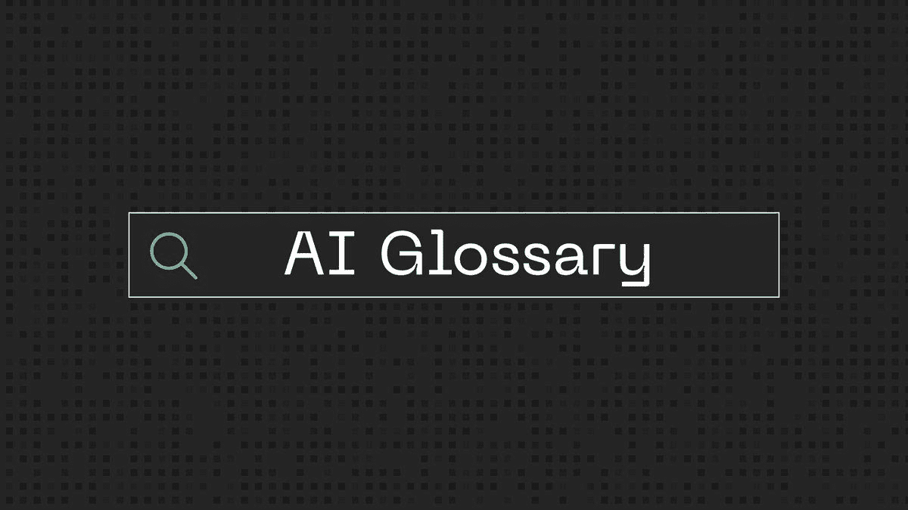
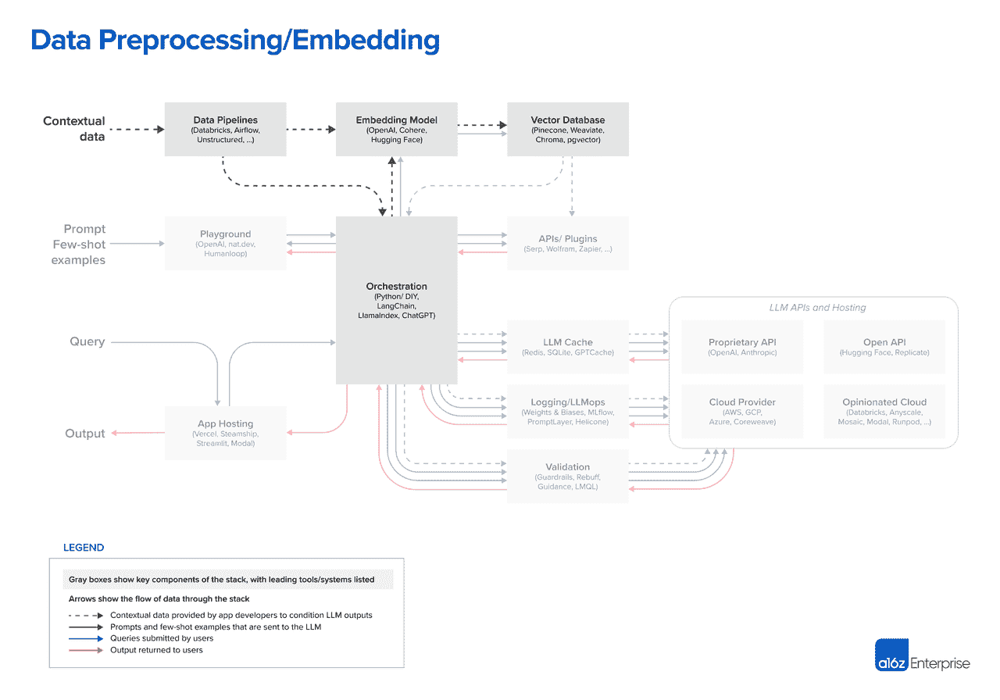
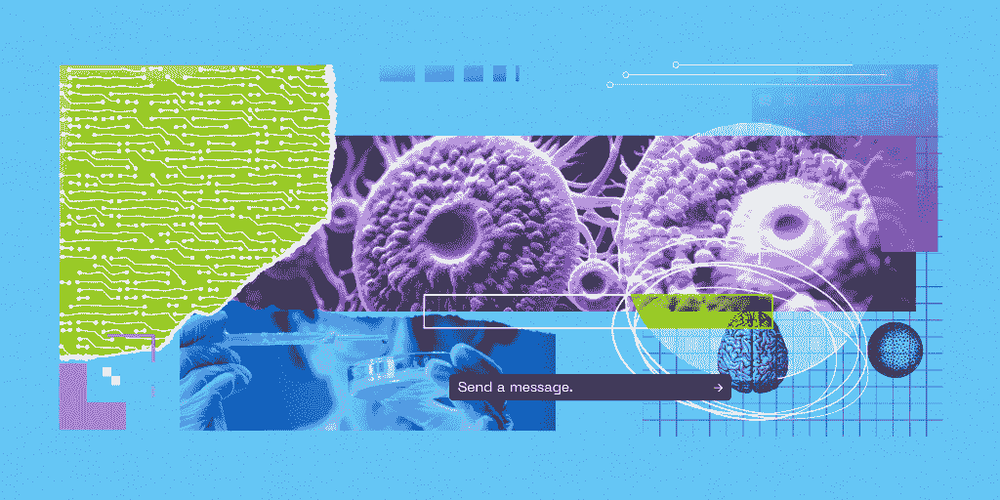
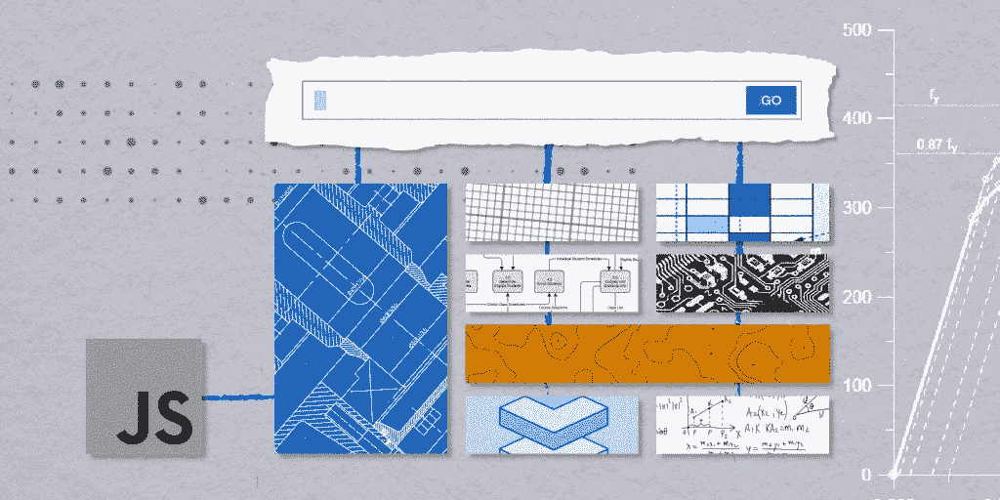
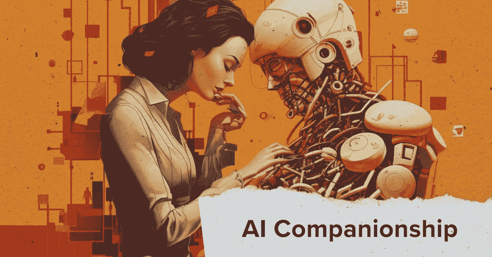
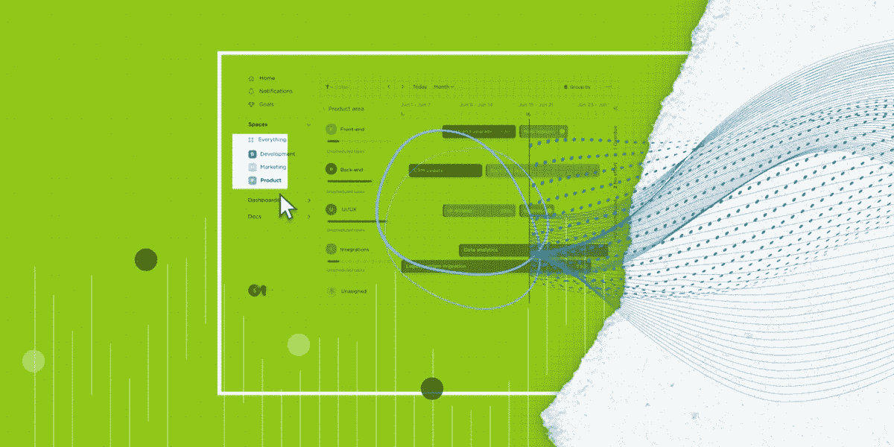

# 商业：a16z值得收藏的文章

> 来源：[https://waytoagi.feishu.cn/docx/OfLMdqe1Qo7j4Ix1UWTct9XNnbe](https://waytoagi.feishu.cn/docx/OfLMdqe1Qo7j4Ix1UWTct9XNnbe)

> 原文地址1：https://a16z.com/2023/05/25/ai-canon/

> 原文地址2：https://twitter.com/a16z/status/1672307480251039744

# 市场分析

我们都为生成式人工智能所能创造的东西感到惊叹，但仍然有很多问题需要回答。哪些产品和公司将生存和繁荣？艺术家会发生什么变化？公司应该如何利用它？它将如何影响就业和整个社会？以下是一些试图回答这些问题的尝试。

### **a16z 思考**

+   [**Who owns the gen**](https://a16z.com/2023/01/19/who-owns-the-generative-ai-platform/)erative AI platform?：我们对生成式人工智能基础设施、模型和应用层面的价值积累和可能积累的「旗舰评估」。

+   翻译：[生成式AI平台，谁主沉浮？](https://waytoagi.feishu.cn/wiki/O1vfw5M9tiJKICky6EpcbFX2nBg)

+   [**Navigating the hig**](https://a16z.com/2023/04/27/navigating-the-high-cost-of-ai-compute/)h cost of AI compute：详细分析为什么生成式人工智能模型需要如此多的计算资源，以及如何在需求旺盛的市场中获取这些资源（即以合适的成本获得合适数量的正确 GPU）的思考方式。

+   翻译：[惊人算力成本背后，AI混战下如何选择基础设施？](https://waytoagi.feishu.cn/wiki/C87pwwOvqiDNz5kQ3WncnGq5nBc)

+   [**Art isn’t dead， it’s ju**](https://a16z.com/2022/11/16/creativity-as-an-app/)st machine-generated：该文章探讨了 AI 模型如何比软件开发等领域更迅速地改变创造领域，这些领域通常被认为是对自动化的最后抵抗。

+   翻译：[艺术并未消亡，它只是由机器生成](https://waytoagi.feishu.cn/wiki/J3EFwHoJxihlRKkq9RKcgpjynth)

+   [**The generative AI**](https://a16z.com/2022/11/17/the-generative-ai-revolution-in-games/) revolution in games：我们的游戏团队对于[如何通过轻松创建高度详细的](https://a16z.com/2023/03/17/the-generative-ai-revolution/)图形，来改变游戏设计师、工作室以及整个市场进行了分析。我们游戏团队的这篇后续文章特别关注了人工智能生成内容与用户生成内容的对比。

+   翻译：[游戏中的生成式 AI 革命](https://waytoagi.feishu.cn/wiki/GxU1wZLfni9MqPkO9pvcDtGWnMf)

+   [**For B2B generative AI**](https://a16z.com/2023/03/30/b2b-generative-ai-synthai/) apps, is less more?：对 LLM 在 B2B 企业应用领域如何发展的预测，重点是总结信息最终比产生文本更有价值。

+   翻译：[对于 B2B 生成式 AI 应用来说，少即是多吗？](https://waytoagi.feishu.cn/wiki/BES8wp0rUi0FkCkMcTQcRWHanBe)

+   [**F**](https://a16z.com/2023/04/19/financial-services-will-embrace-generative-ai-faster-than-you-think/)inancial services will embrace generative AI faster than you think：这篇文章论述了金融服务行业如何利用生成 AI 进行个性化客户体验、更好成本效益的运营、更好的合规性、改进的风险管理，以及动态预测和报告。

+   翻译：[金融服务业将比你想象得更快地接纳生成式 AI](https://waytoagi.feishu.cn/wiki/SNonwgSn1iYLqMkZWOEc8n9Xn5b)

+   [**Generative AI: The ne**](https://a16z.com/2023/02/07/everyday-ai-consumer/)xt consumer platform：这篇文章探讨了在从医疗到电子商务等各个领域，生成 AI 影响消费市场的机会。

+   翻译：[生成式AI平台，谁主沉浮？](https://waytoagi.feishu.cn/wiki/O1vfw5M9tiJKICky6EpcbFX2nBg)

+   [**To make a real difference in healt**](https://time.com/6274752/ai-health-care/)h care， AI will need to learn like we do：AI 有潜力彻底改变预防和治疗疾病的方式。但是，要实现从药物研发到医疗交付方式的真正转变，我们应该投资于创建一个“专业”AI 的生态系统，使其能够像我们最好的医生和药物研发人员今天所做的那样学习。

+   翻译：[为了在医疗保健中产生真正的改变，AI 需要像我们一样学习](https://waytoagi.feishu.cn/wiki/SPDZwWuGDiofsTkPFOPcjQv6nRc)

+   [**The new industrial **](https://a16z.com/2023/05/17/the-new-industrial-revolution-bio-x-ai/)revolution: Bio x AI：人类历史上的下一次工业革命将是人工智能驱动的生物学。

+   翻译：[新工业革命：生物技术×人工智能](https://waytoagi.feishu.cn/wiki/DJB6wiKMOi6Jqqk7IDJc1mCznqc)

---

## AI相关术语词汇表：

a16z发布了一个不断增长的AI词汇表：

https://a16z.com/ai-glossary/

（所有的词汇表已补充进[0. 从这里启程](https://ywh1bkansf.feishu.cn/wiki/PFXnwBTsEiGwGGk2QQFcdTWrnlb?table=tbltvr7KExCt7Jpw&view=vewjxk9tDu) [AI相关词汇](https://ywh1bkansf.feishu.cn/wiki/PFXnwBTsEiGwGGk2QQFcdTWrnlb?table=tbltvr7KExCt7Jpw&view=vewjxk9tDu)）

## LLM应用程序的新兴架构

https://a16z.com/2023/06/20/emerging-architectures-for-llm-applications/

翻译版本：[LLM 应用程序的新兴架构](https://ywh1bkansf.feishu.cn/wiki/QI6GwuqHSiEX8iktTs0cCJM1n8c)

A16Z 最新的这篇“LLM 应用的新兴架构”来自他们对 AI 初创企业中创始人与工程师的对谈总结，非常清晰的概括了现在基于大语言模型的开发模式。

## 生物 + 健康的AI投资论点

https://a16z.com/2023/06/21/ai-bio-health-thesis/

翻译版本：[交叉点上的人工智能：关于生物+健康的人工智能的投资论文](https://ywh1bkansf.feishu.cn/wiki/F2EtwNq0Gip3JckH7z3cVwVenMc)

## **适用于 ****JavaScript**** 的 ****AI**** Stack 入门**

https://a16z.com/2023/06/21/the-getting-started-with-ai-stack-for-javascript/

翻译版本：[适用于 JavaScript 的 AI Stack 入门](https://ywh1bkansf.feishu.cn/wiki/F3mnwoXMAiJLAPkma42cTtoHnlh)

##  AI伴侣会走向何方？

https://a16z.com/2023/06/22/its-not-a-computer-its-a-companion/

翻译版本：[它不是计算机，而是伴侣！](https://ywh1bkansf.feishu.cn/wiki/WdR7wnd73iv4FGk8HhGcYwEQnWb)

## AI前沿：积极构建和训练一些最大和最前沿的模型

https://a16z.com/2023/06/23/the-next-token-of-progress-4-unlocks-on-the-generative-ai-horizon/

翻译版本：[生成式人工智能领域的 4 个突破点](https://ywh1bkansf.feishu.cn/wiki/OGL3wMPpoiR8OTkXbRycthvHnJb)

# 子页面目录