# 企业构建和购买生成式 AI 方式的 16 个变化

> 来源：[https://waytoagi.feishu.cn/docx/SlXJdmKC4oMrwUxbCrJcWcUenLg](https://waytoagi.feishu.cn/docx/SlXJdmKC4oMrwUxbCrJcWcUenLg)

> 🔗 原文链接： https://a16z.com/generative-ai-enterprise-2024/

> ⏰ 发表时间：2024-03-21

> 作者：[Sarah Wang](https://a16z.com/author/sarah-wang/) and [Shangda Xu](https://a16z.com/author/shangda-xu/)

生成式人工智能（Generative AI）在 2023 年迅速席卷了消费市场，创下了超过 10 亿美元的消费支出的纪录。2024 年，我们相信企业领域的收入机会将是前者的数倍。

去年，尽管消费者花费数小时与新的 AI 伴侣聊天或使用扩散模型（ diffusion models）制作图像和视频，企业对 genAI 的大部分参与似乎局限于少数明显的用例，并且将“GPT-wrapper（GPT 套壳）”产品作为新的 SKU 进行交付。一些持怀疑态度的人怀疑 genAI 是否能够在企业中扩展。这些初创公司真的能赚到钱吗？这难道不都是炒作吗？

在过去的几个月里，a16Z 与数十家财富 500 强和顶级企业领导人进行了交谈，并对 70** 多位进行了调查，以了解他们如何使用、采购和预算生成式人工智能。调查结果显示， 在过去 6 个月里，企**业对生成式 AI 的资源配置和态度发生了显著变化。尽管这些领导人对部署生成式人工智能仍有一些保留，但他们几乎将预算增加了两倍，将更多应用部署在较小的开源模型上，并将更多业务从早期实验转移到生产环境中。

**这对**创始人来说是一个巨大的机遇。a16Z 认为 ，那些为客户“以 AI 为中心的战略计划”构建解决方案，并同时能预见他们的痛点，以及从重服务模式转向构建可扩展产品的人工智能初创公司，将会抓住这一新的投资浪潮并占据重要的市场份额。

任何时候，为企业构建和销售任何产品都需要对客户的预算、关注点和路线图有深入的了解。为了让 AI 公司创始人了解企业客户高层将如何决定部署生成式 AI，并让其了解该领域相关企业高层如何解决与他们相同的问题，a16Z 根据访谈结果总结了以下 16 个最为关键的考虑因素，涉及资源、模型和应用。

#  资源分配：预算呈现急剧增长，且趋势持续

## **1. 生成式人工智能的预算激增**

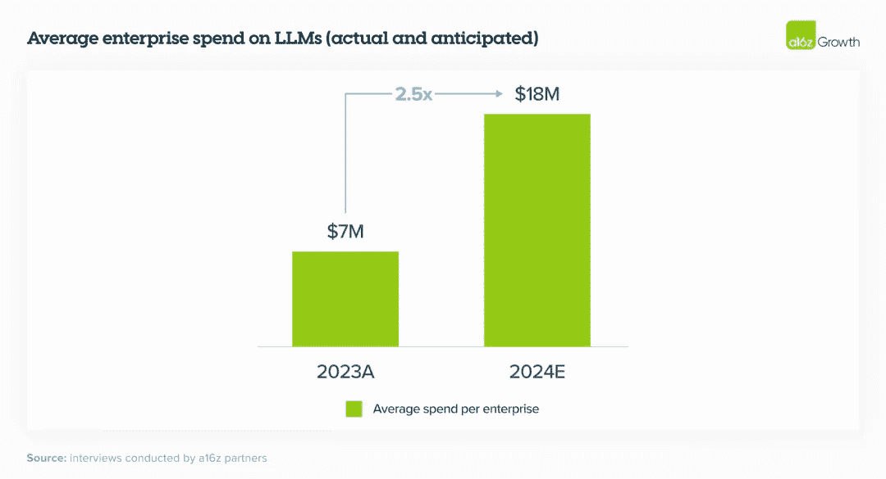

2023 年企业基础模型 API、自主托管和模型微调的平均支出约为 700 万美元。此外，我们与几乎每一家企业交谈后发现，他们的生成式人工智能实验取得了令人期待的初步成果，并计划在 2024 年将支出提高 2 倍至 5 倍，以支持更多业务场景的应用。

## 2. 头部企业开始将 AI 投资重新分配到经常性软件支出预算项目

去年，大部分企业的生成式人工智能支出毫不奇怪地来自“创新”预算和其他一次性资金池。然而，到了 2024 年，许多头部企业正在将这些支出重新分配到更为永久的软件预算项上；不到四分之一的人表示今年的生成式人工智能支出将来自创新预算。在较小的范围内，我们也开始看到一些头部企业将生成式人工智能预算用于节省人力成本，特别是在客户服务方面。

如果这种趋势持续下去，我们认为这将是未来生成式人工智能支出显著增加的先兆。一家公司提到，他们基于 LLM 技术的客户服务每通电话节省了约 6 美元，总体节省了约 90%的成本，这是增加八倍投资于生成式人工智能的原因之一。

以下是参与调查的企业如何分配 LLM 支出的总体情况：

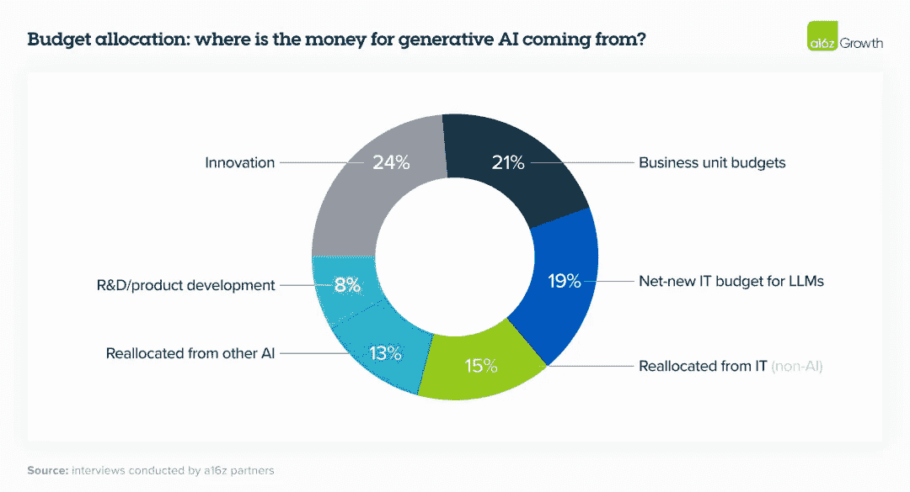

## 3. ROI 的衡量仍然是一门艺术和科学

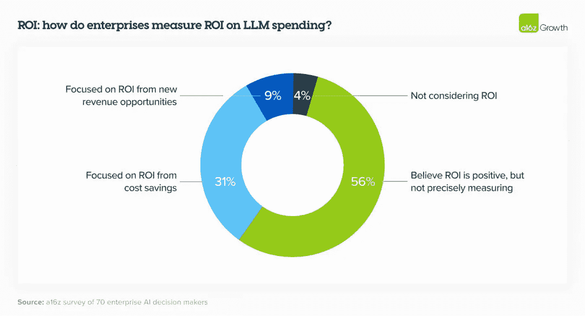

目前，企业领导者主要通过 AI 带来的生产力增长来衡量 ROI。虽然他们依赖 NPS 和客户满意度等作为良好的代理指标，但他们也在寻找更具体的衡量回报的方法，比如收入增长、节约、效率和准确性提升，这取决于具体的使用情况。在短期内，头部企业仍在推出这项技术，并试图找到最佳的度量指标来量化回报，但在未来 2 到 3 年内，ROI 将变得越来越重要。

在头部企业们寻找答案的同时，许多企业领导人对于员工表示他们更有效地利用了自己的时间的情况，往往选择相信员工的陈述，而不是基于确凿的数据或度量标准。

## **4. 实施和扩展生成式人工智能需要正确的技术人才**，但目前许多企业内部并没有太多这样的人才

仅仅拥有大模型提供商的 API 并不足以规模化构建和部署生成式人工智能解决方案。实施、维护和扩展所需的计算基础设施需要高度专业化的人才。仅在 2023 年，实施费用就占据了 AI 支出中最大的部分之一，在某些情况下甚至是最大的部分。一位企业高管提到，“LLM 可能只有构建应用场景的成本的四分之一”，开发成本占据了大部分预算。

为了帮助企业启动和运行他们的模型，基础模型提供商在过去和现在都提供专业服务，这些服务通常与定制模型开发有关。我们估计这在 2023 年为这些公司带来了相当一部分收入，并且除了性能之外，这也是企业选择特定模型提供商的关键原因之一。由于在企业中很难获得合适的生成式人工智能人才，提供工具以使生成式人工智能开发更容易在企业内部内部实施的初创公司可能会看到更快的采用速度。

# 模型：企业正朝着多模型、开源的方向发展

## **5.多模型的未来**

仅仅在 6 个月前，绝大多数企业只是在试验一个模型（通常是 OpenAI 的）或者最多两个模型。但当我们今天与企业领导人交谈时，他们都在测试——在一些情况下甚至在业务场景中使用——多个模型，这使他们能够 1）根据性能、规模和成本来定制具体应用；2）避免锁定；以及 3）快速利用这个迅猛发展领域的最新研究成果。对头部企业来说，第三点尤其重要，因为模型排行榜是动态的，企业很乐意结合当前的最新模型和开源模型以获得最佳结果。

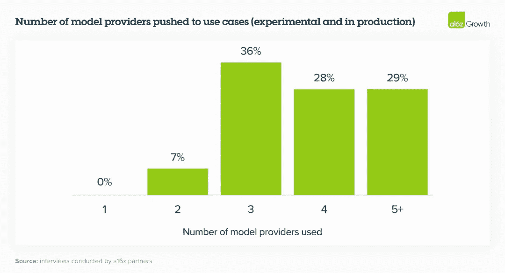

我们很可能会看到更多的模型涌现。下表是根据调查数据绘制的，参与调研的企业领导人们分享了一些正在测试的模型，这是证明企业正将模型推向业务流程的领先指标。OpenAI 仍然在企业应用领域占据主导地位，符合预期。

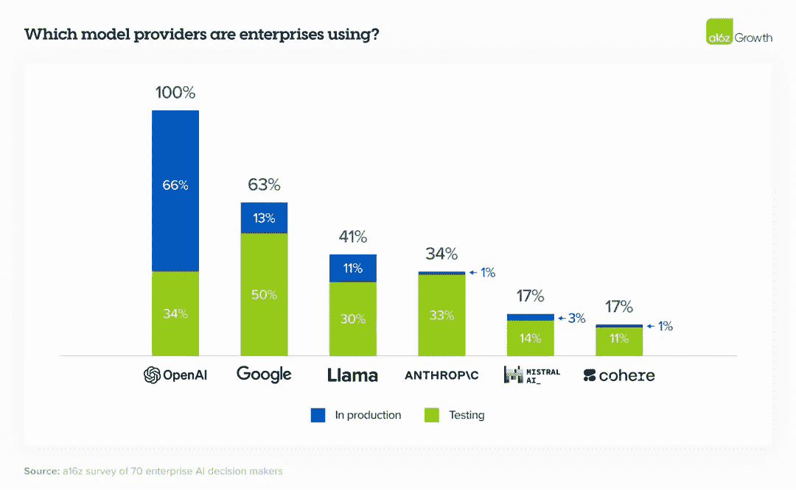

## **6. 开源正在蓬勃发展 **

这是过去 6 个月中最令人惊讶的变化之一。我们估计，2023 年 80%至 90%的闭源模型占据了主要市场份额，且其中大部分市场份额都属于 OpenAI。然而，46%的调查受访者提到，他们在 2024 年更喜欢或非常喜欢开源模型。在采访中，近 60%的 AI 领导者表示，他们对增加开源使用或在调整开源模型的性能与闭源模型大致匹配时进行切换感兴趣。

因此，从 2024 年开始，企业预计将会出现对开源的使用显著转移，一些企业甚至明确表示目标是实现 50/50 的分配比例，而不再是 2023 年的 80%闭源/20%开源的分配比例。

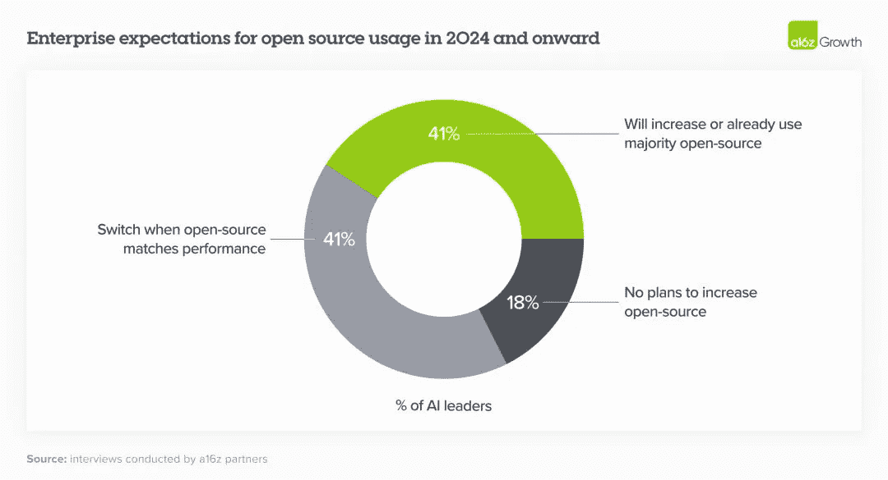

## **7. 虽然成本是开源很有吸引力的一个因素，但它在**关键选择标准中排名在控制权和定制化之后

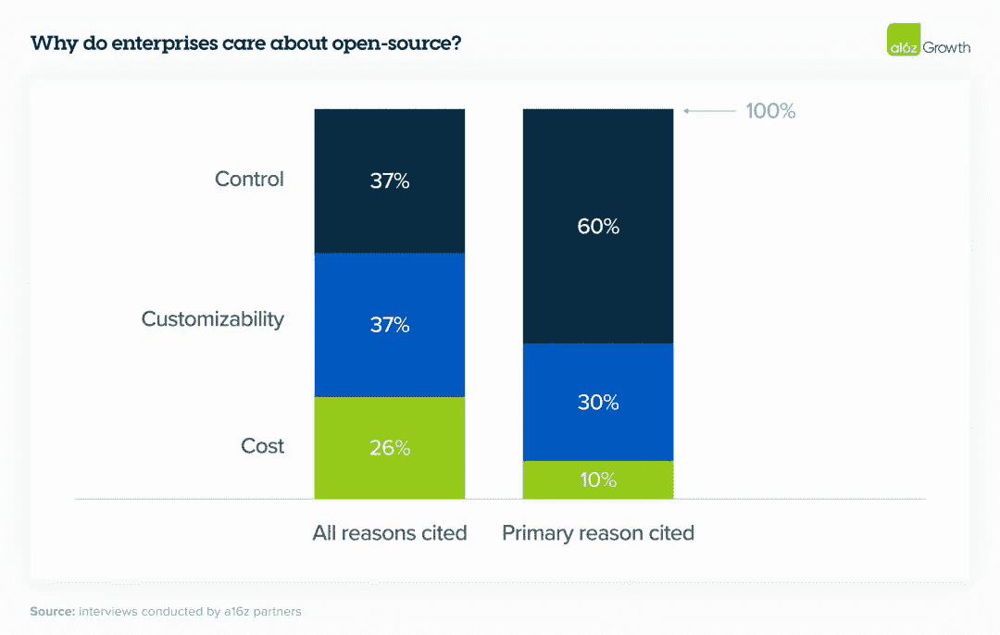

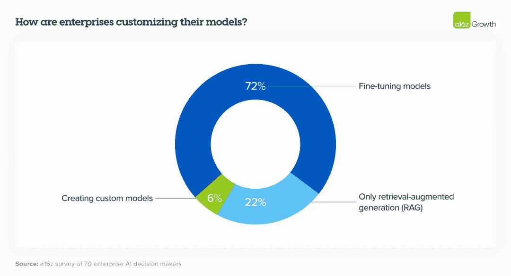

控制权（保护专有数据的安全性以及了解模型产生特定输出的原因）和定制化（针对特定应用进行有效调整的能力）远远超过成本，成为采用开源的主要原因。我们对成本并非关注重点感到意外，但这反映了企业领导层目前的信念，即生成式人工智能所创造的额外价值很可能远远超过其价格。正如一位高管解释的那样：“为了获取准确的答案而花钱是值得的。”

## 8. 对于控制权的渴望源于敏感应用和企业数据安全问题

出于监管或数据安全的考虑，企业仍不愿与闭源模型提供商分享其专有数据，这毫不奇怪。尤其是那些知识产权对其业务模式至关重要的公司尤其保守。一些领导通过自己托管开源模型来解决这一问题，而另一些则指出他们正在优先考虑具有虚拟专用云（VPC）集成的模型。

## 9. 领先企业通常通过微调，而不是从零构建来定制模型

2023 年，有很多关于构建自定义模型（如 BloombergGPT）的讨论。到了 2024 年，企业仍然对定制模型感兴趣，但随着高质量开源模型的出现，大多数企业选择不再从头训练自己的 LLM，而是使用检索增强生成（RAG）或对开源模型进行微调（fine- tuning）以满足他们的特定需求。

## 10. 云仍然在企业模型购买决策中产生极大影响力

2023 年，许多企业出于安全考虑通过其现有的云服务提供商（CSP）购买模型——领导者更担心闭源模型处理数据不当，而不是他们的 CSP——并且为了避免冗长的采购流程。到了 2024 年，情况仍然如此，这意味着 CSP 与首选模型之间的相关性相当高：Azure 用户通常更喜欢 OpenAI，而亚马逊用户更喜欢 Anthropic 或 Cohere。

正如我们在下面的图表中所看到的那样，超过 72％的企业使用 API 访问其模型，其中超过一半使用其 CSP 托管的模型。（请注意，超过四分之一的受访者进行了自我托管，可能是为了运行开源模型。)

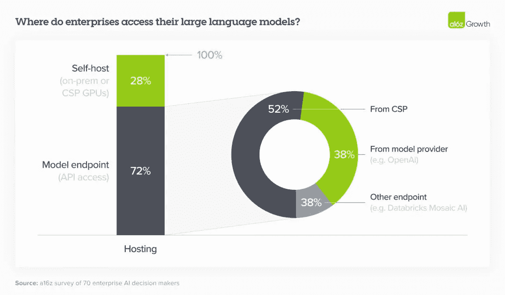

## 11. 客户仍然关注大模型最新推出的领先功能

尽管领导者将推理能力、可靠性和访问易用性（例如，通过他们的云服务提供商）列为采用特定模型的主要原因，但他们也倾向于具有其他差异化特性的模型。多位企业领导者指出，之前的 200K 上下文窗口能力是他们愿意采用 Anthropic 模型的关键原因，而一些人选择了 Cohere，则因为其最早发布、易于使用的微调功能。

## 12. 大多数企业认为模型性能正在趋同

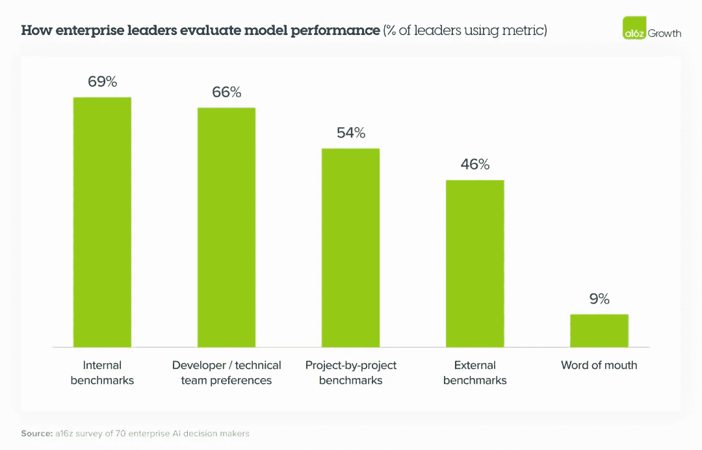

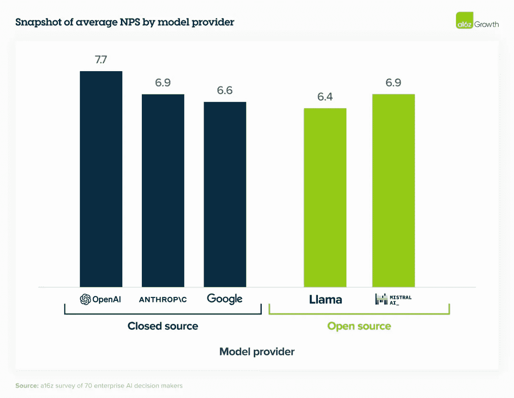

尽管大部分科技社区专注于将模型性能与公共基准（benchmarks）进行比较，但企业领导者更关注将经过微调的开源模型和经过微调的闭源模型的性能与其自身的一套内部基准进行比较。有趣的是，尽管闭源模型在外部基准测试中通常表现更好，但企业领导者仍然给予开源模型相对较高的 NPS（在某些情况下甚至更高），因为它们更容易对特定模型进行微调。

一家公司发现“在微调后，Mistral 和 Llama 的性能几乎与 OpenAI 一样，但成本要低得多。”按照这些标准，模型性能的趋同速度甚至比我们预期的更快，这使领导者能够选择更广泛范围内非常有能力的模型。

## **13. 灵活性优化选择权 **

大多数企业正在设计其应用程序，以便在模型之间切换只需更改 API 即可完成。一些公司甚至预先测试提示，以便切换可以在瞬间完成，而其他公司则建立了“模型花园”，可以根据需要将模型部署到不同的应用程序中。

企业采取这种方法的部分原因是因为他们从云时代学到了一些艰难的教训，即需要减少对供应商的依赖；另一部分原因是因为市场发展得如此之快，承诺只使用单一供应商是不明智的。

# 应用：将会更多迁移到具体业务场景

## 14. 目前企业正在自行构建而非购买应用程序

企业的重点主要放在自主构建应用程序上，目前企业更倾向于自主开发应用程序，而不是从外部购买。这主要是因为市场上缺乏经过严格测试、能够在特定领域内取得决定性成功的企业级人工智能应用程序。毕竟，目前还没有像这样的应用程序的“魔法象限”（Magic Quadrants）。

基础模型的出现使企业更容易通过 API 来构建自己的 AI 应用程序。企业现在正在构建自己版本的常见应用，如客户支持和内部聊天机器人，同时还在尝试更新颖的英语，如编写消费品配方、缩小分子发现范围和进行销售推荐。

关于**“**GPT wrappers（GPT 套壳）”的局限性已经被讨论过很多了，例如，初创公司利用大型语言模型（LLM）已知能力（例如文档摘要）来构建用户熟悉界面（例如聊天机器人）， 我们认为这些公司将面临的一个困境是，AI 进一步降低了企业内部（in-house）自主构建类似应用的门槛。

然而，目前尚不清楚当更多面向企业的 AI 应用上市时，情况是否会发生变化。虽然一位企业领导者提到尽管他们正在内部开发许多应用，但他们乐观地认为“将会有**新工具出现”，并且更愿意“使用市面上最好的工具”。其他人认为，GenAI 越来越成为一种“**战略工具”，允许企业将某些功能内部化，而不是像传统上依赖外部供应商。 鉴于这些情况，我们相信那些能在“LLM + UI”公式之外进行创新，并显著重新思考企业的基本工作流程，或帮助企业更好地利用自己专有数据的应用，将在整个市场上表现特别出色。

## 15.企业对内部应用感到兴奋，但对外部应用仍然更为谨慎

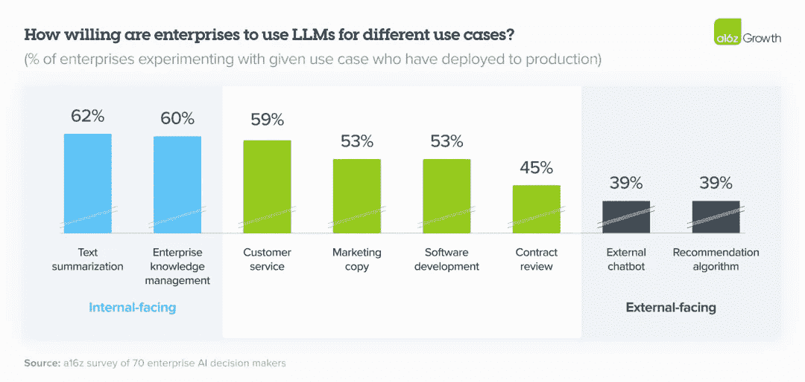

这是因为企业中仍然存在两个主要关于 GenAI 的担忧：1）潜在的幻觉和安全问题，2）部署 GenAI 可能导致的公共关系问题，特别是在敏感的消费者领域（例如，医疗保健和金融服务）。过去一年中最受欢迎的应用要么专注于内部生产力，要么需要在触达客户之前通过工作人员审核，例如编码协作、客户支持和营销。

在企业**中**，完全用于内部的应用（例如文本摘要和知识管理，例如内部聊天机器人）的推广速度远远高于敏感的人机协作应用（例如合同审查）或面向客户的用例（例如外部聊天机器人或推荐算法）。公司希望避免类似于加拿大航空公司由于生成 AI 失误导致发生客户服务问题所带来的后果。 由于这些问题对大多数企业仍然具有重大影响，构建可以帮助控制这些问题的工具的初创公司可能会获得显著的采用率。

# **总机会规模：庞大且快速增长**

## **1**6.我们认为，到 2024 年底，模型 API 和微调的总支出将达到每年超过 50 亿美元的规模，并且企业支出将占据其中的重要部分

根据我们的计算，我们估计，截至 2023 年，模型 API（包括微调）市场的年收入率在 15 亿至 20 亿美元左右，其中包括通过 Azure 购买 OpenAI 模型的支出。鉴于整体市场的预期增长和来自企业的明确迹象，单单这一领域的支出到年底将至少增长到每年 50 亿美元的规模，且潜力巨大。

正如我们讨论过的，企业已经将 GenAI 的部署作为优先事项，增加了预算并重新分配到软件产品线（software lines），优化了跨不同模型的应用，并计划在 2024 年将更多大模型应用扩大至广泛的业务流程，这意味着这种行为很可能成为驱动市场增长的重要影响因素。

在过去的 6 个月里，企业领导层自上而下都要求找到并部署 GenAI 解决方案。以前需要一年多才能达成的交易现在在 2 到 3 个月内就能完成，并且这些交易规模比以往更大。虽然本文重点讨论了基础模型层，但我们也相信企业中的这一机会已经延伸到了堆栈的其他部分——从帮助微调的工具，到模型服务，到应用构建，再到专门构建的 AI 原生应用。

**我**们正处于企业借助 GenAI 转型的重要拐点，我们很兴奋能与下一代服务于这个充满活力和具备巨大成长潜力的市场的公司合作。