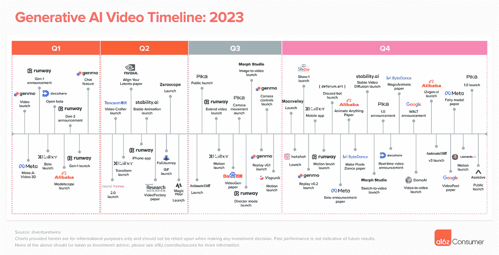
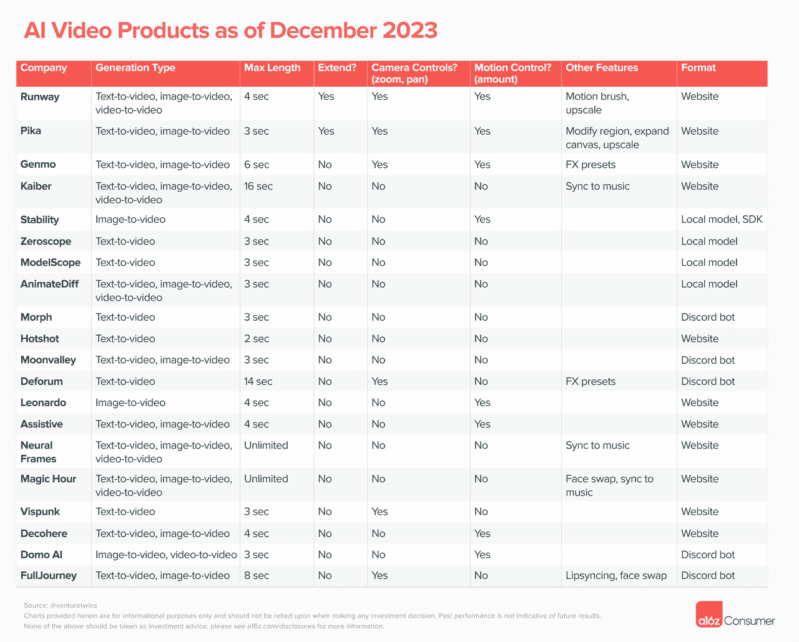
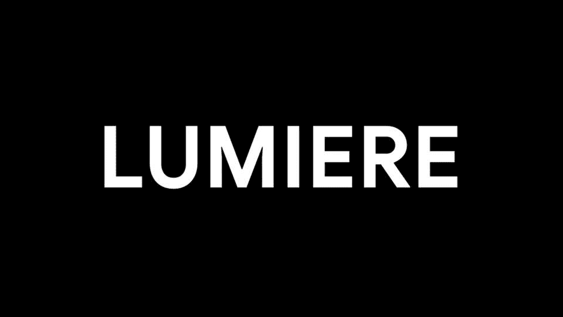
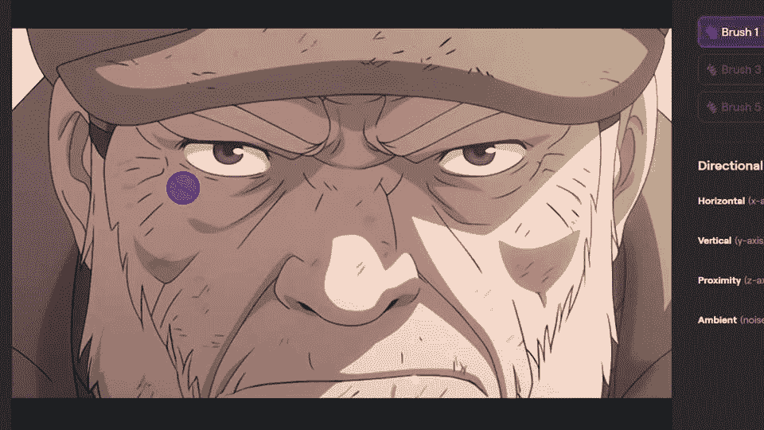
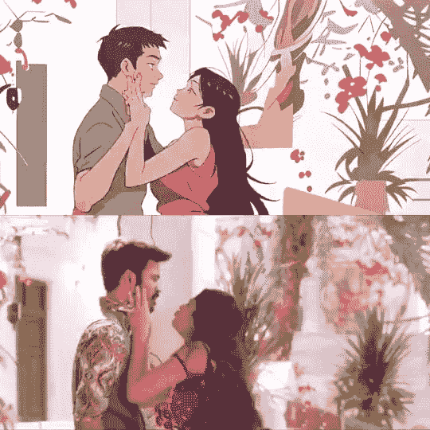
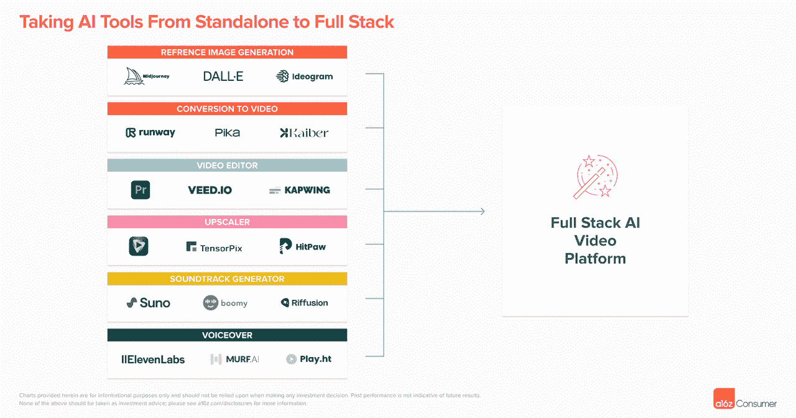

# 为什么说2023年是AI视频的突破年？以及2024年的展望

> 来源：[https://waytoagi.feishu.cn/docx/Zq7ddxaI2oiBmNxN3OSckdthnEf](https://waytoagi.feishu.cn/docx/Zq7ddxaI2oiBmNxN3OSckdthnEf)

> 原链接：https://a16z.com/why-2023-was-ai-videos-breakout-year-and-what-to-expect-in-2024/

> 翻译：歸藏

2023 年是人工智能视频领域的飞跃之年。年初，市场上还没有面向公众的文本生成视频的模型。但仅仅一年时间，我们就见证了数十种视频生成工具的问世，全球已有数百万用户通过文字或图像提示来制作短视频。

目前这些工具还有局限性 — 大部分只能生成 3 到 4 秒的视频，视频质量参差不齐，像保持角色风格一致这样的难题还未得到解决。要想仅凭一个文本提示（或者几个提示）就制作出类似皮克斯电影的短片，我们还有很长的路要走。

然而，过去一年在视频生成技术上取得的进展预示着我们正处于一场巨大变革的初期阶段，这种情况与图像生成技术的发展颇为相似。文本生成视频的模型正持续进步，并且像图像转视频、视频转视频这样的衍生技术也开始流行起来。

为了更好地理解这一创新浪潮，我们追踪了目前为止该领域的重大发展、值得关注的公司，以及尚待解决的关键问题。

## 如今在哪些地方可以尝试人工智能视频生成呢？

### **产品方面**

截至目前，我们今年已经发现了 21 个公开的人工智能视频生成工具。你或许听过 Runway、Pika、Genmo 和 Stable Video Diffusion 这几个名字，但实际上还有许多其他的工具值得探索。

大多数这类产品都是由初创公司推出的，它们往往起初以 Discord 机器人的形式存在，这有几个优点：

无需开发面向消费者的界面，可以全力提升模型的质量

借助 Discord 拥有的1.5亿月活跃用户群体进行推广 — 特别是当你的产品出现在平台的“发现”页面时

公开频道能让新用户通过观看他人的创作来轻松获取灵感，并为产品提供社交认证

但随着这些产品的成熟，我们发现越来越多的视频工具开始建立自己的网站甚至开发移动应用。虽然 Discord 是一个不错的起点，但它在添加工作流程和控制用户体验方面有限制。此外，还有一大部分人不怎么使用 Discord，可能会觉得它的界面使人困惑或不经常登录。

### **研究和大型科技公司**

谷歌、Meta 等似乎并未在公开产品名单中出现 — 尽管我们看到他们发布了一些关于如 Meta 的 Emu Video、谷歌的 VideoPoet 和 Lumiere、字节跳动的 MagicVideo 等模型的高调宣传。

到目前为止，除了阿里巴巴之外，这些大型科技公司选择不公开他们的视频生成产品。他们更倾向于发表各种视频生成形式的论文和发布演示视频，但尚未宣布这些模型是否会对公众开放。

[X2Twitter.com_1750140394443358208(720p) (1) (1).mp4](https://internal-api-drive-stream.feishu.cn/space/api/box/stream/download/all/LIxubHgKQo8751x57eecUs1Snuh)

这些公司拥有庞大的用户群和分发网络，用户数量达到数十亿。那么，为什么他们不推出自己的视频模型，尤其是在他们的演示看起来如此有力，并且在这个新兴市场中他们有机会占据重要市场份额的情况下呢？

需要明白的是，这些公司的决策和行动速度通常较慢。尽管 Instagram 在去年晚些时候为其故事功能推出了一个 AI 背景生成器，TikTok 也在悄悄推出 AI 滤镜，但大多数公司至今仍未推出文本到图像的产品。法律、安全和版权问题往往使得这些公司难以将研究成果转化为产品，并延迟产品推出，从而为新入市的公司提供了先发优势。

## 那么，人工智能视频的下一步是什么呢？

如果你曾使用过这些产品，就会知道在人工智能视频真正成熟并面向大众之前，还有很多方面需要改进。虽然有时候模型能够生成与你的提示匹配的精美剪辑，但这种“神奇时刻”相对罕见。更常见的情况是，你需要多次重新生成，并对输出内容进行裁剪或编辑，才能得到专业级别的视频。

目前，该领域的许多公司都在致力于解决一些核心问题，这些问题至今还未得到解决：

+   控制 — 你能否控制场景中的事件（比如，如果提示是“男人向前走”，他的动作是否如你所描述的那样？）以及“摄像机”的运动？对于后者，一些产品增加了可以让你进行缩放或平移摄像机，甚至添加特效的功能。 至于前者 — 即动作是否如所描述的那样 — 这个问题更加棘手。这是一个关于基础模型质量的问题（模型是否能理解并执行你的提示），尽管有些公司正试图在生成前给用户提供更多控制权。Runway 的运动笔刷就是一个例子，它允许你标记图片的特定区域，并指定这些区域如何移动。

[X2Twitter.com_1748437191284723712(720p).mp4](https://internal-api-drive-stream.feishu.cn/space/api/box/stream/download/all/QZq2bzM0Mok6JxxisWIcsNBbnef)

+   时间连贯性 — 如何确保在视频的不同帧之间，角色、物体和背景的一致性，防止它们在画面中突变或扭曲？这是目前所有公开的模型普遍面临的问题。如果你看到了一段时间连贯且超过几秒钟的视频，那很可能是通过视频到视频的技术制作的，比如采用了像 AnimateDiff 那样的提示来改变视频的风格。

[X2Twitter.com_1742626608278798336(720p).mp4](https://internal-api-drive-stream.feishu.cn/space/api/box/stream/download/all/NmgibktxToWEjjxErm2coHOQnBh)

[X2Twitter.com_1730684932823945216(1214p).mp4](https://internal-api-drive-stream.feishu.cn/space/api/box/stream/download/all/RVzFbqrfHox0XwxalZgcxCRfnZb)

+   视频长度 — 如何制作时长超过几秒的视频片段？这个问题与时间连贯性密切相关。因为保持视频在几秒钟后仍具有一致性存在难度，许多公司限制了用户能生成的视频长度。如果你观看到一段较长的人工智能视频（如下所示），你会发现它实际上是由许多短片段拼接而成，制作过程中需要用到几十甚至上百个不同的提示！

## **未解决的问题**

目前来看，人工智能视频技术仿佛还处在 GPT-2 的阶段。尽管在过去一年取得了巨大进步，但要让日常消费者每天使用这些产品，仍有一段路要走。那么，视频领域的“ChatGPT时刻”何时会到来呢？在这个领域的研究人员和创始人之间还没有形成广泛的共识，以下几个问题仍待解答：

+   当前的扩散架构是否适合视频制作？目前的视频模型是基于扩散技术的：它们主要通过生成连续的帧并尝试创建时间上连贯的动画（采用多种策略实现）。这些模型没有对三维空间及物体间互动的内在理解，这就是扭曲或变形的原因。例如，视频中的人物可能在前半段沿街行走，然后在第二部分融入地面 — 因为模型不理解“坚硬”表面的概念。由于缺乏对场景的三维理解，从不同角度生成同一剪辑也极具挑战性。

+   有些人认为，视频模型不必根本上理解三维空间。如果接受了足够多高质量数据的训练，它们应能学会物体间的关系，并从不同角度呈现场景。然而，其他人则认为这些模型需要一个三维引擎来生成时间上连贯的内容，尤其是在制作超过几秒的内容时。

+   高质量的训练数据将从何而来？训练视频模型比训练其他内容模态更加困难，主要原因是缺乏足够的高质量、有标签的训练数据。语言模型通常在像 Common Crawl 这样的公共数据集上训练，而图像模型则在像 LAION 和 ImageNet 这样的有标签数据集（文本-图像对）上进行训练。 视频数据相对难以获取。尽管 YouTube 和 TikTok 等平台上有大量公开的视频，但这些视频通常没有标签，且可能在内容上缺乏多样性（例如，猫咪视频和网红道歉视频可能在数据集中占比过高）。视频数据的“理想来源”可能是电影制作公司或制片厂，它们拥有从多个角度拍摄、配有剧本和指导的长篇视频。但目前还不确定这些公司是否愿意授权这些数据用于训练。

+   这些用例将如何在不同平台或模型间区分开来？我们在几乎所有内容模态中观察到的现象是，没有一个模型能在所有用例中独占鳌头。例如，Midjourney、Ideogram 和 DALL-E 都有自己的独特风格，并在生成不同类型的图像方面各有所长。

+   我们预计视频领域将展现出类似的发展趋势。如果你现在测试文本到视频和图像到视频的模型，你会发现它们各自擅长不同的风格、运动类型和场景布局（下面我们会展示两个例子）。这些模型所衍生的产品很可能在工作流程和服务的终端市场上产生进一步的差异化。此外，还有一些相关产品，并非专注于纯文本到视频的转换，而是致力于解决诸如动画化人物头像（例如 HeyGen）、视觉特效（例如 Wonder Dynamics）和视频到视频的转换（例如 DomoAI）等问题。

+   谁将主导视频制作的工作流程？在目前的情况下，除了视频本身的生成，制作一段优质的视频或电影通常还需要进行编辑。许多创作者目前是先在其他平台（例如 Midjourney）创作图片，然后在 Runway 或 Pika 上将其制作成动画，再在 Topaz 中进行优化放大。随后，创作者可能会将这段视频导入 Capcut 或 Kapwing 这样的编辑平台，添加音轨和旁白（通常在 Suno 和 ElevenLabs 等其他平台生成）。

+   频繁在这么多不同的产品之间切换显然是不方便的。因此，我们预计视频生成平台将开始引入这些附加功能。例如，Pika 现在允许用户在其网站上对视频进行放大处理。同时，我们也看好那些面向 AI 的本地编辑平台，它们能够让用户在同一平台上跨不同模型和模态轻松生成内容，并将这些内容整合起来

