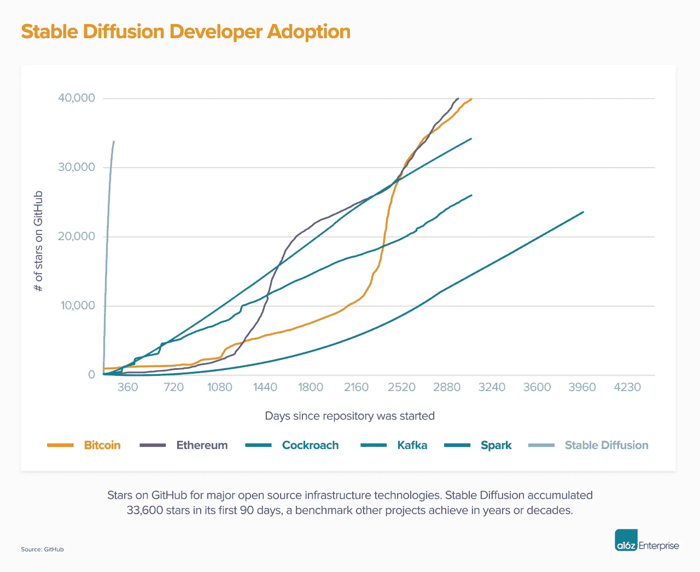
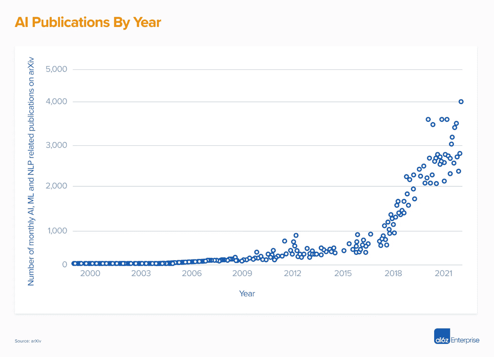
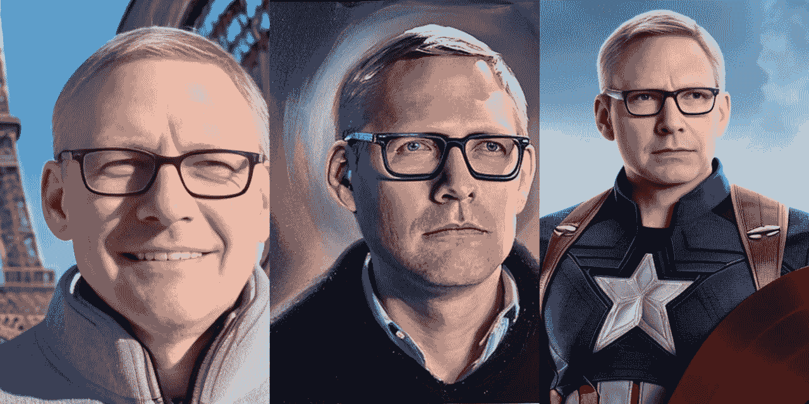
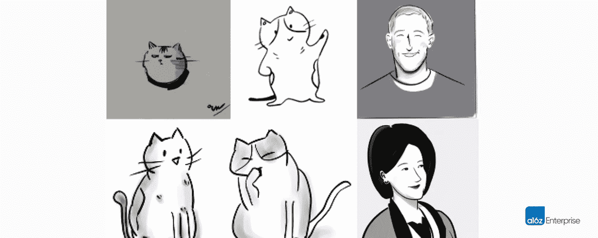

# 艺术并未消亡，它只是由机器生成

> 来源：[https://waytoagi.feishu.cn/docx/U9WudevS2oHZRBxiAMgctG7mndf](https://waytoagi.feishu.cn/docx/U9WudevS2oHZRBxiAMgctG7mndf)

> 原文地址：https://a16z.com/2022/11/16/creativity-as-an-app/

> 作者：Guido Appenzeller， Matt Bornstein， Martin Casado， Yoko Li

> 发表时间：2022 年 11 月 16 日

> 翻译：通往 AGI 之路，若有瑕疵之处，请在段落评论中斧正，谨此致谢

也许我们从生成式人工智能（generative AI）中看到的最令人费解的启示是，与“创造力将是人类智慧的最后堡垒”的普遍观点相反，实际上将困难的创造性任务自动化似乎比将简单的编程任务自动化要容易得多。为了理解这一点，我们比较了生成性 AI 的两个较为流行的用例：代码生成和图像生成。但我们相信，即使生成模型扩展到更复杂的应用，这一观点也能更普遍地站得住脚。

简而言之，这个观点（我们在下文中将更详细地探讨）是：虽然像 GitHub Copilot 这样的产品，在其当前形式下，可以使编码更高效，但它并不能消除对具有编程知识的有能力的软件开发人员的需求。一个重要原因是，当涉及到构建一个程序时，正确性确实很重要。如果 AI 生成了一个程序，它仍然需要一个人来验证它是否正确——这几乎与首次创建它所需的努力程度相同。

另一方面，任何会打字的人都可以使用像 Stable Diffusion 这样的模型，在几分钟内以数量级更低的成本产生高质量、独一无二的图像。创意工作产品通常没有严格的正确性约束，而模型的输出完整得令人惊叹。在依赖创意视觉效果的行业中看到一个完全的阶段转变是很难的，因为对于很多用途来说，AI 现在能够产生的视觉效果已经足够了，而我们现在还处在这项技术的非常早期阶段。

我们完全承认，鉴于这个领域的发展速度，要对任何预测都充满信心是很难的。然而，目前看来，我们更有可能看到由程序员严格创建的充满创意图像的应用，而不是由创作者严格构建的具有人类设计艺术的应用。

## **为什么如此热门，为什么是现在？**

在我们深入探讨代码生成与图像生成的具体内容之前，了解当前 AI（尤其是生成性 AI）的流行程度是很有用的。

生成性 AI 正在经历我们所见过的开发者接纳速度最快的情况。在我们撰写此文时，Stable Diffusion 轻松地以很大的优势位居 GitHub 的趋势榜首位。它的增长远远超过了任何近期的基础设施或加密技术（见上图）。几乎每天都有初创公司使用这项技术的发布和融资公告，而在线社交网络则充斥着由生成模型创建的内容。

过去十年对人工智能的总体投资水平也不容小觑。自 2010 年代中期以来，我们已经看到了出版物数量的指数级增长（见下图）。如今，arXiv 上发布的所有文章中约有 20%是关于 AI、ML 和 NLP 的。重要的是，理论结果已经越过了一个关键的门槛，它们已经变得容易消化，并触发了新技术、软件和初创公司的寒武纪大爆炸。

最近在上图中的激增主要是由于生成性 AI。在短短的十年里，我们从仅限专家使用的 AI 模型（可以对图像进行分类和创建词嵌入）发展到可以供公众使用的模型，这些模型可以编写有效的代码，并使用自然语言提示创建极为准确的图像。创新的步伐不断加快并不令人惊讶，当生成模型开始进入人类曾经主导的其他领域时，这也不应令人惊讶。

## **生成 AI 和编程**

生成性 AI 作为程序员的助手是最早的应用之一。它的工作方式是：一个模型在大量的代码库（例如，GitHub 上的所有公共仓库）上进行训练，然后在程序员编码时给出建议。这些结果是非常出色的。实际上，可以合理地预期这种方法将成为未来编程的代名词。

[image12.webp](https://internal-api-drive-stream.feishu.cn/space/api/box/stream/download/all/QR6Db78ocoy3tsxq60dc77uFnCe)

生成的代码：对不使用分号的攻击具有安全防护

然而[，相对于我们下面将](https://arxiv.org/abs/2108.09293v2)介绍的图像生成，生[产力的提升相对较小。其中一](https://cwe.mitre.org/about/faq.html)部分原因，如上所述，是在编程中（实际上，在更广泛的工程问题中也是如此，但在这篇文章中我们关注编程）正确性至关重要。例如，最近的一项研究发现，对于匹配高风险 CWEs （常见弱点枚举）的场景，40%的 AI 生成的代码包含漏洞。

因此，用户[必须](https://github.blog/2022-09-07-research-quantifying-github-copilots-impact-on-developer-productivity-and-happiness/)在生成[足够](https://arxiv.org/abs/2205.06537)多的代码以提供有意义的生产力提升，同时还要限制它，使得可以检查其正确性之间找到平衡。因此，Copilot 已经帮助 提高了开发人员的生产力——最近的研究（这里 和 这里）估计增长在 2 倍或更少的范围内——但这一水平与我们在开发者语言和工具的先前进步中看到的水平相当。例如，从汇编跳到 C 语言，根据一些估计，生产力提高了 2 到 5 倍。

对于更有经验的程序员来说，他们的关注点可能不仅限[于代码的正确性](https://fast.ai/)[，还包括](https://future.com/the-rise-of-domain-experts-in-deep-learning/)整体代码质量。如 fast.ai 的 Jeremy Howard 所解释的，关于 OpenAI Codex 模型的最新版本，“[它]编写冗长的代码，因为它生成的是平均水平的代码。对我来说，将平均水平的代码转化为我喜欢且知道是正确的代码，比从头开始编写它（至少在我熟悉的语言中）要慢得多。”

因此，虽然显然生成性编程是开发人员生产力的一个重要步骤，但目前还不清楚这种改进是否显著地不同于我们以前所看到的。生成式 AI 使程序员更优秀，但他们仍然必须编程。

## **生成式 AI 和视觉效果**

另一方面，生成模型对创意工作产出（例如图像生成）的影响是极端的。它在效率和成本方面带来了数量级的改进，很难不看到它正在引领一个行业范围的阶段性转变。

生成式 AI 在这个领域的工作方式是接收用户的简单文本输入，称为提示（prompts），然后模型生成视觉输出。目前有能够创建多种输出格式的模型，包括图像、视频、3D 模型和纹理。

特别有趣的是，这些模型如何可以被扩展以几乎不需要创意干预地生成新的或特定领域的图像。例如，Guido（作者之一）拿了一个预训练的图像模型，并在几十张自己的照片上重新训练了它。从那时起，他可以使用提示中的 <guido> 来生成图片。以下是从以下提示生成的照片：“<guido> 作为美国队长”，“<guido> 在巴黎”，“<guido> 在一幅画中”。

生成图[像与在商业环境中生成代码](https://huggingface.co/docs/diffusers/optimization/mps)的巨大差异在于生成式 AI 改变了经济计算的程度。为了创建上面的图片，Guido 在少量照片上训练了模型，基础设施资源的成本约为 0.50 美元。一旦训练完成，生成图像的计算资源成本约为 0.001 美元，并且可以在云端或在最新一代的笔记本电脑上完成。此外，生成图像只需几秒钟的时间。

没有生成性 AI，获取定制图像的唯一方式是雇佣一位艺术家或自己动手做。即使我们从一个假设开始，即一个人可以在一小时内以 10 美元的价格创建一个完全定制的、逼真的图像，生成性 AI 的方法便宜得多，速度也快一个数量级。更现实地说，任何定制艺术作品或图形设计项目可能需要几天或几周的时间，成本可能是数百美元，甚至更多。

与上文中提到的编程辅助工具相似，生成式 AI 将会被艺术家们采用作为工具，而且都需要一定程度的用户监督。但是，很难夸大图像模型模拟完整艺术作品输出所产生的经济差异。使用代码生成模型，编写一个执行标准计算任务的基本功能程序需要审查、编辑和添加许多代码片段的测试。但对于一个基本的图像，输入一个提示并从十几个建议中选择一个图像可以在不到一分钟的时间内完成。

[以我们自己的漫画家（和投资合作](https://twitter.com/stuffyokodraws)伙伴）Yoko Li（@stuffyokodraws）为例。我们使用她以前的 70 张图片训练了一个模型，这个模型能够以一种令人不安的方式模仿生成图像。每个艺术家都必须弄清楚接下来要创作什么，她甚至发现训练过的模型可以呈现出比她脑海中想到的更多的选项——至少在给定时间内迅速产生某物时是这样。画同一个物体有数百种方法，但生成模型立刻就明确了哪些路径值得探索。

因此，在这样的任务中，我们并不是在争论计算机在 1:1 的基础上是否一定比人类更优秀。但是，就像许多其他任务一样，当计算机能够产生完整的工作成果时，它们在规模上完全压倒我们。

请尝试猜测以下哪些图画是由 Yoko 直接画的，哪些是生成的。

答：AI 模型生成的图像拥有一个非白色背景。

经济效益的巨大提升，能够创造新风格和概念的灵活性，以及生成完整或几乎完整的工作成果的能力，这些因素使我们预见，在所有创意资产是业务重要组成部分的行业中，我们将看到明显的变化。而且，这并不仅限于图像，而是适用于整个设计领域。例如：

+   生成性 AI 可以为[游戏](https://a16z.com/2022/11/17/the-generative-ai-revolution-in-games/)创建 2D 艺术、纹理、3D 模型，并协助关卡设计。

+   在营销中，它看似有望取代库存艺术、产品摄影和插图。

+   我们已经看到它在网页设计、室内设计和景观设计中的应用。

我们实际上才刚刚开始。如果一个用例需要创造性地生成内容，那么很难理解为什么生成 AI 不会颠覆它或至少成为这个流程的一部分。

---

那么，这篇文章的要点是什么呢？ 尽管它在某种程度上集中于代码生成和图像生成，但我们怀疑这些结果更具普遍性。特别是，全面的创意努力——无论是视觉的、文字的还是音乐的——都可能在系统构建之前就被 AI 打破。

除了我们以上使用的正确性论点外，将所有先前的艺术品组合和重新组合可能足以满足创意输出的实际范围。例如，音乐和电影行业历史上生产了无数流行专辑和电影的仿制品。完全可以想象，生成模型随着时间的推移可能有助于自动化这些功能。然而，Stable Diffusion 和 DALL-E 2 产生的众多图像中引人注目的一点是，它们真的很好，并且真正有趣。可以轻松地设想一个 AI 模型产生具有吸引力和真实感的电影海报、广告和插图。

