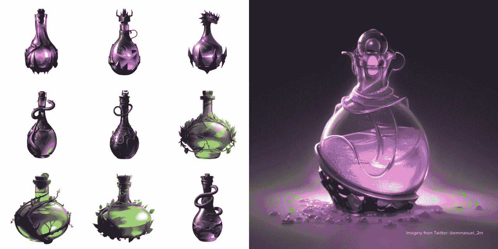
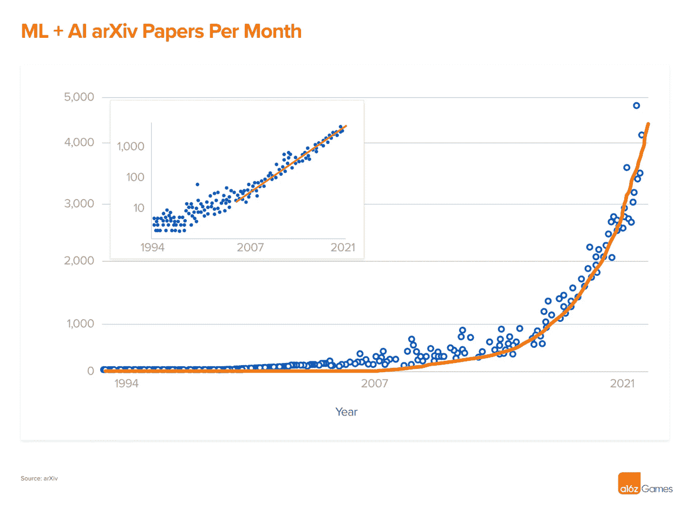
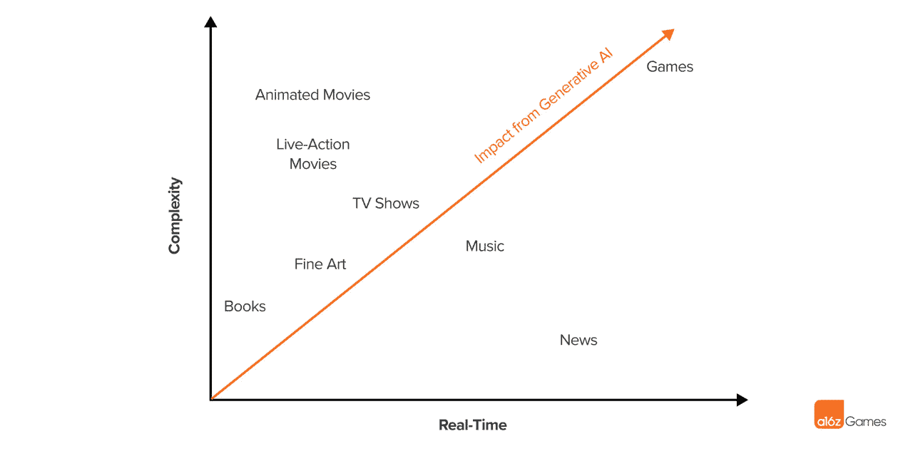
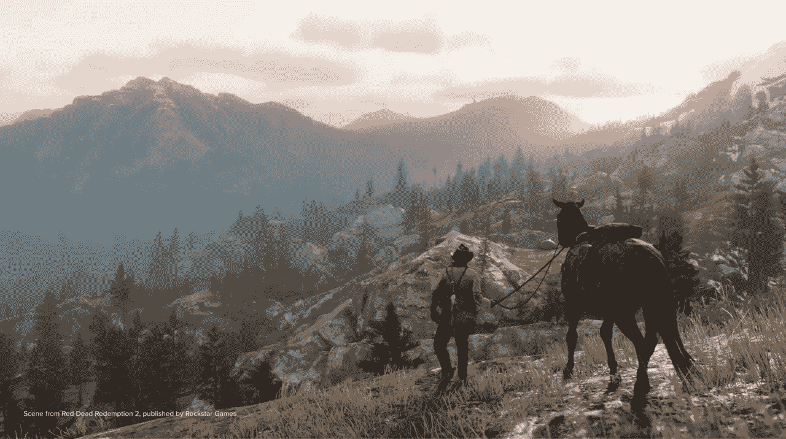
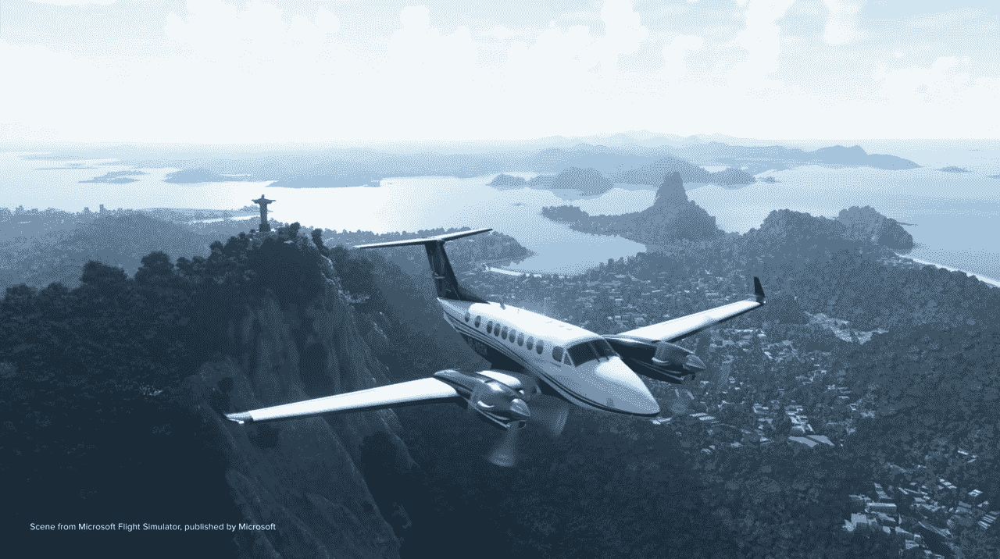
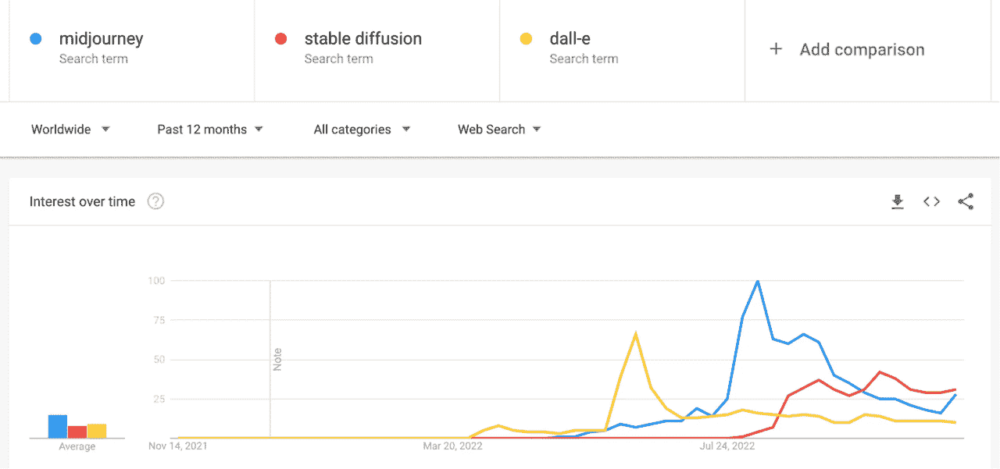
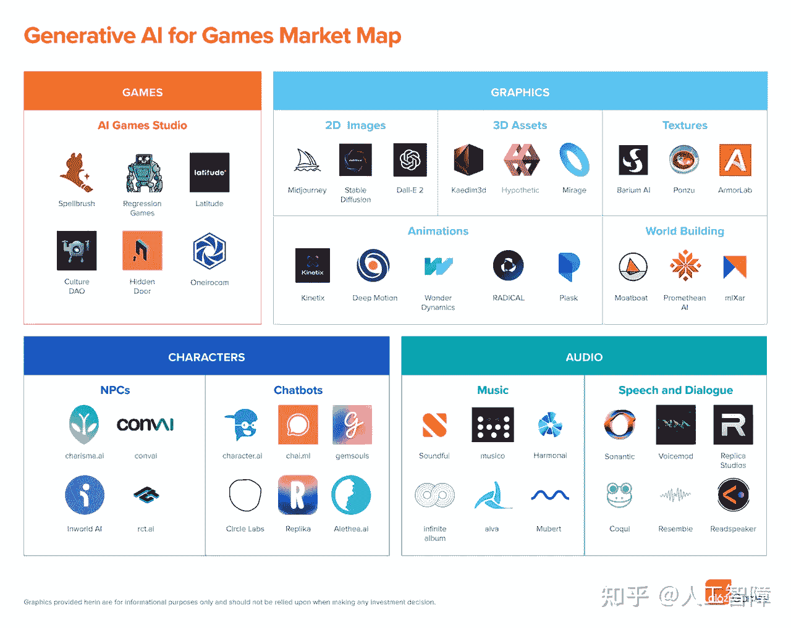
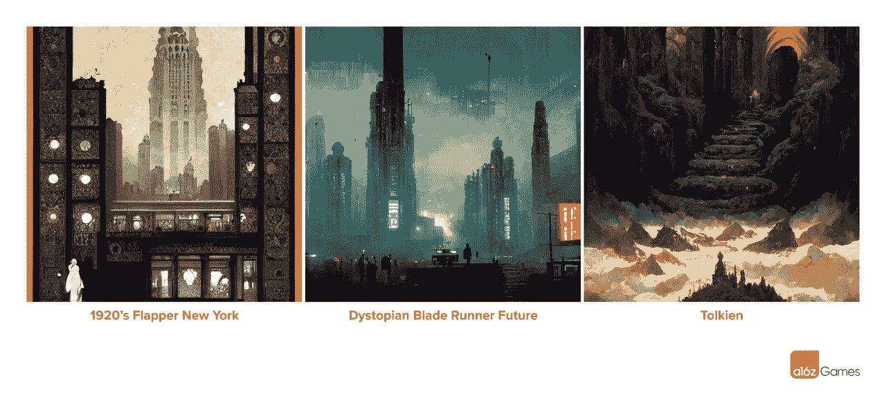

# 游戏中的生成式 AI 革命

> 来源：[https://waytoagi.feishu.cn/docx/FVRhdmcQHokdvOx8SclcRmDtnmf](https://waytoagi.feishu.cn/docx/FVRhdmcQHokdvOx8SclcRmDtnmf)

> https://a16z.com/2022/11/17/the-generative-ai-revolution-in-games/

> 原文标题：The Generative AI Revolution in Games

> 发表时间：2022 年 11 月 17 日

> 作者：James Gwertzman 和 Jack Soslow

> 译者：通往AGI之路，若有瑕疵之处，请在段落评论中斧正，谨此致谢

[为了理解游戏即将如何被生成](https://twitter.com/emmanuel_2m)性 AI [彻底转型，不妨看看这篇](https://twitter.com/emmanuel_2m/status/1589995198289182720)[由@emmanuel_](https://dreambooth.github.io/)2m 最近发布的 Twitter 帖子。在这篇帖子中，他探讨了使用 Stable Diffusion + Dreambooth 这两种流行的 2D 生成性 AI 模型来为一个假设的游戏生成药水图像。

这项工作的变革性不仅在于它节省了时间和金钱，同时还提供了质量——从而打破了经典的“你只能在成本、质量或速度中选择两者”的三角形。艺术家们现在可以在几个小时内创作出高质量的图像，而这些图像如果手工生成则需要几周的时间。真正的变革在于：

+   现在任何能学习几个简单工具的人都可以使用这种创造力

+   这些工具可以高度迭代地创建无尽的变化

+   一旦训练好，这个过程是实时的——结果几乎是立即可用的

自从实时 3D 以来，游戏领域还没有这样的革命性技术。与游戏创作者交谈任何时间，都能感受到他们的兴奋和惊奇。那么，这项技术的发展趋势是什么？它将如何改变游戏？首先，让我们回顾一下什么是生成性 AI？

## 什么是生成式 AI

生成性 AI 是一种机器学习类别，计算机可以根据用户的提示生成原始的新内容。目前，文本和图像是这项技术的最成熟应用，但几乎在每一个创意领域都有工作在进行，从动画、音效、音乐，甚至到创造具有完整性格的虚拟角色。

当然，AI 在游戏中并不是什么新鲜事。即使是早期的游戏，如雅达利的 Pong，也有计算机控制的对手来挑战玩家。然而，这些虚拟的敌人并不是我们今天所知道的 AI。它们只是由游戏设计师制定的简单脚本程序。它们模拟了一个人工智能对手，但它们不能学习，它们的能力只取决于创建它们的程序员。

现在与以前的不同之处在于，由于更快的微处理器和云技术，我们有了更多的计算能力。有了这种能力，我们可以构建大型的神经网络，这些网络可以在高度复杂的领域中识别模式和表示。

这篇博文分为两部分：

+   第一部分包括我们对游戏领域的生成性 AI 的观察和预测。

+   第二部分是我们对该领域的市场地图，概述了各个细分市场并确定了每个市场的关键公司。

## 第一部分 – 观察和预测

### 假设

首先，让我们探索这篇博客文章余下部分的一些基本假设：

1.  一般而言，人工智能的研究数量将继续增长，创造出更有效的技术

考虑一下这张图，它显示了每月在[ arXiv 存档](https://arxiv.org/)上发表的关于机器学习或人工智能的学术论文的数量：

如您所见，论文的数量正在呈指数增长，且没有放缓的迹象。这仅包括已发布的论文 - 大量的研究甚至从未发布，直接转为开源模型或产品研发。结果是对兴趣和创新的爆炸性增长。

1.  在所有娱乐中，游戏将受到生成性 AI 的最大影响

游戏是最复杂的娱乐形式，就涉及的资产类型数量而言（2D 艺术、3D 艺术、音效、音乐、对话等）。游戏也是最具交互性的，强调实时体验。这为新游戏开发者创造了一个陡峭的进入障碍，以及制作现代、登顶榜单的游戏的陡峭成本。它还为生成性 AI 创新创造了巨大的机会。

考虑一款像 Red Dead Redemption 2 这样的游戏，这是有史以来制作成本最高的游戏之一，制作成本近 5 亿美元。很容易理解为什么 - 它拥有市场上任何游戏中最美丽、最完整的虚拟世界。它也花了将近 8 年的时间来建造，拥有超过 1000 个非玩家角色（每个都有自己的性格、艺术作品和配音演员），一个近 30 平方英里的世界，超过 100 个分为 6 章的任务，以及由超过 100 名音乐家创作的近 60 小时的音乐。这款游戏的一切都很宏大。

现在[，将《Red Dead Red](https://blackshark.ai/)[emption 2》与](https://blackshark.ai/solutions/) Microsoft Flight Simulator 进行比较，后者不仅仅是大，它是巨大的。Microsoft Flight Simulator 允许玩家飞越整个地球，所有的 1.97 亿平方英里。微软是如何构建这样一个巨大的游戏的呢？通过让 AI 来做。微软与 blackshark.ai 合作，并训练了一个 AI 从 2D 卫星图像生成逼真的 3D 世界。

这是一个不使用 AI 就不可能构建的游戏示例，此外，这些模型可以随着时间的推移不断改进这一事实中受益。例如，他们可以增强“高速公路三叶草立交桥”模型，重新运行整个建造过程，突然整个星球上的所有高速公路立交桥都得到了改善。

1.  游戏制作中涉及的每个资产都将有一个生成性 AI 模型

到目前为止，像 Stable Diffusion 或 MidJourney 这样的 2D 图像生成器由于它们可以生成的图像的吸引力而获得了大量的受欢迎度。但已经有了生成性 AI 模型，几乎涉及到游戏中的所有资产，从 3D 模型、角色动画到对话和音乐。这篇博客文章的第二部分包括了一个市场地图，突出显示了一些专注于每种类型内容的公司。

1.  内容的价格将大幅下降，某些情况下将接近于零。

与正在尝试将生成性 AI 集成到其生产流程中的游戏开发者交谈时，他们最兴奋的是生产时间和成本的大幅降低。有一位开发者告诉我们，他们生成单张概念艺术图像的时间，从开始到完成，从 3 周减少到了一个小时：减少了 120 倍。我们相信在整个生产流程中都有可能实现类似的节省。

需要明确的是，艺术家并不处于被取代的危险之中。这确实意味着艺术家不再需要自己做所有的工作：他们现在可以设置初始的创意方向，然后将大部分耗时和技术执行交给 AI。在这方面，他们就像早期手绘动画的细胞画家，其中高技能的“描线者”画出动画的轮廓，然后大批低成本的“画家”进行耗时的动画细胞的绘制工作，填充线条。这是游戏创建的“自动完成”。

1.  我们仍处于这场革命的初期，许多实践仍需要完善

尽管最近有很多兴奋，但我们仍然只是处于起点。我们还有大量的工作要做，因为我们正在弄清楚如何为游戏利用这种新技术，并且会为迅速进入这个新领域的公司创造巨大的机会。

### 预测

根据这些假设，以下是一些关于游戏行业可能如何被转型的预测：

1.  学会有效使用生成性 AI 将成为一项有市场价值的技能

我们已经看到一些实验者比其他人更有效地使用生成性 AI。要充分利用这种新技术，需要使用各种工具和技术，并知道如何在它们之间切换。我们预测这将成为一项有市场价值的技能，结合了艺术家的创意视野和程序员的技术技能。

Chris Anderson 以“每一种丰富都会创造新的稀缺”而著名。随着内容变得丰富，我们相信，懂得如何与 AI 工具最有效、最协同地合作的艺术家将会变得最为稀缺。

例如，使用生成性 AI 进行生产艺术作品带来特殊的挑战，包括：

+   **连贯性**。 对于任何生产资产，你需要能够在后续对资产进行更改或编辑。使用 AI 工具，这意味着需要能够使用相同的提示再次生成该资产，以便你可以进行更改。这可能很棘手，因为相同的提示可能会生成截然不同的结果。

+   **风格。**对于一个给定的游戏中的所有艺术品保持一致的风格是非常重要的——这意味着你的工具需要接受特定风格的训练，或以其他方式与你的特定风格相联系。

1.  降低门槛将导致更大的冒险和创造性的探索

我们可能很快就会进入游戏开发的新“黄金时代”，在这个时代，更低的准入门槛将导致更具创新性和创造性的游戏大量涌现。这不仅是因为较低的生产成本导致风险减小，而且是因为这些工具解锁了为更广泛的受众创造高质量内容的能力。这引出了下一个预测……

1.  AI 辅助“微型游戏工作室”的崛起

配备了生成性 AI 工具和服务，我们将开始看到由仅有 1 或 2 名员工组成的“微型工作室”生产更多具有商业可行性的游戏。小型独立游戏工作室的概念并不新鲜——热门游戏《Among Us》就是由仅有 5 名员工的 Innersloth 工作室创作的——但这些小型工作室能够创建的游戏的规模和大小将会增长。这将导致……

1.  **每年发布的游戏数量增加**

Unity 和 Roblox 的成功表明，提供强大的创意工具会导致更多的游戏被开发。生成性 AI 将进一步降低门槛，从而创造出更多的游戏。该行业已经面临发现新游戏的挑战——仅去年一年，就有超过 10,000 款游戏被添加到 Steam 平台——这将对游戏发现带来更大的压力。然而，我们也将看到......

1.  生成性 AI 使得以前不可能存在的新游戏类型成为可能

我们将看到一些完全依赖于生成性 AI 而创造出来的全新游戏类型，这些类型在没有生成性 AI 的情况下是完全不可能存在的。我们已经谈到了微软的飞行模拟器，但将会有完全新的、依赖于实时生成新内容的类型被创造出来。

以 [Arrowmancer](https://www.arrowmancer.com/) 为例，它是由 [Spellbrush](http://spellbrush.com/) 开发的一款 RPG 游戏，具有 AI 创造的角色，以实现几乎无限的新游戏玩法。

我们还知道另一家游戏开发公司正在使用 AI 让玩家创建自己的游戏内角色形象。以前，他们有一系列手绘的角色形象图片，玩家可以自由组合以创建自己的角色形象——现在，他们完全放弃了这种方式，而是直接根据玩家的描述生成角色形象。通过 AI 让玩家生成内容比让玩家从零开始上传自己的内容更安全，因为 AI 可以被训练得避免创造冒犯性内容，同时仍然让玩家有更强烈的归属感。

1.  价值将积累到行业特定的 AI 工具上，而不仅仅是基础模型

围绕 Stable Diffusion 和 Midjourney 等基础模型的兴奋和关注正在产生惊人的估值，但新研究的不断涌现确保新模型将随着新技术的完善而更替。考虑到三个流行的生成性 AI 模型：Dall-E、Midjourney 和 Stable Diffusion 的网站搜索流量。每个新模型都会有它在聚光灯下的时刻。

一种替代的方法可能是构建与特定行业相符的工具套件，这些工具专注于满足给定行业的生成性AI需求，对特定受众有深入的理解，并能丰富地集成到现有的生产流程中（例如游戏的Unity或Unreal）。

一个很好的例子是 [Runway](https://runwayml.com/)，它针对视频创作者的需求，提供AI辅助工具，如视频编辑、绿幕移除、图像修复和运动跟踪。这样的工具可以构建并变现特定的受众，并随着时间的推移添加新的模型。我们尚未看到针对游戏领域的类似Runway的套件出现，但我们知道这是一个正在积极开发的领域。

1.  **法律挑战即将来临**

所有这些生成性AI模型的共同点是，它们都是使用大量的内容数据集进行训练的，这些数据集通常是通过爬取互联网本身获得的。例如，Stable Diffusion是在从网络上抓取的超过50亿的图像/标题对上进行训练的。

目[前，这些模型声称](https://venturebeat.com/ai/why-generative-ai-legal-battles-are-brewing-the-ai-beat/)它们是根据“合理使用”版权原则运作的，但这一论点尚未在法庭上得到明确的检验。似乎很明显，法律挑战即将到来，这可能会改变生成性AI的格局。

有[可能大型工作室会](https://en.wikipedia.org/wiki/Xbox_Game_Studios)寻求通[过构建基于他们拥有明确权利和所](https://en.wikipedia.org/wiki/Activision_Blizzard)有权的内部内容的专有模型来获得竞争优势。例如，微软在这方面的位置尤为优越，目前拥有23个一方工作室，并在收购Activision完成后将再增加7个。

1.  编程不会像艺术内容那样受到深远的影响——至少目前还不会

软件工程是游戏开发的另一项主要成本，但正如我们在a16z企业团队最近的博客文章“艺术并未消亡，它只是由机器生成”中分享的，使用AI模型生成代码需要更多的测试和验证，因此相较于生成创意资产，其生产力提升较小。像Copilot这样的编码工具可能为工程师提供适度的性能改进，但在短期内不会产生相同的影响……

### 推荐

基于这些预测，我们提出以下建议：

1.  **现在就开始探索生成性AI**

完全利用即将到来的生成性AI革命的力量需要一段时间。现在就开始的公司将来会具有优势。我们知道有几家工作室已经启动了内部实验项目，以探索这些技术如何影响生产。

1.  寻找市场地图（Market Map）的机会

我们的市场地图的某些部分已经非常拥挤，比如动画或语音与对话，但其他区域仍然空旷。我们鼓励对这个领域感兴趣的创业者将他们的努力集中在尚未探索的区域，比如“游戏的Runway”。

## 第二部分 – 市场地图

### 市场现状

我们创建了一个市场地图，以捕捉我们在每个类别中识别到的公司列表，我们认为生成性AI将在这些类别中对游戏产生影响。这篇博客文章详细地逐一讲解了这些类别，并突出了每个类别中最令人兴奋的公司。

### 2D 图像

[从文本提示生成2D图](https://www.midjourney.com/home/)像已经是[生成性AI最广泛](https://openai.com/dall-e-2/)应用的领域之一。像 Midjourney、Stable Diffusion 和 Dall-E 2 这样的工具可以从文本生成高质量的2D图像，并已经在游戏生命周期的多个阶段找到了应用。

**概念艺术**

生成性AI工具非常擅长“构思”，或者帮助非艺术家（如游戏设计师）非常快速地探索概念和想法，以生成概念艺术作品，这是生产过程的关键部分。例如，有一家（保持匿名的）工作室正在使用几个这样的工具一起，从根本上加速他们的概念艺术流程，将创建一幅图像所需的时间从原先的长达3周缩短到仅一天。

+   首先，他们的游戏设计师使用Midjourney来探索不同的想法，并生成他们觉得鼓舞人心的图像。

+   然后，这些图像被交给一位专业的概念艺术家，他们将这些图像组合在一起，并在结果上进行绘画，以创建一个单一连贯的图像——然后这个图像被输入到Stable Diffusion中，以生成一系列的变体。

+   他们讨论这些变体，选择其中一个，手动绘制一些编辑——然后重复这个过程，直到他们对结果满意。

+   在那个阶段，他们再次将这个图像传回到Stable Diffusion中，以最后一次“升级”它，从而创作出最终的艺术作品。

**2D 制作艺术**

一[些工](https://www.youtube.com/watch?v=blXnuyVgA_Y)作室已经开始尝试使用相同的工具来制作游戏内的生产艺术品。例如，这里有一个由Albert Bozesan提供的很好的教程，它介绍了如何使用Stable Diffusion来创建游戏内的2D资源。

**

3D 艺术**品

3D资源是所有现代游戏以及即将到来的元宇宙的基础构件。虚拟世界或游戏关卡本质上只是一组3D资源的集合，这些资源被放置和修改以填充环境。然而，创建一个3D资源比创建一个2D图像更复杂，涉及多个步骤，包括创建一个3D模型并添加纹理和效果。对于动画角色，它还涉及创建一个内部的“骨架”，然后在这个骨架之上创建动画。

我们看到有几个不同的初创公司正在针对3D资源创建过程的每个阶段进行尝试，包括模型创建、角色动画和关卡构建。然而，这还不是一个已经解决的问题——目前没有任何解决方案准备好完全集成到生产中。

**3D 资源**

[试图解决3D](https://www.kaedim3d.com/)模[型创建问题的](https://www.mirageml.com/)初创公[司包括 Kaedim](https://www.hypothetic.art/)[、Mira](https://nv-tlabs.github.io/GET3D/)ge 和 Hypothe[tic。大公司也在](https://github.com/AutodeskAILab/Clip-Forge)关注这个问题，包括Nvidia的 Get3D 和Autodesk的 ClipForge。Kaedim和Get3D专注于从图像到3D的转换；ClipForge和Mirage专注于从文本到3D的转换，而Hypothetic对从文本到3D的搜索以及从图像到3D的转换都感兴趣。

**3D 纹理**

一个3D模型看起来的真实程度取决于应用于网格的纹理或材质。决定将哪种苔藓、风化的石头纹理应用到中世纪城堡模型上，完全可以改变场景的外观和感觉。纹理包含了光线[如何与材料反应的](https://barium.ai/)元[数据（例如](https://www.ponzu.gg/)，粗糙[度、光泽度等）。](https://armorlab.org/)允许艺术家根据文本或图像提示轻松生成纹理，将极大地提高创意过程中的迭代速度。有几个团队正在追求这一机会，包括 BariumAI、Ponzu 和 ArmorLab。

**动画**

创建出色的动画是游戏创作过程中最耗时、最昂贵、且最需要技巧的部分之一。减少成本并创建更真实的动画的一种方式是使用运动捕捉技术，即让演员或舞者穿上运动捕捉服，在特殊设置的运动捕捉舞台上记录他们的动作。

我们现在看到生成性AI模型可以直接从视频中捕捉动画。这样做效率更高，原因有两个：一是它消除了需要昂贵的运动捕捉设备的需求，二是它意味着你可以[从现有视频中捕](https://www.kinetix.tech/)捉[动画。这些模型的另一](https://www.deepmotion.com/)个[令人兴奋的方面](https://getrad.co/)是[，它们还可以用](https://www.move.ai/)来给现[有动画应用](https://plask.ai/)滤镜，比如让它们看起来像是醉了，或变老，或变得快乐。涉足这一领域的公司包括 Kinetix、DeepMotion、RADiCAL、Move Ai 和 Plask。

**关卡设计与世界构建**

游戏创作中最耗时的部分之一是建立游戏的世界，这是生成性AI应该非常擅长的任务。像《我的世界》（Minecraft）、《无人之地》（No Man's Sky）和《暗黑破坏神》（Diablo）这样的游戏已经因使用程序化技术来生成它们的关卡而闻名，其中关卡是随机创建的，每次都不同，但遵循关卡设计师设定的规则。新版Unreal 5游戏引擎的一大卖点是它用于开放世界设计的一套程序化工具，例如植被布置工具。

[我们已经看到了这个领](https://www.prometheanai.com/)域[的一些倡议](https://www.mlxar.com/)，如 Prometh[ean、MLXAR 或](https://www.youtube.com/watch?v=62RJv514ijQ) Met[a 的 Build](https://arxiv.org/pdf/1804.09154.pdf)er Bot，我们认为只是时间问题，生成性技术将在很大程度上取代程序化技术。这个领域已经有了一段时间的学术研究，包括 针对Minecraft的生成性技术 或 Doom的关卡设计。

值得期待使用生成性AI工具进行关卡设计的另一个引人注目的原因是，它们能够以不同的风格创建关卡和世界。你可以想象要求工具生成一个1920年代的弗拉珀时代纽约世界，或者一个反乌托邦的“银翼杀手”式未来，或者一个托尔金式的幻想世界。

以下的概念是由 Midjourney 根据提示 “以...的风格设计一个游戏关卡” 生成的。

### 音频

声音和音乐是游戏体验的重要组成部分。我们开始看到公司使用生成性AI来生成音频，以补充图形方面已经进行的工作。

**音效**

[音效是A](https://arxiv.org/abs/2107.09262)I的一个具有吸引力的开放领域。已经有学术论文探讨了使用AI在电影中生成“现场效果音”（例如，脚步声）的想法，但在游戏中的商业产品尚属稀少。

我们认为这只是时间问题，因为游戏的交互性质使这成为生成性AI的明显应用，既可以在生产过程中创建静态音效（例如，“以星球大战的风格制作激光枪声音”），也可以在运行时创建实时交互式音效。

考虑一个简单的任务：为玩家角色生成脚步声音。大多数游戏通过包含少量预先录制的脚步声音来解决这个问题：草地上行走的声音、碎石上行走的声音、草地上奔跑的声音、碎石上奔跑的声音等。这些声音生成和管理起来都很繁琐，并且在运行时听起来重复和不真实。

更好的方法是使用实时的生成性AI模型来制作现场效果音（foley sound effects），它可以在飞行中生成适当的音效，每次都略有不同，而且能够根据游戏参数（如地面表面、角色体重、步态、鞋履等）进行响应。

**音乐**

音乐一直是游戏开发中的一个挑战。音乐很重要，因为它可以帮助设置情感基调，就像在电影或电视中一样。但由于游戏可以持续数百甚至数千小时，音乐很快就可能变得重复或令人烦躁。此外，由于游戏的交互性质，让音乐精确匹配屏幕上发生的事情可能很困难。

[自适应音乐在游戏音频中](https://en.wikipedia.org/wiki/DirectMusic)已经是一个话题超过二十年，可以追溯到微软的“DirectMusic”系统，用于创建交互式音乐。DirectMusic从未得到广泛的采用，主要是因为使用该格式进行作曲的难度较大。只有少数几个游戏，比如 Monolith 的 No One Lives Forever，创建了真正的交互式音乐。

[现在我们看到有很](https://soundful.com/)多[公司试图创建](https://www.musi-co.com/)由[AI生成的音乐，](https://www.harmonai.org/)例[如 Soundful、Mus](https://www.infinitealbum.io/)ico[、Har](https://www.aiva.ai/)[monai、I](https://openai.com/blog/jukebox/)nfinite Album 和 Aiva。虽然今天的一些工具，比如 Open AI 的 Jukebox，在计算上非常密集，无法实时运行，但大多数工具在初始模型建立完成后可以实时运行。

**语音和对话**

有[大量的公司试图为](https://www.sonantic.io/)游[戏角色创造](https://coqui.ai/)逼[真的语音。鉴于长期以来一直试图](https://replicastudios.com/)通[过语音合成技术赋予计算](https://www.resemble.ai/)机[语音的努力，这并不奇怪。这些](https://www.readspeaker.ai/)公司包括 Sonantic、Coqui、Replica Studios、Resemble.ai、Readspeaker.ai 等众多公司。

使用生成性AI进行语音合成有多个优势，这在一定程度上解释了为什么这个领域如此拥挤。

+   实时生成对话。 游戏中的语音通常是由配音演员预先录制的，但这些都局限于预录制的固定语句。借助生成性AI对话，角色可以说任何话——这意味着他们可以完全响应玩家正在做的事情。结合更智能的NPC AI模型（虽然不在本博客的讨论范围内，但目前同样是一个令人兴奋的创新领域），完全对玩家作出反应的游戏将很快成为现实。

+   角色扮演。 许多玩家希望扮演与他们现实世界身份相去甚远的幻想角色。然而，一旦玩家用自己的声音发言，这种幻觉就会破裂。使用与玩家的虚拟形象匹配的生成声音可以维持这种幻觉。

+   控制。 由于语音是生成的，你可以控制声音的细微差别，比如它的音色、抑扬、情感共鸣、音素长度、口音等等。

+   [本地化。 允许](https://deepdub.ai/)对话被翻译成任何语言，并以相同的声音发音。像 Deepdub 这样的公司专注于这个特定的领域。

### NPC 或玩家角色

许多初创公司正考虑使用生成性AI来创建你可以互动的可信角色，这部分是因为这个市场在游戏之外具有如此广泛的适用性，比如虚拟助手或接待员。

创建可信角色的努力可以追溯到AI研究的初期。实际上，经典的“图灵测试”对人工智能的定义就是人类应该无法区分与AI还是人类的聊天对话。

目[前，有数百家公](https://replika.com/)司正在[构建通用聊](https://myanima.ai/)天机器人，其中许多由类似GPT-3的语言模型驱动。较少数公司正在特意尝试为娱乐目的构建聊天机器人，例如 Replika 和 Anima，他们正在尝试建立虚拟朋友。与虚拟女友约会的概念，就像在电影《她》中所探索的那样，可能比你想象得更接近现实。

[我们现在正在看到这些聊](https://charisma.ai/)天[机器人平台的下一代迭](https://convai.com/)代，如[ Charisma.](https://inworld.ai/)ai、Convai.com 或 Inworld.ai，它们旨在为具有情感和自主权的完全渲染的3D角色提供动力，并提供工具，以便创作者给这些角色设定目标。如果这些角色要适应游戏或在推动情节向前发展中担任叙述角色，这一点是重要的，而不仅仅是装饰。

### 一体化平台

[目前，最成功的生成性AI](https://runwayml.com/)工具之一是 Runwayml.com，因为它在一个单一的软件包中汇集了一系列广泛的创作者工具。目前，尚没有这样的平台服务于视频游戏，我们认为这是一个被忽视的机会。我们非常愿意投资于具备以下特征的解决方案：

+   覆盖整个生产流程的完整生成性AI工具套件（代码、资产生成、纹理、音频、描述等）

+   与流行的游戏引擎（如Unreal和Unity）紧密集成

+   专为适应典型的游戏生产流程而设计

## 结论

这对于游戏创作者来说是一个令人难以置信的时代！部分归功于本博客文章中描述的工具，生成构建游戏所需的内容从未如此简单——即使你的游戏规模大到涵盖整个星球！

甚至可以想象有一天，根据玩家的确切需求，为玩家创建一款完全个性化的游戏。这种想法在科幻小说中已经存在很长时间了——比如在《安德的游戏》中的“AI Mind Game”或《星际迷航》中的全息甲板。但随着本博客文章中描述的工具发展得如此迅速，这样的现实似乎就在眼前。

