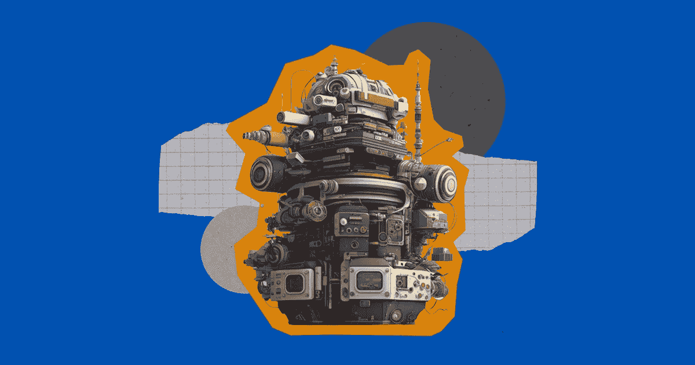
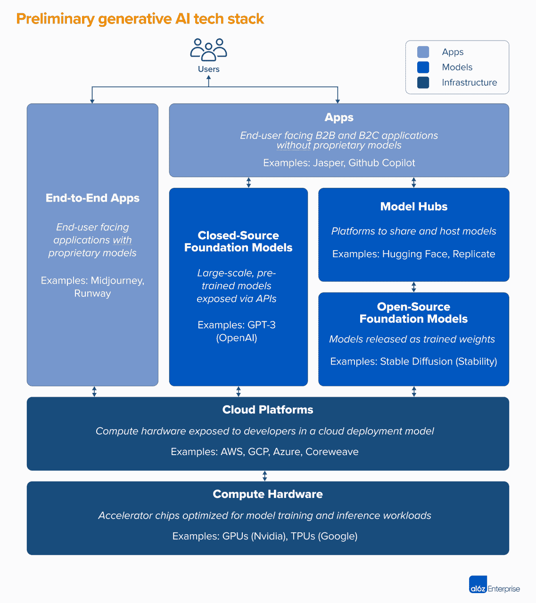
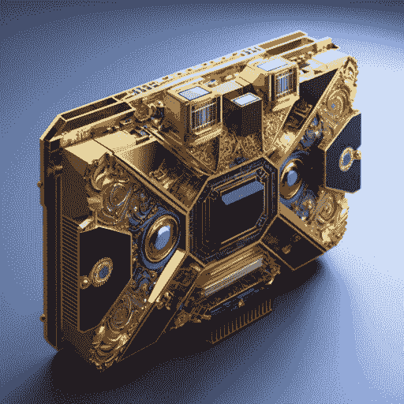

# 生成式AI平台，谁主沉浮？

> 来源：[https://waytoagi.feishu.cn/docx/KOF9dDZtwomcU9xrg5ZcX9tTngg](https://waytoagi.feishu.cn/docx/KOF9dDZtwomcU9xrg5ZcX9tTngg)

> **原文标题：Who Owns the Gen**erative AI Platform?

> **原文链接：****h****t**tps://a16z.com/2023/01/19/who-owns-the-generative-ai-platform/

> **翻译引自链接：****https://xueqiu.com/**2684655177/240906211

> **作者：郑荣南Zeke**

> 发表时间：2023年1月19日

我们已开始见证生成式AI（AIGC）技术栈的兴起。数以百计的初创公司正在涌入市场，开发基础模型，构建人工智能原生的应用程序，并建立基础设施和开发工具。

不像许多热门的技术趋势在市场跟上其步伐前就被过度炒作了，生成式AI的热潮却伴随着极高的市场欢迎度以及真实的市场收益。

如Stable Diffusion和ChatGPT的模型们正在创造用户增长的历史记录，一些应用在发布不到一年的时间里就实现了1亿美元的年营收。对照表明，AI模型在某些任务上的表现优于人类好几个数量级。

已有足够的早期数据表明范式转移正在发生。而我们尚未明确的关键问题是：这个市场中的价值将在哪里积累？

过去一年里，我们会见了几十位生成式AI的从业者，他们有些是初创公司的创始人，有些在大公司中负责与生成式AI相关的工作。据我们观察：

基础设施提供商可能是迄今为止市场上的最大赢家，他们赚取了流经技术栈的大部分资金；应用类公司的营收增长得非常快，但在留存率、产品差异化和毛利率上却容易遇到瓶颈；模型提供商虽然对这个市场而言不可或缺，但绝大多数都还没有实现大规模的商业化。

换言之，创造最大价值的公司——即训练生成式AI模型并将其应用在新的应用程序中的那些公司——尚未获取最大的价值。

我们很难预测接下来将发生什么，但我们认为，核心是理解技术栈的哪些部分真正具有差异化和壁垒。这将对市场结构（公司的横向或纵向发展）和其长期价值的驱动因素（利润率和留存）产生重大影响。

至今，除了经典的护城河之外，我们很难在技术栈中找到坚实的壁垒。

我们非常看好生成式AI，相信它将对软件行业和其他行业产生巨大的影响。这篇文章的目标是描绘出市场的驱动力，并尝试回答和生成式AI的商业模式相关的更广泛的问题

# **高级技术栈：基础设施**、**模型和应用**

为了理解生成式AI市场是如何形成的，我们首先需要定义当前的技术栈是如何构成的的。以下是我们的初步观点：

该栈（自上而下）可分为三个层级：

+   应用层：将生成式AI模型集成进面向用户的应用软件，它们或运行着自己的模型（端到端应用），或依赖于三方模型的API；

+   模型层：驱动AI产品的模型，它们要么以专有API的形式提供，要么开源提供（这种情况需要一个对应的托管解决方案）；

+   基础设施：基础设施供应商（如云厂商或硬件制造商），它们负载着生成式AI模型的训练和推理。

值得注意的是：这并非一幅市场全景图，而是一个分析该市场的框架。在每个类别中，我们列出了部分知名的供应商，没有试图穷举所有已发布的生成式AI应用。关于MLOps（机器学习运维）或LLMOps（大语言模型运维）工具的深入探讨也将在后续的文章中展开，目前它们尚未高度标准化

# 第一波生成式AI应用迈向规模化但留存率和差异化仍面临困难

在之前的技术周期中，人们普遍认为要建立一个独立的大企业，公司必须拥有终端客户——无论是个人消费者还是企业买家。因此人们更容易相信，生成式AI领域的最终赢家也会是面向终端的应用程序。而目前，生成式AI的探索之旅依然迷雾重重。可以肯定的是，生成式AI应用程序的增速是惊人的，这得益于产品的新颖性和丰富的用户用例。

我们了解到至少有三类产品年营收已经超过了1亿美元，即图像生成、文案写作和代码编写。然而，仅靠高增长还不足以建立经久不衰的软件公司。关键之处在于增长的背后必须有利可图——从某种意义上说，用户一旦注册，就会产生收益（高毛利），并长期留在应用中（高留存）。在技术缺乏差异化的情况下，B2B和B2C应用多数通过网络效应、数据沉淀和日益复杂的工作流来推动长期客户价值。

在生成式AI中，这些假设并不一定成立。那些与我们交谈过的应用软件公司，毛利率落在一个很大的区间——少数情况下可高达90%，但更多数情况仅有50-60%，主要受限于模型推理成本。虽然用户漏斗顶端的增长十分惊人，但鉴于我们已经看见付费转化和留存的开始下降，现有的获客策略是否可规模化尚未可知。

由于依赖类似的数据模型，许多应用软件在产品层面相差无几，并且它们均尚未找到友商难以复制的显著网络效应、数据积累或独特工作流。

因此，目前还无法明确直接销售终端应用是否是构建生成式AI可持续商业模式的唯一甚至是最佳途径。随着语言模型的竞争加剧和效率提升，应用的利润空间将会提高（下文将详述），而后面“白嫖党”会逐渐离场，产品的留存也可能有所提升。

一个强有力但仍待验证的观点是，纵向整合的应用（如上图里的Midjourney）将在差异化上具有优势。

展望未来，生成式AI应用公司将面临的主要问题包括：

+   **纵向整合（应用+模型）**：将AI模型视作一种服务，小型应用开发团队可以快速迭代并随着技术的演进替换模型供应商。另一方面，部分开发者认为模型就是产品本身，只有从头开始训练才能建立壁垒——即不断对产品积累下来的专有数据进行训练。这么做的代价是烧更多的钱并牺牲部分产品团队的灵活性。

+   **构建功能还是应用**：生成式AI的产品形态五花八门：桌面应用程序、移动应用程序、Figma/Photoshop插件、Chrome浏览器扩展应用甚至Discord机器人…在用户已经习惯的工作界面中集成AI通常比较容易，因为交互界面往往只是一个文本框。这些公司中的哪些将成长为独立的公司，哪些又将被已有AI产品线的大厂（如微软或谷歌）收入麾下，值得拭目以待。

+   设法穿越炒作周期（Hype cycle）：用户流失究竟是因为产品自身的产品力不足还是早期市场的人为表现目前尚无定论，对生成式AI的浓厚兴趣是否会随着炒作的消退而淡去也暂时没有答案——何时加速融资？如何激进地获客？优先考虑哪些用户群体？何时宣告PMF成功？这些问题对于应用程序类公司而言意义重大。

# 模型提供商发明了生成式AI但尚未实现大规模商业化

如果没有谷歌、OpenAI和Stability.AI等公司奠定了杰出的研究和工程基础，我们现在所说的生成式AI将无从存在。创新的模型架构和不断扩展的训练管道使我们均受益于大语言模型（LLMs）和图像生成模型的“超能力”。

然而，这些公司的收入规模在其用量和热度面前似乎不值一提。

在图像生成方面，得益于其用户界面、托管产品和微调方法组成的操作生态，Stable Diffusion已经见证了爆炸性的社区增长。但Stability仍将免费提供其主要检查点作为核心业务宗旨（愿景是开源）。

在自然语言模型中，OpenAI以GPT-3/3.5和ChatGPT占据主导地位，但到目前为止，基于OpenAI构建的杀手级应用仍相对较少，而且其API定价已经下调过一次。

这可能只是一个暂时的现象。Stability.AI仍是一家尚未专注于商业化的新兴公司，随着越来越多杀手级应用的构建——尤其当它们被顺利整合进微软的产品矩阵，OpenAI也有成长为庞然大物的潜力，届时将吃走NLP领域一块很大的蛋糕。当模型被大量使用，大规模的商业化自然水到渠成。

但阻力依然存在。开源模型可以由任何人托管，包括不承担大模型训练成本（高达数千万或数亿美元）的外部公司。是否有闭源模型可以长久地保持其优势目前还是未知数。

我们看见由Anthropic、Cohere和Character.ai等公司自行构建的大语言模型开始崭露头角，这些模型和OpenAI基于类似的数据集和模型架构进行训练，在性能上已经逼近OpenAI。但Stable Diffusion的例子表明，如果开源模型拥有足够高的性能水平和充分的社区支持，那么闭源的替代方案将难以与其竞争。

如今，对专有API（如OpenAI）的需求正在迅速增长，托管可能是目前对模型提供商而言最明确的商业化路径。

开源模型托管服务（如Hugging Face和Replicate）正在成为便捷地分享和集成模型的有效枢纽——甚至在模型提供者和消费者之间产生了间接的网络效应。模型提供商通过模型微调和与企业客户签订托管协议来变现，看上去是十分可行的。

除此之外，模型提供商将面临的主要问题还包括：

+   **商品化**：人们普遍认为，AI模型的性能将随时间推移趋于一致。在与应用开发者的交谈中，我们可以确定这种情况尚未发生，在文本和图像模型领域都还存在实力强劲的领跑者。它们的优势并非基于独特的模型架构，而是源自大量的资本投入、专有的交互数据沉淀和稀缺的AI人才。但这些会是持久的优势吗？

+   **客户流失**：依赖模型提供商是应用类公司起步甚至（早期）发展业务的绝佳方法。但当业务达到一定体量，这些公司就有动力构建或托管它们自己的模型。许多模型提供商的客户分布高度不均衡，少数应用贡献了绝大多数收入。一旦这些客户转向自研AI，对模型提供商将意味着什么？

+   **钱重要吗**：生成式AI的未来是把双刃剑，前景无比光明却也潜在巨大危害，以至于许多模型供应商以共益企业（B corps）的模式组织成立，它们或发行有上限的利润份额，或以其他方式明确地将公共利益纳入公司使命。这些举措丝毫不影响它们融资。但此处有一个合理的争议——即多数模型提供商是否真的想要获取价值，以及它们是否应该这么做？

# 基础设施供应商触及一切并采摘了果实

生成式AI中的近乎一切都会在某个时刻通过云托管的GPU（或TPU）。无论是对于训练模型的模型提供商和科研实验室、执行推理和微调任务的托管公司或是两者兼顾的应用程序公司，每秒浮点运算（FLOPS）都是生成式AI的命脉。这是很长时间以来第一次，最具颠覆性的计算技术的进步严重受限于计算量。

因此，生成式AI市场里的大量资金最终流向了基础设施公司。可以用一些粗算数字加以说明：

我们估计，应用程序公司平均将约20-40%的年收入用于推理和定制化的微调，这部分通常直接支付给云服务提供商以获取实例或支付给第三方模型提供商——相应地，这些模型提供商将大约一半的收入投入于云基础设施。

据此我们有理由推测，生成式AI总营收的10-20%将流向云服务提供商。

除此之外，训练着自有模型的初创公司们已经筹集了数十亿美元的风险投资——其中大部分（早期阶段高达80-90%）通常也花在云服务提供商身上。许多上市科技公司每年在模型训练上花费数亿美元，它们要么与外部的云服务提供商合作，要么直接与硬件制造商合作。

这就是我们常说的“一大笔钱”——尤其是对于一个新兴市场而言。

其中大部分的钱都花在了三大云上：AWS、谷歌云（GCP）和微软Azure。三大云每年花费超千亿美元的资本支出以确保它们拥有[最全面](https://xueqiu.com/S/NVDA?from=status_stock_match)、最可靠、最具成本优势的云平台。尤其在生成式AI领域，三大云还受益于有限的供给，因为它们可以优先使用稀缺的硬件（如英伟达的A100和H100 GPU）。

眼下，我们看见该领域的竞争也开始出现。甲骨文等挑战者已经通过巨额的资本支出和销售激励进军市场；一些提供针对大模型开发人员提供解决方案的初创公司，如Coreweave和Lambda Labs也正在快速发展，它们在成本、可用性和个性化支持上展开角逐。

此外，初创公司还公开更细粒度的资源抽象（即容器），而受限于GPU虚拟化，大型云厂商只提供虚拟机实例

迄今为止，生成式AI领域最大的幕后[赢家，](https://xueqiu.com/S/NVDA?from=status_stock_match)可能是运行了绝大多数AI工作负载的英伟达（NVIDIA）。

该公[司报告](https://xueqiu.com/S/NVDA?from=status_stock_match)称，2023财年第三季度，其数据中心GPU的收入为38亿美元，其中相当一部分用于生成式AI用例。通过数十年对GPU架构的投资、产学研深入合作以及软硬件生态系统的构建，英伟达已围绕该业务建立了坚固的护城河。

[最近一](https://xueqiu.com/S/NVDA?from=status_stock_match)项分析发现，研究文献中引用英伟达GPU的次数是顶级AI芯片初创公司总和的90倍。

其他硬件选项确实存在，包括谷歌张量处理单元（TPU）、AMD Instinct GPU、AWS Inferenti[a和T](https://xueqiu.com/S/INTC?from=status_stock_match)rainium芯片，以及来自Cerebras、Sambanova和Graphcore等初创公司的AI加速器。后发者英特尔（Intel）也带着高端的Havana芯片和Ponte Vecchio GPU 进入了这个市场。但到目前为止，仍然鲜有新芯片能够占据可观的市场份额。

有[两个例](https://xueqiu.com/S/TSM?from=status_stock_match)[外值得](https://xueqiu.com/S/NVDA?from=status_stock_match)关注，一个[是谷歌](https://xueqiu.com/S/INTC?from=status_stock_match)，其TPU在Stable Diffusion社区和谷歌云平台的一些大型案例中表现出了巨大吸引力，另一个是台积电，据说它生产了以上所列举的所有芯片，包括英伟达的GPU（英特尔的芯片则由自有晶圆厂和台积电共同生产）。

换句话说，基础设施可能是整个技术栈中可持续获利且有壁垒的一层。基础设施供应商需要面临的主要问题包括：

**保持无状态工作负载**：无论在哪里租用[英伟达](https://xueqiu.com/S/NVDA?from=status_stock_match)的GPU都是一样的。大多数AI工作负载是无状态的，从某种意义上说，模型推理无需附加的数据库或存储（除模型权重本身外）。这意味着AI工作负载可能比传统应用程序的工作负载更易于跨云迁移。在这种情况下，云服务提供商应如何创造用户粘性，防止客户转向便宜的选择?

**芯片荒终结后的较量**：云服务提供商和[英伟达](https://xueqiu.com/S/NVDA?from=status_stock_match)产品的定价都是基于最理想的GPU目前供给稀缺。一位供应商告诉我们，A100的售价自发布以来有所上涨，这对于计算硬件而言是极不寻常的。若通过增加产量和/或采用新的硬件平台可最终消除芯片的供给限制，云服务提供商将受何影响？

**挑战者能否破局**：[我们坚](https://xueqiu.com/S/NVDA?from=status_stock_match)信，垂直云将通过提供更加专业的服务从三大云手中夺取市场份额。到目前为止，在AI领域，部分挑战者通过适度的技术差异化和英伟达的支持已经获得了一定的市场吸引力——对英伟达而言，现有的云服务提供商既是最大的客户，也是新兴的竞争对手。但长期的问题是，这些助力是否足以帮助新兴云厂商攻克三大云的规模优势？

# **那么……价值将在哪里累积？**

当然，我们还不知道答案。

但结合生成式AI的早期数据和我们关于AI/ML初创公司的经验，我们有以下直觉：

如今，生成式AI领域似乎不存在任何系统性的护城河。

由于基于相似的模型构建应用，应用程序提供商缺乏显著的的产品差异。其次，由于模型基于相似架构和相似的数据集训练而来，模型提供商长期可能会趋于一致。最后，由于运行同样的GPU，甚至硬件公司在相同的晶圆厂生产芯片，云服务提供商缺乏深度的技术差异。

当然，老生常谈的护城河依然存在，比如：规模护城河（我能比你融到更多的钱！），供应链护城河（我拥有你所没有的GPU！），生态护城河（所有人都已经在使用我的软件），算法护城河（我们比你更聪明！），分发护城河（我已经组建了销售团队并且客户数比你多！）以及数据管道护城河（我在互联网上爬取了比你更多的信息！）。

但长期而言，这些护城河并不可持续。强大的网络效应是否会在生成式AI技术栈中的任何一层占据上风？现在下定论，一切还为时过早。

根据现有数据，我们很难判断，生成式AI长期是否会形成赢者通吃的局面。

这很不寻常，但对我们而言是个好消息。这个市场的潜在规模难以把握——它介于所有软件和所有人类的努力之间——因此我们预计将有许多玩家参与到技术栈各个层级的有序竞争中。

我们也希望公司无论横向延展或是纵向深耕都能取得成功，为终端市场和终端用户提供最佳解决方案。举例来说：

如果终端产品的差异化源自AI本身，那么纵向深耕（即紧密耦合面向用户的应用和自研模型）可能会取胜；

如果AI属于一个更大的长尾功能组合，那么横向延展将更可能发生。随着时间的推移，我们将看见更多典型护城河的建立——甚至可能见证新型护城河的诞生。

无论如何，有一件事我们可以确定，生成式AI正在改变这场游戏，而我们都在与时俱进地学习着游戏规则。大量价值将被AI释放，科技领域终将发生翻天覆地的变化。

此刻，我们正在这浪潮之上，拥抱生成式的新未来！

这篇文章中的所有图像都是使用 Midjourney 创建的。