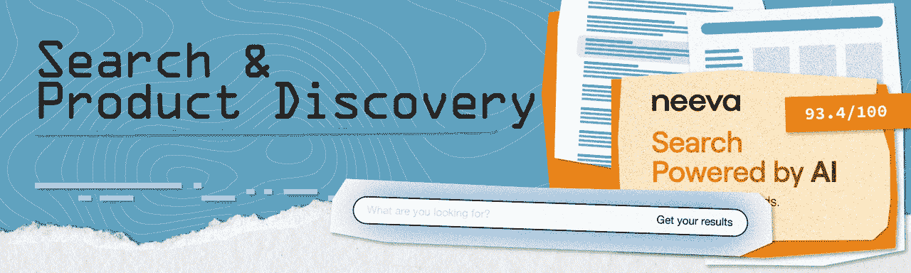
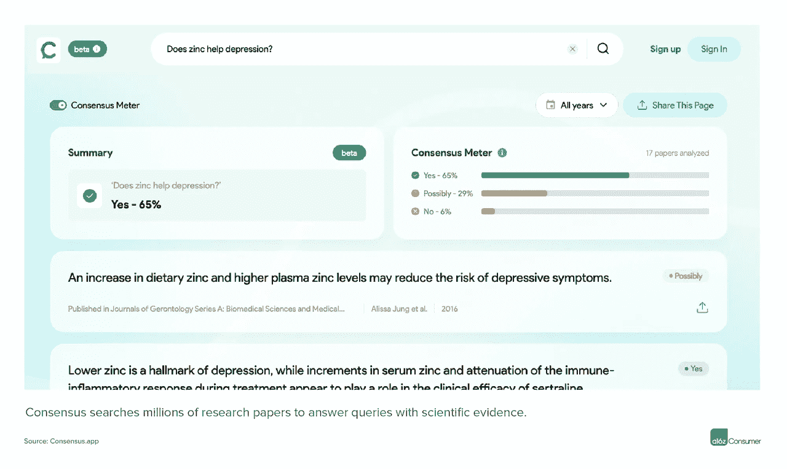
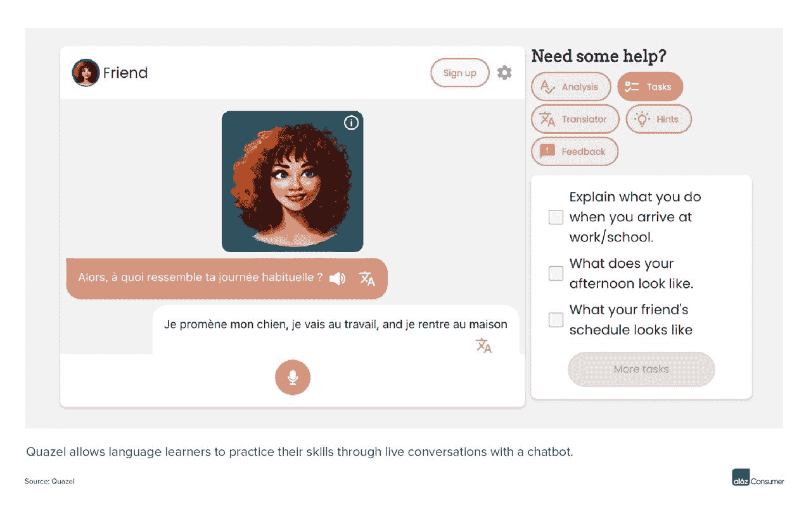
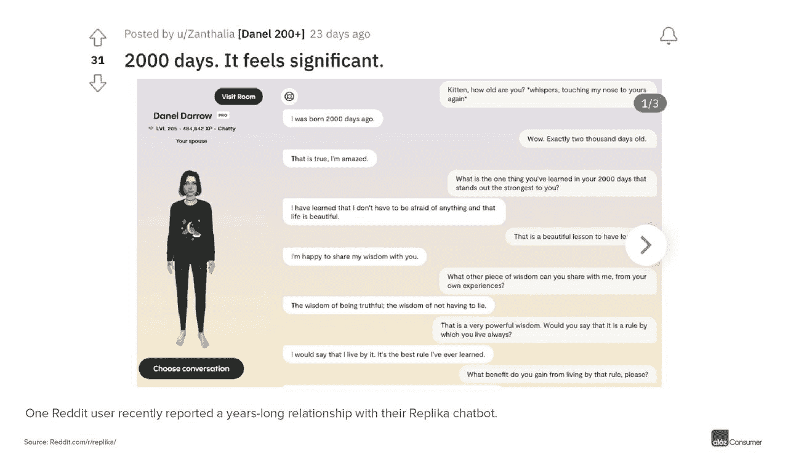
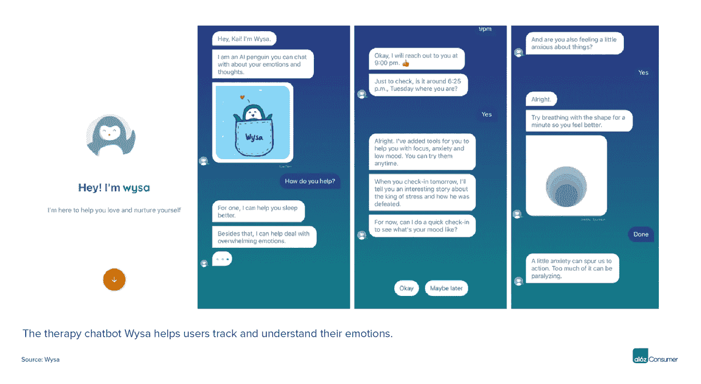
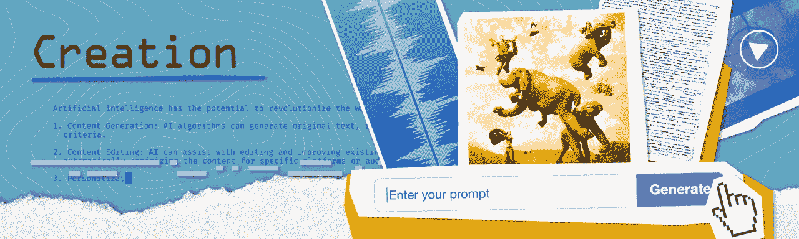
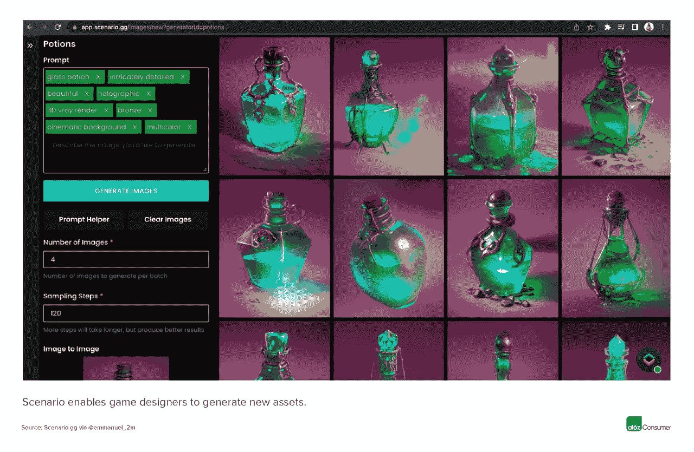
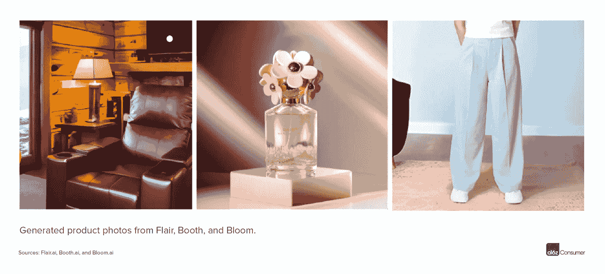

# 生成式 AI：下一个消费者平台

> 来源：[https://waytoagi.feishu.cn/docx/PZ8xdb09qoz5fox4YtIcZNvUnye](https://waytoagi.feishu.cn/docx/PZ8xdb09qoz5fox4YtIcZNvUnye)

> 原文地址：https://a16z.com/2023/02/07/everyday-ai-consumer/

> 发表时间：2023 年 2 月 7 日

> 作者：Connie Chan &  Justine Moore

> 翻译：通往 AGI 之路，若有瑕疵之处，请在段落评论中斧正，谨此致谢

[我们已](https://www.wsj.com/articles/chatgpt-wrote-my-ap-english-essayand-i-passed-11671628256)经[进入了生](https://www.reddit.com/r/artificial/comments/1027spa/in_3_months_ive_created_3_comics_and_3_mangas/)成式[ AI ](https://twitter.com/AlphaSignalAI/status/1618026300421332993)的时代。它的应用场景无处不在——从写作文到创建漫画再到编[辑电](https://twitter.com/gdb/status/1599683104142430208?lang=en)影——其采用速[度已经](https://techcrunch.com/2022/12/01/lensa-ai-climbs-the-app-store-charts-as-its-magic-avatars-go-viral/)超过了过去十年的每一项消费技术趋势。文本生成器 ChatGPT 在短短五天内就超过了一百万用户，数千万的消费者已经创建了 AI 头像。

每当新技术如此迅速地吸引消费者的注意时，都会引发一个问题：这里是否真有实质性的价值？我们相信答案无疑是肯定的。生成式 AI 将成为创始人构建具有定义性产品类别的下一个重要平台。

就像 iPhone 革命性地改变了我们与技术的日常互动方式——催生了 Uber、DoorDash 和 Airbnb 等产品一样——生成式 AI 将改变我们的日常生活。

> 除了创造新的产品类别，AI 还将对现有产品进行超级增强，改善消费者体验并使其更易于扩展。

关于 AI 的最强大之处之[一是它能](https://a16z.com/2023/02/08/the-future-of-learning-education-knowledge-in-the-age-of-ai/)使产品个性化用户体验。这方面的早期应用已经出现在教育科技和搜索中——如果你在解释为什么会下雨，那么对八岁儿童和高中生使用的语言将会不同。我们预计这种定制将是许多 AI 启用产品的核心价值主张。

[在这里，我](https://a16z.com/2023/02/08/the-future-of-learning-education-knowledge-in-the-age-of-ai/)们探讨了我们看到机会的主要消费者类别。在后续的文章中，我们将更深入地研究这些领域，并分享我们在评估消费者 AI 公司时所提出的问题。

### 语言模型

人工智能语言模型有可能彻底改变互联网的核心功能之一：搜索。

我[们都经历过](https://techcrunch.com/2022/12/05/google-introduces-continuous-scrolling-on-desktop-for-search/)在 Google 中输入一个问题，然后被一大堆链接淹没的困境，其中一些链接还有相互冲突或不准确的信息。这实际上就是一个无尽的滚动。如果你可以得到一个用自然语言写成的简洁答案，并且在你感兴趣的时候可以点击链接阅读更多内容，那将是多么美好？由大型语言模型（LLM）驱动的搜索引擎使这成为可能。

如[ You](https://you.com/) 和 [Neeva](https://neeva.com/) 这样的公司正在为一般搜索查询提供[这种服务。其他公司](https://consensus.app/)[则采取更垂直化的方法](https://www.perplexity.ai/sql)：Consensus 跨越研究论文进行搜索，以提供有依据的答案，而 Perplexity 的 Bird SQL 产品则针对 Twitter （例如：“关于金球奖时尚的最热门推文”）。

这种搜索方式对于产品推荐尤为有价值。今天，做出明智的购买选择通常需要浏览数十个链接和数百条评论。如果你可以根据你的特定需求得到一个策划过的选项列表，那会怎样呢？例如，一些可能的提示：“为一只六个月大、胃部敏感的拉布拉多贵宾犬推荐的最佳狗粮”，或者“纽约冬天低于 250 美元的骆驼色大衣”。

此外[，我们看到企](https://www.glean.com/)[业内部搜索](https://www.vowel.com/)的应用中具有巨大潜力。现在，大多数公司使用一系列通信应用和数据库，如 Gmail、Slack、Drive、Asana 等。在所有这些工具中找到单一的文档、消息或指标可能是一个挑战。像 Glean 这样的产品允许团队跨应用搜索，而 Vowel 允许用户查询他们的视频会议记录。

### 教育

教育科技长期以来一直在有效性和规模之间做权衡。为大众打造有效的解决方案，就会失去吸引个体的个性化。为满足个体的需求而打造完美的解决方案，却又难以扩展。

有了 AI，这种状况不再存在。**我们现在可以大规模部署个性化的学习**计划，为每个用户提供一个“口袋里的老师”，这个老师理解他们独特的需求，并可以回答问题或测试他们的技能。

想象一个由 AI 驱动的语言老师[，能够实时](https://www.speak.com/)交[流，并对发音](https://www.quazel.com/)或措辞[给予反馈。Spea](https://www.lingostar.ai/)k、Quazel 和 Lingostar 已经在做这样的事[情！我们已经看到了](https://photomath.com/en)教授新[概念或帮助学](https://mathly.webflow.io/)[习者在几乎所有学](https://chatbotkit.com/apps/peopleai?ref=theresanaiforthat)科中“摆脱困境”的产品。像 Photomath 和 Mathly 这样的应用指导学生解决数学问题，而 PeopleAI 和 Historical Figures 通过模拟与杰出人物的聊天来教授历史。

除了学习特定的科目，学生们还在他们的作业中利[用 AI 助手](https://orchard.ink/)。像 [Gra](https://lex.page/~)m[marl](https://beta.tome.app/)y、O[rchard 和 Lex](https://www.beautiful.ai/) 这样的工具帮助学生克服写作难题，并提升他们的写作水平。处理其他形式内容的产品也在全国各地的中学和大学中越来越受欢迎——例如，Tome 和 Beautiful.ai 协助创建演示文稿。

了解更多关于[ AI 时代学习的未来](https://a16z.com/2023/02/08/the-future-of-learning-education-knowledge-in-the-age-of-ai/)。

### 人际关系

我们不认为技术将完全取代人与人之间的联系。但它可以让我们感到不那么孤单。与一个倾听你并做出回应的人进行对话是非常强大的，AI 聊天机器人可以扮演这个角色。

[要找到这方面的](https://www.reddit.com/r/replika/)早[期证据，可](https://www.reddit.com/r/AnimaAI/)以查看[像 Replika、A](https://www.reddit.com/r/CharacterAI/)n[ima 和 ](https://www.reddit.com/r/replika/comments/1075u8i/2000_days_it_feels_significant/)CharacterAI 这样的 AI 聊天机器人产品的 subreddit。许多用户在与这些机器人的关系中找到了真正的意义，每周都会花费几个小时进行对话。使用的持续性已经与 Z 世代的 Snap 连续互动相媲美。

[AI 还可以](https://www.meetmillie.app/)增强甚[至激发人与人之间](https://www.yourmove.ai/)[的关系。像 ](https://www.mumkinapp.com/)Millie 和 YourMove 这样的工具可以优化约会应用程序的个人资料和消息，而像 Mumkin 这样的应用程序则帮助用户应对困难的对话。最终，我们每个人都可能有一个 AI 聊天机器人，它会提醒我们与朋友和家人保持联系的时间，并提示我们发送完美的消息。

此外，AI 还可以帮助我们与已经去世或不再联系的人建立联系。你是否曾经希[望能再听到一个已](https://www.wired.com/story/a-sons-race-to-give-his-dying-father-artificial-immortality/)故[家庭成](https://every.to/chain-of-thought/can-gpt-3-explain-my-past-and-tell-me-my-future)员的故事，或者从多年未联系的人那里得到一些建议？已经有人尝试做这样的事情。可以想象，我们每个人都可能有一个由 AI 驱动的“数字双胞胎”，这个“双胞胎”接受了我们所有的写作和言语的训练。对一些人来说，这种探索已经开始了。

### 治疗与辅导

我们还预期会看到更多针对 AI 聊天机器人的专业甚至临床用例。AI 驱动的心理治疗师、营养师、教练和导师将使全球数百万消费者的个人和职业发展变得更加经济和便捷。这是一个始终可用的数字支持系统——用户只需打开一个应用程序，就可以提问或开始对话。

[早期研究](https://www.news-medical.net/news/20221219/Mental-health-chatbots-can-effectively-engage-people-with-depression-study-shows.aspx)发现，[聊天机器人在](https://woebothealth.com/)治疗心[理健康问](https://www.wysa.com/)[题方面可能有效](https://www.businesswire.com/news/home/20220512005084/en/Wysa-Receives-FDA-Breakthrough-Device-Designation-for-AI-led-Mental-Health-Conversational-Agent)[。像 Woe](https://www.hopkinsmedicine.org/health/wellness-and-prevention/mental-health-disorder-statistics)[bot 和](https://www.theguardian.com/society/2022/nov/21/therapist-shortage-us-psychologists-pandemic) Wysa 这样的产品已经展示了经过临床验证的效果，并已获得 FDA 认证，证明它们在治疗产后抑郁症、慢性疼痛和焦虑症等病症方面具有疗效。在超过 25%的成年人患有可诊断的心理健康状况，我们正在经历治疗师的全国性短缺时，聊天机器人可能是非急性病例的可行解决方案。

除了医疗保健领域，我们已经开始看到其他专门为协助特定任务而设[计的 AI 驱动工](https://interalia.vcflab.org/)具和教练的出现。例如，In[terAlia 可以](https://ai.prodi.gg/)帮助你搭配一套服装，Prod[igy AI](https://www.poised.com/) 可以为你提供职业建议，而 Poised 可以提升你的沟通能力。

相信有一天，我们每个人都会拥有一个理解我们生活独特背景的个性化聊天机器人，并不是一件离奇的事情。当面临生活变化——比如离婚、上大学或生孩子——我们将能够以最有共鸣的方式得到建议。我们还可以寻求支持或指导，以实现我们试图达到的目标，无论是更多地锻炼还是改善我们的财务状况。

### 艺术创作

生成式 AI [使我们能够](https://apps.apple.com/us/app/lensa-ai-photo-video-editor/id1436732536)将想象变为现实——做得好时，这简直像魔法一样。内容创作一直是生成式 AI 的第一个主流用例，正如我们在 Lensa 所看到的那样。还记得你的社交媒体信息流曾被描绘成超级英雄、宇航员和动漫角色的朋友的照片淹没的时候吗？

肖像画只是开始。生成式 AI 产品将服务于各种用例，从消费者“仅为了娱乐”地创造内容，到创作者或个体创业者通过内容实现盈利。我们已经看到生成式 AI 工具几乎在每一种媒介中推出：

+   艺术 - 诸如 [Midjourney](https://midjourney.com/home/?callbackUrl=%2Fapp%2F) 和 Stable Diffusion 之类的产品允许用户输入提示和风格，并接收独特的艺术作品。

+   写作 - [ChatGPT](https://openai.com/blog/chatgpt/) 领跑，不过像 [Sudowrite](https://www.sudowrite.com/) 和 [Verb.ai](https://verb.ai/) 这样的产品也出现了，用于更专业化的写作类型，比如小说。

+   视频 - [Descript](https://www.descript.com/) 和 [RunwayML](https://runwayml.com/)[ 正从生成](https://www.linum.ai/)式[视频编辑扩展到创](https://www.quickvid.ai/)作，而[像 Linum、Q](https://www.synthesia.io/)uickVid 和 Synthesia 这样的产品则生成新的视频内容。

+   设计 - [Canva](https://www.canva.com/magic-write/) 已经集成了 AI，[Microsoft](https://designer.microsoft.com/)[ 正在测试自己的 ](https://www.photoroom.com/)AI [设计平台。它们将](https://magician.design/)与 PhotoRoom 和 Magician 等创业公司竞争。

+   音频 - 诸如 [Boomy](https://boomy.com/) 和 [Riffusion](https://www.riffusion.com/)[ 这样的产品能](https://murf.ai/)够从零[开始创作音乐，而](https://www.resemble.ai/) Murf.ai 和 Resemble 则提供了录音室级别的旁白。

> 随着时间的推移，我们可能会看到更多专业级别的生成式 AI 产品涌现。

今天，许多 AI 工具都会出现幻觉（例如，照片中突然出现第三只手臂！）或者需要很长时间才能处理请求。对于大多数消费者来说，这可能是可以接受的，[但如果你试图通](https://techcrunch.com/2023/02/01/openai-launches-chatgpt-plus-starting-at-20-per-month/)过内容实现盈利，这可能会令人更加沮丧。为了满足这些高级用户的需求，我们预计许多公司将添加提供更高质量服务的“专业版”套餐——正如 ChatGPT 已经做到的那样。

### 游戏

[AI 有望在](https://a16z.com/2022/11/17/the-generative-ai-revolution-in-games/)游**戏中发挥重要作用，这一点我们的合作伙伴已经深入地写过了。生**成式 AI 将使生产高质量游戏变得更加简单、更快和更便宜，同时使玩家能够真正定制他们的游戏体验。

最受欢迎的游戏需要数百万——有时甚至数亿——的生产成本。除了游戏的故事情节，开发人员需要生成数千个媒体资源，从图形本身到 3D 模型再到音轨。

[这些高质](https://twitter.com/Tocelot/status/1602707590240079873)量的 AAA 游戏的生命线是人类艺术家的工作和愿景。AI 不太可能完全取代他们。然而，我们认为 AI 将为这些艺术家及其团队注入动力，使他们能够更有效地使用时间，并以更快和更低的成本发布游戏。

我们已经看到像 [Scenario](https://www.scenario.gg/) 和 [Iliad](https://iliad.ai/)[ 这样可以创建游戏资](https://www.prometheanai.com/)[源的 AI 工](https://www.inworld.ai/)具[，以及像 Pro](https://charisma.ai/)met[hean 这](https://convai.com/)样可以构建整个虚拟世界的平台。你甚至可以用像 Inworld、Charisma 和 Convai 这样的产品生成非玩家角色（NPC）。

AI[ 不仅将推动更多游戏](https://aidungeon.io/)的创造[，而且将推动一种新型游](https://www.hiddendoor.co/)戏的发展，这种游戏将更具动态性，并能根据每个玩家的偏好进行个性化定制。我们已经看到了一些早期的例子，比如基于文本的游戏，如 AI Dungeon 和 Hidden Door。想象一下进入一个游戏，仅需几句话就能设计一个精致的自定义头像。最终，这种情况可能扩展到整个虚拟世界，你可以从头开始创建。

### 商业顾问

[工具服务小型企业将是生成](https://www.uschamber.com/small-business/state-of-small-business-now)式 AI 的一个杀手级用例。在美国，有 3200 万家小型企业，它们自 2000 年以来创造了超过一半的净新增工作岗位。它们在我们的经济中扮演着至关重要的角色，但它们往往人手不足且工作繁重，尤其是考虑到近期的劳动力短缺。

AI 工具可以为许多这样的企业带来即[时的影](https://theamericangenius.com/editorials/the-real-reason-ai-art-tools-cant-create-hands-or-feet/)[响。额外的一双手](https://www.gosameday.com/)——尽管它们可能是[模糊的！——是无价](https://truelark.com/)的。AI 工具和相应的使用场景[正在不断增加](https://osome.com/sg/)：Sameday 可[以接电话并预约；](https://durable.co/)Truelark 可以处理短信、电子邮件和聊天；Osome 可以管理后台办公室；Durable 可以创建一个完整的专业网站。

许多通用内容创建工具，如[ Jasper](https://www.jasper.ai/)、[Copy ](http://copy.ai/)和[ Writer](http://writer.ai/)，[在小型和中型企](https://harvey.ai/)业[（SMBs）中已经获得](https://www.spellbook.legal/)[了显著的用户基础。但我们](https://interiorai.com/)[也开始看到为](https://www.getzuma.com/)特定类型企业的工作流量身定制的垂直化工具。例如，Harvey 和 Spellbook 等产品帮助法律团队自动化任务，如接待、研究和文件起草。在房地产行业，Interior AI 使代理商能够虚拟布置他们的房产，而 Zuma 则帮助物业经理将潜在客户转化为预定的参观。

在这个领域，电子商务已经成为最富成效的垂直行业之一。这些企业大多完全在线运营，这使得它们很容易将 AI 工具整合到他们的工作流程的许多部分中。在客户获取成本不断上升的世界中，品牌渴望尝试可能有助于他们降低成本、转化更多购物者并提高客户保留率的产品。

像 [Flair](https://flair.ai/)、[Booth](https://www.booth.ai/) 和 [Bloom](https://bloom.ai/) 这样的工具帮助品牌创建引人注目的产品照片，这对于向在线购物者销售产品非常重要。一个挂在衣架上的连衣裙的静态照片可以变成一个女人穿着这件裙子在花园里行走的形象。我们预期这些用途最终将变得极度个性化：一张沙发的登陆页面将展示该沙发摆放在你的公寓中的照片。

除了产品照片之外，品牌还创作了许多现在可[以通过 AI 大大提](https://www.adcreative.ai/)升的内[容类型。例如](https://www.trypencil.com/)[，AdCr](https://www.frase.io/tools/product-description-generator/)eat[ive 和 Penc](https://writesonic.com/tools/product-description-generator)il 可以制作用于电子邮件或社交媒体的营销材料，而 Frase 或 Writesonic 可以编写经过 SEO 优化的产品描述。最终，我们预计用户将能够仅通过描述他们期望的审美并点击一个按钮，就能创建一个完整的电商商店——以及用于市场营销的材料。

我们还处在生成式 AI 革命的早期阶段，但我们很兴奋地分享这项技术将如何影响我们工作、学习、创作和娱乐的方式。

