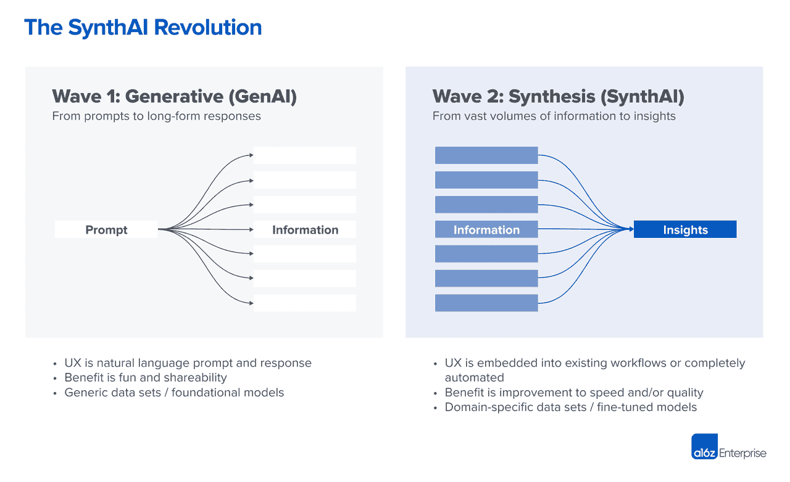
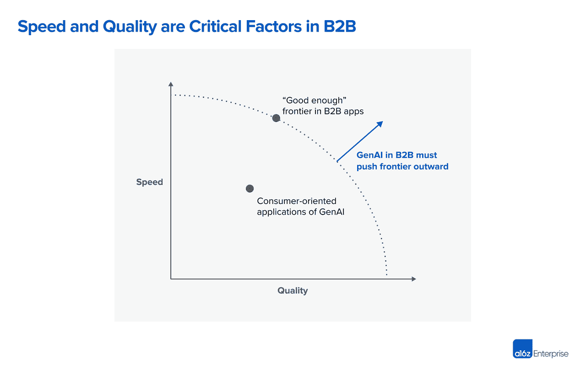
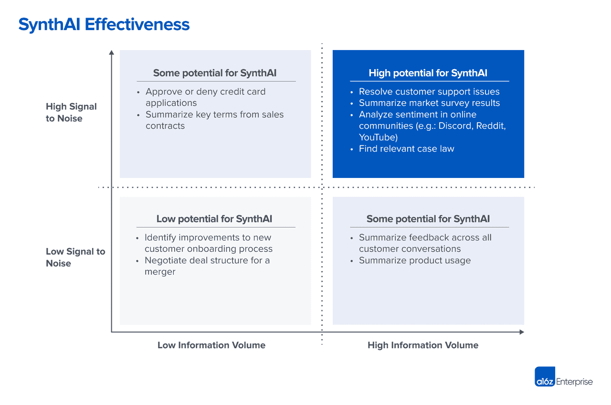
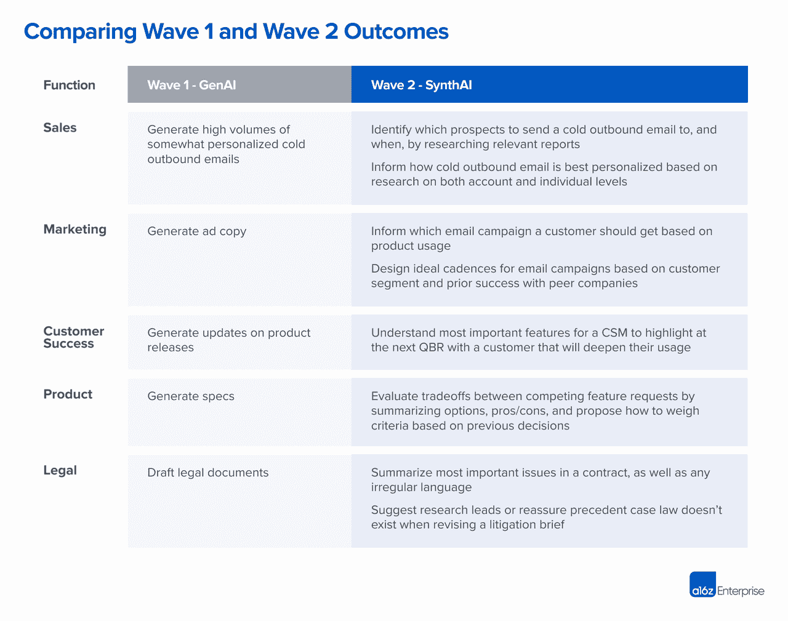

# 对于 B2B 生成式 AI 应用来说，少即是多吗？

> 来源：[https://waytoagi.feishu.cn/docx/DusEdF1E4oznvBx1c4xc11tenpg](https://waytoagi.feishu.cn/docx/DusEdF1E4oznvBx1c4xc11tenpg)

> 原文链接：https://a16z.com/2023/03/30/b2b-generative-ai-synthai/

> 发表时间：2023 年 3 月 30 日

> 作者：Zeya Yang 、Kristina Shen

> 译者：通往 AGI 之路，若有瑕疵之处，请在段落评论中斧正，谨此致谢

我们已经观察到，大语言模型（LLMs）在过去几年中已经成为主流，并且我们已经在 B2B 应用的背景下研究了它们的实现。尽管我们取得了一些巨大的技术进步，并且 LLMs 已经出现在大众的时代精神中，但我们相信我们仍然只处在用于 B2B 用例的生成 AI 应用的第一波中。当公司确定用例并寻求围绕其产品建立护城河时，我们预期从当前的“第一波”到更集中的“第二波”将出现方法和目标的转变。

这是我们的意思：迄今为止，生成 AI 应用主要集中在信息的分歧。也就是说，**它们根据**一组指令创建新内容。在第二波中，我们认为我们将看到 AI 的更多应用是 汇聚信息。也就是说，它们将通过综合可用的信息向我们展示更少的内容。贴切地说，我们将第二波称为综合 AI（“SynthAI”）以与第一波形成对比。虽然第一波在应用层已经创造了一些价值，但我们相信第二波将带来一个阶跃式的变化。

最终，正如我们下面将解释的，**B**2B 解决方案之间的竞争将更少地关注令人眼花缭乱的 AI 能力，更多地关注这些能力将如何帮助公司拥有（或重新定义）有价值的企业工作流。

## 第一波：从消费者到企业的过渡

要分析第一波，首先需要明确 B2C 和 B2B 应用之间的区别。当我们作为消费者使用生成式 AI 时，我们的目标主要是为了获得乐趣和有东西分享。在这个领域里[，质量或准确性并不是高优先级](https://aisnakeoil.substack.com/p/chatgpt-is-a-bullshit-generator-but)：使用 AI 模型生成可以在 Discord 频道内分享的艺术品或音乐，然后很快就忘记它，是一件有趣的事。我们也有一种心理倾向，更倾向于相信更多=有益=好，因此我们被自动化创作所吸引。ChatGPT 的兴起就是一个很好的例子：我们容忍质量上的不足，因为分享更长的内容更令人印象深刻。

**当涉及到 ****B2**B 应用时**，目**标就不同了。首要的**是围**绕时间**和质**量进行成本效益评估。你要么希望能以相同的时间生成更好的质量，要么希望能更快地生成相同的质量。这就是从 B2C 到 B2B 的最初转换出现问题的地方。

我们在工作场所使用 B2B 应用，这里质量很重要。然而，如今 AI 生成的内容主要适用于重复性较强且风险较低的工作。例如，生成式 AI 适合撰写广告或产品描述的短文案；我们已经看到许多 B2B 应用在这个领域取得了令人印象深刻的增长。但我们随后发现，生成式 AI 在撰写观点或论据（即使 AI 生成的内容具有说服力或自信，但通常是不准确的）方面的可靠性较低，而这在 B2B 环境下的创新和合作中更有价值。一个模型可能能生成可用的 SEO 垃圾邮件，但例如宣布针对软件开发人员的新产品的博客文章，就需要相当多的人工润色，以确保其准确性，并确保信息能与目标受众产生共鸣。

另一个越来越常见的例子是用于编写外发销售电子邮件。生成式 AI 对于一般性的、冷门的外发电子邮件是有用的，但对于准确的个性化则不那么可靠。从一位优秀销售代表的角度看，生成式 AI 可能有助于用更少的时间写更多的邮件，但要写能提高回应率并最终导致预约会议的邮件（这是销售代表的评估标准），销售代表仍需要进行研究，并运用他们的判断力决定潜在客户想听到什么。

从本质上看，第一波已经在构思和起草阶段取得了更实质性的写作成功，但最终，需要的创造性和领域专业知识越多，就需要越多的人工润色。

## 打破工作流的成本（或益处）是什么？

即使在生成式 AI 对更长的博客文章有用的情况下，提示也必须精确和明确。也就是说，在 AI 能够以长篇形式表达这些概念之前，作者必须已经清楚地理解了代表博客文章实质内容的概念。然后，为了得到一个可接受的最终结果，作者必须审查输出内容，对提示进行迭代，并可能重写整个部分。

这里的一个极端例子是使用 ChatGPT 生成法律文件。虽然这是可能的，但提示需要一个熟悉法律的人提供所有必要的条款，ChatGPT 然后可以使用这些条款生成较长文档的草稿。考虑从期限表到结案文件的类比。AI 无法执行主要各方之间的谈判过程，但一旦所有关键条款都确定下来，生成式 AI 可以编写较长结案文件的初步草稿。然而，一名受过培训的律师仍然需要审查和编辑输出内容，以使文件达到各方可以签署的最终状态。

这就是为什么在 B2B 背景下，成本效益评估会出现问题。作为知识工作者，我们正在评估将一个额外的 AI 驱动步骤加入到我们的工作流程中是否值得，或者我们是否应该自己完成这个工作。今天，在第一波应用中，答案常常是我们自己动手做更划算。

## 第二波：汇聚信息以改进决策

当我们进入生成式 AI 应用的下一波时，我们预计将看到从信息生成转向信息综合的焦点转变。在知识工作中，决策具有巨大的价值。员工得到报酬是为了根据不完美的信息做出决策，而不一定是生成执行或解释这些决策的内容的数量。在许多情况下，更长并不意味着更好，它只是更长而已。

许多格言支持这一点：编写的代码行数并不是衡量工程生产力的良好指标；更长的产品规格并不一定能更清晰地说明需要构建什么；更长的幻灯片也不一定总是提供更多的洞察。

[Hex ](https://hex.tech/)的首席执行官和联合创始人 Barry McCardel 相信人机共生，并强调了大型语言模型（LLMs）如何改进我们的工作方式：

> “AI 的存在是为了增强和改进人类，而不是取代人类。在理解世界和做决策时，你需要人类参与其中。AI 能做的是帮助我们将更多的脑力应用于有价值的、富有创造性的工作，这样我们不仅可以每天花更多的时间在重要的工作上，还能让自己自由地做到最好。”

AI 如何改进人类的决策呢？我们相信大型语言模型（LLMs）将需要专注于合成和分析 —— SynthAI —— 这将改进决策的质量和/或速度（请记住我们上面的 B2B 图表），即使不是做出实际决策本身。这里最明显的应用是总结人类自己无法直接消化的大量信息。

未**来 SynthAI 的真正价值将在于**帮助人们更快地做出更好的决策。我们设想的几乎与 ChatG[PT 用](https://get.mem.ai/)户界面完全相反：如果我们能从大量的数据中反向工程出总结这些数据的简洁提示，那将是怎样的呢？ 我们认为有机会重新考虑用户体验，使其能尽可能有效地传达大量信息。例如，一个 AI 驱动的知识库，如 Mem，它保存了组织中每次会议的记录，可以在人们开始新项目时主动建议相关的决策、项目或人员，从而为他们节省数小时（甚至数天）的时间，以便浏览先前的机构知识。

回到我们的外发销售电子邮件示例，一个可能的表现形式是 AI 识别出目标账户处于最高意愿水平的时候（基于新闻报道、财报电话会议、人才迁移等），并警告相关销售代表。然后，AI 模型会根据综合研究，建议在电子邮件中提到一两个最重要的问题，以及与该目标账户最相关的产品功能。讽刺的是，这些输入可以然后被输入到一个第一波解决方案中，但价值来自于合成阶段，以及可能为销售代表节省数小时研究单一潜在客户的时间。

**确保这种合成足够高质量的根本性转变将是**从大规模、通用模型转向利用多个模型的架构， 包括更多针对特定领域和用例数据集进行微调的模型。例如，构建客户支持应用程序的公司可能主要使用一个具有访问公司历史支持票据的支持中心模型，但在特殊情况下回退到 GPT。在微调模型和数据集是专有的情况下，这些组件有机会在提供速度和质量方面形成壁垒。

## 实施 综合AI（SynthAI）

当我们思考第二波可能的样子时，我们相信最能从综合 AI 中受益的用例将是以下两者兼具的情况：

+   信息量大，以至于人工手动筛选所有信息是不切实际的

+   高信噪比，这样的主题或洞察是明显和一致的。为了准确性，你不想让一个 AI 模型去解读细微之处

在下面的图表中，我们通过这些维度对常见的分析和合成的例子进行了分类，以帮助更生动地展示这一点。

这有助于我们思考第二波应用将实现的类型以及它们如何不同于第一波应用的结果。下面，我们尝试提供一些例子来更生动地展示这些对比，但它们绝不是全面的。

## 争夺工作流的所有权之战

自然地，现有的记录系统和试图嵌入 AI 增强功能的工作流解决方案之间存在竞争，新的解决方案则是 AI 本地化的。我们想明确他们争夺的目标：奖品并不是关于谁能构建 AI 综合能力；而是谁能拥有工作流。 对于现有的解决方案，供应商正通过 AI 来改进他们现有的工作流，以便加深其根基。对于挑战者来说，供应商将使用最佳实践的 AI 实现作为一个楔子，并从那里寻求扩展，以重新定义工作流。

在产品反馈用例中，[Sprig ](https://sprig.com/)一直使用 AI 来分析开放文本回应和语音回应，并将它们总结为主题。Sprig 的创始人兼首席执行官 Ryan Glasgow 对大型语言模型（LLMs）改进他们的综合解决方案的潜力感到兴奋：

> “有了 LLMs，我们可以为客户节省比以前更多的时间。在我们之前的模型中，客户能看到主题之前，我们需要有一个人在循环中的审查过程；现在，我们可以立即呈现主题，并在之后进行审查过程。此外，我们现在能够为每个主题添加一个描述符，以提供更多的特异性，这使得洞察更具有可操作性。”

>

> “在未来，我们认为有机会允许用户提出后续问题，如果他们想进一步深入了解一个主题。归根结底，这是关于提供端到端的工作流 —— 从快速收集数据到快速理解它 —— 以帮助实时做出决策。”

与此同时，我们已经看到新的初创公司完全专注于使用 AI 来总结用户反馈，通过与正在收集原始反馈的现有平台集成。

在外部销售的应用场景中，[ZoomInfo ](https://www.zoominfo.com/)最近[宣布](https://www.businesswire.com/news/home/20230216005530/en/ZoomInfo-Will-Integrate-GPT-into-Its-Go-to-Market-Platform)[他们正在](https://www.youtube.com/watch?v=_C94CaEZ1Ag)将 GPT 集成到他们的平台中，并分享了一个演示视频。视频的某些部分与我们描述的第二波例子相去不远。同样，我们已经看到新兴的创业公司完全专注于尽可能地使用人工智能优先的方法自动化外部销售流程。

AI 可能改变我们工作方式的潜力是无穷的，但我们仍处于早期阶段。在 B2B 应用中，生成式 AI 需要超越仅仅创造更多内容的能力，发展到合成型 AI，从而使我们能够更高效、更迅速地完成工作。在 B2B 应用中，谁能拥有工作流程一直是一个不断变动的焦点，而以人工智能为核心的应用将使这场“舞蹈”变得愈发引人注目。

