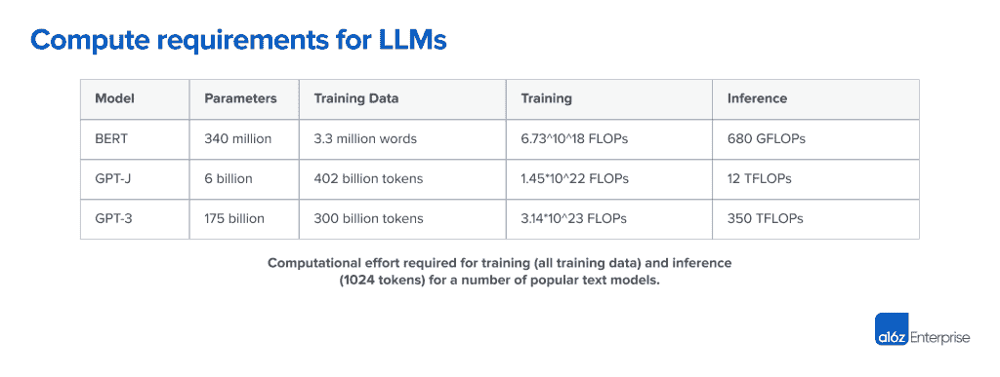
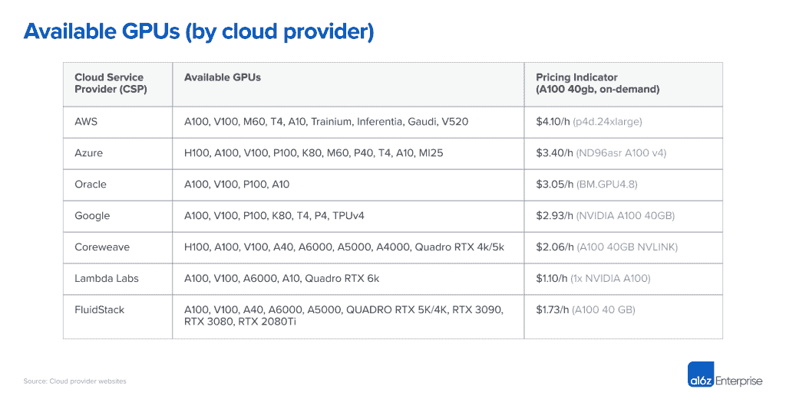
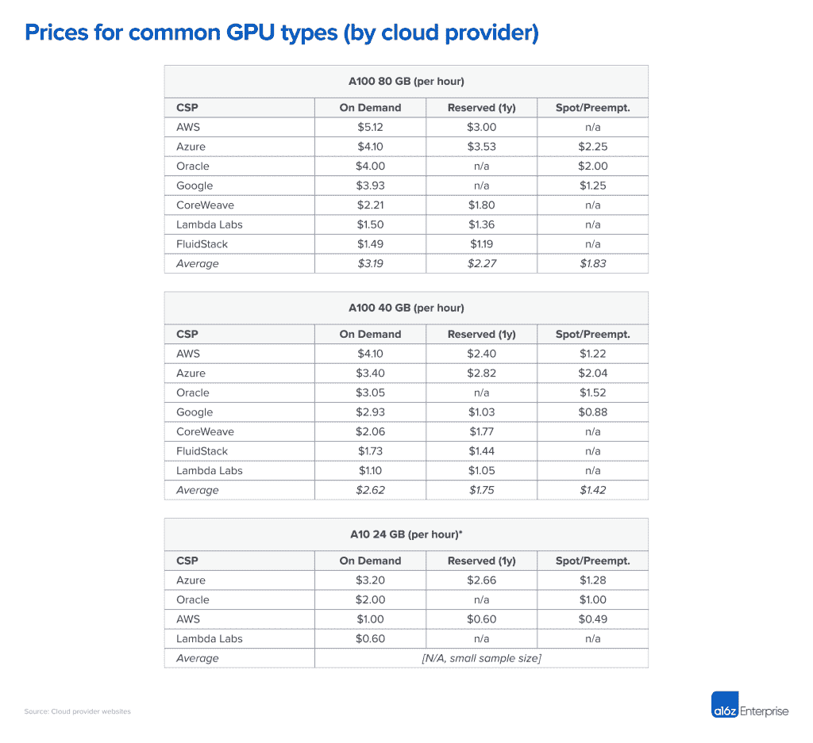

# 惊人算力成本背后，AI混战下如何选择基础设施？

> 来源：[https://waytoagi.feishu.cn/docx/Ena1dshIvoJ9CGxFpGXcUqognGO](https://waytoagi.feishu.cn/docx/Ena1dshIvoJ9CGxFpGXcUqognGO)

# 或 AI混战下如何应对AI计算的惊人成本

> **原文标题：Navigating the Hig**h Cost of AI Compute

> **原文链接：****h**ttps://a16z.com/2023/04/27/navigating-the-high-cost-of-ai-compute/

> **by ****Gu**[**ido Appenzelle**](https://a16z.com/author/matt-bornstein/)**r, Mat**[**t Bornstein, **](https://a16z.com/author/martin-casado/)and Martin Casado

Source: Midjourney

生成式AI热潮是以算力是为基础的。其独特性在于算力的大小直接影响着数据处理能力的强弱，更大的算力造就更好的产品。通常情况下，研发投资与产品的价值直接挂钩，且这种关系明显是亚线性的（这种增长并不是成比例的，而是逐渐减缓的）。但人工智能行业并非如此，推动行业发展的主要因素就是训练和推理的成本。

虽然我们不知道真实成本是多少，据可靠信息得知，算力缺口巨大，需求高达10倍！所以我们可以公平地说，现在，获得算力资源——以最低的总成本——已经成为AI公司成功的决定性因素。

事实上，许多AI公司将其募集资金的80%以上用于算力资源！

在这篇文章中，我们试图分解AI公司的成本因素。绝对数字当然会随着时间的推移而变化，但我们并没看到AI公司受算力资源的约束得以快速缓解。下面希望为大家提供一个有用的思考框架。

# 为什么AI模型的计算成本如此之高？

生成式AI模型有很多种，推理和训练成本取决于模型的大小和类型。幸运的是，当今最流行的模型大多是基于 Transformer （变换器）的架构[，其](https://arxiv.org/abs/1706.03762)中包括流行的大型语言模型 (LLM)，例如 GPT-3、GPT-J 或 BERT。虽然 Transformer 的推理和学习的精确操作数是模型特定的（请参阅本文），但有一个相当准确的经验法则，即取决于模型的参数数量（即神经网络的权重）和输入和输出令牌的数量。

令牌本质上是几个字符的短序列。它们对应于单词或单词的一部分（子词或字符）。了解令牌的最好方法是尝试使用公开可用的在线令牌器（例如，OpenAI）进行令牌化。对于GPT-3，令牌的平均长度是4个字符。

Transformer 的经验法则是，对于具有p 个参数且长度为n 个令牌的输入和输出序列的模型 ，前向传递（即推理）大约需要2np浮点运算(FLOP¹ )。训练同样的模型，每个令牌大约需要6p* FLOPs（即，额外的反向传递需要四次更多的操作² ）。您可以将其乘以训练数据中的令牌数量来估算总训练成本。

Transformer 的内存要求也取决于模型大小。为了进行推理，我们需要p 模型参数不得超过内存的大小。为了学习（即反向传播），我们需要在前向和反向传递之间为每个参数存储额外的中间值。假设我们使用 32 位浮点数，则每个参数需要额外的 8 个字节。为了训练 1750 亿个参数的模型，我们需要在内存中保存超过 1 TB 的数据——这超过了当今现有的任何 GPU，我们需要将模型拆分到多个卡上。通过使用较短长度的浮点值，可以优化推理和训练的内存需求，其中16位浮点算力已经很常见，8位浮点算力预计在不久的将来出现。

> 这里的16位和8位是指浮点数的长度，也就是用多少位来表示一个浮点数。浮点数的长度越短，占用的内存空间越小，计算速度也越快，但是精度也会降低。

上表显示了几种流行模型的大小和计算成本。GPT-3大约有1750亿个参数，对于1024个令牌的输入和输出，计算成本大约是350万亿次浮点运算（即太浮点运算或TFLOPs）。训练一个像GPT-3这样的模型需要大约3.14*10^23次浮点运算。其他模型，如Meta的LLaMA，有更高的计算要求。训练这样一个模型是人类迄今为止进行的计算量最大的任务之一。

总之：AI基础设施之所以昂贵，是因为底层的算法问题计算难度极大。与GPT-3生成一个单词的复杂度相比，对一百万个条目的数据库表进行排序的算法复杂性显得微不足道。这意味着你要选择最小的模型来解决你的用例。

好消息是，根据变换器的经验法则，我们可以轻松估计一个特定大小的模型将消耗多少算力和内存。因此，选择合适的硬件成为我们下一个考量因素。

# GPU的时间和成本论证

计算复杂度如何转化为时间？处理器内核[每个周期通常可以执行1-2条指](https://en.wikipedia.org/wiki/Dennard_scaling)令，而由于Dennard Scaling的约束，处理器时钟频率在过去15年里一直稳定在3 GHz左右。在不利用任何并行架构的情况下，执行单个GPT-3的推理操作需要大约350 TFLOPs/(3 GHz*1 FLOP)或116000秒，即32小时。这非常不切实际，我们需要专门的芯片来加速这个任务。

实际上，当今所有AI模型都在使用了大量专用芯片的GPU卡上运行。例如，NVIDIA A100 GPU有512个“张量核心”，它们可以在一个周期内执行一个4×4矩阵乘法（相当于64次乘法和加法，或128 FLOPs）。AI加速卡通常被称为GPU（图形处理单元），因为这种架构最初是为桌面游戏开发的。未来，我们预计AI将增长成为一个独立的产品系列。

A100的标称性能为312 TFLOPs，理论上可以将GPT-3的推理时间缩短到大约1秒。然而，这是一个过于简化的计算，原因如下：

首先，对于大多数用例，瓶颈不是GPU的计算能力，而是将数据从专用的图形内存传输到张量核心的能力。

其次，1750亿个权重占用了700GB的空间，无法放入任何 GPU 的图形内存中。需要使用分区和权重流等技术。

第三，有许多优化方法（例如，使用较短的浮点表示，如FP16、FP8或稀疏矩阵）用于加速计算。

总体而言，上述数字让我们对当今LLMs的总体计算成本有了直观的了解。

一个Transformer 模型通常需要大量的令牌来训练，训练Transformer 模型每个令牌所需的时间大约是推理时间的三倍。然而，训练数据集大约比推理提示（即interfence prompt） 大3亿倍，训练时长延长了10亿倍。在单个GPU上，训练需要几十年的时间；实际上这是在专用数据中心或更可能是在云中的大型计算集群上完成的。训练也比推理更难以并行化，因为更新后的权重必须在节点之间交换。由于高速互连和专用结构的普遍存在，GPU之间的内存和带宽往往成为更重要的因素。对训练非常大的模型而言，创建合适的网络设置将是首要挑战。展望未来，AI加速器在GPU卡甚至芯片上集成网络能力也不是不可能。

这种计算复杂度又如何转化为成本呢？正如我们上面所提到的，GPT-3推理在A100上大约需要1秒，在上述费率下进行1000个令牌的原始计算成本在0.0002美元和0.0014美元之间（与OpenAI定价0.002美元/1000令牌相比）。每天生成100次推理请求的用户每年花费大约几美元。这是一个非常低的价格，使得大多数基于文本的AI用例在经济上是可行的。

另一方面，训练GPT-3要昂贵得多。在上述费率下只计算3.14*10^23 FLOPs的计算成本，我们可以估计A100卡上的单次训练费用为56万美元。实际上，我们在GPU上训练不会获得近100%的效率；我们可以使用优化来减少训练时间。GPT-3训练成本估计从50万美元到460万美元不等，具体取决于所需硬件的假设或预测。注意，这是单次运行的成本，而不是总成本。为达到最佳的模型性能和效果，可能需要多次运行训练过程，且云计算提供商也会希望长期合作（下面会详细介绍）。训练最先进的模型仍然很昂贵，但在资金充足的初创公司可承受范围内。

总之，生成式AI需要在基础设施上进行巨大投资，没有理由相信这会在不久的将来发生改变。训练像 GPT-3 这样的模型是人类有史以来计算量最大的任务之一。尽管 GPU 变得越来越快，并且我们找到了优化训练的方法，但人工智能的快速扩张抵消了这两种影响。

# AI基础设施的考虑因素

至此，你对AI模型的训练和推理所需的规模以及驱动它们的底层参数有了直观了解。我们现在想就如何决定使用哪种AI基础设施提供一些实用指南。

## 外部 vs. 内部基础设施

让我们面对现实吧：GPU很酷。许多工程师和有工程思维的创始人都倾向于配置自己的AI硬件，这样不仅可以对模型训练进行细粒度的控制，而且使用高性能的计算机或云服务来执行复杂的任务或创造新的东西，可以带来一种满足感或兴奋感（见图表A）。

然而，事实是，许多创业公司——尤其是应用公司——不需要在成立第一天就建立自己的AI基础设施。相反，像OpenAI或Hugging Face（针对语言）和Replicate（针对图像生成）等采用托管模型服务，可以让创始人迅速寻找产品市场契合度，且无需管理底层基础设施或模型。

这些服务已经足够好，以至于许多公司离不开它们。开发者可以通过提示工程和更高阶的微调抽象（即通过API调用进行微调）来实现对模型性能的有意义的控制。这些服务的定价是基于消费量的，这通常也比运行单独的基础设施更便宜。我们看到一些应用公司在后台运行托管模型服务，产生了超过5000万美元的年收入，估值超10亿美元。

另一方面，一些创业公司——尤其是那些训练新的基础模型或构建垂直集成AI应用程序的公司——不可避免直接在GPU上运行自己的模型。要么是因为模型本身就是产品，团队正在寻找“模型-市场契合度”，要么是因为需要对训练和/或推理进行细粒度的控制，才能实现某些功能或大规模降低边际成本。无论哪种方式，管理基础设施都可以成为竞争优势的来源。

## 云 vs. 数据中心建设

在大多数情况下，云是AI基础设施的合适之选。对大多数创业公司和大公司，较少的前期成本、规模可伸缩性、区域可用性以及减少构建自己数据中心的干扰都极具吸引力。

但也有一些例外：

+   如果你的运营规模非常大，那么运行自己的数据中心可能会更具成本效益。具体的成本根据地理位置和设置而异，但通常每年需要超过5000万美元的基础设施支出。

+   你需要非常特定的硬件，无法从云提供商那里获得。例如，未广泛使用的GPU类型，以及不寻常的内存、存储或网络需求。

+   你无法找到一个符合地缘政治考虑的云。

如果你确实想建立自己的数据中心，可针对自己的设置进行全面的GPU价格/性能分析（例如Tim Dettmer的分析）。除了GPU本身的成本和性能外，硬件选择还取决于功率、空间和冷却需求。例如，两张RTX 3080 Ti卡的原始计算能力与A100相当，但各自的功耗分别为700W和300W。在三年生命周期内，以0.10美元/千瓦时的市场价格计算，3,500千瓦时的功率差异将使RTX3080 Ti的成本增加近2倍（约1000美元）。

尽管如此，我们预计绝大多数创业公司都会使用云计算。

## 比较云服务提供商

亚马逊网络服务（AWS）、微软Azure和谷歌云平台（GCP）都提供GPU实例，但也有一些专门专注AI工作负载的新服务商出现。以下是许多创始人用来选择云服务提供商的框架：

### **价格：**

下表显示了截至2023年4月7日的一些主要和小型专业云的定价。这些数据仅供参考，因为实例在网络带宽、数据出口成本、CPU和网络的额外成本、可用折扣和其他方面有很大差异。例如，谷歌为支持A100 40GB的GPU，需使用A2加速优化实例，这会增加25%的成本。

特定硬件上的计算能力是一种商品。我们很天真地想，其价格水平应非常接近，但事实并非如此。虽然云计算之间存在着相当大的功能差异，但这不足以解释按需使用NVIDIA A100的定价在不同的云提供商之间相差近4倍。

在高端云市场，大型公共云基于品牌声誉、经验证的可靠性和管理各种工作负载的需求而收取溢价。小型专业AI提供商则通过运行专用数据中心（例如 Coreweave）或套利其他云（例如 Lambda Labs）来提供更低的价格。

实际上，大多数大型买家直接与云提供商协商价格，通常承诺最低支出要求以及最短使用时间（我们看到过1-3年）。经过协商，云计算之间的价格差异有所缩小，但我们看到上表中的排名相对稳定。值得注意的是，较小的公司可以从专业云提供商获得有竞争力的价格，而无需做出大量支出承诺。

### **可用性：**

在过去 12 个多月里，最强大的 GPU（例如 Nvidia A100）一直供不应求。

理论上来说，前三大云提供商由于拥有资金和技术优势，建立了更多的数据中心和服务器，应该有最好的可用性。但令人惊讶的是，许多创业公司发现并非如此。大型云拥有很多硬件，但也要满足大量客户需求——例如，Azure是ChatGPT的主要托管方——并且不断增加/租赁容量以满足需求。与此同时，Nvidia承诺在整个行业广泛提供硬件，包括为新的专业提供商分配。 （他们这样做既是为了公平，也是为了减少对少数几个与他们竞争的大客户的依赖。）

因此，许多初创公司在较小的云提供商处找到了更多可用芯片，包括尖端的 Nvidia H100。如果与新的基础设施公司合作，也许可以减少硬件的等待时间，并在此过程中节省成本。

### **计算交付模式：**

目前，大型云只提供具有专用GPU的实例，因为GPU虚拟化尚未解决。专业AI云提供其他模式，如容器或批处理作业，可以处理单个任务而不产生实例启动和拆除成本。如果你使用这种模式，可以大大降低成本。

### **网络互连：**

对于训练来说，网络带宽是选择云提供商的主要因素。需要在节点之间具有专用结构的集群（例如 NVLink）来训练某些大型模型。对于图像生成来说，出口流量费用也可能是一个主要成本驱动因素。

### **客户支持：**

大型云提供商拥有成千上万种产品服务和庞大的客户群。除非你是一个大客户，否则很难引起客户支持部的注意或为你专门解决问题。相反地，许多专业AI云即使是针对小客户，也提供快速响应和灵敏支持。因为他们运营规模较小，且他们的工作负载更加同质化——所以他们更有动力专注于AI特定的功能和错误。

## 比较GPU

在其他条件相同的情况下，顶级GPU在几乎所有工作负载上都会表现最佳。然而，正如下表所示，最好的硬件也要昂贵得多。根据具体应用选择合适的GPU可以大大降低成本，也可能使你的商业模式从不可行变为可行。

决定要往下走多远——也就是说，确定对你的应用来说最具成本效益的GPU选择——主要是一个技术决策，超出了本文的讨论范围。但我们将在下面分享一些我们认为最重要的选择标准：

### 训练**与推理：**

正如我们在上文第一节看到的，训练 Transformer 模型除了模型权重外，还需要存储 8 字节的数据用于训练。这意味一个内存12GB的典型高端消费级 GPU 几乎无法用于训练 40 亿参数的模型。实际上，训练大型模型是在机器集群上完成的，最好是每台服务器有多个 GPU、大量 VRAM 以及服务器之间的高带宽连接（即使用顶级数据中心 GPU 构建的集群）。

具体来说，许多模型在 NVIDIA H100 上最具成本效益，但截至今天很难找到在 NVIDIA H100上运行的模型，而且通常需要一年以上的长期合作承诺。如今，更多的选择是在NVIDIA A100 上运行大多数模型训练，但对于大型集群，仍需要长期承诺。

### **内存要求：**

大型 LLM 的参数数量太多，任何卡都无法容纳。它们需要分布到多个卡中，并且需要类似于训练的设置。换句话说，即使进行LLM推理，您也可能需要H100或A100。但是较小的模型（例如Stable Diffusion）需要的VRAM要少得多。虽然A100仍然很受欢迎，但我们已经看到初创公司使用A10，A40，A4000，A5000和A6000，甚至RTX卡。

### **硬件支持：**

虽然我们采访过的公司的绝大多数工作负载都在 NVIDIA 上运行，但也有一些开始尝试其他供应商。最常见的是谷歌TPU，英特尔的Gaudi2 似乎也有一些吸引力。这些供应商面临的挑战是，模型的性能往往高度依赖于这些芯片的软件优化是否可用。你可能需要执行 PoC 才能了解性能。

### 延迟**要求：**

一般来说，对延迟不太敏感的工作负载（例如，批处理数据处理或不需要交互式 UI 响应的应用程序）可以使用功能较弱的 GPU。这可以将计算成本降低多达 3-4 倍（例如，在 AWS 上将 A100 与 A10 进行比较）。另一方面，面向用户的应用程序通常需要高端GPU卡来提供引人入胜的实时用户体验。优化模型是必要的，以使成本降低到可管理的范围。

### 峰值**：**

AI技术是如此新颖和令人兴奋，生成式AI公司的需求经常急剧上升，新产品一经发布，请求量每天增加 10 倍，或者每周持续增长 50%，这种情况并不罕见。在低端 GPU 上处理这些峰值通常更容易，因为更多的计算节点可能随时可用。如果这种流量来自于参与度较低或留存率较低的用户，那么以牺牲性能为代价使用较低成本的资源也是有意义的。

# **优化和调度模型**

软件优化可以极大地影响模型的运行时间——10倍的增益并不罕见。然而，你需要确定哪些方法对你的特定模型和系统最有效。

某些技术适用于相当广泛的模型。使用较短的浮点表示（即 FP16 或 FP8 与原始 FP32）或量化（INT8、INT4、INT2）可实现通常与位数减少呈线性关系的加速。有时需要修改模型，但越来越多的技术可以自动处理混合或更短的精度。剪枝神经网络通过忽略低值的权重来减少权重数。结合高效的稀疏矩阵乘法，这可以在现代 GPU 上实现大幅加速。另一组优化技术解决了内存带宽瓶颈（例如，通过流式模型权重）。

其他优化很大程度上取决于模型的特性，例如，Stable Diffusion在推理所需的VRAM量方面取得了重大进展。另一类优化方法是针对硬件的。NVIDIA的TensorRT包含了许多优化，但只能NVIDIA硬件上运行。NVIDIA TensorRT是基于CUDA和cuDNN的高性能的深度学习推理优化引擎，是一种在 NVIDIA 硬件上部署光速推理的解决方案。

最后，也是最重要的，AI任务的调度可以造成巨大的性能瓶颈或改进。以一种最小化权重交换的方式将模型分配给GPU，如果有多个GPU可用，选择最适合任务的GPU，以及通过提前批量处理工作负载来最小化停机时间，都是常用的技术。

总之，模型优化仍然有点像黑魔法，我们交流过的大多数创业公司都与第三方合作来处理一些软件方面的问题。通常，这些不是传统的MLops供应商，而是专门针对特定生成模型进行优化的公司（例如OctoML或SegMind）。

# AI**基础设施成本将如何演变？**

在过去的几年里，我们见证了[模型参数](https://huggingface.co/blog/large-language-models)和[GPU 计算能力](https://epochai.org/blog/trends-in-gpu-price-performance#:~:text=We%20find%20that%20FLOP%2Fs,price%2Dperformance%20for%20all%20GPUs.)%E5%91%88%E6%8C%87%E6%95%B0%E7%BA%A7%E5%A2%9E%E9%95%BF%E3%80%82%E7%9B%AE%E5%89%8D%E5%B0%9A%E4%B8%8D%E6%B8%85%E6%A5%9A%E8%BF%99%E7%A7%8D%E8%B6%8B%E5%8A%BF%E6%98%AF%E5%90%A6%E4%BC%9A%E6%8C%81%E7%BB%AD%E4%B8%8B%E5%8E%BB%E3%80%82)的指数级增长。目前尚不清楚这种趋势是否会持续下去。

如[今，人们普遍认为最佳参数数量](https://www.deepmind.com/publications/an-empirical-analysis-of-compute-optimal-large-language-model-training)和训练数据集的大小之间[存在一种相关性（有关更多](https://commoncrawl.org/)信[息，请参阅 D](https://booksearch.blogspot.com/2010/08/books-of-world-stand-up-and-be-counted.html)eepmind 的Chinchilla工作）。当今最好的LLMs是在Common Crawl（45 亿个网页的集合，约占现有所有网页的 10%）进行训练的。训练语料库还包括维基百科和藏书，尽管两者要小得多（现存书籍总数估计只有10 亿册左右）。人们还提出了其他想法，例如转录视频或音频内容，但这些想法的规模都无法与之相媲美。目前尚不清楚我们是否可以获得比已使用数据大 10 倍的非合成训练数据集。

GPU（图形处理器）的性能会继续提高，但速度会变慢。摩尔定律仍然有效，它预测了芯片上晶体管的数量和核心的数量会不断增加，从而提高了计算能力。但是，功耗和I/O（输入/输出）成为了限制因素，因为它们会影响芯片的运行效率和稳定性。此外，许多优化芯片性能的方法已经被使用过了，没有太多的空间来进一步改进。

然而，这并不意味着我们对计算能力的需求不会增加。模型和训练集的增长可能会放缓，但是人工智能行业的发展和人工智能开发者的增加仍然会推动更多、更快 GPU 的需求。在模型开发阶段，开发者需要使用大量的GPU来进行测试，这种需求与人员规模成正比。目前没有迹象表明我们今天面临的GPU短缺现象会在短期内缓解。

人工智能[基础设施的持续高成本](https://a16z.com/2023/01/19/who-owns-the-generative-ai-platform/)是否会形成一条护城河，使新进者无法赶上资金资源充足的现有从业者？我们还不知道这个问题的答案。如今，LLMs的训练成本可能看起来像是一条护城河，但 Alpaca 或 Stable Diffusion 等开源模型已经表明，市场仍处于早期阶段，可能会迅速发生变化。随着时间的推移，新兴人工智能软件堆栈的成本结构（请参阅我们之前的文章）可能看起来更像传统软件行业。

最终，这将是一件好事：历史表明，这会带来充满活力的生态系统，为创业者带来快速创新和大量机会。

感谢 Moin Nadeem 和 Shangda Xu 在写作过程中的投入和指导。

---

¹ 这里的直觉是，对于神经网络中的任何参数（即权重），推理操作（即前向传递）需要对每个参数执行两次浮点运算。首先，它将神经网络输入节点的值与参数相乘。其次，它将求和的结果添加到神经网络的输出节点。编码器中的参数每个输入令牌使用一次，解码器中的参数每个输出令牌使用一次。如果我们假设模型有p 个参数，并且输入和输出的长度均为n 个标记*，则总浮点运算为n * p*。模型中还发生许多其他操作（例如归一化、编码/解码嵌入），但相比之下，执行这些操作所需的时间很短。

²学[习首先需要如上所述通过](https://arxiv.org/abs/2005.14165)变压器进行前向传递，然后是反向传递，每个参数需要四次额外的操作来计算梯度并调整权重。请注意，计算梯度需要保留前向传播中计算出的节点值。对于 GPT-3，*语言模型是少样本学习者*讨论了训练成本。