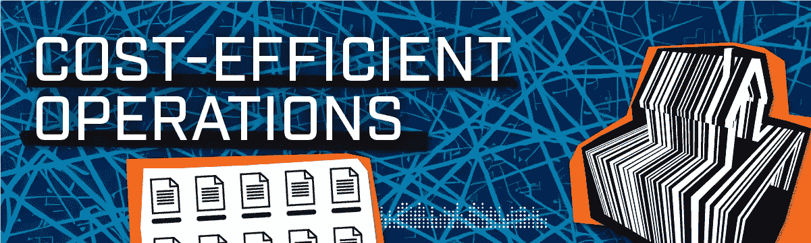
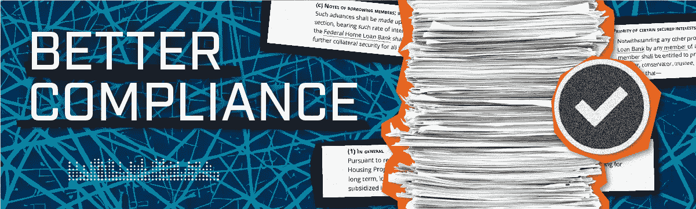
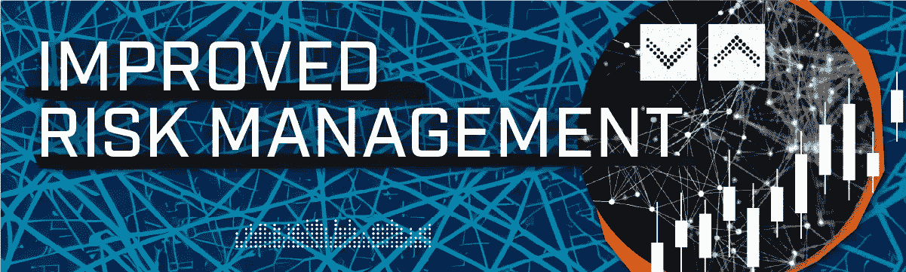
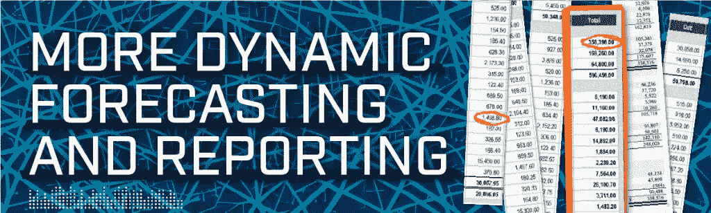

# 金融服务业将比你想象得更快地接纳生成式 AI

> 来源：[https://waytoagi.feishu.cn/docx/XEqUd0VphoJ7eJxA2hAcDFsBnud](https://waytoagi.feishu.cn/docx/XEqUd0VphoJ7eJxA2hAcDFsBnud)

> 原文地址：https://a16z.com/2023/04/19/financial-services-will-embrace-generative-ai-faster-than-you-think/

> 原文作者：Angela Strange, Anish Acharya, Sumeet Singh, Alex Rampell, Marc Andrusko, Joe Schmidt, David Haber, Seema Amble

> 发表时间：2023年4月19日

> 译者：通往 AGI 之路，若有瑕疵之处，请在段落评论中斧正，谨此致谢

人工[智能](https://a16z.com/2023/02/08/the-future-of-learning-education-knowledge-in-the-age-of-ai/)和[机器](https://a16z.com/2022/11/17/the-generative-ai-revolution-in-games/)学[习在](https://a16z.com/2023/02/07/everyday-ai-consumer/)金融服务行业的应用已经有十多年的历史，它们已经促成了从更好的信贷评估到更精确的基础欺诈评分等一系列的改进。大型语言模型（LLMs）通过生成式人工智能，代表着一次重大的飞跃，正在改变教育、游戏、商业等多个领域。与传统的AI/ML主要侧重于基于现有数据进行预测或分类不同，生成式人工智能可以创造全新的内容。

这种能力，结合了对大量非结构化数据的训练和实际上无限的计算能力，可能将带来金融服务市场数十年来最大的变革。与其他平台转变——如互联网、移动设备、云计算——不同，在这些转变中金融服务行业的采用速度较慢，在这里，我们预计最优秀的新公司和现有企业将立即开始接纳生成式人工智能。

金融服务公司拥有大量的历史金融数据；如果他[们使用这些数据来微调大型](https://www.cnbc.com/2023/04/13/bloomberg-plans-to-integrate-gpt-style-ai-into-its-terminal.html)语言模型（或者像BloombergGPT那样从零开始训练模型），他们将能够迅速地回答几乎任何金融问题。例如，一个经过公司客户聊天记录和一些额外产品规格数据训练的LLM，应该能够立即回答有关公司产品的所有问题，而一个经过公司十年可疑活动报告（SARs）训练的LLM，应该能够识别出一组表明存在洗钱计划的交易。我们相信金融服务行业已经准备好使用生成式人工智能来实现五个目标：个性化的消费者体验、成本效益高的运营、更好的合规性、改进的风险管理、以及动态的预测和报告。

在[现有企业与初创公司之间的竞争](https://a16z.com/2015/11/05/distribution-v-innovation/)中，由于拥有对专有金融数据的访问权限，现有企业在使用AI推出新产品和改进运营时将拥有初始优势，但他们最终将受到对准确性和隐私的高标准的限制。另一方面，新进入者最初可能需要使用公开的金融数据来训练他们的模型，但他们将迅速开始生成自己的数据，并逐渐使用AI作为新产品分销的突破口。

让我们深入了解这五个目标，看看现有企业和初创公司如何利用生成式 AI。

## 个性化的消费者体验

尽管消费金融科技公司在过去 10 年取得了巨大的成功，但他们尚未实现他们最宏伟的承诺：在没有人工干预的情况下，优化消费者的资产负债表和损益表。这个承诺尚未实现，是因为用户界面无法完全捕捉影响金融决策的人类背景，或以帮助人们做出合适权衡的方式提供建议和交叉销售。

一个很好的例子是，消费者在[经济困难时如何优先支付账单](https://a16z.com/2022/08/17/consumer-fintech-returns-to-the-trend-line-august-2022-fintech-newsletter/)。消费者在做这样的决定时，往往会同时考虑效用和品牌，而这两个因素的相互作用使得创建一个完全捕捉如何优化这一决策的体验变得复杂。例如，这使得在没有人工员工参与的情况下提供最佳信用指导变得困难。尽管像 Credit Karma 这样的体验可以引导客户完成 80% 的旅程，但剩下的 20% 成了一个诡异的谷地，进一步尝试捕捉背景的尝试往往过于狭隘或使用了错误的精确度，从而破坏了消费者的信任。

在现代财[富管理和税务](https://reason.com/2022/04/15/americans-will-spend-6-5-billion-hours-on-income-taxes-this-year/)准备中也存在类似的不足。在财富管理方面，即使是那些专注于特定资产类别和策略的金融科技解决方案，人类顾问也能胜过它们，因为人们的决策深受特殊的希望、梦想和恐惧的影响。这就是为什么人类顾问历来能够比大多数金融科技系统更好地为他们的客户量身定制建议的原因。在税务方面，即使在现代软件的帮助下，美国人每年在税务上花费超过 60 亿小时，犯下 1200 万个错误，而且经常遗漏收入或放弃他们不知道的权益，例如可能扣除工作旅行费用。

大语言模型（LLMs）通过更好地理解和导航消费者的金融决策，为这些问题提供了一个整洁的解决方案。这些系统可以回答问题（“为什么我的投资组合中有一部分在市政债券中？”），评估权衡（“我应该如何看待期限风险与收益率？”），并最终将人类背景纳入决策中（“你能建立一个足够灵活的计划，在将来的某个时候帮助我经济支持年迈的父母吗？”）。这些功能应该将消费金融科技从一个高价值但狭隘的应用集合转变为一个可以帮助消费者优化整个金融生活的应用集合。

–Anish Acharya 和 Sumeet Singh

## 具有成本效益的运营

在一个[充斥着](https://www.imdb.com/title/tt2294677/)生成式 AI 工具的银行世界里，Sally 应该持续得到信贷审批，以便在她决定购房时，她已经获得了预先批准的抵押贷款。

不幸的是，这样的世界尚未存在，主要有三个原因：

+   首先，消费者信息存在于多个不同的数据库中。这使得交叉销售和预测消费者需求变得极具挑战性。

+   其次，金融服务被认为是情感购买，通常具有复杂且难以自动化的决策树。这意味着银行必须聘请大型客户服务团队，根据客户的个人情况回答客户关于哪种金融产品最适合他们的许多问题。

+   第三，金融服务是高度受监管的。这意味着像贷款员和处理员这样的人类员工必须参与每一个可用的产品（例如，抵押贷款）的流程，以确保符合复杂但非结构化的法律。

生成式 AI 将使从多个位置获取数据、理解非结构化的个性化情境和非结构化的合规法律的劳动密集型功能效率提高 1000 倍。例如：

+   客户服务代表：在每家银行，成千上万的客户服务代表都必须对银行的产品和相关的合规要求进行痛苦的培训，以便回答客户的问题。现在想象一下，一个新的客户服务代表开始工作，他们可以使用已经经过过去 10 年所有银行部门客户服务通话训练的大语言模型。代表可以使用该模型快速生成任何问题的正确答案，并帮助他们更聪明地谈论更广泛的产品，同时减少培训他们所需的时间。现有公司会希望确保他们的专有数据和客户特定的个人身份信息没有被用于改进其他公司可能使用的通用大语言模型。新进入者将必须在如何启动数据集方面具有创意。

+   贷款员：贷款员目前从近十个不同的系统中提取数据来生成贷款文件。一个生成式 AI 模型可以在这些系统的所有数据上进行训练，这样贷款员只需提供客户名称，贷款文件就会立即为他们生成。贷款员可能仍然需要确保 100% 的准确性，但他们的数据收集过程将更加高效和准确。

+   质[量保证：银](https://www.usevesta.com/)行和金融科技公司的大部分质量保证工作都涉及确保完全符合众多监管机构的要求。生成式 AI 可以大大加速这个过程。例如，Vesta可以整合一个经过 Fannie Mae 销售指南训练的生成式 AI 模型，以便立即提醒抵押贷款员合规问题。由于许多监管指南都是公开的，这可能为新的市场参与者提供了一个有趣的入口。然而，真正的价值仍然将归属于拥有工作流引擎的公司。

这些都是迈向一个世界的步骤，在这个世界里，Sally 可以即时获得可能的抵押贷款。

-- Angela Strange, Alex Rampell, 和 Marc Andrusko

## 更好的合规性

未来拥抱生成式 AI 的合规部门可能有望阻止每年[在全球范围内](https://www.zippia.com/advice/money-laundering-statistics/)非法洗钱的 8000 亿到 2 万亿美元。毒品贩运、有组织犯罪和其他非法活动都将看到数十年来最大幅度的减少。

[如今，目前花费](https://a16z.com/2020/01/21/every-company-will-be-a-fintech-company-2/)在合规性[上的数十亿美](https://a16z.com/2021/10/15/open-source-is-finally-coming-to-financial-services/)元仅在阻止犯罪洗钱方面具有 3% 的有效性。合规软件主要是建立在“硬编码”规则之上。例如，反洗钱系统使合规官员能够运行像“标记任何超过 1 万美元的交易”这样的规则，或者扫描其他预定义的可疑活动。应用这样的规则可能是一种不完美的科学，导致大多数金融机构被他们法律上有义务调查的假阳性结果淹没。合规员工花费大量时间从不同的系统和部门中收集客户信息，以便调查每一笔被标记的交易。为了避免巨额罚款，他们雇佣了数千人，通常占银行员工总数的 10% 以上。

生成式 AI 的未来可能实现：

+   **高效筛查**： 一个生成式AI模型可以迅速将任何个体在不同系统中的关键信息汇总并呈现给合规官员，使合规官员能更快地得出交易是否存在问题的答案。

+   **更准确地预测洗钱者**： 现在想象一个模型，它是根据过去10年的可疑活动报告（SARs）进行训练的。无需明确告诉模型洗钱者是什么，AI可以用来检测报告中的新模式，并创建其自己对洗钱者构成的定义。

+   **更快的文档分析**： 合规部门负责确保公司的内部政策和程序得到遵守，并且遵循监管要求。生成式AI可以分析大量的文档，如合同、报告和电子邮件，并标记需要进一步调查的潜在问题或关注区域。

+   **培训和教育**： 生成式AI可以用于开发培训材料，并模拟真实世界的场景，以教育合规官员关于最佳实践以及如何识别潜在风险和不合规行为。

新进入者可以使用来自数十个机构的公开可用合规数据进行自我启动，并使搜索和综合变得更快、更便捷。较大的公司从多年收集的数据中受益，但他们需要设计适当的隐私功能。合规长期以来一直被视为一个由过时技术支持的不断增长的成本中心。生成式AI将改变这一点。

—Angela Strange 和 Joe Schmidt

## 改善风险管理

Archegos 和 London Whale 可能听起来像是来自希腊神话的生物，但它们都代表了风险管理的非常真实的失败，这些失败使世界上几个最大的银行蒙受了数十亿美元的损失。再加上最近的硅谷银行的例子，就清楚地看出，风险管理对我们许多领先的金融机构来说依然是一个挑战。

尽管AI的进步无法完全消除信用、市场、流动性和操作风险，但我们相信，这项技术可以在帮助金融机构更快地识别、规划和应对这些不可避免出现的风险方面发挥重要作用。在战术上，以下是我们认为AI可以有助于推动更有效风险管理的几个领域：

+   **自然语言处理**： 像ChatGPT这样的LLM模型可以帮助处理大量非结构化数据，如新闻文章、市场报告和分析师研究，从而提供更完整的市场和交易对手风险视图。

+   **实时洞察**： 对市场条件、地缘政治事件和其他风险因素的即时了解可以使公司更迅速地适应不断变化的情况。

+   **预测分析**： 能够运行更复杂的场景并提供早期警告，这可能有助于公司更积极地管理风险敞口。

+   **集成**： 集成不同的系统并使用AI综合信息，可以帮助提供更完整的风险敞口视图，并简化风险管理流程。

—David Haber 和 Marc Andrusko

## 更动态的预测和报告

除了能够帮助回答财务问题外，LLMs还可以帮助金融服务团队改进自己的内部流程，简化财务团队的日常工作流程。尽管金融的几乎每个其他方面都取得了进展，但现代财务团队的日常工作流[程仍然依赖](https://a16z.com/2020/04/15/new-cfo-tools/)于像Excel、电子邮件和需要人工输入的商业智能工具这样的手动流程。由于缺乏数据科学资源，基本任务尚未被自动化，CFO及其直接报告人因此在繁琐的记录和报告任务上花费太多时间，而他们应该专注于金字塔顶端的战略决策。

总体而言，生成式AI可以帮助这些团队从更多的数据源中获取数据，并自动化突出趋势、生成预测和报告的过程。以下是一些例子：

+   预测： 生成式AI可以帮助编写Excel、SQL和BI工具中的公式和查询，从而实现分析的自动化。此外，这些工具可以帮助发现模式，并从更广泛、更复杂的数据集中为预测建议输入（例如，考虑宏观经济因素），并建议如何更容易地适应这些模型，以便为公司决策提供依据。

+   报告： 生成式AI可以帮助自动创建文本、图表、图形等内容，并根据不同的示例调整此类报告，而无需手动将数据和分析整合到外部和内部报告中（例如，董事会材料、投资者报告、周报表）。

+   会计和税务： 会计和税务团队需要花时间咨询规则并了解如何应用它们。生成式AI可以帮助综合、总结，并就税法和潜在的扣除项提出可能的答案。

+   采购和应付账款： 生成式AI可以帮助自动生成和调整合同、采购订单和发票以及提醒。

也就是说，需要注意的是，生成式AI在这里的输出当前仍有局限性，特别是在需要判断或精确答案的领域，这常常是财务团队所需的。生成式AI模型在计算方面持续改进，但目前尚不能完全依赖于其准确性，或者至少需要人工审查。随着模型的快速改进、额外的训练数据和与数学模块的整合能力，它的使用将展现新的可能性。

–Seema Amble

**挑战**

在这五个趋势中，新进入者和现有参与者在将生成式AI的未来变为现实时面临两个主要的挑战。

1.  **使用金融数据训练LLMs**： LLMs目前是在互联网上训练的。金融服务用例将需要使用特定于用例的金融数据来微调这些模型。新进入者可能会开始使用公开的公司财务数据、监管文件和其他易于获取的公开金融数据来优化他们的模型，然后最终在随着时间的推移使用他们自己收集的数据。现有的参与者，如银行或具有金融服务业务的大型平台（例如，Lyft），可以利用他们现有和专有的数据，这可能会给他们带来初步的优势。然而，现有的金融服务公司在接受大型平台转变时往往过于保守。在我们看来，这给了无拖累的新进入者竞争优势。

1.  **模型输出准确性**： 考虑到金融问题的答案可能对个人、公司和社会产生的影响，这些新的AI模型需要尽可能准确。它们不能产生幻觉或编造错误但听起来自信的答案来回应关于个人税收或财务状况的关键问题，它们需要比流行文化查询或通用高中作文的大致答案更准确。一开始，人类经常会作为AI生成答案的最终验证环节。

生成式AI的出现对金融服务公司来说是一个巨大的平台变革，有潜力催生个性化客户解决方案、更加成本高效的运营、更好的合规和改进的风险管理，以及更具动态的预测和报告。现有参与者和初创公司将争夺我们上面概述的两个关键挑战的掌控权。虽然我们还不知道谁将最终胜出，但我们已经知道有一个明确的赢家：未来金融服务的消费者。

