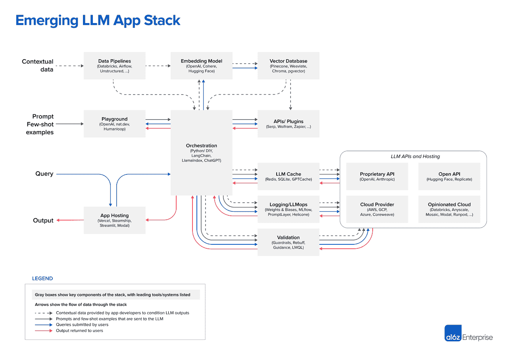
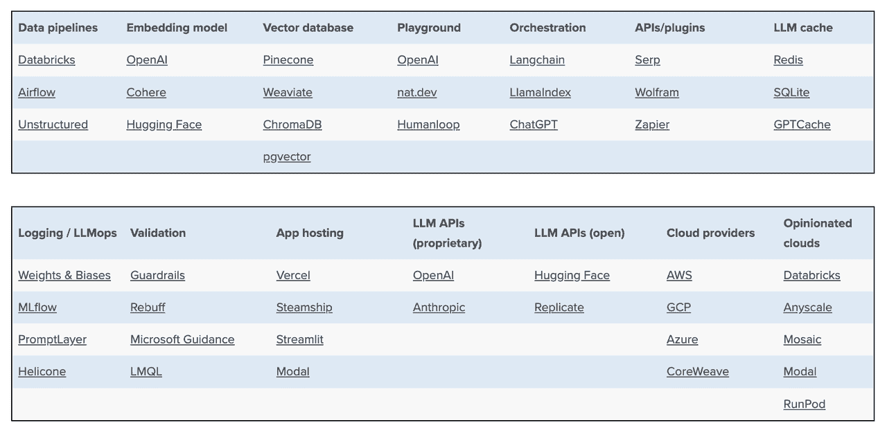
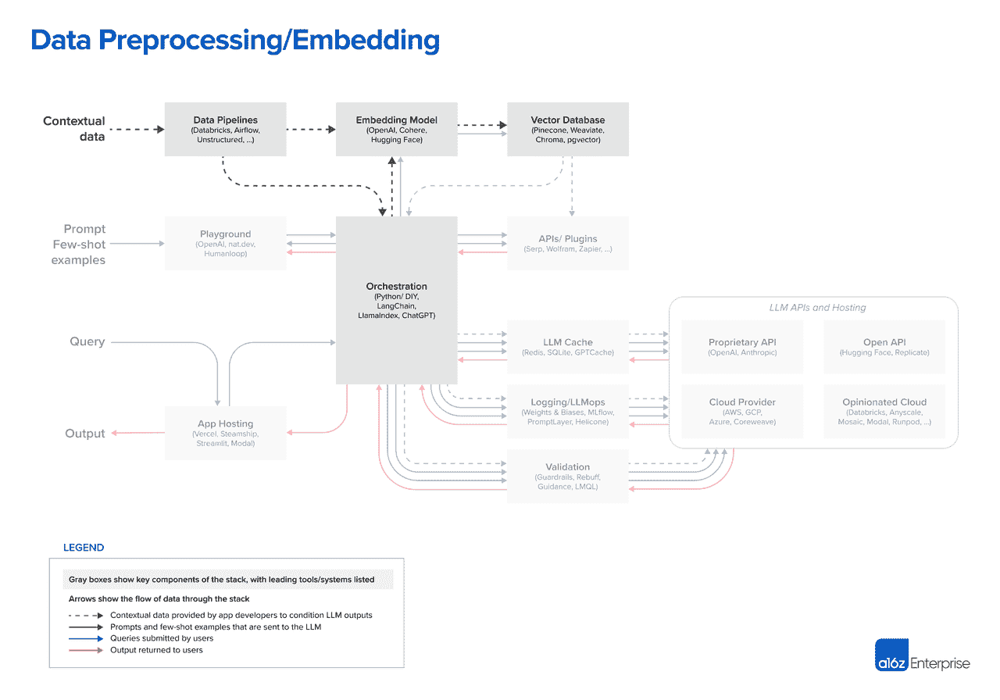
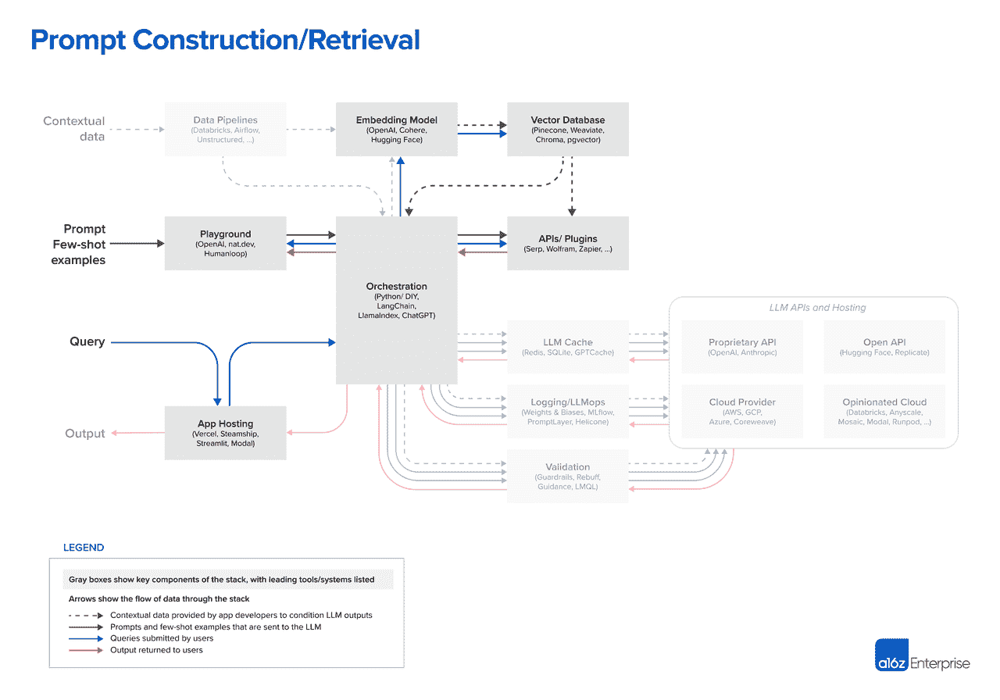
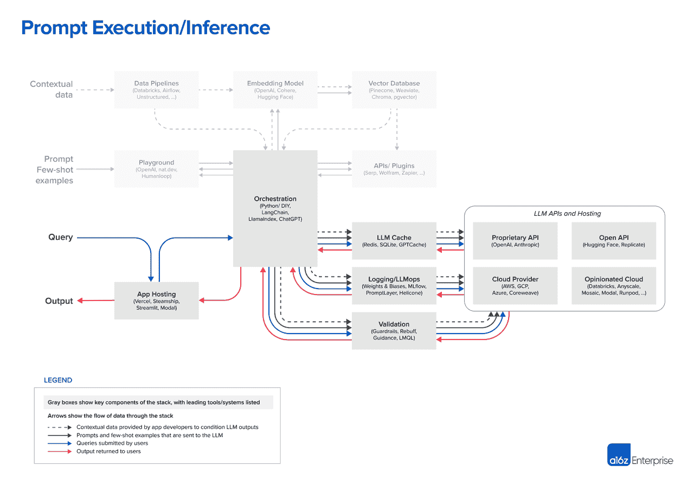

# LLM 应用程序的新兴架构

> 来源：[https://waytoagi.feishu.cn/docx/QFdJdSxW0o6g8RxtbRNcAmSknEd](https://waytoagi.feishu.cn/docx/QFdJdSxW0o6g8RxtbRNcAmSknEd)

> 原文地址：https://a16z.com/2023/06/20/emerging-architectures-for-llm-applications/

> 译者：通往AGI之路，若有瑕疵之处，请在段落评论中斧正，谨此致谢

> 发表时间：2023年6月20日

大型语言模型（LLM）是构建软件的强大新基础设施。但由于它们太新了——并且与普通计算资源的行为如此不同——如何使用它们并不总是显而易见的。

在本文中，我们将分享新兴 LLM 应用程序堆栈的参考架构。它展示了我们见过的 AI 初创公司和成熟的科技公司使用的最常见的系统、工具和设计模式。这个堆栈还处于非常早期的阶段，可能会随着底层技术的进步而发生重大变化，但我们希望它现在能作为使用LLM的开发人员的有用参考。

这项工作基于与 AI 初创公司创始人和工程师的对话。我们尤其依赖于以下人员的意见：Ted Benson、Harrison Chase、Ben Firshman、Ali Ghodsi、Raza Habib、Andrej Karpathy、Greg Kogan、Jerry Liu、Moin Nadeem、Diego Oppenheimer、Shreya Rajpal、Ion Stoica、Dennis Xu、Matei Zaharia 和Jared Zoneraich。感谢你们的帮助！

## 堆栈

这是我们目前对 LLM 应用程序堆栈的看法：

以下是每个项目的链接列表，供快速参考：

> 标题依次为：

+   "Data pipelines" - 数据管道

+   "Embedding model" - 嵌入模型

+   "Vector database" - 向量数据库

+   "Playground" - 沙盒环境 / 测试环境

+   "Orchestration" - 编排

+   "APIs/plugins" - API接口/插件

+   "LLM cache" - 大型语言模型缓存

+   "Logging / LLMops" - 日志记录 / 大型语言模型操作

+   "Validation" - 验证

+   "App hosting" - 应用托管

+   "LLM APIs (proprietary)" - 专有的大型语言模型API接口

+   "LLM APIs (open)" - 开放的大型语言模型API接口

+   "Cloud providers" - 云服务提供商

+   "Opinionated clouds" - 有特定策略或观点的云服务

使用大[型语言模型](https://en.wikipedia.org/wiki/In-context_learning_(natural_language_processing))（LLM）构建应用的方法有很多，包括从头开始训练模型、微调开源模型或使用托管的API。我们在这里展示的堆栈是基于上下文学习的，这是我们看到的大多数开发人员开始使用的设计模式（只有在有基础模型的情况下才可能实现）。

下一部分简要解释了这种模式；经验丰富的LLM开发者可以跳过这一部分。

## 设计模式：上下文学习

上下文学习的核心思想是使用现成的LLM（即无需任何微调），然后通过巧妙的提示和在私有的“上下文”数据上条件化来控制它们的行为。

例如，假设您正在构建一个聊天机器人来回答有关一组法律文件的问题。采用一种简单的方法，您可以将所有文档粘贴到 ChatGPT 或 GPT-4 提示中，然后在最后询问有关它们的问题。这可能适用于非常小的数据集，但无法扩展。最大的 GPT-4 模型只能处理约 50 页的输入文本，并且当您接近这个称为上下文窗口的限制时，性能（通过推理时间和准确性衡量）会严重下降。

上下文学习用一个巧妙的技巧解决了这个问题：它不是将所有的文档都与每个LLM提示一起发送，而是只发送少数最相关的文档。而最相关的文档是在……你猜对了……LLM的帮助下确定的。

在非常高的层面上，工作流程可以分为三个阶段：

+   **数据预处理/嵌入**：这个阶段涉及到存储将来要检索的私有数据（在我们的例子中是法律文件）。通常，文档被分成几个块，通过一个嵌入模型传递，然后存储在一个称为向量数据库的专门数据库中。

+   **提示构建/检索**：当用户提交一个查询（在这个例子中是一个法律问题）时，应用程序构建一系列要提交给语言模型的提示。一个编译好的提示通常结合了开发者硬编码的提示模板；称为少量示例的有效输出示例；从外部API检索的任何必要信息；以及从向量数据库检索的一组相关文档。

+   **提示执行/推断**：一旦提示被编译，它们就被提交给预先训练的LLM进行推断，包括专有模型API和开源或自我训练的模型。一些开发者在这个阶段还增加了像日志记录、缓存和验证这样的操作系统。

这看起来像是大量的工作，但通常比替代方案要简单：训练或微调LLM本身。你不需要一个专门的机器学习工程师团队来进行上下文学习。你也不需要托管自己的基础设施或从OpenAI购买昂贵的专用实例。这种模式有效地将一个AI问题简化为一个大多数初创公司和大公司已经知道如何解决的数据工程问题。对于相对较小的数据集，它也倾向于优于微调——因为一个具体的信息需要在训练集中出现至少大约10次，一个LLM才会通过微调记住它——并且可以近实时地整合新数据。

关[于上下文学习的最](https://arxiv.org/abs/2302.10866)大[问题之一是：如](https://blog.gopenai.com/how-to-speed-up-llms-and-use-100k-context-window-all-tricks-in-one-place-ffd40577b4c)果我们只是改变底层模型以增加上下文窗口会发生什么？这确实是可能的，并且是一个活跃的研究领域（例如，请参阅Hyena 论文或最近的这篇文章）。但这伴随着许多权衡——主要是推理的成本和时间与提示的长度成二次方。如今，即使是线性缩放（最好的理论结果）对于许多应用来说成本也过高。按照当前的 API 费率，超过 10,000 个页面的单个 GPT-4 查询将花费数百美元。因此，我们预计不会基于扩展的上下文窗口对堆栈进行大规模更改，但我们将在帖子正文中对此进行更多评论。

[如果您想](https://a16z.com/2023/05/25/ai-canon/)[更深](https://a16z.com/2023/05/25/ai-canon/)入地了解上下文学习， AI 典藏中有许多很棒的资源（尤其是“使用 LLM 进行构建的实用指南”部分）。在这篇文章的其余部分，我们将按照上面的工作流程引导你了解参考堆栈。

## 数据预处理 / 嵌入

LLM 应用程序的上下文数据包括文本文档、PDF，甚至包括 CSV 或 SQL 表等结构化格式。这些数据的数据加载和转换解决方案在我们采访过的开发人员之间差异很大。大多数使用传统的 ETL 工具，如 Databricks 或 Airflow。有些还使用编排框架中内置的文档加载器，例如 LangChain（由 Unstructed 提供支持）和 LlamaIndex（由 Llama Hub 提供支持）。不过，我们认为该堆栈的这一部分相对不发达，并且有机会专门为 LLM 应用程序构建数据复制解决方案。

对于嵌入[，大多数开发人员使](https://github.com/openai/openai-cookbook/blob/main/examples/Customizing_embeddings.ipynb)用 OpenAI API，特别是text-embedding-ada-002模型。它很容易使用（特别是如果你已经在使用其他 OpenAI API），可以提供相当好的结果，并且变得越来越便宜。一些较大的企业也在探索 Cohere，他们的产品工作更专注于嵌入，并且在某些场景下具有更好的性能。对于喜欢开源的开发人员来说，Hugging Face 的 Sentence Transformers 库是一个标准。还可以根据不同的用例创建不同类型的嵌入；这是当今的一种小众实践，但却是一个有前途的研究领域。

从[系统的角度来看，](https://www.pinecone.io/)预处理管道中最重要的部分是向量数据库。它负责高效存储、比较和检索多达数十亿的嵌入（即向量）。我们在市场上看到的最常见的选择是Pinecone。它是默认设置，因为它完全由云托管，因此很容易上手，并且具有大型企业在生产中所需的许多功能（例如，良好的规模性能、SSO 和正常运行时间 SLA）。

不过，有大量可用的向量数据库。尤其：

+   Weaviate、Vespa 和 Qdrant 等开源系统：它们通常具有出色的单节点性能，并且可以针对特定应用进行定制，因此受到喜欢构建定制平台的经验丰富的 AI 团队的欢迎。

+   Chroma 和 Faiss 等本地向量管理库：它们拥有丰富的开发人员经验，并且易于启动小型应用程序和开发实验。它们不一定能大规模替代完整的数据库。

+   诸如 pgvector 之类的 OLTP 扩展：对于看到每个数据库形状的漏洞并尝试插入 Postgres 的开发人员，或者从单个云提供商购买大部分数据基础设施的企业来说，这是一个很好的向量支持解决方案。从长远来看，尚不清楚紧密耦合向量和标量工作负载是否有意义。

展望未来，大多数开源向量数据库公司都在开发云服务。我们的研究表明，在云中实现强大的性能，跨越可能的广泛使用案例的设计空间，是一个非常困难的问题。因此，短期内选项集可能不会大规模改变，但长期可能会发生变化。关键的问题是向量数据库是否会类似于它们的OLTP和OLAP同类，围绕一两种流行的系统进行整合。

另一个悬而未决的问题是，随着大多数模型可用上下文窗口的增长，嵌入和向量数据库将如何发展。人们很想说嵌入将变得不那么相关，因为上下文数据可以直接放入提示中。然而，专家对此主题的反馈表明情况恰恰相反——嵌入管道可能会随着时间的推移变得更加重要。大型上下文窗口是一个强大的工具，但它们也需要大量的计算成本。因此，有效利用它们成为当务之急。我们可能会开始看到不同类型的嵌入模型变得流行，直接针对模型相关性进行训练，以及旨在实现和利用这一点的向量数据库。

## 提示构建/检索

促进 LLM 和整合上下文数据的策略正变得越来越复杂，并且作为产品差异化的来源越来越重要。大多数开发人员通过尝试简单的提示来开始新项目，这些提示包括直接说明（零样本提示）或可能的一些示例输出（少样本提示）。这些提示通常会产生良好的结果，但达不到生产部署所需的准确性水平。

下一级的提示技巧旨在将模型响应根据一些事[实](https://www.promptingguide.ai/techniques)[来源，并提供](https://www.promptingguide.ai/techniques)[模](https://www.promptingguide.ai/techniques)型未被训练的外部上下文。《提示工程指南》列出了不少于 12 (!) 种更高级的提示策略，包括思维链、自洽性、生成的知识、思维树、方向刺激以及许多其他策略。这些策略也可以一起使用，以支持文档问题回答，聊天机器人等不同的LLM使用案例。

这就是LangChain 和 LlamaIndex 等编排框架大放异彩的地方。它们抽象出许多提示链的细节；与外部API的接口（包括确定何时需要API调用）；从向量数据库检索上下文数据；并在多个LLM调用中维持内存。它们还为上述许多常见应用提供了模板。它们的输出是要提交给语言模型的一个提示或一系列提示。这些框架在想要启动应用的业余爱好者和初创公司中被广泛使用，其中LangChain是领导者。

LangChain仍然是一个相对新的项目（目前版本为0.0.201），但我们已经开始看到用它构建的应用正在转入生产。一些开发者，特别是LLM的早期采用者，更愿意在生产中切换到原生Python以消除额外的依赖性。但是我们预计，这种自行制作的方法会随着时间的推移，在大多数用例中的使用会减少，这与传统的web应用堆栈有着类似的情况。

眼尖的读者会注意到编排框中有一个看似奇怪的条目：ChatGPT。在[正常情况](https://github.com/openai/chatgpt-retrieval-plugin)下，ChatGPT 是一个应用程序，而不是开发人员工具。但它也可以作为 API 进行访问。而且，如果你仔细观察，它会执行一些与其他编排框架相同的功能，例如：抽象出对定制提示的需求、维持状态，并通过插件、API 或其他来源检索上下文数据。虽然 ChatGPT 不是此处列出的其他工具的直接竞争对手，但可以将其视为替代解决方案，并且它最终可能成为即时构建的可行、简单的替代方案。

## 提示执行 / 推理

如今，OpenAI 已成为语言模型领域的领导者。我们接触的几乎所有开发者都是使用OpenAI API启动新的LLM应用，通常使用的是gpt-4或gpt-4-32k模型。这为应用性能提供了最佳的场景，且易于使用，因为它在广泛的输入领域中运行，并且通常不需要微调或自托管。

当项目投入生产并开始规模化时，更广泛的选择就会发挥作用。我们听到的一些常见问题包括：

+   切换到gpt-3.5-turbo：它比 GPT-4[便宜约 50 倍](https://github.com/ray-project/llm-numbers)，而且速度明显更快。许多应用程序不需要 GPT-4 级别的准确性，但确实需要低延迟推理和对免费用户的成本有效支持。

+   与其他专有供应商 （尤其是 Anthropic 的 Claude 模型）进行实验：Claude 提供快速推理、GPT-3.5 级精度、针对大客户的更多定制选项以及高达 100k 的上下文窗口（尽管我们发现精度会随着长度的增加而降低）输入。

+   将一些请求分流到开源模型：这在高流量的B2C用例（如搜索或聊天）中可能尤其有效，其中查询复杂性有较大的差异，且需要便宜地为免费用户提供服务。

+   这通常与微调开源基础模型结合起来最有意义。我们不会在本文中深入讨论该工具堆栈，但越来越多的工程团队正在使用 Databricks、Anyscale、Mosaic、Modal 和 RunPod 等平台。

+   开源模型可以使用多种推理选项，包括 Hugging Face 和 Replicate 的简单 API 接口；来自主要云提供商的原始计算资源；以及上述列出的更具主见的云服务。

目前，开源模型落后于专有产品，但差距正在开始缩小。Meta 的 LLaMa 模型为开源准确性设定了新的标准，并引发了一系列变体。由于[ L](https://youtu.be/6PDk-_uhUt8?t=139)LaMa 只被授权用于研究用途，许多新的提供商已经介入训练替代基础模型（例如 Together、Mosaic、Falcon、Mistral）。Meta 还在讨论LLaMa 2 的真正开源版本。

当（而不是如果）开源 LLM 达到与 GPT-3.5 相当的准确度水平时，我们期望看到文本的稳定扩散时刻——包括微调模型的大量实验、共享和生产。像 Replicate 这样的托管公司已经在添加工具，让软件开发人员更容易使用这些模型。开发人员越来越相信，更小、经过微调的模型可以在狭窄的用例中达到最先进的准确性。

我们采访过的大多数开发人员还没有深入研究LLM 的操作工具。缓存相对普遍——通常基于 Redis——因为它可以缩短应用程序响应时间并降低成本。Weights & Biases 和 MLflow（从传统机器学习移植而来）或 PromptLayer 和 Helicone（专为 LLM 设计）等工具也得到了相当广泛的使用。他们可以记录、跟踪和评估 LLM 输出，通常是为了改进提示构建、调整管道或选择模型。还有许多正在开发的新工具来验证 LLM 输出（例如 Guardrails）或检测提示注入攻击（例如 Rebuff）。大多数这些操作工具都鼓励使用他们自己的 Python 客户端来进行 LLM 调用，因此看看这些解决方案如何随着时间的推移共存将会很有趣。

最后，LLM 应用程序的静态部分（即模型以外的所有内容）也需要托管在某个地方。到目前为止，我们看到的最常见的解决方案是标准选项，例如 Vercel 或主要的云提供商。然而，两个新类别正在出现。Steamship 等初创公司为 LLM 应用程序提供端到端托管，包括编排 (LangChain)、多租户数据上下文、异步任务、向量存储和密钥管理。Anyscale 和 Modal 等公司允许开发人员在一个地方托管模型和 Python 代码。

## 代理呢？

[此参考架构中缺](https://github.com/Significant-Gravitas/Auto-GPT)少的最重要组件是AI 代理框架。AutoGPT被描述为“使 GPT-4 完全自主的实验性开源尝试”，是今年春天历史上增长最快的 Github 项目，实际上今天的每个 AI 项目或初创公司都包含某种形式的代理。

与我们交谈的大多数开发人员都对代理的潜力感到非常兴奋。我们在这篇文章中描述的上下文学习模式可有效解决幻觉和数据新鲜度问题，以便更好地支持内容生成任务。另一方面，代理为人工智能应用程序提供了一组全新的功能：解决复杂的问题，解决复杂问题，对外界采取行动，以及在部署后从经验中学习。他们通过高级推理/规划、工具使用、记忆/递归/自我反思的组合来实现这一点。

因此，代理有可能成为 LLM 应用程序架构的核心部分（如果您相信递归自我改进，甚至可以接管整个堆栈）。像 LangChain 这样的现有框架已经包含了一些代理概念。只有一个问题：代理还没有真正起作用。今天的大多数代理框架都处于概念验证阶段——能够进行令人难以置信的演示，但还不能可靠、可重现地完成任务。我们正在密切关注它们在不久的将来会如何发展。

## 展望未来

预训练的AI模型代表了自互联网以来软件架构的最重要的变化。他们使得个人开发者能够在几天内构建出令人难以置信的AI应用，这些应用超过了大团队花费几个月时间构建的监督机器学习项目。

我们在此处列出的工具和模式可能是集成 LLM 的起点，而不是终点。我们将在发生重大变化时更新此信息（例如，转向模型训练）并在有意义的地方发布新的参考架构。如果您有任何反馈或建议，请联系我们。