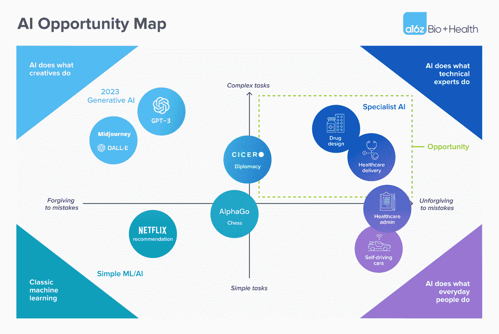

# 交汇点上的人工智能：a16z对生物和健康领域人工智能投资论点

> 来源：[https://waytoagi.feishu.cn/docx/Gxoidm3CYo3DFDxSweicXvPUnpb](https://waytoagi.feishu.cn/docx/Gxoidm3CYo3DFDxSweicXvPUnpb)

> 原文链接：https://a16z.com/2023/06/21/ai-bio-health-thesis/

> 翻译：通往AGI之路，若有瑕疵之处，请在段落评论中斧正，谨此致谢

> 发表时间：2023年6月21日

## **两个指数的故事**

### 利用摩尔定律对抗反摩尔定律（Eroom）

[今天的计算机以](https://a16z.com/2011/08/20/why-software-is-eating-the-world/)相同的价格比十年前强大大约 1000 倍。它们的力量大约是二十年前的百万倍。从 1970 年代到今天的这个戏剧性增长时期导致软件吞噬了世界。技术之所以强大，是因为它遵循摩尔定律——数十年来科技行业以指数方式降低成本和提高能力的能力。

[

相比之下，药](https://en.wikipedia.org/wiki/Eroom%27s_law)物设计和医疗保健服务遵循着Eroom定律（反摩尔定律），该定律是从“摩尔定律”反过来构造的。这些行业的成本已经持续增长了几十年，已经达到了极高的水平，以至于医疗成本已经接近美国GDP的四分之一（并且还在上升）。由于劳动力成本的上升、临床试验成本、行政成本的增加、日益恶劣的付款方-提供方关系等等原因，治疗和医疗成本正在按照错误的曲线增长。

### 将服务转化为计算

[鉴于一个呈指数级递减，另一](https://a16z.com/2015/11/18/bio-fund/)个[呈指数级增长，显而](https://a16z.com/2020/12/14/solving-baumols-cost-disease-healthcare/)易见的目标是从反摩尔定律过渡到摩尔定律。但这怎么可能呢？人们必须将人类驱动的服务（即提供护理服务）转变为计算（即通过技术将服务商品化）。这正是我们在人工智能上看到的。

这种转变从不太复杂的一次性模型（通常称为机器学习）开始，以执行容忍错误的简单任务，例如：Netflix使用AI推荐节目。

> 注：横坐标轴从左至右为可容忍错误--低容忍错误；纵坐标轴从下至上无为简单任务--复杂任务

+   左下角（简单任务/可容忍错误）为经典的机器学习，包括Netflix、AlphaGO；

+   左上角（复杂任务/可容忍错误）为AI创意工作，如GPT-3、MidJourney、DALL-E；

+   右下角（简单任务/低容忍错误）为AI替代每个人在做的事，如自动驾驶；

+   左上角（复杂任务/低容忍错误）为AI替代技术专家在做的事，如药物设计、医疗健康等

随着人工智能变得越来越复杂，我们正逐渐进入新的可能性领域。生成型人工智能方法现在可以生成文本和图像，以及完成复杂的任务，尽管可能会出现错误（也称为幻觉）。例如，ChatGPT可以对问题提供英文答案，但在某些问题上偶尔会出现惊人的失败，产生“幻觉”般的虚构答案。

随着时间的推移，这种进展将导致人工智能在生命科学和医疗领域具有巨大规模的助力，能够扩大熟练劳动力或提升低技能劳动力的水平。例如，人工智能可以提出答案或创意，让经过训练的人类选择最佳答案，筛选结果并跳过任何错误的答案。这种方法将人工智能自然地整合到现有的工作流程中。

随着时间的推移，人类工作的比例会减少，最终在即使需要人类专家的领域，也逐渐接近完全自动化。在这些领域中，小错误可能会产生灾难性影响，但可能不会完全摒弃人类的参与，特别是在对错误特别容忍度低的领域，例如诊断、药物处方或医疗程序。开发能够在这些专业任务上成功而不受关键错误影响的人工智能，是人工智能发展道路中未来的重要领域，也是未来人工智能进步最终对生命科学和医疗产生最大影响的自然领域。

### 算法和计算能力的复兴与生物学和医疗保健的进步相结合

人工智能的巨大进步只是故事的一部分。人工智能正处于一个生命科学和医疗保健也在转变的时期，这两个行业都越来越多地受到工程技术的推动，工程技术有力地改变了我们诊断、治疗、管理疾病和提供健康服务的方式。

在生命科学领域，基因编辑、细胞生物学、干细胞、机器人实验等方面的进展使科学家能够以前所未有的方式操纵生物学。这些进步不仅使生物学实现了大规模，而且具有新发现的一致性，这两个关键元素对于与人工智能的连接至关重要。此外，随着人工智能嵌入生命科学实验中，存在着一个强大的反馈循环，实验改进了人工智能的预测能力，而人工智能又进一步改进了实验。

类似地，医疗保健正在利用技术经历一次复兴。巨大的医疗保健成本压力沉重地压在该领域上，创新者渴望能够改善结果并降低成本的技术。朝着价值导向的付费模式的转变使得积极主动的患者和提供者参与至关重要，这也进一步为人工智能在医疗保健领域创造了深层次的效用。

所有这些进展的基础是巨大的计算和数据存储能力，这只是最近才成为可能。首次，算法的复兴与纯计算能力结合，可以测试、迭代和运行这些程序。

## **影响：应对我们最大的挑战**

简而言之：我们有机会使用人工智能来解决我们在医疗保健和药物设计方面面临的最大挑战。

首先是医疗保健成本。成本的指数增长部分源于对高素质人员（博士、医生、护士等）的需求，特别是随着熟练劳动力成本远远快于通货膨胀的增长。随着人工智能越来越能够充当技术专家，我们有机会扩展现有提供者的能力，以更低的成本提供护理服务。如果人工智能能够具备同理心，它可以促进患者的参与，并遵守临床建议，同时减轻临床医生的工作压力。

其次，随着成本的降低，我们有能力解决医疗保健的可及性（规模）和质量（绩效差异的降低）问题。随着越来越多的护理工作由人工智能支持，人工智能有潜力使医疗保健民主化，让每个人都能享受最好的医疗服务。人工智能有能力放大现有的智慧，这意味着患者更有可能早期获得正确的诊断和治疗方案。

此外，降低成本和改善结果的关键部分可能来自人工智能在新疗法开发中的影响。在这方面，人工智能在理解生物学方面扮演着关键角色。就像微积分在物理学中起着基础性作用一样，人工智能成为揭示生物学复杂性的推动者，而这种复杂性很可能超出了人类完全理解的范围。我们今天已经看到了关于人类疾病的人工智能模型，这些模型指引着更有效的药物的开发路径，这些药物可以更快地进入市场，并减少失败的次数。简而言之，人工智能能够超越人类科学家的能力来理解生物学。这使得研究能够远远超越当前的模式（主要依赖于在实验室中进行的数小时人力劳动所带来的偶然发现）。

综上所述，也要注意潜在的担忧。我们意识到早期人工智能模型在人类收集的数据上进行训练可能存在嵌入的偏见和其他失败。随着人工智能应用于新的行业，科学家、医疗保健提供者和监管机构需要保持警惕，以防止潜在的有害副作用。

确实，在生命科学和医疗保健领域，现有的监管框架对所有事物（治疗、设备等）进行功效和不良反应测试。对于那些担心人工智能是一个黑匣子的人，我们认为人工智能是可以完全审查的，并且在足够的时间下，任何人工智能都可以被详细地理解；讽刺的是，在医疗保健领域，人类的推理才是真正的黑匣子。

## **新的工业革命即将来临**

显然，这不是一夜之间发生的转变，因为医疗保健（以及生物制药）实际上是一组相互交织的行业，受到监管机构的监管。那些期望人工智能的影响在几个月内发生的人，要么会感到失望，要么可能利用过渡的渐进性来指责人工智能的失败。相反，我们期待的过渡可能需要10到20年的时间，以一种所有利益相关方都能意识到和适应过渡的方式，同时彻底改变美国GDP中历史上完全不受技术创新影响的巨大部分。

建设者们需要了解以下两点：a）如何利用最新最先进的人工智能技术；b）如何在生物制药和医疗保健领域推广一种具有可靠产品和营销策略的产品或平台，这或许更为重要。因此，我们相信在这个新时代中，具备科学家、人工智能专家、医疗保健建设者和运营商、产品和营销专家等多方面专长的团队将处于最有优势的领导和获胜地位。

我们看到人工智能将每个护士都变成了住院病人的超级英雄，并推动着行业思考，如果每个患者都有一个始终在身边、经过专业培训的伴侣，可以无论何时与他们交谈，每小时只需几分钱的费用，这将意味着什么。在治疗方面，我们一直关注着旨在增加健康寿命的治疗方法的发展；基于人工智能的研究，以改进抗体疗法以应对人类最严重的疾病；以及超越人类科学家能力的研发工作。

多年来，我们一直在投资这些具有开创性的公司，您可以在这里查看我们的人工智能和其他投资的完整列表，而我们的信心也在不断增长。新的工业革命已经到来，我们很高兴能在其中发挥作用。