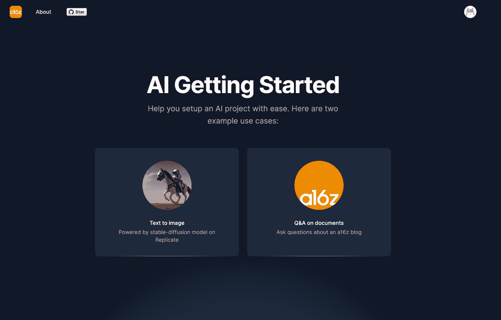
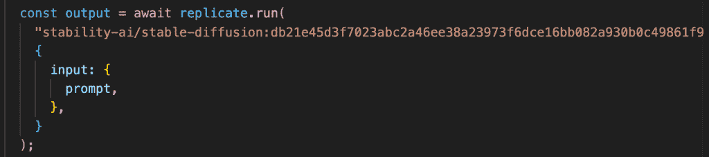
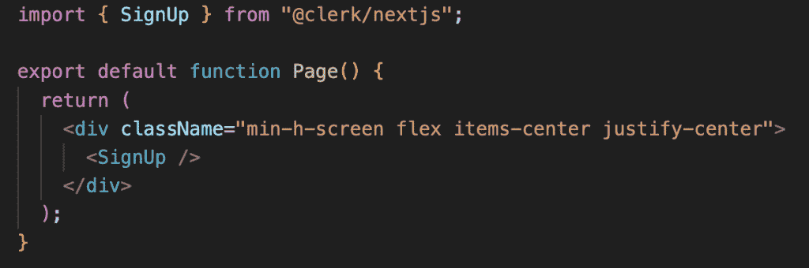
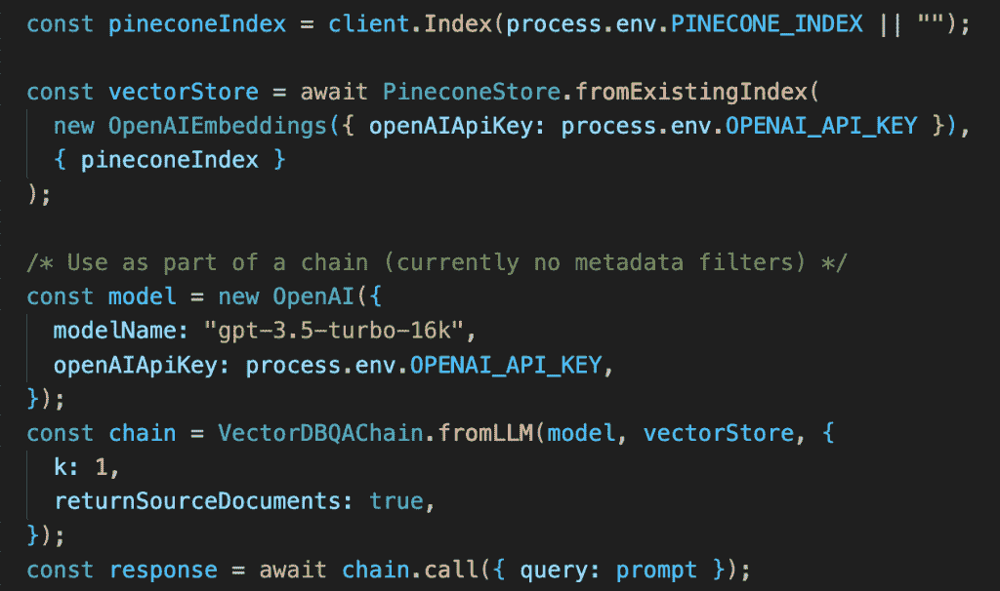

# 适用于 JavaScript 的 AI 堆栈入门

> 来源：[https://waytoagi.feishu.cn/docx/DzDYdNzjIoOrwPxvlDjcxhN5n2d](https://waytoagi.feishu.cn/docx/DzDYdNzjIoOrwPxvlDjcxhN5n2d)

> 原文链接：https://a16z.com/2023/06/21/the-getting-started-with-ai-stack-for-javascript/

> 翻译：通往AGI之路，若有瑕疵之处，请在段落评论中斧正，谨此致谢

> 发表时间：2023年6月21日

如果不使用新的软件基础设施技术，很难理解它们。至少，这是a16z基础设施团队的发现 - 因为我们中的许多人的职业生涯都是从程序员开始的，我们通常通过实践学习。这在生成式人工智能浪潮中尤为明显，这股浪潮来得如此之快、如此壮观，以至于好的文档通常落后于代码几个月。因此，为了更好地理解这个领域，我们围绕大型语言模型（LLM）、大型图像模型、向量数据库等建立了一些项目。

在这[个过程中，我们注意到](https://github.com/a16z-infra/ai-getting-started)由于所有这些都是如此新颖且变化如此迅速，实际上没有好的框架可以快速入门。每个项目都需要大量的样板代码和集成。坦率地说，这很麻烦。因此，我们着手创建一个非常简单的“入门人工智能”模板，供那些想要尝试核心技术但又不想过多考虑授权、托管和工具选择等辅助问题的人使用。

您可以[在这里](https://github.com/a16z-infra/ai-getting-started)fork并部署该模板。我们非常乐意听取您的想法和反馈，以使模板变得更好。

## 组件

我们中的许多人都是JavaScript/TypeScript的爱好者，所以我们选择了JavaScript堆栈作为起点。不过，这个框架可以很容易地修改以支持其他编程语言，我们计划很快就会这样做。

以下是我们与长期合作伙伴和开源爱好者Tim Qian共同制作的入门堆栈的简要概述。我们的目标是突出从GitHub上拉取代码到运行生成式人工智能应用程序（包括图像和文本）的最简单路径。它被设计为可以轻松扩展到更复杂的架构和项目：

+   身份验证：[Clerk](https://clerk.com/)

+   应用逻辑： [Next.js](https://nextjs.org/)

+   向量数据库： [Pinecone](https://www.pinecone.io/) / Supabase pgvector

+   LLM 编排： [Langchain.js](https://js.langchain.com/docs/)

+   图像模型： [Replicate](https://replicate.com/)

+   文本模型： [OpenAI](https://platform.openai.com/docs/models)

+   部署： [Fly.io](https://fly.io/) 部署

[LLM 应用程序的新兴架构](https://ywh1bkansf.feishu.cn/wiki/QI6GwuqHSiEX8iktTs0cCJM1n8c)有关新兴LLM堆栈的更详细概述，请查看我们标题为“  ”的文章。

## 模型和推理

模型托管是一件麻烦的事情，与构建AI应用程序大体上是两个独立的问题。因此，我们使用[OpenAI](https://replicate.com/replicate/vicuna-13b)来构建文本模型，使用Replicate来进行图像推理。Replicate还提供基于文本的模型（看看运行Vicuna有多容易），因此如果需要的话，您可以使用它来替代OpenAI。

[在Rep](https://github.com/a16z-infra/ai-getting-started/blob/fc74d00552c7bdfdd504f98b0c7d362f8e5933c0/src/app/api/txt2img/route.ts)licate上运行Stable Diffusion推理的示例代码

## 认证

对于一个入门级的框架，通常我们不会费心去包含身份验证功能。但在这种情况下，模型非常强大且通用，成为大规模组织努力的目标，试图获取免费使用权。开发人员往往在从模型提供者那里收到意外的10000美元账单时才痛苦地得知这一点。这就是为什么我们选择包含Clerk，它可以在机器人检测方面发挥重要作用，并且如果您最终构建一个更复杂的应用程序，它当然也提供完整的身份验证支持。

[用于用户](https://github.com/a16z-infra/ai-getting-started/blob/fc74d00552c7bdfdd504f98b0c7d362f8e5933c0/src/app/sign-up/%5B%5B...sign-up%5D%5D/page.tsx)注册的插入式 Clerk 组件的示例代码，该组件处理机器人检测、强制实施 2FA 并检测用户模拟

## 向量数据库

LLM需要一个稳定的长期记忆来保存状态并解决上下文窗口的问题，这由向量数据库来处理。目前，Pinecone是与生成式人工智能群[体最成熟和最受欢迎](https://supabase.com/docs/guides/database/extensions/pgvector)的向量存储库。话虽如此，我们希望为所有用例和偏好提供支持，因此我们还在存储库中包含了对Supabase的pg-vector的支持。

将Pinecone与 Langcha[in.](https://github.com/a16z-infra/ai-getting-started/blob/fc74d00552c7bdfdd504f98b0c7d362f8e5933c0/src/app/api/qa-pg-vector/route.ts)[js](https://github.com/a16z-infra/ai-getting-started/blob/fc74d00552c7bdfdd504f98b0c7d362f8e5933c0/src/app/api/qa-pinecone/route.ts) 一起使用的示例代码。您还可以在此处找到有关使用Supabase pg-vector的示例.

## 部署

对于部署，我们使用Fly.io，因为它是多区域的、易于管理，并提供一个非常通用的计算环境（任何可以在容器中运行的东西）。随着时间的推移，许多AI项目最终会使用多种编程语言和/或在后端具有非平凡的功能，因此Fly.io是在JavaScript本地托管环境（如Vercel或Netlify）和传统云之间的一个很好的折衷选择。话虽如此，如果您希望选择其他托管环境，该代码也很容易支持。

Fly.io很快还将提供GPU，用于需要托管自己的模型的情况。

## 路线图

尽管我们认为这个第一版是一个很好的起点，但我们正在逐步完善堆栈并增加更多选项。以下是我们的路线图的一瞥：

+   交互式CLI用于create-ai-stack，开发人员可以选择自己的项目脚手架和依赖项。

+   用于高级用例的事务性数据库（例如，在问答中保留问题、用户偏好等）。

+   更多的向量数据库和部署平台选项。

+   用于开源模型的轻量级微调步骤。

我们非常希望您提出错误修复、功能请求和反馈的PR。我们很高兴为开源社区做出贡献，并相信生态系统将永远获益。

我们对以下在我们的AI入门堆栈创建过程中发挥了重要作用的开源项目表示感谢。这些不可或缺的工具简化了复杂的任务，使它们更容易处理。正是通过他们的不懈努力和宝贵贡献，JavaScript生态系统得以蓬勃发展和繁荣！

+   [Tailwind ](https://github.com/tailwindlabs/tailwindcss)

+   [ai sdk ](https://github.com/vercel-labs/ai)

+   [dotenv ](https://github.com/motdotla/dotenv)

+   [Next.js](https://github.com/vercel/next.js/)

+   [langchain.js](https://github.com/hwchase17/langchainjs)