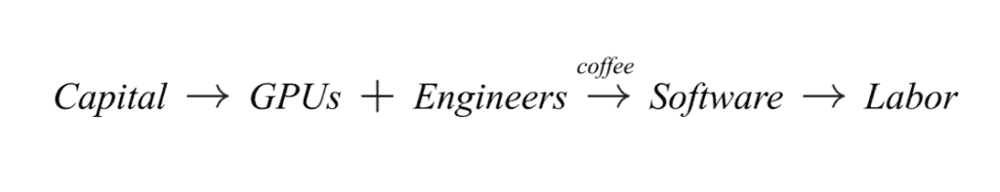
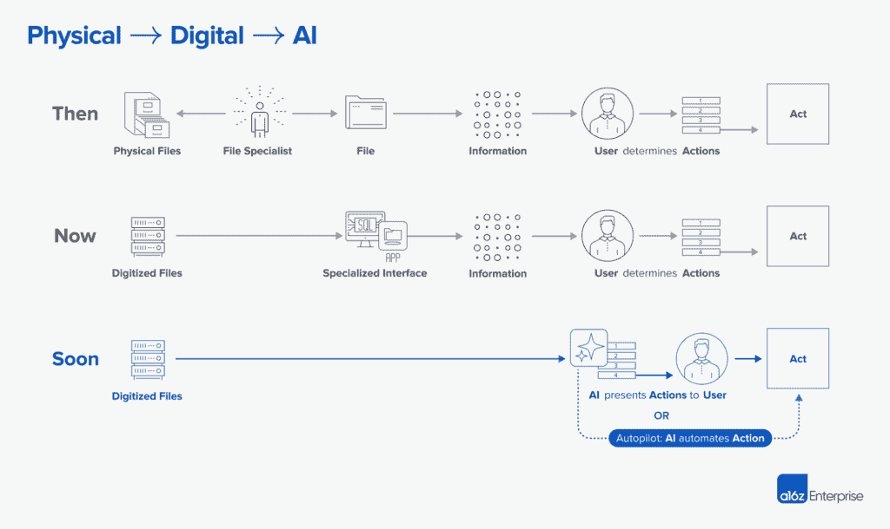
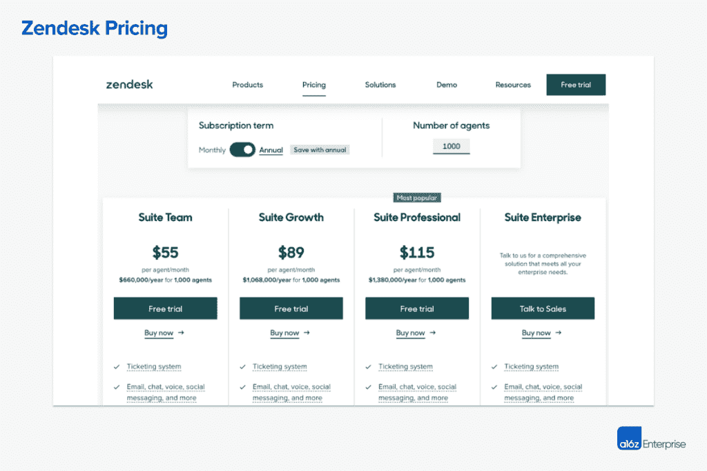
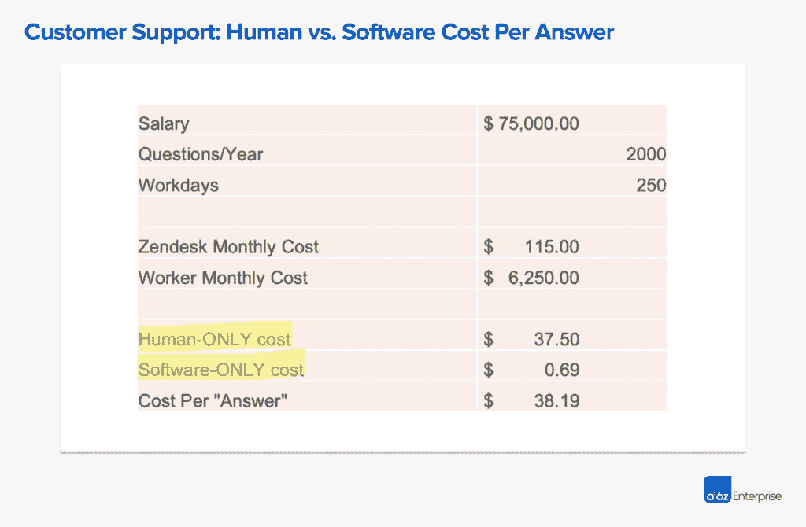
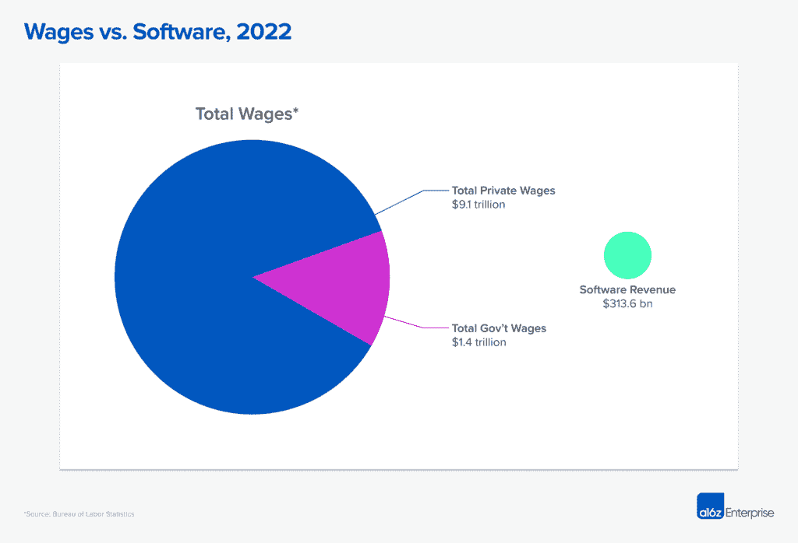

# 输入咖啡，输出代码：AI 如何将资本转化为劳动力

> 来源：[https://waytoagi.feishu.cn/docx/CXKEdxAIoohG7lxpJRPcIASYnpc](https://waytoagi.feishu.cn/docx/CXKEdxAIoohG7lxpJRPcIASYnpc)

> 原文地址：https://a16z.com/ai-turns-capital-to-labor/

> 发表时间：2024 年 8 月 22 日

几个世纪以来，科学的长期目标之一是实现炼金术的梦想——将铅转化为金。实际上，在核物理学中这是可能的，这被称为核嬗变。在核反应堆或粒子加速器中用中子轰击汞……看！金子就这样产生了。

今天，多亏了人工智能，我们正在见证可能是历史上最伟大的嬗变。软件正在转变为劳动力。这就像是新的质能方程式  。资本用于购买咖啡、雇佣工程师以及购置GPU。产出的是承担起劳动角色的代码。这既能壮大现有的软件市场，又能创造出许多新的软件市场，而在这些市场中，"按座席 "定价从未取得过巨大的成果。

历史上，许多软件将离线形式的存储数字化，放入数据库，然后为可能不懂SQL的最终用户提供一个可访问、可授权的前端界面，享受数字化、网络化媒介的速度优势。

+   PeopleSoft和后来的Workday将人力资源文件柜数字化了。

+   Zendesk将老式的客户支持“票据”数字化了。

+   Quicken和Quickbooks将老式的账簿数字化了。

+   Epic和Cerner实现了健康记录的数字化。

+   Salesforce将销售名册和黑板上的流程图数字化了。

+   电子邮件数字化了，嗯，就是邮件！

现在，IT 部门的 William 和 Sarah 不再需要人力资源文员 Bill 或会计文员 Sally 从文件柜中 "取 "文件，而是要确保人力资源或会计部门的每个人都能正确配置并访问系统。但是会计部门和人力资源部门的人员数量是一致的。

但是现在——这是重大变化——数字化文件柜的“用户”不必是人类。

让我们来看看Zendesk的定价：

目前存在巨大的商机，所有“数字化文件柜”公司——比如Intuit、Workday、Zendesk等——现在可以开始对“准人类”进行收费，以取代或增强过去访问和处理记录的人类。这可能会导致对历史上的“按座席”定价模式进行大规模的改变，因为企业将需要更少（如果有的话！）的座席，因为系统可以自行采取行动，甚至使人类的工作效率提高10倍。

Workday可以对人力资源咨询收费。Intuit可以对发送逾期应收账款催收信件收费。Epic可以对预约后的随访收费。Salesforce可以对销售活动收费。

明确地说，这并不意味着白领工作的结束——如果有的话，人工智能可能会创造出新的“人工智能工作”，这些工作在人类成本或间歇性需求下是不可能的。经济学中有一个流行的说法：“高价格的解药是更高的价格。”意思是：随着一个商品价格的上涨，更多的制造商决定生产它（或者现有的制造商生产更多），从而增加供应，从而降低价格。但在技能劳动力的情况下，存在严重的滞后性。如果明天护士的工资提高了5倍，可能不会显著改变明天的供应（也许一些退休的护士会重新上岗！），但它可能会导致更多的人进入护理学校并在3年后毕业。如果明天急需大量护士怎么办？

对于其[他职业来说，培训](https://ir.citi.com/gps/9j79xHIa-vfPi785TYiSciffO0j4I0D52fI9LrahsLZEo6MpT4aM7SpwSFagAL9CIukqn2fwiJ_GNvDsLy4b6XEjftdK1abu)是“在职”进行的，很难与业务的起伏同步。2021年，抵押贷款利率下降，导致对抵押贷款经纪人的需求激增……随着利率的上升，这种需求很快就结束了。在Crowdstrike灾难之后，达美航空公司可能需要成千上万经过培训的支持代表。在美国过去20年中增长速度排名第五的职业是“合规官”，在这里，培训（而不仅仅是工资！）造成了短缺。人工智能总是会出现在工作岗位上，而且可以立即接受培训，当对高技能工作只有间歇性或偶发性需求时，人工智能会很乐意填补 "市场空白"。如果一年只需要你的技能两次，为什么还要去上学或学习几年呢？人工智能不存在这个问题。

从风险投资的角度来看，我认为云软件经历了三个时代：

1.  原始云时代（约1999-2007年），当时市场足够大，足以容纳纯软件，基本上取代了内部软件。这就是Salesforce、NetSuite、Veeva、Hubspot等公司崛起的时代。

1.  金融服务支持的云时代（约2010年至今），当时市场足够大，嵌入了支付、贷款和其他“金融科技”附加服务。例如，餐厅的软件市场很小，但“软件+支付”市场对餐厅来说很大——因此有了Toast（成立于2012年）。暖通空调承包商的软件市场很小，但“软件+支付”市场很大——因此有了ServiceTitan（成立于2012年），等等。

1.  “AI 驱动成果”的云时代（现在—），当时软件市场很小，因为劳动力是主要成本，而软件需求——数字文件柜——相对较小或具有通用性。许多职业的软件提供商只是Excel和Word，而不是专业的工具。

[这并不意味着AI](https://a16z.com/distribution-vs-innovation/)的成功仅仅局限于“全新”的类别。但在分销与创新的较量中，分销通常是默认的赢家——现有的软件公司拥有分销渠道。尤其是在 2024 年的今天，人工智能几乎是所有软件公司和终端客户的首要任务。2007 年，大多数首席执行官都认为 iPhone 很愚蠢（没有键盘！），而黑莓则更好。1996 年，大多数零售业首席执行官都认为互联网只是一个玩具、一种时尚，人们肯定不会通过网络浏览器买东西。这让新公司填补了这一空白。2024 年，几乎不可能找到一个认为人工智能是个坏主意的首席执行官。

AI软件公司将有效地有三种起源和结果：

+   运行在现有软件之上的AI工具（想想：为Zoom会议自动记录会议笔记）；

+   运行在现有软件之上的AI工具，有机会取代现有的软件（想想：为Zoom会议记录会议笔记……然后该公司构建视频会议并向你推销，让你放弃Zoom）；

+   成为劳动力的AI工具——一个全新的类别，在此之前完全不受软件影响（想想：软件为你主持会议！）

平台转[变总是促成前](https://a16z.com/financial-opportunity-of-ai/)两种情况（X 的互联网版本、X 的移动版本、X 的云版本）。但AI革命最令人兴奋的是，看似庞大的企业软件市场——每年支出3000亿美元——与白领劳动力市场相比，简直是微不足道，后者每年有数万亿美元。这就是为什么我们看到的许多增长最快的公司都是“已知的未知数”，它们将现有的昂贵服务转化为大众的低价产品（由AI创造）。

我们正处于软件吞噬和增强劳动力的最初阶段。