# Top100 AI 消费者应用（第三版）

> 来源：[https://waytoagi.feishu.cn/docx/MBhVdNQLPoZyYvxfmjhcLJy7ntb](https://waytoagi.feishu.cn/docx/MBhVdNQLPoZyYvxfmjhcLJy7ntb)

> 原文：https://a16z.com/100-gen-ai-apps-3/

> 发表时间：2024 年 8 月 21 日

无论我[**们是**](https://x.com/omooretweets/status/1808897223645933709)[**在构**](https://x.com/omooretweets/status/1761069953736945823)建节省时间的新[**工作**](https://a16z.com/category/consumer/creativity/#arts-and-crafts)流程[**、探**](https://x.com/omooretweets/status/1823380097531093232)索实际用途，还是试验新的创意，跟上不断扩大的消费级 AI 产品领域都是一项动态、快速发展的工作。但在产品发布、投资公告和大肆宣传的功能不断涌现的过程中，值得一问的是： 这些生成 AI 应用中，哪些是真正被人们使用的？哪些行为和类别在消费者中获得了关注？而哪些 AI 应用是人们反复使用的，而不是随便尝试后就放弃的？

欢迎来到Top100 AI 消费者应用第三版。

每六个月，我们会深入挖掘数据，对前 50 款 AI 优先 Web 产品进行排名（排名依据每**月独立访问量) 和前 50** 个 AI 优先移动应用（由每月活跃用户）与我们之前的2024 年 3 月报告相比，这一次，近 30% 的公司是新公司。

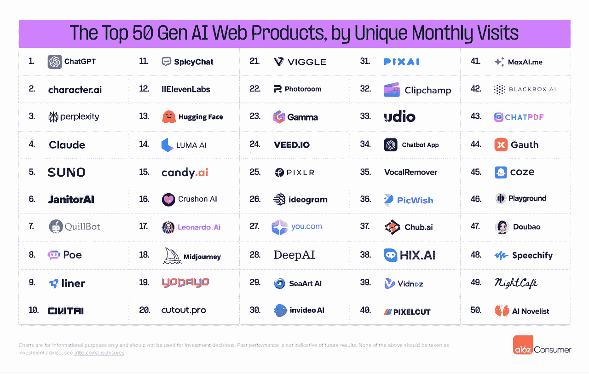

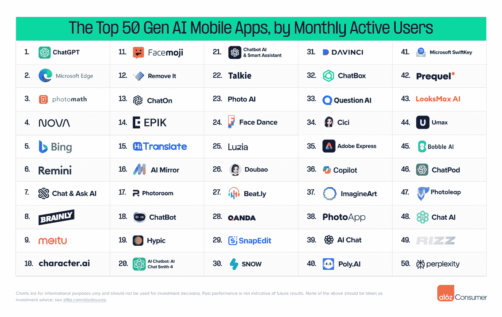

然而，除了这些排名所体现的标志意义之外，数据还揭示了一些值得注意的趋势，包括新兴和不断扩大的类别、新兴竞争对手和参与模式。

以下是我们的一些重要结论：

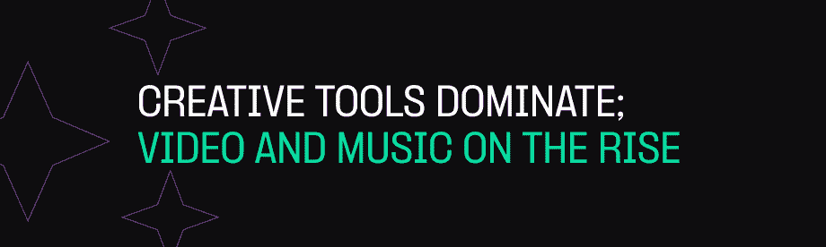

[**创意工具的魔力**](https://a16z.com/aiart/)** **继续吸引着消费者。网络榜单上有 52% 的公司专注于内容生成或编辑，涉及多种形式——图像、视频、音乐、语音等。在 12 家新进入者中，有 58% 属于创意工具领域。

[**其中包括**](https://lumalabs.ai/)首次上榜的 5 大[**应用：Lum**](https://viggle.ai/)a（第 14 位）[**、Viggl**](http://seaart.ai/)e（第 21 位）[**、Sea**](http://udio.com/)[**Art（**](http://suno.ai/)第 29 位）和Udio（第 33 位）。过去六个月中，进步最大的是音乐生成器Suno，从第 36 位上升至第 5 位。

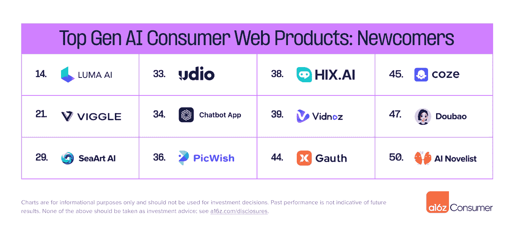

在我们之前的列表中，大多数内容生成工具都专注于图像。在过去的六个月中，其他模式也获得[**了发展：图像**](http://seaart.ai/)[**生成仅占**](https://lumalabs.ai/)顶[**级内容生成网**](https://viggle.ai/)站[**的 41%。**](http://vidnoz.com/)在首次上榜的五种生成工具中，只[**有Sea**](http://udio.com/)Art一款是图像类的。视频领域有三款新上榜工具（Luma、Viggle和Vidnoz），音乐领域有一款新上榜工具（Udio）——这两种模式的输出质量在过去一年中都取得了巨大的飞跃。

那么在[**移动设备**](https://apps.apple.com/us/app/meitu-photo-editor-ai-art/id416048305)上呢？图片和视频[**的内容编**](https://apps.apple.com/us/app/snow-ai-profile/id1022267439)辑是最常见的用途。[**在 22% 的榜单中，它是**](https://apps.apple.com/us/app/adobe-express-ai-photo-video/id1051937863)移动排名中第二大的产品类别——用户渴望在手机上编辑内容。虽然初创公司也在这里涌现，但榜单上排名最高的许多新进入者都是传统的创意工具，它们已经转型成为生成式 AI 优先，比如美图秀秀（第 9 位）、SNOW（第 30 位）和Adobe Express（第 35 位）。

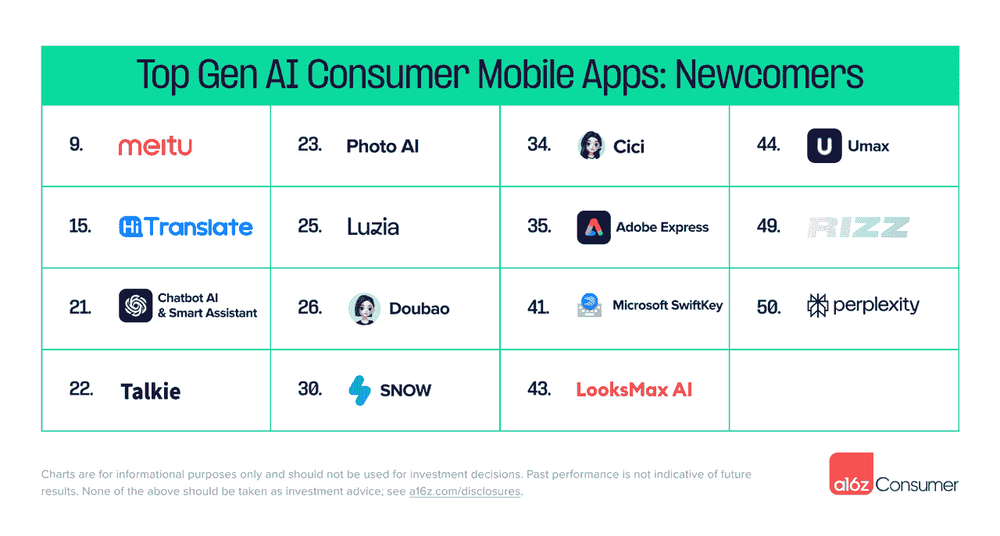

[**ChatGPT**](http://chat.openai.com/)第三次以巨大优势成为网络和移动端排名第一的产品，但争夺最佳消费者助手的竞争正在升温。

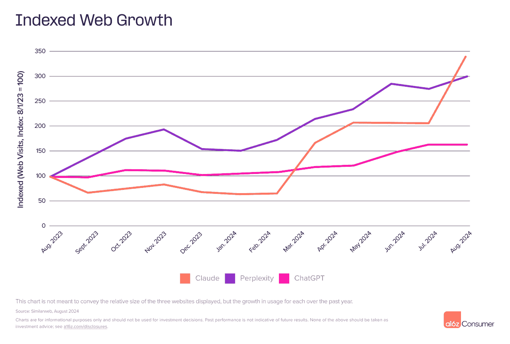

[**Perplexity**](http://perplexity.ai/)** **目前在网络上排名第三——这款人工智能搜索引擎专注于提供简明、实时和准确的查询答案，并引用来源。根据 Similarweb 数据，Perplexity 在访问时长（超过 7 分钟）方面略胜于 ChatGPT，这表明用户参与度很高。Perplexity 还首次进入移动端前 50 名榜单。

Anthropic 的[**Claude**](http://claude.ai/)可[**以说是**](https://openai.com/index/introducing-gpts/) ChatGPT 的直接竞争对手，它在网页排名中进入前五，排名第 4，高于之前的排名第 10。该公司最近推出了Artifacts ，与 ChatGPT 的GPT正面交锋。

在移动端，人工智能助手[**Luzia**](https://apps.apple.com/us/app/luzia-your-ai-assistant/id6472703434)[**首次**](https://jobs.lever.co/luzia/fbc75db6-d0b4-4507-a9cc-151a99c0a7ef)[**亮相排**](https://techcrunch.com/2023/10/20/luzia-lands-10-million-in-funding-to-expand-its-whatsapp-based-chatbot/)名第 25 位——该公司声称在全球拥有 4500 万用户，主要为西班牙语使用者。Luzia最初是基于 WhatsApp 的聊天机器人，但于 2023 年 12 月推出了一款独立的移动应用程序。

[**TikTo**](http://gauthmath.com/)[**k 的母**](http://coze.com/)公司字节跳动正在进军基于 We[**b **](http://doubao.com/)的 AI 产品。该公司[**的三**](https://apps.apple.com/cn/app/%E8%B1%86%E5%8C%85-%E6%8A%96%E9%9F%B3%E6%97%97%E4%B8%8B-ai-%E6%99%BA%E8%83%BD%E5%8A%A9%E6%89%8B/id6459478672)款应用首次出现在我们的榜单上：教育科技平台Gauth（排名第 44 位）、机器人构建器Coze（排名第 45 位）和通用助手豆包（排名第 47 位）。豆包也首次出现在移动榜单上，排名第 26 位。

除了豆包，照片和视频编辑器 Hypic（第 19 名）和助手 Cici（第 34 名）也是字节跳动的产品，在两个榜单上共占据 6 个席位。这些应用针对不同的地理市场；在移动端，Cici 是豆包的英文版。

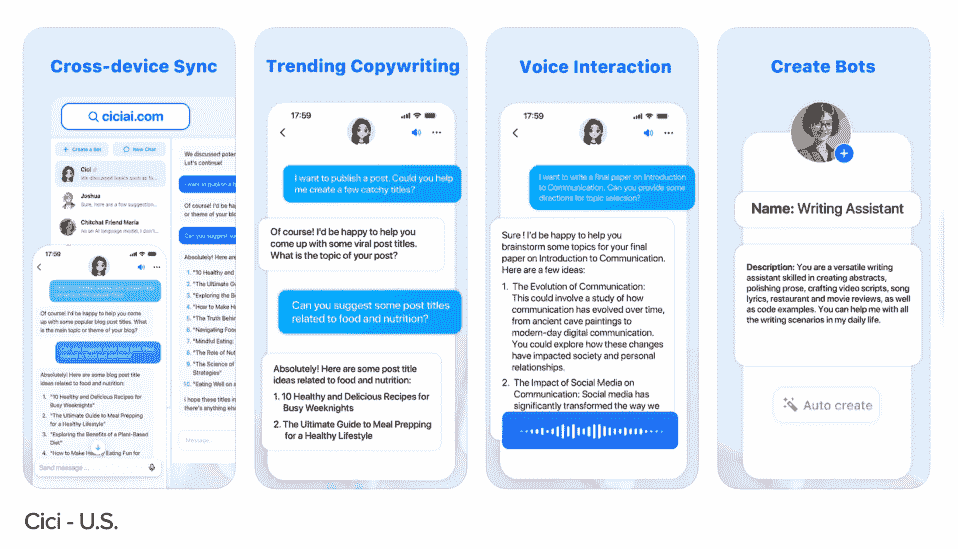

[**为何会有如此多**](https://www.forbes.com/sites/emilybaker-white/2024/01/16/tiktok-bytedance-ai-chatbots-openai/)的新进入者？字节跳动于 2023 年底 成立了专注于生成式 AI 应用的研发部门 Flow，并从2024 年初开始以其他公司名义在美国（及海外）推出新的 AI 应用。

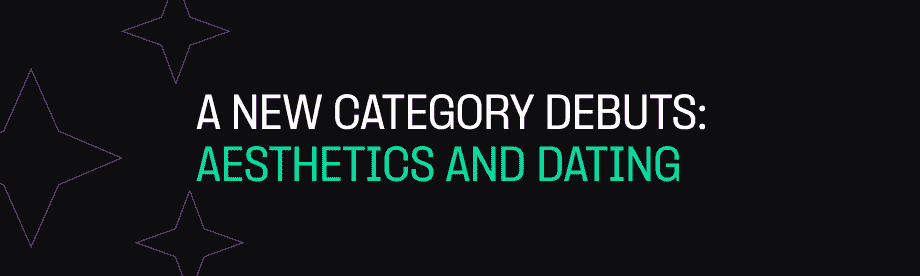

[**在网页和移动端，只有一**](https://apps.apple.com/us/app/looksmax-ai/id6474518292)个新类别：审美[**和约会。**](https://apps.apple.com/us/app/umax-become-hot/id6471026798)这包括三家新[**进入者：**](https://apps.apple.com/us/app/rizz/id1663430725)LooksMax AI （#43）、Umax（#44）和RIZZ（#49），均在移动端榜单上榜。

LooksMax 和 Umax 会采集用户的照片，对其进行评分，并给出“建议”，让用户变得更有魅力。Umax 还会生成用户 10 分满分的照片，而 LooksMax 会分析用户的声音，以确定其吸引力。在其应用入门屏幕上，LooksMax 声称拥有超过 200 万用户，而 Umax 声称拥有 100 万用户。

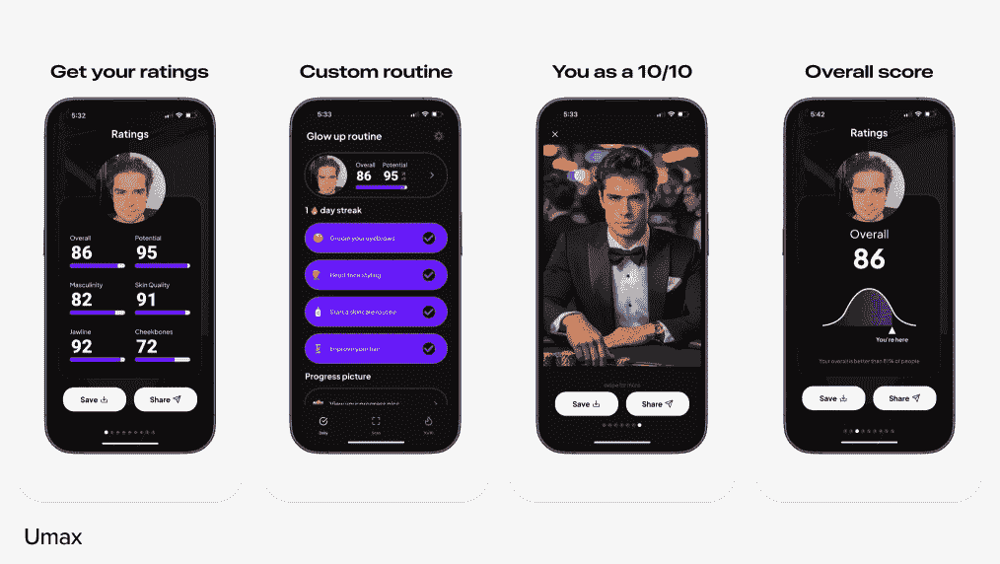

这两款应用程序均通过订阅来解锁结果以实现盈利：Umax 每周收费 4.99 美元（或邀请三位好友），LooksMax 每周收费 3.99 美元。

而 RIZZ 则专注于提升约会应用消息的水平。用户可以上传对话截图或个人资料，并获得关于该说什么的建议。消息可以直接从 RIZZ 复制到约会应用中。

在许多情况下，Discord 流量是应用程序在网络和移动排名中攀升的领先指标，尤其是在内容生成方面。

有些[**产品在 **](http://suno.ai/)Discord 上发布是为了“测试”产品，同时建立社区，但随后会推出网站并基本从 Discord 上迁移出去。这些产品从 Discord 顶级排名中“毕业”（一个典型的例子是Suno，它在我们上次的 Discord 流量榜上排名第 31 位，但这次没有出现在 Discord 的前 100 名服务器中）。

其他公司即使在推出独立产品后仍保持[**着对 Discord**](https://www.midjourney.com/)** 的大**量使用。例如，Midjourney在所有Discord 服务器的邀请流量中保持第一的位置。

截至 7 月，共有 10 家 AI 公司在 Discord 所有服务器的邀请流量排名中位列前 100 名。与 1 月份相比，其中一半是新进入者：

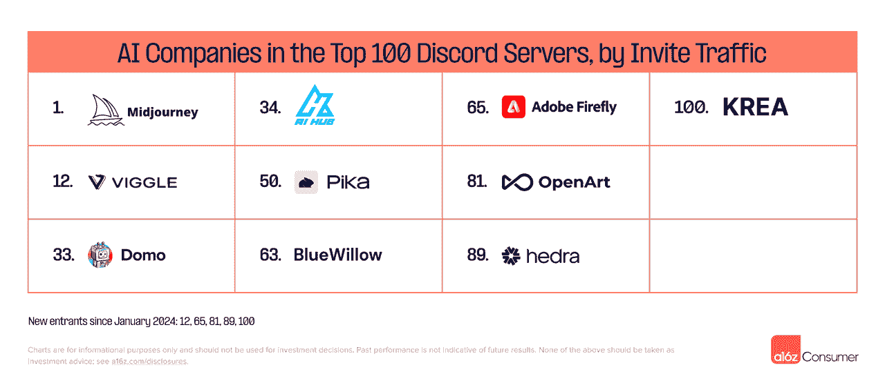

排名前 10 的 Discord 服务器中有一半允许用户在 Discord 中实际生成内容（通常是通过付费订阅），而另一半则使用 Discord 进行社区建设、客户支持和资源共享。

---

显然，新一代[**人工智能原生**](https://a16z.com/how-ai-will-usher-in-an-era-of-abundance/)产品和公司的增长速度比以往任何时候都要快，并且更深入地吸引用户。我们相信，在未来十年，人工智能将成为定义类别的公司的基础。

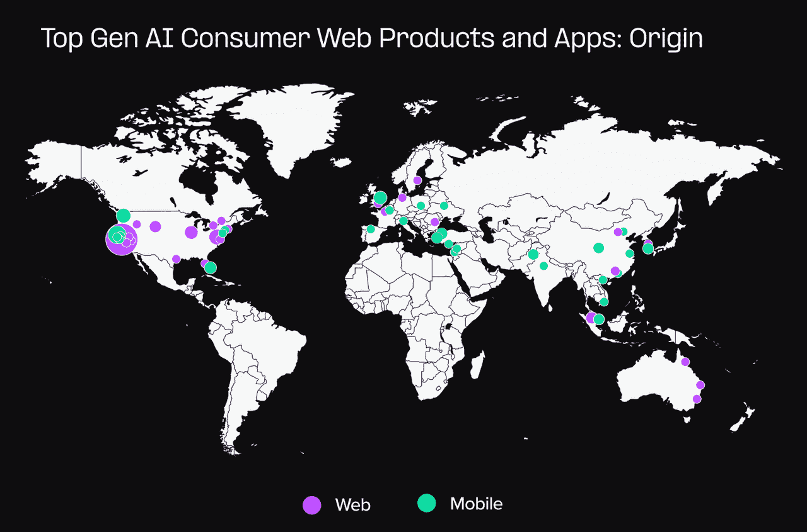

## Web 产品链接

[AI Novelist](http://ai-novel.com/)

[Blackbox AI](http://blackbox.ai/)

[Candy.AI](http://candy.ai/)

[Character AI](http://character.ai/)

[Chatbot App](http://chatbotapp.ai/)

[ChatGPT](http://chat.openai.com/)

[ChatPDF](http://chatpdf.com/)

[Chub.ai](http://chub.ai/)

[Civitai](http://civitai.com/)

[Claude](http://claude.ai/)

[Clipchamp](http://clipchamp.com/)

[Coze](http://coze.com/)

[CrushOn](http://crushon.ai/)

[Cutout.pro](http://cutout.pro/)

[DeepAI](http://deepai.org/)

[Doubao](http://doubao.com/)

[ElevenLabs](http://elevenlabs.io/)

[Gamma](http://gamma.app/)

[Gauth](http://gauthmath.com/)

[Hix.AI](http://hix.ai/)

[Hugging Face](https://huggingface.co/)

[Ideogram](http://ideogram.ai/)

[InVideo AI](http://invideo.io/)

[Janitor AI](http://janitorai.com/)

[Leonardo](http://leonardo.ai/)

[Liner](http://getliner.com/)

[Luma](https://lumalabs.ai/)

[MaxAI](http://maxai.me/)

[Midjourney](http://midjourney.com/)

[Nightcafe](http://creator.nightcafe.studio/)

[Perplexity](http://perplexity.ai/)

[Photoroom](https://www.photoroom.com/)

[PicWish](http://picwish.com/)

[Pixai](https://pixai.art/)

[Pixelcut](http://pixelcut.ai/)

[Pixlr](http://pixlr.com/)

[Playground](http://playgroundai.com/)

[Poe](http://poe.com/)

[Quillbot](http://quillbot.com/)

[SeaArt](http://seaart.ai/)

[Speechify](http://speechify.com/)

[Spicychat](http://spicychat.ai/)

[Suno](http://suno.ai/)

[Udio](http://udio.com/)

[Veed](http://veed.io/)

[Vidnoz](http://vidnoz.com/)

[Viggle](https://viggle.ai/)

[Vocal Remover](http://vocalremover.org/)

[Yodayo](http://yodayo.com/)

[You.com](http://you.com/)

## APP 产品链接

Al Chat - AI Chatbot

[AI Chat Smith 4](https://apps.apple.com/us/app/ai-chatbot-ai-chat-smith-4/id1559479889)

[AI Mirror ](https://apps.apple.com/us/app/ai-mirror-ai-art-photo-editor/id6444888896)

[Adobe Express](https://apps.apple.com/us/app/adobe-express-ai-photo-video/id1051937863)

[Beat.ly](https://play.google.com/store/apps/details?id=vinkle.video.editor&hl=en_US)

[Bing](https://apps.apple.com/us/app/bing-chat-with-ai-gpt-4/id345323231)

[Bobble AI ](https://apps.apple.com/us/app/bobble-ai-keyboard-assistant/id972432964)

[Brainly](https://apps.apple.com/us/app/brainly-ai-homework-helper/id745089947)

[Character AI](https://apps.apple.com/us/app/character-ai-ai-powered-chat/id1671705818)

[Chat & Ask AI](https://apps.apple.com/us/app/chat-ask-ai-by-codeway/id1668787639)

Chat AI - AI Chatbot

Chatbot 4o AI Chat

ChatBot - AI Chat

Chatbot AI Assistant

[Chatbox ](https://apps.apple.com/us/app/chatbox-ask-ai-chatbot/id6447763703)

[ChatGPT](https://apps.apple.com/us/app/chatgpt/id6448311069)

[ChatOn](https://apps.apple.com/us/app/chaton-ai-chat-bot-assistant/id1661308505)

[Cici ](https://play.google.com/store/apps/details?id=com.larus.wolf)

[DaVinci](https://apps.apple.com/us/app/davinci-ai-image-generator/id1630366866)

[Doubao (China)](https://apps.apple.com/cn/app/%E8%B1%86%E5%8C%85-%E6%8A%96%E9%9F%B3%E6%97%97%E4%B8%8B-ai-%E6%99%BA%E8%83%BD%E5%8A%A9%E6%89%8B/id6459478672)

[Epik](https://apps.apple.com/us/app/epik-ai-photo-video-editor/id1577705074)

[Face Dance](https://apps.apple.com/us/app/face-dance-ai-photo-animator/id1589749730)

[Facemoji ](https://apps.apple.com/us/app/facemoji-ai-emoji-keyboard/id1103138272)

[Hi Translate ](https://play.google.com/store/apps/details?id=com.zaz.translate&hl=en_US)

[Hypic](https://apps.apple.com/us/app/hypic-photo-editor-ai-art/id1644042837)

[ImagineArt](https://apps.apple.com/us/app/imagine-ai-art-generator/id1664121419)

[LooksMax AI ](https://apps.apple.com/us/app/looksmax-ai/id6474518292)

[Luzia](https://play.google.com/store/apps/details?id=co.thewordlab.luzia&hl=en_US)

[Meitu](https://apps.apple.com/us/app/meitu-photo-editor-ai-art/id416048305)

Microsoft Copilot

[Microsoft Edge](https://apps.apple.com/us/app/microsoft-edge-ai-browser/id1288723196)

Microsoft SwiftKey

[Nova](https://apps.apple.com/us/app/ai-chatbot-nova/id1669007652)

[Perplexity ](https://apps.apple.com/us/app/perplexity-ask-anything/id1668000334)

[Photo AI ](https://play.google.com/store/apps/details?id=com.xphotokit.aipixtool&hl=en_US)

[PhotoApp](https://apps.apple.com/us/app/photoapp-ai-photo-enhancer/id1596089614)

[Photoleap](https://apps.apple.com/us/app/photoleap-ai-art-photo-editor/id1191337894)

[Photomath](https://apps.apple.com/us/app/photomath/id919087726)

[Photoroom](https://apps.apple.com/us/app/photoroom-ai-photo-editor/id1455009060)

[Poly.AI](https://apps.apple.com/us/app/poly-ai-create-ai-chat-bot/id6449190344)

[Prequel ](https://apps.apple.com/us/app/prequel-photo-video-editor/id1325756279)

[Qanda](https://apps.apple.com/us/app/qanda-instant-math-helper/id1270676408)

[Question.AI ](https://play.google.com/store/apps/details?id=com.qianfan.aihomework&hl=en_US)

[Remini](https://apps.apple.com/us/app/remini-ai-photo-enhancer/id1470373330)

[Remove It](https://play.google.com/store/apps/details?id=com.vyroai.objectremover)

[RIZZ](https://apps.apple.com/us/app/rizz/id1663430725)

[SnapEdit ](https://play.google.com/store/apps/details?id=snapedit.app.remove)

[SNOW](https://play.google.com/store/apps/details?id=com.campmobile.snow&hl=en_US)

[Talkie ](https://apps.apple.com/us/app/talkie-ai-chat-with-character/id6450140383?ppid=3b1bde39-b9d7-41b4-974f-ea841dfc3be9)

[Umax ](https://apps.apple.com/us/app/umax-become-hot/id6471026798)