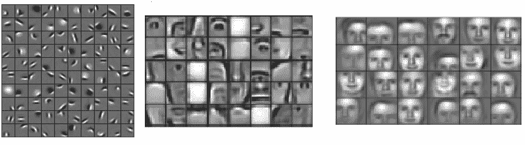
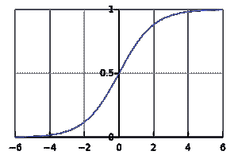
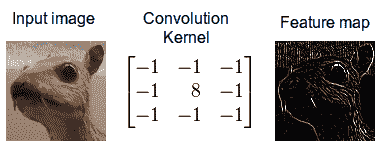
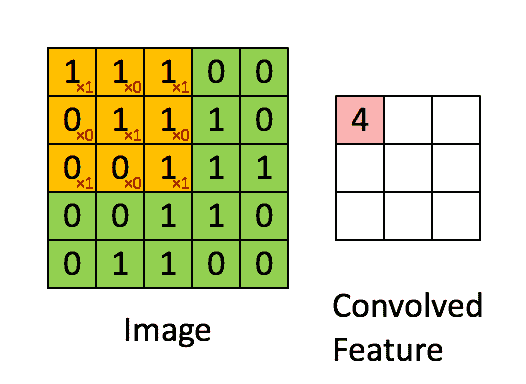
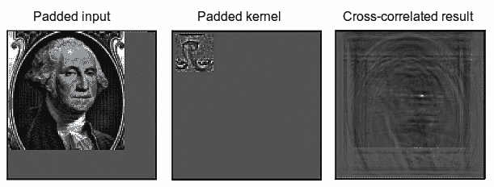

# 深度学习（1）核心概念

> 来源：[https://waytoagi.feishu.cn/docx/Fct2dlP35oCciwxl6QVczugCnrD](https://waytoagi.feishu.cn/docx/Fct2dlP35oCciwxl6QVczugCnrD)

> 原文地址：https://developer.nvidia.com/blog/deep-learning-nutshell-core-concepts/

> 作者：Tim Dettmers

> 发表于：2015 年 11 月 3 日

这篇文章是我将为 Parallel Forall 撰写[的系列文](https://developer.nvidia.com/deep-learning)章中的第一篇，该系列文章旨在为 深度学习 提供一个直观而温和的介绍。它涵盖了最重要的深度学习概念，旨在提供对每个概念的理解，而不是其数学和理论细节。虽然数学术语有时是必要的，并且可以进一步理解，但这些文章尽可能使用类比和图像来提供易于理解的信息，包括对深度学习领域的直观概述。

我以术语表的风格编写了这个系列，因此它也可以作为深入学习概念的参考。

+   第一部分 主要介绍深度学习的主要概念。

+   [第二部分](https://ywh1bkansf.feishu.cn/wiki/QacGwCWxoizfmlkOsKFc0PHQnWb) 提供历史背景，并深入研究用于深度学习培训的培训程序、算法和实用技巧。

+   [第三部分](https://ywh1bkansf.feishu.cn/wiki/CHMXwqoEYibzHdkC3QmcXZ53niX) 涵盖了序列学习，包括递归神经网络、 LSTMs 和用于神经机器翻译的编解码器系统。

+   第四部分 涵盖强化学习。

## **核心概念**

### **机器学习**

在机器学习中[，我](https://developer.nvidia.com/blog/parallelforall/deep-learning-nutshell-history-%E8%AE%AD%E7%BB%83#%E8%AE%AD%E7%BB%83)们（ 1 ）获取一些数据，（ 2 ）根据这些数据训练一个模型，（ 3 ）使用训练的模型对新数据进行预测。 训练 一个模型的过程可以看作是一个学习过程，在这个过程中，模型一步一步地暴露在新的、不熟悉的数据中。在每一步中，模型都会做出预测，并得到关于其生成的预测有多精确的反馈。这种反馈是根据某种度量（例如距正确解的距离）提供的误差，用于校正预测中的误差。

学习过程通常是参数空间中来回的游戏：如果你调整模型的一个参数以获得正确的预测，那么模型可能会因此得到之前正确的预测错误。训练一个具有良好预测性能的模型可能需要多次迭代。这个迭代的预测和调整过程一直持续到模型的预测不再改善为止。

### **特征工程**

特征工程[是从数据](https://developer.nvidia.com/zh-cn/blog/deep-learning-nutshell-core-concepts/#machine-learning)中提取有用模式的艺术，这将使 机器学习 模型更容易区分类。例如，你可以用绿色像素和蓝色像素的数量作为一个指标，来判断某张图片中是陆地动物还是水生动物。这个特性对机器学习模型很有帮助，因为它限制了要进行良好分类所需考虑的类的数量。

当你想在大多数预测任务中获得好的结果时，特征工程是最重要的技能。然而，由于不同的数据集和不同的数据类型需要不同的特征工程方法，因此很难学习和掌握。艺术不仅仅是一门粗糙的科学，更是一门科学。可用于一个数据集的特征通常不适用于其他数据集（例如，下一个图像数据集仅包含陆地动物）。特征工程的难度和所涉及的工作量是寻找能够学习特征的算法的主要原因，即自动生成特征的算法。

虽然许多任务可以通过特征学习（如对象和语音识[别）实现自动化，但特征工程](http://blog.kaggle.com/2014/08/01/learning-from-the-best/)仍然是 在困难的任务中最有效的方法 （就像 Kaggle 机器学习竞赛中的大多数任务一样）。

### **特征学习**

特征学习算[法可以找](https://developer.nvidia.com/zh-cn/blog/deep-learning-nutshell-core-concepts/#feature-engineering)到对区[分类很重](https://developer.nvidia.com/zh-cn/blog/deep-learning-nutshell-core-concepts/#logistic-regression)要的共同模式，并自动提取它们以用于分类或回归过程。特征学习可以被认为是由算法自动完成的 特征工程 。在深度学习中，卷积层特别擅长于在图像中找到好的特征到下一层，从而形成一个非线性特征的层次结构，这些特征的复杂性不断增加（例如，斑点、边缘 – >鼻子、眼睛、脸颊 – >面部）。最后一层使用所有这些生成的特征进行分类或回归（卷积网络中的最后一层本质上是多项式 逻辑回归 ）。

图 1 ：从深度学习算法中学习的层次特征。每个特征都可以看作是一个过滤器，它过滤输入图像的特征（鼻子）。如果找到了特征，负责的单元会产生大量的激活，这些激活可以被后面的分类器阶段提取出来，作为类存在的良好指示器。图片由 Honglak Lee 和同事（ 2011 年）发表在“用卷积深信念网络进行分层表征的无监督学习”。

图[ 1 显示了](https://developer.nvidia.com/blog/parallelforall/deep-learning-nutshell-sequence-learning#recurrent-neural-networks)由深度[学习算法](https://developer.nvidia.com/blog/parallelforall/deep-learning-nutshell-sequence-learning#LSTM)生成的特性，该算法可以生成易于解释的特性。这很不寻常。特征通常很难解释，尤其是在像 循环神经网络 和 LSTM 这样的深层网络或非常深的卷积网络中。

### **深度学习**

在分层 [特征学习](https://developer.nvidia.com/zh-cn/blog/deep-learning-nutshell-core-concepts/#feature-learning) 中，我们提取多层非线性特征并将其传递给一个分类器，该分类器将所有特征组合起来进行预测。我们感兴趣的是将这些非常深层次的非线性特征叠加起来，因为我们无法从几层中学习复杂的特性。从数学上可以看出，对于图像来说，单个图层的最佳特征是边缘和斑点，因为它们包含了我们可以从单个非线性变换中提取的大部分信息。为了生成包含更多信息的特征，我们不能直接对输入进行操作，但是我们需要再次转换我们的第一个特征（边缘和斑点），以获得包含更多信息的更复杂的特征，以区分类。

有研究表明，人脑做的是完全相同的事情：在视觉皮层接收信息的第一层神经元对特定的边缘和斑点很敏感，而视觉管道下游的大脑区域则对更复杂的结构（如脸部）敏感。

虽然分层特征学习[在领](https://developer.nvidia.com/blog/parallelforall/deep-learning-nutshell-history-training#stochastic-%E6%A2%AF%E5%BA%A6-descent)域深度学习存在之前就被使用了，但是这些架构面临着诸如消失 梯度 问题，其中梯度变得太小，无法为非常深的层提供学习信号，因此，与浅层学习算法（如支持向量机）相比，这些体系结构的性能较差。

“深[度学习”](https://developer.nvidia.com/zh-cn/blog/deep-learning-nutshell-core-concepts/#activation-function)一词源于新的方法和策略，这些方法和策略旨在通过克服梯度消失的问题来生成这些深层的非线性特征层次，以便我们可以训练具有数十层非线性层次特征的体系结构。在 2010 年早期，有研究表明，结合 GPUs 和 激活函数 提供更好的梯度流，足以在没有重大困难的情况下训练深层结构。从这里开始，人们对深入学习的兴趣与日俱增。

深度学习不仅与学习深度非线性层次特征有关，还与学习检测序列数据中非常长的非线性时[间依赖性有](https://developer.nvidia.com/blog/parallelforall/deep-learning-nutshell-sequence-learning#LSTM)关[。虽然大多数](https://developer.nvidia.com/blog/parallelforall/deep-learning-nutshell-sequence-learning#recurrent-neural-networks)其他处理顺序数据的算法只有最后 10 个时间步的内存， 长短时记忆 循环神经网络 （由 Sepp Hochreiter 和 J ü rgen-Schmidhuber 在 1997 年发明）允许网络收集过去几百个时间步的活动，从而做出准确的预测。虽然 LSTM 网络在过去 10 年中大多被忽视，但自 2013 年以来， LSTM 网络的使用量迅速增长，与卷积网络一起构成了深度学习的两大成功案例之一。

## **基本概念**

### **对数几率回归**

回归分析估计统计输入变量之间的关系，以便预测结果变量。 Logistic 回归是一种回归模型，它使用输入变量来预测一个分类结果变量，该变量可以采用一组有限的类值，例如“ cancer ”/“ no cancer ”，或者图像类别，如“ bird ”/“ car ”/“ dog ”/“ cat ”/“ horse ”。

Logistic 回归将 Logistic sigmoid 函数（见图 2 ）应用于加权输入值，以预测输入数据属于哪两类（或者在多项式 Logistic 回归的情况下，是多个类别中的哪一个）。

图 2 : logistic [sig](https://en.wikipedia.org/wiki/File:Logistic-curve.svg)moid 函数$ latex f （ x ）=\ frac { 1 }{ 1 + e ^{ -x }}}$。 图像源

Logistic 回归类似于非线性 [感知器](https://developer.nvidia.com/blog/parallelforall/deep-learning-nutshell-history-training#%E6%84%9F%E7%9F%A5%E5%99%A8) 或没有隐藏层的神经网络。与其他基本模型的主要区别在于，如果输入变量的某些统计特性成立， logistic 回归易于解释且可靠。如果这些统计特性成立，我们可以用很少的输入数据生成一个非常可靠的模型。这使得 logistic 回归对于缺乏数据的领域很有价值，比如医学和社会科学领域， logistic 回归用于分析和解释实验结果。因为它简单、快速，所以它也适用于非常大的数据集。

在深度学习中，用于分类的神经网络的最后一层通常可以解释为逻辑回归。在这种情况下，我们可以将深度学习算法视为多个特征学习阶段，然后将其特征传递到 logistic 回归中，对输入进行分类。

### **人工神经网络**

人工神经网络（ 1 ）获取一些输入数据，（ 2 ）通过计算输入的加权和来转换这些输入数据，（3 ）将一个非线性函数应用[于此](https://developer.nvidia.com/zh-cn/blog/deep-learning-nutshell-core-concepts/#%E5%8D%95%E5%85%83)转换以计算中间状态。上面的三个步骤构成了所谓的 层 ，而转换函数通常被称为 单元 。通常称为特征的中间状态被用作另一层的输入。

通过重复这些步骤，人工神经网络学习多层非线性特征，然后将这些非线性特征组合到最后一层来创建预测。

神经网络通过产生一个误差信号来学习，该信号测量网络的预测值与期望值之间的差异，然后使用该误差信号来改变权重（或参数），从而使预测更加准确。

### **单元**

单元通常指的是层中的 [激活函数](https://developer.nvidia.com/zh-cn/blog/deep-learning-nutshell-core-concepts/#activation-function)[ ，通](https://en.wikipedia.org/wiki/Logistic_function)过该层，输入通过非线性激活函数（例如通过 形函数[ ）进行转](https://developer.nvidia.com/blog/parallelforall/deep-learning-nutshell-sequence-learning#LSTM)换[。通](https://developer.nvidia.com/zh-cn/blog/deep-learning-nutshell-core-concepts/#pooling)常，一[个单](https://developer.nvidia.com/zh-cn/blog/deep-learning-nutshell-core-concepts/#%E5%8D%B7%E7%A7%AF)元有几个传入连接和几个传出连接。然而，单元也可以更复杂，比如 长短时记忆 单元，它有多个激活函数，与非线性激活函数有不同的连接布局，或者 maxout 单元，它通过一系列非线性转换的输入值计算最终输出。 联营 、 卷积 和其他输入转换函数通常不被称为单元。

### **人工神经元**

“人工神经元”或“神经元”这一术语与 [单元](https://developer.nvidia.com/zh-cn/blog/deep-learning-nutshell-core-concepts/#%E5%8D%95%E5%85%83) 是一个等价的术语，但它意味着与神经生物学[和人](https://developer.nvidia.com/blog/parallelforall/deep-learning-nutshell-history-training#ai-winter)脑有着密切的联系，而深度学习与大脑几乎没有任何关系（例如，现在人们认为生物神经元更类似于整个多层感知器，而不是神经网络）。在上一次 艾冬 之后，人们鼓励使用“神经元”这个词来区分更成功的神经网络与失败和被遗弃的感知器。然而，自 2012 年后深度学习的疯狂成功之后，媒体往往会拿起“神经元”一词，试图将深度学习解释为人脑的模仿，这对深度学习领域的认知非常误导，也有潜在的危险。现在不鼓励使用“神经元”一词，而应该使用更具描述性的术语“单元”。

### **激活函数**

激活函数接受加权数据（输入数据和权重之间的矩阵乘法）并输出数据的非线性[转换。例如，$ ](https://developer.nvidia.com/blog/parallelforall/deep-learning-nutshell-history-training#rectified-linear-function)l[atex](https://developer.nvidia.com/blog/parallelforall/deep-learning-nutshell-sequence-learning#LSTM) output = max （ 0 ， weighted _ data ）$是 校正线性激活函数 （基本上将所有负值设置为零）。单元和激活函数之间的区别在于，单元可以更复杂，也就是说，一个单元可以有多个激活函数（例如 LSTM 单元）或稍微复杂一些的结构（例如 maxout 单元）。

线性激活函数和非线性激活函数之间的区别可以用一些加权值的关系来表示：想象四个点 A1 号 、 A2 、 地下一层 和 地下二层 。对 A1 号 / A2 和 地下一层 / 地下二层 彼此靠近，但 A1 号 与 地下一层 和 地下二层 相距较远，反之亦然； A2 也是如此。

通过线性变换，对之间的关系 MIG ht 发生变化。例如 A1 号 和 A2 MIG ht 相距很远，但这意味着 地下一层 和 地下二层 也相距很远。两对 MIG ht 之间的距离会缩小，但如果确实如此，那么 地下一层 和 地下二层 将同时接近 A1 号 和 A2 。我们可以应用许多线性变换，但是 A1 号 / A2 和 地下一层 / 地下二层 之间的关系总是相似的。

相反，通过非线性激活函数，我们可以增加 A1 号 和 A2 之间的距离，而我们 减少 可以增加 地下一层 和 地下二层 之间的距离。我们可以使 地下一层 靠近 A1 号 ，但 地下二层 远离 A1 号 。通过应用非线性函数，我们在点之间创建新的关系。随着每一个新的非线性变换，我们可以增加关系的复杂性。在深度学习中，使用非线性激活函数会为每一层创建越来越复杂的特征。

相反， 1000 层纯线性变换的特征可以由一个单层再现（因为矩阵乘法链总是可以用一个矩阵乘法表示）。这就是为什么非线性激活函数在深度学习中如此重要。

### **层**

层是深度学习的最高层次的构建块。层是一个容器，它通常接收加权输入，用一组非线性函数对其进行转换，然后将[这些](https://developer.nvidia.com/zh-cn/blog/deep-learning-nutshell-core-concepts/#%E8%81%94%E8%90%A5)值作为[输出](https://developer.nvidia.com/zh-cn/blog/deep-learning-nutshell-core-concepts/#%E5%8D%B7%E7%A7%AF)传递到下一层。一个层通常是统一的，即它只包含一种类型的激活函数， 联营 ， 卷积 等，因此可以很容易地与网络的其他部分进行比较。网络中的第一层和最后一层分别称为输入层和输出层，中间的所有层称为隐藏层。

## **卷积式深度学习**

### **卷积**

卷积是一种数学运算，它描述了如何混合两个函数或信息的规则：（ 1 ）特征映射（或输入数据）和（ 2 ）卷积核混合在一起形成（ 3 ）转换后的特征映射。卷积通常被解释为一种滤波器，在这种滤波器中，核对特征映射进行某种类型的信息过滤（例如，一个核 MIG ht 滤波器用于边缘并丢弃其他信息）。

[图](https://en.wikipedia.org/wiki/File:Vd-Orig.png) [2](https://en.wikipedia.org/wiki/File:Vd-Edge3.png) ：使用边缘检测器卷积核的图像的卷积。来源： 1 2 。

卷积在物理和数学中很重要，因为它通过卷积定理定义了空间域和时[域（位置（ 0 ， 30 ](https://developer.nvidia.com/blog/parallelforall/accelerate-machine-learning-cudnn-deep-neural-network-library/)处强度为 147 的像素）和频域（振幅为 0 。 3 ，频率为 30Hz ，相位为 60 度）之间的桥梁。这种桥是通过使用傅立叶变换来定义的：当你对核和特征映射都使用傅立叶变换时，卷积运算就大大简化了（积分变成了乘法）。卷积的一些最快的 GPU 实现（例如 NVIDIA cuDNN 库中的一些实现）目前使用傅立叶变换。

图 3：通过在整个图像上滑动图像块来计算卷积。将原始图像（绿色）的一个图像块（黄色）乘以核（黄色斑块中的红色数字），并将其和写入一个特征映射像素（卷积特征中的红细胞）。图片来源： 1 。

卷积可以描述信息的扩散，例如，将牛奶放入咖啡中而不搅拌时发生的扩散可以通过卷积操作精确地建模（像素向图像中的轮廓扩散）。在量子力学中，它描述了当你测量粒子位置时量子粒子在某个位置的概率（像素位置的平均概率在轮廓处最高）。在概率论中，它描述了互相关，即重叠的两个序列的相似程度（如果特征（例如鼻子）的像素在图像（例如脸部）中重叠，则相似度很高）。在统计学中，它描述了一个标准化输入序列上的加权移动平均值（轮廓线的权重大，其他所有的权重都很小）。还有许多其他的解释。

对于深度学习，卷积的哪种解释是正确的还不清楚，但目前最有用的解释是：卷积滤波器可以解释为特征检测器，即输入（特征映射）针对某个特征（核）进行过滤，如果在形象。这就是如何解释图像的互相关。

图 [4 ：图像的互](http://www.dspguide.com/swsmith.htm)相关。卷积可以[通过反转核（倒置图像）转换为互](http://www.dspguide.com/pdfbook.htm)相关。然后，内核可以被解释为一个特征检测器，其中检测到的特征导致大输出（白色）和小输出（如果没有特征存在）（黑色）。图片取自 史蒂芬·史密斯 的优秀作品 关于数字信号处理的免费在线书籍 。

附加材料： [在深度学习中理解卷积](http://timdettmers.com/2015/03/26/convolution-deep-learning/)

### **抽样/子抽样**

池化[是一个过程，](https://developer.nvidia.com/zh-cn/blog/deep-learning-nutshell-core-concepts/#convolutional-neural-networks)它接受某个区域的输入并将其减少到单个值（子采样）。在 卷积神经网络 中，这种集中的信息具有有用的特性，即传出连接通常接收相似的信息（信息被“漏斗”地“导入”到下一个卷积层的输入特征映射的正确位置）。这为旋转和平移提供了基本的不变性。例如，如果一个图像块上的人脸不在图像的中心，而是稍微平移了一下，它仍然可以正常工作，因为信息通过池化操作被导入到正确的位置，这样卷积滤波器就可以检测到人脸。

池区越大，信息就越浓缩，这就导致了更容易放入 GPU 内存的细长网络。但是，如果池区域太大，就会丢弃太多的信息，并且预测性能会降低。

附加材料： 神经网络[9 。 5]：计算机视觉 – 池和子抽样

### **卷积神经网络**

卷积神经网络[，或优选卷](https://developer.nvidia.com/zh-cn/blog/deep-learning-nutshell-core-concepts/#artificial-neuron)积网络或卷积网[络](https://developer.nvidia.com/zh-cn/blog/deep-learning-nutshell-core-concepts/#layer)（术语“神[经”](https://developer.nvidia.com/zh-cn/blog/deep-learning-nutshell-core-concepts/#%E5%8D%B7%E7%A7%AF)具有误导性；另请参见 人工神经元 ）使用卷积 层 （参见 卷积 ），它过滤输入以获取有用信息。这些卷积层具有学习的参数，以便自动调整这些滤波器以提取手头任务的最有用信息（参见特征学习）。例如，在一般的目标识别任务中，过滤有关对象形状的信息（对象通常具有非常不同的形状），而对于鸟类识别任务，它更适合于提取有关鸟的颜色的信息（大多数鸟的形状相似，但颜色不同）；这里的颜色更能区分鸟类）。卷积网络会自动调整以找到这些任务的最佳特征。

通常，多个卷积层用于在每一层之后过滤图像以获得越来越多的抽象信息（参见层次特征）。

卷积网络通常也使用池层（见 [联营](https://developer.nvidia.com/zh-cn/blog/deep-learning-nutshell-core-concepts/#%E8%81%94%E8%90%A5) ），以获得有限的平移和旋转不变性（即使对象出现在不寻常的地方也能检测到）。池化还可以减少内存消耗，从而允许使用更多的卷积层。

[最近](https://developer.nvidia.com/zh-cn/blog/deep-learning-nutshell-core-concepts/#%E5%BC%80%E7%AB%AF)的卷积网络使用初始模块（见 开端 ），它使用 1 × 1 卷积核来进一步减少内存消耗，同时加快计算速度（从而提高训练速度）。

图 5 ：一个交通标志的图像被 4 个 5 × 5 的卷积核过滤，生成 4 个特征图，这些特征图通过最大池化进行二次采样。下一层将 10 个 [5 × 5 ](http://parse.ele.tue.nl/mpeemen)的卷积核应用于这些子采样图像，并再次将特征映射集中在一起。最后一层是一个完全连接的层，在这里所有生成的特征被组合并用于分类器（本质上是 logistic 回归）。图像由 莫里斯·皮曼 提供。

附加材料： 课程：机器学习的神经网络：用神经网络识别物体 。

### **开端**

[卷积网络](https://developer.nvidia.com/zh-cn/blog/deep-learning-nutshell-core-concepts/#convolutional-neural-network)[ 中](https://developer.nvidia.com/zh-cn/blog/deep-learning-nutshell-core-concepts/#%E5%8D%B7%E7%A7%AF)的初始模[块](https://developer.nvidia.com/zh-cn/blog/deep-learning-nutshell-core-concepts/#layer)被设计为允许更深更大的 卷积 al 层 ，同时允许更有效的计算。这是通过使用较小的特征图尺寸的 1 × 1 卷积来实现的，例如 192 个 28 × 28 尺寸的特征地图可以通过 64 个 1 × 1 的卷积缩小为 64 个 28 × 28 的特征地图。由于缩小了体积，这些 1 × 1 卷积可随后得到 3 × 3 和 5 × 5 的较大卷积。除 1 × 1 卷积外，最大池化也可用于降维。

在初始模块的输出中，所有的大的卷积被连接成一个大的特征映射，然后被送入下一层（或初始模块）。

附加材料： [卷积更深](http://www.cv-foundation.org/openaccess/content_cvpr_2015/papers/Szegedy_Going_Deeper_With_2015_CVPR_paper.pdf)

## **第一部分结论**

这是本次深度学习速成课程的第一部分[。请尽快](https://developer.nvidia.com/blog/parallelforall/deep-learning-nutshell-history-training/)回来查看本系列的下两个部分。在 第二部分 中，我将提供一个简短的历史概述，然后介绍如何训练深层神经网络。