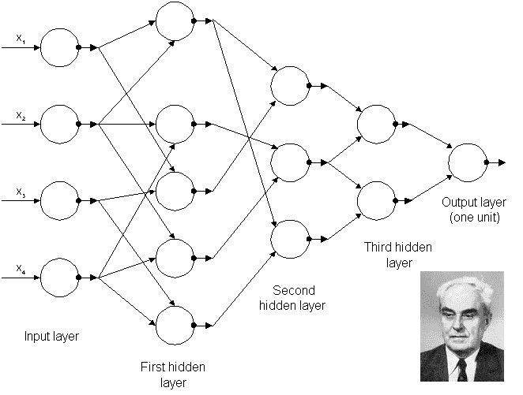
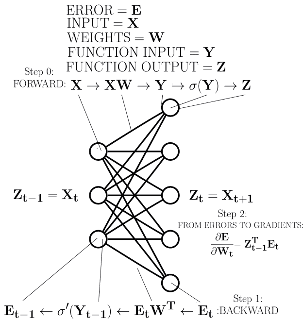
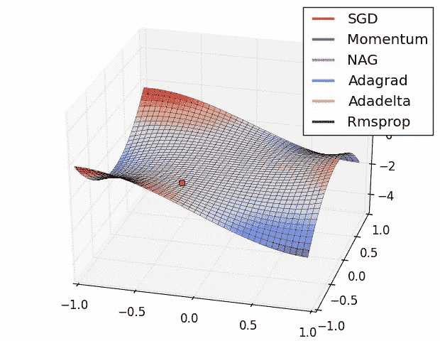

# 深度学习（2）历史和训练

> 来源：[https://waytoagi.feishu.cn/docx/HkXPdC0J6onaR1xO9SJcsji4nhh](https://waytoagi.feishu.cn/docx/HkXPdC0J6onaR1xO9SJcsji4nhh)

> 《**Deep Learning in a Nutshell: **History and Training》

> https://developer.nvidia.com/blog/parallelforall/deep-learning-nutshell-history-training/

> 译者：《通往AGI之路》共建者dorothy

[这一系列](https://developer.nvidia.com/deep-learning)博客旨在提供一[个直观温](https://developer.nvidia.com/blog/parallelforall/deep-learning-nutshell-core-concepts/)[和且不严](https://developer.nvidia.com/blog/parallelforall/deep-learning-nutshell-sequence-learning/)重依赖数学或理论构建的深度学习介绍。本系列的第一部分对深度学习领域进行概述，涵盖了基础和核心概念。第三部分涵盖了序列学习主题，如循环神经网络和LSTM。

在[第二部分](https://developer.nvidia.com/blog/parallelforall/deep-learning-nutshell-sequence-learning/)中，我们简要回顾了深[度学习的](https://developer.nvidia.com/blog/parallelforall/deep-learning-nutshell-reinforcement-learning/)历史，然后着手讨论快速高效训练深度学习架构的方法。第三部分着重介绍了序列学习，第四部分则重点关注强化学习。

我以词汇表的形式编写了这个系列，因此它也可以用作深度学习概念的参考。

# **历史**

## **深度学习的简史**

[**最早具有多层**](https://developer.nvidia.com/blog/parallelforall/deep-learning-nutshell-core-concepts#layer)**非**线性特征的类似深度学习的[算法](https://developer.nvidia.com/blog/parallelforall/deep-learning-nutshell-core-concepts#activation-function)可[以追溯到](https://developer.nvidia.com/blog/deep-learning-nutshell-history-training/#backpropagation) 1965 年的 [Iv](https://developer.nvidia.com/blog/parallelforall/deep-learning-nutshell-core-concepts#artificial-neural-network)akhnenko 和 Lapa（图 1），他们使用了带有多项式激活函数的薄而深的模型，并通过统计方法对其进行了分析。在每一层中，他们通过统计方法选择最佳特征并将其转发到下一层。他们没有使用反向传播来端到端训练他们的网络，而是使用逐层最小二乘拟合，其中前一层与后一层独立拟合。

图1：1965年由Alexey Grigorevich Ivakhnenko培训的第一个已知深度网络的体系结构。每个层之后的特征选择步骤都会导致体系结构变得越来越窄，当通过添加另一个层而无法实现进一步改进时，该体系结构就会终止。维基百科提供的Alexey Ivakhnenko教授的照片。

最早的[**卷积网络**](https://developer.nvidia.com/blog/parallelforall/deep-learning-nutshell-core-concepts#convolutional-neural-network)[**是由福**](https://developer.nvidia.com/blog/parallelforall/deep-learning-nutshell-core-concepts#pooling)岛在1979年使用的。福岛的网络有多个卷积和池化层，类似于现代网络，但该网络是通过使用强化方案进行训练的，其中多层的强激活轨迹随着时间的推移而增加。此外，人们可以通过增加某些连接上的权重来手动分配每个图像的重要特征。

在这个时期，还缺乏使用误差反向传播训练深度模型的方法。反向传播算法早在1960年代就已经被推导出来，但是形式不完整且低效。现代形式的反向传播算法最早由Linnainmaa在他1970年的硕士论**文中**推导出来，并包括了用于反向传播的FORTRAN代码，不过没有提及其在神经网络中的应用。即使在这个时期，反向传播算法仍然相对较为陌生，1980年代早期，几乎没有记录下反向传播算法的应用（例如1982年的Werbos）。Rumelhart、Hinton和Williams在1985年证明，神经网络中的反向传播算法可以产生有趣的分布式表示。在当时，这是认知心理学中一个重要的成果，问题在于人类认知是否可以被认为是依赖于分布式表示（连接主义）还是符号逻辑（计算主义）。

反向传播的第一个真正实用的应用是由LeCun于1989年在贝尔实验室的工作成果。他将卷积网络与反向传播相结合来对手写数字（MNIST）进行分类，该系统后来在美国被用于读取大量手写支票。上面的视频显示了Yann LeCun在1993年使用“LeNet”网络进行数字分类的演示。

尽管取得了这些成功，但用于神经网络研究的资金仍然很少。[**在人工智能寒冬**](https://developer.nvidia.com/blog/deep-learning-nutshell-history-training/#ai-winter)期间，人工智能一词近乎成为伪科学的代名词，该领域仍需一段时间才能恢复。这一时期取得了一些重要的进展，例如，Hochreiter和Schmidhuber在1997年为递归神经网络开发的长短期记忆（LSTM），但是这些进展在Cortes和Vapnik于1995年开发的支持向量机（VCM)面前相形见绌，因此大多数被人们所忽视。

下一个重大转变的契机出现在静待计算机变得更快，和接下来引入的图形处理单元（GPU）。仅等待更快的计算机和GPU就可以在10年内将计算速度提高1000倍。在这期间，神经网络逐渐开始与支持向量机相竞争。与支持向量机相比，神经网络可能会慢一些，但是在相同数量的数据下可以获得更好的结果。与简单算法不同，神经网络在有更多训练数据时会持续改进。

此时的主要障碍是训练大型、深层的网络，这些网络因遭受梯度消失问题，无法学习早期层的特征，因为没有学习信号到达这些层。

解决这个问题的第一个方法是逐层预训练，即通过使用无监督学习以逐层方式构建模型，以便早期层中的特征已经用一些合适的特征进行初始化或“预训练”（权重）。早期层中的预训练特征只需要在监督学习期间略微调整即可获得良好的结果。第一个预训练方法是由Schmidhuber于1992年为递归神经网络开发的，另一个预训练方法是由Hinton和Salakhutdinov于2006年为前馈网络开发的。另一个解决递归神经网络中梯度消失问题的解决方案是于1997年提出的长短期记忆（LSTM)。

随着GPU速度的[迅速增加，C](https://developer.nvidia.com/blog/deep-learning-nutshell-history-training/#rectified-linear-function)**ire**[san和他的同](https://developer.nvidia.com/blog/deep-learning-nutshell-history-training/#dropout)**事在****201****1年和2012年****展示了卷积网络的训练不再****需要预**[训练，他](https://developer.nvidia.com/blog/parallelforall/deep-learning-nutshell-core-concepts#feature-engineering)们用卷**积网络架构赢得了**[字符识别](https://developer.nvidia.com/blog/parallelforall/deep-learning-nutshell-core-concepts#feature-learning)、交通标志和医学成像竞赛。Krizhevsky、Sutskever和Hinton在2012年也使用了类似的架构，还采用了修正线性激活函数和dropout进行正则化。他们在2012年的ILSVRC-2012 ImageNet竞赛中取得了杰出的成绩，标志着特征工程的放弃和深度学习形式的特征学习被采用。Google、Facebook和Microsoft注意到了这一趋势，并在2012年至2014年期间对深度学习初创企业和研究团队进行了大规模收购。从此深度学习的研究迅速加速。

附加材料：[**神经网络中的深度学习概述**](http://arxiv.org/pdf/1404.7828v4.pdf)

## **感知器**

感知器仅包含单个线性或非线性[**单元**](https://developer.nvidia.com/blog/parallelforall/deep-learning-nutshell-core-concepts#unit)。从几何角度来看，采纳Delta 规则训练的非线性单元的感知器可以找到分离两个不同类别数据点的非线性平面（如果分离平面存在）。如果不存在这样的分离平面，感知器通常仍会产生提供良好分类精度的分离平面。感知器的良好性能引发了人工智能的热潮。然而，1969 年，研究表明感知器可能无法分离看似简单的模式，例如 XOR 函数提供的点。感知器的声誉跌落是第一次人工智能寒冬出现的主要原因之一。虽然具有隐藏层的神经网络不会受到感知器的典型问题的困扰，但神经网络仍然与感知器相关联，因此在人工智能寒冬期间也面临形象问题。

尽管如此，尽管深度学习取得了成功，感知器仍然在大数据领域得到广泛应用，因为感知器的简单性使其可以成功应用于非常大的数据集。

## **人工智能寒冬**

机器学习和其他推理方法的快速发展引起了人工智能的炒作（类似于当今深度学习的热潮）。研究人员承诺这些进展将持续，并将导致强人工智能的出现，因此人工智能研究获得了大量资金支持。

1970年代，人们开始意识到这些承诺无法兑现，资金被大幅削减，人工智能领域陷入了近似伪科学的境地。研究变得非常困难（资金很少；发表的论文几乎无法通过同行评审），但仍有一些研究人员继续沿着这条道路前进，他们的研究很快导致了该领域的复苏和深度学习领域的诞生。

这就是为什么过度的深度学习炒作是危险的，研究人员通常避免对未来做出预测：人工智能研究人员希望避免另一个人工智能寒冬。

## **AlexNet**

AlexNet是一种卷积网络架构，以Alex Krizhevsky的名字命名，在Ge**of****frey Hin****t**[**on的监**](https://developer.nvidia.com/blog/deep-learning-nutshell-history-training/#rectifieid-linear-function)**督下他与Ily**[**a Sutskever将此架构应用于以 **](https://developer.nvidia.com/blog/deep-learning-nutshell-history-training/#dropout)ImageNet 数据集为特色的 ILSVRC-2012 竞赛中。他们改进了Ciresan和同事开发的卷积网络架构，该架构通过使用修正线性单元提高速度和dropout以提高泛化能力，赢得了 2011 年和 2012 年的多项国际比赛。他们的结果与特征工程方法形成了鲜明的对比，这立刻在深度学习和计算机视觉的特征工程方法之间产生了巨大的分歧。从这里可以明显看出，深度学习将取代计算机视觉，并且其他方法将无法赶上。AlexNet预示了深度学习的主流应用和前景。

使用深度卷积神经网络进行ImageNet分类。

# **训练深度学习架构**

## **训练**

训练深度学习架构的过程类似于幼儿开始理解周围世界的过程。当幼儿遇到一个新的动物，比如一只猴子，他或她不会知道这是什么。但是一个成年人会用手指指向猴子并说：“那是一只猴子！”幼儿就能将他或她看到的图像与标签“猴子”联系起来。

然而，在下一次遇到同样的动物时。单个图像可能不足以正确地标记该动物。例如，幼儿可能会把树懒误认为猴子，或者把猴子误认为树懒，或者干脆忘记某种动物的名称。为了可靠地记忆和标记，幼儿需要看到许多不同的猴子和类似的动物，并且每次都需要知道它是否真的是猴子——反馈对于学习至关重要。经过一段时间，如果幼儿遇到足够多的动物并配对它们的名称，幼儿将学会区分不同的动物。

深度学习过程类似。我们向神经网络提供图像或其他数据，例如一只猴子的图像。深度神经网络预测某种结果，例如图像中物体的标签（“猴子”）。然后我们向网络提供反馈。如果网络预测图像显示有 30% 的概率是猴子，70% 的概率是树懒，那么所有有利于树懒类的输出都会出错！通过误差反向传播算法，我们使用该误差来调整神经网络的参数。

通常，我们会随机初始化深度网络的参数，起初网络会输出随机预测。对于包含1000个类别的ImageNet，这意味着初始化神经网络后，我们对任何图像的平均分类精度仅为 0.1%。为了提高性能，我们需要调整参数，以便分类性能随着时间的推移而提高。但这本质上是困难的：如果我们调整一个参数来提高一类的性能，这个变化可能会降低另一类的分类性能。只有找到适用于所有类别的参数变化，我们才能实现良好的分类性能。

如果你想象一个只有两个参数（例如-0.37和1.14）的神经网络，那么你可以想象一个山地景观，其中山地高度代表分类错误，而两个方向-南北（x轴）和东西（y轴）代表我们可以改变这两个参数的方向（负-正方向）。任务是要找到山地景观中的最低点：我们要找到最小值。

这样做的问题是，我们一开始对整个山地景观一无所知。仿佛整个山脉都笼罩在雾气之中我们只知道我们当前的位置（初始随机参数）和我们的高度（当前的分类错误）。当我们对景观的信息非常少时，如何快速找到最小值呢？

## **随机梯度下降**

想象一下，你站在山顶上，脚上绑着滑雪板。你想尽快下到山谷，但是有雾，你只能看到你周围的环境。你该如何尽快下山？你环顾四周，找到最陡峭的下山路径，沿着这条路径下山一段时间，再次环顾四周，找到新的最陡峭的路径，沿着这条路径下山，然后重复这个过程——这正是梯度下降所做的。

梯度下降相当于每 10 米停下来，用卷尺测量周围环境的陡度（根据整个数据集测量梯度），而随机梯度下降相当于快速估计陡度（仅使用几百个数据点来估计陡度）。

就随机梯度下降而言，我们沿着误差函数的最陡路径（负梯度或一阶导数）向下走，以寻找局部最小值，即为我们的任务产生低误差的点。我们以微小的步骤来做这件事，这样我们就不会被困在半管状的障碍物中（如果我们太快，我们永远无法摆脱这些半管，甚至可能被“弹射”上山）。

虽然我们的滑雪景观是 3D 的，但典型的误差景观可能有数百万个维度。在这样的空间中，我们有很多山谷，所以很容易找到一个好的解决方案，但我们也有很多鞍点，这使得事情变得非常困难。

鞍点是周围环境几乎完全平坦的点，但其一端或另一端可能有剧烈的下降（鞍点就像稍微弯曲的高原，稍微弯曲，可能通向悬崖）。在多维误差环境中找到好的解决方案的大多数困难源于导航鞍点（因为这些平台几乎没有陡度，鞍点附近的进展非常缓慢），而不是找到最小值本身（有很多最小值，它们几乎是均具有相同的质量）。

附加材料：Coursera：用于机器学习的神经网络：优化 - 如何使学习更快

## **误差反向传播**

误差反向传播，或者通常简称反向传播，是一种用于在神经网络上找到误差相对于权重的梯度的方法。梯度表示网络的误差如[**何随着网**](https://developer.nvidia.com/blog/deep-learning-nutshell-history-training/#stochastic-gradient-descent)络权重的变化而变化。梯度用于执行梯度下降，从而找到一组使网络误差最小化的权重。

ent/uploads/2015/12/backprop-624x659.png

图 1：深度神经网络中任意层的反向传播。

教授反向传播有三种好方法：

（1）使用视觉表示

（2）使用数学表示

（3）使用基于规则的表示。本节末尾的奖励材料使用数学表示。

在这里，我将使用基于规则的表示，因为它需要很少的数学知识并且很容易理解。

[**想象一个有 100层**](https://developer.nvidia.com/blog/parallelforall/deep-learning-nutshell-core-concepts#layer)**的****神经网络****。我们**[**可以想象**](https://developer.nvidia.com/blog/parallelforall/deep-learning-nutshell-core-concepts#activation-function)一个前向传递（即前传，一种神经网络的计算方式），其中的一个矩阵（维度：示例数量 x 输入节点数量）被输入到网络并通过网络传播，我们始终具有以下顺序传输：（1）输入节点，（2）权重矩阵（维度：输入节点 x 输出节点），以及（3）输出节点，其通常也具有非线性激活函数（维度：示例 x 输出节点）。我们如何想象这些矩阵？

输入矩阵表示如下：对于每个输入节点，我们有一个输入值，例如像素（三个输入值 = 图 1 中的三个像素），我们将其乘以示例数量，例如图像数量。因此，对于 128 个 3 像素图像，我们有一个 128×3 输入矩阵。

权重矩阵表示输入和输出节点之间的连接。传递到输入节点（像素）的值由权重矩阵值加权，并通过这些连接“流”到每个输出节点。这种流动是通过将输入值乘以输入节点和输出节点之间每个权重的值来实现的。输出矩阵是所有输入节点在所有输出节点的累积的“流”（即信息传播）。

因此，对于每个输入，我们乘以所有权重，然后将输出节点上的所有这些贡献相加，或者更容易地，我们将矩阵乘积的输入矩阵乘以权重矩阵。在我们的示例中，这将是 128×3 输入矩阵乘以 3×5 权重矩阵（参见图 1）。因此，我们得到输出矩阵，在本例中其大小为 128×5。然后，我们使用该输出矩阵，应用非线性激活函数，并将得到的输出矩阵视为下一层的输入矩阵。我们重复这些步骤，直到达到误差函数。然后，我们应用误差函数来查看查看预测值与正确值之间的差距。我们可以通过定义简单的规则来制定前向传递和后向传递的整个过程（参见图 1）。

对于给定的输入数据，我们按照以下规则从第一层到最后一层进行前向传递：

1.  当我们遇到权重矩阵时，我们将矩阵乘以该权重并传播结果。

1.  如果我们遇到一个函数，我们将当前的结果放入函数中，并将函数的输出作为结果传播。

1.  我们将上一层的输出作为下一层的输入

1.  当我们遇到错误函数时，我们应用它，从而为我们的反向传递生成错误。

给定误差的后向传递也类似，但是是从最后一层进行到第一层，其中前向传递中规则 4 中生成的误差代表最后一层的“输入”。然后我们通过网络向后追溯并遵循以下规则：

1.  当我们遇到权重矩阵时，我们将矩阵乘以矩阵的转置并传播结果。

1.  如果我们遇到一个函数，我们将其与该函数相对于从前向传递接收的输入的导数进行逐元素相乘。（见图1）

1.  我们将上一层的错误视为下一层的输入（错误）

为了计算梯度，我们使用在后向传递中执行规则 2 后获得的每个中间结果，并将该中间结果与前一层前向传递的规则 2 的值进行矩阵乘法（参见图 1）。

附加材料：Coursera：机器学习的神经网络：反向传播学习过程

## **修正****线性函数**

修正线性函数（ReLU函数）是一种简单的非线性函数：对于负数输入，它的值为 0，而正数则保持不变 (f(x) = max(0,x))。ReLU函数的梯度在所有正数值上都为1，在负数值上为0。这意味着在反向传播过程中，负梯度不会被用来更新输出ReLU单元的权重。

然而，由于[**我们对任何正值的梯度均为 **](https://developer.nvidia.com/blog/parallelforall/deep-learning-nutshell-core-concepts#logistic-regression)1，因此与其他非线性函数相比，由于良好的梯度流，我们的训练速度要快得多。例如，逻辑 sigmoid 函数对于大的正负值具有非常小的梯度，因此在这些区域学习几乎停止（这种行为类似于鞍点）。

尽管负梯度不会在修正线性函数中[**传播（此**](https://developer.nvidia.com/blog/parallelforall/deep-learning-nutshell-core-concepts#activation-function)处梯度为零），但正值的大梯度非常强大，无论梯度大小如何，都能确保快速训练。一旦这些好处被发现，修正线性函数和类似的具有大梯度的激活函数就成为深度网络的首选激活函数。

## **动量/涅斯特罗夫加速梯度**

动量使用这样的概念，即梯度偶尔曲折，但通常沿着一条相当直线走向局部最小值。因此，如果我们在这个大方向上移动得更快并且忽略之字形方向，我们通常会更快地到达局部最小值。

为了实现这一行为，我们跟踪运行动量矩阵，它是梯度的加权运行和，并将该动量矩阵值添加到梯度中。通过在每次更新时衰减动量矩阵（乘以 0.7-0.99 之间的动量值）来控制动量矩阵的大小。随着时间的推移，运行动量矩阵中的锯齿形尺寸将变得平滑：一个方向上的锯齿形和完全相反方向上的锯齿形相互抵消，并产生一条直线朝向局部最小值的大体方向。一开始，朝向局部最小值的大体方向并未牢固建立（一系列没有锯齿形的锯齿，反之亦然），并且动量矩阵需要更加强烈地衰减，或者动量值越来越强调锯齿形方向，这反过来又会导致学习不稳定。因此，当尚未建立局部最小值的大体方向之初，动量值应保持较小数值（0.5-0.7）。之后动量值可以快速增加（0.9-0.999）。

通常，先进行梯度更新，然后跳转到动量方向。然而，Nesterov 表明，最好首先跳入动量方向，然后通过梯度更新来纠正该方向；这个过程被称为“Nesterov 加速梯度”（有时是“Nesterov 动量”），可以更快地收敛到局部最小值。

附加材料：Coursera：机器学习的神经网络：3.动量法

## **RMSprop（均方根传播）**

RMSprop 跟踪平方梯度的加权移动平均值，然后将每个计算出的梯度除以该加权移动平均值的平方根（它本质上是通过除以最近梯度的大小来归一化梯度）。结果是，当遇到误差曲面上的平台并且梯度非常小时，更新会采取更大的步骤，确保更快的学习（小更新：0.00001，加权平均值的平方根：0.00005，更新大小：0.2 ）。另一方面，RMSprop 可以防止梯度爆炸（大更新：100，加权平均值的平方根：25，更新大小：4），因此在循环神经网络和 LSTM 中经常使用RMSprop来防止梯度消失和爆炸。

g/wp-content/uploads/2015/12/NKsFHJb.gif

图 2：不同加速梯度下降方法在加速上的[**行为。鞍点被认为是**](https://www.themuse.com/companies/indicoio/people/alec)优化深度网络的主要难点。图片由亚历克·雷德福拍摄。

附加材料：

Coursera：用于机器学习的神经网络用于机器学习：RMSProp

[**比较不同优化问题的附加动画**](http://imgur.com/a/Hqolp)。

## Dropout

想象一下，你是[**卷积网络**](https://developer.nvidia.com/blog/parallelforall/deep-learning-nutshell-core-concepts#convolutional-neural-network)**中的一个**[**单元**](https://developer.nvidia.com/blog/parallelforall/deep-learning-nutshell-core-concepts#unit)**，**正在为一项分类任务准备考试，并且你知道在考试期间可以从同学（其他单元）那抄答案。你会为了考试而学习吗？这个问题的答案可能是“是”或“否”，至少取决于你班上是否有一些学生已经为考试进行了学习。

假设**您**知道你的班级（卷积网络）中有两名学生（单元），他们享有为每次考试（呈现的每张图像）学习的名声。因此，你不用为考试而学习，只需复制这些学生的内容（你高度重视前一层中单个“精英”单元的输入）。

现在我们介绍一种传染性流感（dropout），它影响了 50% 的学生。现在这两个真正备考的学生很有可能不会到场，所以依靠抄袭答案不再是一个好的策略。所以这次你必须自己学习（选择考虑所有层中的所有单元，而不仅仅是精英单元）。

换句话说，dropout 对单元的信息处理解耦，使它们不能依赖于某些似乎总是有正确答案的“超级明星”单元（这些超级明星检测到的特征比其他单元检测到的特征更重要）。

这反过来又使分类过程民主化，以便每个单元的计算在很大程度上独立于强大影响因素，从而通过确保不那么极端的意见（没有主流观点）来减少偏见。这种单元的解耦反过来又导致了强大的正则化和更好的泛化（群体的智慧）。

## **L1 和 ****L2 正则化**

L1 和 L2 正则化对网络权重的大小进行惩罚，使得单个大权重不再能够产生强信心的大输出值，而是需要多个中等大小的权重。由于许多单元必须达成一致才能获得大（输出）值，因此输出不太可能因单个单元的意见而产生偏差。从概念上讲，它惩罚单个单元的强烈意见，并鼓励考虑多个单元的意见，从而减少偏见。

L1 正则化惩罚权重的绝对值大小，而 L2 惩罚权重的平方大小。如果使用较大的权重，该惩罚会添加到误差函数值中，从而增加误差。因此，网络被驱使着使用小权重来解决问题。

由于即使很小的权重也会产生相当大的 L1 惩罚，因此 L1 惩罚的效果是大多数权重将设置为零，而只保留一些中到大的权重。由于存在较少的非零权重，因此网络必须对其结果充满信心才能实现良好的预测性能。

L2 惩罚鼓励非常小的非零权重（大权重=非常大的误差）。在这里几乎所有权重都参与了预测，从而减少了偏差（没有可以单独改变结果的影响因素）。

附加材料：Coursera：机器学习的神经网络：2.限制权重的大小

# **第 2 部分的结论**

[**这是深度学习**](https://developer.nvidia.com/blog/parallelforall/deep-learning-nutshell-sequence-learning/)**速成课程的第二部分。敬请期****待本系列的****下一部分。在****第 3 部分****中，我将介**[**绍有关学习算**](https://developer.nvidia.com/blog/parallelforall/deep-learning-nutshell-reinforcement-learning/)**法、无监督学习、****序列学习****和自然语言处理的细节，在第**[** 4 部分中，我将深**](https://developer.nvidia.com/blog/parallelforall/deep-learning-nutshell-core-concepts/)入探讨强化学习。如果您错过了，请务必查看该系列的第 1 部分。

同时，您可能有兴趣了解[**cuDNN**](https://developer.nvidia.com/blog/parallelforall/cudnn-v2-higher-performance-deep-learning-gpus/)**、**[**DIGITS**](https://developer.nvidia.com/blog/parallelforall/easy-multi-gpu-deep-learning-digits-2/)**、**[**Caffe 计算机视觉**](https://developer.nvidia.com/blog/parallelforall/deep-learning-computer-vision-caffe-cudnn/)**、**[**Torch 自然语言处理**](https://developer.nvidia.com/blog/parallelforall/understanding-natural-language-deep-neural-networks-using-torch/)**、**[**神经机器翻译**](https://developer.nvidia.com/blog/parallelforall/introduction-neural-machine-translation-with-gpus/)**、Julia 的**Mocha.jl深度学习框架或其他关于深度学习的 Parallel Forall 帖子。

##

## **相关资源**

+   GTC 会议：与专家交流：深度学习、机器学习和数据科学（2023 年春季）

+   GTC 会议：与专家交流：加速深度学习模型并将其部署到生产（2023 年春季）

+   SDK：[**Nsight深度学习设计器**](https://developer.nvidia.com/nsight-dl-designer?ncid=em-nurt-245273-vt33)

+   网络研讨会：NVIDIA Inception 开放日：Metropolis

+   网络研讨会：NVIDIA 新兴分会教育系列 - Jetson AI 基础知识

+   网络研讨会：NVIDIA Inception 以色列初创公司网络研讨会

# **关于 Tim Dettmers**

Tim Dettmers 是卢加诺大学信息学硕士生，从事深度学习研究[**。在此之前，他学习**](http://timdettmers.com/)了应用数学，并在自动化行业担任了三年的软件工程师。他运营着一个关于深度学习的博客，并参加了 Kaggle 数据科学竞赛，他的世界排名达到了 63 位。