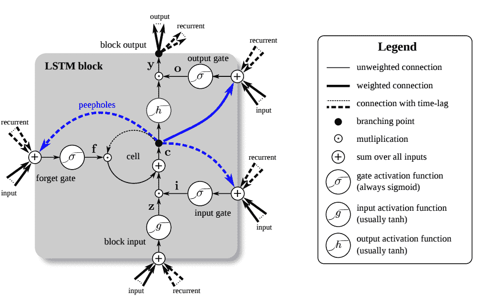
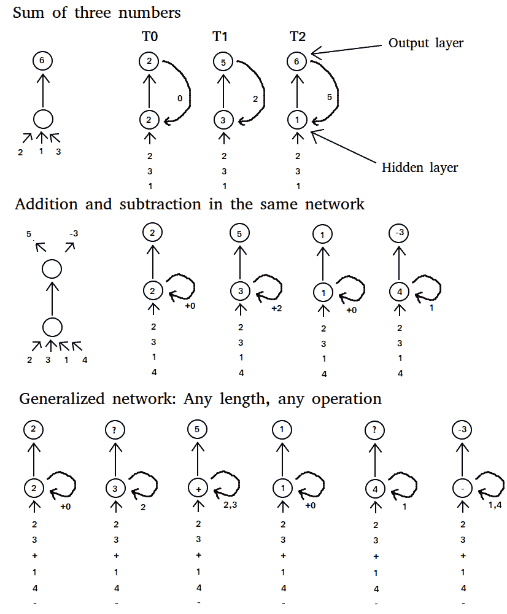
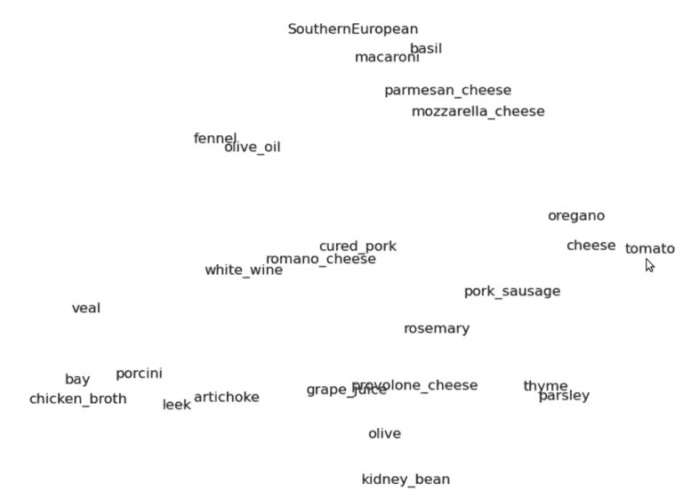

# 深度学习（3）序列学习

> 来源：[https://waytoagi.feishu.cn/docx/RMIydmP4woX7Olx7uumcZ9eJn8f](https://waytoagi.feishu.cn/docx/RMIydmP4woX7Olx7uumcZ9eJn8f)

> 《**Deep Learning in a Nutshel**l: Sequence Learning》

> https://developer.nvidia.com/blog/parallelforall/deep-learning-nutshell-sequence-learning/

> 译者：通往AGI之路，共建者：dorothy

[这一系列](https://developer.nvidia.com/deep-learning)博客旨在提供一[个直观且](https://ywh1bkansf.feishu.cn/wiki/UdLFwdjgPiXm5tkVi0dcfcRMn0f)[不严重依](https://ywh1bkansf.feishu.cn/wiki/QacGwCWxoizfmlkOsKFc0PHQnWb)赖数学或理论构建的深度学习介绍。本系列的第一部分对深度[**学习领域进行概述，涵**](https://ywh1bkansf.feishu.cn/wiki/X8WZwBW9jiynLhkGOd2cBB56nMc)盖了基础和核心概念。在第二部分中，我们概述了有效训练神经网络的方法，并介绍了该领域的历史背景。在这篇文章中，我们将重点关注自然语言处理的序列学习。本系列的第 4 部分介绍了强化学习。

图 1：长短期记忆 (LSTM) 单元。LSTM 单元有四个输入权重（从数据到输入和三个门（即input gate、output gate和forget gate））和四个循环权重（从输出到输入和三个门（即input [**gate、output ga**](http://arxiv.org/abs/1503.04069)te和forget gate））。窥视孔是存储单元和门之间的额外连接，但它们不会显著提高性能，通常为简单起见而被省略。图片由 Klaus Greff 及其同事拍摄，发表于 《LSTM：搜索空间奥德赛》。

# 序列**学习**

生活中的一切都取决于时间，因此代表着一个序列。为[**了使用顺序**](https://developer.nvidia.com/blog/parallelforall/deep-learning-nutshell-core-concepts/#machine-learning)**数据（文本、语音**[**、视频等**](https://developer.nvidia.com/blog/parallelforall/deep-learning-nutshell-core-concepts#artificial-neural-network)）进行机器学习，我们可以使用常规神经网络并将整个序列提供给它，但是我们数据的输入大小将是固定的，这相当受限制。如果序列中的重要事件恰好位于输入窗口之外，这种方法还存在其他问题。我们需要的是（1）一个网络，我们可以向其中输入任意长度的序列，每个时间步长一个序列元素（例如一个视频只是一系列图像；我们一次向网络输入一个图像）；以及（2）一个具有某种记忆的网络，可以记住过去许多时间步骤中发生的重要事件。这些问题和要求催生了各种不同的循环神经网络。

# **循环神经网络**

如果我们想要一个常规的神经网络解决两个数字相加的问题，那么我们可以只输入这两个数字并训练网络来预测这些输出的总和。如果我们现在想要三个数字相加而不是两个数字，我们可以（1）使用额外的输入和权重来扩展我们的网络并重新训练它，或者（2）将输出（即前两个数字和第三个数字的总和）反馈到网络中。方法（2）显然更好，因为我们可以希望网络在不重新训练整个网络的情况下表现良好（网络已经“知道”如何将两个数字相加，因此它应该知道如何将两个数字之和与另一个数字相加）。

相反，如果我们的任务是先将两个数字相加，然后再减去两个不同的数字，那么这种方法将不再有效。即使我们使用输出中的附加权重，我们也不能保证正确的输出：这相当于试图用加法和乘法来近似两个数的减法，这通常是行不通的！相反，我们可以尝试将网络中的“程序”从“加法”改为“减法”。我们可以通过对隐藏层的输出进行加权，并将其反馈到隐藏层——一个循环权重（参见图 2）！通过这种方法，我们可以通过每个新输入（也就是说，在每个新的数字）来改变网络的内部动态。网络将学会在前两个数字之后将程序从“加法”改为“减法”，从而解决问题（尽管在准确性上存在一些误差）。

图 2：常规神经网络与循环神经网络基本计算架构的比较。循环神经网络为每个时间步长都有一个输入，而常规神经网络一次性获取所有输入。

我们甚至可以推广这种方法，向网络逐个输入两个数字，然后输入一个代表“加法”、“减法”、“乘法”等数学运算的“特殊”数字。尽管这在实践中并不完美，但我们可以获得大致正确的结果。然而，这里的要点不是得到正确的结果，而是我们可以训练循环神经网络来学习任意输入序列的非常具体的输出，这非常强大。

**举****个例子，我们可以教循****环网络****学习单****词序列。So****u**mith Chintala和Wojciech[** Zar**](http://karpathy.github.io/2015/05/21/rnn-effectiveness/)emba撰写了一篇关于使用 RNN 进行自然语言理解的优秀 Parallel Forall 博客文章。RNN 还可用于生成序列。Andrej Karpathy 写了一篇引人入胜且有趣的博客文章，其中他演示了字符级 RNN，它可以生成从莎士比亚到 Linux 源代码再到婴儿名字的一切模仿。

# **长短期记忆 (****LSTM****)**

长短期记忆 (LSTM) 单元使用具有自连接的线性单元，其恒定权重 为1.0 。这使得流入该自循环单元的值（前向传递）或梯度（后向传递）可以无限期地保留（输入或误差乘以 1.0 仍然具有相同的值；因此，前一个时间步的输出或误差与下一个时间步的输出相同），以便在最需要的时间可以准确地检索该值或梯度。这种自我循环单元，即存储单元，提供了一种可以存储过去数十个时间步长的信息的存储器。这对于许多任务来说非常强大，例如对于文本数据，LSTM 单元可以存储前一段中包含的信息并将该信息应用于当前段落中的句子。

此外，深度网络中的一个常见问题是“梯度消失”问题，即梯度逐层变得越来越小，直至太小而无法影响最深层。借助 LSTM 中的存储单元，我们拥有连续的梯度流（误差保持其值），从而消除了梯度消失问题，并能够从数百个时间步长的序列中进行学习。

然而，有时我们想丢弃存储单元中的信息，替换成更新的、更相关的信息。同时，我们不想通过向网络释放不必要的信息来混淆网络的其他部分。为了解决这个问题，LSTM 单元有一个遗忘门，它会删除自循环单元中的信息，而不将信息释放到网络中（见图 1）。这样，我们就可以丢弃不造成混乱的信息，并为新的记忆腾出空间。遗忘门通过将 0（删除）和 1（保留所有内容）之间的数字乘以存储单元的值来实现此目的。（存储单元）确切的值由当前输入和前一个时间步长的 LSTM 单元输出所决定。

在其他时候，存储单元包含需要在许多时间步长内保持完整的a。为此，LSTM 添加了另一个门，即输入门或写入门，该门可以关闭，以便没有新信息流入存储单元（参见图 1）。这样，存储单元中的数据就可以得到保护，直到需要为止。

另一个门通过将存储单元的输出乘以 0（无输出）和 1（保留输出）之间的数字来操纵存储单元的输出（见图 1）。如果多个记忆相互竞争，这个门可能会很有用：一个存储单元可能会说“我的记忆现在非常重要！所以我现在就释放它！” 但网络可能会说：“你的记忆很重要，这是事实，但其他存储单元的记忆比你的记忆重要得多！因此，我向你的输出门发送小值，这将关闭你，并向其他输出门发送大值，以便更重要的记忆获胜！”

LSTM 单元的连接乍一看可能有点复杂，您需要一些时间来理解它。然而，如果将所有部分隔离开来，你会发现该结构本质上与普通循环神经网络相同，其中输入和循环权重流向所有门，而这些门又反过来连接到自循环存储单元。

为了更深入地研究 LSTM 并理解整个架构，我建议阅读 LST[**M: A Searc**](http://dl.acm.org/citation.cfm?id=1246450)h Space Odyssey 和 原始 LSTM 论文。

# 词嵌入

想象一下“猫”这个词以及所有其他与“猫”这个词密切相关的词。您可能会想到“小猫”、“猫科动物”等词。现在考虑一下与“猫”一词有点不同但与“猫”更相似而不是“汽车”的单词。你可能会想出“狮子”、“老虎”、“狗”、“动物”等名词或“咕噜咕噜”、“喵喵叫”、“睡觉”等动词。

现在想象一个三维空间，我们将“猫”这个词放在该空间的中间。上面提到的与“猫”一词更相似的词映射到离空间中距离“猫”位置更近的位置；例如，“小猫”和“猫科动物”很接近；“老虎”和“狮子”距离稍远一些；“狗”更远一些；而“车”则非常非常遥远。请参阅图 3，了解烹饪食谱中的单词及其二维词嵌入空间的示例。

[**图 **](https://developer.nvidia.com/discover/cluster-analysis)3：烹饪食谱的二维词嵌入空间。这里我们放大到“南欧”集群。

如果我们使用指向这个空间中每个单词的向量，那么每个向量将由 3 个坐标组成，这些坐标给出了这个空间中的位置，例如，如果“猫”是 (0,0,0)，那么“小猫”可能有坐标(0.1,0.2,-0.3) 而“汽车”的坐标为 (10,0,-15)。

这个空间就是我们上面的词汇（单词）的词嵌入空间，每个具有 3 个坐标的向量都是一个词嵌入，我们可以将其作为算法的输入数据。

通常，嵌入空间包含数千个单词和一百多个维度。对于人类来说这个空间很难理解，但是相似的单词在嵌入空间中紧密相连的属性仍然存在。对于机器来说，这是一种极好的单词表示，可以改善处理语言任务的结果。

如果您想了解有关词嵌入的更多信息，[**并了**](https://developer.nvidia.com/blog/parallelforall/developing-new-materials-gpu-accelerated-supercomputers/)[**解如**](https://developer.nvidia.com/blog/parallelforall/understanding-natural-language-deep-neural-networks-using-torch/)**何**[**应用它**](https://developer.nvidia.com/blog/parallelforall/developing-new-materials-gpu-accelerated-supercomputers/)**们**[**来创建可以“理解**](http://cs.nyu.edu/~zaremba/)”语言（至少在某种程度上）的模型，我建议您阅读 Soumith 的《使用 Torch 通过深度神经网络理解自然语言》钦塔拉和沃伊切赫·扎伦巴。

# **编码器****-****解码器**

停下来想象一下西红柿。现在想想与西红柿搭配得好的食材或菜肴。如果你的想法与你在网上找到的最常见的食谱类似，那你应该想到了奶酪和萨拉米（披萨）等成分；帕尔马干酪、罗勒、通心粉；以及橄榄油、百里香和欧芹等其他食材。这些食材大多与意大利和地中海美食有关。

现在想想同样的西红柿，但从墨西哥菜的角度来看。你可能会将西红柿与豆类、玉米（玉蜀黍）、辣椒、香菜或鳄梨联系起来。

你刚才所做的就是将“西红柿”一词的表示转换为“墨西哥美食“中的”西红柿”的新表示。

你可以想象编码器在做同样的事情。它逐个单词地接收输入，并将其转换成新的“思考向量” 并通过相应地转换所有单词的表示（就像将上下文“墨西哥菜”添加到“西红柿”中一样）。这是编码器-解码器架构的第一步。

编码器-解码器架构的第二步利用了这样一个事实：即两种不同语言的表示在词嵌入空间中具有相似的几何形状，即使它们对某个事物使用完全不同的词。例如，德语中的“猫”一词是“Katze”，而“狗”一词是“Hund”，这当然是不同的词，但这些词之间的根本关系几乎是相同的，即 Katze 与 Hund 的关系就像“猫”与“狗”的关系一样，因此Katze 和 Hund 之间以及猫和狗之间的“思想向量”差异将非常相似。或者换句话说，尽管词语不同，但它们描述的是相似的“思想向量”。有些单词无法用另一种语言真正表达，但这种情况很少见，一般来说单词之间的关系应该是相似的。

带着这些想法，我们现在可以构建一个解码器网络。我们将英语编码器生成的“思想向量”逐字输入德语解码器。德语解码器将这些重新解释的“思想向量”或“关系的转换”作为“德语单词向量空间”，从而生成以德语表述的与英语相同关系的句子。所以我们本质上构建了一个可以翻译语言的网络。在当前的研究中，这个想法已日臻成熟；虽然结果并不完美，但正在迅速改进，很快这种方法可能会成为语言翻译的最佳方式。

如果您想更深入地了解编码器-解码器架构和[**神经机器翻译，我建议您阅读**](https://developer.nvidia.com/blog/parallelforall/introduction-neural-machine-translation-with-gpus/)[**Kyunghyun Cho**](http://www.kyunghyuncho.me/)**撰写的**[**关于编码器-解码器架构的**](https://developer.nvidia.com/blog/parallelforall/introduction-neural-machine-translation-gpus-part-2/)这篇综合性 Parallel Forall博客文章。

# **结论**

我们已经看到，我们可以使用循环神经网络来解决处理任意长度序列的困难任务。我们还看到，过去输入的记忆对于成功的序列学习至关重要，并且 在这种情况下，LSTM 可提供改进的性能和缓解梯度消失问题。我们深入研究了词嵌入以及如何使用它们来训练循环架构以获得一定的语言理解能力。

我希望您喜欢这篇博文。敬请期待本系列的下一篇[**文章，该文章**](https://developer.nvidia.com/blog/parallelforall/deep-learning-nutshell-core-concepts/)将讨[**论强化学习。**](https://developer.nvidia.com/blog/parallelforall/deep-learning-nutshell-history-training/)**如**[**果您有任何疑**](https://developer.nvidia.com/blog/parallelforall/deep-learning-nutshell-reinforcement-learning/)问，请在下面的评论中留言，我会尽力解答。请务必阅读 本系列的第 1 部分、 第 2 部分和第 4 部分 ，以了解深度学习的基础和核心概念、历史、训练算法以及强化学习！