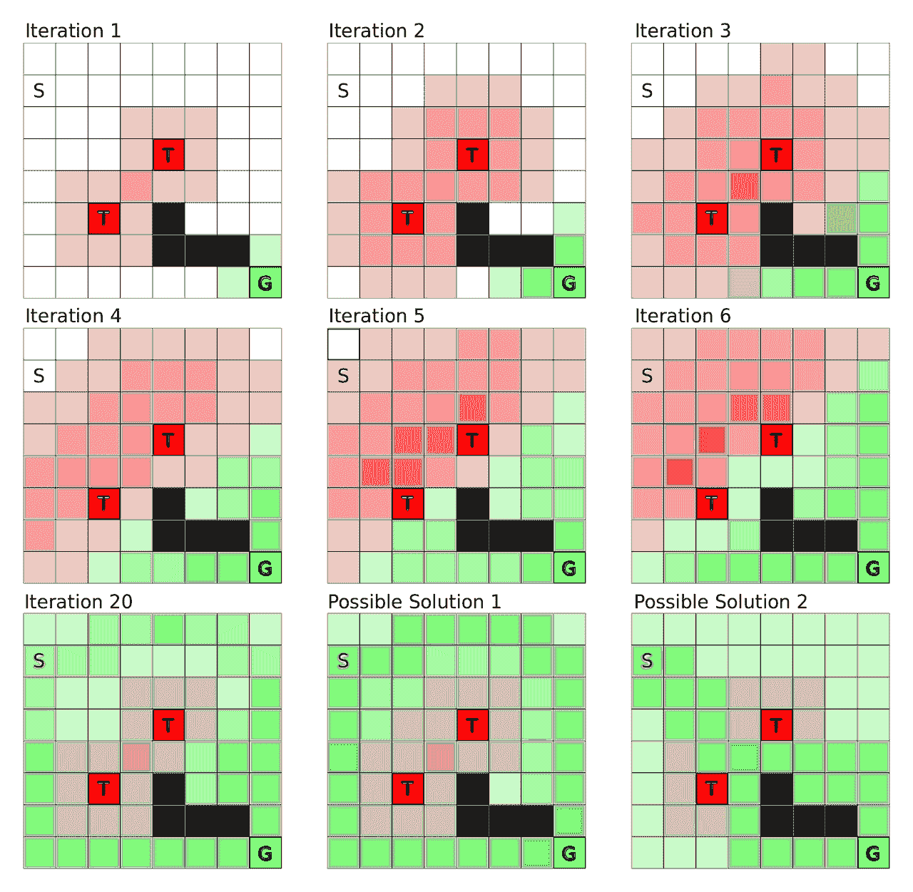
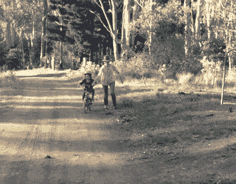
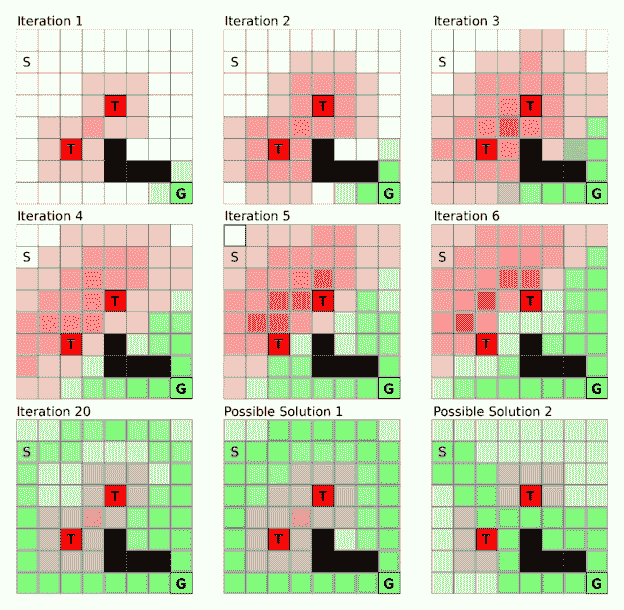
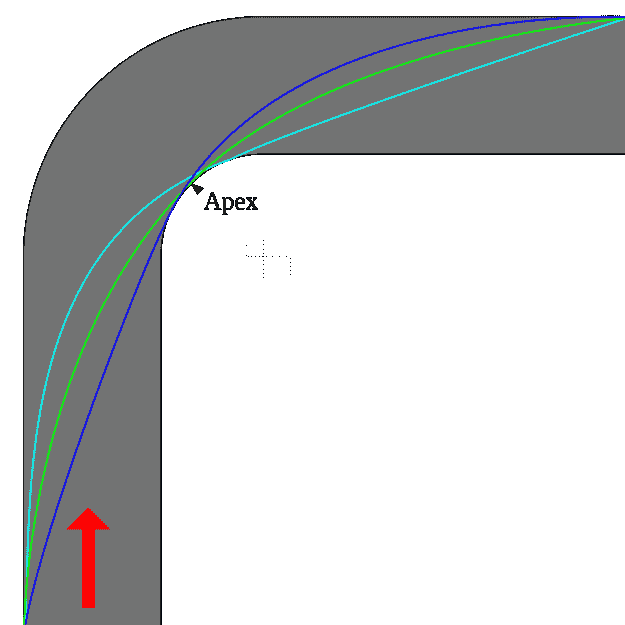
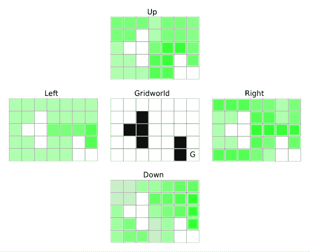
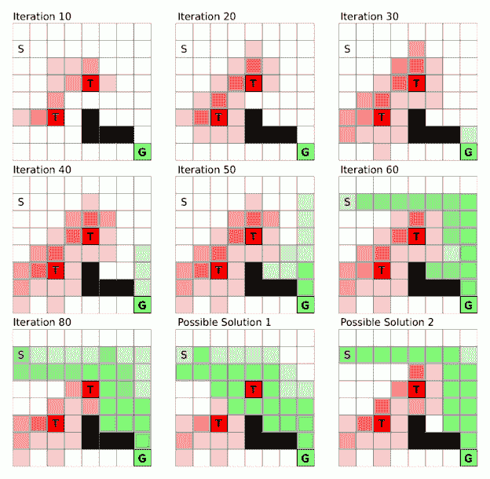
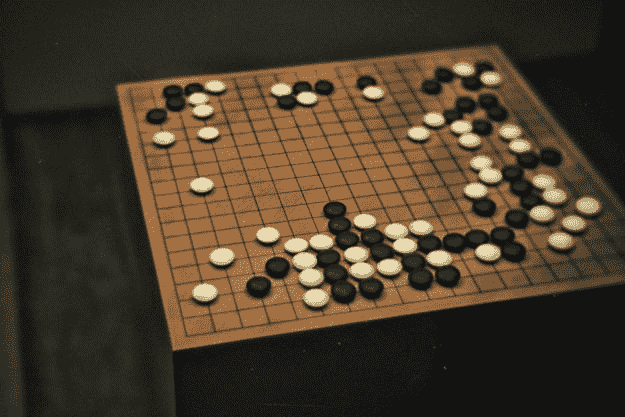

# 深度学习（4）强化学习

> 来源：[https://waytoagi.feishu.cn/docx/NJxgdkPuIoGZqJxT8yhctnK1n5c](https://waytoagi.feishu.cn/docx/NJxgdkPuIoGZqJxT8yhctnK1n5c)

> 原文地址：https://developer.nvidia.com/blog/deep-learning-nutshell-reinforcement-learning/

> 作者：[**Tim Dettmers**](https://developer.nvidia.com/blog/author/tdettmers/)

> 发表时间：2016年9月8日

本章是《深度学习简介》系列的第 4 部分，我将深入探讨强化学习。强化学习是机器学习的范式和方法论之一，用于描述和解决智能体（agent）在与环境的交互过程中通过学习策略以达成回报（或奖励）最大化。

《深度学习简介》对深度学习基本概念进行了高水平概述，目的是启发对基本概念而非数学和理论细节的了解。尽管数学术[**语有时很有必要且利**](https://ywh1bkansf.feishu.cn/wiki/UdLFwdjgPiXm5tkVi0dcfcRMn0f)**于**[**进一步理解，但本章尽**](https://ywh1bkansf.feishu.cn/wiki/QacGwCWxoizfmlkOsKFc0PHQnWb)**可能**[**使用类比**](https://ywh1bkansf.feishu.cn/wiki/CHMXwqoEYibzHdkC3QmcXZ53niX)和图像以便易于理解，从而形成深度学习领域的直观综述。之前的文章涵盖了深度学习的核心概念、深度学习：训练及历史以及序列学习。

# **强化学习**

还记得你是如何学会骑自行车的吗？很可能有一个成年人站在你身后或跟在你身边，鼓励你迈出第一步，并在你绊倒或摔倒时帮助你重新上车。但向孩子解释如何骑自行车是非常困难的，再好的解释对从未骑过自行车的人来说也没什么意义：你必须自己去感受。所以如果你不能解释如何骑上自行车的，又怎么能学会骑自行车呢？事实上，你是在不断地通过尝试进行学习，你很可能会跌倒，或至少可能会突然停下然后不得不控制好自己。你会不断跌倒或跌跌撞撞——直到你突然掌握了一些诀窍，能在你再次跌倒前前进几米了。

在这个学习过程中，针对我们的表现，反馈信号要么是痛苦的：“哎哟！我摔倒了！好痛啊！下次我会避免做导致这种情况发生的事情！”，要么带来奖励：“哇！我正在骑自行车！这感觉棒极了！我只需要继续做我现在正在做的事情！”

学习骑自行车需要试错，就像强化学习一样。（视频由马克·哈里斯提供，他说他作为父母正在“学习强化”。）

**在****强化学习****的问题上，我们认为存在一个****智能体**（agent）在尝试通过决策来最大化其所能收到的奖励。

因此，获得最大可能奖励的智能体可以被视为在给定状态下执行了最佳操作。这里的智能体指的是抽象实体，它可以是执行任何动作的对象或主体：自动驾驶汽车、机器人、人类、客户支持聊天机器人、围棋玩家。智能体的状态是指其在抽象环境中的位置和状态；例如，虚拟现实世界中的某个位置、建筑物、国际象棋棋盘或赛车道上的位置和速度。

为了简化强化学习问题和**解决方案，通常会简化环境，使智能**体只了解对决策重要的细节，而忽略其他部分。就像骑自行车的例子一样，强化算法只有两个反馈源可供学习：惩罚（摔倒的疼痛）和奖励（骑几米的刺激）。如果我们将惩罚视为负奖励，那么整个学习问题都将是关于探索环境和经过一个又一个的状态来尝试最大化我们的 agent 所得到的奖励，直到达到目标状态（自动从 A 驾驶到 B；赢得一场国际象棋比赛，通过聊天解决客户问题）：简而言之，这就是强化学习。

# 价**值函数**

强化学习是通过正向和负向奖励（惩罚或痛苦）来学习怎样选择产生最大累积奖励的行动的算法。为了找到这些行动，首先需要考虑当前环境中最有价值的状态。例如，在赛道上，终点线是最有价值的（这里好像就是你冲刺要达到deadline的前一步，这个状态肯定最有价值），即奖励最多的状态，并且在赛道上的状态比在赛道外的状态更有价值。（其实这里面就是递归的思想，当你找到了最有价值的状态，你只需要想办法得到这个状态就好了）

一旦我们确定了哪些状态是有价值的，我们就可以为不同的状态赋予“奖励”值。例如，对汽车位置偏离赛道的所有状态给予负奖励；完成一圈收到一个正奖励；当汽车超越当前的最佳圈速也收获一个正奖励；等等。我们可以将状态和奖励当成一个离散函数。例如，赛道可以用 1×1 米的网格表示。网格上的奖励由数字表示。例如，目标状态的奖励可能是 10，偏离赛道的奖励为 -2，而所有其他奖励为 0。假设这个函数是 3 维的，那么我们可以想象最佳的行动是让函数的值越高越好（即最大奖励）的行动。

对于每个状态，都存在中间状态，这些状态不一定是有奖励的（奖励 为0），但是它们是通往奖励状态的必经之路。例如，您需要通过第一个转弯才能完成一圈比赛，或者你必须跑完一圈才能提高圈速。

训练或拟合的价值函数将局部奖励值赋给中间状态，完成第二轮比第一轮更有价值，因为第二轮更接近下一个目标的状态。价值函数通过提供中间奖励来帮助智能体做出正确的决策，使智能体更容易判断下一步要移动到哪个状态。

图 1：通过全状态的价值迭代（value iteration）构建价值函数（value function）。这里每个方格都是一个状态：S是开始状态，G是目标状态，T方格是陷阱，黑色方格不能进入。在价值迭代中，我们初始化奖励（陷阱和目标状态），这些奖励值随着时间的推移而传播，直到达到平衡。根据陷阱的惩罚值和目标的奖励值，不同的奖励值可能产生不同的解决方案；最后的两张图是两种不同的解。

该框架意味着每个给定状态的值都会被周围状态的值所影响。图 1 显示了一个示例世界，其中每个方格都是一个状态，S 和 G 分别是起始状态和目标状态，T 方格是陷阱，黑色方格是无法进入的状态（挡路的大石块）。目标是从状态 S 移动到状态 G。如果我们想象这是我们的赛道，那么随着时间的推移，我们会创建一个从起始状态到目标状态的“斜坡”，这样我们只需沿着最陡的方向前进即可。这是价值函数的主旨思想：提供每个状态价值的估计，以便我们可以逐步做出决策直至获得奖励。

价值函数还可以捕捉问题的微妙之处。例如，相比偏离跑道外的状态，赛车在跑道两侧的惩罚并没有那么大；但是这并不能有效地将赛车纠正回跑道中心，也就无法达到理想的跑圈时间（赛车无法在高速下转弯）。因此，安全性和速度是无法兼顾的，价值函数会在赛道上找到最合适的快速且安全的路径。最终的解决方案可以通过改变奖励值来调整。例如，如果跑圈时间越短给予高奖励，则价值函数将会给风险更大但时间更短的状态赋予更大的值。

图 2：拐角处的不同赛车线。每条赛车线都有不同的距离、可能的速度不同、以及磨损轮胎的力度也不同。优化圈速的价值函数将优化此问题，以便找到能最小化弯道用时的状态转换。

# 折算因子

尽管价值函数决定奖励值大小，但它也取决于一个称为折算因子的参数，它限定了 agent 会在多大程度上受到较远状态的影响。（因为在一场的跑步比赛当中距离终点很远的一个状态只要朝着目标前进，它的奖励值也会很大。但是这显然不合理）。每当状态发生改变时，局部奖励值乘以折算因子记入价值函数。因此，在折算因子为 0.5 的情况下，仅经过 3 次状态变化，原始奖励值就会变成初始值的八分之一，所以智能体更倾向于搜索临近状态的奖励值。因此折算因子是控制价值函数偏向于谨慎或贪婪行为的权重 。

例如，跑得快的赛车可能获得高奖励，折算因子接近于零则会导致跑得越来越快的贪婪策略。但更谨慎的智能体知道，当前方有急转弯时，跑得越来越快是一个坏主意，而在恰当时机减速可能会在后面得到更短的跑圈时间，从而获得更高的奖励。为了拥有这种远见，智能体需要将跑得快的奖励延后，因此接近 1 的折算因子可能会更好。

价值函数的折算因子确保远处的奖励值会随着距离或步数成比例地减少。该因子通常设置为一个高度重视长期奖励的值，但又不是那么重视（例如每次状态转换奖励衰减 5%）。

首先把所有状态的奖励值初始化为 0 或者一个特定的值，然后搜索所有状态可能的下一个状态（从当前状态转移到其中的任意一个状态都有一个概率），并评估在下一个状态中获得的奖励，通过这种方式学习每一个状态特有的局部奖励值。如果它在下一个状态获得（部分）奖励，这个奖励会累计到当前状态的奖励。重复这个过程直到每个状态内的部分奖励不再改变，这意味着每次变换状态采取的可能转向以及每个状态的奖励值都被考虑在内。你可以在图 1 中看到价值迭代算法的过程。

乍一看，这似乎效率低下，但与动态规则相关的技巧使其更高效。在子问题已解决的前提下，动态规则能解决高阶问题：B 到 C 的奖励值可以被用于计算 A->B->C 和 D→B->C 的链式状态的奖励值。

总之，价值函数和价值迭代提供了一张部分奖励值的决策图，agent 根据它就可以朝着奖励值增加的状态方向运动，因此得到各个状态下的决策。

# 策略**函数**

在给定价值[**函数的**](https://developer.nvidia.com/blog/parallelforall/deep-learning-nutshell-history-training#training)**情况下，策略函数代表**一种策略，选择能产生最高（长期）回报的行动。在所有可能的下一步行动中，通常没有明确的优胜者。例如，智能体面临选择下一步进入 4 个状态 A, B, C, D 中的一个，其奖励值分别为 A=10、B=10、C=5 和 D=5。因此，A 和 B 都是很好的即时选择，但是随着时间的推移，A 状态之后的路径得到的奖励可能比 B 状态好得多，或者进入C状态的行动甚至是最佳选择。在训练过程中搜索所有选择是值得的，但同时，如果只看到即时奖励，就可能会导致非最优的选择。那么，我们如何在探索尽量高的奖励和探索回报较少但从长远来看可能会带来高回报的路径之间找到一个平衡点呢？

一个聪明的方法是根据奖励值的比例随机选择状态。在此示例中，选择 A 的概率为 33% (10/(10+10+5+5))，选择 B、C 和 D 的概率分别为 33%、16% 和 16% 。策略函数的这种随机选择属性对于学习一个好的策略至关重要。可能存在一些反直觉，但是有效甚至关键的成功策略。

例如，如果你以跑得快来训练赛车，它会尝试以尽可能高的速度抄近路。但是，如果你将竞争对手加入其（模型）中，则该策略将不是最佳策略。智能体会将其他选手在转弯处减速考虑在内，以避免竞争对手超车或更糟糕的碰撞的可能性。另一种情况可能是，高速转弯会使轮胎磨损得更快，导致赛程停滞（赛车紧急停留维修），从而浪费宝贵的时间。

请注意，策略函数和价值函数相互依赖。给定特定的价值函数，不同的策略会导致不同的选择，而给定特定的策略，智能体可能会对行动赋予不同的值。给定国际象棋游戏“只赢比赛”的策略，价值函数将为游戏中获胜概率较高的走棋赋予高价值（牺牲棋子以获得赢棋胜算会被赋予高价值）。但如果给予“以大比分领先获胜”，那么策略函数将学习在特定游戏中最大化得分的动作（永远不要牺牲棋子）。

这些只是众多例子中的两个。如果我们想要获得特定的结果，我们可以使用策略函数和价值函数来指导智能体学习良好的策略来实现该结果。这使得强化学习用途广泛且功能强大。

我们通过以下步骤训练策略函数：

1.  随机初始化——例如，让每一个状态被选择的概率与它的奖励值成正比——并用奖励值初始化价值函数；也就是说，把所有没有直接奖励值状态的奖励值设成 0（（例如，赛道目标的奖励为 10，偏离赛道的状态的惩罚为 -2，赛道上的所有状态的奖励为零） ）。

1.  训练价值函数直到收敛（参见图 1）

1.  对于特定的状态（状态 A），增大能让奖励值增加最多的行动（从 A 移动到 B）的概率，（相比从 A 到C，这种移动可能具有较低甚至负的奖励值，比如牺牲一个棋子，但可能符合赢得比赛的策略）。

1.  重复步骤(1)，直到策略不再改变。

# **Q 函数**

我们已经看到，策略函数和价值函数是高度相依的：我们的策略主要取决于我们看重什么，而我们看重什么决定了我们的行动。那么也许我们可以将价值函数和策略函数结合起来？我们可以这样做，这个组合称为 Q 函数（其实就是状态－动作（action-state）值函数）。

Q 函数考虑了当前状态（如价值函数）和下一个动作（如策略函数），并返回状态-动作对（即state-action pair）部分奖励（也就是说Q 函数将智能体的状态和行动作为输入，将它们映射到可能的奖励上）。对于更复杂的用例，Q 函数还可能结合更多状态来预测下一个状态。例如，如果运动方向很重要，则至少 需要2 个状态来预测下一个状态，因为通常无法从单个状态（例如静止图像）推断出精确的方向。我们还可以将输入状态传递给 Q 函数，以获得每个可能动作的部分奖励值。然后我们可以（例如）根据局部奖励值的比例来随机选择下一步行动（这种方法叫探索），或者只采取最高价值的行动（这种方法叫利用）。

然而，Q函数的要旨实际上并不在此。设想一辆自动驾驶汽车：有如此多的“状态”以至于不可能建立一个覆盖所有状态的价值函数；地球上所有道路上每种可能的速度和位置实在太多了，计算所有局部奖励值几乎是不可能的。相反，Q 函数

(1) 只在一步的范围内查找所有可能的下一状态

(2) 基于当前状态和下一状态，查找最佳可能动作。因此，对于每个下一个状态，Q 函数都会向前探索一步（并非探索所有步骤直至终止，如价值函数）。这些向前探索被表示为状态-动作对。例如，状态 A 可能有 4 个可能的动作，因此我们有动作对 A->A、A->B、A->C、A->D。每个状态有四个动作和一个 10×10 状态网格，我们可以将整个 Q 函数表示为四个 10×10 矩阵，或一个 10x10x4 张量。请参阅图 3 中的 Q 函数，它表示网格世界问题（可以移动到相邻状态的 2D 世界）的解决方案，其中目标位于右下角。

图 3：具有阻塞状态（黑色）的网格世界问题的 Q 函数，其中目标是右下角。四个矩阵显示每个状态下所有四个动作的奖励（或 Q 函数的 Q 值），其中深绿色表示较高的 Q 值。agent 将以更高的概率选择较暗的状态，或者在贪婪的情况下将始终选择具有最高Q 值的动作。这将引导 agent 尽快达到目标。此行为与起始位置无关。

在某些情况下，我们需要为绝对无限状态进行建模。例如，在自动驾驶[**汽车中，**](https://developer.nvidia.com/blog/parallelforall/deep-learning-nutshell-core-concepts#artificial-neural-network)“状态”通常表示为连续函数，例如神经网络，它会将所有状态变量纳入，例如汽车的速度和位置，并对每个动作输出 Q 值。

为什么只获取一些状态的信息是有帮助的呢？许多状态是非常相关的，因此在两个不同但相似的状态下采取相同的行动可能都能取得成功。例如，赛道上的每个转弯都会有所不同，但是您从每次左转弯中学到的东西（何时开始转弯、应如何调整速度等）对于下一次左转弯很有价值。因此，随着时间的推移，一个赛车agent（智能体）可以学会越来越好的左转弯技术，即使是在它从未见过的轨道上。

# **Q-学习**

为了训练 Q 函数，我们将所有状态-动作对的所有 Q 值初始化为零，并将状态奖励值设定为给定的值，作为状态的初始化值。因为智能体起初并不知道如何获得奖励（智能体只能看到下一个状态的 Q 值，这些值都为零），所以智能体可能会探索很多状态，直到发现一个奖励。因此我们会对训练 Q-函数定义一个训练长度（例如 100 步），或者定义训练直到达到某些状态（跑道上完成一圈）。这确保了我们不会陷入学习无用状态行动的过程中，这些无用状态可能不管经过多少次迭代，却永远不会获得任何明显的奖励。

图 4：网格世界中的 Q 学习，其中 S 是起始状态，G 是目标状态，T 方格是陷阱，黑色方格是阻塞状态。在 Q 学习期间，智能体逐步探索环境，最初没有找到目标状态 G。一旦从目标状态到起始状态附近建立了一个链条，算法会快速收敛到一个解，然后再进一步调整以找到问题的最佳策略。

学习 Q 函数从结果（奖励）到开始（第一个状态）。图 4 用 Q 学习描述了图 1 中的网格世界示例。假设目标是以最少的步数达到目标状态G。最初，智能体进行随机移动，直到它（碰巧）到达陷阱或目标状态。由于陷阱更接近起始状态。因此智能体最有可能首先遇到陷阱，但一旦智能体在磕磕绊绊中遇到目标状态，这种模式就会被打破。从那次迭代开始，目标状态之前的状态（向前探索一步）被赋予局部奖励值，并且由于奖励现在更接近起点，智能体更可能达到这样的奖励状态。这样一来，我们建立起一连串从目标到起始状态的局部奖励值，而且智能体（ agent）越是常遇到有局部奖励值的状态，局部奖励值就收敛得越快 （见图4）。

# **深度 Q 学习**

一辆自动驾驶汽车可能需要考虑许多状态：速度和位置的每种不同组合都是不同的状态。但大多数状态都是相似的。是否有可能将相似的状态组合起来，使它们具有相似的 Q 值？这就是深度学习发挥作用的地方。

[**我们可以将驾**](https://developer.nvidia.com/blog/parallelforall/deep-learning-nutshell-core-concepts/#convolutional-neural-network)驶员当前的视野——一张图像——输入到卷积神经网络（CNN），训练它以预测下一个可能行动的奖励。因为相似状态的图像是相似的（许多左转弯看起来相似），所以它们也会有相似的行动。例如，神经网络会生成许多左转弯，甚至对以前没有遇到过的左转弯采取适当的行动。正如在一个许多不同对象的图像上训练的 CNN可以准确识别这些对象一样，一个通过很多相似左转弯变体训练的网络也能针对每个不同的左转弯进行速度和位置的微调。

然而，成功使用深度 Q 学习，我们不能简单地应用该规则来训练前面描述的 Q 函数。如果我们盲目应用 Q 学习规则，那么网络将在左转弯时学会做好左转弯，但同时会开始忘记如何做好右转弯。之所以如此，是因为神经网络的所有动作都使用相同的权重；调整左转弯的权重会使它们在其他情况下表现得更糟。解决方案是将所有输入图像和输出动作存储为“经验”：即将状态、动作和奖励存储在一起。

运行一段时间[**训练**](https://developer.nvidia.com/blog/parallelforall/deep-learning-nutshell-history-training#training)算法后，我们从迄今为止收集的所有经验中进行随机选择，并为神经网络权重创建一个均值更新，从而为每一个发生在那些经验期间的动作最大化 Q 值（奖励）。这样我们就可以教我们的神经网络同时进行左转弯和右转弯。由于在赛道上比较早期驾驶经验并不重要———因为它们来自我们的智能体经验不足甚至是初学者的时期————因此我们只跟踪记录固定数量的过去经验，而忘记其余经验。这个过程被称为经验回放。

以下视频展示了深度 Q 学习算法学习如**何玩专家级别的 Breako**[**ut。（感谢Károly Zs**](https://www.youtube.com/channel/UCbfYPyITQ-7l4upoX8nvctg)olnai-Fehér允许嵌入此视频。您可能对他的2 分钟 YouTube 频道感兴趣，他在短短两分钟内用通俗易懂的语言解释了重要的科学工作。）

视频链接：https://youtu.be/V1eYniJ0Rnk

经验回放是一种受生物学启发的方法。人脑中的海马体是每个大脑半球的强化学习中心。海马体存储我们白天的所有经验，但它的经验记忆能力有限，一旦达到记忆限度，学习就会变得更加困难（考试前临时抱佛脚太多）。在夜间，海马体中的记忆缓冲区被遍布整个皮层的神经活动清空到皮层中。皮层是大脑的“硬盘驱动器”，几乎所有的记忆都存储在那里。手部动作的记忆存储在“手部区域”，听觉记忆存储在“听觉区域”，依此类推。这种从海马体向外扩散的特征性神经活动被称为睡眠纺锤波。虽然目前没有强有力的证据来支持它，许多睡眠研究人员认为，我们通过做梦来帮助海马体将白天收集到的经验与我们在皮质中的记忆整合到一起，从而形成连贯的图片。

所以你看，存储记忆与将记忆以某种协调的方式写回，这不仅对于深度强化学习、而且对于人类学习来说都是一个重要的过程。这种生物相似性给我们增加了一点信心，说明我们的大脑理论可能是正确的，也说明我们设计的算法正走在通往智能的正确道路上。

# AlphaGO

由 Google DeepMind 开发的 AlphaGo 在 2016 年成为了第一[**个在围棋**](https://developer.nvidia.com/blog/parallelforall/deep-learning-nutshell-core-concepts/#convolutional-neural-network)游戏中击败人类职业棋手的计算机程序，制造了重大新闻。随后，它以四比一的比分击败了世界顶级围棋选手之一李世石。AlphaGo 结合了本文前面提到的许多元素；即（1）价值和（2）策略神经网络，它们代表（1）围棋游戏中当前配置的价值函数，从而预测每步棋之间的相对值，以及（2）策略函数表明应该选择什么走棋才能赢得比赛。这些网络是卷积网络，它将围棋棋盘视为 19×19 输入“图像”（每个位置一个像素）。

因为我们已经有许多围棋游戏的记录，通过使用专业人士的现有围棋比赛数据来训练策略网络是有用的。策略网络基于这些数据进行训练，以在给定游戏配置的游戏中预测围棋冠军的下一步棋。

（图片来源：Linh Nguyen/Flickr）

一旦完成监督[**训练**](https://developer.nvidia.com/blog/parallelforall/deep-learning-nutshell-history-training#training)阶段，强化学习就会发挥作用。在这里，AlphaGo 与自己进行对抗，并尝试完善其选择棋步的策略（策略网络）以评估谁将获胜（价值网络）。即使只是训练策略网络，这种也比之前最著名的 围棋算法（称为 Pachi）要好得多，后者利用树搜索算法和启发式算法。然而，借助价值网络，深度学习方法的性能仍然可以显着提高。

当价值网络在整个游戏中被训练时其泛化能力往往很差，由于配置的高度相关性，网络会去学习识别一局比赛（比如说，如果这场比赛在 1978 年北京的 A vs. B，那么我会根据历史知道是 A 获胜了）而不是去识别好的走子。为了规避这个问题，DeepMind 生成了很多 AlphaGo 与自己对战的数据，然后选取每场比赛的几个位置来训练价值网络。这类似于经验回放，我们从不孤立地查看冗长的动作序列，而是查看非常不同的状态和动作的组合。

价值网络表现出与采用 rollout 策略的蒙特卡罗搜索树相似的性能，但 AlphaGo 在深度学习方法之上使用蒙特卡罗搜索树以取得更好的表现。什么是具有rollout策略的蒙特卡洛搜索树？想象一棵游戏配置树，其中一次行动是一个边缘，而节点是不同的游戏配置。例如，您处于某个游戏配置中，并且拥有 200 个可能的行动————即有 200 个节点连接到您当前的节点————然后您选择某个行动（一个边缘导致一个节点），从而生成一棵拥有199个不同节点的新树，这些节点可以在当前行动之后被连接上。然而，这棵树永远不会完全扩展，因为它呈指数增长，并且需要很长时间才能完全被评估，所以在蒙特卡洛树搜索中，我们只采取一条沿着树进入到一定深度的路线，以使评估更有效。

在rollout策略中，我们查看当前状态，运用策略网络来选择树中下一个节点的行动，并为每个玩家重复后续行动，直到游戏结束并得出胜负。这提供了另一种快速而贪婪的方法来评估行动的价值。这种洞察力还可以用于提高价值网络的准确性。有了更准确的价值函数，我们也能进一步改善我们的策略函数，：更准确地了解某项行动是好是坏，使我们能够基于良好的或之前被认为是坏的行动来开发策略。或者换句话说，AlphaGo能够思考人类无法想象、但却能赢得比赛的策略。

AlphaGo 也使用蒙特卡洛搜索树用于训练。该树包含在每次迭代中更新的 Q 值边界、访问数 (N) 和一个先验概率 (P)。最初，Q 值、访问数和先验概率为零。一次迭代中，每次行动根据三个参数 (Q,N,P) 进行选择。例如要决定走 E5 是否为一步好棋，该行动后的新棋盘状态是由下述两个因素结合进行评估：

（1）策略网络，为该行动设置初始先验概率；

（2a）价值网络，为该行动赋予一个值；（2b）蒙特卡洛 rollout，为该行动赋予另一个值。

步骤（2a）和（2b）通过一个参数和 Q 值进行加权，Q 值和访问数 (N) 由该路径上的平均估值进行更新（如果该行动平均而言是相对好的则增加 Q 值，反之则减少 Q 值）。

同一次行动的值随着每一次迭代的进行，由访问数（的增加）而略有减少，以至于将有更高的概率探索到新的行动。这保证了探索和利用之间的平衡。然而我们也得到越来越多对于已采取行动的准确估计。随着时间的推移，树为那些非常有力的行动分配更高的 Q 值。通过这个训练过程，AlphaGo 用每次训练迭代去学习采取更好的行动，从而学习哪次动作将赢得比赛。至此直到我们创造一个优于人类专家的围棋机器人，剩下的仅仅是计算能力和时间的问题了。

# **结论**

在这篇文章中，我们看到强化学习是训练智能体表现出非常复杂行为的通用框架。我们研究了强化学习的组成部分，包括价值和策略函数，并在此基础上实现深度强化学习。深度强化学习有望成为一种非常通用的学习过程，它可以通过很少的反馈来学习有用的行为。这是一个令人兴奋但也充满挑战的领域，肯定会成为未来人工智能领域的重要组成部分。您可能还对OpenAI Gym 的训练强化学习代理感兴趣。

[**如果您想阅读本系列**](https://developer.nvidia.com/blog/parallelforall/deep-learning-nutshell-core-concepts/)的其余部分，请查看[**第 1 部分： 深度**](https://developer.nvidia.com/blog/parallelforall/deep-learning-nutshell-core-concepts/)学习的核心概念、第 2[** 部分：**](https://developer.nvidia.com/blog/parallelforall/deep-learning-nutshell-sequence-learning/) 深度学习：训练及历史、以及第 3 部分： 序列学习。我希望你喜欢这个系列！

如果您有疑问，请在下面的评论区告知，我会尽力解答。

# **致谢**

我要感谢马克·哈里斯（Mark Harris）通过他深思熟虑的编辑和有用的建议帮助我完善了这个博客文章系列。我还要感谢艾莉森·朗兹和斯蒂芬·琼斯让这个系列成为可能。