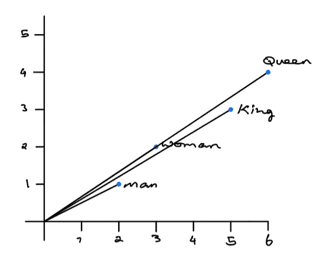
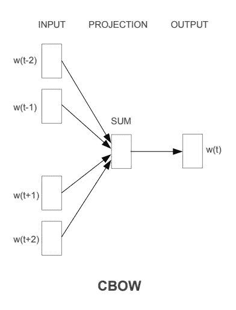
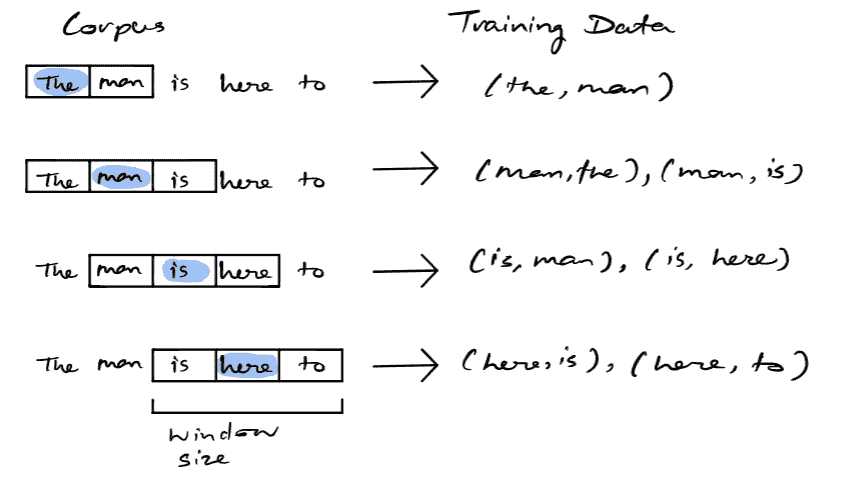
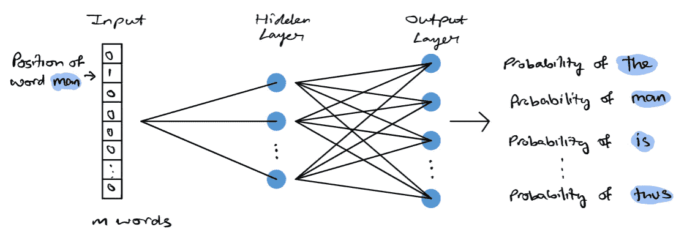
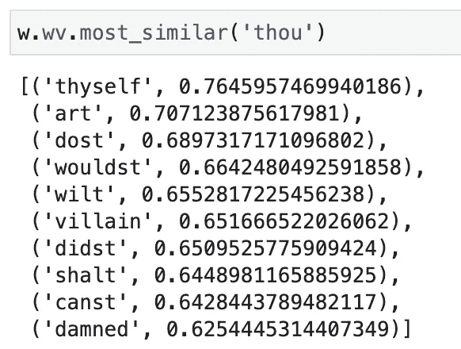
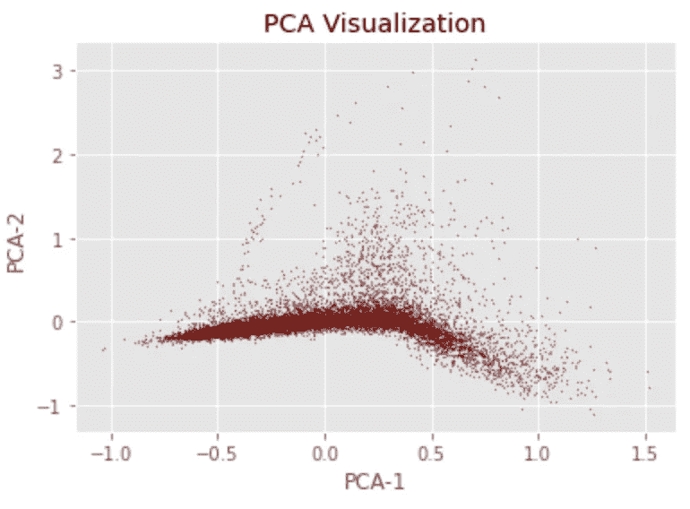

# Word2Vec 详解

> 来源：[https://waytoagi.feishu.cn/docx/ELutddAIGoDvnRxrG26c0wBEnWb](https://waytoagi.feishu.cn/docx/ELutddAIGoDvnRxrG26c0wBEnWb)

> 副标题：Word2Vec 的直观理解，并在 Python上 实现它

> 原文地址：https://towardsdatascience.com/word2vec-explained-49c52b4ccb71

> 作者：[Vatsal](https://vatsal12-p.medium.com/?source=user_profile-------------------------------------) （MongoDB 机器学习工程师）

> 译者：waytoAGI共建者 Dorothy


# 介绍

Word2Vec 是 NLP 领域的一个近期突破。Tomas Mikolov ，捷克计算机科学家，目前是 CIIRC（捷克信息学、机器人学和控制论研究所）的研究员，是 word2vec 研究和实现的主要贡献者之一。词嵌入是解决 NLP 中许多问题不可或缺的一部分。它们描述了人类如何向机器理解语言。你可以将它们想象为文本的向量化表示。Word2Vec 是一种常用的生成词嵌入的方法，具有多种应用，如文本相似性、推荐系统、情感分析等。

# 词嵌入

在进入word2vec领域之前，让我们先了解一下什么是词嵌入。了解这一点很重要因为word2vec的总结果和输出与算法传递的每个唯一单词的相关联嵌入。词嵌入是一种将单个单词转换为单词数字表示（即向量化）的技术。当每个单词被映射到一个向量时，这个向量就会以一种类似于神经网络的方式被学习。这些向量试图捕捉该单词与整个文本相关的各种特征。这些特征可以包括单词的语义关系、定义、上下文等。有了这些数字化表示，你可以做很多事情，比如确定单词之间的相似性或不相似性。

显然，这些作为机器学习各个方面的输入是不可或缺的。机器无法处理原始形式的文本，因此将文本转换为嵌入将允许用户将嵌入输入到经典机器学习模型中。最简单的嵌入是对文本数据进行 one-hot 编码，每个向量都会映射到一个类别。

For example:

have = [1, 0, 0, 0, 0, 0, ... 0]

a    = [0, 1, 0, 0, 0, 0, ... 0]

good = [0, 0, 1, 0, 0, 0, ... 0]

day  = [0, 0, 0, 1, 0, 0, ... 0] ...

然而，像这样的简单嵌入会存在多种限制，因为它们无法捕捉单词的特征，而且根据语料资料库的大小，它们会变得非常大。

# Word2Vec架构

Word2Vec 的有效性来自于它能够将相似单词的向量分组在一起。给定足够大的数据集，Word2Vec 可以根据它们在文本中出现的次数对单词的含义做出强有力的估计。这些估计产生了与语料库中其他单词的单词关联。

例如，像“国王”和“王后”这样的单词彼此非常相似。当对词嵌入进行代数运算时，您可以找到接近单词相似性的近似值。例如，“国王”的2 维嵌入向量 - “男人”的2 维嵌入向量 + “女人”的2 维嵌入向量 ，生成一个与 “王后”的嵌入向量非常接近的向量 。

注意，下面的值是随机选择的。

King    -    Man    +    Woman    =    Queen

[5,3]   -    [2,1]  +    [3, 2]   =    [6,4]



你可以看到 King 和 Queen 这两个词在位置上很接近。（图片由作者提供）

word2vec的成功归因于两种主要架构，即skip-gram 和 CBOW 架构。

## CBOW（连续词袋）

这种架构非常类似于前馈神经网络。这种模型架构本质上是试图从一组上下文单词中预测目标单词。这个模型背后的直觉非常简单：给定一个短语 “Have a great day”，我们将选择目标单词为 “a”，上下文单词为 [“have”, “great”, “day”]。这个模型将要做的是利用上下文单词的分布式表示来预测目标单词。



CBOW架构. 图片来源 [E](https://arxiv.org/pdf/1301.3781.pdf)fficient Estimation of Word Representation in Vector Space

## Skip-Gram模型

Skip-gram 模型是一个具有隐藏层的简单神经网络，训练其用来预测当出现输入单词时给定单词的出现概率。直观地说， skip-gram 模型与 CBOW 模型刚好相反。在这种架构中，它将当前单词作为输入，并试图准确预测当前单词前后的单词。这个模型本质上是试图学习并预测指定输入单词的上下文单词。通过实验评估了该模型的准确性，发现在给定大范围的词向量，预测质量有所提高，但同时也增加了计算复杂度。该过程可以如下图所示进行可视化描述。



为 skip-gram 模型生成训练数据的示例。窗口大小为 3

如上图所示，给定一些文本语料库，在某个滚动窗口上选择一个目标单词。训练数据由该目标单词与窗口中所有其他单词的成对组合组成。这是神经网络的生成训练数据。一旦模型训练完成，我们就可以得到一个单词在给定目标的上下文单词的概率。下图表示了 skip-gram 模型的神经网络架构。



Skip-Gram模型架构

语料库可以表示为大小为N的向量，其中N中的每个元素对应于语料库中的一个单词。在训练过程中，我们有一对目标和上下文单词，输入数组中除目标单词外的所有元素都为0。目标单词=1。隐藏层将学习每个单词的嵌入表示，生成一个d维嵌入空间。输出层是一个带有softmax激活函数的密集层。本质上，输出层会产生一个与输入层同样大小的向量，向量中的每个元素都包含一个概率。这个概率表示目标单词和语料库中相关单词之间的相似性。

[要更详细](https://arxiv.org/pdf/1301.3781.pdf)地了解这两种模型，我强烈建议阅读原始论文。

# 实现 Implementation

我将展示如何使用word2vec生[成词嵌](https://pyshark.com/principal-component-analysis-in-python/)入并使用这些嵌入来查找相似词和通过PCA实现嵌入的可视化。

> PCA（主成分分析）是一种常用的数据降维算法。它的主要思想是将n维特征映射到k维上，这k维是全新的正交特征也被称为主成分，是在原有n维特征的基础上重新构造出来的k维特征¹。简而言之，PCA的目的是减少数据集中变量的数量，同时保留尽可能多的信息²。

## 数据 Data

[为了](https://github.com/vatsal220/medium_articles/blob/main/w2v/data/shakespeare.txt)本教程的目的，我们将使用莎士比亚数据集。您可以在这里找到我用于本教程的文件，它包括莎士比亚为他的戏剧所写的所有台词。

> 莎士比亚数据集包含了莎士比亚所有的戏剧，角色，台词和幕。每个样本对应一个角色在某个戏剧中连续说的台词。

## 要求 Requirement

nltk==3.6.1

node2vec==0.4.3

pandas==1.2.4

matplotlib==3.3.4

gensim==4.0.1

scikit-learn=0.24.1

注意：您需要下载NLTK语料库才能继续本教程。您可以通过以下命令轻松完成下载：

```
import nltk
nltk.download(&#x27;stopwords&#x27;)
nltk.download(&#x27;punkt&#x27;)
```

## 导入数据 Import Data

```
import pandas as pd
import nltk
import string
import matplotlib.pyplot as plt

from nltk.corpus import stopwords
from nltk import word_tokenize
from gensim.models import Word2Vec as w2v
from sklearn.decomposition import PCA

# constants
PATH = &#x27;data/shakespeare.txt&#x27;
sw = stopwords.words(&#x27;english&#x27;)
plt.style.use(&#x27;ggplot&#x27;)
# nltk.download(&#x27;punkt&#x27;)
# nltk.download(&#x27;stopwords&#x27;)

# import data
lines = []
with open(PATH, &#x27;r&#x27;) as f:
    for l in f:
        lines.append(l)
```

[**view raw**](https://gist.github.com/vatsal220/13f5e99da6e14af2ad9746a477b3f3a7/raw/fcbd3078ecc3f14a3f3ed75725ac4206ca94d7aa/w2v_import.py)[**w2v_import.py **](https://gist.github.com/vatsal220/13f5e99da6e14af2ad9746a477b3f3a7#file-w2v_import-py)

请注意，您需要将PATH变量更改为您正在使用的数据的路径。

## 预处理数据 Preprocess Data

```
# remove new lines
lines = [line.rstrip(&#x27;\n&#x27;) for line in lines]

# make all characters lower
lines = [line.lower() for line in lines]

# remove punctuations from each line
lines = [line.translate(str.maketrans(&#x27;&#x27;, &#x27;&#x27;, string.punctuation)) for line in lines]

# tokenize
lines = [word_tokenize(line) for line in lines]

def remove_stopwords(lines, sw = sw):
    &#x27;&#x27;&#x27;
    The purpose of this function is to remove stopwords from a given array of 
    lines.
    
    params:
        lines (Array / List) : The list of lines you want to remove the stopwords from
        sw (Set) : The set of stopwords you want to remove
        
    example:
        lines = remove_stopwords(lines = lines, sw = sw)
    &#x27;&#x27;&#x27;
    
    res = []
    for line in lines:
        original = line
        line = [w for w in line if w not in sw]
        if len(line) &lt; 1:
            line = original
        res.append(line)
    return res
    
filtered_lines = remove_stopwords(lines = lines, sw = sw)
```

[**view raw**](https://gist.github.com/vatsal220/a8fa4e0c2a863f6c762bfb565790996d/raw/7976a383bb93c53a64dc5dd19d1a3a8954612228/w2v_preprocess.py)w2v_preprocess.py

## 停用词过滤

+   在处理莎士比亚文本数据时，我们需要注意停用词过滤。由于这些文本来自另一个世纪，因此我们需要考虑当时的用语习惯。这对于清洗单词和预处理数据非常重要。

+   例如，现代英语中的“you”或“yourself”在停用词列表中会被删除，但在莎士比亚的文本中，这些词并不常用。相反，“thou”或“thyself”可能更适合删除。注意这些微小的变化，因为它们对模型性能的好坏有着巨大的影响。

+   在本例中，我不会详细介绍如何识别来自不同时代的停用词，但请注意，你应该这样做。

## 嵌入 Embed

```
w = w2v(
    filtered_lines,
    min_count=3,  
    sg = 1,       
    window=7      
)       

print(w.wv.most_similar(&#x27;thou&#x27;))

emb_df = (
    pd.DataFrame(
        [w.wv.get_vector(str(n)) for n in w.wv.key_to_index],
        index = w.wv.key_to_index
    )
)
print(emb_df.shape)
emb_df.head()
```

[**view raw**](https://gist.github.com/vatsal220/44f438ec689f4a92a92ebf35f02621cb/raw/9a847315110e73d38a2fe1cb025f82aa8982c8ef/w2v_embedd.py)[**w2v_embedd.py **](https://gist.github.com/vatsal220/44f438ec689f4a92a92ebf35f02621cb#file-w2v_embedd-py)



## 嵌入的主要成分分析（PCA on Embeddings）

```
pca = PCA(n_components=2, random_state=7)
pca_mdl = pca.fit_transform(emb_df)

emb_df_PCA = (
    pd.DataFrame(
        pca_mdl,
        columns=[&#x27;x&#x27;,&#x27;y&#x27;],
        index = emb_df.index
    )
)

plt.clf()
fig = plt.figure(figsize=(6,4))

plt.scatter(
    x = emb_df_PCA[&#x27;x&#x27;],
    y = emb_df_PCA[&#x27;y&#x27;],
    s = 0.4,
    color = &#x27;maroon&#x27;,
    alpha = 0.5
)

plt.xlabel(&#x27;PCA-1&#x27;)
plt.ylabel(&#x27;PCA-2&#x27;)
plt.title(&#x27;PCA Visualization&#x27;)
plt.plot()
```

[**view raw**](https://gist.github.com/vatsal220/8c85ac0024bc357d16784fd5cce7bae6/raw/eb6543e333c2517bceba97a2546f0b5d5546213a/w2v_pca.py)[**w2v_pca.py **](https://gist.github.com/vatsal220/8c85ac0024bc357d16784fd5cce7bae6#file-w2v_pca-py)



在词嵌入空间中，相似的单词会彼此靠近，图源作者

Tensorflow对word2vec模型进行了非常漂亮、直观和用户友好的表示。我强烈建议你探索它，因为它允许你与word2vec的结果进行交互。链接如下：projector.tensorflow.org

# 结尾语

词嵌入是解决许多NLP（自然语言处理）问题的重要部分，它向机器描绘了人类如何理解语言。给定大型文本语料库，word2vec会为语料库中的每个单词生成一个关联嵌入向量。这些嵌入的结构使得相似特征的单词彼此靠近。CBOW（连续词袋）和skip-gram模型是word2vec的两种主要架构。给定一个输入单词，skip-gram将尝试预测与输入相关的上下文单词，而CBOW模型将采用多个单词并尝试预测其中缺失的单词。（即skip-gram模型是用中心单词预测上下文单词，而CBOW模型是用上下文单词预测中心单词）

我还写过关于 node2vec 的文章，它使用 word2vec 在给定网络的情况下生成节点嵌入。可点击下方链接阅读。

> Node2Vec Explained

> [E](https://towardsdatascience.com/node2vec-explained-db86a319e9ab)xplaining & Implementing the Node2Vec Paper in Python

> towardsdatascience.com

# 资源

+   https://arxiv.org/pdf/1301.3781.pdf

+   [h](https://www.kdnuggets.com/2019/02/word-embeddings-nlp-applications.html)ttps://www.kdnuggets.com/2019/02/word-embeddings-nlp-applications.html

+   https://wiki.pathmind.com/word2vec

+   https://projector.tensorflow.org/