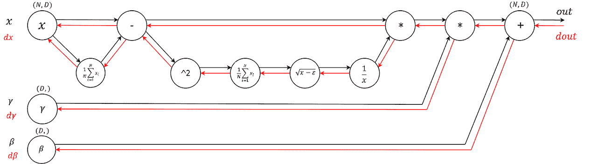
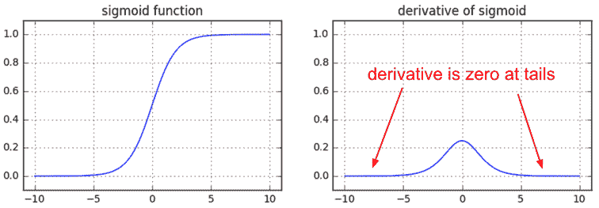
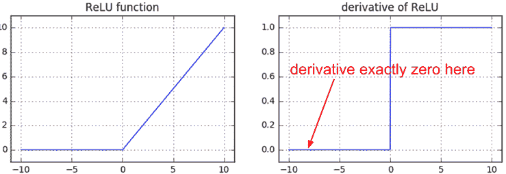
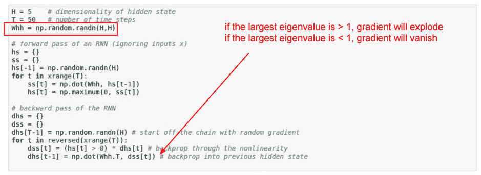
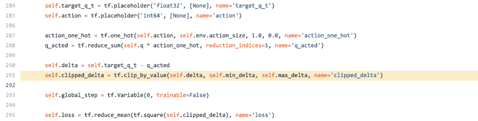

# 是的！你应该了解反向传播

> 来源：[https://waytoagi.feishu.cn/docx/GpZYdecPtoDPRex4emec86rzndc](https://waytoagi.feishu.cn/docx/GpZYdecPtoDPRex4emec86rzndc)

> 原文链接：https://karpathy.medium.com/yes-you-should-understand-backprop-e2f06eab496b

> 作者：[Andrej Karpathy](https://karpathy.medium.com/?source=post_page-----e2f06eab496b--------------------------------) （OpneAI联合创始人）

> 发表时间：2016年12月

> [翻译者：D](https://zhuanlan.zhihu.com/p/104294254)orothy，翻译过程中参考了这个翻译

**当**我们在斯坦福大学提供CS231n时（CS231n: Convolutional Neural Networks for Visual Recognition，是顶级院校斯坦福出品的深度学习与计算机视觉方向专业课程），我们在最基础的反向传播课程中特意设计了包含显示计算的编程作业。学生们必须用原始numpy（用于科学计算的Python库）实现每一层的正向和反向传播。难免有学生在课堂留言板上抱怨： “为什么我们要手动编写反向传播，而在现实世界中的框架（如TensorFlow）会自动计算它们？”

这似乎是一个非常合理的呼吁——一旦课程结束后你再也不会编写反向传播，为什么还需要练习呢？我们只是为了自娱自乐而折磨学生吗？一些简单的回答或许可以勉强解释：“出于对知识的好奇，你值得知道”或者“万一以后你想改进核心算法”，但是以下是更有力、更实际的论据，我想专门写一篇文章来阐述一下。

**反**向传播的问题在于它是一个抽象漏洞。（The Law of Leaky Abstractions 是一个有关程式的定律。最早是由Joel Spolsky在其blog中提出，其定义为“所有非不证自明的抽象概念，都有某种程度的疏漏”）

换句话说，很容易陷入抽象化学习过程的陷阱—觉得自己可以简单地将任意层堆叠在一起，然后反向传播会在你的数据上“神奇地发挥作用”。那么让我们来看一些明显的例子，而事实并非如此，以非常不直观的方式。



一些养眼的东西：带有前向传递（[黑色）和](https://kratzert.github.io/2016/02/12/understanding-the-gradient-flow-through-the-batch-normalization-layer.html)反向传递（红色）的 Batch Norm 层的计算图。（引用自这篇文章）

# sigmoid 函数中的梯度消失

让我们从这里轻松开始。从前有段时间，很流行在全连接层中使用sigmoid（或者tanh）等非线性函数。直到人们想到反向传播才意识到其中的一个棘手的问题，就是如果你很草率地设定初始值或者做数据预处理，这些非线性函数可能会“饱和”或者完全停止学习——你的训练损失值将会变得很平缓或者不再下降。如下例子，一个全连接层中的sigmoid计算（使用原始numpy）：

```
z = 1/(1 + np.exp(-np.dot(W, x))) # forward pass
dx = np.dot(W.T, z*(1-z)) # backward pass: local gradient for x
dW = np.outer(z*(1-z), x) # backward pass: local gradient for W
```

如果你的权重矩阵**W**初始化时太大，矩阵乘法的输出范围可能非常大（例如**-**400到400之间的数字），这将使向量z中的所有输**出几乎都是**二**进**制的：要么1要么0。但是如果这样的话，z(1-z)（sigmoid函数非线性的局部梯度）在两种情况下都将变为零*（“梯度消失”），从而使x和W的梯度都为零。由于“乘法”在链式法则中的作用，从此时起，其余的反向传播值将全部为零。（由于梯度是通过将每一层的局部梯度相乘而计算出来的，所以如果某一层的局部梯度为零，那么在这一层之前的所有层的梯度都将变为零。这就是所谓的“乘法”在链式法则中的作用。）



关于 sigmoid 的另一个不明显的有趣事实是，当 z = 0.5 时，其局部梯度 (z*(1-z)) 的最大值是 0.25 。这意味着每次梯度信号流过 sigmoid gate时，其幅度总是会减小四分之一（或更多）。如果你使用的是基础的SGD，那么网络较低层的训练速度将比较高层慢得多。

**总而言之**：**如**[果你在网络中使用的是sigmo](https://youtu.be/gYpoJMlgyXA?t=14m14s)id或tanh非线性函数，并了解反向传播的话，你应时刻警惕你的初始化不会导致它们完全饱和。请参阅此CS231n 讲座视频中的详细说明。

##

# **垂死的 ReLU**

另一个有趣的非线性是 ReLU，它将神经元阈值限制为零。使用 ReLU 的全连接层的前向和后向传播的核心包括：

```
z = np.maximum(0, np.dot(W, x)) # forward pass
dW = np.outer(z &gt; 0, x) # backward pass: local gradient for W
```

**观**察一会你会发现如果一个神经元在前向传播中被限制到零（即z = 0，它不会“触发”），那么它的权重将得到零梯度。这会导致所谓的“dead ReLU”问题，即如果 ReLU 神经元不幸被如此初始化，它将永远不会激发，或者如果在训练过程中该神经元的权重大幅更新至此区间，则该神经元将永远死亡。这就像永久性的、不可恢复的脑损伤。有时你可以向前传播整个训练集，发现你训练网络中的很大一部分（例如 40%）神经元始终为零。



总的[来说：如果你理解了反向传播，](https://youtu.be/gYpoJMlgyXA?t=20m54s)并且你的网络用的是ReLU，你会经常担忧Dead ReLU的问题。这些神经元在整个训练集中永远不会对任何样本开启，并且将永久死亡。神经元也可能在训练过程中死亡，通常因为激进的学习率。请参阅CS231n 讲座视频中的详细说明。

# **RNN 中的梯度爆炸**

Vanilla RNN （RNN即Recurrent Neuron Network，V**a****n**illa RNN是最基础的RNN）是反向传播的不直观的另一个很好的例子。我将复制粘贴 CS231n 中的一张幻灯片，该幻灯片是简化的 RNN，不接受任何输入x，并且仅计算隐藏状态的递归（等效地，输入x可以始终为零）：



这个 RNN 展开了 T 个时间步。当你仔细观察反向传播在做什么时，你会发现，通过所有隐藏状态的反向时间梯度信号总是被相同的矩阵（递归矩阵 Whh）相乘，夹杂着非线性反向传播。

当你取一个数 a 并开始将它乘以另一个数 b（即 a*b*b*b*b*b*b...）时会发生什么？如果 |b| < 1，这个序列会变为零，如果 |b| > 1，它会爆炸到无穷大。在 RNN 的反向传播中也会发生同样的事情，只不过 b 是一个矩阵而不仅仅是一个数，所以我们必须考虑它的最大特征值。

简[而言之：如果你了解反向传播并且](https://www.youtube.com/watch?v=yCC09vCHzF8)正在使用 RNN，你可能会担心必须进行梯度裁剪，或者你更喜欢使用 LSTM。请参阅此CS231n 讲座视频中的详细说明。

# 实践**发现：DQN 裁剪**

> DQN 裁剪” 是指在实际应用中发现的 DQN 裁剪问题。DQN 是 Deep Q Learning 的缩写，它是一种强化学习算法。裁剪是指在训练过程中对梯度进行限制，以防止梯度爆炸或消失。

让我们再看一个例子——真正激发这篇文章的灵感来源。昨天，我正在浏览 TensorFlow 中的深度 Q 学的实践（看看其他人如何处理计算Q[:, a]的 numpy 等价物，其中a是整数向量 - 事实证明TF 不支持这种琐碎的运算）。不管怎样，我搜索了*“dqn tensorflow”*，点击第一个链接，找到了核心代码。以下是摘录：



**如果您熟悉 DQN，您可以看到有 **targ**et_q_t **，即[reward *** \gam**ma \argmax_a Q(**s',a)]，然后有q_acted，也就是执行了动作的Q(s,a**)。作者在这里将两者相减得到变量delta，然后他们希望在第 295 行用 L2 损失和 tf.reduce_mean(tf.square()) 最小化它。到目前为止一切顺利。

问题出在第 291 行。作者试图对异常值做出反应，所以如果 delta 太大，他们会用 tf.clip_by_value 进行裁剪。这是出于好意并且从前向传播的角度看起来很合理，但是如果你考虑反向传播，它会引入一个重大的错误。

clip_by_value 函数在 min_delta 到 max_delta 范围外的局部梯度为零，所以当 delta 超过 min/max_delta 时，在反向传播过程梯度恰好为零。当作者试图修剪梯度以增加鲁棒性（added robustness指的是增强模型对异常值或噪声的抵抗能力，使其更稳定、更可靠）时，他们正在修剪原始Q delta。在这种情况下，正确的做法是用 Huber 损失代替 tf.square：

```
def clipped_error(x):
  return tf.select(tf.abs(x) &lt; 1.0,
                   0.5 * tf.square(x),
                   tf.abs(x) - 0.5) # condition, true, false
```

在 TensorFlow 中这有点毛病，因为我们想要做的就是在梯度高于阈值时裁剪梯度，但由于我们不能直接干预梯度，我们只能迂回地定义Huber损失 。 在Torch中，这将更加简单。

[我在 DQN 存储库上提交了](https://github.com/devsisters/DQN-tensorflow/issues/16)一个问题，该问题很快得到了修复。

##

# **综上所述**

反向传播是一种抽象漏洞；这是一个具有重要后果的信用分配方案。如果你因为“TensorFlow 自动让我的网络学习”而试图忽略它的底层工作原理，那么你就不会做好应对与它带来的危险作斗争的准备，并且在构建和调试神经网络方面的效率也会大大降低。

好消息是，如果表述得当，反向传播并不难理解。我对这个话题有相对[强烈的感受，因为在](https://cs231n.github.io/)我看来，95% 的反向传播材料都错了，充满了机械的数学公式。相反，我会推荐关于反向传播的 CS231n 讲座，它强调直觉（是的，请允许我无耻地给自己打广告）。如果你有空闲时间，作为奖励，可以完成CS231n 作业，这可以让您手动编写反向传播并帮助你巩固理解。

现在就这样了！我希望您对对反向传播保持好奇，并仔细思考反向传播正在做什么。另外，我知道这篇文章（无意中！）变成了几个 CS231n 广告。对此表示歉意:)