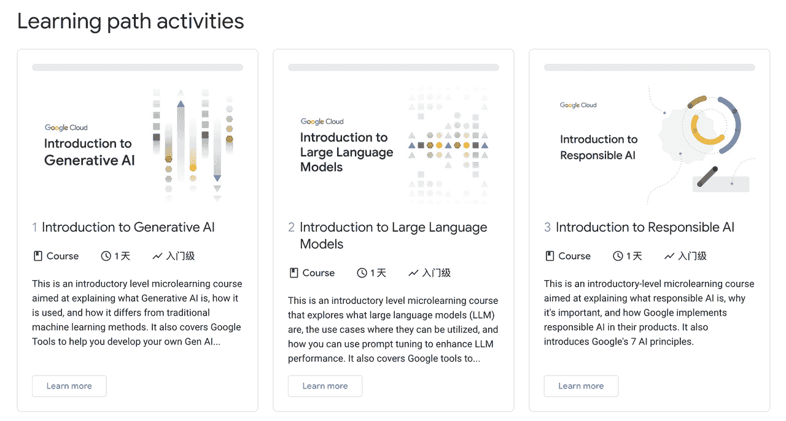

# 目录：谷歌生成式AI课程

> 来源：[https://waytoagi.feishu.cn/docx/GWptdRmbWoZ8zmxCkbAcddYxnKg](https://waytoagi.feishu.cn/docx/GWptdRmbWoZ8zmxCkbAcddYxnKg)

此学习路径将引导您完成有关生成式 AI 产品和技术的精选内容集合，从大型语言模型的基础知识，到如何在 Google Cloud 上创建和部署生成式 AI 解决方案。

https://www.cloudskillsboost.google/journeys/118

10个独立课程如下: