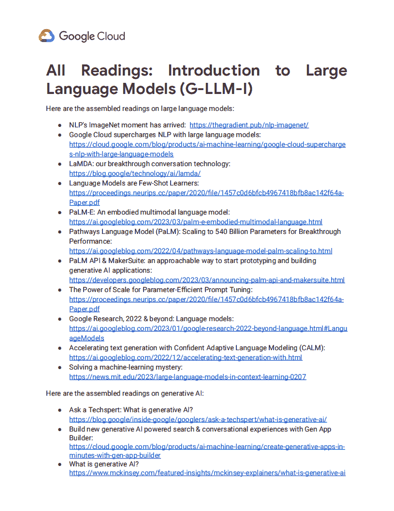

# 2. 大语言模型介绍

> 来源：[https://waytoagi.feishu.cn/docx/WPjEd53H8oY8EHxCux9cLu4Ln4g](https://waytoagi.feishu.cn/docx/WPjEd53H8oY8EHxCux9cLu4Ln4g)

+   视频课程学习地址：https://youtu.be/zizonToFXDs

+   宝玉XP的翻译版本：https://www.youtube.com/watch?v=zfFA1tb3q8Y

<https://player.bilibili.com/player.html?bvid=1HV4y1k7vq>

<https://player.bilibili.com/player.html?bvid=1h14y1C79P>

Google的教学视频《Introduction to Large Language Models | 大语言模型介绍》，介绍了大型语言模型（Large Language Models，LLMs）的概念、使用场景、提示调整以及Google的Gen AI开发工具。

大型语言模型是深度学习的一个子集，可以预训练并进行特定目的的微调。这些模型经过训练，可以解决诸如文本分类、问题回答、文档摘要、跨行业的文本生成等常见语言问题。然后，可以利用相对较小的领域数据集对这些模型进行定制，以解决零售、金融、娱乐等不同领域的特定问题。

大型语言模型的三个主要特征是：大型、通用性和预训练微调。

+   "大型"既指训练数据集的巨大规模，也指参数的数量。

+   "通用性"意味着这些模型足够解决常见问题。

+   "预训练和微调"是指用大型数据集对大型语言模型进行一般性的预训练，然后用较小的数据集对其进行特定目的的微调。

使用大型语言模型的好处包括：一种模型可用于不同的任务；微调大型语言模型需要的领域训练数据较少；随着数据和参数的增加，大型语言模型的性能也在持续增长。

此外，视频还解释了传统编程、神经网络和生成模型的不同，以及预训练模型的LLM开发与传统的ML开发的区别。

在自然语言处理中，提示设计和提示工程是两个密切相关的概念，这两者都涉及创建清晰、简洁、富有信息的提示。视频中还提到了三种类型的大型语言模型：通用语言模型、指令调整模型和对话调整模型。每种模型都需要以不同的方式进行提示。

参考资料：

[G-LLM-I-m0-l2-file-en-2.pdf](https://internal-api-drive-stream.feishu.cn/space/api/box/stream/download/all/Ue5Rbthk8og4cgxCGHdc7fflnWh)

**A****l**l Readings: Introduction to Large Language Models (G-LLM-I)

Here are the assembled readings on large language models:

+   NLP's ImageNet moment has arrived: https://thegradient.pub/nlp-imagenet/

+   Google Cloud supercharges NLP with large language models:

+   https://cloud.google.com/blog/products/ai-machine-learning/google-cloud-supercharge

+   s-nlp-with-large-language-models

+   LaMDA: our breakthrough conversation technology: https://blog.google/technology/ai/lamda/

+   Language Models are Few-Shot Learners: https://proceedings.neurips.cc/paper/2020/file/1457c0d6bfcb4967418bfb8ac142f64a- Paper.pdf

+   PaLM-E: An embodied multimodal language model: https://ai.googleblog.com/2023/03/palm-e-embodied-multimodal-language.html

+   Pathways Language Model (PaLM): Scaling to 540 Billion Parameters for Breakthrough Performance:

+   https://ai.googleblog.com/2022/04/pathways-language-model-palm-scaling-to.html

+   PaLM API & MakerSuite: an approachable way to start prototyping and building generative AI applications: https://developers.googleblog.com/2023/03/announcing-palm-api-and-makersuite.html

+   The Power of Scale for Parameter-Efficient Prompt Tuning: https://proceedings.neurips.cc/paper/2020/file/1457c0d6bfcb4967418bfb8ac142f64a- Paper.pdf

+   Google Research, 2022 & beyond: Language models: https://ai.googleblog.com/2023/01/google-research-2022-beyond-language.html#Langu ageModels

+   Accelerating text generation with Confident Adaptive Language Modeling (CALM): https://ai.googleblog.com/2022/12/accelerating-text-generation-with.html

+   Solving a machine-learning mystery: https://news.mit.edu/2023/large-language-models-in-context-learning-0207

+   Here are the assembled readings on generative AI:

+   Ask a Techspert: What is generative AI? https://blog.google/inside-google/googlers/ask-a-techspert/what-is-generative-ai/

+   Build new generative AI powered search & conversational experiences with Gen App Builder:

+   https://cloud.google.com/blog/products/ai-machine-learning/create-generative-apps-in-

+   minutes-with-gen-app-builder

+   What is generative AI? https://www.mckinsey.com/featured-insights/mckinsey-explainers/what-is-generative-ai

+   Google Research, 2022 & beyond: Generative models: https://ai.googleblog.com/2023/01/google-research-2022-beyond-language.html#Gener ativeModels

+   Building the most open and innovative AI ecosystem: https://cloud.google.com/blog/products/ai-machine-learning/building-an-open-generativ e-ai-partner-ecosystem

+   Generative AI is here. Who Should Control It? https://www.nytimes.com/2022/10/21/podcasts/hard-fork-generative-artificial-intelligen ce.html

+   Stanford U & Google’s Generative Agents Produce Believable Proxies of Human Behaviors:

+   https://syncedreview.com/2023/04/12/stanford-u-googles-generative-agents-produce-b

+   elievable-proxies-of-human-behaviours/

+   Generative AI: Perspectives from Stanford HAI: https://hai.stanford.edu/sites/default/files/2023-03/Generative_AI_HAI_Perspectives.pd f

+   Generative AI at Work: https://www.nber.org/system/files/working_papers/w31161/w31161.pdf

+   The future of generative AI is niche, not generalized: https://www.technologyreview.com/2023/04/27/1072102/the-future-of-generative-ai-is- niche-not-generalized/

+   Additional Resources:

+   Attention is All You Need: https://research.google/pubs/pub46201/

+   Transformer: A Novel Neural Network Architecture for Language Understanding:

+   https://ai.googleblog.com/2017/08/transformer-novel-neural-network.html

+   Transformer on Wikipedia: https://en.wikipedia.org/wiki/Transformer_(machine_learning_model)#:~:text=Transfor mers%20were%20introduced%20in%202017,allowing%20training%20on%20larger%20da tasets.

+   What is Temperature in NLP? https://lukesalamone.github.io/posts/what-is-temperature/

+   Bard now helps you code: https://blog.google/technology/ai/code-with-bard/

+   Model Garden: https://cloud.google.com/model-garden

+   Auto-generated Summaries in Google Docs:

+   https://ai.googleblog.com/2022/03/auto-generated-summaries-in-google-docs.html