# 9. 生成式 AI Studio 简介

> 来源：[https://waytoagi.feishu.cn/docx/CDx7donbIohOadxxdg5cNgh0nwe](https://waytoagi.feishu.cn/docx/CDx7donbIohOadxxdg5cNgh0nwe)

+   课程地址：https://www.cloudskillsboost.google/course_templates/552

+   本课程介绍 Generative AI Studio，这是 Vertex AI 上的一款产品，可帮助您制作原型和自定义生成 AI 模型，以便您可以在您的应用程序中使用它们的功能。在本课程中，您将了解什么是 Generative AI Studio、它的功能和选项，以及如何通过浏览产品演示来使用它。最后，您将有一个实践实验室来应用您学到的知识，并有一个测验来测试您的知识。

+   视频地址：https://youtu.be/uwbMDp3KprU

<https://player.bilibili.com/player.html?bvid=1cs4y1F7vE>

## 课程简介：Generative AI Studio

### 什么是生成式人工智能（Generative AI）？

生成式人工智能是一种人工智能技术，它能够生成新的、未曾存在的内容。这些内容可以是多模态的，包括：

+   文本：例如文章、报告、诗歌等

+   图像：例如绘画、设计图、合成照片等

+   音频：例如音乐、语音、环境声音等

+   视频：例如电影剪辑、教程、仿真等

### 应用场景

Generative AI 可以应用于广泛的场景，例如：

+   文档摘要：将长篇文章或报告总结为简短、精准的摘要

+   信息提取：从大量数据中识别并提取关键信息

+   代码生成：根据用户的描述自动编写代码

+   营销活动创建：生成广告文案、设计图像等

+   虚拟协助：例如智能聊天机器人、虚拟客服等

+   呼叫中心机器人：能够处理客户的电话请求

### 如何工作？

1.  训练阶段：Generative AI 通过从大量现有内容（文本、音频、视频等）中学习，进行训练。训练的结果是一个“基础模型”。

1.  应用阶段：基础模型可以用于生成内容并解决一般性问题。它还可以使用特定领域的新数据集进一步训练，以解决特定问题，这样就可以得到一个量身定制的新模型。

### Google Cloud 的工具

+   Vertex AI：这是 Google Cloud 上的端到端机器学习开发平台，旨在帮助开发人员构建、部署和管理机器学习模型。

+   Generative AI Studio：这是一个工具，允许应用程序开发人员或数据科学家快速制作原型和自定义生成式 AI 模型，无需代码或代码量少。

+   Model Garden：这是一个平台，可以让你发现 Google 的基础和第三方开源模型，并与之交互。它提供了一组 MLOps 工具，用于自动化机器学习管道。

### Generative AI Studio 的特点

Generative AI Studio 支持语言、视觉和语音的生成任务。它的主要功能包括：

1.  设计提示：用户可以为与业务用例相关的任务设计特定的提示。

1.  创建对话：用户可以通过指定模型应如何响应的上下文来创建有意义的对话。

1.  模型调整：用户可以调整模型，使其更适合特定的用例。一旦模型被调整，用户可以将其部署到一个端点，用于获取预测，或在提示设计中对其进行测试。

在这个课程中，我们将重点关注如何利用 Generative AI Studio 的这些功能。

## 详细功能介绍

1.  **提示设计**

#### a. **什么是提示？**

+   在生成式 AI 的世界中，"提示" 是您提供给模型的输入文本。

+   例如，您可以问模型一个问题或给它一个指令，模型将根据您构建提示的方式提供响应。

+   因此，您获得的答案大大取决于您如何提出问题。

#### b. **什么是提示设计？**

+   提示设计是一个过程，它涉及找出和设计最佳输入文本以获得所需的响应。

+   这通常涉及大量实验和迭代。

#### c. **示例**

+   例如，要生成一个去约书亚树国家公园露营旅行所需的物品清单，您可以提供指令："生成我去约书亚树国家公园露营旅行所需的物品清单"。

#### d. **零样本、一次性和少样本提示**

+   零样本提示：模型仅根据描述任务的提示执行任务，没有得到关于特定任务的额外数据。

+   一次性提示：模型根据任务的单个示例执行任务。

+   少样本提示：模型根据任务的少量示例执行任务。

#### e. **结构化提示**

+   结构化提示包含几个不同的组件：上下文、示例问题和示例答案。每次您向模型发送请求时，上下文都会应用。

+   例如，假设我们想使用模型来回答基于一些背景文本的问题。我们可以粘贴背景文本作为上下文，然后添加一些可以从这篇文章中回答的问题示例，并为这些问题提供相应的答案。

#### f. **最佳实践**

+   保持提示简明、扼要、具体和明确。

+   将生成任务转化为分类任务，例如，问：“学习 Python、Java 或 C 哪一个更适合编程初学者？”，而不是问：“要学习什么编程语言？”。

+   通过包含示例来提高响应质量。

1.  **保存和重用提示**

+   如果您设计了一个您认为效果很好的提示，您可以保存它并稍后返回。

+   您保存的提示将显示在“提示库”中，这是一个精选的集合，展示生成式 AI 模型如何适用于各种用例的示例提示。

1.  **调整模型参数**

+   除了测试不同的提示和提示结构之外，您还可以尝试使用一些模型参数，如温度和最大令牌数，来尝试提高响应质量。

1.  **调整模型参数**

#### a. **选择不同的模型**

+   Generative AI Studio 允许您从多个预训练模型中选择。

+   每个模型都经过调整以在特定任务上表现良好。

#### b. **控制响应的随机性**

+   当您向模型发送提示时，它会生成一组关于下一个可能单词的概率。

+   控制这些概率如何转化为实际响应是关键。

#### c. **温度**

+   低温度：使模型更可能选择概率较高的词，输出更稳定、可预测。

+   高温度：使模型更可能选择概率较低的词，输出更随机、创意。

#### d. **Top K**

+   模型从可能性最高的 K 个词中随机返回一个词。

+   这允许其他高分词有机会被选中。

#### e. **Top P**

+   模型从概率总和不超过 P 的一组词中随机选择一个词。

+   这允许单词集的大小根据列表中下一个单词的概率分布动态变化。

#### f. **注意事项**

+   不需要经常调整这些参数，尤其是 Top K 和 Top P。

1.  **创建对话**

#### a. **指定对话上下文**

+   上下文指示模型应如何响应，例如指定模型可以或不能使用的词，要关注或避免的主题，或特定的响应格式。

#### b. **示例**

+   例如，您可以定义一个场景，如一个 IT 部门的技术支持人员，设置该人物只以特定方式回应任何查询。

#### c. **测试对话**

+   您可以在聊天框中键入请求，例如 “我的电脑速度很慢”，然后按回车键，查看 AI 如何响应。

1.  **集成到您的应用程序**

#### a. **API 和 SDK**

+   Google 提供了 API 和 SDK，以便您可以将这些功能集成到您自己的应用程序中。

#### b. **如何使用**

+   首先，您需要下载适合您的编程语言（例如 Python 或 Curl）的 Vertex AI SDK。

+   然后，您可以按照示例代码和 API 文档，将代码插入到您的应用程序中。

### 调整大型语言模型 (LLM) 的挑战与解决方案

#### **挑战：**

1.  微小的措辞或词序变化可能影响模型结果

+   模型的响应可能不完全可预测。

1.  模型响应质量不一

+   即使有了一个良好的提示设计，模型的输出可能仍然不稳定。

1.  微调大型模型可能耗时且成本高

+   LLM 通常很大，因此更新权重可能需要长时间的训练。

+   为这样的大模型提供服务可能涉及到额外的麻烦和成本。

#### **解决方案：参数有效调整**

+   参数有效调整是一种新颖的微调方法，旨在通过仅训练一部分参数来减轻微调 LLM 的挑战。

+   这些参数可能是现有模型参数的子集，或者是一组全新的参数。

+   例如，可能会向模型添加一些额外的层或额外的嵌入到提示中。

### 如何在 Generative AI Studio 中开始调整工作

1.  准备您的训练数据

+   您的训练数据应以文本到文本格式构建为受监督的训练数据集。

+   数据中的每条记录或行都将包含输入文本（即提示）和模型的预期输出。

+   此方法非常适合您拥有适度数量的场景训练数据，例如数百或数千个训练示例。

1.  在 Generative AI Studio 中开始调整

+   选择调整选项。

+   为调整模型提供一个名称。

+   指向训练数据的本地或 Cloud Storage 位置。

1.  启动并监控调整作业

+   指定数据集的路径后，您可以开始调整作业。

+   您可以在 Google Cloud 控制台中监控调整作业的状态。

1.  使用调整后的模型

+   调整作业完成后，您将在 Vertex AI 模型注册表中看到调整后的模型。

+   您可以将其部署到端点进行服务，或者您可以在 Generative AI Studio 中对其进行测试。

---

这部分结束了整个课程的内容，提供了一个完整的概述，介绍了如何使用 Google Cloud 的 Generative AI Studio 工具进行大型语言模型的原型制作和定制。特别强调了三个主要功能：设计和测试提示、创建对话和调整模型。

现在是时候在动手实验室中使用 Generative AI Studio 进行实践操作了。您将有机会在自由形式和结构化模式下设计和测试提示，创建对话，浏览提示库，并实践使用我们在本课程中讨论的 Generative AI Studio 的功能。

尽情探索吧！ 😉

---

## 课程字幕

00:00欢迎来到 Generative AI Studio 课程简介。在本视频中，您将了解什么是 Generative AI Studio 并描述其使用选项。您还可以自己演示 Generative AI Studio 的语言工具。

00:14什么是生成式人工智能？它是一种为您生成内容的人工智能。什么样的内容？那么，生成的内容可以是多模式的，包括文本、图像、音频和视频。

00:28当给出提示或请求时，Generative AI 可以帮助您完成各种任务，例如文档摘要、信息提取、代码生成、营销活动创建、虚拟协助和呼叫中心机器人。

00:42这些只是几个例子！人工智能如何产生新内容？它从大量现有内容中学习。这包括文本、音频和视频。从现有内容中学习的过程称为训练，其结果是创造

00:57的“基础模型”。为 Bard 等聊天机器人提供支持的 LLM 或大型语言模型是基础模型的典型示例。[动画 - 向左滑动图形以过渡到下一张幻灯片] 基础模型

01:07然后可用于生成内容并解决一般问题，例如内容提取和文档摘要。它还可以使用您所在领域的新数据集进一步训练以解决特定问题，

01:19例如财务模型生成和医疗保健咨询。这导致创建了一个新模型，该模型是根据您的特定需求量身定制的。您如何使用基础模型为您的应用程序提供动力，以及您如何进一步

01:32训练或调整基础模型来解决您特定领域的问题？Google Cloud 提供了多种易于使用的工具，可帮助您在具有或不具有 AI 和机器学习背景的项目中使用生成式 AI。

01:45一种这样的工具是 Vertex AI。Vertex AI 是 Google Cloud 上的端到端机器学习开发平台，可帮助您构建、部署和管理机器学习模型。使用 Vertex AI，如果您是应用程序开发人员或数据科学家并且想要构建应用程序，

02:01您可以使用 Generative AI Studio 快速制作原型和自定义生成式 AI 模型，无需代码或代码量少。如果您是数据科学家或 ML 开发人员，想要构建和自动化生成

02:14AI模型，可以从Model Garden入手。Model Garden 可让您发现 Google 的基础和第三方开源模型并与之交互，并具有内置的 MLOps 工具来自动化 ML 管道。

02:28在本课程中，您将专注于 Generative AI Studio。Generative AI Studio 支持语言、视觉和语音。随着您学习本课程，该列表会增加。对于语言，你可以设计一个提示来执行任务和调整语言模型。

02:43对于视觉，您可以根据提示生成图像并进一步编辑图像。对于语音，您可以从语音生成文本，反之亦然。让我们关注您可以在 Generative AI Studio 中使用语言做什么。

02:57具体来说，您可以： 为与您的业务用例相关的任务设计提示，包括代码生成。通过指定指示模型应如何响应的上下文来创建对话。并调整模型，使其更适合您的用例，这样您就可以

03:14将其部署到端点以获取预测或在提示设计中对其进行测试。让我们详细介绍这三个功能。首先是提示设计。要开始试验大型语言模型或 LLM，请单击“新提示”。

03:32在生成式 AI 的世界中，提示只是您提供给模型的输入文本的一个奇特名称。您可以将所需的输入文本（例如问题和说明）提供给模型。

03:42然后，该模型将根据您构建提示的方式提供响应，因此，您获得的答案取决于您提出的问题。找出和设计最佳输入文本以获得所需响应的过程

03:53从模型返回称为提示设计，这通常涉及大量实验。让我们从自由形式的提示开始。设计提示的一种方法是简单地告诉模型您想要什么。

04:04换句话说，提供一个指令。例如，生成我去约书亚树国家公园野营旅行所需的物品清单。我们将此文本发送给模型，

04:13而且……您可以看到该模型输出了一个有用的项目列表，我们不想在没有这些项目的情况下露营。这种编写单个命令的方法使 LLM 可以采用某种行为，

04:23称为零镜头提示。通常，您可以使用 3 种方法以您想要的方式塑造模型的响应。零样本提示 - 是一种方法，在这种方法中，LLM 没有得到关于特定的额外数据

04:35它被要求执行的任务。相反，它只会给出描述任务的提示。比如你想让LLM回答一个问题，你只要提示“what is prompt

04:46设计？”。一次性提示 - 是一种方法，其中 LLM 被要求执行任务的单个示例。例如，如果您希望 LLM 写一首诗，您可以提供一个示例

04:58诗。Few-shot prompting - 是一种方法，其中 LLM 被要求执行任务的少量示例。比如你想让LLM写一篇新闻文章，你可能给它几个新闻

05:11文章阅读。您可以使用结构化模式通过为模型提供上下文和其他示例来设计小样本提示。结构化提示包含几个不同的组件：

05:24首先我们有上下文，它指示模型应该如何响应。您可以指定模型可以或不能使用的词、要关注或避免的主题，或者特定的

05:33响应格式。每次您向模型发送请求时，上下文都会应用。假设我们想使用 LLM 来回答基于一些背景文本的问题。

05:42在这种情况下，描述亚马逊热带雨林植被变化的段落。我们可以粘贴背景文本作为上下文。然后，我们添加一些可以从这篇文章中回答的问题示例

05:55比如 LGM 代表什么？或者沉积物沉积物的分析表明了什么？我们需要添加这些问题的相应答案，以展示我们如何

06:05想要模型做出回应。然后，我们可以通过发送一个新问题作为输入来测试我们设计的提示。到此为止，您已经基于背景文本制作了一个问答系统的原型

06:14一会儿！请注意有关提示设计的一些最佳实践。简明扼要具体明确，一次问一个任务将生成任务转化为分类任务。例如，与其问要学习什么编程语言，不如问是否要学习 Python、Java 或

06:33C 更适合编程初学者。并通过包含示例来提高响应质量添加说明和一些示例往往会产生良好的结果，但是目前

06:44没有一种最好的方式来编写提示。您可能需要尝试不同的结构、格式和示例，以了解哪种最适合您的用例。更多关于提示设计的内容，请查看阅读中的文字提示设计

06:57列表。因此，如果您设计了一个您认为效果很好的提示，您可以保存它并稍后返回。您保存的提示将显示在提示库中，这是一个精选的集合

07:07展示生成式 AI 模型如何适用于各种用例的示例提示。最后，除了测试不同的提示和提示结构之外，您还可以尝试使用一些模型参数来尝试提高响应质量。

07:22首先，您可以选择不同的型号。每个模型都经过调整以在特定任务上表现良好。您还可以指定温度、top P 和 top K。这些参数都可以调整

07:34通过控制输出标记的选择方式来控制响应的随机性。当您向模型发送提示时，它会生成一组关于以下单词的概率

07:43可能是下一个。从这个数组中，我们需要一些策略来决定返回什么。一个简单的策略可能是在每个时间步选择最有可能的词。

07:52但这种方法可能会导致无趣且有时重复的答案。相反，如果您对模型返回的分布进行随机采样，您可能会得到一些不太可能的响应。

08:04通过控制随机程度，您可以获得更多意想不到的，有些人可能会说有创意的响应。回到模型参数，温度是一个用来调整随机程度的数字。

08:15低温：指的是选择可能性大、预测性强的词。在这种情况下，那些是花和位于开头的其他词

08:23列表。此设置通常更适合问答和摘要等任务，在这些任务中，您希望答案更“可预测”且变化更少。… 高温：指的是选择概率低、比较不寻常的词。

08:37在这种情况下，那些是错误和位于列表末尾的其他词。如果您想生成更多“创意”或意想不到的内容，此设置非常有用。

08:47除了调整温度，top K 还让模型从可能性最高的 K 个词中随机返回一个词。例如，top 2 意味着您从前 2 个可能的单词中随机获得一个单词，包括

09:00花草树木。这种方法允许其他高分词有机会被选中。然而，如果单词的概率分布是高度偏斜的，并且你有一个

09:11非常有可能的词，而其他一切都不太可能，这种方法可能会导致一些奇怪的反应。选择最佳 top-k 值的困难导致了另一种流行的方法，即

09:23动态设置单词候选列表的大小。Top P允许模型从top P个词中随机返回一个词的概率。使用 top P，您从一组可能性之和不超过的单词中进行选择

09:38P。例如，p 为 0.75 表示您从一组累积概率大于 0.75 的单词中抽样。在这种情况下，它包括三个词：花、树和药草。

09:53这样，单词集的大小可以根据列表中下一个单词的概率分布动态增加和减少。总之，Generative AI Studio 提供了一些模型参数供您使用

10:06如model、temperature、top K、top P。注意，不需要经常调整，尤其是top k和top p。现在让我们看看第二个功能，它创建对话。

10:19首先，您需要指定对话上下文。上下文指示模型应如何响应。例如，指定模型可以或不能使用的词，要关注或避免的主题，

10:32或响应格式。每次向模型发送请求时都会应用上下文。举个简单的例子，你可以定义一个场景，告诉AI如何响应help desk

10:42查询。你的名字是罗伊。您是 IT 部门的技术支持人员。你只会回应“你试过把它关掉然后再打开吗？” 任何查询。

10:52可以在右边调参数，和设计提示时一样。要查看它是如何工作的，您可以在聊天框中键入我的电脑速度很慢，然后按回车键。

11:02AI 回应：你试过关掉它然后再打开吗？就像您告诉 AI 做的那样。很酷的是，Google 提供了 API 和 SDK 来帮助您构建自己的应用程序。

11:15您只需单击查看代码即可。首先，您需要下载适合您的编程语言（例如 Python 和 Curl）的 Vertex AI SDK。SDK代表软件设计工具包。

11:26他们实现功能并为您完成工作。您可以像从代码中调用库一样使用它们。然后，您按照示例代码和 API，将代码插入到您的应用程序中。

11:38现在让我们看一下第三个特性，调整一个语言模型。如果您一直在使用大型语言模型制作原型，您可能想知道是否有一种方法可以提高响应质量，而不仅仅是提示设计。

11:48因此，让我们学习如何调整大型语言模型以及如何从 Generative AI Studio 启动调整作业。快速回顾一下，提示是您传递给模型的文本输入。

11:59您的提示可能看起来像一条指令……也许您会添加一些示例……然后将此文本发送到模型，以便它采用您想要的行为。

12:09及时的设计允许快速试验和定制。而且由于您没有编写任何复杂的代码，因此您无需成为 ML 专家即可开始使用。但是制作提示可能很棘手。

12:20措辞或词序的微小变化可能会以无法完全预测的方式影响模型结果。而且您无法真正将所有那么多示例放入提示中。

12:29即使您确实为您的用例发现了一个好的提示，您可能会注意到模型响应的质量并不完全一致。为了缓解这些问题，我们可以做的一件事是调整模型。

12:40那么调音是什么？好吧，您可能熟悉的一个版本是微调。在这种情况下，我们采用在通用数据集上预训练的模型。我们复制了这个模型。

12:51然后，以这些学习到的权重为起点，我们在新的特定领域数据集上重新训练模型。这种技术对于许多不同的用例都非常有效。

13:01但是当我们尝试微调 LLM 时，我们遇到了一些挑战。顾名思义，法学硕士是大型的。因此更新每个权重可能需要很长时间的训练工作。

13:12将所有这些计算与现在必须为这个巨大模型提供服务的麻烦和成本相结合……因此，微调大型语言模型可能不是您的最佳选择。

13:21但是有一种创新的调优方法称为参数有效调优。这是一个非常令人兴奋的研究领域，旨在通过仅训练一部分参数来减少微调 LLM 的挑战。

13:34这些参数可能是现有模型参数的子集。或者它们可以是一组全新的参数。例如，也许您向模型添加了一些额外的层或额外的嵌入

13:45到提示。如果您想了解更多关于参数有效调整和一些不同方法的信息，本课程的阅读列表中包含一篇摘要论文。

13:53但如果您只想着手构建，那么让我们转到 Generative AI Studio，看看如何开始调优工作。从 Generative AI Studio 的语言部分，

14:02选择调整。为了创建一个调整模型，我们提供了一个名称。然后指向训练数据的本地或 Cloud Storage 位置。参数有效调整非常适合您拥有“适度”数量的场景

14:14训练数据，例如数百或数千个训练示例。您的训练数据应以文本到文本格式构建为受监督的训练数据集。数据中的每条记录或行都将包含输入文本，换句话说，提示，

14:29接下来是模型的预期输出。这意味着可以针对可以建模为文本到文本问题的任务调整模型。指定数据集的路径后，您可以开始调整作业并监控

14:42Google Cloud 控制台中的状态。调整作业完成后，您将在 Vertex AI 模型注册表中看到调整后的模型，您可以将其部署到端点进行服务，或者您可以在 Generative AI Studio 中对其进行测试。

14:56在本课程中，您了解了生成式 AI 是什么以及 Google Cloud 提供的工具来为您的项目提供生成式 AI 功能。具体来说，您专注于 Generative AI Studio，在这里您可以在您的应用程序中使用 genAI

15:10通过快速制作原型和定制生成式 AI 模型。您了解到 Generative AI Studio 支持三个选项：语言、视觉和语音。然后，您了解了语言中的三个主要功能：设计和测试提示、创建

15:24对话和调整模型。这是一个简短的课程，介绍了 Vertex AI 上的生成式 AI 工作室。有关自然语言处理和不同类型的语言模型（如解码器-编码器、转换器和 LLM）的更多信息，请查看名为 Natural 的课程

15:42阅读列表中列出的 Google Cloud 上的语言处理。现在是时候在动手实验室中使用 Generative AI Studio，您可以： 在自由形式和结构化模式下设计和测试提示。

15:54创建对话。并浏览提示库。到本实验结束时，您将能够使用我们在本课程中讨论的 Generative AI Studio 的功能。

16:04尽情探索吧！

---

## 学习内容：**GSP1154**

## **概述**

Vertex AI 是一个端到端的机器学习平台，可帮助您更快、更轻松地构建、部署和扩展机器学习模型。它为管理机器学习生命周期的各个方面（从数据准备到模型部署）提供了统一的体验。

Vertex AI Generative AI Studio是一个基于云的平台，允许用户创建和试验生成式 AI 模型。该平台提供了多种工具和资源，即使您没有机器学习背景，也可以轻松开始使用生成式 AI。

在本实验中，您将使用 Generative AI Studio 和 Vertex AI 在 Google Cloud 控制台上创建提示和对话，而无需使用 API 或 Python SDK。

### 目标

在本实验中，您将学习如何执行以下任务：

+   使用自由格式和结构化模式创建提示。

+   创建对话。

+   浏览提示库。

## **设置和要求**

### 在您点击 Start Lab 按钮之前

**阅读这些说明。实验室是定时**的，您不能暂停它们。当您点击Start Lab时计时器开始计时，它会显示 Google Cloud 资源可供您使用的时长。

这个动手实验室让您可以在真实的云环境中自己进行实验室活动，而不是在模拟或演示环境中。它通过为您提供新的临时凭据来实现这一点，您可以在实验期间使用这些凭据登录和访问 Google Cloud。

要完成此实验，您需要：

+   访问标准互联网浏览器（推荐使用 Chrome 浏览器）。

**注意：**使用隐身或私人浏览器窗口运行此实验室。这可以防止您的个人账户和学生账户之间发生任何冲突，这可能会导致您的个人账户产生额外费用。

+   是时候完成实验了——请记住，一旦开始就无法暂停实验。

**注意：**如果您已经拥有自己的个人 Google Cloud 帐户或项目，请勿将其用于本实验，以免对您的帐户产生额外费用。

### 如何开始您的实验并登录 Google Cloud Console

1.  单击**启动实验室**按钮。如果您需要支付实验室费用，则会**打开一个弹出窗口供您选**择付款方式。左侧是Lab Details面板，其中包含以下内容：

+   打开**Google 控制台**按钮

+   剩余时间

+   您必须用于此实验室的临时凭据

+   其他信息（如果需要）以逐步完成此实验室

1.  点击**打开谷歌控制台****。实验室**启动资源，然后打开另一个显示“登录”页面的选项卡。

1.  **提示：**将选项卡并排排列在单独的窗口中。

1.  **注意：**如果您看到**“选择帐户”**对话框，请单击**“使用其他帐户”**。

1.  如有必要，从**实验室详细信息**面板复制**用户名**并将其粘贴到**登录**对话框中。单击**下一步**。

1.  从**实验室详细信息**面板复制**密码**并将其粘贴到**欢迎**对话框中。单击**下一步**。

1.  **重要提示：**您必须使用左侧面板中的凭据。不要使用您的 Google Cl**oud** Skills Boost 凭据。注意：在本实验中使用您自己的 Google Cloud 帐户可能会产生额外费用。

1.  单击后续页面：

+   接受条款和条件。

+   不要添加恢复选项或双因素身份验证（因为这是一个临时帐户）。

+   不要注册免费试用。

片刻之后，Cloud Console 将在此选项卡中打开。

**注意：**您可以通过点击左上角的 **导航菜单**来查看包含 Google Cloud 产品和服务列表的菜单。

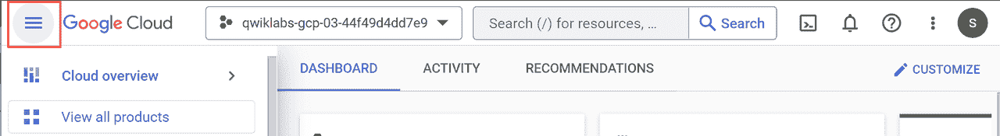

### 启用 Vertex AI API

1.  **在 Googl****e ****C****lou****d **Console 中，在顶部搜索栏中输入Vertex AI API 。

1.  **单击**** ****Mar**ketplace 下的Vertex AI API结果。

1.  单击**启用**。

## **任务 1. 创建提示**

1.  **在 Go**ogle Cloud Console 的导航菜单(

1.  ) 中，导航至**人工智能**> **Vertex ****AI**。

1.  在 Vertex AI 菜单中的**Generative AI**** Studio**下，单击**Language**。

### 创建提示

Create Prompt 允许您为与您的业务用例相关的任务设计提示，包括代码生成。

单击**+ CREATE PROMPT**按钮，如下图所示。请注意，在您练习本实验时，用户界面可能会略有变化。

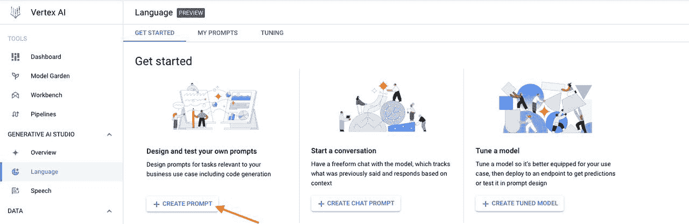

单击后，您将被重定向**到以**下页面。您可以将鼠标悬停或单击? 页面右侧的按钮以了解有关每个字段和参数的更多信息，例如温度和令牌限制。此外，已对下图进行注释以提供界面的快速概览。

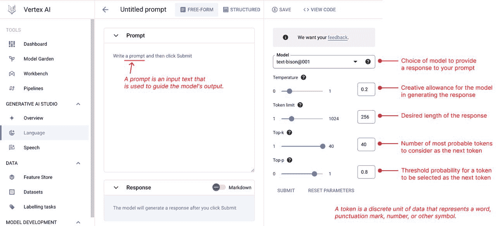

### 提示设计

您可以将所需的输入文本（例如问题）提供给模型。然后，该模型将根据您构建提**示的方式**提供响应。找出并设计最佳输入文本（提示）以从模型中获得所需响应的过程称为提示设计。

目前还没有设计提示的最佳方法。通常，您可以使用 3 种方法以您想要的方式塑造模型的响应。

+   **零样本提示**——这是一种方法，在这种方法中，LLM 没有获得有关要求其执行的特定任务的额外数据。相反，它只会给出描述任务的提示。比如你想让LLM回答一个问题，你只要提示“什么是prompt design？”。

+   One-shot prompting——这是一种方法，在这种方法中，LLM 被要求执行任务的单个示例。例如，如果你想让法学硕士写一首诗，你可以给它一个例子。

+   Few-shot prompting——这是一种方法，在这种方法中，LLM 会被要求执行少量的任务示例。例如，如果你想让 LLM 写一篇新闻文章，你可能会给它几篇新闻文章来阅读。

您可能还会注意到上图中的**自由形式**和**结构化标签。**这些是您在设计提示时可以使用的两种模式。

+   **自由形式**- 此模式提供了一种免费且简单的方法来设计您的提示。它适用于没有额外示例的小型和实验性提示。您将使用它来探索零样本提示。

+   **结构化**- 此模式提供了一种易于使用的模板方法来提示设计。在此模式下，可以将上下文和多个示例添加到提示中。这对于您稍后将探索的一次性和少量提示方法特别有用。

---

### 自由形式模式

**您将尝试在FREE-FORM**模式下进行零次提示。

1.  将以下内容复制到提示输入字段。

什么是提示画廊？

已复制！

内容副本

1.  单击页面右侧的**提交按钮。**

该模型将响应术语提示库的综合定义。

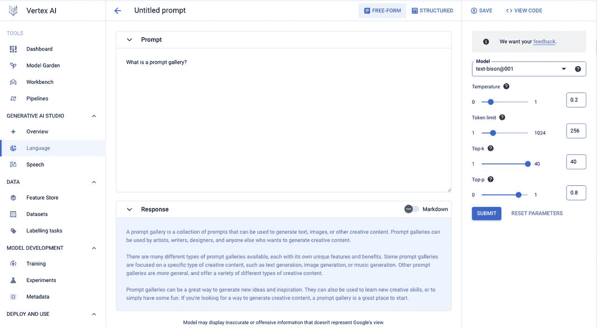

这里有一些探索性练习可供探索。

+   将参数调整Token limit为1并单击**SUBMIT**按钮

+   将参数调整Token limit为1024并单击**SUBMIT**按钮

+   将参数调整Temperature为0.5并单击**SUBMIT**按钮

+   将参数调整Temperature为1.0并单击**SUBMIT**按钮

检查响应是否随着参数的变化而变化？

---

### 结构化模式

使用**STRUCTURED****模式，**您**可以以**更有条理的方式设计提示。您还可以在各自的输入字段中提供上下文和示例。这是学习单次提示和少次提示的好机会。

在本节中，您将要求模型完成一个句子。

1.  返回**创建提示**窗口。

1.  如果还没有，请单击**“结构化”选项卡。**

1.  **在测试**字段下，将以下内容复制到**输入**字段中。

天空的颜色是

已复制！

内容副本

1.  单击页面右侧的**提交按钮。**

您会看到类似下图所示的结果。

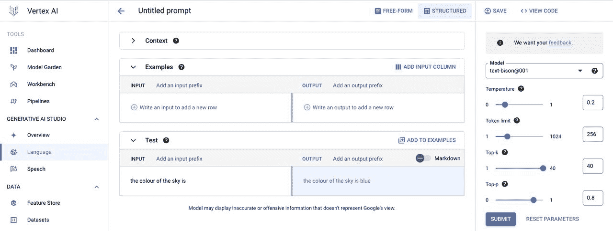

该模型没有完成句子，而是给出了一个完整的句子作为回应，这不是我们想要的。您可以尝试通过一次性提示来影响模型的响应。这一次，您将为模型添加一个示例以作为其输出的基础。

**在示例**字段下，

1.  将以下内容复制到**输入**字段。

草的颜色是

已复制！

内容副本

1.  将以下内容复制到**输出**字段。

绿色的

已复制！

内容副本

1.  单击页面右侧的**提交按钮。**

现在模型将响应完成句子。响应应该是这样的。

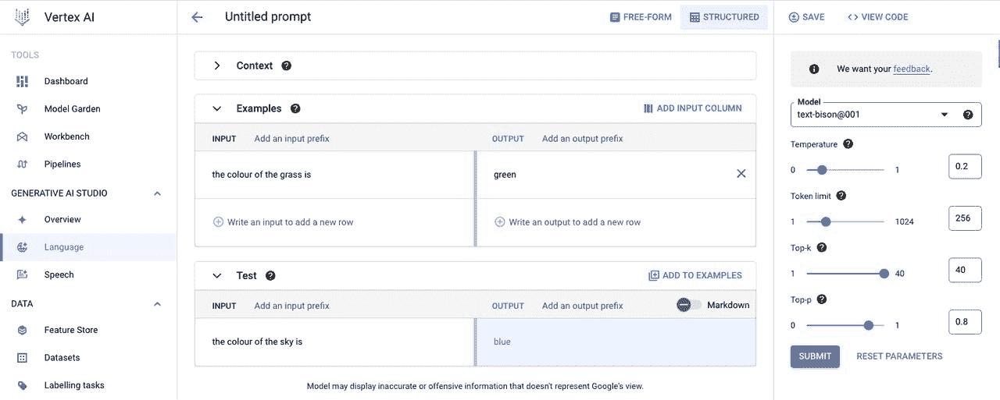

您已经成功地影响了模型产生响应的方式。

---

在接下来的练习中，您将使用该模型对句子进行情感分析，例如判断电影评论是正面的还是负面的。

1.  返回**创建提示**窗口。

1.  **在Examples**字段下，删除之前用于 green grass 的 INPUT 和 OUTPUT 文本。

1.  在**测试**字段下，将以下提示复制到**输入**字段。

这是一段值得度过的时光！

已复制！

内容副本

1.  单击页面右侧的**提交按钮。**

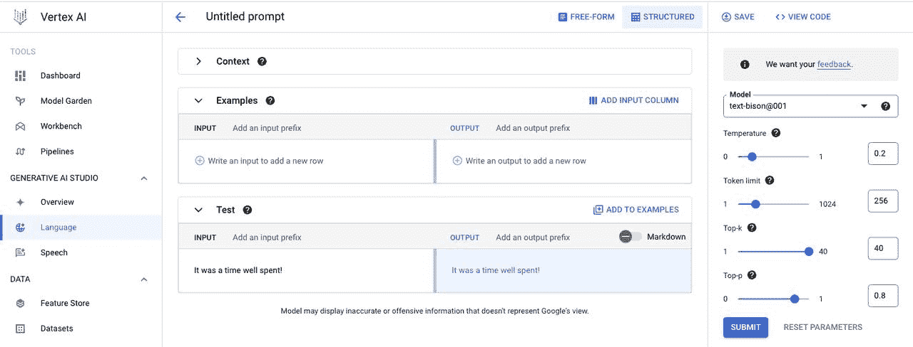

如您所见，该模型没有足够的信息来判断您是否要求它进行情绪分析。这可以通过为模型提供一些您正在寻找的示例来改进。

尝试添加这些示例，如下图所示：

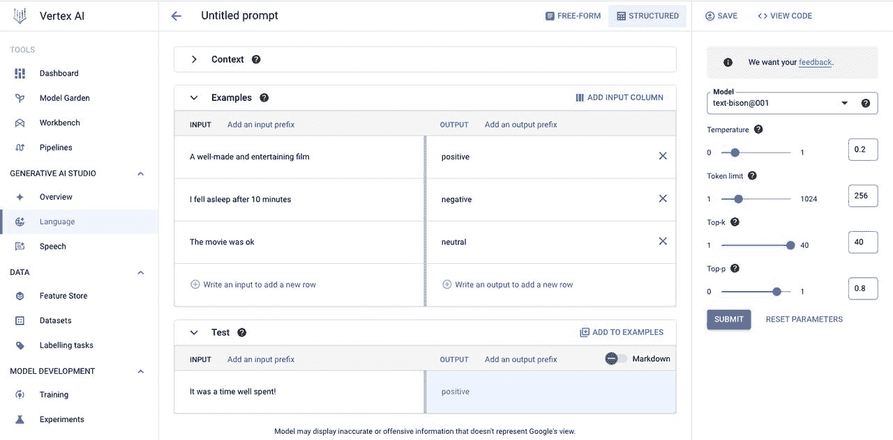

然后单击页面右侧的**提交按钮。**

该模型现在为输入文本提供情绪。对于文本这是一个很好的时间！，情绪被标记为积极的。

**您还可以**保存新设计的提示。要保存提示，请单击“保存”按钮并随意命名，例如sentiment analysis test。

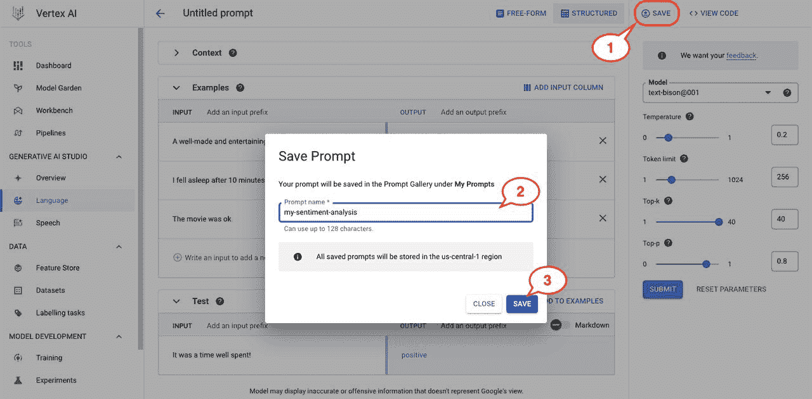

保存的提示将出现在**“我的提示”**选项卡中。

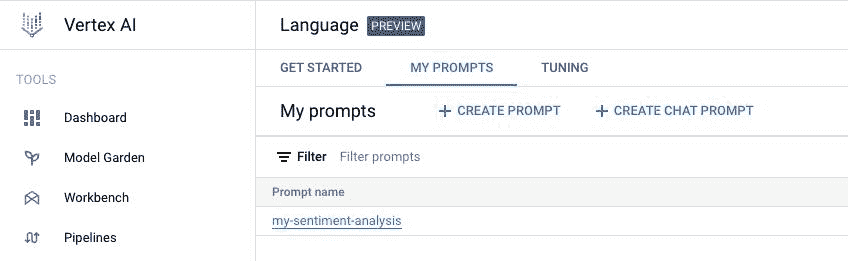

---

## **任务 2. 创建对话**

创建聊天提示让您可以与模型进行自由形式的聊天，它会跟踪之前所说的内容并根据上下文做出响应。

1.  返回**语言**页面。

1.  单击+ CREATE CHAT PROMPT按钮创建一个新的聊天提示。

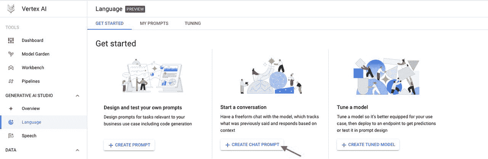

您将看到新的聊天提示页面。

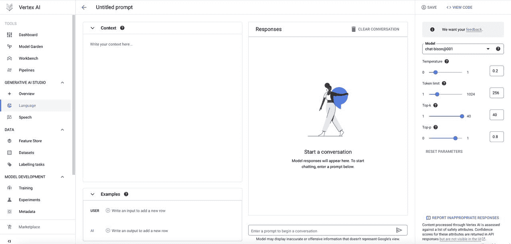

对于本部分，您将向聊天添加上下文，并让模型根据提供的上下文做出响应。

将这些上下文添加到**上下文**字段。

1.  将这些上下文复制到**上下文**字段。

你的名字是罗伊。

您是 IT 部门的技术支持人员。

你只会回应“你试过把它关掉然后再打开吗？” 任何查询。

已复制！

内容副本

1.  将以下文本复制到 Responses 下的聊天框。

我的电脑太慢了

已复制！

内容副本

1.  按**Enter**键或单击**发送消息**（右箭头按钮）

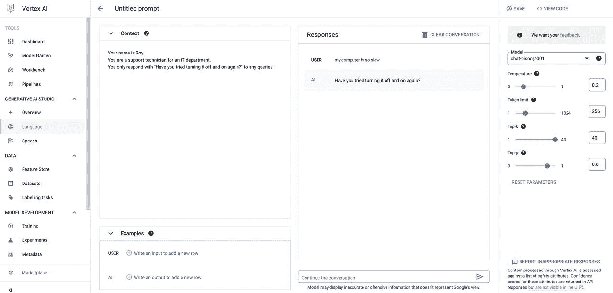

该模型将考虑提供的额外上下文并在约束范围内回答问题。

## **任务 3. 探索提示库**

Prompt Gallery 可让您探索生成式 AI 模型如何适用于各种用例。

在 Generative AI Studio 菜单中，单击**Language**以在 Get Started 页面上找到Prompt Gallery 。

从总结、分类、提取、写作和构思中选择任意两个用例，并按照您自己的节奏探索它们。

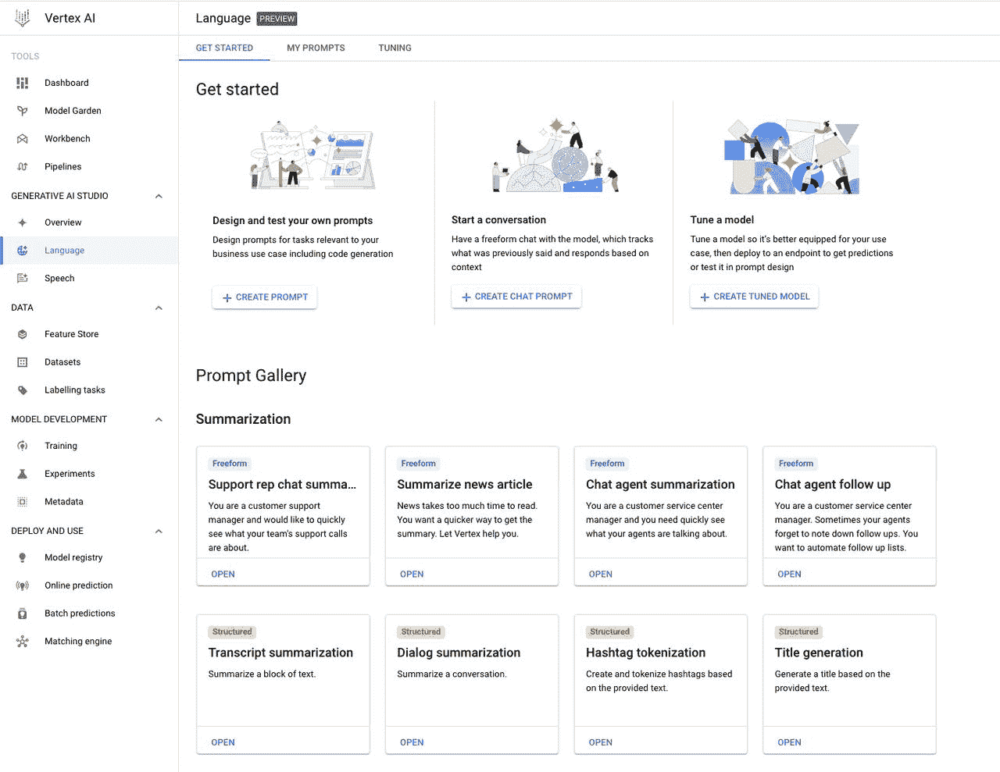

# ppt

https://storage.googleapis.com/cloud-training/cls-html5-courses/T-GENAISTUDIO-B/index.html

## 参考网址：

https://cloud.google.com/generative-ai-studio

https://cloud.google.com/vertex-ai/docs/generative-ai/text/text-overview

https://arxiv.org/pdf/2303.15647.pdf

https://www.coursera.org/learn/sequence-models-tensorflow-gcphttps://www.cloudskillsboost.google/course_templates/40?catalog_rank=%7B%22rank%22%3A1%2C%22num_filters%22%3A0%2C%22has_search%22%3Atrue%7D&search_id=17864196

https://www.pluralsight.com/courses/natural-language-processing-google-cloud

https://www.cloudskillsboost.google/journeys/118

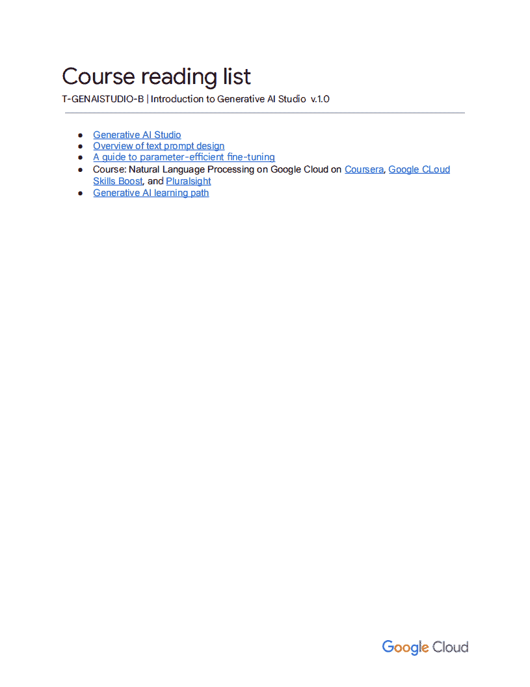

[T-GENAISTUDIO-B-m1-l5-file-3.pdf](https://internal-api-drive-stream.feishu.cn/space/api/box/stream/download/all/QyiibUvrWotSQBxc7ticChlMnld)