# 10.生成式 AI 资源管理器 - Vertex AI

> 来源：[https://waytoagi.feishu.cn/docx/TDi3dOD6joTqbSxruUrcCygsngg](https://waytoagi.feishu.cn/docx/TDi3dOD6joTqbSxruUrcCygsngg)

+   课程：https://www.cloudskillsboost.google/quests/299

+   Generative AI Explorer - Vertex Quest 是一组关于如何在 Google Cloud 上使用 Generative AI 的实验。通过实验，您将了解如何使用 Vertex AI PaLM API 系列中的模型，包括 text-bison、chat-bison 和 textembedding-gecko。您还将了解提示设计、最佳实践，以及如何将其用于构思、文本分类、文本提取、文本摘要等。您还将了解如何通过 Vertex AI 自定义训练对基础模型进行训练并将其部署到 Vertex AI 端点来调整基础模型。

# 使用 Vertex AI 的生成式 AI：入门

## **概述**

该实验室将提供有关 Google Cloud 上生成式 AI 的介绍性实践经验。

[PaLM 2](https://ai.google/discover/palm2)是谷歌的下一代大型语言模型 (LLM)，它建立在谷歌在机器学习和负责任人工智能领域突破性研究的传统基础上。PaLM 2 因其构建方式而擅长高级推理、翻译和代码生成等任务。

Generative AI Studio和 [Vertex](https://ai.google/discover/palm2) AI PaLM API 由PaLM 2提供支持。

在本实验中，您将学习如何开始使用Generative AI Studio和Vertex AI PaLM API。

## **你将学到什么：**

如何使用 Generative AI Studio 用户界面：

+   探索语言产品和提示库

+   创建不同类型的新提示并在 UI 中获取响应

如何使用 Vertex AI PaLM API 和 Python SDK：

+   LLM 和 PaLM API 的背景

+   文本生成示例

+   探索文本生成中涉及的各种模型参数

+   聊天模型示例

+   嵌入模型示例

## **设置和要求**

### 在您点击 Start Lab 按钮之前

**阅读这些说明。实验室是定时**的，您不能暂停它们。当您点击Start Lab时计时器开始计时，它会显示 Google Cloud 资源可供您使用的时长。

这个动手实验室让您可以在真实的云环境中自己进行实验室活动，而不是在模拟或演示环境中。它通过为您提供新的临时凭据来实现这一点，您可以在实验期间使用这些凭据登录和访问 Google Cloud。

要完成此实验，您需要：

+   访问标准互联网浏览器（推荐使用 Chrome 浏览器）。

**注意：**使用隐身或私人浏览器窗口运行此实验室。这可以防止您的个人账户和学生账户之间发生任何冲突，这可能会导致您的个人账户产生额外费用。

+   是时候完成实验了——请记住，一旦开始就无法暂停实验。

**注意：**如果您已经拥有自己的个人 Google Cloud 帐户或项目，请勿将其用于本实验，以免对您的帐户产生额外费用。

### 如何开始您的实验并登录 Google Cloud Console

1.  单击**启动实验室**按钮。如果您需要支付实验室费用，则会**打开一个弹出窗口供您选**择付款方式。左侧是Lab Details面板，其中包含以下内容：

+   打开**Google 控制台**按钮

+   剩余时间

+   您必须用于此实验室的临时凭据

+   其他信息（如果需要）以逐步完成此实验室

1.  点击**打开谷歌控制台****。实验室**启动资源，然后打开另一个显示“登录”页面的选项卡。

1.  **提示：**将选项卡并排排列在单独的窗口中。

1.  **注意：**如果您看到**“选择帐户”**对话框，请单击**“使用其他帐户”**。

1.  如有必要，从**实验室详细信息**面板复制**用户名**并将其粘贴到**登录**对话框中。单击**下一步**。

1.  从**实验室详细信息**面板复制**密码**并将其粘贴到**欢迎**对话框中。单击**下一步**。

1.  **重要提示：**您必须使用左侧面板中的凭据。不要使用您的 Google Cl**oud** Skills Boost 凭据。注意：在本实验中使用您自己的 Google Cloud 帐户可能会产生额外费用。

1.  单击后续页面：

+   接受条款和条件。

+   不要添加恢复选项或双因素身份验证（因为这是一个临时帐户）。

+   不要注册免费试用。

片刻之后，Cloud Console 将在此选项卡中打开。

**注意：**您可以通过点击左上角的 **导航菜单**来查看包含 Google Cloud 产品和服务列表的菜单。

## **文件组织**

本实验分为两个不同的文件：

## **任务 1. Vertex ****AI**** Workbench**

在您的 Google Cloud 项目中，导航到 Vertex AI Workbench。在顶部搜索栏中，输入Google Cloud 控制台的Vertex AI Workbench 。

1.  点击**打开 JupyterLab**，

1.  JupyterLab 将在新选项卡中运行。

## 任务 2. 打开 generative-ai 文件夹

1.  导航到generative-ai笔记本左侧的文件夹。

1.  导航到Language文件夹。

1.  点击intro_prompt_design.ipynb文件

1.  按照笔记本中的步骤一次运行每个单元格。

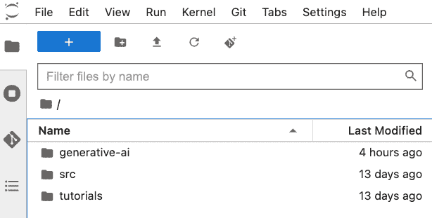

单击**检查我的进度**以验证目标。

## **任务 3. 打开介绍笔记本**

1.  在左侧的文件目录中，右键点击文件夹intro_generative_ai_studio.md中的文件，使用Markdown Previewlanguage/打开，类似如下截图：

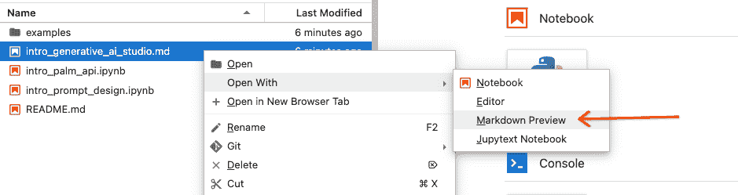

1.  按照说明开始使用 Generative AI Studio 的用户界面。

## **任务 ****4. 打**开介绍 PaLM API 笔记本

1.  在左侧的文件目录中，双击文件夹intro_palm_api.ipynb中的文件language/。

1.  按照笔记本中的步骤一次运行每个单元格。notebook 的单元格使用适用于 PaLM API 的 Python SDK，并将在执行时在每个单元格下输出结果。

单击**检查我的进度**以验证目标。

运行 intro_palm_api.ipynb 文件的单元格

检查我的进度

## **恭喜**

您现在已经完成了实验！在本实验中，您探索了 Vertex AI 中的生成式 AI Studio。您还使用 Python SDK for Generative AI 在 Jupyter notebook 中使用 PaLM API。

### 下一步

+   查看Generative AI on Vertex AI 文档。

+   在Google Cloud Tech YouTube 频道上了解有关生成式 AI 的更多信息。

# 使用 Vertex AI 的生成式 AI：提示设计

## **GSP1151**

## **概述**

用于文本的 Vertex AI PaLM API 使您能够根据自己的喜好构建提示。您可以添加上下文信息、说明、示例、问题、列表以及您能想到的任何其他类型的文本内容。

在本实验中，您将了解提示设计和使用 Vertex AI PaLM API 的各种文本生成用例。

## **你将学到什么：**

如何开始使用 PaLM API 进行即时工程：

+   最佳实践

+   零、一和少量提示

如何使用 PaLM API 探索一些文本生成用例：

+   构思

+   问答

+   文本分类

+   文本提取

+   文本摘要

## **设置和要求**

### 在您点击 Start Lab 按钮之前

**阅读这些说明。实验室是定时**的，您不能暂停它们。当您点击Start Lab时计时器开始计时，它会显示 Google Cloud 资源可供您使用的时长。

这个动手实验室让您可以在真实的云环境中自己进行实验室活动，而不是在模拟或演示环境中。它通过为您提供新的临时凭据来实现这一点，您可以在实验期间使用这些凭据登录和访问 Google Cloud。

要完成此实验，您需要：

+   访问标准互联网浏览器（推荐使用 Chrome 浏览器）。

**注意：**使用隐身或私人浏览器窗口运行此实验室。这可以防止您的个人账户和学生账户之间发生任何冲突，这可能会导致您的个人账户产生额外费用。

+   是时候完成实验了——请记住，一旦开始就无法暂停实验。

**注意：**如果您已经拥有自己的个人 Google Cloud 帐户或项目，请勿将其用于本实验，以免对您的帐户产生额外费用。

### 如何开始您的实验并登录 Google Cloud Console

1.  单击**启动实验室**按钮。如果您需要支付实验室费用，则会**打开一个弹出窗口供您选**择付款方式。左侧是Lab Details面板，其中包含以下内容：

+   打开**Google 控制台**按钮

+   剩余时间

+   您必须用于此实验室的临时凭据

+   其他信息（如果需要）以逐步完成此实验室

1.  点击**打开谷歌控制台****。实验室**启动资源，然后打开另一个显示“登录”页面的选项卡。

1.  **提示：**将选项卡并排排列在单独的窗口中。

1.  **注意：**如果您看到**“选择帐户”**对话框，请单击**“使用其他帐户”**。

1.  如有必要，从**实验室详细信息**面板复制**用户名**并将其粘贴到**登录**对话框中。单击**下一步**。

1.  从**实验室详细信息**面板复制**密码**并将其粘贴到**欢迎**对话框中。单击**下一步**。

1.  **重要提示：**您必须使用左侧面板中的凭据。不要使用您的 Google Cl**oud** Skills Boost 凭据。注意：在本实验中使用您自己的 Google Cloud 帐户可能会产生额外费用。

1.  单击后续页面：

+   接受条款和条件。

+   不要添加恢复选项或双因素身份验证（因为这是一个临时帐户）。

+   不要注册免费试用。

片刻之后，Cloud Console 将在此选项卡中打开。

**注意：**您可以通过点击左上角的 **导航菜单**来查看包含 Google Cloud 产品和服务列表的菜单。

## **笔记本组织**

本实验跨各种 Jupyter notebooks 进行组织：

## **任务 1. Vertex ****AI**** Workbench**

在您的 Google Cloud 项目中，导航到 Vertex AI Workbench。在顶部搜索栏中，输入Google Cloud 控制台的Vertex AI Workbench 。

1.  点击**打开 JupyterLab**，

1.  JupyterLab 将在新选项卡中运行。

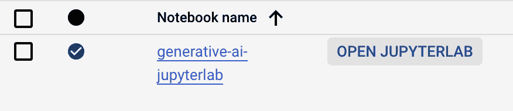

## 任务 2. 打开 generative-ai 文件夹

1.  导航到generative-ai笔记本左侧的文件夹。

1.  导航到Language文件夹。

1.  点击intro_prompt_design.ipynb文件

1.  按照笔记本中的步骤一次运行每个单元格。

单击**检查我的进度**以验证目标。

简明扼要

检查我的进度

具体且定义明确

检查我的进度

一次询问一个任务

检查我的进度

警惕幻觉

检查我的进度

将生成任务转化为分类任务以减少输出可变性

检查我的进度

通过包含示例提高响应质量

检查我的进度

## **任务 3. 探索笔记本**

1.  在左侧文件目录中，双击打开文件夹language/examples/prompt-design/。

1.  打开文件夹中的任何笔记本，探索不同的用例，在这些用例中，提示工程可以帮助从 PaLM API 生成所需的结果。

1.  打开notebook后，逐个运行一个cell，在notebook中查看运行结果。

单击**检查我的进度**以验证目标。

探索笔记本

检查我的进度

## **恭喜**

您现在已经完成了实验！在本实验中，您使用了 GitHub 存储库中提供的各种笔记本generative-ai来探索 Vertex AI 中的 PaLM API。

### 下一步

+   查看Generative AI on Vertex AI 文档。

+   在Google Cloud Tech YouTube 频道上了解有关生成式 AI 的更多信息。

# 开始使用生成式 AI Studio

## **概述**

Vertex AI 是一个端到端的机器学习平台，可帮助您更快、更轻松地构建、部署和扩展机器学习模型。它为管理机器学习生命周期的各个方面（从数据准备到模型部署）提供了统一的体验。

Vertex AI Generative AI Studio是一个基于云的平台，允许用户创建和试验生成式 AI 模型。该平台提供了多种工具和资源，即使您没有机器学习背景，也可以轻松开始使用生成式 AI。

在本实验中，您将使用 Generative AI Studio 和 Vertex AI 在 Google Cloud 控制台上创建提示和对话，而无需使用 API 或 Python SDK。

### 目标

在本实验中，您将学习如何执行以下任务：

+   使用自由格式和结构化模式创建提示。

+   创建对话。

+   浏览提示库。

## **设置和要求**

### 在您点击 Start Lab 按钮之前

**阅读这些说明。实验室是定时**的，您不能暂停它们。当您点击Start Lab时计时器开始计时，它会显示 Google Cloud 资源可供您使用的时长。

这个动手实验室让您可以在真实的云环境中自己进行实验室活动，而不是在模拟或演示环境中。它通过为您提供新的临时凭据来实现这一点，您可以在实验期间使用这些凭据登录和访问 Google Cloud。

要完成此实验，您需要：

+   访问标准互联网浏览器（推荐使用 Chrome 浏览器）。

**注意：**使用隐身或私人浏览器窗口运行此实验室。这可以防止您的个人账户和学生账户之间发生任何冲突，这可能会导致您的个人账户产生额外费用。

+   是时候完成实验了——请记住，一旦开始就无法暂停实验。

**注意：**如果您已经拥有自己的个人 Google Cloud 帐户或项目，请勿将其用于本实验，以免对您的帐户产生额外费用。

### 如何开始您的实验并登录 Google Cloud Console

1.  单击**启动实验室**按钮。如果您需要支付实验室费用，则会**打开一个弹出窗口供您选**择付款方式。左侧是Lab Details面板，其中包含以下内容：

+   打开**Google 控制台**按钮

+   剩余时间

+   您必须用于此实验室的临时凭据

+   其他信息（如果需要）以逐步完成此实验室

1.  点击**打开谷歌控制台****。实验室**启动资源，然后打开另一个显示“登录”页面的选项卡。

1.  **提示：**将选项卡并排排列在单独的窗口中。

1.  **注意：**如果您看到**“选择帐户”**对话框，请单击**“使用其他帐户”**。

1.  如有必要，从**实验室详细信息**面板复制**用户名**并将其粘贴到**登录**对话框中。单击**下一步**。

1.  从**实验室详细信息**面板复制**密码**并将其粘贴到**欢迎**对话框中。单击**下一步**。

1.  **重要提示：**您必须使用左侧面板中的凭据。不要使用您的 Google Cl**oud** Skills Boost 凭据。注意：在本实验中使用您自己的 Google Cloud 帐户可能会产生额外费用。

1.  单击后续页面：

+   接受条款和条件。

+   不要添加恢复选项或双因素身份验证（因为这是一个临时帐户）。

+   不要注册免费试用。

片刻之后，Cloud Console 将在此选项卡中打开。

**注意：**您可以通过点击左上角的 **导航菜单**来查看包含 Google Cloud 产品和服务列表的菜单。

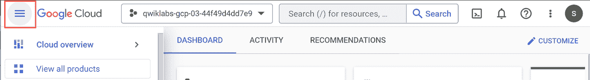

### 启用 Vertex AI API

1.  **在 Googl****e ****C****lou****d **Console 中，在顶部搜索栏中输入Vertex AI API 。

1.  **单击**** ****Mar**ketplace 下的Vertex AI API结果。

1.  单击**启用**。

## **任务 1. 创建提示**

1.  **在 Go**ogle Cloud Console 的导航菜单(

1.  ) 中，导航至**人工智能**> **Vertex ****AI**。

1.  在 Vertex AI 菜单中的**Generative AI**** Studio**下，单击**Language**。

### 创建提示

Create Prompt 允许您为与您的业务用例相关的任务设计提示，包括代码生成。

单击**+ CREATE PROMPT**按钮，如下图所示。请注意，在您练习本实验时，用户界面可能会略有变化。

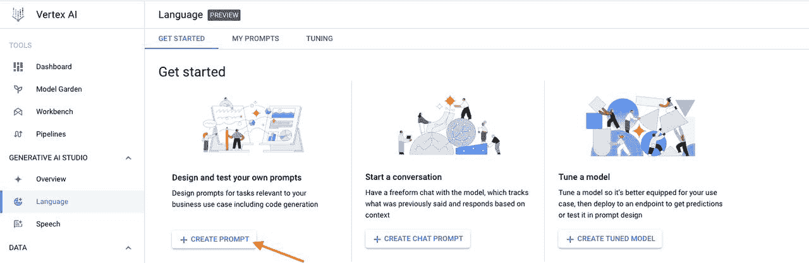

单击后，您将被重定向**到以**下页面。您可以将鼠标悬停或单击? 页面右侧的按钮以了解有关每个字段和参数的更多信息，例如温度和令牌限制。此外，已对下图进行注释以提供界面的快速概览。

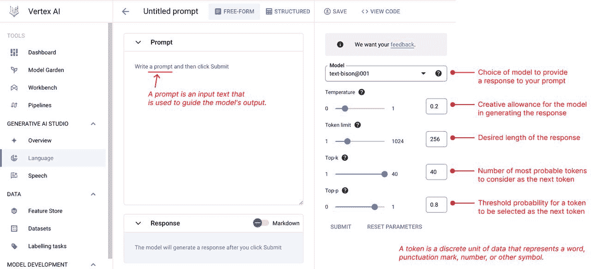

### 提示设计

您可以将所需的输入文本（例如问题）提供给模型。然后，该模型将根据您构建提**示的方式**提供响应。找出并设计最佳输入文本（提示）以从模型中获得所需响应的过程称为提示设计。

目前还没有设计提示的最佳方法。通常，您可以使用 3 种方法以您想要的方式塑造模型的响应。

+   **零样本提示**——这是一种方法，在这种方法中，LLM 没有获得有关要求其执行的特定任务的额外数据。相反，它只会给出描述任务的提示。比如你想让LLM回答一个问题，你只要提示“什么是prompt design？”。

+   One-shot prompting——这是一种方法，在这种方法中，LLM 被要求执行任务的单个示例。例如，如果你想让法学硕士写一首诗，你可以给它一个例子。

+   Few-shot prompting——这是一种方法，在这种方法中，LLM 会被要求执行少量的任务示例。例如，如果你想让 LLM 写一篇新闻文章，你可能会给它几篇新闻文章来阅读。

您可能还会注意到上图中的**自由形式**和**结构化标签。**这些是您在设计提示时可以使用的两种模式。

+   **自由形式**- 此模式提供了一种免费且简单的方法来设计您的提示。它适用于没有额外示例的小型和实验性提示。您将使用它来探索零样本提示。

+   **结构化**- 此模式提供了一种易于使用的模板方法来提示设计。在此模式下，可以将上下文和多个示例添加到提示中。这对于您稍后将探索的一次性和少量提示方法特别有用。

---

### 自由形式模式

**您将尝试在FREE-FORM**模式下进行零次提示。

1.  将以下内容复制到提示输入字段。

什么是提示画廊？

已复制！

内容副本

1.  单击页面右侧的**提交按钮。**

该模型将响应术语提示库的综合定义。

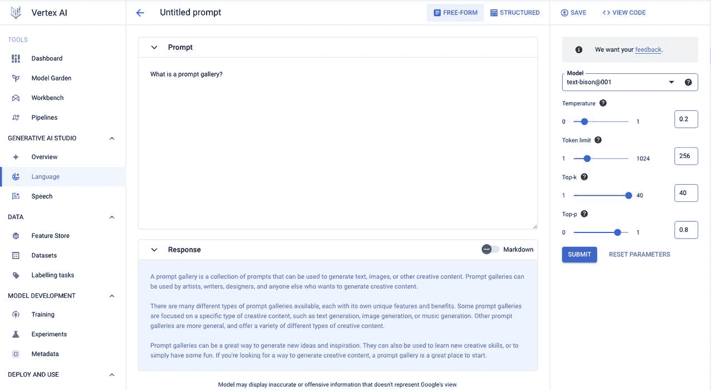

这里有一些探索性练习可供探索。

+   将参数调整Token limit为1并单击**SUBMIT**按钮

+   将参数调整Token limit为1024并单击**SUBMIT**按钮

+   将参数调整Temperature为0.5并单击**SUBMIT**按钮

+   将参数调整Temperature为1.0并单击**SUBMIT**按钮

检查响应是否随着参数的变化而变化？

---

### 结构化模式

使用**STRUCTURED****模式，**您**可以以**更有条理的方式设计提示。您还可以在各自的输入字段中提供上下文和示例。这是学习单次提示和少次提示的好机会。

在本节中，您将要求模型完成一个句子。

1.  返回**创建提示**窗口。

1.  如果还没有，请单击**“结构化”选项卡。**

1.  **在测试**字段下，将以下内容复制到**输入**字段中。

天空的颜色是

已复制！

内容副本

1.  单击页面右侧的**提交按钮。**

您会看到类似下图所示的结果。

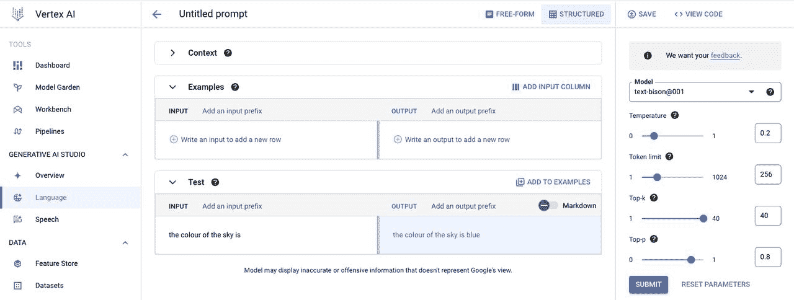

该模型没有完成句子，而是给出了一个完整的句子作为回应，这不是我们想要的。您可以尝试通过一次性提示来影响模型的响应。这一次，您将为模型添加一个示例以作为其输出的基础。

**在示例**字段下，

1.  将以下内容复制到**输入**字段。

草的颜色是

已复制！

内容副本

1.  将以下内容复制到**输出**字段。

绿色的

已复制！

内容副本

1.  单击页面右侧的**提交按钮。**

现在模型将响应完成句子。响应应该是这样的。

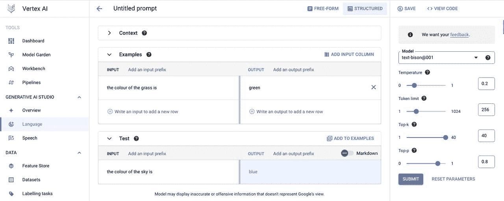

您已经成功地影响了模型产生响应的方式。

---

在接下来的练习中，您将使用该模型对句子进行情感分析，例如判断电影评论是正面的还是负面的。

1.  返回**创建提示**窗口。

1.  **在Examples**字段下，删除之前用于 green grass 的 INPUT 和 OUTPUT 文本。

1.  在**测试**字段下，将以下提示复制到**输入**字段。

这是一段值得度过的时光！

已复制！

内容副本

1.  单击页面右侧的**提交按钮。**

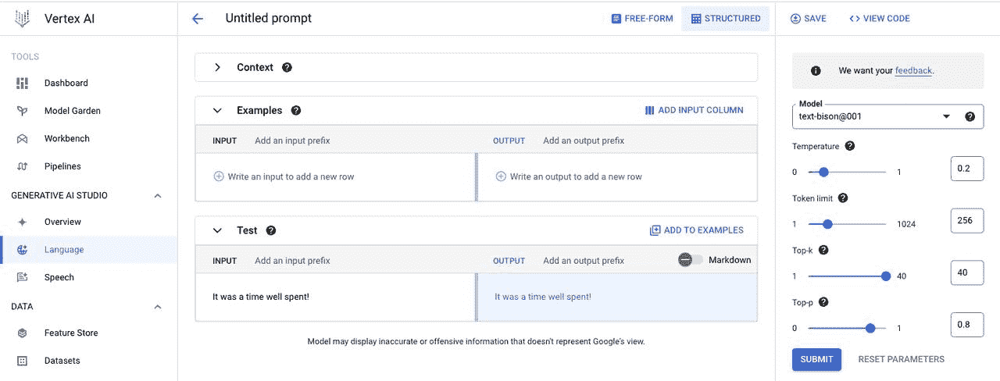

如您所见，该模型没有足够的信息来判断您是否要求它进行情绪分析。这可以通过为模型提供一些您正在寻找的示例来改进。

尝试添加这些示例，如下图所示：

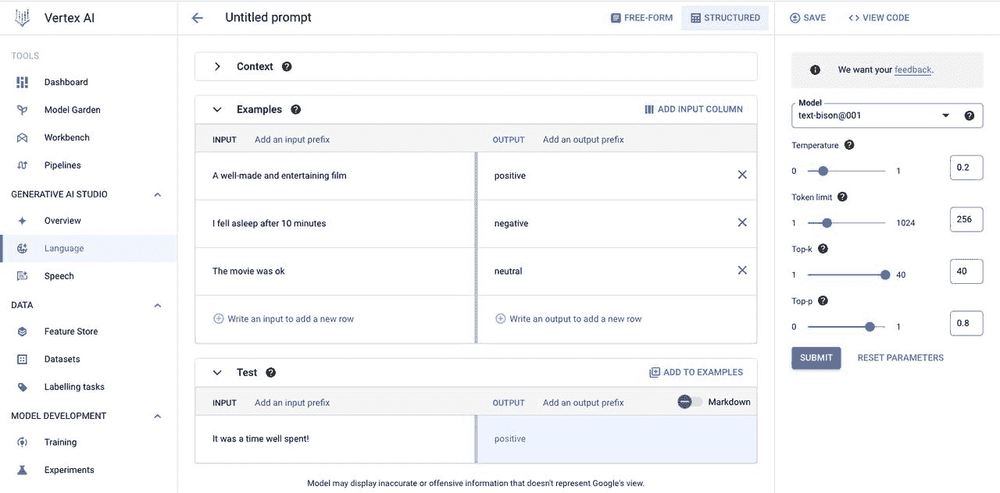

然后单击页面右侧的**提交按钮。**

该模型现在为输入文本提供情绪。对于文本这是一个很好的时间！，情绪被标记为积极的。

**您还可以**保存新设计的提示。要保存提示，请单击“保存”按钮并随意命名，例如sentiment analysis test。

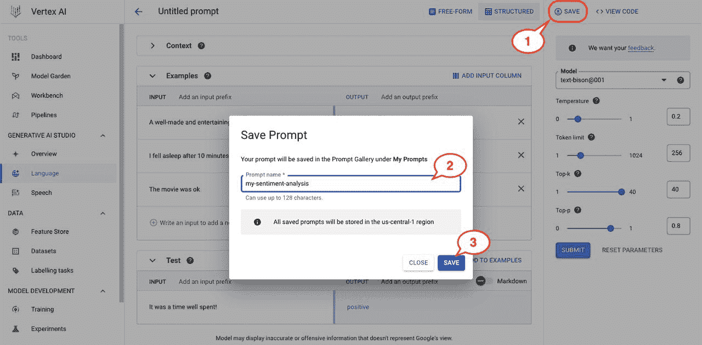

保存的提示将出现在**“我的提示”**选项卡中。

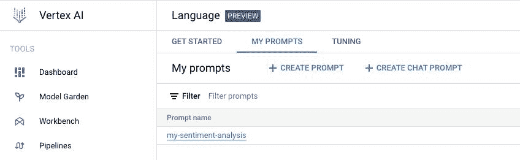

---

## **任务 2. 创建对话**

创建聊天提示让您可以与模型进行自由形式的聊天，它会跟踪之前所说的内容并根据上下文做出响应。

1.  返回**语言**页面。

1.  单击+ CREATE CHAT PROMPT按钮创建一个新的聊天提示。

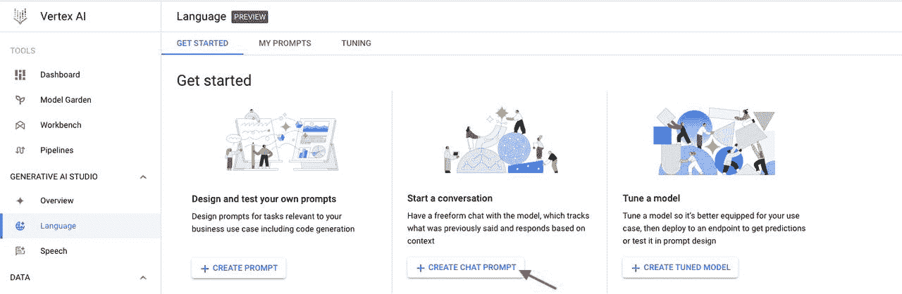

您将看到新的聊天提示页面。

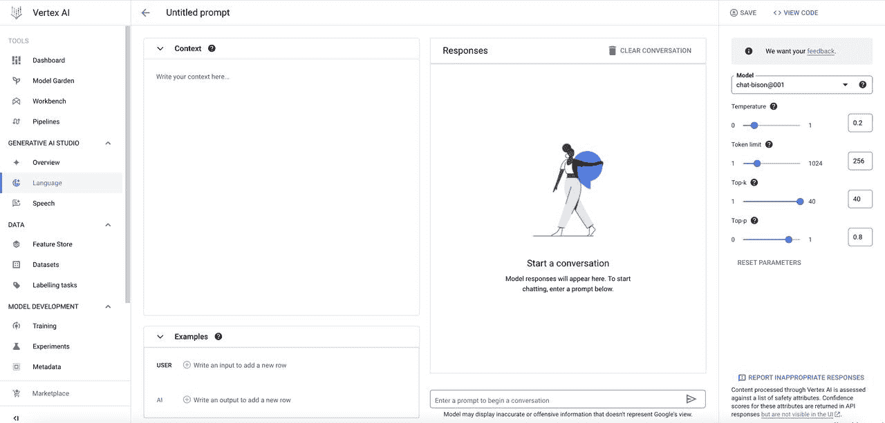

对于本部分，您将向聊天添加上下文，并让模型根据提供的上下文做出响应。

将这些上下文添加到**上下文**字段。

1.  将这些上下文复制到**上下文**字段。

你的名字是罗伊。

您是 IT 部门的技术支持人员。

你只会回应“你试过把它关掉然后再打开吗？” 任何查询。

已复制！

内容副本

1.  将以下文本复制到 Responses 下的聊天框。

我的电脑太慢了

已复制！

内容副本

1.  按**Enter**键或单击**发送消息**（右箭头按钮）

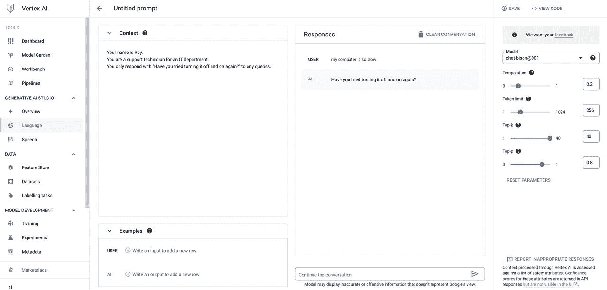

该模型将考虑提供的额外上下文并在约束范围内回答问题。

## **任务 3. 探索提示库**

Prompt Gallery 可让您探索生成式 AI 模型如何适用于各种用例。

在 Generative AI Studio 菜单中，单击**Language**以在 Get Started 页面上找到Prompt Gallery 。

从总结、分类、提取、写作和构思中选择任意两个用例，并按照您自己的节奏探索它们。

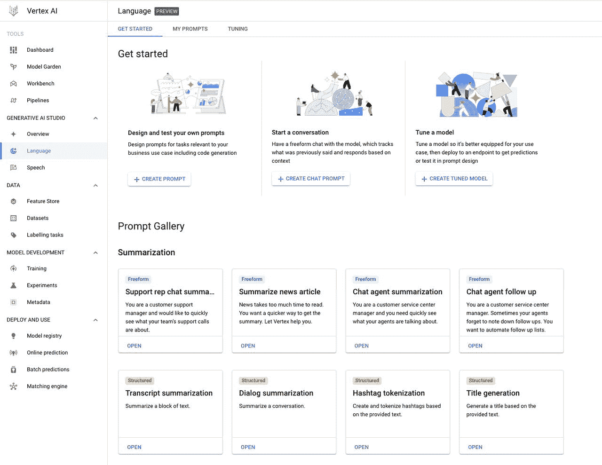

## **恭喜！**

您学习了如何创建和测试提示、创建对话以及探索提示库。您已迈出使用 Generative AI Studio 和其他 Generative AI 开发工具开始您的旅程的第一步！