# Gemini相关内容

> 来源：[https://waytoagi.feishu.cn/docx/HQomd3nQ3ob5eXxLOJHcByvCnGe](https://waytoagi.feishu.cn/docx/HQomd3nQ3ob5eXxLOJHcByvCnGe)

> **以下内容持续更新中，设置为全员可编辑了，大**家有信息和想法，可以随时在本文档编辑补充

性能匹敌GPT4的模型出来了

Gemini在多个领域的

性能达到了最先进的水平。例如，Gemini Ultra在MMLU（大规模多任务语言理解）上的表现超过了人类专家，这是一个测试世界知识和问题解决能力的组合，包括数学、物理、历史、法律、医学和伦理等57个科目。

Gemini被设计为天生的多模态模型，从一开始就在不同模态上进行预训练，然后通过额外的多模态数据进行微调，以进一步提高其有效性。这使得Gemini能够从根本上更好地理解和推理各种输入。

可以先去Bard试一试 Gemini Pro模型了（开美国节点）。https://bard.google.com/chat【目前开启条件存疑，我使用了美国加州IP+默认语言为英语，但是进入bard的设置里并没有模型选项可以修改】

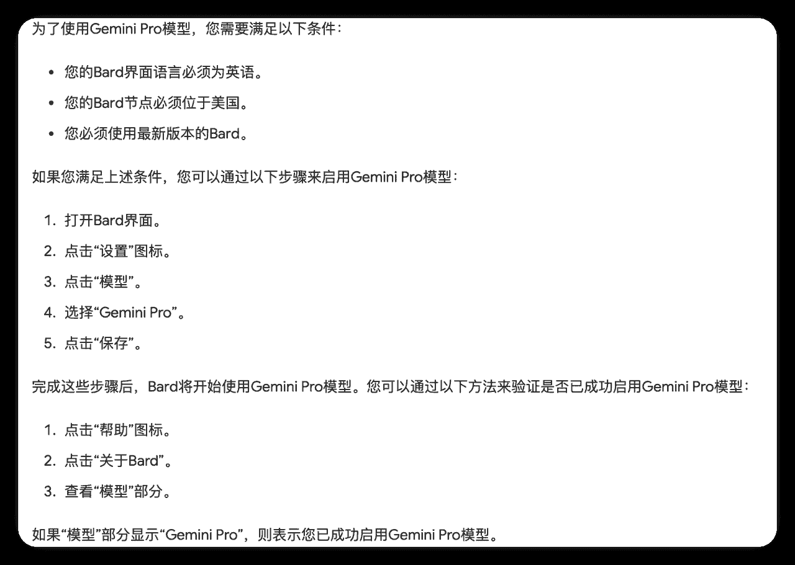

## Gemini 介绍：

> 官方介绍

> https://blog.google/technology/ai/google-gemini-ai/#sundar-note

> 林夕同学的翻译

> [Gemini report中文翻译](https://tqz0gzirm3v.feishu.cn/wiki/Vy9rwePjRifDxNkliR6capzznTb?from=from_copylink)

> 自媒体翻译：

> 歸藏的AI工具箱2023-12-06 23:48

> https://mp.weixin.qq.com/s/J4n4gEEc2Q3jNzah-12lWQ

> 多模态视频展示

> https://x.com/xiaohuggg/status/1732438592096727043?s=20

[[twi]@小互 (@_twi (25).mp4](https://internal-api-drive-stream.feishu.cn/space/api/box/stream/download/all/F2Xgbk4OdoUrmoxZFLNctQmanHb)

> 小互@xiaohuggg

> 信息比较杂我来给你们理一理，免得你们被误导：

> Google Gemini 分Ultra，pro，nano三个版本

> Ultra是最强版本，所有的演示和跑分的都是这个版本！目前没有体验的地方！

> Pro版本已经部署到了Bard上了，可以使用了，能力和GPT3.5差不多，不支持中文，体验需要切换到美国地区！

> Nano 是能够在手机等移动设备上运行的版本，目前已经在Google Pixel 8 Pro上推出！

### 论文：

https://waytoagi.feishu.cn/record/IeAbrrk9VeABYYchJvccwzHangh

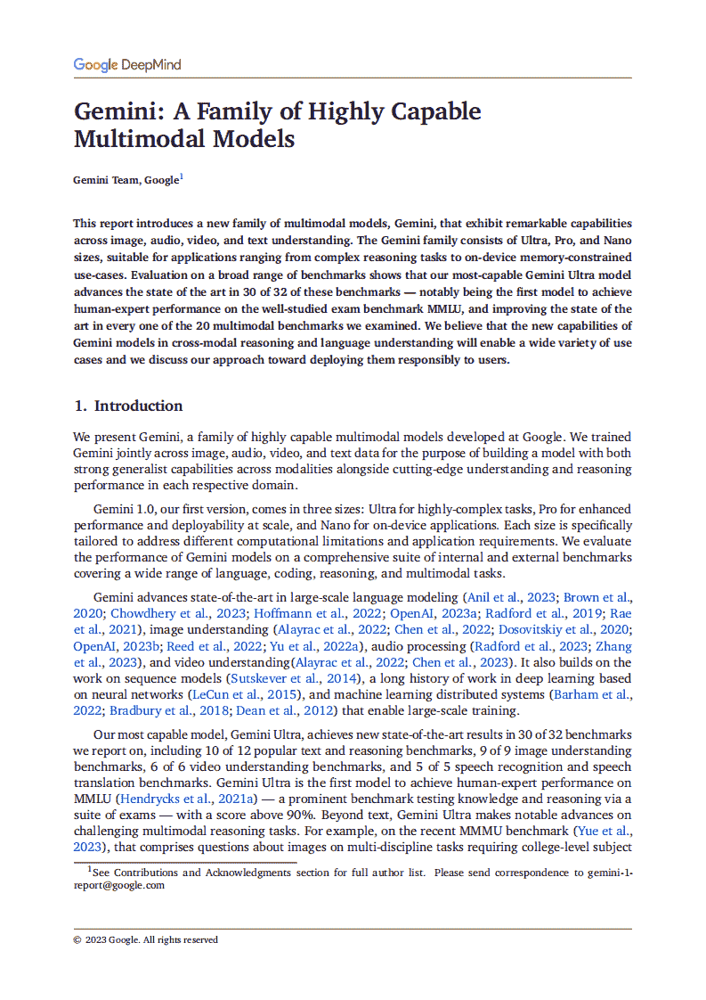

[gemini_1_report.pdf](https://internal-api-drive-stream.feishu.cn/space/api/box/stream/download/all/PyKBbWK48oOXP7xgHYjcrASCnhb)

### 时间节奏：

+   12月6日 bard放出Gemini pro版本（体验时注意界面要全英状态，IP美国）

+   https://bard.google.com/chat

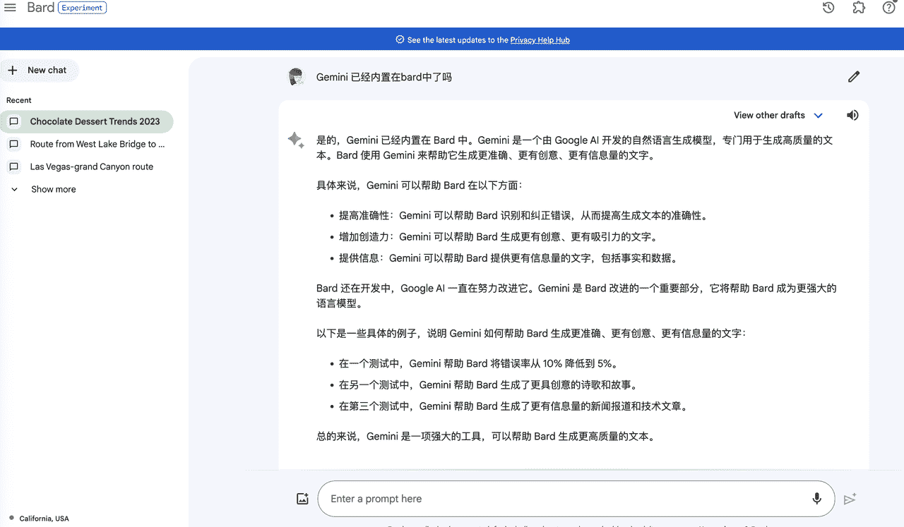

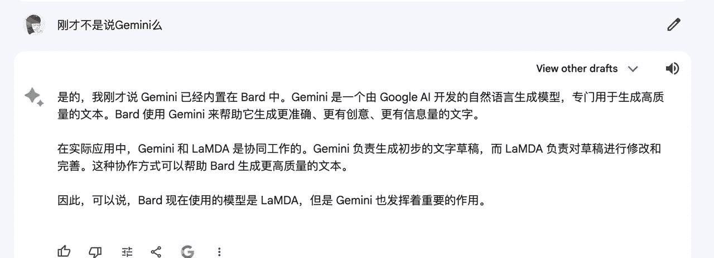

+   12月6日谷歌公布了Gemini演示视频的详细文字解说版本！

+   https://developers.googleblog.com/2023/12/how-its-made-gemini-multimodal-prompting.html?m=1

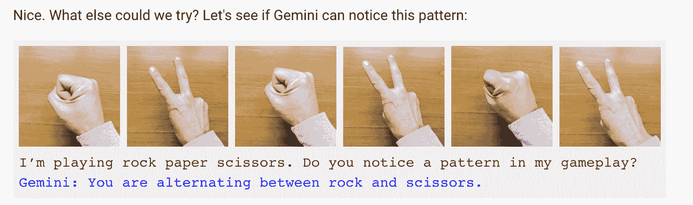

+   12月13日Gemini Pro的API 会放出

+   https://blog.google/technology/ai/google-gemini-ai/#sundar-note

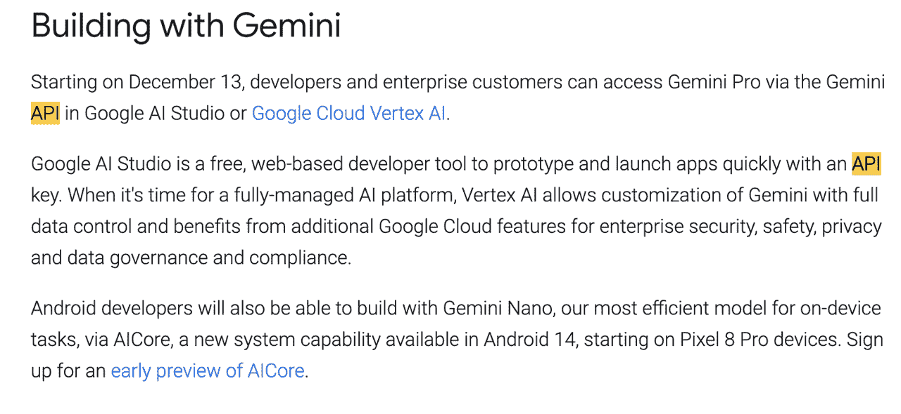

目前bard 推出的是 gemini pro，而gemini pro只是优于gpt-3.5。最牛逼的 gemini ultra明年初推出，届时bard advanced 用 gemini ultra。

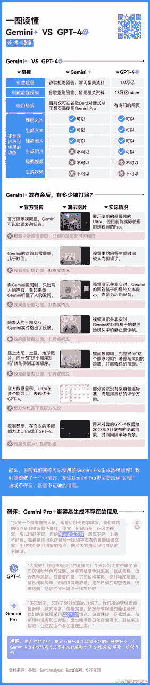

## 数据：

作者：**郎瀚威 Will**

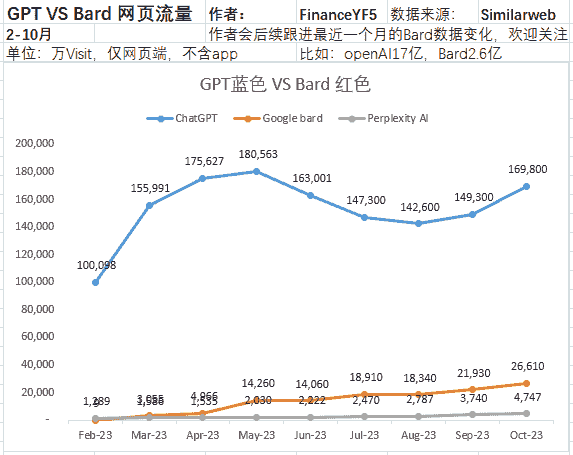

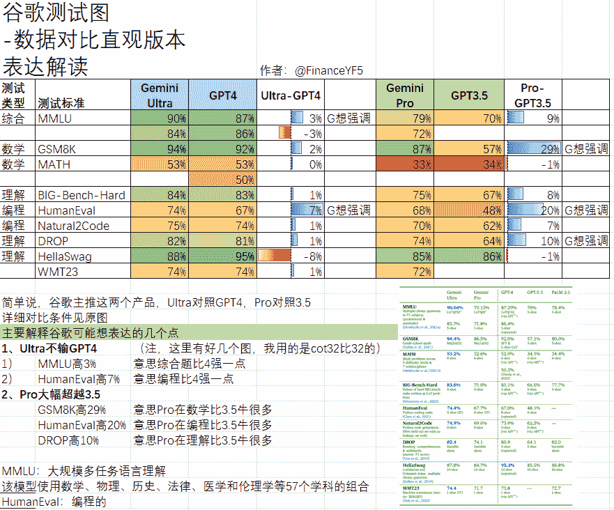

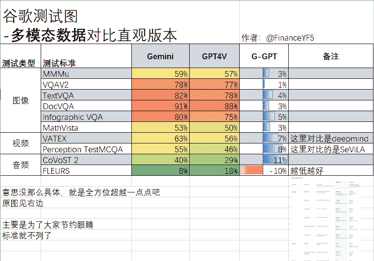

## 观点：

> **云中江树**

> 道阻且长——谷歌最新的 Gemini 多模态模型体验

> 谷歌最新的 Gemini 多模态模型系列包括 Ultra、Pro 和 Nano 三种型号，能够处理图像、音频、视频和文本。Gemini 的优势在于原生多模态能力，一个模型即可完成多种任务。目前 Gemini 的多模态能力有限，幻觉问题和多语言表现不佳仍存在。Gemini 的体验不如 ChatGPT，特别是对中文的理解能力较弱。然而，谷歌在生成质量和与搜索生态结合方面有显著进步，体验比 bing 和 GPT 好。

> **郎瀚威 Will **

> 谷歌的Gemini能使用户停止流向OpenAI吗？

> Google和OpenAI的对比：

> ChatGPT 粉丝会重新回到 Google 吗？随着时间推移，很可能

> OpenAI短期内有开发者优势，但长期可能回到谷歌生态

> OpenAI尚未充分挖掘应用端实力

> OpenAI尚未挖掘终端能力，并对终端覆盖有限。

> 拭目以待2024进展！

> **信息平权**

> [Gemini意味着什么](https://mp.weixin.qq.com/s/r4FNyhJY-ttuS4GZ1-cP8g)

> 先说一下后续影响

1.  GPT-4.5可能要被迫提前出战了

1.  Anthropic第一个多模态版本的Claude估计也快了（是不是像Gemini一样的端到端多模态？可能算力不支持）

1.  开源模型们什么时候出多模态？（这个可能更难...）

1.  谷歌Gemini对AI应用的意义，要超过OpenAI，对应用的诞生可以更乐观一点。

1.  谷歌物美价廉的TPU、以及遥遥领先的光互联网络（可与Nvlink IB一战），相关投资会加强。

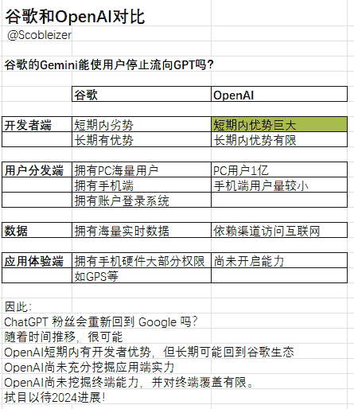

## 质疑：

https://x.com/FinanceYF5/status/1732555536741335276?s=20

如何看待测试标准不同带来的结果？

[来自huggingfac](https://twitter.com/_philschmid)e首席技术专家@_philschmid的分析（如下图）： 永远不要相信营销内容

修复了 MMLU 上 [@GoogleAI](https://twitter.com/GoogleAI) Gemini Ultra 的结果。

但根据报告，CoT@32 上的 Gemini Ultra > GPT-4 是的。

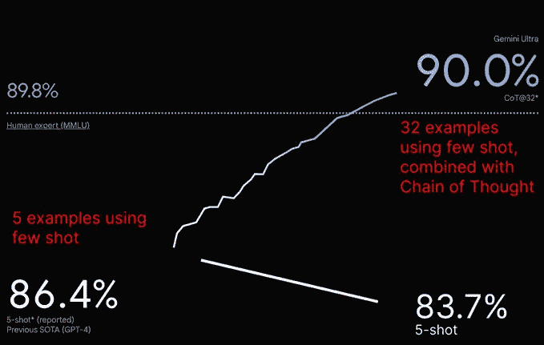

## 训练方面

来源

**Gemini 是在Googl****e的TP****U AI****加速器上训****练的，似乎没****有使用英伟达的GP****U。

Googl****e还推出了全****新的Cloud **TPU[ v](https://t.co/6rTc9DlIGw)5p和AI Hypercomputer超级计算机，将加速Gemini的开发，使AI模型的训练更快。

Cloud TPU v5p：

性能: Cloud TPU v5p是目前Google最强大、可扩展和灵活的AI加速器。它在TPU v4的基础上提供了超过2倍的FLOPS（浮点运算次数/秒）和3倍的高带宽内存（HBM）。

速度: TPU v5p可以比前一代TPU v4更快地训练大型语言模型（LLM），提供了2.8倍的速度提升。对于嵌入密集型模型，其训练速度比TPU v42快1.9倍。

可扩展性: TPU v5p的可扩展性是TPU v4的4倍，意味着它可以在单个pod中提供更多的FLOPS。

AI Hypercomputer：

集成系统: AI Hypercomputer是一个突破性的超级计算机架构，它采用了集成的系统，包括性能优化的硬件、开放软件、领先的机器学习框架，以及灵活的消费模型。

系统级协同设计: 与传统方法相比，AI Hypercomputer采用系统级协同设计来提高AI训练、调优和服务的效率和生产力。

性能优化硬件: AI Hypercomputer具有性能优化的计算、存储和网络硬件，建立在超大规模数据中心基础设施之上，利用高密度占地面积、液体冷却和Jupiter数据中心网络技术。

开放软件: AI Hypercomputer通过开放软件使开发者能够调整、管理和动态编排AI训练和推理工作负载。

灵活消费模型: AI Hypercomputer提供了一系列灵活和动态的消费选择，包括传统的承诺使用折扣（CUD）、按需定价和现货定价，以及为AI工作负载量身定制的消费模型。

详细：https://cloud.google.com/blog/products/ai-machine-learning/introducing-cloud-tpu-v5p-and-ai-hypercomputer

### 质疑2：

参考原文:https://zhuanlan.zhihu.com/p/670929510

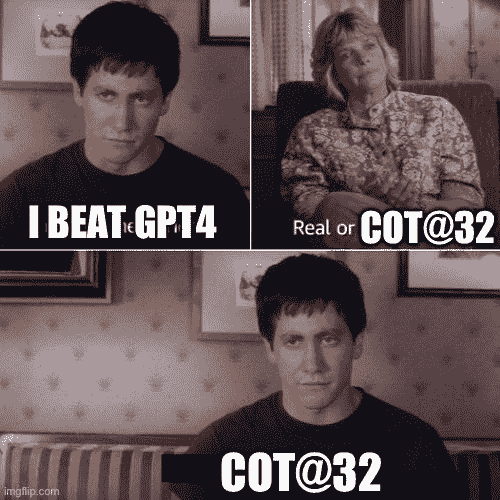

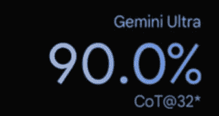

MMLU测试中，

Gemini结果下面灰色小字标称CoT@32，展开来代表使用了思维链提示技巧、尝试了32次选最好结果。

总结：综合看还是GPT4好

---

## 媒体文章

#### 虎嗅：GPT-4地位难保，谷歌Gemini新王登基？

https://m.huxiu.com/article/2393353.html?type=text&f=app_ios_friends

#### 第一财经：谷歌深夜放大招！最强大模型Gemini能打败GPT4吗？

https://mp.weixin.qq.com/s/CT4VFLH7k7vLv_Wh-VQrWw

#### 甲子光年：优等生归来，谷歌最强大模型Gemini能否打败GPT4？｜甲子光年

https://mp.weixin.qq.com/s/fpojsRq_bHH3S_nCPMVeMA

#### 机器之心：谷歌大杀器终于来了，最大规模Gemini震撼发布：真超GPT4，三大版本，手机直接可用

https://mp.weixin.qq.com/s/q8IEFgNwPxrqTd1V4UGRVw

#### 新智元：谷歌深夜放复仇杀器Gemini，最强原生多模态史诗级碾压GPT-4！语言理解首超人类

https://mp.weixin.qq.com/s/kmM0_6qbhRdBfmA1nD79QQ

#### 量子位：突发！谷歌发布史上最强大模型Gemini，打爆GPT-4

https://mp.weixin.qq.com/s/N2UPe-O9rK4mIRUwkRlM1Q

#### 腾讯科技：赶超GPT-4！谷歌发布最新大模型Gemini，主打三大“杀手锏”

https://mp.weixin.qq.com/s/p9w_ymfLvprErv-i-pz3lw

#### The New York Times：Google 正在追逐 ChatGPT

https://www.nytimes.com/2023/12/06/technology/google-ai-bard-chatbot-gemini.html

#### 阿法兔研究笔记：刚刚！谷歌推出可在多类设备上高效运行的大模型 Gemini（全文）

https://mp.weixin.qq.com/s/OTrxz2DAijGTn57t9OBaow

#### 谷歌黑板报：我们规模最大、能力最强的 AI 模型

https://mp.weixin.qq.com/s/GcZ-ILXO1CH5OZS4LH0kig

#### 投资实习所：a16z 或领投 Mistral 估值 20 亿美金，MIT 新 AI 公司种子轮超 3 亿美金估值

https://mp.weixin.qq.com/s/XIcRsq-kAGXgdLa6Yijnfg

#### 差评：试用完谷歌的Gemini，我只想说GPT-4有点菜。

https://mp.weixin.qq.com/s/b23VEdI9ujAFui7qZ-LTlQ

#### 谷歌Gemini：被神话的多模态和被低估的隐忍

李光华DavidLee David的AI全景图

谷歌的 Gemini 大模型在发布后引起了广泛关注。Gemini 以其多模态能力和强大的性能成为行业焦点，但同时也暴露出对文本的低估。Gemini 的发布奠定了 AI 领域的双子星格局，同时显示出谷歌的隐忍和实力。与此同时，我们也应该警惕 AI 的风险和可能带来的影响。

https://mp.weixin.qq.com/s/S7WLxFIH3gD-M3Um9Ywsxw

## 视频翻译集合

### **G**emini系列视频1/15：实时视频理解：https://www.xiaohongshu.com/explore/65718bb2000000003a009d5a

### **G**emini系列视频2/15：大规模文献查找与理解：https://www.xiaohongshu.com/explore/65718df1000000003801fd66

### **G**emini系列视频3/15：多步推理与UI生成：https://www.xiaohongshu.com/explore/657197f600000000340349e4

### **G**emini系列视频4/15：编程与 AlphaCode 2：https://www.xiaohongshu.com/explore/65718fe50000000039033111

### **G**emini系列视频5/15：原生多模态可理解音调：https://www.xiaohongshu.com/explore/657191dd0000000039033552

### **G**emini系列视频6/15：手写中学题目批改解答：https://www.xiaohongshu.com/explore/6571c8fd0000000034036523

### **G**emini系列视频7/15：90秒概览Gemini各特点：https://www.xiaohongshu.com/explore/65719601000000003803165b

### **G**emini系列视频8/15：助你做出爆款视频：https://www.xiaohongshu.com/explore/65719d6a0000000039031efc

### **G**emini系列视频9/15：多模态下中文输入输出：https://www.xiaohongshu.com/explore/6571b037000000003a009e88

### **G**emini系列视频10/15：解释两幅图间的联系：https://www.xiaohongshu.com/explore/6571be74000000003c013b1d

### **G**emini系列视频11/15：根据多张图片猜电影：https://www.xiaohongshu.com/explore/6571bfb900000000380323d2

### **G**emini系列视频12/15：理解服装使用场景：https://www.xiaohongshu.com/explore/6571c26e0000000038022ccb

### **G**emini系列视频13/15：理解新emoji表情：https://www.xiaohongshu.com/explore/6571c360000000003802feca

### **G**emini系列视频14/15：图片生成代码展示：https://www.xiaohongshu.com/explore/6571c683000000001502d5bd

### **G**emini系列视频15/15：高管的理念与愿景：https://www.xiaohongshu.com/explore/6571c863000000001502e504