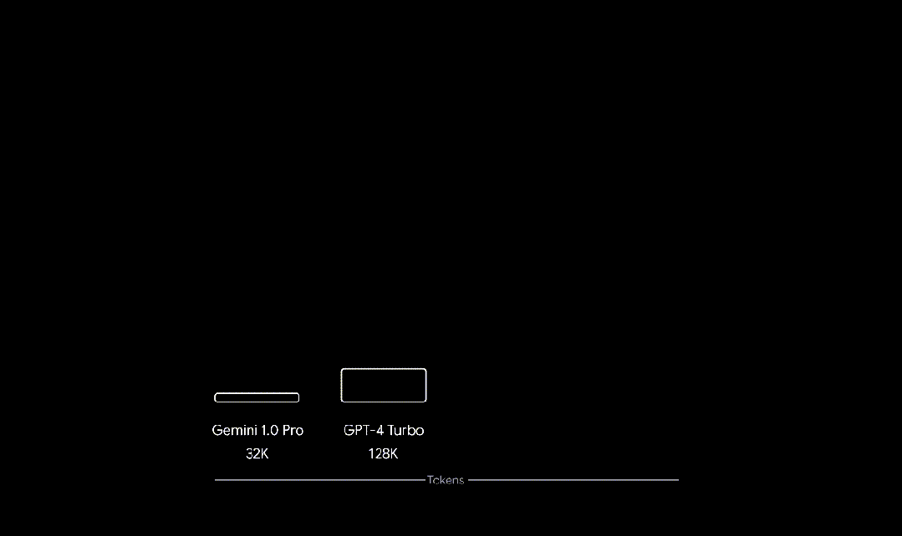
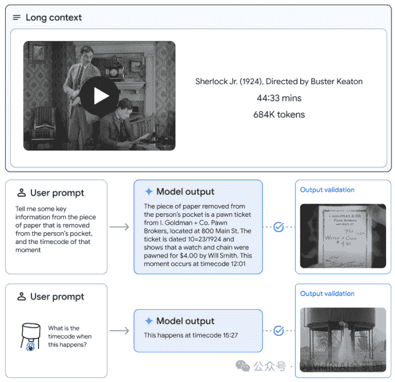
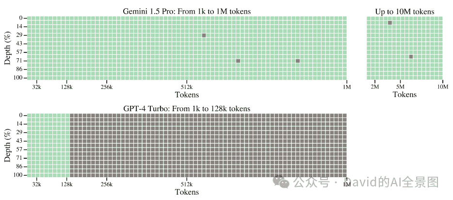
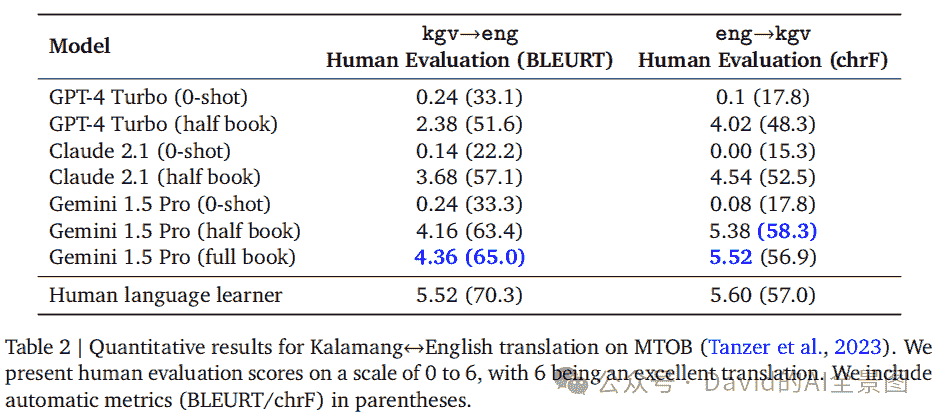

# Gemini1.5笔记 | 100万token上下文意味着什么

> 来源：[https://waytoagi.feishu.cn/docx/WnGMdrHFPomRcpxYPlGcVukBnac](https://waytoagi.feishu.cn/docx/WnGMdrHFPomRcpxYPlGcVukBnac)

> 原创 李光华DavidLee David的AI全景图 2024-02-25 18:58 北京

> 原文地址：https://mp.weixin.qq.com/s/JO3LrZTN0haIr6cNOAXhxA

Gemini1.5在2月15日的更新非常重磅，不然也不会触发OpenAI 武器库中的Sora发布。继续践行Learn in public精神，分享一下当时看Gemini blog和技术报告的笔记。

### 1、Gemini1.5相比于Gemini1.0的主要更新：

1.5 Pro的质量与1.0 Ultra相当，而计算量却更少。

支持100万token，可以以一次性处理大量信息：比如1小时的视频，11小时的音频，超过30,000行代码或超过700,000个单词的代码库。

### **2、技术报告中有意思的案例：**

1）当给定一部44分钟的无声巴斯特·基顿电影时，该模型可以准确分析各种情节点和事件，甚至推断电影中容易被忽略的小细节。

2）“大海捞针”(NIAH)评测，和GPT4-turbo的对比：

3）快速学会新语种：Gemini学习纯粹根据上下文从英语翻译成卡拉曼语，在推理时遵循完整的语言手册。卡拉曼语是一种在新几内亚西部只有不到 200 人使用的语言。Gemini 在训练期间从未见过这种语言，只提供了 500 页的语言文档、一本字典和大约 400 个上下文中的平行句子。Gemini获得了英语翻译卡拉曼语接近人工翻译的能力（满分是6分）。

4）在X上看到，有人用Gemini读Sora视频，Gemini的分析挺有意思：

> 这段视频拍摄的是日本一条下雪的街道，樱花盛开。有一些不一致的地方表明视频可能是AI生成的。首先，雪下得很大，但樱花还在盛开，樱花通常开在春天，那时天气温暖，没有雪；其次，雪以一种很均匀的方式落下，这与现实生活中的雪通常不同；第三，尽管下着雪，视频中的人没有穿任何冬天的衣服。总的来说，这段视频在视觉上很吸引人，但前后矛盾之处表明这不是真实场景。

### 3、上下文长度（context length)为什么重要？

算法视角：更宽的上下文窗口允许模型在推理时纳入训练数据中未找到的大量新的、特定于任务的信息，从而提高各种自然语言或多模式任务的性能……对越来越长的上下文进行数据建模的能力follow了这个发展历程：从 Shannon 1948提出的 2-gram 语言模型、到 1990 年代和 2000 年代的现代 n-gram 模型（ 5 个上下文token），2010 年代的循环神经网络（RNN）达到数百个token (Jozefowicz等），到2023年Anthropic将上下文扩展到几十万token。

产品视角：长上下文意味着LLM理解能力增强。从提示词到RAG，都是为了增加给模型的上下文，进而让需求更明确，让模型理解得更好。从用数据训练模型、到指令微调，到提示词和RAG，到大模型的超长下文，机器越来越像人了。提示词和RAG正在快速被弱化，但出于工程和商业考量，目前在很多领域还是主流，未来依然可能是一个混合状态。

模型上下文长度覆盖了书籍、电影、长视频等产品的通用长度，应该会引发相关链路上产品交互层的变化，这一点值得观察。

One more thing：在公众号发送“1.5"，获取Gemini1.5技术报告的中英文版。

-END-