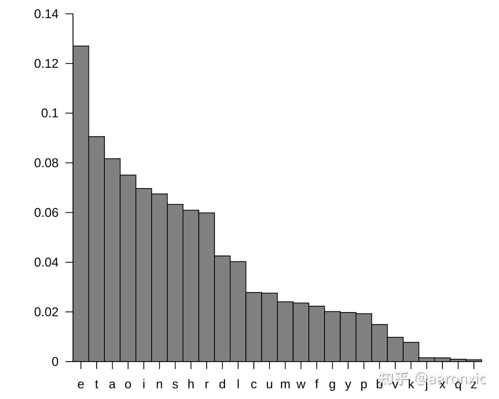
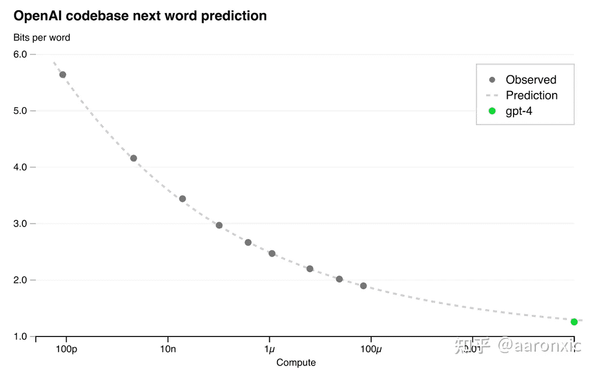
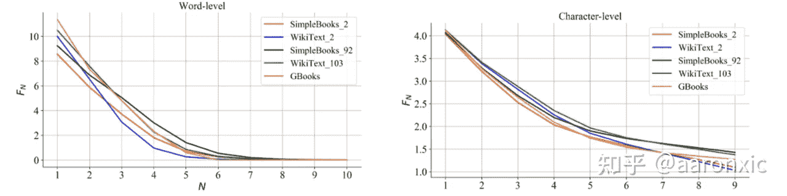
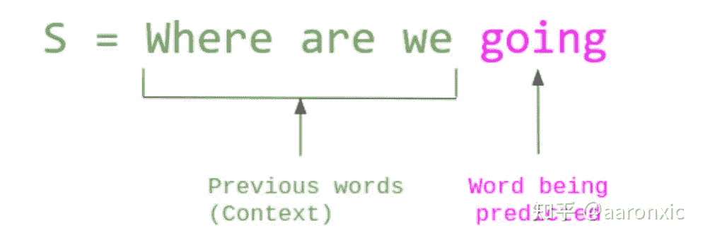

# （1）Perplexity指标究竟是什么?

> 来源：[https://waytoagi.feishu.cn/docx/A6dAdIHqPo5tTFx6o8QcBvwUn4d](https://waytoagi.feishu.cn/docx/A6dAdIHqPo5tTFx6o8QcBvwUn4d)

> 作者：小A，aaronxic，[知乎个人主页](https://www.zhihu.com/people/aaronxic)

> 发表时间：2023年7月8日

> 原文地址：https://zhuanlan.zhihu.com/p/633757727

## 开篇

大家好，我是aaronxic，大家可以叫我小A。最近由于项目需要开始关注transformer相关的进展，结果眼花缭乱的工作让大脑计算存储都严重溢出。围绕transformer相关的进展日新月异，难怪陆奇都说都有点赶不上大模型时代的狂飙速度。

网上不乏大量优秀文章介绍transformer的方方面面，观点非常有insight，分析也极尽的详实。但是从新手角度看仍然希望有这样的transformer上手资料

+   内容覆盖相对较全。能把transformer相关的算法、训练和部署方法一齐串讲，让新手快速建立该领域的know-how

+   详略得当，兼顾bottom-up和top-down。对容易被大部分文章忽略的细节bottom-up详细理清逻辑链，对大量看似独立但又相互关联的知识进行top-down梳理。

笔者小A从自己实际入坑的经验出发，尝试总结梳理出新手友好的transformer入坑指南。一方面能倒逼自己理清知识脉络，另一方面希望能让后面的新同学少走弯路，更快拿到自己想要的知识。

本系列计划从以下五个方面对transformer进行介绍

+   算法1: NLP中的transformer网络结构

+   算法2: CV中的transformer网络结构

+   算法3: 多模态下的transformer网络结构

+   训练: transformer的分布式训练

+   部署: transformer的tvm量化与推理

由于笔者小A并没有亲手撸过上述内容的所有细节，大部分是通过研究代码和精读优秀文章的方式总结而来，本质上是个拾人牙慧的知识搬运工，所以终究是纸上谈兵。因此希望各方有实际经验的大佬猛锤，思维碰撞才生火花，真理越辩越明。

每个方面可能由若干篇文章组成，如果对某些部分感兴趣可以关注小A，后续会逐步更新相应章节。接下来是本系列的第一篇，侧重介绍NLP中最常用的perplexity指标究竟是什么含义

本文会先从大家熟悉的entropy指标开始，逐步介绍针对自然语言的改进版N-gram Entropy指标，最后介绍基于此改进的perplexity指标。

## Entropy (无先验)

在自然语言 里面，一句话可以看成若干字符组成的有序字符串，假设每个字符 出现的概率是$p(x)$，其中 是由26个英文小写字母组成的字符集，即 。我们按照熟悉的熵的定义，可以计算自然语言 的熵：

有时候也简写为 ，含义是在分布$p(x)$下计算 的期望

如果我们没有任何观察样本和先验，那么26个字母是均匀分布的，那么可以计算自然语言L的熵为

这个含义是编码 中每个字符需要的比特数是4.7比特

## N-gram Entropy (有先验)

但是显然，在真正的自然语言中，有大量先验可以使用

+   先验1: 不同字母出现的概率差别很大，例如e出现的概率12.70%，z出现的概率是0.07%，那么对e编码可以用更少的比特数，对z编码可以用较长的比特数。如下统计了英文中小写字母常见的频率，如果将其带入  ，可以得到   ，小于

+   先验2: 给出上文，下文每个字符出现的概率会有很大不同。例如虽然单字符e出现概率比h高，但是t后面接着h的概率要比e高

由上可知，自然语言   的熵   是跟概率   紧密相关的值，并且原始的熵没法把先验2[纳入考虑范围，对此香农在1951年论文<P](https://link.zhihu.com/?target=https%3A//www.princeton.edu/~wbialek/rome/refs/shannon_51.pdf)rediction and Entropy of Printed English>中专门针对自然语言提出了N-gram Entropy。

给定自然语言 的足够长的字符序列 ，考察所有长度为N的子字符串 ，定义N-gram Entorpy  如下。

个人解读如下

+   香农提出 背后的insight是为了引入上下文，所以考察连续 个字符的熵，并且把常规 改成了带条件概率的 。这样就把先验2纳入指标设计了。

+   对 可以求和是因为可以沿着字符序列S不断滑窗可以得到很多组 数据

如果定义 ，则

容易看出 就是连续N个字符的熵 ，即前文的

当 逐渐增大的时候， 越来越逼近自然语言 真正的熵 ，即

并且 的值有单调递减的特性(完整证明可以参考[博文](https://thegradient.pub/understanding-evaluation-metrics-for-language-models/#fnref4))

当N比较小的时候，可以通过语料简单统计得到

+    ，即前文的 。注意原始 表达式中 时是无意义的， 的含义是香农特殊定义的

+    ，即前文的 。这个相当于独立字符做统计

+    。这个是考虑两两字符出现的情况。

当N比较大的时候，出现了单词之间的空格，此时往往会加入空格字符，共27个符号。由于这个确切的值比较难估计，往往是给出区间。例如

+   估计1: 香农给出的是0.6-1.3bit

+   估计2: Cover和King则认为1.25bit

+   估计3: 一般经典认知是1.25bit左右 (错了可以纠正我)

值得注意的是，上述都是character-level的N-gram entropy，对应的还有word-level和subword-level，在对比数值的时候要留意。例如GPT4汇报的是word-level的指标，叫BPW，这个指标先按下不表，大家心里有个印象，后面回来再介绍。

不同尺度模型的BPW指标

一个常见的问题是character-level和word-level可以相互转化吗？按笔者小A的理解，这个问题没有trival的转换公式，只能说两者变化趋势基本一致

此外从变化趋势还能看出一个很有趣的insight，就是随着N的增大，曲线下降更快的数据集更容易拟合，像WikiText-2就相对容易，但是SimpleBooks-92就比较难。

## Cross-Entropy与Perplexity

前面无先验的Entropy和有先验的N-gram Entropy都是描述自然语言  本身的固有性质熵，目的是衡量这种自然语言   的信息量和复杂度。那么对于一个给定的Language Model模型，例如N-gram模型或者Transformer模型

+   问题1: 我们怎么衡量这个LM的熵呢？

+   问题2: 这个LM的熵跟模型的最终表现有直接关系吗？

回答这两个问题之前，我们得先弄清楚LM数学上一般是怎么建模的，最常见的方式如下。

本质上就是看到previous words，预测next word。这里最核心的条件概率  既可以用N-gram语言模型(例如KenLM)，也可以用Transformer模型(例如GPT4)来建模。

给定上述模型后，一种朴素的思想是，我们基于N-gram Entropy的定义，尝试把  换成  ，这里的 正是LM模型的核心输出。

这里我们其实已经无意中写出了cross-entropy的定义，展开就是

注意这里  的关键一步

+   对于   ，这里简化计算，假设身为oracle的自然语言 看到了  ，就会以置信度1输出  ，于是

+   对于   ，这里同样简化计算，假设滑窗后一共产生  个  ，即 ，那么每个特定的 的概率就是

以及最后一步

+   由于滑窗后共有m个  ，把每个  展开，积分个数变成m个

+   首先  写开是  。注意无论是N-gram还是GPT4模型，都有窗口大小的限制，当前文内容 不足N或者超过N的时候，都会补齐或者截断到N大小。因此最后一行的每个积分项 都可以通过补齐或者截断的方式变成   (这里可能会比较绕，可以反复品味)

如果我们进一步把  和   放到对数 log2 里面，可以得到

因此可以得到 (严格来说是约等于)

这个其实很好记忆，就是

+   假如一个LM模型的熵是4.7比特，那么就相当于每次生成下个词的时候扔一个 24.7=25.99 面的骰子。这个25.99就是Perplexity

+   反过来如果一个LM模型的Perplexity是31.1，那么相当于每次生成下个词的时候扔一个31.1面的骰子，这个LM模型的熵是 比特

每次扔骰子的面越少，说明这个LM预测越确定性地倾向于某个token，对自然语言做了某些压缩，学到了non-trival的东西

注意这里的底可以从2换成e，只要保持跟熵的定义一致即可

此外关[于前文](https://link.zhihu.com/?target=https%3A//stats.stackexchange.com/questions/211858/how-to-compute-bits-per-character-bpc)的[Bit](https://zhuanlan.zhihu.com/p/424162193)s per Word(BPW)或者Bits per Character(BPC)，我理解其实跟   是一回事儿，只是BPW是word-level，BPC是character level。(看到很多文章说的是有额外对序列长度求平均，例如资料1和资料2，小A不是特别理解，还请理解的小伙伴赐教。)

## Perplexity越低越好？

上一节回答了问题1中如何计算LM的熵，那我们追求更低的Perplexity就一定有好处吗？

+   在XLNet论文里面说越低的perlexity可能会损害下游任务的精度

+   RoBERTa论文里面说对于像RoBERTa这样encoder-only结果的网络，perplexity越低那么在NLU任务表现就越好

因此可见perlexity是不错的引领性指标，但最终的判别标准还是得结合下游任务表现一起考察

## 结尾

总的来说Perplexity/Cross-Entropy/Bits Per Character都是类似的东西，他们都是围绕熵来刻画LM的信息量和复杂度。

最后强烈推荐阅读[Evaluation Metrics f](https://link.zhihu.com/?target=https%3A//thegradient.pub/understanding-evaluation-metrics-for-language-models/)or Language Modeling，配合本文食用效果更佳。此外由于笔者小A刚上手transformer相关内容，难免有错的地方，还请大佬们指正。

如果后续想了解transformer在NLP/CV/多模态的算法知识，分布[式训练的知识](https://www.zhihu.com/people/aaronxic)，以及如何在TVM上做PTQ量化和部署，可以关注aaronxic哦~知乎个人主页

