# （2）初探LLM基座模型

> 来源：[https://waytoagi.feishu.cn/docx/ObtGduOwHoaB7pxbYaccaVvqnad](https://waytoagi.feishu.cn/docx/ObtGduOwHoaB7pxbYaccaVvqnad)

> 作者：小A，aaronxic，[知乎个人主页](https://www.zhihu.com/people/aaronxic)

> 发表时间：2023年7月8日

> 原文地址：https://zhuanlan.zhihu.com/p/640784855


## 开篇

大家好，我是小A。今天给大家带来本系列的第二篇内容，主要介绍LLM基座模型里常见的3种transformer架构，encoder-only，encoder-decoder和decoder-only

## NLP任务速览

在深入介绍LLM网络结构之前，我们先简单了解一下NLP (Natural Language Processing)都包含了哪些任务。主要包含3大类任务

+   自然语言理解任务(NLU, Natural Language Understanding)。特点是能看到完整上下文信息，然后做广义分类任务，典型任务如文本情感分析，词性标注，信息检索等。

+   有条件自然语言生成任务(conditioned-NLG, Natural Language Generation)。特点是seq2seq，典型任务例如机器翻译，自动摘要等。

+   无条件自然语言生成任务(unconditioned-NLG)。特点是开放性的句子生成，典型任务如问答系统(QA)、对话机器人(ChatBot)等。

一开始针对不同任务会使用不同的模型，后来发现NLG任务能通过in-context learning + prompt来完成NLU任务，于是逐渐收敛到了NLG任务。

## 评价指标

从上一篇可以知道，entropy-like指标(如cross-entropy指标)常常运用在训练过程中，表征模型的收敛情况，同时也可以用于测试集的简单评估(如Perplexity指标等)。但对于丰富复杂的下游应用来说，这几个指标远远不能满足需求。

如果想从第一性原理出发推导出所有指标，这并不现实。下面参考HELM论文的中内容，简单列举了NLP中的指标，大家不必深究，有个简单印象即可。

+   正确性Accuracy。

+   信息检索任务。NDCG@K指标，核心衡量最相关文档是否排序足够靠前的指标。

+   摘要任务。一般用ROUGE指标，ROUGE是个指标体系，有4个大类，其中最简单的为2-gram的方式，即ROUGE-2。就是把两个sequence按2-gram的方式做切分做频次统计，然后计算pred和gt之间的召回率

+   文本生成任务。Bits-per-Byte，类似于Perplexity指标

+   不确定性Calibration and Uncertainty。

+   针对二分类任务，一般用ECE指标(Expected Calibration Error)。核心是度量模型输出概率p的时候，最终正确率真的为p的一致性。

+   鲁棒性Robustness。分为两种

+   invariance。加入不改变语义的噪声，如果大小写变换，加入错别字typo等

+   equivariance。利用contrast set，做语义改变，例如修改关键单词和短语把一个正面的评论改成负面的评论

+   公平性Fairness。看模型输出是否公平，例如把性别和人种等换一下，看输出是否有变化

+   偏见程度Bias and stereotypes。看模型有没有偏见和刻板的印象，例如看模型对亚洲人是否存在“学习好并且会谈钢琴”的偏见

+   有毒性Toxicity。看模型输出是否有毒。

## LLM演变树

对NLP有了基本认知后，下面祭出一个广为流传的图，这张图信息量比较大，其中最重要的观察就是分成了三支明显分叉，从左到右分别是

+   粉色分支，Encoder-only框架(也叫Auto-Encoder)，典型代表如BERT等

+   绿色分支，Encoder-decoder框架，典型代表如T5和GLM等

+   蓝色分支，Decoder-only框架(也叫Auto-Regressive)，典型代表如GPT系列/LLaMa/PaLM等

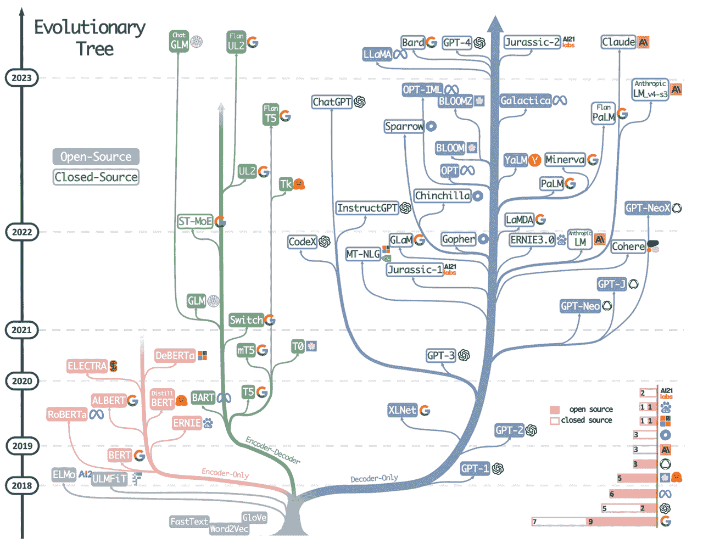

Harnessing the Power of LLMs in Practice

刚听这三种框架名称可能会有点懵逼，不用担心，先感性认识一下。如下所示

+   横轴代表了输入token，纵轴代表相对应每个位置的输出token

+   左图为encoder-only，输出token都能看到所有输入token。例如 这一行可以看到 输入

+   中图为decoder-only，输出token只能看到历史的输入token。例如 这一行只能看到 输入， 和 并不能看到

+   右图为encoder-decoder，前k个输出token可以看到所有k个输入token，从k+1的输出token开始只能看到历史的输入token。例如 能看到 输入( 也可以)，而 开始只能看到 输入

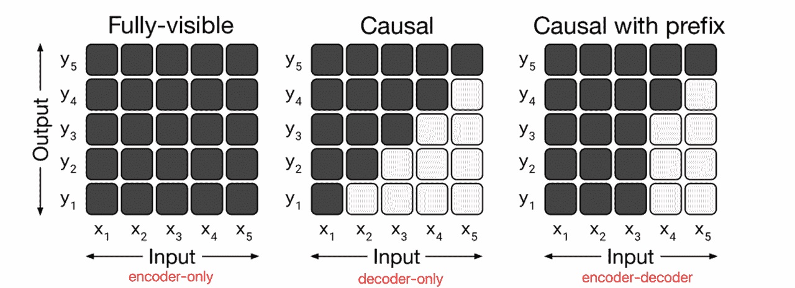

PS: 这里为了方便理解，encoder-decoder简化使用causal with prefix示意，具体详见encoder-decoder章节

这三种结构不同的LLM，往往擅长处理不同的任务，信息总结如下

## Encoder-only (BERT)

虽然GPT1出现的时间比BERT早，但BERT的影响力貌似更大一下，所以我们以BERT为引子介绍transformer的基本结构

### gemm-like算子

宏观上看BERT的结构非常简单，Base和Large模型分别由基础的transformer block重复12次和24次组成

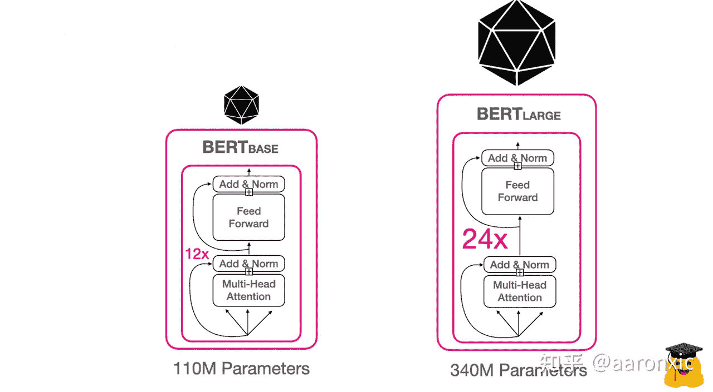

BERT-base和BERT-large

transformer block详细结构网上资料很多，这里尝试从数据流角度进行介绍。如下所示，主要由三种结构组成

+   MHA(Multi-Head Attention)，多头注意力模块，下图绿色部分。

+   Add&Norm，归一化模块，下图蓝色部分。

+   FFN，前馈网络模块，下图粉色部分

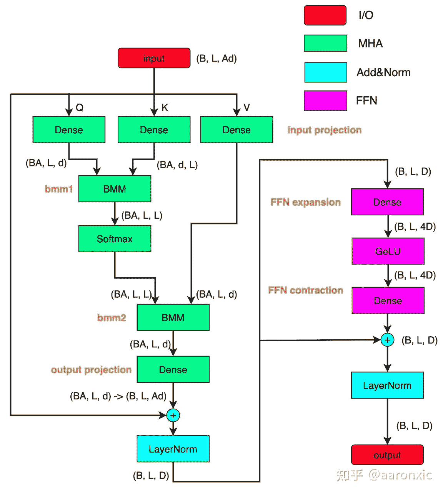

BERT transformer block

下面把gemm-like的算子的参数进行了汇总，其中B为batch_size，L是seq长度，A是head数量，d是每个head的feature维度，同时注意

根据上表不难算出单个transformer block的参数量和计算量的公式

+   参数量： (注意只有dense算子才有参数)

+   计算量：  (假设B=1)

可以发现参数量和计算量跟head数量无关，head划分更多是通过特征子空间划分提高精度，而不是为了节省参数量或者计算量

当我们把具体L和D代入表达式，可以得到BERT-base和BERT-large的参数量 (单词本每个单词特征长度为D)

### LayerNorm

Post-Norm和Pre-Norm

BERT当时使用的是Post-Norm的结构，同时期的GP1也是用该结构，后来的GPT2使用Pre-Norm。

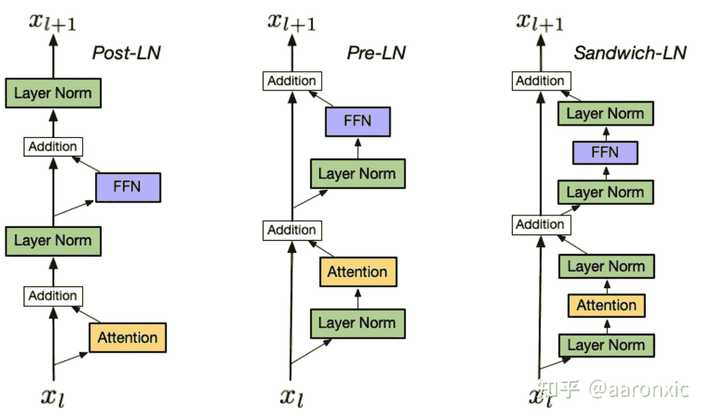

Post-LN vs. Pre-LN vs. Sandwich-LN

Pre-Norm比Post-Norm参数更好调，但是最终模型精度要比Post-Norm略差。对于这一现象的解释，可以从下面问题开始思考

问题：对于 结构，应该在哪儿插入normalization？

+   方法1(Post-Norm)：朴素方法，在做完残差的时候norm，即

+   方法2(Pre-Norm)：懒癌思维，在用到的时候再norm，即

递推式展开前，先熟悉一下Norm的计算公式，假设x和y是相互独立的均值为0，方差为1的随机变量

将方法1的递推公式按上式化简，得到

递归展开最终可以得到

可以看出底层远古的feature被衰减得很厉害，例如缩小了 倍，这样导致残差这个通道名存实亡，网络比较难训练，因此解释了Post-Norm参数难调。

同理将方法2的递推公式展开，可以得到

可以看出

+   输出的方差会很大，因此需要在输出加个额外的LayerNorm (GPT2的设计)

+   Pre-Norm把网络的实际深度变浅了，并且增加了宽度

+   Pre-Norm的网络层数是有水分的，这个可能是导致模型最终精度不如Post-Norm的原因。

两种Norm的特点总结如下

+   Post-Norm会削弱残差的作用，深度保持，但是收敛和调参困难

+   Pre-Norm会将网络变成浅且宽的结构，收敛容易，但是精度会有一定损失

Sandwich-Norm

除了上述两种Norm的位置，还有一种Sandwich-Norm，就是基于Pre-Norm再加一个

Deep-Norm

后来基于Post-Norm做了改进，出现了Deep-Norm，能训练1000层的Transformer。这里的 和 超参的选取，作者给了经验表格直接使用即可

```
def deepnorm(x):return LayerNorm(x * alpha + f(x))def deepnorm_init(w):if w is [&#x27;ffn&#x27;, &#x27;v_proj&#x27;, &#x27;out_proj&#x27;]:nn.init.xavier_normal_(w, gain=β)elif w is [&#x27;q_proj&#x27;, &#x27;k_proj&#x27;]:nn.init.xavier_normal_(w, gain=1)
```

除此之外，LayerNorm有个容易使人困惑的就是具体计算过程

+   在CV里面，对于输入为 (B, C, H, W)的feature，LayerNorm是沿着CHW做reduce，最后输出(B, 1, 1, 1)的mean和std

+   在CV里面，对于输入为 (B, C, H, W)的feature，InstanceNorm是沿着HW做reduce，最后输出(B, C, 1, 1)的mean和std

+   在NLP里面，对于输入为(N, L, D)的feature，LayerNorm是沿着D做reduce，最后输出(N, L, 1)的mean和std。并且最后的gamma和beta是(1, 1, D)维度的。

由上可见，NLP语境下的LayerNorm，其实是CV里面的InstanceNorm

据此我们已经了解

+   3种norm的摆放位置，Post-Norm、Pre-Norm和Sandwich-Norm

+   2种norm方法，LayerNorm和DeepNorm

### GeLU激活函数

GeLU (Gaussian Error Linear Unit)大家应该比较熟悉了，中文名为高斯误差线性单元，出发点是受到了RELU和dropout的启发

+   RELU是激活小的时候乘以0

+   dropout是随机乘以0

+   GeLU就是概率性的乘以0 (但是跟dropout不同，用确定性的表达式给出)

假设 是服从标准高斯分布的随机变量，则

其中

这里 的意思就是把高斯概率密度函数积分到 ，如果x越小，这个积分值就越小

+   当 的时候

+   当 的时候

函数形状如下左图所示，一般部署用tanh做逼近，如下右图所示

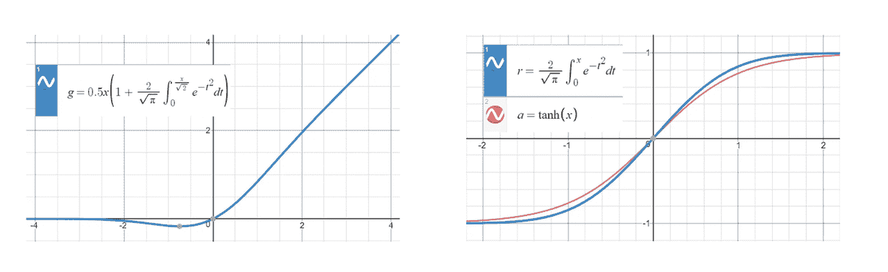

### Attention Softmax

MHA的核心公式是两个BMM夹着Softmax (简称三明治结构)，如下所示

这里有个比较有趣的操作是除以 ，也就是除以feature dim的平方根，其实这一步的重要性容易被低估，原因推导如下。

容易知道 的每个元素是由 次乘累加得到的，假设Q和K本身每个元素已经是0均值和1方差的，那么attention矩阵每个元素的均值为0，方差为

由高斯分布的性质知道大部分能量在 之内，也就是 之间，如果 ，则可以得到高斯分布的范围是  ，这个在softmax作用下大小天差地别，贫富差距过大，例如 和 ，这不利于模型收敛。

于是为了让 的输出方差在合理的区间内，需要除以

此外这个bmm-softmax-bmm三明治结构对于transformer的加速至关重要，相关工作也比较多，例如FastTransform和FlashAttention等，在后面TVM量化和部署章节会作更多的介绍

### Tokenization

分词，是NLP任务一切美好故事的开始，就像CV里面光子经过ISP成像变成像素值一样。但确定分词的颗粒度却不是一件容易的事情，早期有word-base和character-base两种，但是

+   word-base，单词种类太多，单词本会太大

+   character-base，序列太长，单词本字母没有语义

于是出现了trade-off的方法，就是sub-word base，拆分成sub-word的原则是

+   把不频繁出现的单次拆成更加频繁出现的部分

+   不要把频繁的单词拆开成若干部分

Byte-Pair Encoding (BPE)是当前SOTA的LM模型常用的分词方法

+   从字母开始，统计频率，生成最初的单词表，并且把单词的结尾用分割开

+   统计两两字母，把出现频率最高的组成pair然后添加到词表中，同时更新原来单个字母的频率

+   依次类推，直到词表数量达到预设值

+   详细推导过程参见[这里](https://link.zhihu.com/?target=https%3A//towardsdatascience.com/byte-pair-encoding-subword-based-tokenization-algorithm-77828a70bee0)

BERT使用的是Wordpiece，属于BPE的改进版，都是sub-word分词器，一般认为1 token≈0.75 word

此外BERT使用了长度为30k的单词本，每个token是长度为D的可学习向量

### Position Encoding

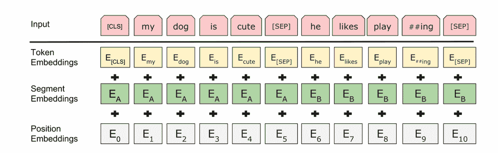

由于transformer的attention本身对token的位置是无感的，但是LM中的token是有序的，因此需要把位置信息植入transformer结构，这个就是位置编码的作用。早期位置编码用的是绝对编码方案，就是对每个token位置赋予一个静态唯一的向量描述，例如三角式位置编码和可学习位置编码

原始transformer(attention is all you need)里面用的是三角式位置编码

+   这有点傅里叶频谱变换的味道，希望用若干组cosine和sine函数来代表不同的特征维度(类比频率)

+   例如BERT-base里面dim=768，就用384组三角函数来表征

+   每一组三角函数的频率，固定从 的等比数列 (注意左开右闭)，因此公比

+   第k组的频率 ，其中

+   第k组的角频率

+   最终可以得到第t个token在feature dim的第k组的三角式位置编码为

[想对](https://link.zhihu.com/?target=https%3A//kexue.fm/archives/8231)三角式绝对编码有更深刻的理解可以参考博文

BERT使用的是可学习的位置编码，预设的位置个数是512，因此最大序列长度为512

### BERT训练

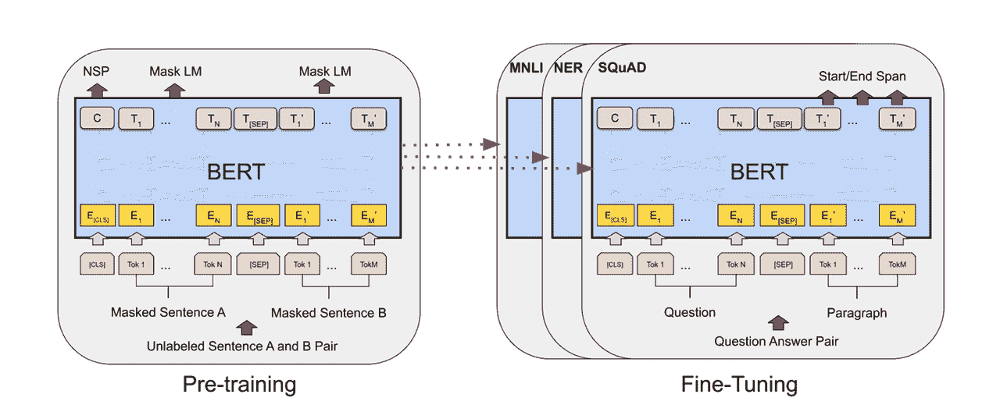

BERT Pre-training & Fine-Tuning

BERT在无监督预训练的时候用了两种任务

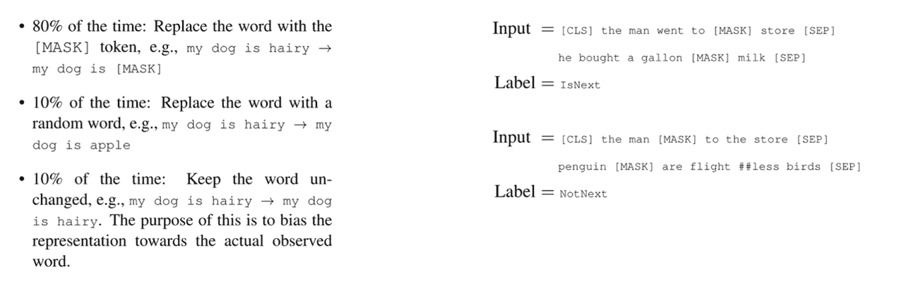

BERT Pre-training Tasks

+   Masked LM任务，遮住部分词，让网络看到上下文预测这个词。

+   Next Sentence Prediction任务，判断两个句子是否为紧挨着的两句话。

在Finetune阶段复用预训练的网络权重

+   分类的话可以用[CLS]的向量接softmax层做监督

+   更复杂的任务可以用对应单词输出的向量接softmax做监督

### BERT短板

BERT训练简单，但个人认为有以下两个短板

+   短板1：对连续的Mask Token处理的不好

+   短板2：没法直接用于做变长的文字生成的任务

后面我们会看到后面encoder-decoder架构如何基于这两个问题做改进的

## Encoder-Decoder

从BERT的介绍我们已经知道了encoder-only就是所有输出token都能看到过去和未来的所有输入token，这个对于NLU任务天然友好，但是对于seq2seq任务，如机器翻译，这个结构就不是特别匹配，因为比较难直接用做翻译结果的生成

一种直接的办法就是加上decoder做预测生成，这就形成了encoder-decoder架构，如下所示

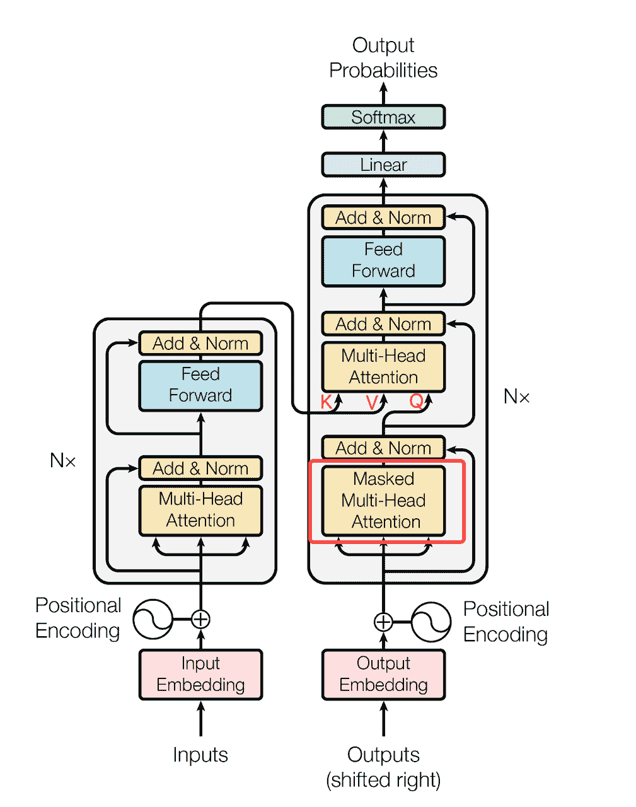

Classic Transformer Block

+   decoder第一个MHA变成masked-MHA，使用的是前文casual的attention mask的方式，这样每个当前输出token只能看到过去生成的token

+   decoder新增第二个MHA，并且K和V来自于encoder的输出，这样就实现了看到原始输入的全文

至此我们可以梳理一下encoder-decoder的两种方式

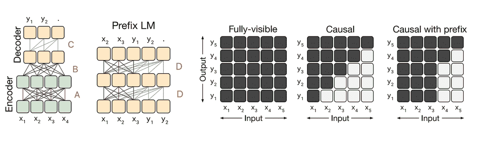

+   两者分离，标准的原始结构。其中A和B用的是fully-visible的attention mask，C是casusal的attention mask

+   两者融合，前半部分是fully-visible的，后半部分是casual的。其中D就是casual with prefix的attention mask。

### T5

T5(Text-to-Text Transfer Transformer) 是第一种encoder-decoder典型工作代表之一，出品方是google，核心贡献有两个

+   把4种NLP任务都定义成了text-to-text问题，即输入text，输出text，包括了机器翻译，QA，摘要生成和文本分类

+   提出了C4(Colossal Clean Crawled Corpus) 数据集，750G

整体使用如下所示

+   通过前置prompt指令的方式提示模型做相应的输出，其中cola和stsb都是GLUE里面的9个数据集中的一个。GLUE数据集是经典的NLU数据集。

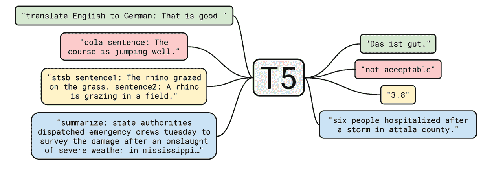

在网络结构上，相比于标准的Transformer，做了几点改进

+   把LayerNorm和FNN的dense的beta去掉了，据说能使网络训练更稳定

+   把LayerNorm从残差结构外面挪到了里面，但是放在了MHA后面，而不是pre-norm一样放在MHA前面

+   用了简单的相对位置编码，最远128个token

训练过程分为预训练和finetune两个阶段，如下所示

+   预训练借鉴了SpanBERT的方式，就是把若干连续的token给mask掉，替换成哨兵token<M>，然后要求decoder对这些哨兵token的位置做预测

+   finetune阶段混合了多个任务，在原始训练样本前面打上任务prefix后直接训练

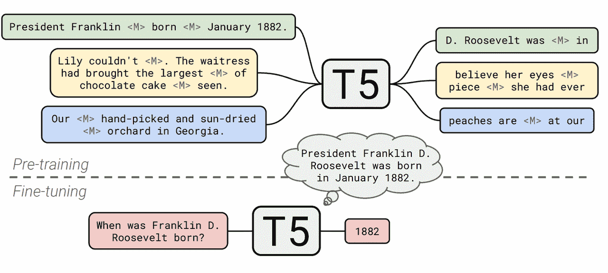

T5 Pre-training & Fine-tuning

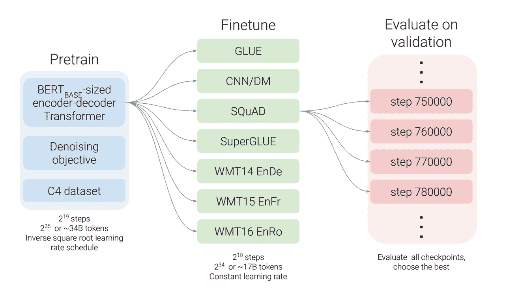

### GLM-130B

GLM(General Language Model)是清华提出的基座模型，属于Prefix LM方式。作者说出发点是

+   希望能同时在3种NLP任务上达到最优

+   也不想引入原始encoder-decoder成倍的计算量代价

换个角度理解，我认为该论文出发点是改进BERT，想解决BERT的两个短板

+   短板1：对连续的Mask Token处理的不好 → 干脆把连续的Mask Tokens合并成一个token   token

+   短板2：没法直接用于做变长的文字生成的任务 → 对 位置进行任意长度的展开

于是得到解体思路为，先用双向网络encoder对题干(prompt)审题，然后通过decoder-only的方式把题干中  位置做展开作答。最终的网络形式很像权值共享版本的encoder-decoder，这样计算量也降下来了。

具体做法如下所示，关键是构造seq A和seq B

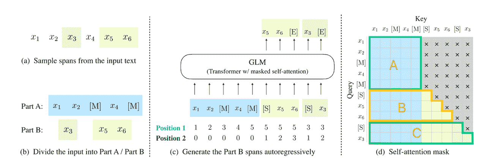

+   从seq A里面采样出若干组连续的token，设置成Mask字符 。如下图所示，原始文本 中的   和   分别用  替换，变成   ，这个就是seq A

+   把seq A中所有  位置的token顺序打乱，并且添加前缀  。例如  和 顺序交换，加上前缀最终得到新的序列 ，这个就是seq B

+   把seq A和seq B连接起来，seq A内部attention是双向的，如上右图(d)的A部分。seq B是单向的，能看到seq A的信息，但是看不到seq B后面的信息，如上图右图(d)的B+C部分。

+   正确的标签来自于原始文本里面的下一个token，注意每组的结尾要求输出 字符，代表当前组终止

+   位置编码采用的是2个层次编码

+   Position 1代表字符在原始文本中的位置下标，注意同一个 组内的字符用 在seq A的下标表示

+   Position 2代表组内的相对偏移，对seq A而言默认是0

+   此外根据Mask token的数量多少可以自由设置单词(MASK)，句子(sMASK)，文档(gMASK)三种MASK方式

下游任务要finetune的时候，如下所示

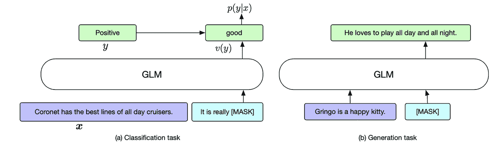

GLM fintune

+   如果是分类任务，那么添加模板句子，例如感情分类用 ，seq B对  位置做分类token预测

+   如果是生成任务，那么直接在seq A最后pad上  即可，seq B对  位置做续写，达到生成文本的目的

GLM-130B是比较晚出现的模型，用了比较新技术

+   使用了Post-Deep-Norm的归一化方法

+   使用了GeGLU的激活函数

GeGLU激活函数

下面介绍一下GeGLU激活函数，由GeLU和GLU两部分组成。其中GLU(Gated Linear Unit)是双线性函数，通用表达式为

其中⊗代表了逐元素乘法。可见第一个是用sigmoid激活，第二个是线性，于是GeGLU就是把第一个sigmoid换成GeLU

### UL2

UL2(Unifying Language Learning Paradigms)是T5的改进型，同样属于encoder-decoder

UL2跟GLM有点相似，继续把masked-span的范式发扬光大和统一建模，抽象出了3个变量对masked-span进行参数化

+   span长度，一种

+    为每个span的平均token个数

+   span个数，二选一

+     为出现masked-span的概率

+     为masked-span的个数

有了参数化后的masked-span，作者又提出了3种mask方式，分为R-Denosier，S-Denosier和X-Denosier，如下所示

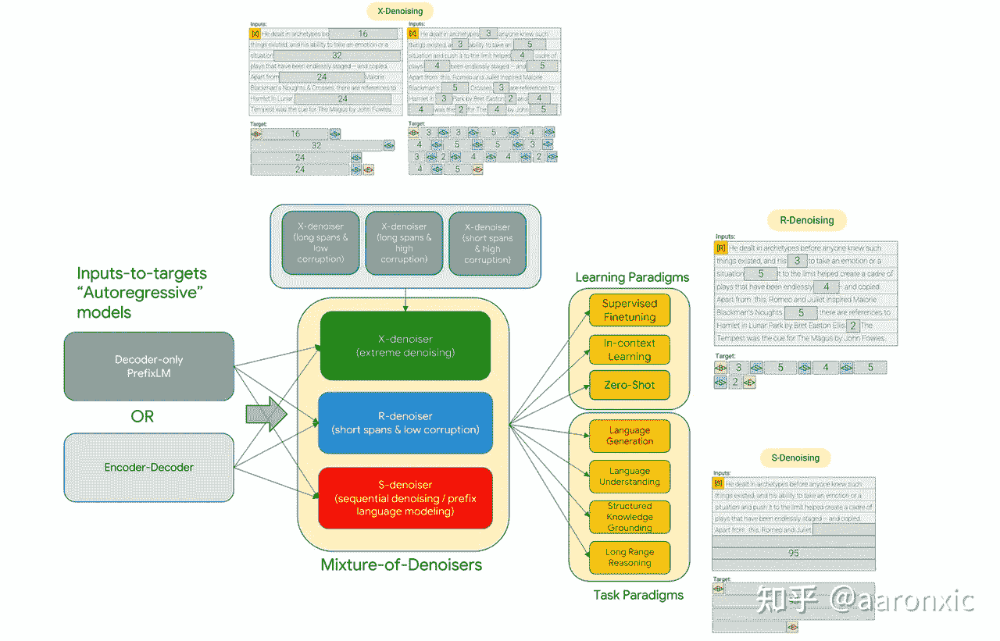

假如输入序列长度为   ，上述3种mask情况参数化表达为

+   R-Denosier。Regular Denoising，模拟T5的方式。span长度  ，span发生概率是

+   S-Denosier。Sequential Denoising，模拟decoder-only的方式。span长度 ，span个数

+   X-Denosier。Extreme Denoising，模拟受限信息下生成长序列，介于R-Denosier和S-Denosier之间。span长度  ，span发生概率

## Decoder-only

最后我们来看一下当今红得发紫紫得发黑的decoder-only家族，明显可以看到也是枝繁叶茂最为粗壮的一支。该家族的大模型种类非常多，本文更多是侧重是LLM基座模型相关的内容，所以指令微调、奖励模型(Reward Model)和RLHF相关的将在下一篇“ChatBot是怎么炼成的?”中展开。

### GPT系列

首先来看看来自OpenAI的扛把子模型GPT系列，这篇[文章](https://link.zhihu.com/?target=https%3A//www.notion.so/GPT-3-5-360081d91ec245f29029d37b54573756%3Fpvs%3D21)很详细的梳理了GPT各个模型的关系，这里把关键路径用蓝色框标记出来。可见这都是GPT3之后的工作，这些调教过程一般称为alignment，目的是让机器按照人的习惯来交流，逐渐从LLM模型基座变成ChatBot。

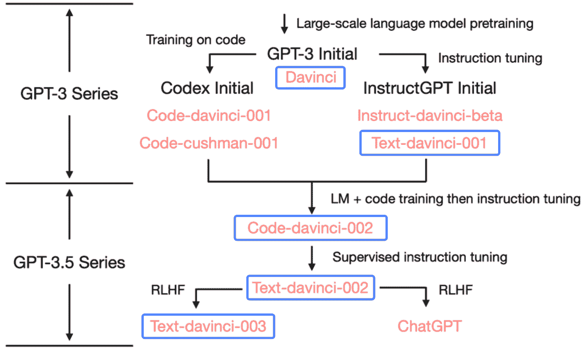

下面[我们](https://link.zhihu.com/?target=https%3A//blog.csdn.net/weixin_36378508/article/details/121809595)看看奠基性工作GPT1/GPT2/GPT3中的transformer结构有啥变化。很遗憾其实变化很少，主要就是从Post-Norm转到Pre-Norm，最后加了一个LayerNorm输出。借用这里的图。

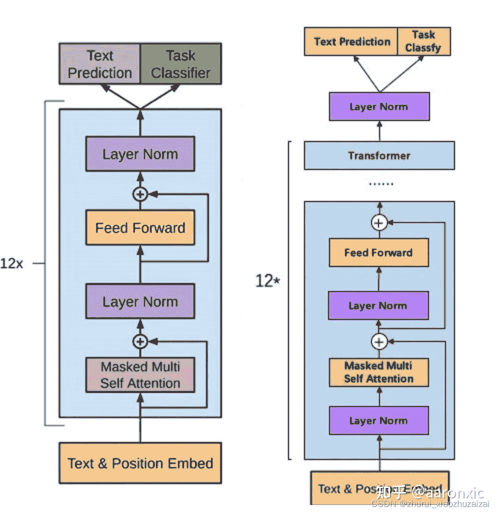

GPT1/2/3更多探究的是如何更好的达到生成的效果。GPT2尝试用zero-shot解决问题，但发现实在太难了，于是GPT3开始转向用few-shot来解决问题

decoder-only有个值得说的特点是推理可以使用KV-cache技术，原因是casual attention mask可以让历史不可改变，只需要把past的attention矩阵存下来，新来token只需要计算新的一行，列直接填充-inf即可。(当然这个也带了灾难性的低计算访存比，增加了部署加速难度)

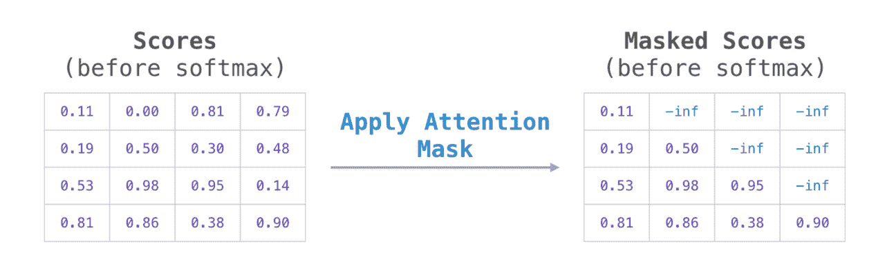

decoder-only attention mask

GPT从3.5开始才真正的大放异彩，详情将在下一篇“ChatBot是怎么炼成的?”中展开。

### LLaMA

Meta可谓是LLM开源一哥，LLaMA是其代表作，一共有4个模型尺寸，出发点如下

+   只使用公开的数据集，保证所有人在数据面前平等

+   用更多的数据训练更小网络，例如用1T的token训练7B的模型和13B模型，用1.4T的token训练33B和65B模型。这一点是参考了Chinchilla的结论。

网络结构也是decoder-only的方式，跟GPT3相比异同如下

+   使用了SentencePiece实现的PBE的编码方式

+   使用了PreNorm，这样收敛稳定一些。同时用RMSNorm，就是LayerNorm里面没有减均值项和beta项

+   使用SwiGLU，即swish激活+GeLU调制。由于SwiGLU引入了额外的参数矩阵，原始FFN需要做相应的砍小

+   用了苏剑林老师提出的RoPE旋转位置编码，核心思想是通过绝对位[置编](https://zhuanlan.zhihu.com/p/359502624)码的方式实现相对位置编码，理论推导见原文

RMSNorm

RMSNorm是本文要介绍的第3种norm，其中RMS(root mean square)是均方根的含义

同时省去了beta，则可以得到

SwiGLU激活函数

SwiGLU和前面介绍的GeGLU非常相似，只是把GeLU激活换成了Swish激活，如下所示

其中 代表了逐元素乘法，且

对比原始的FNN第一个dense乘法

可以看出SwiGLU多了一个逐元素乘法项，因此为了跟原来的计算复杂度持平，FNN的dense需要相应砍小

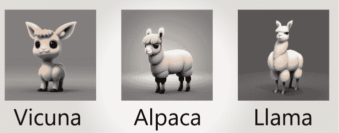

从LLaMA开始，羊驼大军就源源不断，基本都是基于LLaMA做指令微调和RLHF训练，我们将在下一篇“ChatBot是怎么炼成的?”中展开

### OPT

+   OPT是meta更早一点的开源模型尝试，一共有8种尺寸模型，出发点就是为爱发电，尝试探索一条复现GPT3开源之路

+   模型配置跟GPT3基本一致，可学习的绝对位置编码，Pre-LayerNorm，激活函数用的是ReLU

+   但是训练过程也非常艰难，在训练过程中频繁中断，修改lr，优化器等。从下图训练曲线可见一斑

+   模型最终结果似乎也不是太好，出现了不能很好处理陈述性指令，输出toxicity比较严重，容易陷入重复循环等问题

+   更多细节参见[该视频](https://link.zhihu.com/?target=https%3A//www.youtube.com/watch%3Fv%3Dp9IxoSkvZ-M)

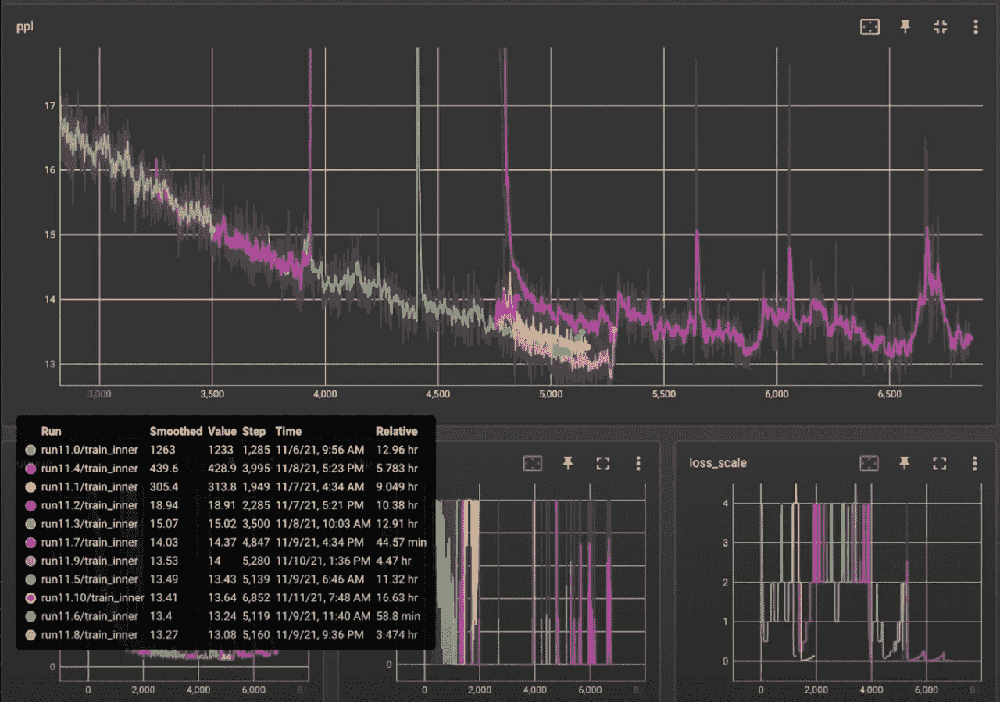

OPT training curve

### PaLM

Jeff Dean出品，必属精品。PaLM又一次体现了google强大的软硬体系能力。总结来说，PaLM基于Pathways训练框架，使用了6144个TPU，在780B的tokens上训练了540B的超大模型，并且达到了50%左右的峰值使用率

模型部分的改进点如下

+   使用SwiGLU激活，这个在前面已经介绍过

+   结构并行化修改，把MHA的串行结构改成了并行。(这都行..)

串行

并行

+   使用了MQA(Muti Query Attention)加速方式。就是把MHA的Key和Value在不同head间共享，维度都变成了 ，Query保留原始的 维度。其中A是head数量。

+   位置编码选用RoPE Embeddings方式，这个在前面也介绍过

+   共享输入和输出的词向量的embedding矩阵

+   在dense和layerNorm中去除了bias学习，可以提高训练稳定性

最后说说TPU和Pathways训练框架

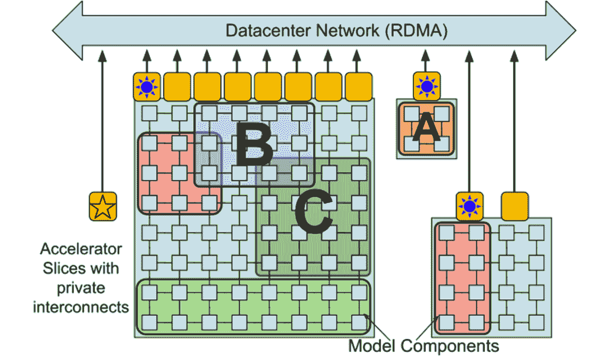

TPU Pod

+   一般把多个高速互联的硬件计算设备看成一个island，例如在GPU里面用NVLink互联的单机8卡；或者TPU里面多达1024卡组成一个island，如上中间方方正正的矩阵硬件阵列，也叫一个Pod

+   GPU编程是SIMT的，多个warp可以在SM上并发切换执行，因此GPU是可抢占的

+   TPU更多的依赖编译器的编译和提前编排，所以只支持串行的kernel，否则需要解决Gang Scheduling问题。就是多个关联程序在多个执行器上同时执行的时候，可能会有死锁问题

+   因此Google认为multi-controller的架构不适合未来ML系统的趋势，中心化single-controller才是王道，这里multi-controller暗指GPU的设计

+   Pathways里面解决了JAX只能在一个pod内调度的问题，扩展到了多个pod，支撑了PaLM大语言模型跨Pod并行

### LaMDA

LaMDA是google在2021开发者大会上公布的专门用于对话的大语言模型，具有137B的参数，除了预训练阶段，其实还包含了微调阶段

LaMDA网络的细节论文里说的不多

+   位置编码跟T5一样是可学习的相对位置编码

+   使用GeGLU的激活函数

### Chinchilla

关乎人类AGI的大事儿，DeepMind怎么能缺席。在Gopher之后，DeepMind提出了一个参数量更少，但精度更高的Chinchilla模型。

DeepMind在文中回答了大家关心的一个核心问题

Q: 在给定计算FLOPs的约束下，如何权衡模型规模大小和训练tokens数量？

A: 模型大小和tokens数量同等重要

最终以自家的Gopher模型为baseline，用了4倍数量约1.4T的tokens，训练一个四分之一大小约70B的模型，精度还比Gopher要好

模型结构沿用了Gopher

+   归一化方法选择了Pre-Layer-Norm

+   位置编码使用相对位置编码，借鉴了Transformer-XL的无需参数学习的sinusoid矩阵，因此是fixed relative PE

### BLOOM

BigScience是个研究型合作组织，参与方有huggingface和法国机构GENCI和IDRIS。旗下出品的BLOOM模型使用了IDRIS下的Jean Zay超级计算机，基于ROOTS数据集，用了384张卡，使用Megatron-DeepSpeed框架，做了DP+PP+TP的3D并行训练。

BLOOM的网络框架如下

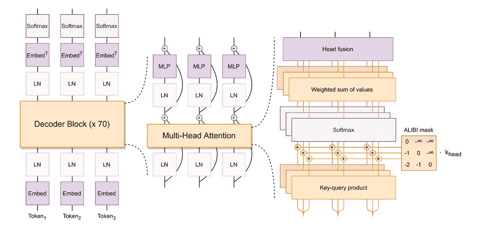

BLOOM architecture

+   word embedding之后加一个Lay[erNorm，有助于收敛。](https://link.zhihu.com/?target=https%3A//github.com/facebookresearch/bitsandbytes)启发来自于bitstandbytes的StableEmbedding做法

+   用了Pre-Layer-Norm归一化方法和GeLU激活

+   位置编码用了ALiBi的方式

下面简单介绍一下ALiBi(Attention with Linear Biases)的相对位置编码机制。

ALiBi的出发点是希望能提升位置编码的外推能力，原因是在实际使用中的输入token长度可能会远远大于训练阶段使用的最大token限制。

方法非常朴素，就是对于attention矩阵的 位置用 表示相对位置，乘以系数m后直接加在attention矩阵上

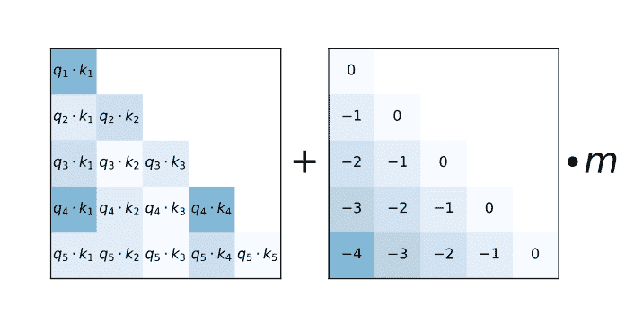

ALiBi

其中m的计算取决于head总数n，第t个head的系数  为

例如

+   head数量为8的时候，为121,122,⋯,128

+   head数量为16的时候，为120.5,121,121.5⋯,128

作者说训练是前紧后松，一开始由于链路没有趟通，大家都很急。前期做了很多基建和准备工作，而当真正趟通之后，却出奇的顺利。

BLOOM的另外一个亮点是系统展示了如何基于Megatron-DeepSpeed框架，做DP+PP+TP的3D并行训练，相关内容将会在本系列后续的“LLM的分布式训练”篇详细介绍。

## 写在最后

最后把前面提到的三大家族的LLM基座模型做了个信息汇总，方便查阅。

由于篇幅所限，很多优秀的LLM[模型并没有提及，](https://link.zhihu.com/?target=https%3A//arxiv.org/abs/2303.18223)更加完整的LLM模型信息收录参阅这篇Survey

总结一下，本文主要介绍了LLM基座模型里常见的3种transformer架构，encoder-only，encoder-decoder和decoder-only。提及的模型组件包括

+   Norm位置3种: Post-Norm，Pre-Norm和Sandwich-Norm

+   Norm方法3种: LayerNorm, DeepNorm和RMSNorm

+   激活函数3种: GeLU, GeGLU和SwiGLU

+   PE方法6种: Fixed Absolute, Learned Absolute, Fixed Relative, Learned Relative, RoPE, ALiBi

预告：计划下一篇为“ChatBot是怎么炼成的?”，将重点介绍指令微调、奖励模型(Reward Model)和RLHF相关技术，敬请期待。

PS：由于笔者小A并没有亲手撸过上述内容的所有细节，大部分是通过研究代码和精读优秀文章的方式bottom-up总结而来，本质上是个拾人牙慧的知识搬运工，所以终究是纸上谈兵。因此希望各方有实际经验的大佬猛锤，思维碰撞才生火花，真理越辩越明。

如果后续想了解transformer在NLP/CV/多模态的算法知识，分布[式训练的知识](https://www.zhihu.com/people/aaronxic)，以及如何在TVM上做PTQ量化和部署，可以关注aaronxic哦~知乎个人主页

