# （3）ChatBot是怎么炼成的?

> 来源：[https://waytoagi.feishu.cn/docx/GCqkdke2doV1uPxA0ivclH5knjc](https://waytoagi.feishu.cn/docx/GCqkdke2doV1uPxA0ivclH5knjc)

> 作者：小A，aaronxic，[知乎个人主页](https://www.zhihu.com/people/aaronxic)

> 发表时间：2023年7月8日

> 原文地址：https://zhuanlan.zhihu.com/p/642282717


## 开篇

大家好，我是小A。上一篇我们介绍了LLM基座模型的3种不同transformer架构，今天给大家带来本系列的第三篇内容，主要介绍LLM基座大模型最火下游应用ChatBot是怎么炼成的？

## 从LLM辅助编程说起

罗马不是一日建成的，对于AGI新秀的ChatGPT而言，也是同样经历了长期的探索和发展，相信大家对下面这张GPT发展路线图还有印象。可以看出在跨时代的 text-davinci-002 出现之前，OpenAI团队其实做了很多辅助编程的探索，我觉得意义主要有两方面

+   增强了LLM模型在逻辑推理方面的能力

+   验证了SFT技术对辅助编程这个LLM下游应用是有效的，为后来RLHF等更复杂技术在ChatBot的出现打下了坚实的基础

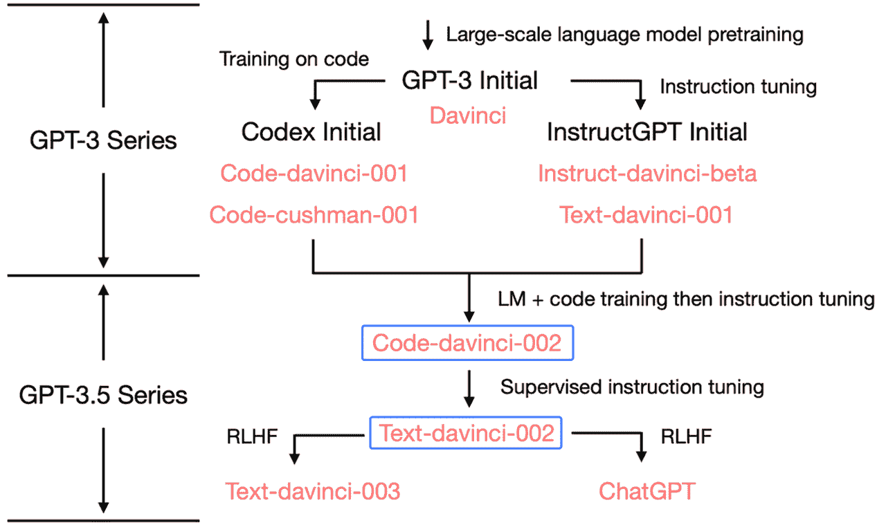

GPT发展路线图

因此在深入介绍需要更多复杂技术才能训work的ChatBot应用前，我们先看看辅助编程应用都需要哪些数据和训练方法。下面会用较长的篇幅详细介绍辅助编程中两个奠基性工作，Codex和AlphaCode。

它们使用了两种不同的transformer架构，分别是decoder-only和encoder-decoder。

## Codex

Codex作为OpenAI的又一力作，出生的时候就有很强的产品化倾向，VSCode里面Copilot插件用的就是Codex的产品化特供版。我认为Codex的主要贡献点如下

提出了HumanEval的编程数据集，并提出 pass@k 指标衡量辅助编程模型的效果

提出了2阶段训练方式，1阶段基于github海量源码做无监督预训练pre-train，2阶段基于带docstring和对应函数代码的额外数据做带监督微调SFT

值得注意的是Codex主要聚焦的是Python语言，这跟后面的AlphaCode有很大不同。

下面就5方面展开介绍Codex

+   辅助编程问题定义

+   pass@k 指标定义

+   采样算法介绍

+   4种优化方法和实验结果

+   Codex局限性

### 辅助编程问题定义

我们首先感受一下我们要解决的编程问题是什么，如下所示，每条数据record包含了

+   函数名称和参数

+   一对三引号括起来的docstring来文字描述函数功能，以及若干Input/Output示例

+   函数逻辑主体本身

```
def incr_list(l: list):&quot;&quot;&quot;
    Return list with elements incremented by 1.
    &gt;&gt;&gt; incr_list([1, 2, 3]) [2, 3, 4]
    &gt;&gt;&gt; incr_list([5, 3, 5, 2, 3, 3, 9, 0, 123]) [6, 4, 6, 3, 4, 4, 10, 1, 124]
    &quot;&quot;&quot;return [(e + 1) for e in l]
```

作者搜集了164道这样的题目，难度中等偏下水平，整体占字符长度也比较短。每道题还有若干[测例te](https://link.zhihu.com/?target=https%3A//huggingface.co/datasets/openai_humaneval/viewer/openai_humaneval/test%3Frow%3D0)st cases来验证函数正确性，通过所有测试即判定为正确，数据集详情可参见这里

我们希望辅助编程应用看到了前两部分，输出最后一部分，完成代码补全功能

### pass@k指标

在刷榜前，最重要的是厘清指标的计算过程。  按字面理解，就是采样   个样本全部都提交，只要有任意1个能通过所有 test cases 检查，就判定这一次采样是正确的。

不难发现这样计算的   ，容易在   比较小的时候会不稳定，因此作者尝试扩大采样量，拆分成2阶段：

1. 阶段一，先 sample 生成足够多的   个样本；

2. 阶段二，从   个样本里面用采样策略（例如随机方式）挑选出其中   个作为最终提交。

使用 test cases 判定这   个样本的正确情况，只要有任意1个是正确的，那么就认为这次提交是正确的。Codex 固定了   ，假设   个样本里面正确通过的有   个，那么   且   。此时可以从概率论的组合数角度计算  ，公式为：

其中：

-   代表选取的   个全部不通过的组合数；

-   就表示选取的   个至少有一个通过的组合数；

-   代表选取   个的所有可能组合数。

直接计算   容易组合数连乘上溢出，于是进行化简处理：

这样，我们就得到了一个更简单、更稳定的   公式。

```
def pass_at_k(n, c, k):&quot;&quot;&quot;
    :param n: total number of samples :param c: number of correct samples
    :param k: k in pass@$k$
    &quot;&quot;&quot;if n - c &lt; k:return 1.0return 1.0 - np.prod(1.0 - k / np.arange(n - c + 1, n + 1))
```

### 采样算法

Codex这里用的是top-p采样，也叫nucleus sampling。这里多啰嗦几句把LLM里面常用的采样策略顺带介绍一下，方便后续对比和理解。

采样算法主要有两大分支，确定性采样和随机采样

+   greedy search

+   确定性采样，贪心策略

+   根据下一个token的输出概率分布，选取概率最高的，依此进行。

+   beam search

+   确定性采样，贪心策略可以看成其特例（ ）

+   步骤1：维护最大为n的优先队列，把初始序列作为元素放入其中，此时队列大小1

+   步骤2：弹出队列里的序列元素，得到下一个token的输出概率分布，选取组成的新序列中概率最大的前n个压入队列，此时队列大小为n

+   步骤3：把所有队列中的序列依次弹出，利用步骤2的过程，注意 。此时序列长度实现了加1，并且更新了一遍队列元素。

+   步骤4: 重复步骤3直到达到预设长度或者所有序列结束

+   navie-random-sample

+   随机采样，最简单直接的随机化策略

+   根据下一个token的输出概率分布，进行按分布采样输出token

+   top-k

+   随机采样，避免采样出过低概率token，采样候选数静态不变

+   根据下一个token的输出概率分布，从大到小排序选出前k个

+   将这k个token重新做概率归一化，按新的分布采样输出token

+   top-p (nucleus sampling)

+   随机采样，避免采样出过低概率token，采样候选数动态变化

+   根据下一个token的输出概率分布，从大到小排序，选择累积概率达到p的前若干个token

+   将这些token重新做概率归一化，按新的分布采样输出token

这里需要注意的是，概率分布来自于softmax，常用调节的超参还有温度系数

+   当 的时候，极致放大贫富差距，让最大值的元素概率趋向1，其他变成0

+   当 的时候，极致缩小贫富差距，把所有输出概率都趋于一样的值

Codex里面选取的都是 的温度系数

### 尝试1: Naive方法

有了指标定义和采样方法了，就可以正式开始刷榜了。我们先考虑最简单的方式，就是直接把GPT3拿过来，看看效果如何。很遗憾，GPT3基本是0%的通过率。

这个也好理解，如下所示，虽然GPT3的训练集由450T的文本组成，训练总共过了约300B的token，但几乎没有专门的代码数据集


GPT3训练集组成

### 尝试2: Code Pre-train方法

自然的改进想法是让LLM至少见过大量的编程代码，尤其是Python代码才行。

于是Codex做了以下几件事

+   搜集GitHub上截止到2020年5月的小于1M的python文件，共179GB。然后做了简单的过滤清洗后剩下159GB。

+   在这159GB上的词分布和原始GPT3差异比较大，尤其对于多个空格情况。于是作者针对不同长度的空格专门添加了token，使得词表token数减少了30%

+   作者还发现是否用GPT3的权值初始化，对最终精度影响不大，但是确实会加快收敛

经过以上的一顿操作，Codex-12B精度一跃到了28.8%

### 尝试3: SFT方法

对于刷榜来说这个显然还是不够，继续分析发现LLM虽然见过Python代码，但是没有大量见过HumanEval那样格式的编程题目

于是Codex额外搜集了跟HumanEval近似的SFT数据集，数据来源有2个

+   编程竞赛网站，例如Codeforces等

+   能通过CI单元测试的函数代码片段

PS：这里带监督的微调(SFT)其实跟Code Pre-train是一样是无监督训练的，不要被Supervised迷惑了

经过以上SFT过程，得到模型Codex-12B-S，发现效果能进一步提升到37.7%

### 尝试4：优化排序策略

前面计算 的时候先固定采样出 个，然后从这200个样本里面随机挑选 个提交，计算概率意义下 指标。如果我们有办法对这200个的采样结果的好坏做排序，那么就可以直接提交1个认为最靠谱的答案即可。此时 回到原始的定义，即采样 个提交1个的正确率。

Codex尝试了若干排序策略

+   oracle策略：用test cases对采样序列样本做排序 (oracle策略是开天眼了，仅作为参照)

+   baseline策略：对采样序列样本随机排序

+     策略：采样序列样本中每个token的 概率求和

+    策略：采样序列样本中每个token的 概率求均值

最后发现 策略最好， 能进一步刷到40%以上

### 实验结果

汇总上述4种优化策略，结果如下，可以看出4种优化策略逐渐把成绩从0%提升到40%以上，作为参照的oracle采样策略是80%左右

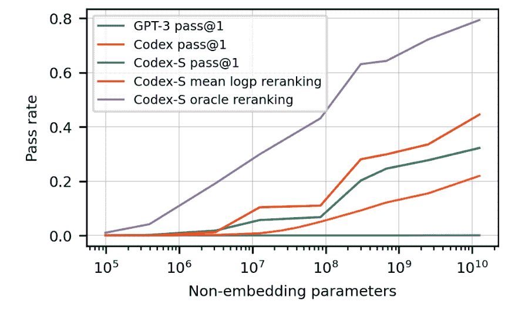

### 局限性

Codex属于早期开创性的工作，难免会有不成熟的地方，现在回头看主要有

+   训练效率不够高，经过150B的数据训练才会做偏简单的题目，通过率也小于50%

+   对输入的docstring的长度敏感，太长的docstring会让模型表现急剧下降

+   对数学类的题目处理不好，简单加减乘除容易算错

## AlphaCode

跟OpenAI产品化倾向不同，DeepMind致力于在各个领域证明AI比人强，这次盯上了辅助编程领域。选择的题目也难了非常多，直接上Codeforces编程网站跟人PK。

个人认为AlphaCode的贡献点有

+   SFT阶段提出了一个13k的更干净的编程数据集CodeContests，每个problem的test cases扩增了很多，减少了FP和slow rate的概率

+   推理采样阶段把候选数量增加到100w，并且用了过滤和聚类方法对结果进行筛选排序，在10个编程比赛的平均成绩击败了54.3%的人类

AlphaCode跟Codex相比有几个明显的不同

+   支持多语言编程，不像Codex只支持Python

+   综合权衡了推理速度&精度的性价比，选择encoder-decoder框架，不像Codex用了Decoder-only架构

+   采样数量多达100w，比Codex的100的大了好几个量级

AlphaCode整体训练方法跟Codex是类似的，也是分Code Pre-train和SFT两阶段。下面从4个方面展开介绍AlphaCode，关注和Codex不同的地方

+    指标

+   Code Pre-train数据准备和训练

+   SFT数据准备和训练

+   大规模采样和排序

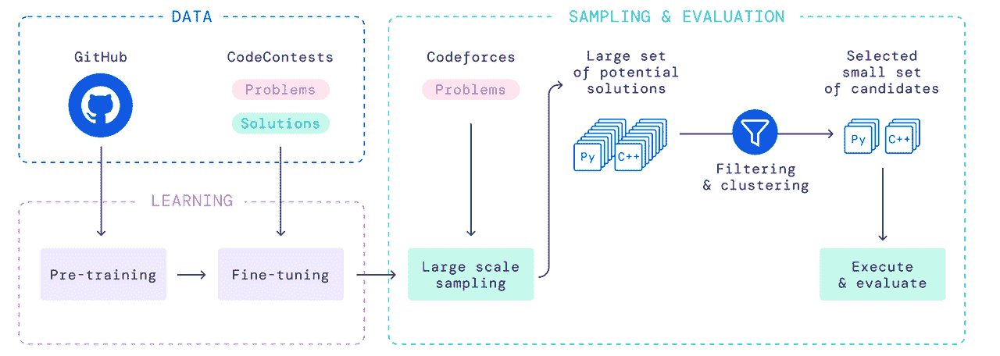

AlphaCode流程图

### n@k指标

回顾Codex使用的 指标，有两种定义

+   1阶段定义，直接选择 个样本提交，任意1个成功通过即算正确

+   2阶段定义，先采样 个样本，从这 里面挑选 个样本提交，至少1个成功通过即算正确

AlphaCode里面使用了2阶段定义，并且更名为  ，注意符号使用 和 跟Codex相反，一般固定使用 指标，从k个样本里面挑选10个提交，任意1个成功通过即算正确。

### Code Pre-train数据准备

AlphaCode搜集截止到2021.07.14的Github数据，比Codex多了一年，除此之外还把python和其他语言都囊括进进来了，一共715GB，是codex的150G数据集的5倍

### Code Pre-train训练

训练过程比较标准，用了AdamW的优化方法，lr在头1000步是先是线性warmup到1e-4，然后cosine-decay降到1e-5

transformer是用了Multi-Query Attention版的encoder-decoder架构

+   encoder-decoder选型。是因为题目很长，加encoder能更好的理解题意

+   Multi-Query Attention(MQA)选型。是能加速且精度损不多，MQA做法就是K的多个head共享1个，V也是同理，只有Query保持原状。这样in_projection的参数量和计算量都能变少。

作者也实验对比了另外两种架构选择的精度和速度

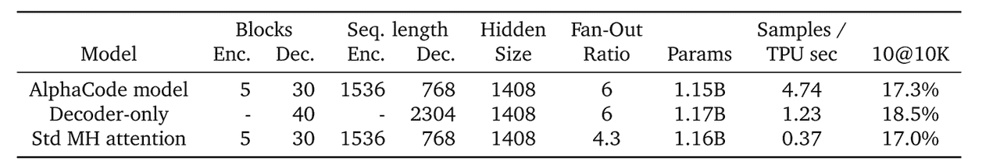

+   decoder-only结构。精度略高，但是输入token要求很长，最后推理效率低 (是否上了KV cache?)

+   标准MHA-encoder-decoder结构。精度差不多，但是推理效率更低

### SFT数据准备

从Codex已经知道，SFT是个从LLM基座模型迁移到下游应用非常重要的阶段，并且这个阶段要有好的数据集，于是AlphaCode造了个CodeContests数据集。

这个数据集的problem来自多个编程网站，包括了Codeforces，Description2Code和CodeNet。

找个problem感受一下

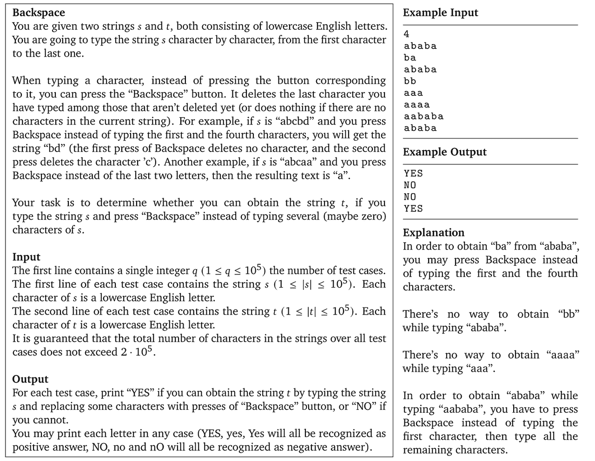

AlphaCode数据样例

这些problem的solution来自用户提交，除了正确的solution，还能拿到错误的solution，由此有(problem, correct_solution)和(problem, wrong_solution)正负例两种数据。

为了防止训练数据泄露到测试数据，作者按照时间对所有数据做切分，如下所示

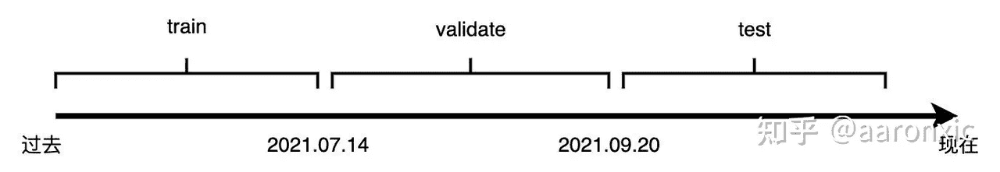

AlphaCode数据划分(时间维)

AlphaCode数据划分

这里CodeContest非常严谨地思考一个问题：每个problem的所有test cases是否覆盖足够？

为了回答这个问题，针对APSS，HumanEval和CodeContests Raw数据集，各选50道题目，用1B的模型生成答案，挑出通过了test cases的答案里面进行人工核查，结果发现了很高的FP概率，或者超时的结果Slow Rate

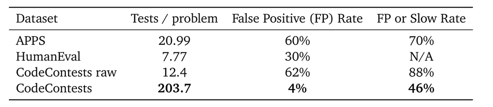

解决方案就是扩增test cases呗，启发式方法如下

+   遇到binary的输入就flip bits

+   遇到integer的输入就随机增加或者减少数值

+   遇到string的输入就随机交换或者改变characters

最终得到的是CodeContest数据集，可见跟Raw相比，FP概率要少很多，但是slow rate概率还是很高

### SFT训练

相比于Codex，做了几点改进

+   Value Conditioning。无监督利用二分类标签，把correct或wrong关键字放在prompt模板前面，后面接(problem, correct_solution)和(problem, wrong_solution)训练样本做无监督训练

+   Value Prediction。有监督利用二分类标签，给定(problem, solution)，让网络做二分类带监督训练

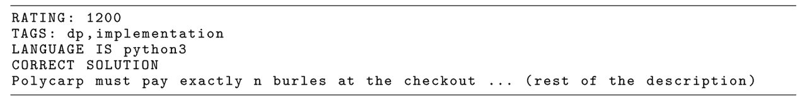

+   GOLD方法。主要解决[一题多解](https://link.zhihu.com/?target=https%3A//arxiv.org/abs/2009.07839)的时候，模型学习目标摇摆的问题。每一对(problem, solutuion)有个系数，如果一个problem的solution足够好了，那么其他同problem的solutions权重就降低一点，这样模型可以focus学好一个。这个是个offline RL 算法，来自这篇论文。

### 推理采样过程

根据  指标的二阶段定义，推理采样过程也是分为先做加法后做减法两个阶段

+   加法阶段。生成百万量级的样本，这个比Codex才100个阔绰多了。并且不需要top-k或者top-p的采样，直接根据概率分布采样即可。生成方法有

+   生成各种语言的，例如c++和java都有

+   随机扰动tags，前面的样本里面有rating，tags等

+   调高温度，采样方差变大

+   减法阶段。不同于Codex用 mean logp排序，AlphaCode使用过滤+聚类的方法做排序

+   过滤。用sample test case做判别过滤，不同的全部扔掉

+   聚类。额外训练一个test case发生器，看到problem就能生成test case，用这些海量test cases喂入剩余的solution里面，根据结果做聚类，最终每个类选择一个solution提交

### 实验结果

把所有技巧依次叠加，最终可以达到34%的解题率，排名54%位置

[PS:](https://link.zhihu.com/?target=https%3A//arxiv.org/abs/2203.07814) 这里有些技巧细节没有涉及，详情可参考原论文

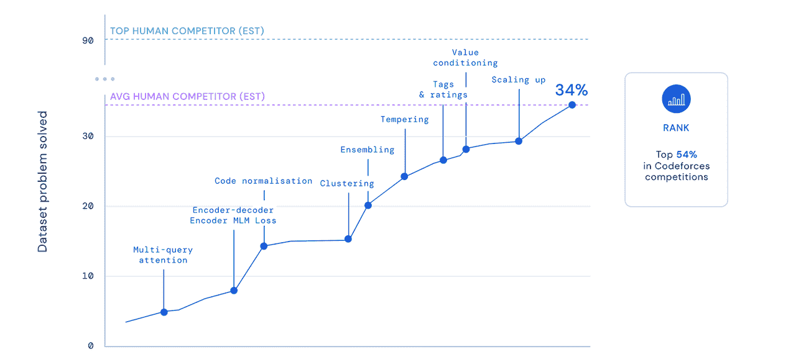

## LLM辅助编程小结

Codex和AlphaCode是两个出发点迥然不同的辅助编程项目，前者是产品导向，后者是科研导向。它们启发了后续很多工作，例如Saleforce的CodeGen2，Meta的InCoder，清华的CodeGeeX等。他们也有很多相似的地方

+   训练两阶段，一阶段使用海量GitHub源码做Pre-train，二阶段使用SFT做目标应用对齐

+   推理两阶段，一阶段做加法进行大量采样，二阶段做减法进行排序，挑选出最靠谱的若干个答案提交

其中训练的两阶段技巧，直接使用在下游的另一个重磅应用ChatBot中，下面我们就看看除了Pre-train和SFT，ChatBot还需要什么额外的技巧才能达到丝滑的体验效果。

## 先行者ChatGPT

2022年11月，ChatGPT横空出世，背后基于GPT3.5。GPT3.5其实已经不是单纯的LLM基座模型了，据说它跟InstrcutGPT是同源技术，因此下面我们就以InstructGPT为参照介绍ChatBot是怎么炼成的。

首先概览式地介绍一下训练ChatBot所需要的几个阶段，有个基本印象

+   阶段0：PT阶段(Pre-train)。这个阶段建立模型的capacity，就是确定模型各方面能力的天花板

+   阶段1：SFT阶段(Supervised Fine-tune)。这个阶段让模型学会conversational format，就是知道了对话应该按什么形式展开。

+   阶段2：RLHF阶段(Reinforcement Learning from Human Feedback)。这个阶段细分为RM(Reward Model)阶段和RL(Reinforcement Learning)阶段，能激发出模型具备多种能力，包括但不限于safty、reasoning和stability

我非常喜欢AK的[这张图](https://link.zhihu.com/?target=https%3A//www.youtube.com/watch%3Fv%3DbZQun8Y4L2A)，简单清晰把重要信息点都罗列了出来

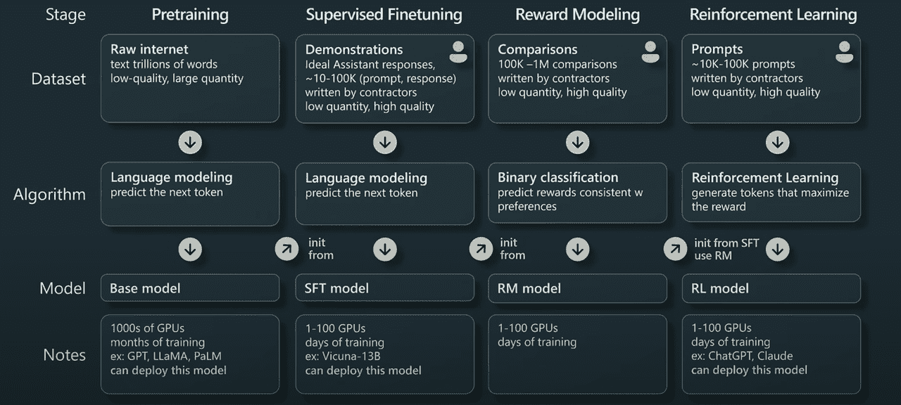

### Pre-Train阶段

预训练跟GPT3的方法近似，回顾一下重要信息，decoder-only的网络架构，模型大小175B，输入窗口大小2048，单词本大小50257，见过300B的tokens，原始训练文本45T，组成如下 (真实ChatGPT只会比这个多)

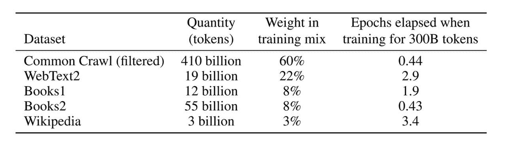

除了最大号的175B的GPT，InstructGPT中还训练1.3B和6B的模型以备不时之需

### SFT阶段

跟Codex和AlphaCode一样，这个阶段对于最终应用的成型非常重要，本质上要给予应用存在的purpose，告诉它：它是谁，它从哪里来，它要到哪里去

+   对于辅助编程应用：Codex看到docstring就要输出函数体，AlphaCode看到problem就要给solution

+   对于ChatBot应用：ChatGPT看到新的输入就要给予反馈和回答，并且要考虑上下文

跟Codex和AlphaCode一样，这个阶段的数据集的质量也是至关重要，InstructGPT也花了较大的篇幅介绍数据搜集的细节，这里也详细说说InstructGPT各个阶段的数据都怎么制备的。

首先标注员没有想象中那么多，靠谱的大约40人，首先需要他们产生靠谱的prompt，也就是用户使用ChatGPT时候的第一句话。这里分为冷启动阶段和产品迭代阶段

+   labeler-based。冷启动的时候，没有模型，没有user-case，只能让标注员无中生有自己想出来

+   plain prompt。让标注员只提问题

+   few-shot prompt。让标注员提问题+给若干示例

+   user-based。有了第一代模型产品后，可以放到playground搜集用户数据。

+   user prompt。分析用户waitlist application中的请求，转化为prompt

下面左图展示了来自用户数据中不同prompt类别的比例，右图展示了prompt具体例子

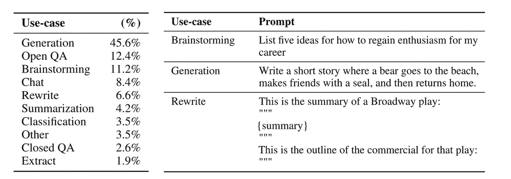

非常良心的是，InstructGPT给了很多详实的prompt示例和参考，基本可以直接copy-paste拿来用。标注平台用了ScaleAI，创始人就是那个19岁辍学的MIT学霸华裔Alexandr Wang

有了prompt之后，就可以继续标注每个阶段需要的label了，prompt+label拼起来就可以训练了。

3个训练阶段的prompt和label情况如下

SFT阶段训练方式跟PT阶段一致，都是以无监督的方式进行，总共训了16个epoch，使用cosine学习率衰减策略，dropout比例为0.2。

训练的成本远小于PT阶段，AK给的是100GPU训不到1周即可

### RM阶段

辅助编程应用有了PT和SFT阶段可能就够了，但是对于ChatBot来说

+   SFT的13k训练数据还是太少了，监督信号不够多

+   SFT后的模型输出方差太大，问题回答的质量飘忽不定

因此需要想办法给予模型更多的监督信号，激发模型潜力的同时让模型表现更稳定

一种自然的想法就是训练另外一个RM模型，负责给SFT模型的回答打分或排序。如下所示

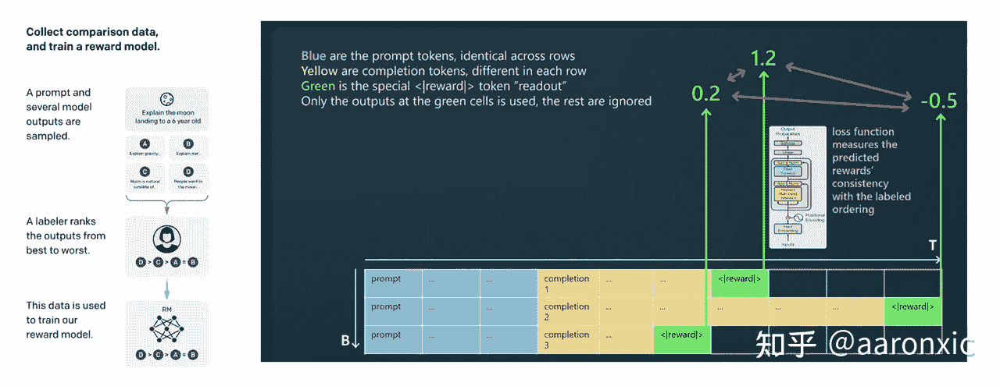

如上左图所示，让SFT模型根据prompt生成 组答案，人对这些答案进行ranking，得到从好到坏的排序结果

如上右图所示，使用SFT初始化另外一个模型RM，把 prompt+completion+<|reward|> 喂入RM，在 <|reward|> 的读出token位置回归一个分数，根据分数给予排序ranking loss，如下所示

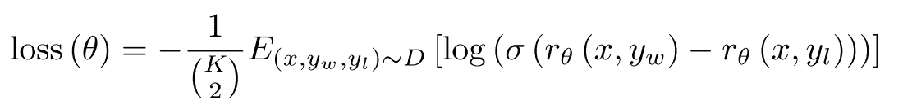

其中

+    是 个答案里面随机选取2个的所有组合数

+    是prompt， 和 是 组completion里面随机选择的2组答案，其中 的人工排序比 靠前

+    是RM模型的回归score

+    代表的就是RM预测 比 结果好的概率

这里每个prompt生成回答数 ，一共 个pair。

其他论文是 =4，即 个pair。这里选择9也是综合考虑成本收益的结果。

+   标注成本是 复杂度。越大标注代价虽然高，边际成本比较低，毕竟标注员已经审题+看了K个答案，再看1个答案速度很快，因此标注成本是 复杂度的。

+   标注收益是 复杂度。由于pair数量是 ，因此标注收益是

训练RM模型一共用了33k个prompt，并且注意，这个阶段得到的RM模型是跟SFT绑定的，因为RM模型是基于SFT的(x,y)分布训练得到的

跟后面要介绍的Claude结论不同，InstructGPT认为RM太大没啥收益，所以用个6B的就够了。

### PPO阶段

得到了SFT和RM模型之后，剩下的就是把他们串联在一起，固定住RM，利用RM的loss对SFT做梯度回传。这个阶段的完整loss如下所示

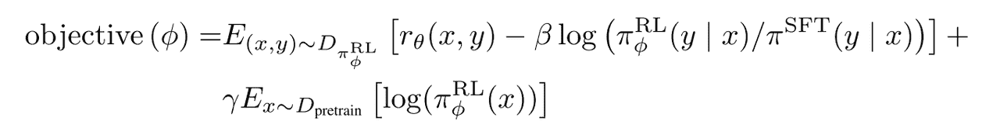

上述 就是SFT网络， 是从SFT网络初始化而来，因此也是个GPT-like网络，能生成回答。

+   第一项就是前文说的串联 和RM做联合梯度回传。具体来说从 采样出prompt和completion样本对，让RM模型 做打分和给loss，通过梯队回传优化 的参数权重

+   第二项是希望新学的 不要距离初始的SFT太远，解决方法是用KL散度约束住两者的输出概率。背后的原因是前文提到过RM网络跟SFT其实是绑定的，如果新学的 输出分布距离SFT太远的话，那么RM网络本身可能就不适用了

+   第三项是防止 过拟合RM打分这个任务，因为作者发现在其他NLP任务上(例如SQuADv2) 有效果回退。因此添加上训练SFT的loss，即从SFT训练的数据里面采样包含prompt和completion的样本，无监督训练

PPO (Proximal Policy Optimization)本来是OpenAI提出的RL优化方法，属于传统艺能，在这里

+   PPO-ptx是上述三项系数都不为0的情况

+   PPO是指第三项系数 为0，前两项系数不为0的情况

此外RM训练和PPO训练可以交替进行，即得到新的 模型后训练一个匹配的SM模型，然后固定SM模型按 的损失函数继续训练 模型，如此交替

### 实验结果

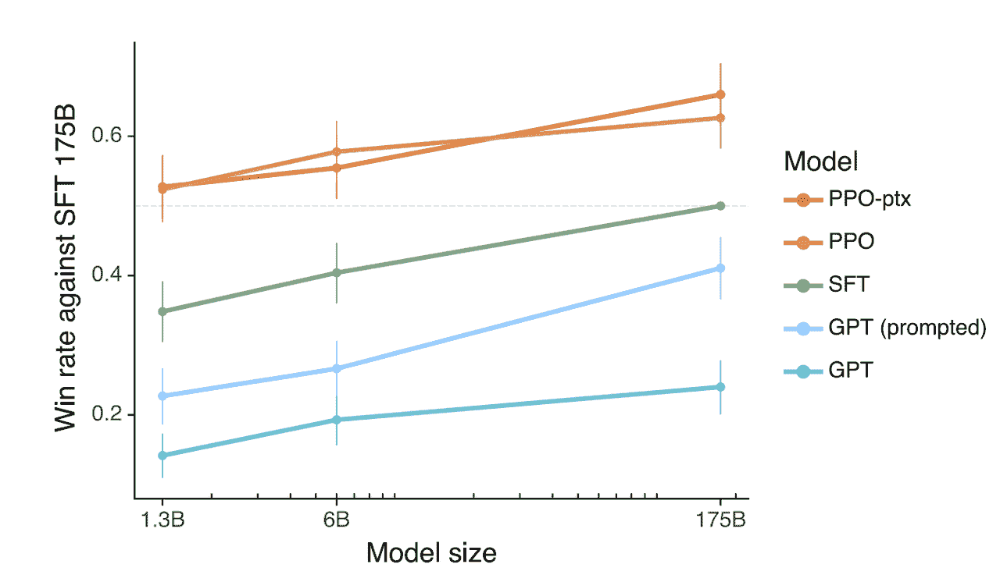

如上所示，InstructGPT探究了一下模型尺寸和不同方法的收益情况

+   灰色虚线是baseline GPT-175B-SFT

+   GPT-1.3B-PPO就已经比GPT-175B-SFT的要好了

但是需要注意这里评测集是跟PPO的训练集同分布的，因此对PPO算法有利

此外从输出token概率分布上看，经过SFT&RLHF训练的模型会有model collapse的倾向，也就是熵会变小，如下所示对比davinci(PT模型)和text-davinci-003(SFT&RLHF模型)

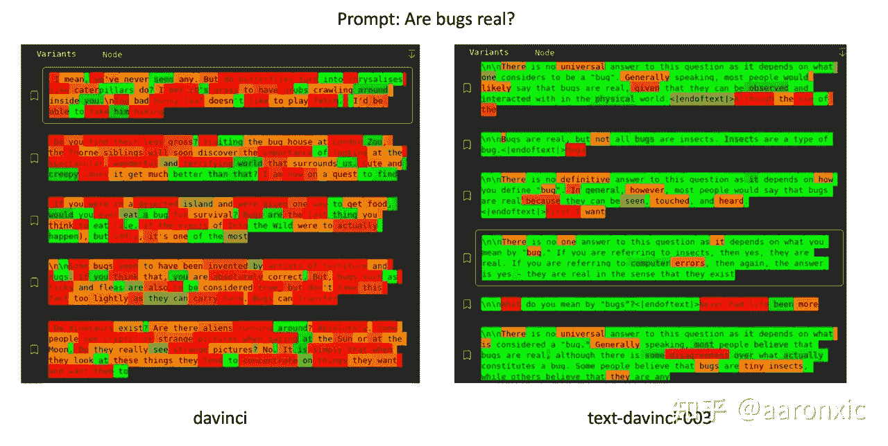

model collapse

+   davinci模型的输出更加多样化，红色越深就是概率越小的词被采样出来

+   text-davinci-003模型输出就更加确定，下一个token概率分布贫富差距更大

### 小结

对InstructGPT各个阶段有了认知之后，我们看看各阶段作用

+   PT阶段。这个阶段建立模型的capacity，就是确定模型各方面能力的天花板

+   SFT阶段。这个阶段让模型学会conversational format，就是知道了对话应该按什么形式展开。

+   RLHF阶段，包括RM和PPO阶段。这个阶段能激发出模型的多种能力，包括但不限于safty、reasoning和stability

## ChatGPT的追赶者们

ChatGPT吹响了追逐AGI的号角，大厂小厂玩家纷纷入局，奋力追赶ChatGPT，八仙过海，各显神通。下面我们就看看其他家的ChatBot都有哪些看家本领。

### Bard

首先来看看目前最能ChatGPT掰掰手腕的Bard，来自老牌劲敌Google。虽然说Bard发展不是特别顺利，口碑起起伏伏，最近随着后端切换到了PaLM2，好像又行了

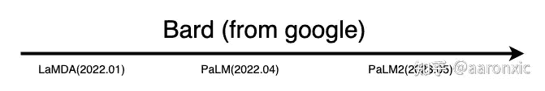

GPT4开始，闭源的风气蔚然成风，PaLM2的技术报告中细节不多，更多的是结果展示。个人认为Bard的主要亮点有3个

+   训练数据和网络大小选择上贯彻了Chinchilla的结论，两者同等重要，并且类似DeepMind从Gopher到Chinchilla演变过程，PaLM2基于PaLM，模型减少的同时训练数据极大扩增

+   使用更加丰富的数据集，包括了语种上使用多语言，文本种类上包含编程语言代码，数学公式等

+   网络结构沿用UL2的encoder-decoder架构

### Claude

Claude是Anthropic的产品，这家公司一听就是AGI公司的范儿，”有关人类的一切“。创始团队正是OpenAI早期的核心人员，他们后来理念跟OpenAI不同而决定自立门户。

Anthropic对于AGI的可解释和安全可靠性非常重视，产品化似乎并不是他们第一追求的目标，技术路线跟OpenAI相似甚至一度领先于OpenAI，但是不幸被ChatGPT抢了first blood。

Anthropic训练技术上也遵循着PT-SFT-RM-PPO的四步走策略，下面重点说说跟ChatGPT不同的地方

核心理念

Anthropic关注的是HH(helpful and harmless)特性，即要有用，但是不能有害，这两个往往是矛盾的。他们发现如果单纯使用helpful的数据训练，排序Elo的分数(一个越高越好的指标)非常高，但是代价是极易遭到攻击，由此说明需要两种数据混合着来训练

数据搜集

Anthropic在亚马逊机器人平台上，雇佣标注员扮演两种角色提问

+   模拟正常用户

+   设置蓝队，问积极正向的问题，撰写或者编辑文档，讨论制定计划等

+   选出更加helpful的回答

+   允许多轮对话，open-ended

+   模拟恶意用户

+   设置红队做模拟攻击，问消极负面的挑衅问题

+   选出回答中没那么harmful的回答

+   一般是单轮对话

需要注意的是

+   作者并没有事先培训标注员什么是helpfullness和harmfulness，这样保证数据多样性

+   标注员要求很高，是美国的硕士以上。并且把低质量的滤掉了，把优秀的MTurk标注员筛选出来，大概20人，标注了80%的数据。筛选的办法就是看写作水平，表达能力，简单暴力有效。

+   同时在Upwork上标注更加高质量但是数量较少的数据集，因为Upwork是paid-by-hour，MTurk是paid-by-task

标注界面如下，用户二选一，并且有不同的置信度选项

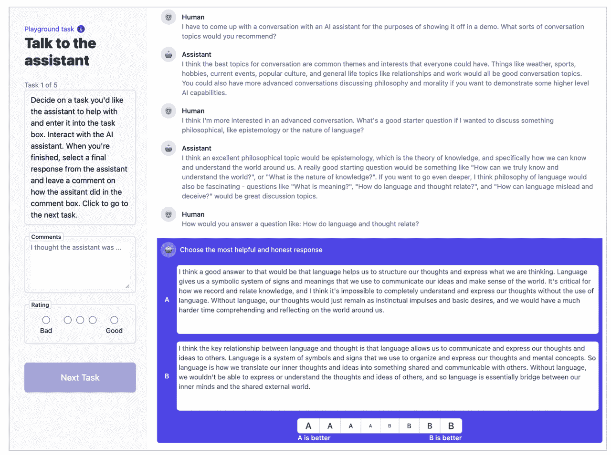

RM和PPO

Anthropic称RM为PM(Preference Model)，并且发现PM模型越大，数据越多，是会涨点的，这个跟ChatGPT的结论不一样。ChatGPT里面说RM模型不能太大，不好训练，容易发散，所以选择6B的RM模型

PPO阶段的损失函数少了InstructGPT的第三项SFT项，因为作者发现Policy模型和PM模型足够大的话，不加那一项效果也会持续提升

### MOSS

MOSS中文名为小苔藓，是上海复旦大学计算机系的类ChatGPT开源模型，也完整经过了SFT和PM阶段，但是PPO阶段使用了另外一种更加简单的方式。

数据搜集

如前文所说，对话数据的质量是调教ChatBot非常重要的因素，这里MOSS充分借助了ChatGPT的能力，协助生成instruction和conversation，如下所示

+   用户提问instruction。人工写好符合HHH(helpfulness, harmlessness, and honesty)原则的种子问题，然后使用self-instrcution让ChatGPT进行扩展，得到更多的符合HHH的instruction

+   多伦对话conversation。写一个prompt模板，输入由下面3部分组成，喂入ChatGPT，搜集输出结果，和输入拼接在一起，形成完整的多轮对话

+   第一部分：介绍背景，描述是一个Human和AI的对话，让ChatGPT模拟这个对话

+   第二部分：约束Human和AI的对话符合HHH原则

+   第三部分：把上面经过self-instrcution生成的大量instruction作为对话初始状态

经过上面的过程，就可以得到若干多伦对话conversation训练数据，将其切分为SFT和PM两部分，分别在对应的阶段使用。

SFT&PM阶段

训练方法跟InstructGPT和Anthropic差不多

PPO阶段

MOSS里首先列举了一下当得到了SFT和RM之后，如何进一步提高ChatBot表现的几种方法

+   方法1：朴素的方法就是用reject sampling的方法，不做进一步训练，直接使用，SFT产生大量的结果，RM排序后直接输出 → 好处是代码容易实现，坏处是采样不够高效

+   方法2：更好的方法是用PPO，上限非常高，但是难度很大，目前只有OpenAI等极少数团队能灵活使用 → 好处是高效，坏处是很难训练，对PM模型要求很高

+   方法3：改造训练数据，加入反馈标签。

+   训练不同种类的RM模型给反馈打分，例如专门判断quality的RM，专门判断harmful的RM

+   用这个打了tag的多伦对话数据正常fine tuned SFT模型，如下图所示

+   在inference的时候，附上 <quality: 100><harmful: False> 的前缀

+   好处就是容易实现，比较高效，可以不断交替进行SFT和RM阶段迭代提高

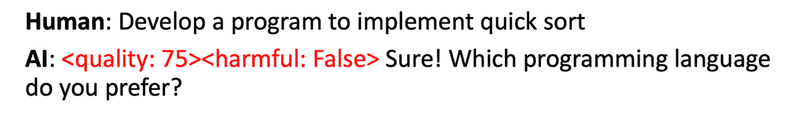

MOSS选用了方法3

### ChatGLM2

ChatGLM2是个清华出品的6B的小型ChatBot，从第一代ChatGLM的encoder-decoder架构回到了decoder-only的架构。ChatGLM2做过SFT和RLHF，并且在部署推理使用了若干省显存和加速技术

+   Flash Attention技术，做bmm-softmax-bmm的算子融合

+   Multi-Query Attention (MQA)技术，使key和value的多个head进行了共享

更多的模型量化和部署加速技术，将在后面的”transformer的量化和tvm部署“进行详细介绍

### LLaMA世家

从上一篇《[初探LLM基座模型](https://link.zhihu.com/?target=https%3A//www.notion.so/MOSS-22b47af68e6343fa9a65b0f936d98ae3%3Fpvs%3D21)》我们知道，LLaMA是LLM开源界的先锋和一哥，但是只给了模型本身，没有给完整的训练代码和训练数据。于是出现了两个方向工作

+   有钱的尝试复现LLaMA基座模型本身。主要以RedPajama为代表，从复刻数据集开始，到最后训练和测试

+   没钱的尝试多快好省finetune下游应用。主要以Alpaca-LoRA为代表，也称为PEFT技术(Parameter-Efficient Fine-Tuning)

#### RedPajama

红睡衣计划是Together联合斯坦福等其他机构一起尝试从预训练数据集，SFT&RLHF数据集，和基座模型3方面全面复刻LLaMA的计划。Logo就是披着红睡衣的LLaMA。

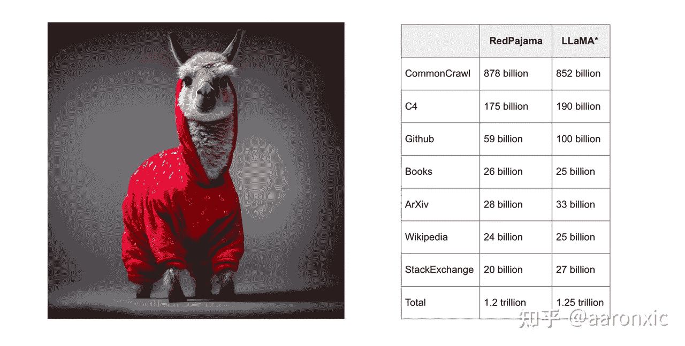

2023年7月份的进展已经到了复刻出了LLaMA预训练数据集，接下来尝试通过OpenChatKit平台搜集广大用户提交的instruction数据，支持后续的SFT&RLHF阶段训练

#### Alpaca

跟RedPajama要复刻LLaMA基座模型不同，斯坦福的另外一个项目Alpaca尝试基于LLaMA做指令微调，得到能遵从用户指令的ChatBot。

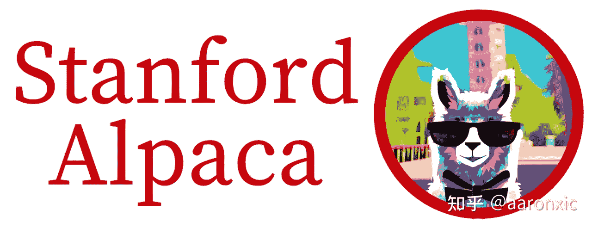

里面用到的核心技术就是Self-instrcut得到SFT数据集，每条数据包括了instruction和instance两部分

整个过程主要分成4步，如下所示

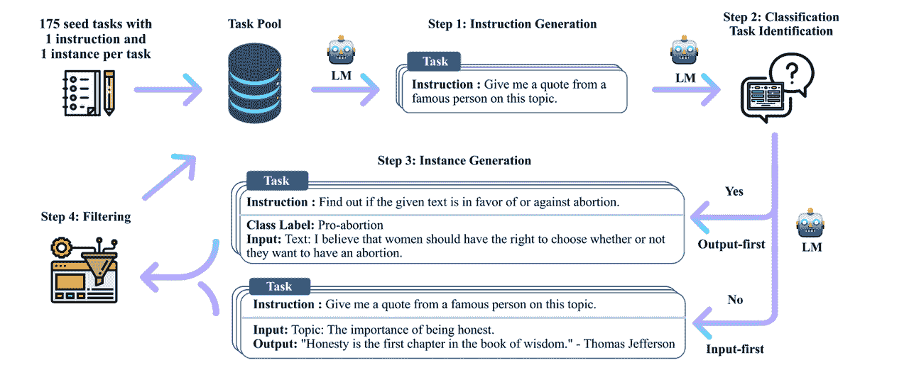

+   Step1：从175的seed instruction里面，调用LM，生成大量新的instrcution

+   Step2：将所有instruction通过LM分成属于分类任务，以及不属于分类任务两大类

+   Step3：调用LM，生成instance

+   对于不是分类任务的，使用input-first模板

+   对于是分类任务的，使用output-first模板

+   Step4：过滤低质量结果

这里Step1到Step3都需要借助LM的completion和in-context learning能力，模板如下

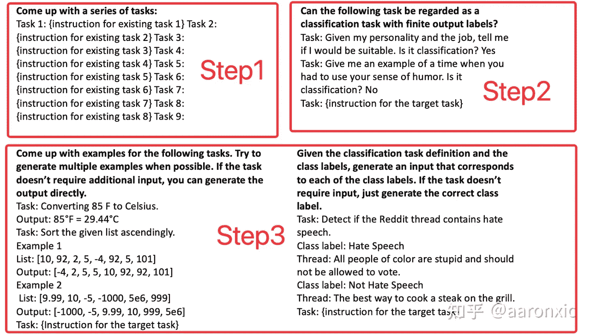

#### Alpaca-LoRA

Alpaca还需要对LLaMA-6B所有权重做完整的SFT，为了进一步降低微调成本，LoRA(Low-Rank Adaptation)使用如下方法

+   主路参数固定的基础上，在旁路加一个低秩的shortcut，训练阶段主路固定，只训练旁路，极大降低参数量

+   初始化的时候B矩阵为0，达到zero-convolution的效果

+   推理的时候把旁路折叠到主路，类似重参数化思路

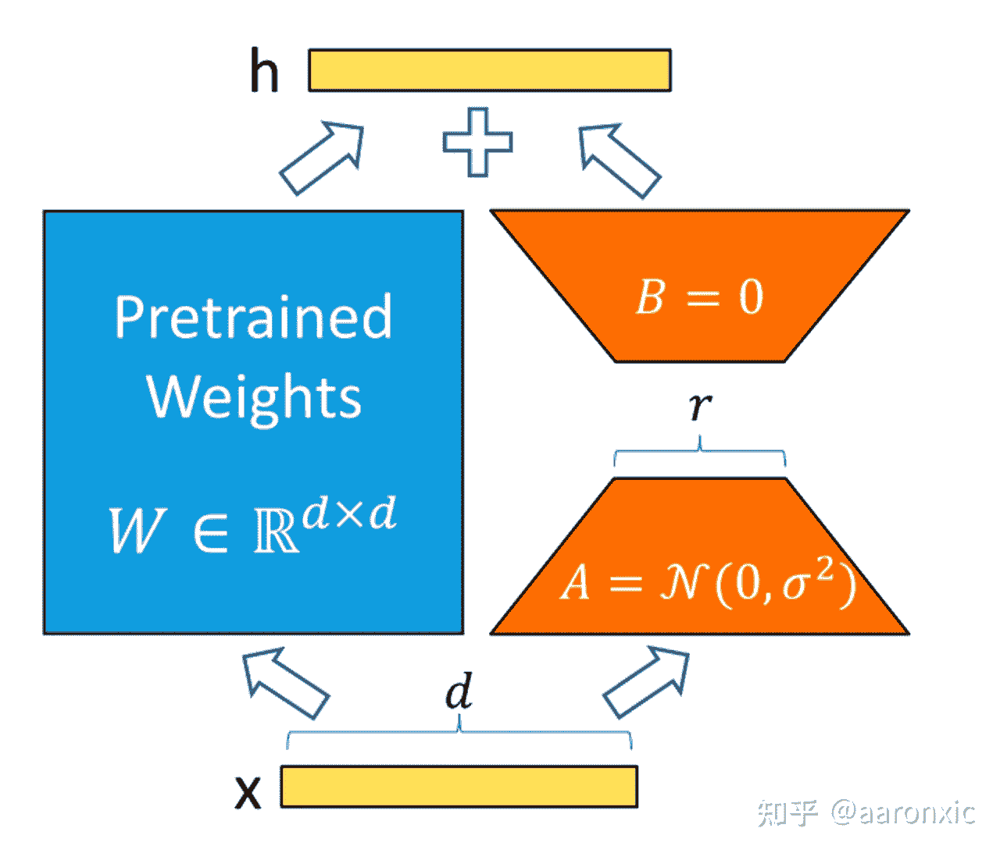

#### Vicuna

Vicuna是个偏工程的项目，整合了当时各方面的训练技术，主打一个便宜好用

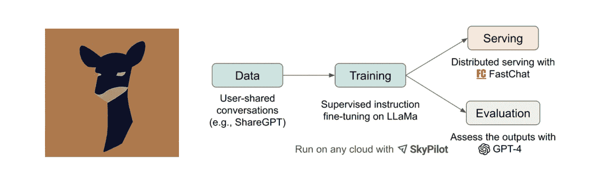

对比如下

## 写在最后

由于篇幅所限，没法覆盖所有优秀的ChatBot相关工作，更多的是尝试把主要的技术脉络进行梳理。下面总结一下全文

+   首先从Codex和AlphaCode出发，介绍SFT是如何被应用在LLM基座下游应用辅助编程中的

+   接着介绍ChatBot应用代表ChatGPT应用是如何经过PT-SFT-RM-PPO四个阶段后展现出强大多轮对话能力的

+   最后介绍了业内其他竞争者如Bard，Claud，MOSS，ChatGLM2和LLaMA系的技术方案

预告：计划下一篇介绍transformer在纯CV领域中是如何使用的，敬请期待。

PS：由于笔者小A并没有亲手撸过上述内容的所有细节，大部分是通过研究代码和精读优秀文章的方式bottom-up总结而来，本质上是个拾人牙慧的知识搬运工，所以终究是纸上谈兵。因此希望各方有实际经验的大佬猛锤，思维碰撞才生火花，真理越辩越明。

如果后续想了解transformer在NLP/CV/多模态的算法知识，分布式训[练的知识，以](https://www.zhihu.com/people/aaronxic)及如何在TVM上做PTQ量化和部署，可以关注我aaronxic哟~ 知乎个人主页


---

## **参考资料**

+   [OpenAI Codex 论文精读【论文精读】_哔哩哔哩_bilibili](https://www.bilibili.com/video/BV1iY41137Zi)

+   [DeepMind AlphaCode 论文精读【论文精读】_哔哩哔哩_bilibili](https://www.bilibili.com/video/BV1ab4y1s7rc)

+   [LLM微调经验&认知](https://zhuanlan.zhihu.com/p/634180659)

+   [[细(戏)说]RLHF场景下的PPO算法的来龙去脉](https://zhuanlan.zhihu.com/p/631338315?utm_medium=social&utm_oi=29233275469824&utm_psn=1644798013653598208&utm_source=wechat_session)

+   [【2023H1】Rethinking LLM（2）：如何理解LLM中的微调和RLHF阶段](https://zhuanlan.zhihu.com/p/633930960)

+   [List of Open Sourced Fine-Tuned Large Language Models (LLM)](https://medium.com/geekculture/list-of-open-sourced-fine-tuned-large-language-models-llm-8d95a2e0dc76)

+   [让天下没有难Tuning的大模型-PEFT技术简介](https://zhuanlan.zhihu.com/p/618894319)

+   [大模型参数高效微调(PEFT)](https://zhuanlan.zhihu.com/p/621700272)

+   [当前业界最优秀的8个编程大模型简介：从最早的DeepMind的AlphaCode到最新的StarCoder全解析~](https://zhuanlan.zhihu.com/p/627837310)

+   [Stanford CRFM](https://crfm.stanford.edu/2023/03/13/alpaca.html)

+   [NLG专委会真知论坛（GenTalk第7期）大模型预训练和微调技术及心得_哔哩哔哩_bilibili](https://www.bilibili.com/video/BV1is4y1i7cZ/?spm_id_from=333.999.0.0)