# （4）多模态的大一统之路

> 来源：[https://waytoagi.feishu.cn/docx/JDc5dcfopoD3JdxFQUgcc4LQnqf](https://waytoagi.feishu.cn/docx/JDc5dcfopoD3JdxFQUgcc4LQnqf)

> 作者：小A，aaronxic，[知乎个人主页](https://www.zhihu.com/people/aaronxic)

> 发表时间：2023年7月8日

> 原文地址：https://zhuanlan.zhihu.com/p/643969218


# **开篇**

大家好，我是小A。前面几篇我们已经了解了transformer是如何应用在LLM领域中，从这一篇开始我们进入多模态的领域，看看多模态是如何通过transformer架构逐渐走向大一统的。

提纲如下，共5个章节

+   首先介绍了Vision Transf[ormer的入门知识和相](https://arxiv.org/abs/2010.11929)关的应[用。包括了ViT(202](https://arxiv.org/abs/2111.06377)0[.10)，ViT-22B(](https://arxiv.org/abs/2106.08254)2[023.02)，Swin Tr](https://arxiv.org/abs/2208.06366)ansformer(2021.08)，MAE(2021.11)，BEiT(2021.06)，BEiTv2(2022.08)，TimeSFormer(2021.02)，BEVFormer(2022.03)。

+   接着介绍了多模态任务、训练评测数据集和评测方法。包括了Video Action Recognition任务，Image Text Retrival任务，Image Caption任务，Visual QA任务，Visual Reasoning任务，Visual Entailment任务。

+   开[始介绍多模态大一统的Sta](https://arxiv.org/abs/1803.08024)g[e1，模块独立。从TE，V](https://arxiv.org/abs/2103.00020)E[和MI三个模块的复杂度关系](https://arxiv.org/abs/2212.00794)入[手，列举了4种类型的网络结](https://arxiv.org/abs/2102.03334)构[，包括了SCAN(2018.](https://arxiv.org/abs/2107.07651)0[3)，CLIP(2021.](https://arxiv.org/abs/2205.01917)02)，FLIP(2022.12)，ViLT(2021.02)，ALBEF(2021.07)，CoCa(2022.08)。

+   [继续介绍多模态大一统的St](https://arxiv.org/abs/2111.02358)age2，模块共享。VLMO(2021.11)[开启了TE，VE和MI三个](https://arxiv.org/abs/2201.12086)模[块共享transformer ](https://arxiv.org/abs/2208.10442)b[lock的先例，启发了后续B](https://arxiv.org/abs/2301.12597)LIP(2022.01)，BEiTv3(2022.08)和BLIP2(2023.01)等工作

+   最后介绍了多模态大一统的Stage3，范式统一。这是一个仍然蓬勃发展的方向，以个人见解列举了Pixel2seq(2021.09)和Unified-IO(2022.06)的范式统一方法。

# Vision Transformer入门

多模态统一的第一步是架构统一，因此如何将transformer应用在传统的CV任务里面变得尤为重要，下面就介绍transformer是如何替代CNN充当视觉任务的骨干网络。

## ** ****ViT**

回想在NLP里面，text通过tokenization的过程变成了token序列，那么对应vision里面的tokenization过程是什么呢？有一种简单直观的想法，切分patch，过程如下

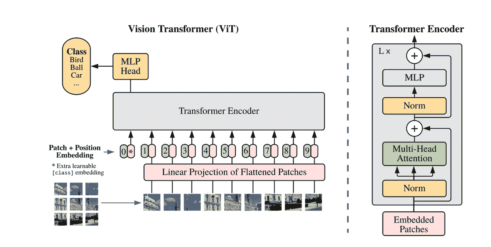

+   输入 的图片，切分成 像素的patch，因此变成了 的grid，由于原始输入是通道为3的RGB图片，因此每个格点是 维度的feature

+   数学化表达上述过程，就是假设图片 ，沿着长和宽切分成   个 的patch，其中 ，则最终得到的输入为

+   这样 就类比于NLP中的序列长度了

+   这里切分既可以通过对原始像素做reshape和transpose实现，也可以用 且 的卷积实现，同时引入了可学习的映射过程

```
Conv2d(3, 768, kernel_size=(16, 16), stride=(16, 16))
```

CLS token: 此外为了方便下游做全局任务(例如图像分类)，添加可学习的 CLS token ，放在网络最前面，因此序列长度为 。用 CLS token 对应的输出做全局信息获取做下游分类任务即可。

PE: 由于transformer本身对位置无感，因此需要把位置信息encode进行，ViT引入了可学习的绝对位置编码(learnable absolute PE)。如上图示例中划分成了9个patch，再加上 CLS token，因此可学的位置编码有10个

网络结构：所有patch token之间信息相互可见，因此使用了标准的pre-norm的encoder结构

## ** ViT-22B**

NLP那边网络可以scale到175B的大小，那么ViT是否也能轻松scale呢？貌似看起来也不是那么容易。[ViT-22B](https://arxiv.org/abs/2302.05442) 中做了3个改动才成功把网络放大到22B，如下所示

+   对query和key做了额外的前置LayerNorm，否则导致训练不稳定。下图绿色就加了前置LayerNorm的，红色就是没有加前置LayerNorm的

+   对MHA和FFN做了并行化改造，这样并行度更高，减少训练耗时

+   移除了input projection和LayerNorm后面的bias

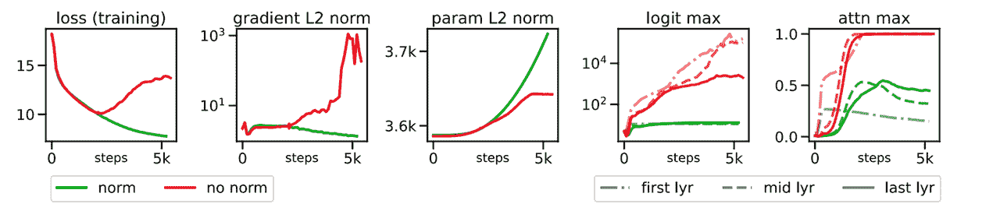

改进后的transformer block如下所示

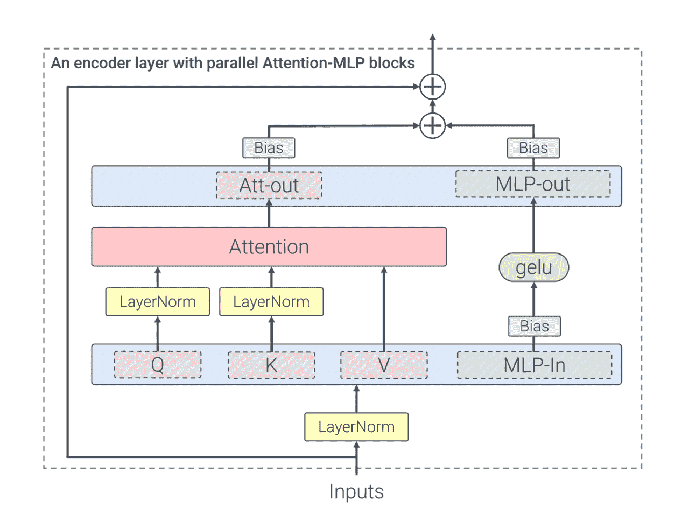

完整的参数量对比如下所示

参数计算公式可参考本系列[（2）初探LLM基座模型](https://ywh1bkansf.feishu.cn/wiki/UU9pwtOFtiKIqAkQiSVc3Zdun7e) 文章内容

[PS:](https://arxiv.org/abs/2106.04560) Vi[T-G](https://arxiv.org/abs/2209.06794)和ViT-e分别来自[论文1]和[论文2]

##  Swin Transformer

从上文可知ViT的序列长度是跟分辨率大小成正比的，而transformer结构的计算复杂度又跟序列长度呈平方关系，因此当下游任务的分辨率线性增长时，ViT的计算复杂度呈平方量级增长，计算效率显著下降。

如何解耦分辨率和计算量，成了Swin Transformer需要解决的问题。具体来说通过3个过程实现

+   窗口内信息交换。划分窗口，在窗口内做self-attention，实现完全信息交换

+   相邻窗口间信息交换。通过shift方式实现相邻窗口的信息交换。

+   远距离窗口间信息交换。对窗口做合并，扩大窗口覆盖原始像素面积，使得相距更远的窗口可以交换信息。

下面详细介绍Swin Transformer的处理过程。

**网络总览**

借用[这篇文章](https://zhuanlan.zhihu.com/p/507105020)的图，网络整体分成了4个stage，每个stage由若干block组成，block数量分别是2-2-6-2

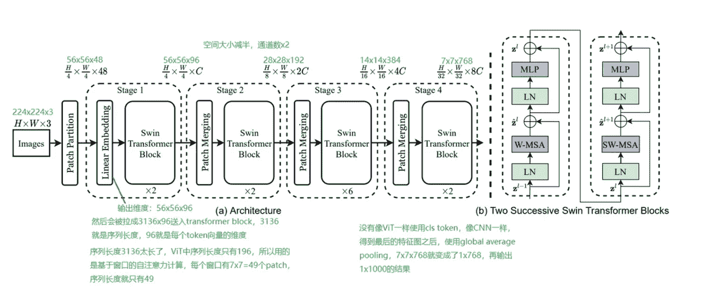

**窗口内信息交换**

首先对原始 的输入图片做 的patch划分，映射feature维度为 ，因此经过第一层之后tensor的尺寸为

不同于ViT的 直接把 的序列直接输入transformer，Swin的 对此做进一步窗口划分，大小为 ，因此可以得到 个 大小的patch窗口，输出tensor尺寸为

这样有 组 的序列独立做self-attention，实现了patch窗口内的信息交换，做完之后重新reshape回到输入的 大小

下图展示的是 个patch为1个窗口的例子，实际中是 个patch为1个窗口

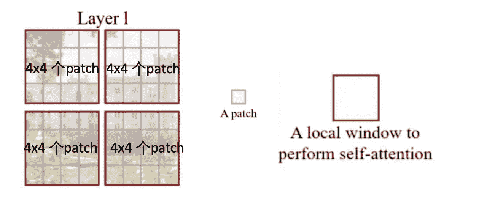

从[（2）初探LLM基座模型](https://ywh1bkansf.feishu.cn/wiki/UU9pwtOFtiKIqAkQiSVc3Zdun7e) 中我们知道，ViT的计算量公式为

因此 的计算量为

将输入 切成了若干个 的patch窗口，因此可以得到计算量为

可见计算复杂度从 的 降成了 的

**相邻窗口间信息交换**

上述结构确实降低了计算量，但是也造成了窗口之间的信息割裂，不同窗口间的像素永远无法做信息交互。一种解决方法就是将patch窗口划分方式进行shift，如下所示分别朝右和朝下循环位移半个窗口，形成了9个新窗口。

经过这样的操作，对于P点像素，在Layer L中跟左上角窗口内的像素做信息交换，到了Layer L+1之后可以跟0号窗口内的像素做信息交互，不会出现信息闭塞的问题。

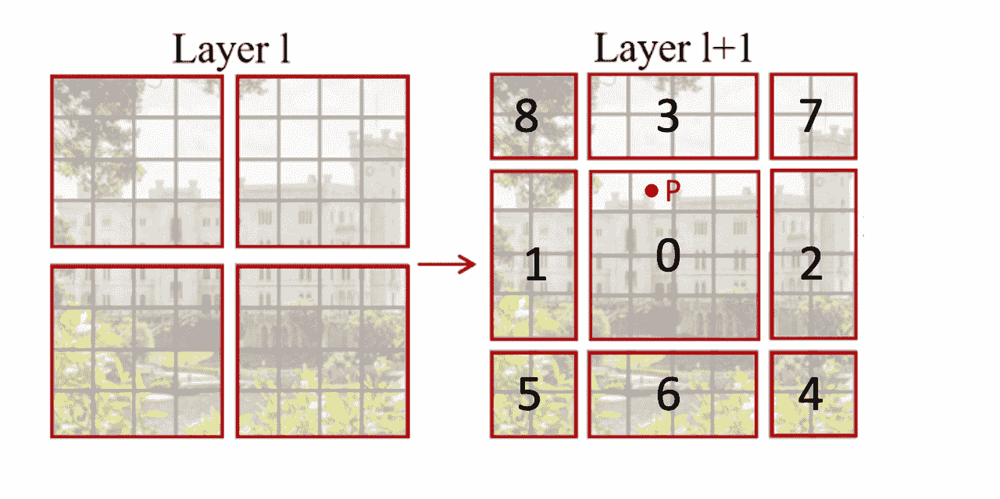

但不难发现，如果按照naive的方式实现上述流程，从4个窗口变成了9个窗口，会增加了额外的计算复杂度。因此一种解决方案就是把边角的窗口拼接在一起，用mask掩码保证信息隔离跟原来拼接前完全等效。具体来说，把(0), (1, 2), (3, 6)和(4, 5, 7, 8)通过shift操作拼接在一起，形成4个新窗口

```
shift_size = window_size // 2
 shift_windows: (C, H, W) 
torch.roll(shift_windows, shifts=(shift_size, shift_size), dims=(1, 2) 
```

如下所示

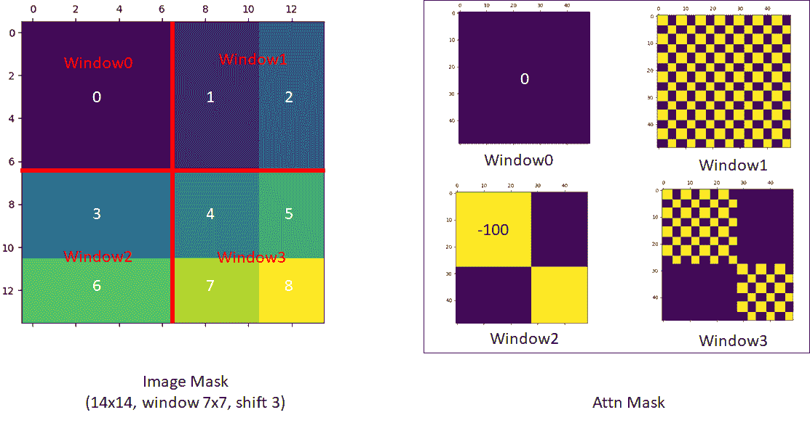

掩码添加非常巧妙，黄色代表mask掉，即禁止信息交互。大家可以自行推导一下

+   Hint1：把每个window内的像素从左到右，从上到下展开成长向量vector，代表窗口掩码的行和列下标

+   Hint2：保证每个数字内像素点可以相互交互，不同数字间的像素点要被黄色mask掉

注意最后做完masked-attention之后，调用 torch.roll 循环位移回来即可

**远距离窗口间信息交换**

只有上述窗口内信息交换和相邻窗口信息交换还是不够，因为没法实现长距离的信息交换，因此类似CNN堆叠stage增大感受野，Swin也引入了多stage概念，每个stage中间会进行window的合并和特征维度的扩增，代码中叫Merging模块

这个过程跟spatial_to_depth比较像，spatial_resolutin减半，feature增加

```
 input_feature: (1, 56, 56, 96)
 (1, 56, 56, 96) -&gt; (1, 28, 28, 96)*4 -&gt; (1, 28, 28, 384)
input_feature_0 = input_feature[:, 0::2, 0::2, :]
input_feature_1 = input_feature[:, 1::2, 0::2, :]
input_feature_2 = input_feature[:, 0::2, 1::2, :]
input_feature_3 = input_feature[:, 1::2, 1::2, :]
input_feature = torch.cat([input_feature_0, input_feature_1, input_feature_2, input_feature_3], -1)
```

至此，Swin Transformer设计了窗口内，相邻窗口，远距离窗口的3种信息交换过程，实现了计算量大幅下降的同时，保证信息能自由流动

## ** ****MAE**

对Vision Transformer有了基本认识之后，下面介绍几个比较重要的应用，扩展对Vision Transformer应用案例的认知。

其中一个是使用 [MAE](https://arxiv.org/abs/2111.06377) (Masked Autoencoders)做无监督训练。如下所示

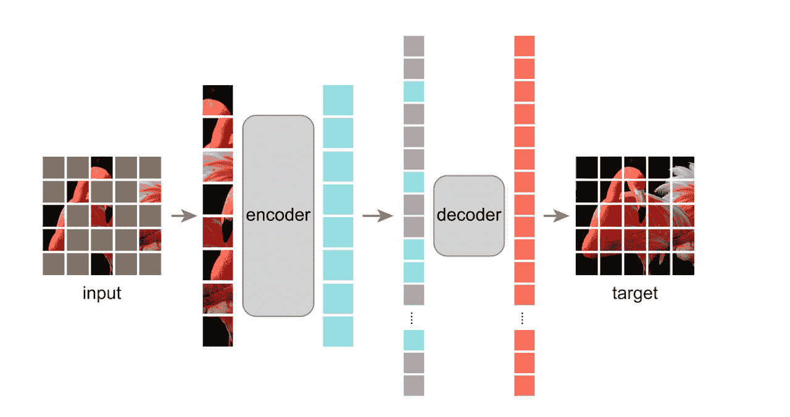

+   MAE把问题建模成类似BERT里面的完形填空，将patch看作视觉完形填空的对象

+   整体架构是encoder-decoder的transformer结构，但是注意decoder没有cross-attention

+   encoder部分。随机把高达75%的patch给mask掉，将剩下patch喂入ViT-like结构的encoder里面

+   decoder部分。 可学习的[MASK] token 代表前面被mask掉的patch的编码，拼接上encoder对剩余patch的编码，重新排序后喂入decoder做full-self-attention，最后decoder的输出就是重建每个patch的像素值，具体来说是 个值

+   最后将重建的像素和输入图像做均方误差loss监督即可

MAE的其中一个亮点是训练比较快，原因是

+   encoder部分只把mask之后剩余的patch喂入网络，因此序列长度减少到原始数量的1/4左右

+   decoder虽然需要所有位置的patch输入，但是由于大小比encoder小一个数量级，因此使用起来也很高效

## ** BEiT**

不同于MAE把像素级的原始patch作为重建对象，BEiT把抽象的vision token作为重建的对象，如下所示

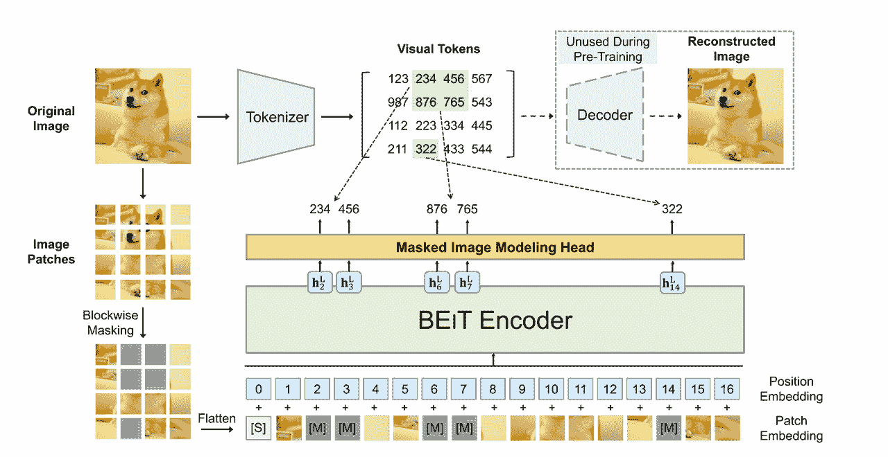

+   重建目标vision token直接来自DALL-E论文开源的码本，该码本是通过dVAE的方式重建学习而来。dVAE的训练方式将在下一篇《AIGC组成原理》中做展开介绍

+   除了重建目标不同，BEiT的网络只由Encoder组成，此外mask掉的patch直接用可学习的 [M] token 替代

PS: BEiTv2使用了VQ-VAE的方式重建teacher的特征(例如CLIP)，最后得到每个patch的vision tokens码本。VQ-VAE的训练方式将在下一篇《AIGC组成原理》中做展开介绍

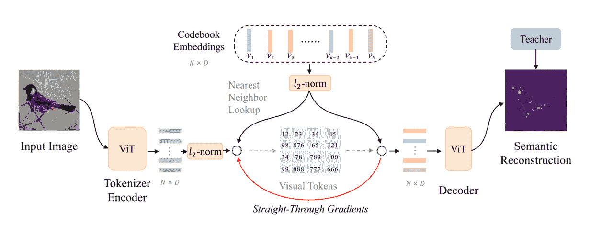

## ** TimeSFormer**

除了使用Vision Transformer做无监督训练，还有使用Vision Transformer做视频动作分类。顾名思义，就是给定一段视频片段，要求算法返回视频包含的动作类别。这里核心要解决的是在计算复杂度受限的情况下，如何在空间维度和时间维度分配transformer的注意力计算。

TimeSFormer对此作了多种拆解的探究，如下所示

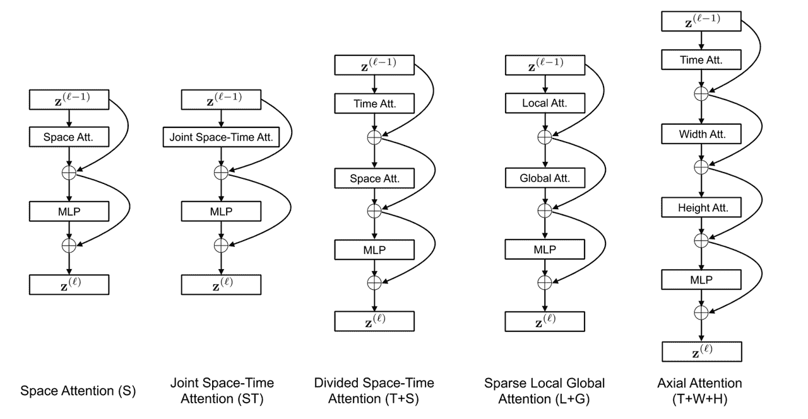

+   Space Attention (S)。只保留空间的注意力，相当于单帧做，不考虑时序间的信息交流。对应下图(S)列，红色patch就是蓝色patch的注意力范围

+   Joint Space-Time Attention (ST)。空间和时间进行完整的注意力，相当于每一个patch都能获取到空间和时间的所有信息。对应下图(ST)列，红色patch就是蓝色patch的注意力范围

+   Divided Space-Time Attention (T+S)。空间维度自己做注意力，时间维度自己做注意力。对应下图(T+S)列，绿色patch就是蓝色patch在时间维度的注意力范围，红色patch就是蓝色patch在空间维度注意力范围，这里两个独立的注意力模块

+   Sparse Local Global Attention (L+G)。按照空间距离使用不同的注意力模块。对应下图(L+G)列，粉色patch就是蓝色patch在距离为0的注意力范围，黄色patch就是蓝色patch在距离为1的注意力范围，紫色patch就是蓝色patch在距离为3的注意力范围，这里有3个独立的注意力模块

+   Axial Attention (T+W+H)。按照特征维度使用不同的注意力模块。对应下图(T+W+H)列，绿色patch就是蓝色patch在T维度的注意力范围，黄色patch就是蓝色patch在W维度的注意力范围，紫色patch就是蓝色patch在H维度的注意力范围，这里有3个独立的注意力模块

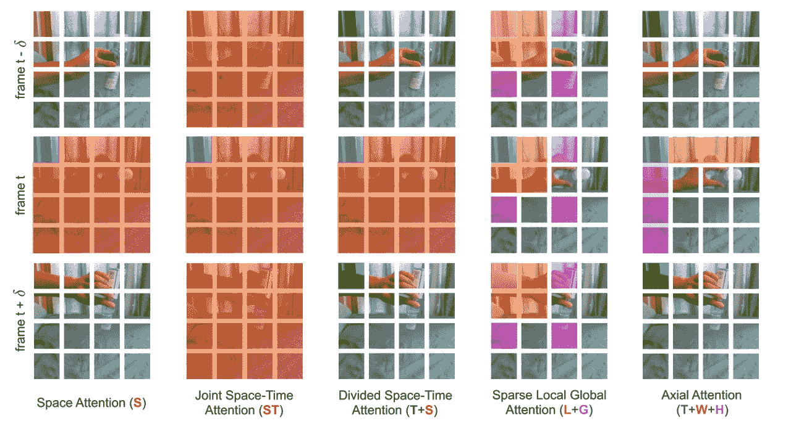

最后TimeSFormer发现T+S效果最好

## ** BEVFormer**

作为Vision Transformer入门的最后一部分，我们来看个不一样的例子，这就是几乎快成为自动驾驶标配的BEVFormer网络结构。核心知识点如下

+   BEV就是BirdEye View的缩写，即从上往下看的平面俯视图。

+   整体使用的是encoder-decoder架构，其中decoder包含cross-attention

+   encoder部分。BEVFormer的视觉主干并没有使用ViT进行feature抽取，但是从原理上可以将CNN替换成ViT或者Swin Transformer

+   decoder部分。BEVFormer本质上是借助多视角的相机信息做隐式的多视几何(Multiview Geometry)，通过learnable query和cross-attention机制把图片空间的feature整合到了BEV空间中

下面详细说说decoder计算过程(简单起见忽略时间维度)，如下所示

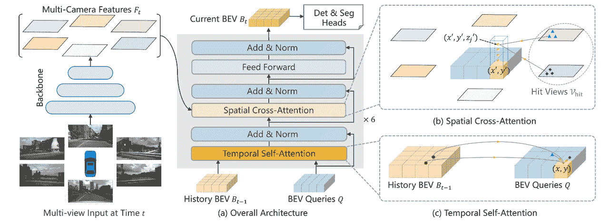

+   前面encoder已经得到了每个camera不同网络深度的feature，简化表达为

+   在BEV坐标系下对车辆周边空间做网格划分，其中 代表空间中的一点，每个点对应一个learnable query，即

+   考察每个 对应的encoder输出

- 通过相机外参和内参，把 映射到各个相机的像素平面

- 利用Deformable Attention机制，在点 附近aggregate encoder的特征输出，得到 对应的feature输出，即

- 对 按网格坐标进行排列拼接，形成最终的BEV网格feature，输出到下游各个head任务

这里Deformable Attention的核心过程如下

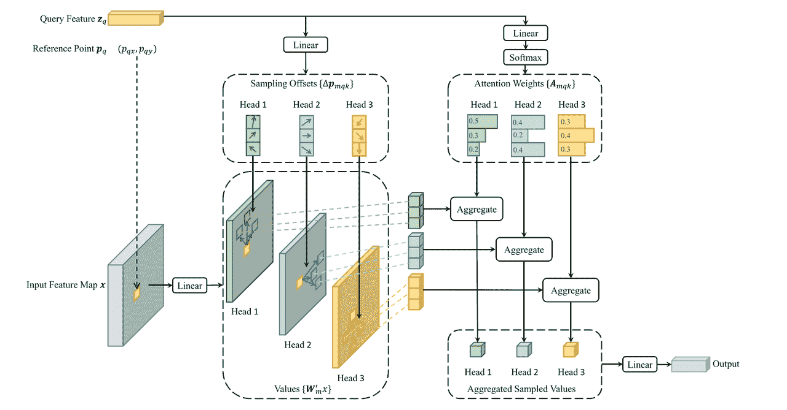

+   每个query通过linear层映射编码出一组offset和一组weight

+   每个offset叠加前面的 像素得到最终的像素位置，索引该位置的feature，跟另外的一组weight做加权乘累加，得到这个query的最终feature

## ** 小结**

本节介绍了Transformer是如何应用在Vision中，并且介绍了优化方法和若干周边应用

+   ViT。开创了vision transformer的先河，本质上是对图片切分patch，转换成patch token序列，然后用处理text token的方式处理patch token即可

+   Swin Transformer。为了解决原始的ViT的计算复杂度跟输入图片分辨率呈平方关系的问题，通过设计窗口内，相邻窗口，远距离窗口的3种信息交换过程，实现了计算量大幅下降的同时，保证信息能自由流动

+   无监督应用。类似于BERT做完形填空，vision里面的MAE和BEiT也尝试做视觉完形填空，前者尝试重建raw pixel，后者尝试重建抽象的vision token

+   视频动作分类应用。使用Vision Transformer做视频动作分类，核心要解决的是在计算复杂度受限的情况下，如何在空间维度和时间维度分配transformer的注意力计算。TimeSFormer尝试了多种拆解方法，最后发现空间和时间分开的方法效果最好。

+   自动驾驶应用。最后我们简单介绍了BEVFormer，一种使用cross-attention机制来提取特征完成下游视觉任务的特殊例子

# **多模态任务和评测方法**

有了Vision Transformer之后，视觉和文本至少在形式上可以在同一个空间中表达了，这给他们的直接交互提供了极大的便利，于是多模态的各种工作就雨后春笋般出现。

多模态范围非常宽泛，个人认为但凡涉及到多种模态(图片，文字，声音，视频，激光雷达，毫米波雷达等)的输入，以及单种或者多种模态输出的过程，都可以理解为多模态。

在正式介绍多模态的相关算法之前，我们先捋一下多模态的任务都有哪些，以及相关的训练测试集和评测方法是什么。这里不求大而全的多模态任务罗列，更多的是把后续多模态论文中涉及到的多模态任务提前解释和介绍一下

## Video Action Recognition

视频动作分类，给一段15秒内的短视频，要求算法识别出其中的动作类别。常用的数据集有

+   UCF-101。从YouTube搜集的101个动作类别视频，一共有13320个视频片段，分为25组，每组4-7个动作，每组有共同特征，例如相似的背景，相似的视角等。每段视频10秒左右。

+   HMDB-51。从YouTube和Google搜集的51个动作类别视频，一共6849个视频片段，同样也是短视频

+   Moments in Time。339个动作类别，一共有1百万段长度为3秒的视频片段，平均每个动作有1k个以上视频片段

+   Kinetics400/600/700。从YouTube搜集的400/600/700个动作类别视频，每个动作包含400/600/700个视频片段，每段视频长度为10秒左右

指标跟ImageNet类似，多分类下的Top1或者Top5的accuracy

## Image Text Retrival

图文检索任务

+   图搜文。给定一张图片和若干段文字描述，要求算法返回最匹配的文字描述

+   文搜图。给定一段文字和若干张图片，要求算法返回最匹配的图片

常用的数据集有

+   Flickr30K。包含了31K张来自Flickr的人工精标图文数据集，每张图片有5个文字描述

+   MS-COCO。包含了113k人工精标的图文数据，每张图片有至少一个文字描述，质量很高

指标计算跟检索排序类似，给定一张图片和海量的候选文字描述，算法返回排序后的文字描述，然后计算Recall@k，就是返回结果里面前K个是否包含正确结果。

## **Image Caption**

生成图片描述任务，给定图片，要求算法生成文字描述。图文检索任务的数据可以直接拿来用，除此之外还有很多网络爬取的图文数据。

+   Visual Genome (VG)。最早是李飞飞组提出的，原始数据集规模很大，但是后人认为其中的object标注过于杂乱，存在命名模糊和bounding box重叠的问题。所以一般使用VG150的精简版，数据质量更高，包含108K张图片，5.41M段文字描述

+   CC12M。CC12M来自Google的web数据集，包含URL，自行通过爬虫下载链接。一共有12M，里面存在大量noise，所以需要经过过滤。

+   SBU。来自Flickr的数据集，约800K对图文数据

+   LAION400M。来自LAION非营利性组织，来自Common Crawl原始数据，使用了CLIP做过滤，把相似度小于0.3的过滤了。总共400M对图文数据

指标计算比较启发式，本质上是计算两个sequence的相似度，常用的指标有CIDEr，BLEU，ROUGE和METEOR，其中使用CIDEr居多

## **Visual ****QA**

看图回答问题，给定图片和提问，要求算法回答问题，一般分成闭集QA和开集QA，前者是多分类任务，后者是文字生成任务。

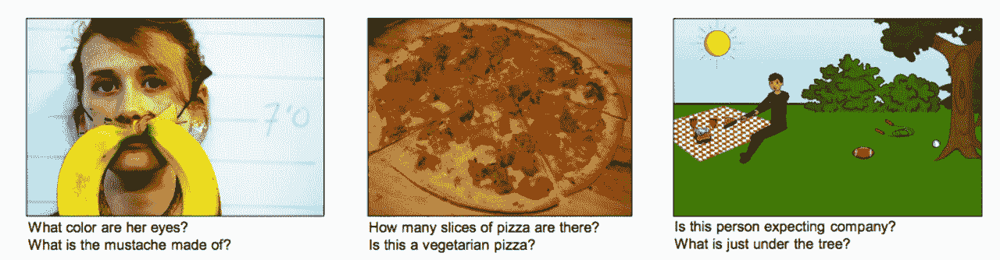

+   Closed QA，闭集QA，看成多分类任务。常用数据集为VisDial。数据集本身有多个问答，一般转换为二分类问题

+   Open QA，开集QA，看成文字生成任务。常用数据集为VQAv2。往往回答很简短，所以直接根据算法返回的结果做字符串匹配，完全匹配才算正确。注意VQAv2也可以变成closed的QA，就是把多选的挑出来，然后变成3129类的分类问题。

##  Visual Reasoning

视觉推理任务。给定图片和文字描述，要求算法判断文字是否匹配，常用数据集为NLVR2。是给了2张图片+文字描述，判断描述是否和图片匹配，一共包含92K个问题。

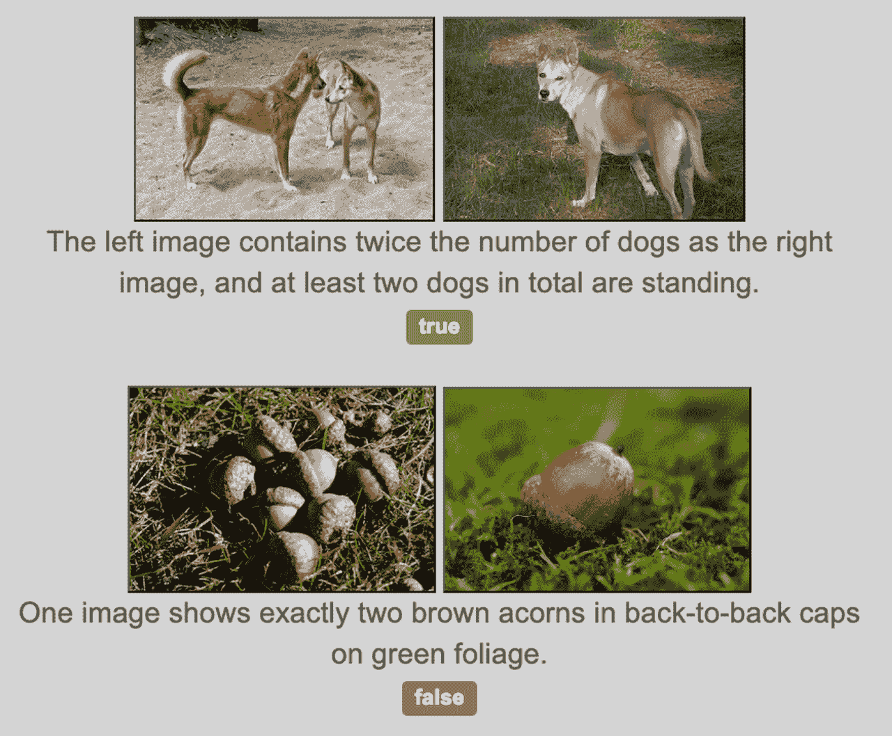

二分类问题，指标使用accuracy

##  Visual Entailment

视觉蕴含判断任务。图片作为premise，文字是Hypothesis，要求算法返回蕴含、对立或者中立(无法判断)，属于三分类问题。常用的数据为SNLI-VE，包含30K张图片

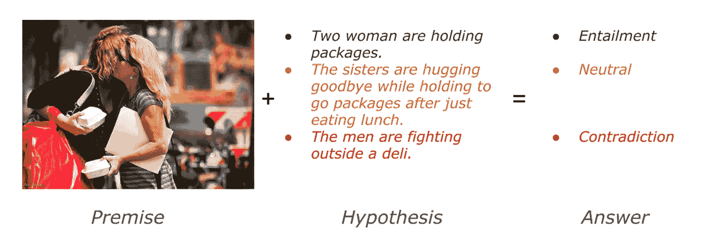

三分类问题，指标使用accuracy。

## ** 小结**

汇总以上的信息，总结成表格，方便查询

#  大一统Stage1: 模块独立

接下来我们正式进入多模态算法部分，重点关注的是图片和文字的模态交互。我们可以简单的抽象出三个模块

+   Textula Embed(TE)。文字特征抽取模块，主要接受文字信息输入，经过主干网络(例如LSTM/GRU/Transformer等)变成抽象的文字特征

+   Image Embed(VE)。图特征抽取模块，主要接受图片信息输入，经过主干网络(SIFT/CNN/ViT)变成抽象的图片特征

+   Modality Interaction (MI)。多模态交互模块，接受文字特征和图片特征，对其进行信息融合，完成下游需要的任务。

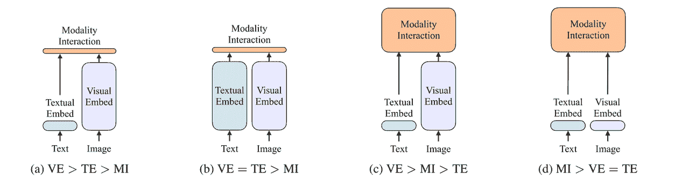

多模态的早期发展阶段，TE, VE和MI的3个模块是相互独立，没有权值共享。按照3个模块之间复杂程度的相对关系，可以分出上述的(a)-(b)-(c)-(d)共4类网络架构设计，

## **SCAN**

多模态发展过程中，TE和VE的骨干网络一直在不断变化。在ViT完全统治VE之前，一直用物体检测的pipeline来抽取各个物体的框和特征，SCAN就是这一类方法的代表，如下所示

+   VE部分使用Fast R-CNN作为bottom-up的目标检测器，把所有 个物体检测出来并且ROI Pool得到对应的特征 ，其中

+   IE部分对 个单词做特征抽取，得到 ，其中

+   MI部分

- 针对这两组特征做了复杂的手工设计的加权方式，最终得到融合后相似度

- 使用Log- SumExp pooling得到最终图片和文字的整体相似度，接着可以做正负样本监督

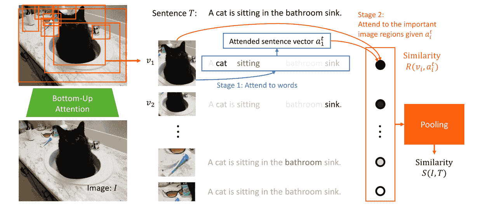

作为早期工作的代表，SCAN有以下的局限性

+   VE部分计算复杂，一般是提前抽取好feature，这样数据增广等技巧就受到阻碍

+   MI部分人工设计公式，复杂且迁移性差，inductive bias过强

## ** CLIP**

OpenAI的CLIP作为(b)类别的代表，对TE和VE一视同仁，MI部分用简单的Contrastive Loss，最后在图片分类任务上效果拔群，影响力巨大。如下所示

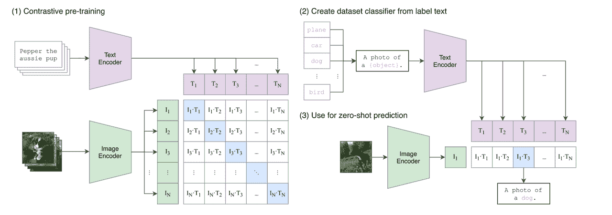

**Pre-train**

预训练使用Contrastive Loss，具体如下

+   IE使用带mask的Transformer，方便在encoder-decoder架构和decoder-only架构间切换，抽取得到文本的全局特征

+   VE使用Resnet或者ViT网络结构，得到图片的全局特征

+   MI部分把同一对的text-image看成正样本，其余为负样本，做对比学习

对比学习一般会逐行和逐列分别求一次softmax+cross-entropy，对角线元素为正样本，非对角线元素为负样本，最终除以2取平均。代码更加清晰，如下所示

```
 image_encoder - ResNet or Vision Transformer 
 text_encoder - CBOW or Text Transformer 
 I[n, h, w, c] - minibatch of aligned images
 T[n, l] - minibatch of aligned texts
 W_i[d_i, d_e] - learned proj of image to embed 
 W_t[d_t, d_e] - learned proj of text to embed 
 t - learned temperature parameter

 extract feature representations of each modality 
I_f = image_encoder(I) [n, d_i] 
T_f = text_encoder(T)  [n, d_t]

 joint multimodal embedding [n, d_e] 
I_e = l2_normalize(np.dot(I_f, W_i), axis=1) 
T_e = l2_normalize(np.dot(T_f, W_t), axis=1)

 scaled pairwise cosine similarities [n, n] 
logits = np.dot(I_e, T_e.T) * np.exp(t)

 symmetric loss function 
labels = np.arange(n)
loss_i = cross_entropy_loss(logits, labels, axis=0) 
loss_t = cross_entropy_loss(logits, labels, axis=1)
loss = (loss_i + loss_t)/2
```

这里值得注意的是温度系数 np.exp(t) ，其中 不是固定参数，而是可学习的值，同时 正好也符合温度系数的值域。OpenAI说这样设置效果更好，也省去人工调参。

此外OpenAI还是用了闭源的经过清洗后的多达400M的数据集，训练代码本身也是闭源的，这也是有后续OpenCLIP等工作的原因。

Zero-shot Predition

在做下游的分类任务的时候，完全可以做zero-shot，text部分有很多模板选择，例如 a photo of {} 等，最后效果大杀四方，并且ViT的效果更好一点

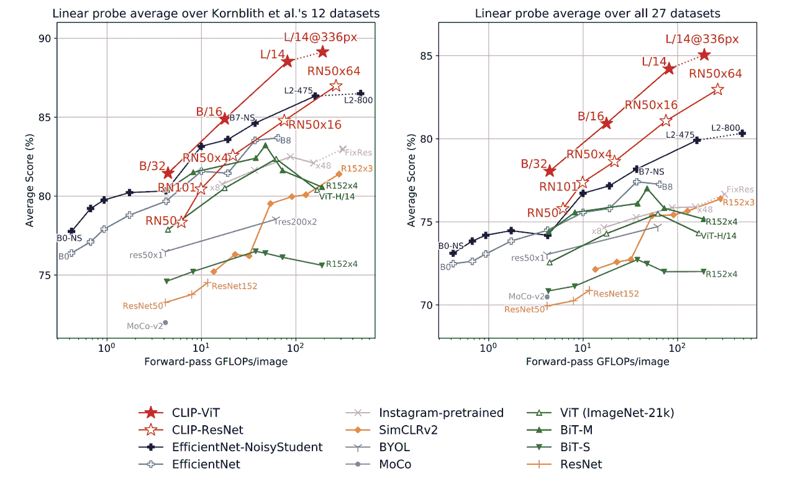

**局限性**

+   CLIP在图像分类上效果很好，但是直接使用在更复杂的VQA/VR/VE上效果不佳

+   训练昂贵，需要上千卡天的训练总时间(12 days on 256 V100)

## **FLIP**

FLIP出发点就是为了解决CLIP训练昂贵的问题，简单理解为Fast版本的CLIP，改进点为

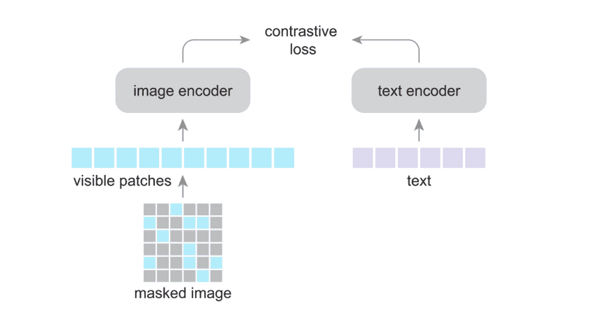

+   MAE里面编码器部分会对原始输入的图片patch做随机mask，比例高达75%

+   只将剩余的patch喂入Vision Encoder(VE)网络

+   这样VE部计算量能降低为原来的 ，于是训练更加便宜了

最后FLIP中还探究了一下scaling情况，发现模型和数据增大都能继续涨点，但是训练更长epoch没有用

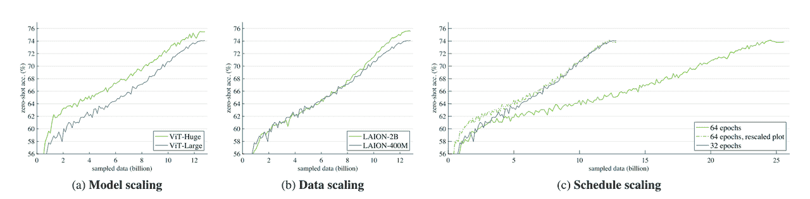

## ** ViLT**

(c)类方法虽然是SOTA，但是很多想法都受到(d)类的代表作ViLT启发，因此在介绍SOTA之前，我们先详细看看(d)类的ViLT是怎么做的。

本节开头的VE, TE和MI的分类方法就是来源于ViLT，ViLT的出发点是把VE彻底换成简单的patch projection模块，借鉴了ViT的思维，如下所示

+   Region Feature。就是传统的CNN backbond+Det head的方式，本质做检测，然后用ROI Align把对应的feature抽出来作为vision token，计算量比较大

+   Grid Feature。只过CNN backbond，把最后的feature作为vision token，计算量也很大

+   Patch Projection。受到ViT启发，上来就过个简单的conv把 的像素区域变成一个patch，然后就直接作为vision token，这样推理速度奇快无比

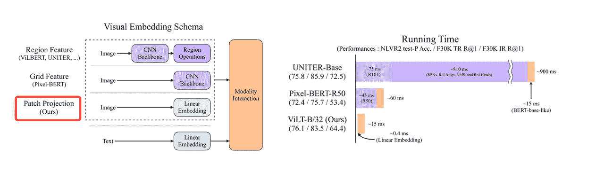

**网络结构**

整体网络架构图如下所示，典型(d)类没跑了

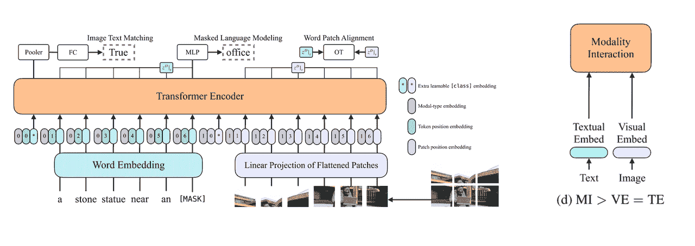

+   跟ViT非常像，是个encoder结构。Text经过embedding之后是 ，Image经过embedding之后是 。Text和Image前面各有一个 CLS token ，因此总的输入尺寸是

+   注意这里的PE(Position Encoding)有两部分

+   首先是0和1分别编码text部分和image部分

+   其次是在text内和image内的常规的位置编码

**Loss设计**

训练loss相对比较复杂，得好好说说，包含3个

+   Image Text Matching (ITM)

- 类似于constrastive los，从text的CLS token出来

- 正样本是配对图片，负样本是把image替换成其他图片

- 对图片使用RandAugment做增广，去掉了color jitter和crop的aug，以防出现图文不匹配情况

+   Word Patch Alignment (WPA)

- 对text subset和image subset做最alignment，具体来说使用优搬运理论进行loss最小化，这里不做进一步展开

+   Masked Language Modeling (MLM)

- 类似BERT的完形填空，不过这里用了Whole Word Masking(WWM)，而不是单个token masing

- Whole Word Masking的出发点也很直接，就是避免网络通过其他词根推测同一个词的剩余部分，例如 giraffe 拆成了 gi , raf  和 fe ，通过gi 和fe 可以推断出 raf

**实验效果**

跟其他Region Feature和Grid Feature的方法相比还有些距离，但是主要贡献是打开了新思路

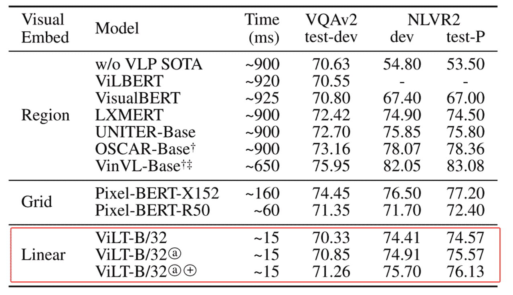

## ** ALBEF**

随着ViLT开创了VE使用ViT的先河，很多工作开始涌现，其中ALBEF算是其中的佼佼者。ALBEF尝试解决ViT效果不够好的问题，认为VE部分要足够复杂才行，甚至要比TE更复杂，网络结构如下

+   容易发现很像BERT，只是把BERT的decoder部分拆成两半，一部分给TE，一部分给MI

+   由于VE有12层，TE只有6层，因此符合VE应该要比TE复杂的insight

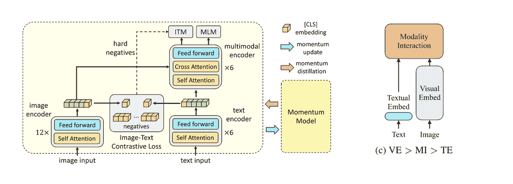

跟ViLT的loss相比，保留了ITC和MLM，新增Image-Text Matching Loss

+   ITC(Image-Text Constrastive) Loss就是常见的对比学习的loss

+   正样本来自于当前配对的image和text的feature

+   负样本来自于两个额外的queue，分别为 和 (后面会介绍)

+   ITM(Image-Text Matching) Loss 就是图文匹配二分类loss，判断image和text是否为正样本，为了类别均衡，也涉及到正负样本来源问题

+   正样本来自于当前配对的image和text的feature

+   负样本来自于ITC里面最难的负样本

+   MLM(Masked Language Modeling) Loss 就是类似BERT的完形填空任务，有15%的token被 [MASK] 替换

**Momentum Model**

本文的另外一个创新点是借鉴了MoCo，维护一个跟上图左侧结构完全一样的镜像网络结构Momentum Model(MM)

+   MM的但是权值更新不是来自于梯度回传，而是来自于左侧模型的EMA(Exponential Moving Average)

+   MM主要的作用是提供负样本来源，维护大小为65536的text的负样本队列 ，和大小为65536的image负样本队列

+   当前 时刻左侧网络forward完之后，把text和image和分别放到负样本队列 和 的末尾(当做未来时刻的负样本)，同时从两个队列头取出相同数量的样本作为当前 时刻的负样本

此外ALBEF使用了CC12M这个比较大且包含较多噪声的数据集，因此借助MM做了self-training的方式

+   MM是用EMA更新，所以变化缓慢，比较稳定，可以用作teacher

+   用MM当做teacher，对ITC和MLM做蒸馏，称为Momentum Distillation(MoD)

+   ITM由于已经有hard negative了所以就没有用蒸馏loss

ALBEF也通过可视化验证了MM作为teacher的靠谱程度，如下GT就是原始标签，peeud-target就是MM模型的输出

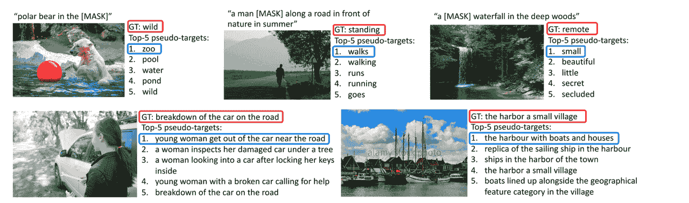

**实验结果**

在Image Retrival, VQA, VR和VE上均取得了不错的效果

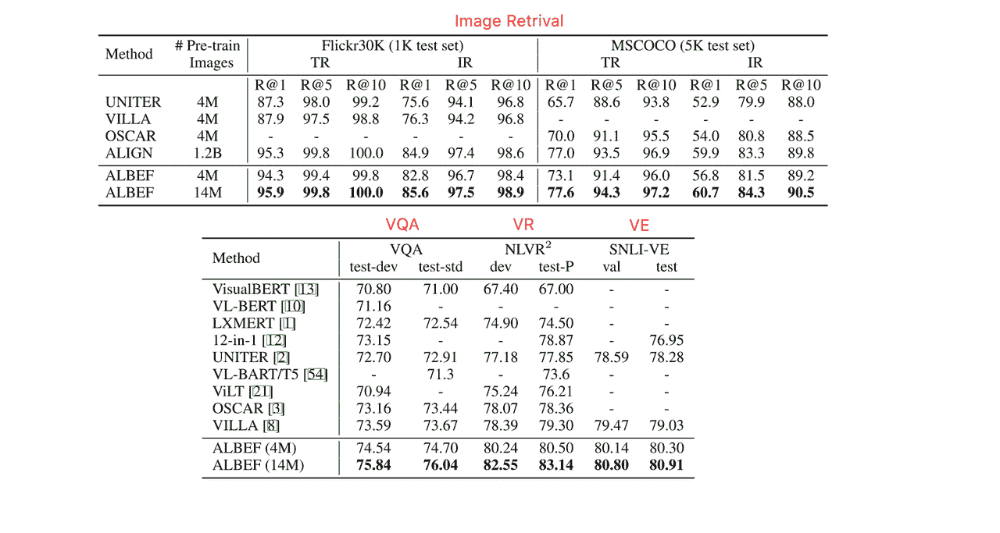

## ** ****CoCa**

同样作为(c)类方法，CoCa把ALBEF的能力往前推了一大截，主要改进点如下

+   MI部分换成decoder-only架构，因此不做BERT完形填空任务了，直接做caption生成任务

+   loss只保留了图文Constrastive Loss (Co)和自然语言的Captioning Loss (Ca)，因此论文名称是CoCa

+   loss精简之后，只需要forwar一次就能计算所有loss，不像之前的方法每个loss需要单独forward，模型可以训练更快了

+   提出了attention_pooling的Pooler，使用MHA模块实现

+   设置 个可学习的query

+   key和value来自Image Encoder输出

+   对于Constrastive Loss的话

+   对于Captioning Loss的话

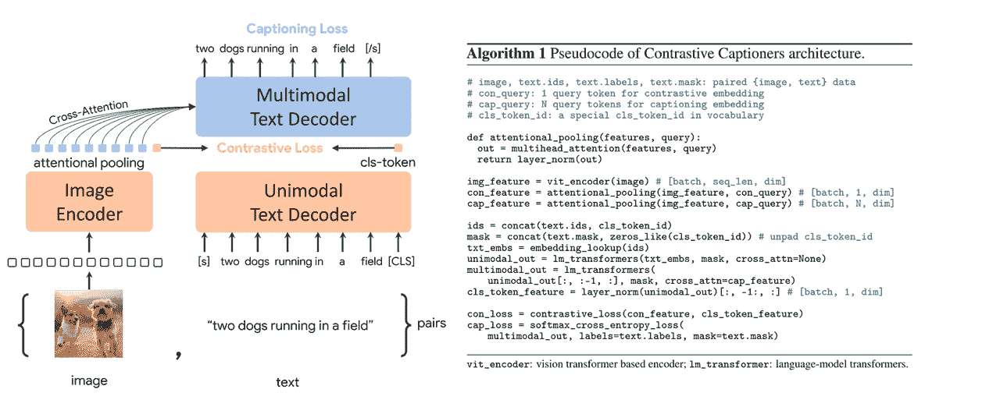

从CoCa开始流行通过雷达图展示模型的能力，如下所示

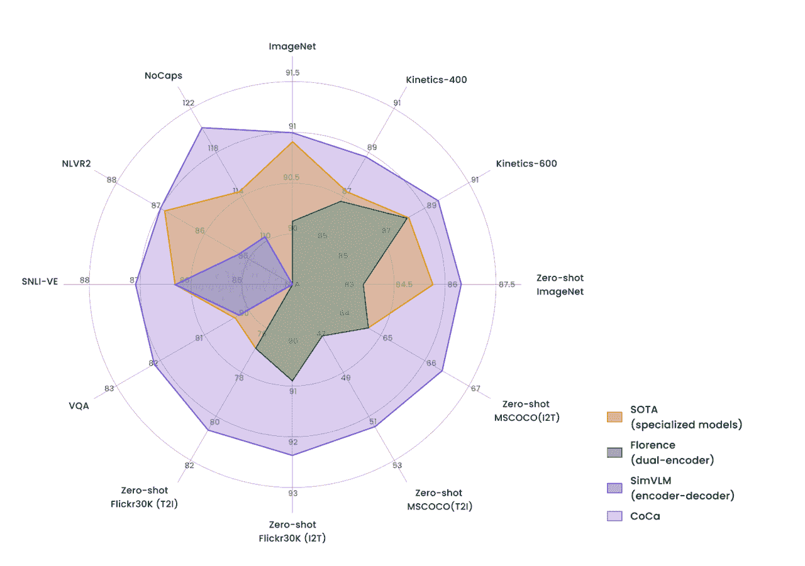

+   视频动作识别的K400和K600

+   图片分类任务ImageNet

+   Caption任务NoCaps

+   VR任务NLVR2

+   VE任务SNLI-VE

+   VQA任务VQAv2

+   图文检索任务Flickr30K和MSCOCO

PS: 数据集和指标说明可以查询”多模态任务和评测方法“一节中的表格

## ** 小结**

本节主要介绍了大一统的Stage1，特点是出现了VE, TE和MI三个模块，但是他们直接还是相互独立的


+   (a) VE > TE > MI。代表方法是SCAN，VE部分沿用Fast R-CNN，一般是提前抽取好feature；MI部分人工设计公式，inductive bias过强

+   (b) VE = TE > MI。CLIP方法简单有效，但是数据和训练闭源，训练成本高，FLIP借鉴了MAE的加速技巧对CLIP进行改进

+   (c) VE > MI > TE。ALBEF和CoCa贯彻了VE要比IE更复杂，且MI也要足够复杂的思想，达到了Stage1时期的SOTA

+   (d) MI > VE = TE。ViLT尝鲜VE中使用Patch Projection，虽然效果不好，但是做了很好的开创性工作

#  大一统Stage2: 模块共享

Stage1里使用VE, TE和MI三个模块相互配合，已经可以比较好的完成多模态任务了，但是他们在参数层面还是分离的，例如VE和TE的encoder是权重不共享的。如果将VE和TE整合到同一个transformer结构里面，模型精度是否会受到影响呢？

本节就介绍多模态大一统的Stage2，多模态是如何共享transformer模块的，主要介绍4篇论文，VLMO，BLIP，BEiTv3和BLIP2

## ** VLMO**

VLMO提出了Mixture-of-Modality-Experts (MoME) Transformer，也叫Multiway Transformers。如下所示

+   类似SuperNet思想，针对不同模态的输入，激活不同的FNN Expert通路

+   移除了cross-attention，统一使用self-attention，这意味着text和image可以同一个的self-attention编码

+   跟ALBEF一样也有3种loss，ITC，ITM和MLM

+   VLMO还提出了分阶段训练，这样更好的利用单模态的海量数据

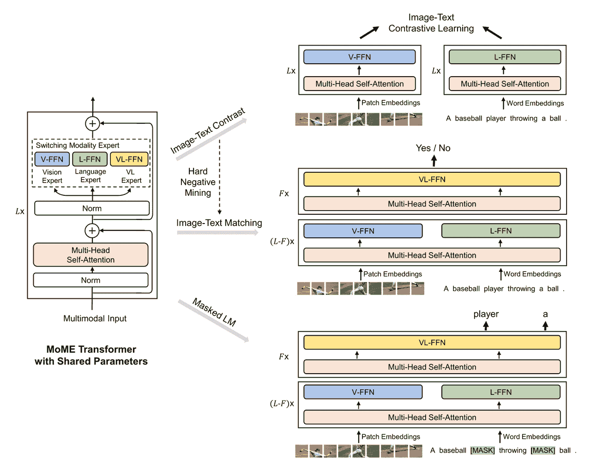

**分阶段训练**

+   图文匹配数据毕竟数量有限，常用的4M训练集，外加14.1M的CC12M训练集，跟纯文本或者图片动不动上十亿的体量相比，还是太少。

+   于是为了利用这些海量的数据，VLMO使用了分阶段的无监督训练方法

+   有趣的是在图片上做无监督的预训练之后，在文本数据上freeze住self-attention，只finetune FFN，效果貌似还不错。如果顺序对调，发现不work。

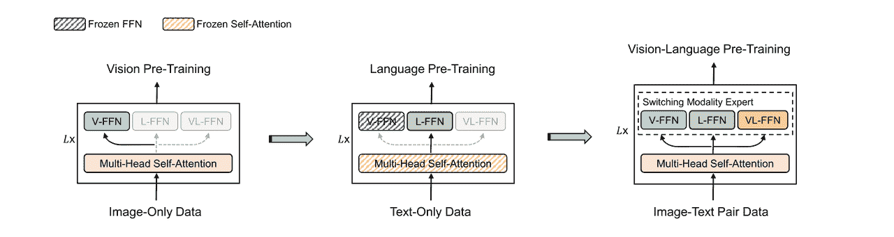

## ** ****BLIP**

BLIP整合了ALBEF和VLMO，也使用共享模块，同时做了以下2点改进

+   模型结构上加上了decoder-only的文本生成能力

+   使用CapFilt模块做数据清洗和过滤，能稳定涨点

**网络设计**

相比于ALBEF的ITC、ITM和MLM三种loss，BLIP把MLM的完形填空变成了decoder-only的LM loss，原因是要生成caption

+   对于ITC，添加 [CLS] 的token输出text的特征

+   对于ITM，添加 [Encode] 的token输出二分类概率预测

+   对于LM，添加 [Decode] 的token提示语言模型开始预测token

注意ITC和ITM是共享self-attention模块，这里借鉴了VLMO的思路，但是对于LM，发现还是得self-attention单独训练

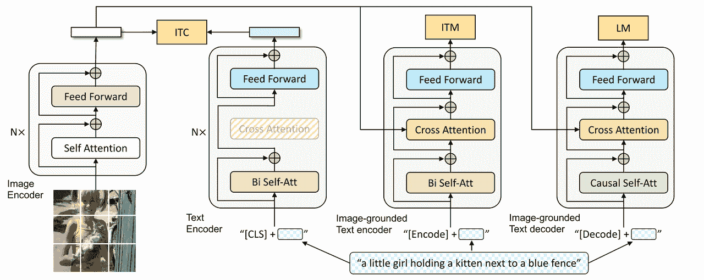

**CapFilt方法**

BLIP贯彻了data-centric的思路，好好的清洗了一波数据

+   Step1: 首先利用人工标注的数据和互联网自动爬取数据共同训练初始的模型

+   Step2: 利用人工标注的干净数据做finetune，具体来说做ITC&ITM finetune得到filter，做LM finetune得到Captioner

+   Step3: 最终联合使用Filter和Captioner对数据进行清洗，训练新模型

+   Step4: 重复Step1-Step3若干次

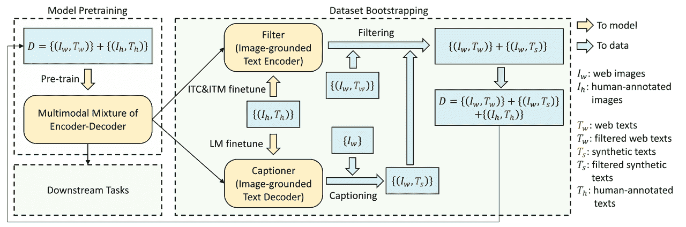

得到的Filter和Captioner效果如下，红色为原始caption，绿色为CapFilt生成的caption

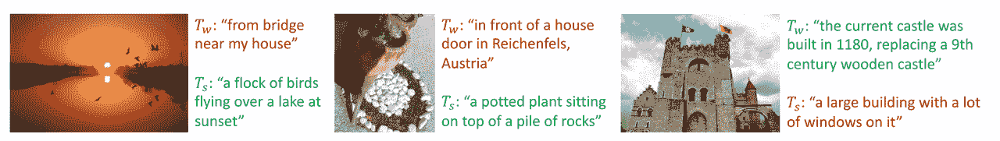

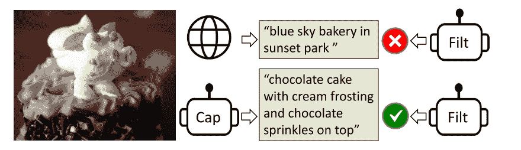

数据清洗普遍带来1-2个点的提升

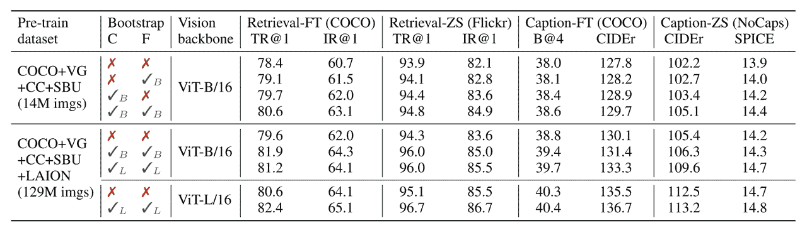

## ** BEiTv3**

跟VMLO高度相似，也是Multiway Transformers，改进之处为

+   把VE完全看成了NLP的一种外语，Pre-train阶段loss精简成只剩下mask-and-predict的范式，无论是image还是text，都用完形填空的方式做预训练

+   text用SentencePiece做tokenization，image用BEiTv2里面学的visual tokens作为重建目标

+   BEiTv3全部使用开源可下载的数据作为训练集，主打一个可复现性

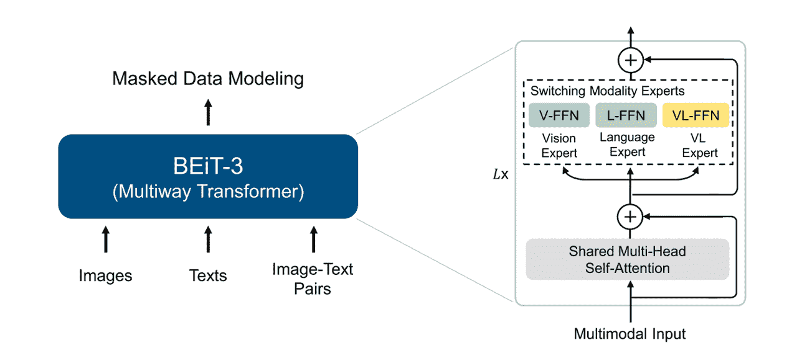

最终比CoCa效果好一圈

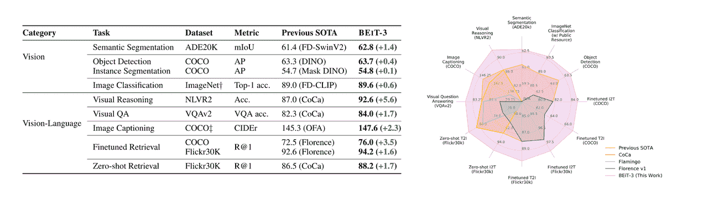

## ** BLIP2**

为了进一步提高多模态的能力，BLIP2做了如下改进

+   引入了32个可学习的query token，对图片的信息进行了压缩抽取，借助预训练的LLM(如OPT/T5-FLAN)模型，实现了VQA问题效果的巨大提升

+   由于query数量固定，transformer输出token数量跟图片分辨率解耦，训练非常便宜，16张A100 40G即可

+   使用2阶段训练方法，1阶段训练query token，2阶段串联LLM做端到端finetune

**训练阶段1**

+   设置32个learnable queries，注意query和text的self-attention是权重共享的，这样有助于query学出近似text语义的token

+   使用常见的ITM, ITC和ITG loss，注意不同loss下self-attention会添加不同的mask

+   Pre-train阶段总计129M数据，同时使用CapFilt技巧对web image做过滤和修正

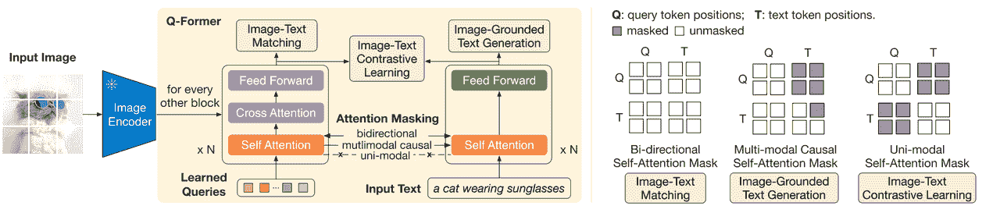

**训练阶段2**

串联上decoder-only或者encoder-decoder的LLM模型做VQA finetune

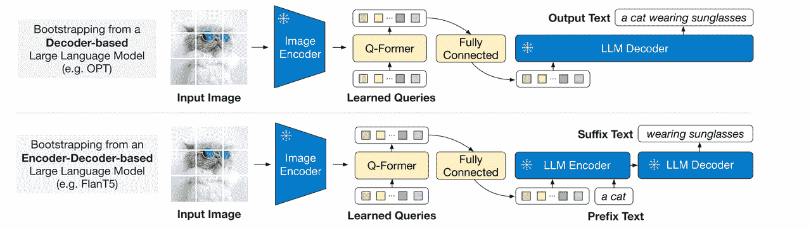

最后在各多模态任务上又霸榜一圈(不过借助了LLM，这算不算外援)

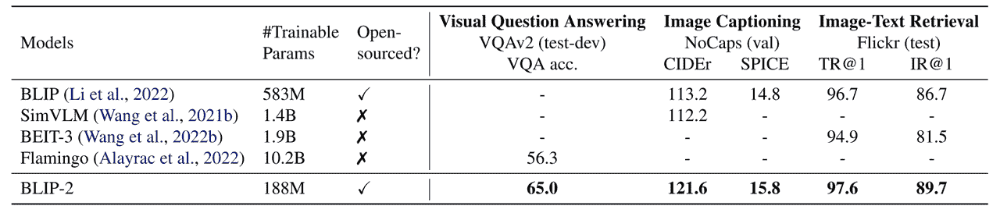

## ** 小结**

本节主要介绍了如何在同一个transformer block内融合VE，TE和MI，主要思路是Multiway Transformer方法

+   VLMO首次提出MoME，不同模态通过FFN的不同expert来表达

+   BLIP整合了ALBEF和VLMO，也使用共享模块，并且加上了decoder-only的文本生成能力，使用CapFilt模块做数据清洗和过滤，能稳定涨点

+   BEiTv3跟VMLO高度相似，把VE完全看成了NLP的一种外语，Pre-train阶段loss精简成只剩下mask-and-predict的范式，无论是image还是text，都用完形填空的方式做预训练

+   BLIP2引入了32个可学习的query token，对图片的信息进行了压缩抽取，借助预训练的LLM(如OPT/T5-FLAN)模型，实现了VQA问题效果的巨大提升

# ** 大一统Stage3: ****范式****统一**

个人认为，多模态的终极形态应该是支持任意多模态输入，任意多模态输出。一种解决思路就是把所有模态变成token序列，统一建模成seq2seq任务。

从Stage1和Stage2可以知道，多模态的输入统一成token seq基本已经实现了，无论是image还是video，都可以通过patch partition的方式变成patch token，剩下要解决的就是输出模态表征为token seq。具体来说，需要对Image, Video, Text, Sparse(少量离散的位置坐标), Dense(深度图或者分割图)进行token序列化，这里的

+   Image、Video和Dense。可以通过AIGC技术把输出token seq变成稠密矩阵。AIGC技术细节将在下一篇《AIGC组成原理》中做展开介绍

+   Text。天然是token seq

+   Sparse。通过坐标离散化编码成token seq

这里对Sparse的编码可能比较陌生，因此先介绍一下pixel2seq工作

## ** Pixel2seq**

pixel2seq尝试把传统OD问题建模成了输入是图片像素pixel，输出是token seq预测问题

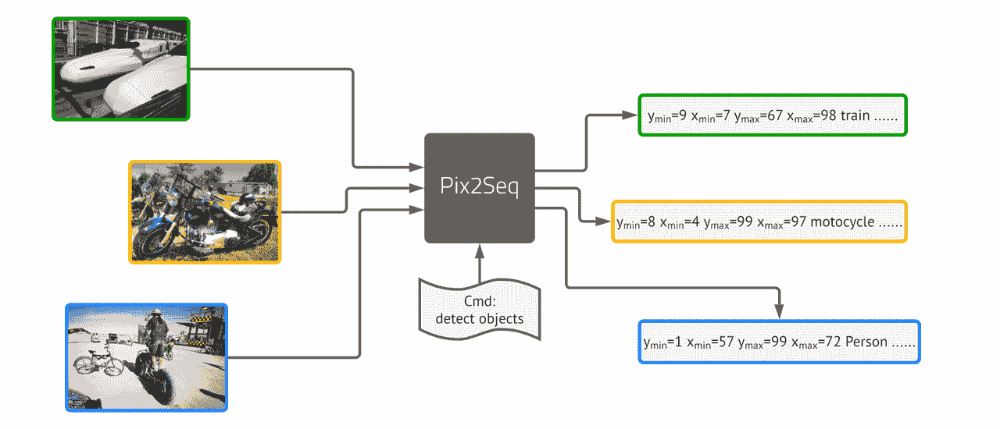

+   把每个object框建模为长度为5的序列，形式为

+   4个corner坐标均匀离散化成 ，需要 个token。例如600x600的图片， 可以做到无损表征

+   每个类别 用一个token表示，需要 个token

+   一共需要 种token

+   网络使用encoder-decoder的方式，其中decoder使用casual mask保证只能看到历史的token序列

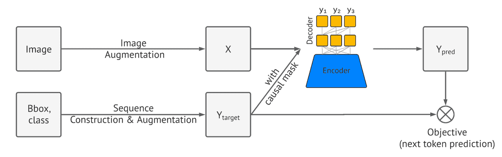

## ** Unified-I**

当我们对Image, Video, Text, Sparse和Dense模态都转换成了token seq之后，统一的IO框架就呼之欲出了，如下所示

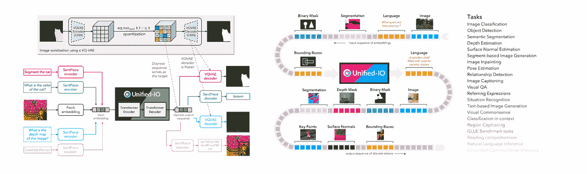

常见的多模态任务都可以通过prompt指令来执行，如下展示了常见任务输入和输出模态的类型组合

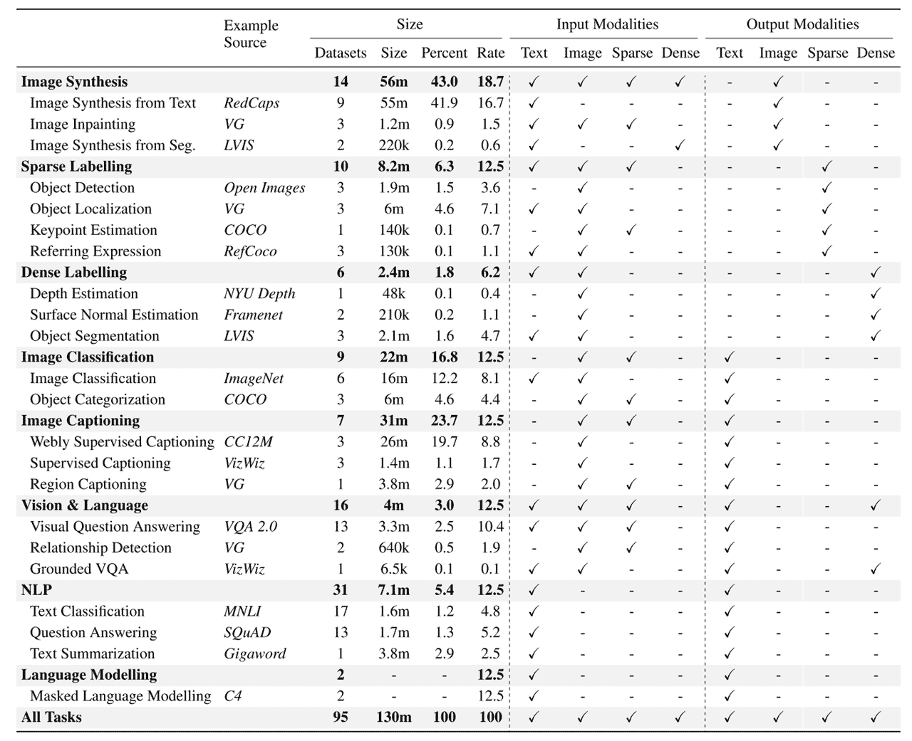

## ** 小结**

Stage3的范式统一还处于蓬勃发展中，演变过程其实并行于Stage1和Stage2，并没有严格的先后逻辑关系。Unified-IO只是代表了一种发展方向，即用seq2seq统一多模态。还有很多其他优秀的工作例如MetaLM，Uni-Perceiver，PaLi等，篇幅所限就不逐个展开了。

# ** 写在最后**

本文一共分了5个小节

+   首先介绍了Vision Transf[ormer的入门知识和相](https://arxiv.org/abs/2010.11929)关的应[用。包括了ViT(202](https://arxiv.org/abs/2111.06377)0[.10)，ViT-22B(](https://arxiv.org/abs/2106.08254)2[023.02)，Swin Tr](https://arxiv.org/abs/2208.06366)ansformer(2021.08)，MAE(2021.11)，BEiT(2021.06)，BEiTv2(2022.08)，TimeSFormer(2021.02)，BEVFormer(2022.03)。

+   接着介绍了多模态任务、训练评测数据集和评测方法。包括了Video Action Recognition任务，Image Text Retrival任务，Image Caption任务，Visual QA任务，Visual Reasoning任务，Visual Entailment任务。

+   开[始介绍多模态大一统的Sta](https://arxiv.org/abs/1803.08024)g[e1，模块独立。从TE，V](https://arxiv.org/abs/2103.00020)E[和MI三个模块的复杂度关系](https://arxiv.org/abs/2212.00794)入[手，列举了4种类型的网络结](https://arxiv.org/abs/2102.03334)构[，包括了SCAN(2018.](https://arxiv.org/abs/2107.07651)0[3)，CLIP(2021.](https://arxiv.org/abs/2205.01917)02)，FLIP(2022.12)，ViLT(2021.02)，ALBEF(2021.07)，CoCa(2022.08)。

+   [继续介绍多模态大一统的St](https://arxiv.org/abs/2111.02358)age2，模块共享。VLMO(2021.11)[开启了TE，VE和MI三个](https://arxiv.org/abs/2201.12086)模[块共享transformer ](https://arxiv.org/abs/2208.10442)b[lock的先例，启发了后续B](https://arxiv.org/abs/2301.12597)LIP(2022.01)，BEiTv3(2022.08)和BLIP2(2023.01)等工作

+   最后介绍了多模态大一统的Stage3，范式统一。这是一个仍然蓬勃发展的方向，以个人见解列举了Pixel2seq(2021.09)和Unified-IO(2022.06)的范式统一方法。

预告：计划下一篇为《AIGC组成原理》，敬请期待。

PS：由于笔者小A并没有亲手撸过上述内容的所有细节，大部分是通过研究代码和精读优秀文章的方式bottom-up总结而来，本质上是个拾人牙慧的知识搬运工，所以终究是纸上谈兵。因此希望各方有实际经验的大佬猛锤，思维碰撞才生火花，真理越辩越明。

**如果想****了解tra****nsfo****rmer在N****LP/****多模态/AIGC的算法知识，分布式训练的**知识，以及如何在TVM上做PTQ量化和部署，可以关注我aaronxic哟~

# ** 系列文章导览**

+   [（1）Perplexity指标究竟是什么?](https://ywh1bkansf.feishu.cn/wiki/E1pjwy9OMirKTdkFQDEcDDlfnTh)

+   [（2）初探LLM基座模型](https://ywh1bkansf.feishu.cn/wiki/UU9pwtOFtiKIqAkQiSVc3Zdun7e)

+   [（3）ChatBot是怎么炼成的?](https://ywh1bkansf.feishu.cn/wiki/HRnLw588DiTDLPkSTXCcKit8nbD)

# ** 参考资料**

+   [transformer入门 论文阅读(4) Swin Transformer | shifted window,relative position bias详解](https://zhuanlan.zhihu.com/p/507105020)

+   [ViLT 论文精读【论文精读】_哔哩哔哩_bilibili](https://www.bilibili.com/video/BV14r4y1j74y)

+   [多模态论文串讲·上【论文精读·46】_哔哩哔哩_bilibili](https://www.bilibili.com/video/BV1Vd4y1v77v)

+   [多模态论文串讲·下【论文精读·49】_哔哩哔哩_bilibili](https://www.bilibili.com/video/BV1fA411Z772)

+   [BLIP2：下一代多模态模型的雏形](https://zhuanlan.zhihu.com/p/606364639)

+   [CLIP 论文逐段精读【论文精读】_哔哩哔哩_bilibili](https://www.bilibili.com/video/BV1SL4y1s7LQ)