# （5）AIGC组成原理(上)

> 来源：[https://waytoagi.feishu.cn/docx/LRJFdisvdofXyLxPTuOc3kUWnzN](https://waytoagi.feishu.cn/docx/LRJFdisvdofXyLxPTuOc3kUWnzN)

> 作者：小A，aaronxic，[知乎个人主页](https://www.zhihu.com/people/aaronxic)

> 发表时间：2023年7月8日

> 原文地址：https://zhuanlan.zhihu.com/p/646149258


# **开篇**

大家好，我是aaronxic。前面几篇我们已经感受了transformer是如何应用在LLM和多模态领域的，从这一篇开始我们把目光转向AIGC，看看AIGC任务都是由哪些部件组装而成的。

AIGC (Artificial Intelligence Generative Content)即人工智能生成内容，这里强调的是GC部分，也就是decoder部分。

+   上一篇 [（4）多模态的大一统之路](https://ywh1bkansf.feishu.cn/wiki/ReVzwZUr0ivgWfkaQ91cXrYUnoh) 侧重的是encoder部分，包括对Image和Video的编码。对decoder的生成主要聚焦在生成text生成上

+   本篇《AIGC组成原理(上)》将介绍常见的4大类生成算法，包括了VAE、GAN、FlowModel和Diffusion Model。同时，还会介绍IS(Inception Score)和FID(Frechet Inception Distance)两种生成图片常见评价指标。

+   下一篇《AIGC组成原理(下)》将介绍具体的Image生成、Video生成、Audio生成和3D生成算法

PS: 长文预警，本篇约12000字，关注&收藏后电脑上阅读体验更加哦~ (^_^)

提纲如下，共2个章节

+   首先介绍了生成模型的本质目的，就是为了建模 分布。

+   首先是最朴素的极大似然估计，虽然简单，但是要求有明确的参数化分布形式，在实际中往往不可得

+   接着介绍4种隐变量模型，包括VAE，GAN，Flow Model和Diffusion Model。本质上用 来近似

+   VAE模型。尝试提高 采样效率，尝试最小化 ，最终得到了正则项和重建误差项

+   GAN模型。尝试对MSE的损失函数做进一步拓展，引入判别模型 来隐式学习度量方法

+   Flow Model模型。强行让 函数可逆，满足 和 的一一映射，以RevNet为例子介绍Flow Model具体使用方式

+   Diffusion Model (DDPM)。将VAE扩展到了多步，有复杂的数学推导，但是本质上跟VAE是相似的

+   DDPM的score function。换一种角度理解DDPM，发现可以用网络  来预测

+   DDIM。尝试对DDPM做采样加速，将DDPM变成了确定性的过程

+   classifier-guided。使用classifier-guided技术，首次把DDPM和DDIM的IS和FID指标拉高到GAN齐平。在推理阶段，DDPM可以直接分析 ；而对于DDIM，由于是个确定性过程，因此退化成分析

+   classifier-free。为了省去classifier-guided的梯度计算过程，classifier-free在训练中混合训练有condition和无condition的模型，使得在推理阶段无需求解梯度，在提高保真度的同时计算效率也很高

+   接着介绍了图片生成常见的两种指标

+   IS(Inception Score)指标提供了两种理解角度。IS本身有很强的先验，认为符合ImageNet的分布才是真实分布

+   FID(Frechet Inception Distance) 指标，衡量两个数据集的距离，更科学一点

# **从生成模型谈起**

假设我们有一批大小为 的真实图片数据集合，

+   如果有一个完美的分布  能生成集合 中的元素，就意味着要求每次采样出来的 都满足 。

+   当集合元素 比较小的时候， 可以强行背下来即可；但是当 变得非常大的时候，完美分布 就几乎不可能获取了。

而AIGC的任务就是逼近这个完美分布 ，这里的 可以是Image，可以是Video，可以是Audio或者3D模型

那具体如何逼近这个完美分布 呢？各类方法各显神通，下面我们就来逐个来看


## **极大似然估计**

估计分布   有个最直接的方法，就是极大似然估计。先假设   的形式为   ，然后待定其中的参数   。例如我们假设$x$来自多元高斯分布   ，即   ，其中高斯分布的维度和图片的像素个数一致。于是这里的待定参数就是   ，此时似然估计函数为

做最大似然估计，用梯度下降或者公式推导求解出最佳参数

这样就求得了   的分布为

上述方法简单直观，但是弊端也很明显：

+      形式未知。需要丰富的领域知识才能笃定   就是某个形式，其实对于复杂问题来说只有上帝才知道分布的参数化表达式是啥

+   参数量   的空间太大。多元高斯分布的维度跟图片像素数一样大，例如ImageNet是   维度，那么意味着是150528元高斯分布，那得需要多少海量的数据才能估计得准确呀

## **隐变量估计**

为[了解决上](https://lilianweng.github.io/posts/2021-07-11-diffusion-models/)述两个问题，更加广泛使用的方式是隐变量估计法，目前生成模型主流的4大类方法本质上都是生成模型，如下所示。原图出处

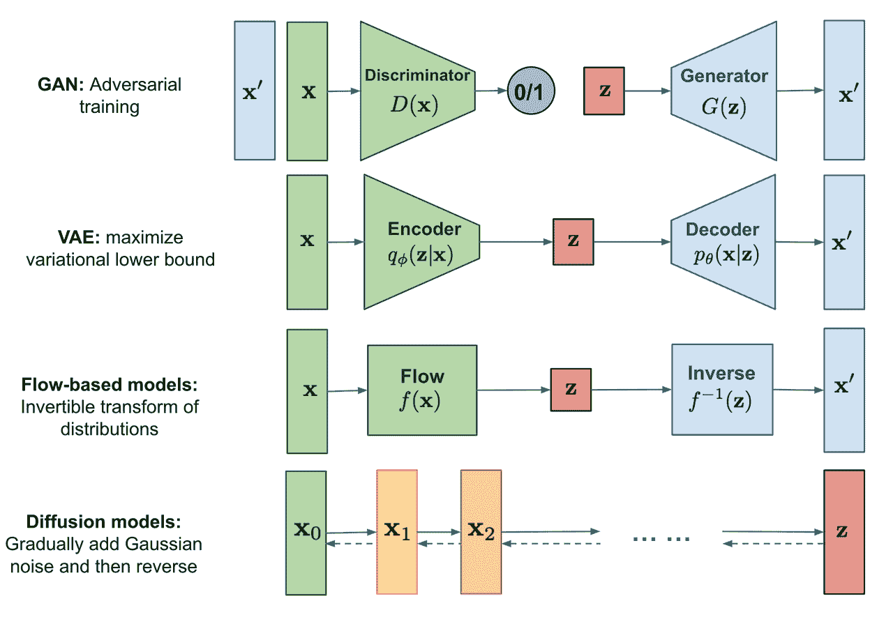

在介绍上述4种方法之前，我们先深入了解一下隐变量模型是什么。

隐变量模型顾名思义，就是引入隐变量   ，期望从简单的分布   出发，用积分公式来间接求出复杂的

这里值得注意的是

+   **简单**满足两个性质。

+      分布表达式简单，例如是普通的多元高斯分布

+      自由度低，例如对于多元高斯分布，维度为   ，其中

+      可以是个确定性的过程    ，即   ，   用神经网络来表示

+   有了万能拟合函数   ，那么从简单分布   生成任意分布   过程为

+   Step1: 假设想得到   的概率，那么就先研究   找到所有   使得

+   Step2: 假设   的解集合为   ，则把这些   出现的概率全部加起来就是   出现的概率，即可以得到

但是要找到Step2里面   的解集合是很难的，所以虽然   很简单，   是个确定过程，但由于   不一定可逆，   仍然很难直接算出表达式。

我们能做的是数值模拟的方式采样出   ，常用的为蒙特卡洛方法

+   首先依    的分布采样   次   ，得到数组   ，其中

+   根据   计算得到数组

+   注意如果   概率更高，那么   出现在   的次数会越多，相应的   出现在   的概率就会高

+   只需要简单对   取均值即可得到本次采样最终的

蒙特卡洛方法虽然简单，但是也有2个可改进方向

+   提高采样效率。这里的   可能需要非常大才能得到对应满意的结果，也就是生成**一个   需要**很多次   的采样。因此一种思路是提高   的采样效率，最好采样一次就能完成任务  (VAE方向)

+   损失误差不用均方误差MSE。在实际网络训练中，上述蒙特卡洛采样过程，每次得到的   会启发式地和真实图片   做MSE。但没有证据**表明MSE就是**最优度量，因此另外一种思路是用神经网络   来隐式学这个度量方式 (GAN方向)

## **VAE**

观察隐变量的积分式

如何提高   的采样效率呢？一种思路是用   来估计   ，原因是有了   的信息，   怎么着都应该变得确定一点吧。这里研究的变量是   ，因此   是先验分布，   是后验分布。

但即便如此，无中生有出   会陷入鸡生蛋和蛋生鸡的窘境，我们需要一个具体可优化模型来逼近   ，于是引入新的概率分布   。思路逐渐清晰了

+   Step1：先想办法构造一个新的分布    ，使得

+   Step2：然后不断优化   靠近   ，使得最终近似满足

引入的    是一系列的分布家族，并且需要在里面做优化，选择最合适的    分布，这个过程就是变分。

下面我们用KL衡量一下这两个分布的差距

可以看到，通过变分我们绕过了虚无缥缈的   ，留下的3项都是可以分析的对象。

下面我们逐项分析：

+   明确目标是希望左侧的KL距离越来越小，并且要重点关注   要怎么变才能逼近

+   右边第一项   ，希望尽可能小，也就是新引入的采样过程得到的   不能离原来的标准多元高斯分布假设   太远。我们是希望   的方差变小，而不是完全变个样。这个不就是正则项要尽可能小嘛

+   右边第二项     ，希望尽可能小，也就是     要尽可能大，含义就是每张图的似然   在所有   采样中要尽可能解释观测数据 $x$，这个不就是重建误差要尽可能小嘛

+   右边第三项   ，是个跟    没啥关系的常数，不随    变化而变化，忽略

上式也常常写成如下形式

要最大化$p(x)$，只需要不断提高VLB(Variational Lower Bound)即可，即最大化VLB

由上我们知道了第一项就是正则项，第二项就是[重建误](https://spaces.ac.cn/archives/5253)差，整个VAE的网络呼之欲出，魔改苏老师的图，如下所示

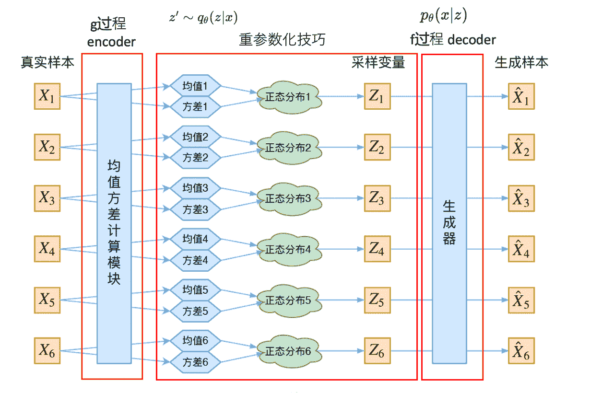

+      过程是采样过程。而神经网络g是个确定性过程，本身没有随机性，因此为了让网络参数可学习，需要引入重参数化技巧。拿图中各分量独立的多元高斯变量举例

+   g过程直接预测每个维度的均值   和方差   ，然后叠加随机数发生器   ，得到采样结果

+   每个维度   都操作完之后得到

+   所有   组成   ，所有   组成   ，则

+      过程是个确定性过程，当   被采样出来之后，直接调用decoder网络就能得到重建的

对VAE网络有了认识，我们再回到VAE网络的loss上来，包含两项：

+   最小化正则项。从    转为   ，有闭式解，即最小化

+   最小化重建误差项。     可以转换为要求   和    的MSE的值尽可能小，即最小化

最终VAE网络的loss如下

模型收敛之后

+   把encoder网络丢弃

+   每次按标准多元高斯分布采样$z$，然后经过decoder网络输出   ，完成一次采样

## **GAN**

让我们重新回到梦开始的地方，再看看隐变量模型

前面说到VAE的思路是提高   采样效率，参数化后验分布    ，引入数据依赖直接得到均值   和方差   ，使得

而原始GAN的思路是保留   是固定的标准多元高斯分布，额外引入新网络   对生成的   和真实的   做分类，而不是像VAE一样用固定的MSE损失函数

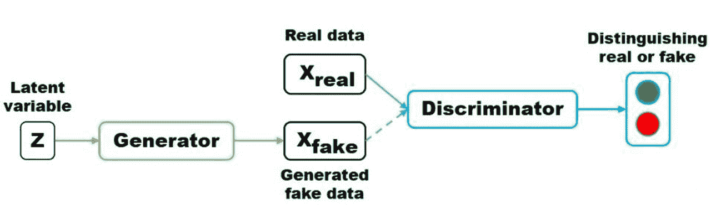

GAN的数学化表达如下，公式直观，但是背后蕴藏了非常多玄机，[对GAN的性质和优](https://zhuanlan.zhihu.com/p/25071913)化感兴趣的建议阅读这篇关于WGAN的文章

## **Flow Model**

我们接着介绍第三种生成模型Flow Model，还是从隐变量模型说

前面介绍了如何用神经网络   来表示   来建立   和   的关系，方法如下

+   Step1: 假设想得到   的概率，那么就先研究   找到所有   使得

+   Step2: 假设   的解集合为   ，则把这些   出现的概率全部加起来就是   出现的概率，即可以得到

但我们知道，想得到Step2里面   的解集合是很难的，所以虽然   很简单，   是个确定过程，但由于   不一定可逆，   仍然很难直接算出表达式。于是退而求其次，不求   的表达式了，只求蒙特卡洛的方式能采样出   就好

但如果，我们就是想硬上求出表达式呢，其实也可以，只是需要满足

+      函数是可逆的，即知道了   ，那么容易推导出来

+   因此   是一一映射的，同时   和   要求是维度一样的，如果   那么

+   既然   是一一映射的，也用不着积分了，直接变量替换

变量替换后概率密度如下

可见除了要求   可逆，还要求逆函数   的行列式计算也要简单

贯彻了flow model理念的代表作有RevNet (Reversible Network)，可逆网络，如下所示

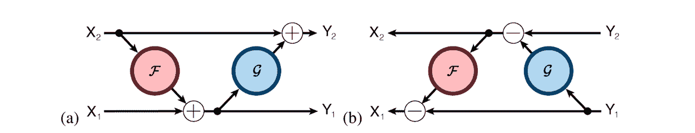

+   输入是   ，输出是

+   把   分成两部分   和   ，把   也分成两部分   和

+   输入和输出tensor shape一样的函数   和

那么可以计算前馈和反传

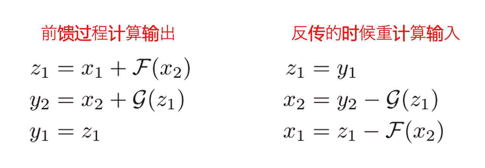

主要这个跟省显存的技术checkpointing不一样

+   checkpoint是通过更浅层的输入重计算当前层输入

+   RevNet是通过当前层的输出直接算出当前层的输入

有了当前层的输入，接着就可以正常求梯度了。完整的梯度回传公式如下

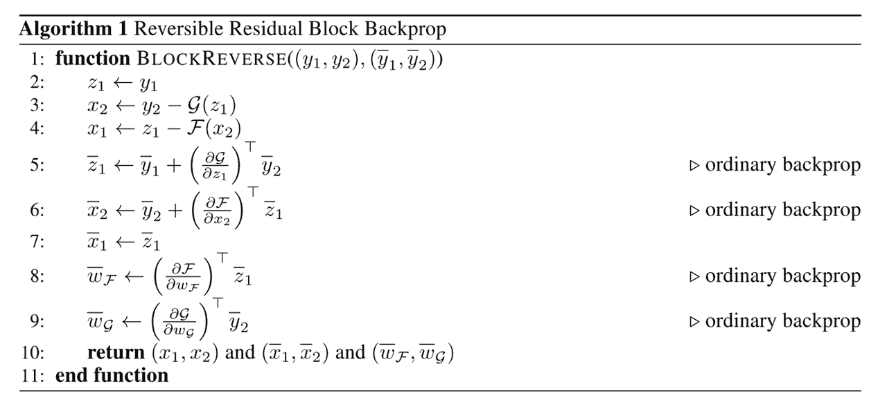

## Diffusion Model (DDPM)

最后我们看看近几年爆红的以DDPM为代表的Diffusion Model，继续回到隐变量模型

回想VAE的思路是提高$p(z)$采样效率

+   encoder。用参数化的后验分布模型    ，直接预测均值   和方差   ，使得

+   decoder。采样得到   之后，经过参数化的   生成最后的

如果   不是一步生成的，而是经过   步会怎么样呢，即encoder为

同理decoder可以变成

如下所示，这个就是diffusion model的思想，但跟VAE也有很大不同

（PS: 符号变换一下，   变成了   ，   变成了   ）

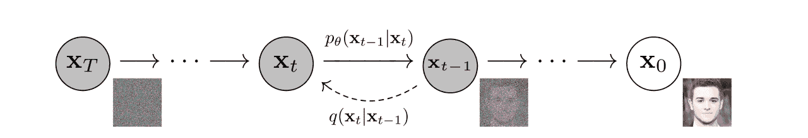

+   从右往左的encoder是无参数的   。不像VAE是带超参数的，这是个人为定义的过程，从原始清晰图   开始，每次转换成新的高斯噪声，逐渐变成标准多元高斯变量   。

+   从左往右的decoder是带参数的     。不是像VAE一样直接预测   ，而是预测高斯噪声，并且会减去这个高斯噪声得到更清晰的图片

+   另外中间隐变量   的维度变成了跟原始图片   一样大

**encoder过程**

首先定义递增的常量序列   ，满足

定义观测原图为随机变量   ，然后定义从随机变量   到随机变量   的分布关系为

即   是均值   且方差为   的高斯分布，用类似重参数分解可以得到

对于公式(2)有以下一些解释

+       和    前面的两个系数平方和等于1

+      单调递增且   ，则可以保证   时候方差几乎为0，   时方差几乎为1

如果定义

+      。为了书写方便

+        。为了书写方便

+      。代表   个高斯分布合并之后的新高斯分布

那么递推展开可以得到

注意

+   这里用了方差的性质，即两个高斯分布的和还是高斯分布，并且新方差等于这两个高斯分布的方差

+      是   个高斯分布合并之后的新高斯分布

+      和   前面两个系数的平方和仍然是1

观察公式(6)里的$x_t$可以发现

+   随着   ，   且   ，因此   ，逐渐变成标准高斯分布，极端情况下

+   不仅     可以直接计算，并且   也可以直接计算

+   整个encoder过程的是完全透明的，可以高效的计算中间任意分布   的方式

**优化目标**

[有了enco](https://lilianweng.github.io/posts/2021-07-11-diffusion-models/)der过程后，接下来寻找优化目标。我们有两种推导方式

+   方法1：最小化        （跟前面VAE一样）

+   方法2：最小化CE损失

殊途同归，发现都是要最小化

+      可以用贝叶斯公式求得

+        是   的参数化建模，假设也符合高斯分布，只需关注均值和方差即可

**分析 **** **** **

使用贝叶斯公式

惊喜地发现每个   代[表的是高](https://www.notion.so/classifier-guidance-5c758f6bf4fb477d8fd7528b1ba70ca1?pvs=21)斯函数的密度函数，因此可以带入得到    的密度函数，并且也是高斯分布。此时是可以用待定系数的方式 推导求出    的均值   和方差   的，如下所示

把式中的   代换掉，可以得

观察分析方差公式   ，其实有好几种选择

+   选择1：    和    是通过预先设置   直接计算而来，运算结果是常量

+   选择2：DDPM里面进一步发现可以简化成

+   选择3：Improved DDPM里面发现也可以设置成可学

这里我们使用第2种选择   ，因此

**分析**

由于已经假设     是高斯分布且满足

那么当我们计算两个高斯分布的KL散度，利用现成结论公式可以得到

DDPM的贡献点之一，就是发现与其让网络输出 $\mu\theta(x_t, t)$预测$\mu_t(x_t, x_0)$ ，不如让网络输出    预测    。    和   关系如下

于是终于得到了最终的Loss表达式

于是终于得到了最终的Loss表达式

这里     是个U-Net网络，并且时间步   需要做embedding灌入网络

**训练&推理过程**

因此训练方式呼之欲出，引用DDPM的原始paper伪代码

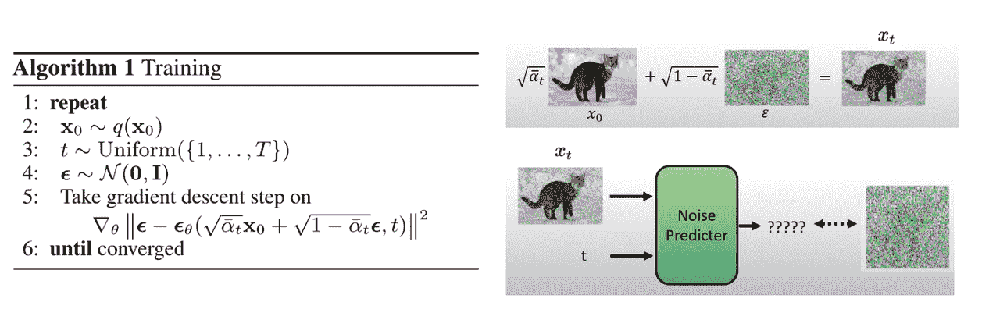

+   训练的时候只从   步里面随机抽取一步来算，这归功于   只需要   就能直接算出的良好性质

+   line2-3: 从数据集随机抽取一张图片   ，同时随机选择一个时间步

+   line4: 从标准高斯分布里面采样一个值，当做   表达式中由   个高斯分布合并的新分布   的采样结果

+   line5: 按照上面MSE的loss的来求梯度，并且做梯度更新

相应的推理过程如下所示

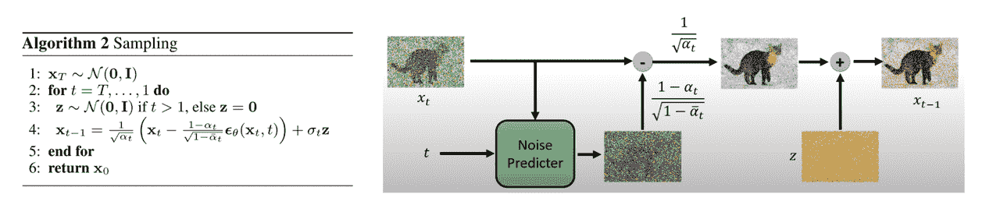

+   跟VAE一样，训练完就扔掉encoder，然后从标准高斯分布开始采样，然后经过   步递推产生

+   line1：从   开始，从标准高斯分布采样

+   line2-5，   从   不断递减，直到

+   每一步decoder输入为   和   ，神经网络先预测出噪声

+       的均值按    的公式计算出

+      的方差   可以按前面的   公式计算出来。直接用   效果也不错，总之不需要神经网络预测

+   然后从高斯分布     里面采出样本作为

+   这里[（3）ChatBot是怎么炼成的?](https://ywh1bkansf.feishu.cn/wiki/HRnLw588DiTDLPkSTXCcKit8nbD)易造成困惑的是生成过程每一步为什么还需要采样   ，直接高斯分布的均值不行吗？个人理解这类似于ChatGPT里面推理的top-p核采样 (忘记的同学可以参考  ，需要引入一定的随机性，最后的效果反而更好

DDPM推导非常多，我们梳理一下核心逻辑

+   首先建模encoder过程为清晰图   到标准高斯分布   的扩散过程，相应的decoder过程为标准高斯分布   到清晰图   的采样过程。我们最后需要的是decoder过程。

+   定义单调递增的序列   ，并定义   的递推表达式

+   利用递推式可以求出encoder的每一步   的分布

+   利用贝叶斯公式可以求出分布    ，并且满足

+   变分分析得出最终的优化loss目标为

+   设置     为高斯分布，并且满足

+   带入    求解，化简表达式，最终发现网络预测噪声    来逼近   即可

## 从Score Function理解DDPM

**energy function**

对于任意分布   ，没法直接以   维输入和1维输出的神经网络拟合，原因是要求

但是如果做了如下变换后，发现   几乎没有任何约束了

此时虽然引入了归一化分母   ，但是如果我们取对数并且对   求导，则

惊奇地发现    不见了，这里的    就是energy function，是个自由函数

**score function**

进一步观察，发现   是让   概率最大化的前进方向，是个向量场，向量指向最大值的前进方向

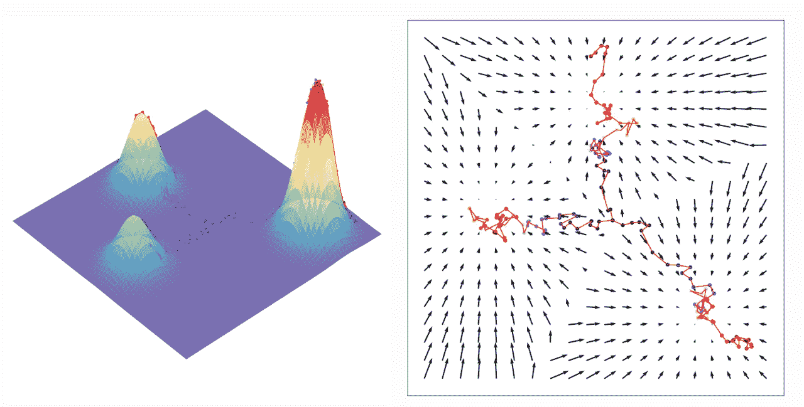

此时如果定义    ，并且要求    去直接拟合   ，即最小化

当模型收敛的时候，    形成的向量场，沿着    行走就能找到   的最大值。这里的   就是   的score function

**DDPM的另外一种理解**

DDPM跟score function会有什么关系呢？

考虑高斯分布   ，当我们有了   的观测之后，对于均值   的期望满足Tweedie’s Formula

回想DDPM里面   ，因此

另外知道   的最优估计就是   的均值，即

因此   可以用   表示出来

将   带入求   的公式(7)，可以得到

到了这里，跟前面DDPM的 $\epsilon\theta(x_t, t)$$\bar{\epsilon}t$ 类似，这里可以用    来拟合    ，即

训练完成后。在推理采样的时候，先得到   之后，然后计算

然后采样得到

因此我们得到了另外一个理解DDPM的角度，就是用网络    来预测    ## DDIMDDIM的出发点是希望能缩减采样次数。观察DDPM的递推公式

DDIM开了两个脑洞- 脑洞1：把高斯分布    拆成两个高斯分布    和   的和- 脑洞2：无中生有   ，通过   和    估计   ，并用在    求解上

如果让U-Net网络学习    ，即    ，则可得到最终表达式

可见每一次递推，先根据   和本次的方差估计    推出   ，然后再正向推出    注意这里的方差为   ，回想原来DDPM里面的方差为

因此要方差可比的话

可见要求   非负。如果   就变成确定性过程，这个就是DDIM。即

因此DDIM主要把reverse过程变成了确定性过程，并且缩减了采样次数## Classifier-GuidedDDPM和DDIM生成**的图片虽然视**觉上效果还可以，但是在FID等指标上一直比不过GAN，直到出现了Classifier-Guided的方法，本质上是牺牲了一定的多样性，提高了保真度。DDPM过程我们想知道DDPM中加入了标签   之后会对   的生成有什么影响，注意此时模型的encoder过程不变。从   原始定义出发，贝叶斯公式展开，最终可以得到下列公式

推导Hint如下-    与    独立，因此     -    取值对给定的图而言是确定的，因此    左右取对数，对   添加尺度因子   ，可得

进一步分析（完整推导见[文章](https://sunlin-ai.github.io/2022/05/30/guided-diffusion.html)）-      项。从DDPM中知道是个高斯分布，可以通过    求出均值    ，因此     可以用概率密度写出-     项。在    做泰勒展开最终表达式为

最终推理方式如下所示，本质上是对均值做一下修正

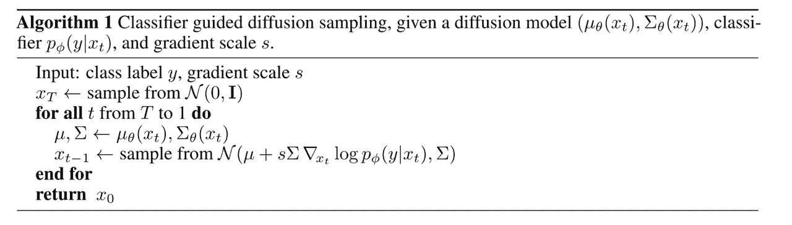

**DDIM过程**

由于DDIM是个确定性过程，    是个确定性映射过程，不是分布。目标对象从    退化成了   。根据贝叶斯公式

两边取对数，并且对   求导数（注意   不能由   表出，因此   导数为0）

对   加入尺度因子，方便做标签强度调整

从[论文结论](https://arxiv.org/abs/2105.05233)可知，借助score function的结论

于是代入整理可得，并且对概率进行参数化（这里   就是分类器）

整理可以得到

在求出    之后，用分类器的梯度对其修正，求出    后替换原始的   。然后再代入DDIM的递推公式中。完整Classifier guided DDIM算法如下

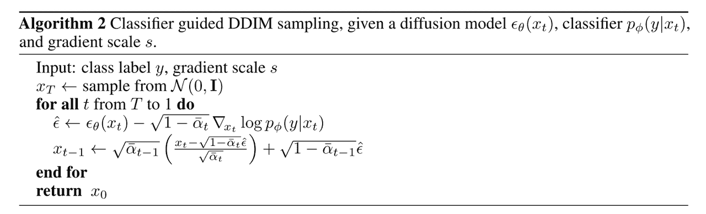

## Classifier-freeguidance

训练虽然能提高保真度，但是问题很多- 但是无论是DDPM还是DDIM的推理过程，每一步都需要计算梯度，操作很贵- classifier本身是扛噪音输入的特供版，需要重新训练，例如noisy-CLIP模型能否既得到高保真度结果，又能在推理时免去梯度计算呢？guidance-free应运而生，本质是在训练阶段就想办法提高模型的能力，免去了推理时候的梯度计算。网络首先把condition吃进来，注意这个condition要跟数据相关，例如- 分类的话就是待生成图片的类别- 文生图的话就是文字的embedding训练阶段随机概率把输入condition置为空，即概率性     推理采样阶段，用下面公式做采样

其中   为引导强度，一般认为   会使生成往有condition和无condition差异比较大的方向走，引导强度越大，越牺牲多样性提高保真度。这里的   也可以换成其他condition。

## 小结

**生****成****模**型背后有大量的数学原理，本质上想解决如何生成   的问题，各类方法总结如下

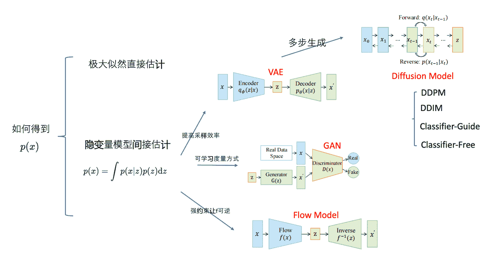

# AIGC评价指标

生成的多模态内容往往包含很强的主观色彩，因此评价相对比较困难，本节我们介绍常见额两种图片生成质量指标，IS(Inception Score) 和 FID (Frechet Inception Distance)

## IS指标

Inception Score (IS) 是个非常启发式的指标，本质上利用“Inception网络对于真实图片有很好的判别能力”这个特性而设计得到的，理解这个指标有两个角度，一个是互信息角度，一个是KL散度角度。符号定义如下-    是个随机变量，由图片生成网络   产生。假设   生成的图片集合为   ，   生成图片的分布为   ，则   且

+      是个随机变量，取值离散集合为     。假设inception网络经过softmax后1000分类的概率向量为   ，则   且

我们可以从两个角度理解这个指标，互信息角度和KL散度角度。

**互信息**

首先从互信息角度考虑，考察互信息   ，衡量的是两个随机变量   和   的依赖情况

+   情况1：如果   是随机噪声图片，那么   的信息对决定   没有任何帮助，   和   完全独立不相关，则

+   情况2：如果   就是ImageNet的图片全集，那么只要   就完全能决定   的分布，两者完全相关，此时    应该取到最大值

由此我们知道，   跟   的真实程度有一定的正相关性。如果我们继续分析   ，想知道最大的    应该满足什么条件。可以通过互信息公式得到

如果想最大化这个指标，那么

+   多样性: 最大化第一项    ，如果   的分布越均匀，多样性越大，不出现模态坍缩，   才能越大，当   为均匀分布的时候

+   清晰度： 最小化第二项   ，即代表给定图片   后的标签   的熵，分布越尖峰，越接近one-hot，    才能越小

由上我们知道   的最大值为

**KL散度**

换一个角度，考察KL散度，给出IS的标准定义

这个式子看起来很复杂，但是其实通过数学推导会发现等价于上述的   ，完整推导如下

因此可以得到

**计算代码**

条件假设

+   假设我们选取了   张图片，分别为

+   将这N张图喂入inception网络，得到输出的softmax概率tensor为

+      相当于   ，即第   张图的第   个label的概率值

+      ，看成均匀分布

+   边缘分布重新写成条件概率求和的方式

因此可以得到可计算的IS表达，如下所示

至此终于可以把所有   用   来替换了，即

最终代码如下 (一般切分多个splits来计算，计算均值和方差)

```
def calculate_inception_score(z_preds, splits=10):
    # z_preds: (N, 1000)
    scores = []
    for i in range(splits):
        slice_start = i * z_preds.shape[0] // splits
        slice_end = (i + 1) * z_preds.shape[0] // splits
        part = z_preds[slice_start:slice_end, :]
        kl = part * (np.log(part) - np.log(np.mean(part, 0, keepdims=True)))
        kl = np.mean(np.sum(kl, 1))
                kl = np.exp(kl)
        scores.append(kl)
    return np.mean(scores), np.std(scores)
```

## **FID指标**

指标Frechet是个人名，法国数学家，提出了Frechet Distance概念。

Frechet Inception Distance(FID)指标计算过程如下

+   给出了生成图片集合   和真实图片集合   ，集合大小分别为   和

+      和    经过Inception v3得到对应feature集合   和

+   将   和   分别看成是来自于某分布   和   的样本点，   和   分别是   的均值和协方差，同理   和   分别是   的均值和协方差

+   在   和   是多元高斯分布的假设前提下，按照FD定义可以求解得到

提供一些个人直观理解

+   FID是衡量生成图片和真实图片的距离，数值越小越好

+   FD指标数学定义比较复杂，也叫2-Wasserstein距离，跟最优传输理论相关

+   FD指标本身是个下界值[，含义可](https://en.wikipedia.org/wiki/Wasserstein_metric)以理解为，把概率分布   投射到概率分布   的解期望传输代价最小值，详细数学定义见wiki

计算FD指标的代码如下

```
import numpy as np
from scipy import linalg

def calculate_frechet_distance(feat_G, feat_R, eps=1e-6):
    # feat_G: (N, D)
    # feat_R: (M, D)
    mu1, sigma1 = np.mean(feat_G, axis=0), np.cov(feat_G.T)
    mu2, sigma2 = np.mean(feat_R, axis=0), np.cov(feat_R.T)
    diff = mu1 - mu2

    # product might be almost singular
    covmean, _ = linalg.sqrtm(sigma1.dot(sigma2), disp=False)
    if not np.isfinite(covmean).all():
        offset = np.eye(sigma1.shape[0]) * eps
        covmean = linalg.sqrtm((sigma1 + offset).dot(sigma2 + offset))

    # numerical error might give slight imaginary component
    if np.iscomplexobj(covmean):
        if not np.allclose(np.diagonal(covmean).imag, 0, atol=1e-3):
            m = np.max(np.abs(covmean.imag))
            raise ValueError(&quot;Imaginary component {}&quot;.format(m))
        covmean = covmean.real

    tr_covmean = np.trace(covmean)

    return diff.dot(diff) + np.trace(sigma1) + np.trace(sigma2) - 2 * tr_covmean
```

## **小结**

+   IS指标计算有很强的先验，认为符合ImageNet的分布才是真实分布

+   FID指标衡量两个数据集的距离，更科学一点

# **写在最后**

本文一共分了2个小节

+   首先介绍了生成模型的本质目的，就是为了建模   分布。

+   首先是最朴素的极大似然估计，虽然简单，但是要求有明确的参数化分布形式，在实际中往往不可得

+   接着介绍4种隐变量模型，包括VAE，GAN，Flow Model和Diffusion Model。本质上用   来近似

+   VAE模型。尝试提高   采样效率，尝试最小化   ，最终得到了正则项和重建误差项

+   GAN模型。尝试对MSE的损失函数做进一步拓展，引入判别模型   来隐式学习度量方法

+   Flow Model模型。强行让   函数可逆，满足   和   的一一映射，以RevNet为例子介绍Flow Model具体使用方式

+   Diffusion Model (DDPM)。将VAE扩展到了多步，有复杂的数学推导，但是本质上跟VAE是相似的

+   DDPM的score function。换一种角度理解DDPM，发现可以用网络    来预测

+   DDIM。尝试对DDPM做采样加速，将DDPM变成了确定性的过程

+   classifier-guided。使用classifier-guided技术，首次把DDPM和DDIM的IS和FID指标拉高到GAN齐平。在推理阶段，DDPM可以直接分析   ；而对于DDIM，由于是个确定性过程，因此退化成分析

+   classifier-free。为了省去classifier-guided的梯度计算过程，classifier-free在训练中混合训练有condition和无condition的模型，使得在推理阶段无需求解梯度，在提高保真度的同时计算效率也很高

+   接着介绍了图片生成常见的两种指标

+   IS(Inception Score)指标提供了两种理解角度。IS本身有很强的先验，认为符合ImageNet的分布才是真实分布

+   FID(Frechet Inception Distance) 指标，衡量两个数据集的距离，更科学一点

预告：计划下一篇为《AIGC组成原理(下)》，将介绍具体的Image生成、Video生成、Audio生成和3D生成算法，敬请期待。

PS：由于笔者小A并没有亲手撸过上述内容的所有细节，大部分是通过研究代码和精读优秀文章的方式 bottom-up 总结而来，本质上是个拾人牙慧的知识搬运工，所以终究是纸上谈兵。因此希望各方有实际经验的大佬猛锤，思维碰撞才生火花，真理越辩越明。

**如果想了解transformer在NLP/多模态/AIGC的算法知识，分布式**训练的知识，以及如何在TVM上做PTQ量化和部署，可以关注我aaronxic哟~

# **系列文章导览**

+   [（1）Perplexity指标究竟是什么?](https://ywh1bkansf.feishu.cn/wiki/E1pjwy9OMirKTdkFQDEcDDlfnTh)

+   [（2）初探LLM基座模型](https://ywh1bkansf.feishu.cn/wiki/UU9pwtOFtiKIqAkQiSVc3Zdun7e)

+   [（3）ChatBot是怎么炼成的?](https://ywh1bkansf.feishu.cn/wiki/HRnLw588DiTDLPkSTXCcKit8nbD)

+   [（4）多模态的大一统之路](https://ywh1bkansf.feishu.cn/wiki/ReVzwZUr0ivgWfkaQ91cXrYUnoh)

# **参考资料**

+   [AIGC的一些记录](https://zhuanlan.zhihu.com/p/615522634)

+   从零推导：变分自编码器（VAE）

+   [变分自编码器（一）：原来是这么一回事 - 科学](https://spaces.ac.cn/archives/5253)空间|Scientific Spaces

+   [细水长flow之NICE：流模型的基本概念与实现 - 科学](https://spaces.ac.cn/archives/5776)空间|Scientific Spaces

+   [生成扩散模型漫谈（一）：DDPM = 拆楼 + 建楼 - 科学](https://spaces.ac.cn/archives/9119/comment-page-1)空间|Scientific Spaces

+   What are Diffusion Models?

+   [扩散模型之DDPM](https://zhuanlan.zhihu.com/p/563661713)

+   PyTorch 32.Gumbel-Softmax Trick

+   [[](https://sunlin-ai.github.io/2022/05/30/guided-diffusion.html)论文理解] Diffusion Models Beat GANs on Image Synthesis

+   [谈谈扩散模型的损失函数](https://zhuanlan.zhihu.com/p/629334231)

+   哪位大神解释下inception score？ - 知乎

+   [GAN的评价指标IS和FID_fi](https://blog.csdn.net/jackzhang11/article/details/104995524)d评价指标_汐梦聆海的博客-CSDN博客

+   互信息 - 维基百科，自由的百科全书

+   IS、FID、PPL，GAN网络评估指标

+   Fréchet inception distance

+   令人拍案叫绝的Wasserstein GAN